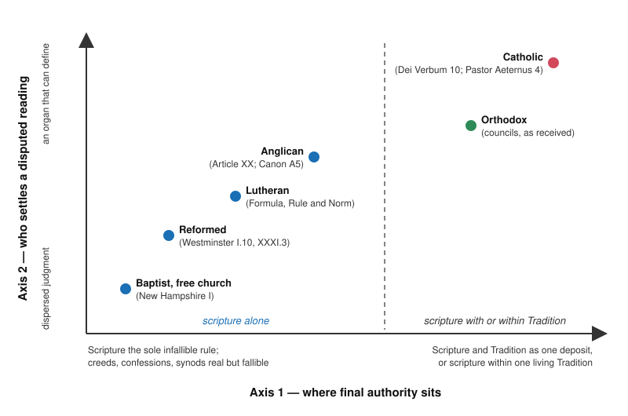

# Apologetics II · Lesson 1.1: Shared ground, and where the argument actually is

> ⏱ ~15 min · Module 1: Arguing among Christians · Builds on: [`apologetics-foundations` 1.1](../../apologetics-foundations/lessons/01-01-what-apologetics-is-and-what-it-isnt.md), [the ladder](../../fundamental-theology/lessons/04-04-the-ladder-of-doctrinal-authority.md) · Unlocks: [1.2](01-02-what-the-church-says-about-other-christians.md), [1.3](01-03-arguing-from-history-without-abusing-it.md), [2.1](02-01-sola-scriptura-at-its-best.md)

## Why this matters

Ask a Catholic, a Lutheran, a Presbyterian and an Orthodox priest to confess the Nicene Creed together: one clause divides them. Almost everything an apologist might argue in that company is already agreed. What is not agreed is who may say what the shared texts mean, and by what warrant. This lesson maps that disagreement onto two axes, and says at the start what the Catholic side carries: the larger claim, and so the larger burden.

## The idea

An analogy. Fifty states share one constitution; their lawyers agree on the text and quarrel about two other things. First, what counts as constitutional law: the text alone, or the text with the body of precedent. Second, who settles a disputed reading: a supreme court whose ruling is final, every officer under oath, or the slow judgment of the people. Most famous cases, pushed far enough, become one of those two quarrels.

Christians are in that position. [`apologetics-foundations` 1.1](../../apologetics-foundations/lessons/01-01-what-apologetics-is-and-what-it-isnt.md) said what apologetics is and the rules it keeps; this course assumes it. The [common inheritance](../reference.md#common-inheritance), checked against the texts:

- **The creeds.** Augsburg I holds "the decree of the Council of Nicaea" on the one essence and three persons "true and to be believed without any doubting" (Triglot). The Formula of Concord pledges itself to the Apostles', Nicene and Athanasian creeds (Epitome, Rule and Norm, §2). Article VIII of the Thirty-Nine Articles and the Belgic Confession (IX) receive the three creeds; the Second Helvetic (XI) professes what the creeds and the first four councils "defined out of the Holy Scriptures". Westminster has no creed article: it restates the Trinity (II.3) and Christ's two natures "without conversion, composition, or confusion" (VIII.2) in its own words, and the oldest editions of its Shorter Catechism annex the Apostles' Creed as "a brief sum of the Christian faith, agreeable to the Word of God", not as scripture. The Orthodox share the Nicene–Constantinopolitan creed; the Apostles' Creed is a Western baptismal creed with no place in their worship.
- **The Trinity and the Incarnation** as Nicaea and Chalcedon define them. The Formula's Solid Declaration (VIII) cites Chalcedon by name.
- **Scripture** as the inspired word of God; **baptism** in the name of the Trinity; **the moral law** (Article VII: "no Christian man whatsoever is free from the obedience of the Commandments which are called Moral"); **the resurrection and the last judgment**, in every creed above.

The list leaks, and accuracy means saying where. The creed's *text* is disputed: every Western confession carries the [filioque](../reference.md#filioque), Westminster II.3 included ([5.1](05-01-the-filioque-two-questions-kept-apart.md)). Scripture's *extent* is disputed ([2.2](02-02-the-canon-question.md)). Baptism's *subjects* are disputed with Baptists, who baptize believers only; this course does not argue it ([`sacraments-and-liturgy` 2.2](../../sacraments-and-liturgy/lessons/02-02-necessity-infants-and-baptism-of-desire-and-blood.md)), and Orthodox practice in receiving Western converts varies ([1.2](01-02-what-the-church-says-about-other-christians.md)). Remarriage is argued in [5.5](05-05-marriage-divorce-and-the-state-of-the-dead.md). God's existence, the Trinity, the resurrection and the reliability of scripture are argued against non-Christians in [`apologetics-foundations`](../../apologetics-foundations/syllabus.md); arguing them with a fellow Christian loses the thread. One real Catholic–Reformed difference about reason, the noetic effects of sin ([`apologetics-foundations` 1.2](../../apologetics-foundations/lessons/01-02-three-strategies.md)), concerns apologetic method and is not argued here.

What remains are the [two axes](../reference.md#two-axes): **(1) the seat of authority**, where final authority lies; **(2) the rule of interpretation**, who settles a disputed reading of it, and how.

## The other side

Each tradition answers both questions in its own texts.

**Lutheran.** The [Formula of Concord](../reference.md#formula-of-concord) makes the prophetic and apostolic scriptures "the sole rule and standard" by which all teachers are judged; the creeds and confessions are not judges but a testimony to how scripture was understood (Epitome, Rule and Norm, Triglot). The [Book of Concord](../reference.md#book-of-concord) binds those who subscribe it, under scripture; [2.1](02-01-sola-scriptura-at-its-best.md) states it in full.

**Reformed.** [Westminster](../reference.md#westminster-confession) I.9: "The infallible rule of interpretation of Scripture is the Scripture itself"; I.10 names the supreme judge of controversies "the Holy Spirit speaking in the Scripture". Synods still have real authority: XXXI.3 (XXXI.2 in the American text) gives them power to determine controversies of faith "ministerially", and their decrees, if consonant with the word, are to be received "with reverence and submission", for the power that made them as well as for their agreement with scripture. Westminster is a subordinate standard of Presbyterian churches.

**Anglican.** [Article XX](../reference.md#thirty-nine-articles) gives the Church "authority in Controversies of Faith", fenced by "God's Word written". The Church of England's Canon A5 grounds its doctrine in scripture and in such teachings of "the ancient Fathers and Councils of the Church" as agree with it. The Articles are formularies whose subscription and authority vary across the Communion.

**Baptist and free church.** The New Hampshire Confession (1833), which Schaff's headnote calls widely accepted by Baptists, makes the Bible "the supreme standard by which all human conduct, creeds, and opinions should be tried" (I). Baptist confessions are adopted by associations and congregations, and differ among themselves.

**Orthodox.** On Kallistos Ware's account in *The Orthodox Church*, scripture is the chief expression of Tradition and is read within the Church, with the councils, the Fathers and the liturgy, not set over it. No single organ settles a reading. The Encyclical of the Eastern Patriarchs (1848, §17) says that neither patriarchs nor councils could bring in novelties, because the whole body of the Church, the people as well as the bishops, guards the faith. A council is known to be ecumenical when the whole Church [receives](../reference.md#reception) it ([5.3](05-03-vatican-i-read-by-orthodox-theologians.md)). The encyclical is a synodal letter of four patriarchates, weighty but not a council; Orthodoxy has no magisterium issuing definitions the Western way, and the [seventeenth-century confessions](../reference.md#orthodox-confessions-of-the-seventeenth-century) do not settle its positions.

**Two objections to the frame itself.** A Lutheran says the axes put the cart before the horse. The [Smalcald Articles](../reference.md#smalcald-articles) (II.1) call justification "the first and chief article" and say "upon this article all things depend which we teach and practise in opposition to the Pope, the devil, and the [whole] world" (Triglot). On this view the quarrel over authority grew out of the gospel, not the reverse. An Orthodox writer says "authority" is already a Western category. Aleksei Khomiakov (1804–1860) argued that Rome and the Reformation are two forms of one error, external authority on one side and private judgment on the other, and that the truth is kept by the whole Church in the unity of love ([*sobornost*](../reference.md#conciliarity)).

## The argument

**P1.** Every tradition in this course confesses the common inheritance, much of it in shared words. *In words:* on these points the other side holds what you hold.

**P2.** Where the inheritance leaks, the leak sits on one of the two axes. *In words:* the cracks run back to authority or to interpretation.

**P3.** A downstream dispute can be argued on its own terms, but when exegesis and history do not settle it, each side's last appeal is its answer on an axis. *In words:* the canon and the papacy are axis-1 disputes; justification becomes one once someone asks whether Trent's canons bind; the filioque is axis 2 as doctrine and axis 1 as the lawfulness of an addition to a council's creed ([`trinity-and-god` 5.2](../../trinity-and-god/lessons/05-02-the-greek-doctrine-and-the-addition.md)).

**∴ C1.** Locate a dispute on its axis before arguing it, and never argue the inheritance.

**P4.** The Catholic answer is the larger one on both axes: scripture and Tradition as one deposit whose authentic interpreter is the living magisterium ([*Dei Verbum*](../reference.md#dei-verbum) 10), papal definitions irreformable "of themselves" and a universal ordinary jurisdiction (*Pastor Aeternus* chs. 4 and 3), and Marian definitions (1854, 1950) that only Rome has made.

**∴ C2.** The Catholic carries the [larger burden](../reference.md#burden-of-the-catholic-claim). By [`philosophical-method` 4.2](../../philosophical-method/lessons/04-02-steelmanning-and-the-burden-of-proof.md)'s grounds, possession would favour the older institution and "what both sides grant" favours scripture; a Catholic who concedes the larger burden gives up the possession ground.

**Mark the levels.** On [the ladder](../../fundamental-theology/lessons/04-04-the-ladder-of-doctrinal-authority.md) ([levels of authority](../reference.md#levels-of-authority)): the creedal core (the Son *homoousios*; one person in two natures) is **rung 1**, by Nicaea, Constantinople and Chalcedon. Scripture inspired with God as author is **rung 1** (Trent IV; *Dei Filius*, canons on revelation, 4). That baptism given by heretics in the Trinitarian name, with the intention of doing what the Church does, is true baptism is **rung 1** (Trent VII, Canons on Baptism, 4); *Unitatis Redintegratio* 22's "sacramental bond of unity" is **rung 3**. Scripture and the traditions received with equal reverence is **rung 1 as worded** (Trent IV), equal in reverence, not extent. The Church as judge of the true sense (Trent IV's second decree) and *Dei Verbum* 10's account of the magisterium are **at least rung 3**. *Pastor Aeternus* chs. 3–4 are **rung 1**, each exactly as worded. Every non-Catholic text above has **no Catholic level**; its weight in its own tradition is stated where cited.

**Concession.** The Catholic claim is the larger one and carries the larger burden. On the common inheritance the other traditions are not "less Christian": they hold it as fully as Catholics do, often in the same words.

**The crux.** Whether the Church needs, somewhere, an organ that cannot err when it settles what belongs to the faith. The Lutheran, Reformed and Anglican answers say no: scripture is that rule, and every church authority beneath it is real and fallible. The Orthodox place unerring judgment in the whole Church, not one organ. The Catholic says yes and names it. What moves it: whether fallible authorities in fact settle disputes ([2.4](02-04-perspicuity-tested.md), [4.4](04-04-the-visible-church-and-what-replaced-the-papacy.md)).

## The map of positions

The placements are approximate, because each tradition holds a range (the Anglican widest), the axes are not quantities, and Orthodox writers would reject framing the vertical scale as authority.

## Worked examples

**Example 1 (clean): the canon, located.** A Reformed and a Catholic Christian disagree about Tobit. Strip the shared ground: both hold the books inspired and say the Church recognizes their authority rather than conferring it (Westminster I.4; *Dei Filius* ch. 2; [`fundamental-theology` 3.3](../../fundamental-theology/lessons/03-03-the-canon-as-defined.md)). Try the history: Jerome doubted the seven books, Carthage and Florence listed them ([`old-testament` 6.1](../../old-testament/lessons/06-01-how-the-old-testament-canon-formed.md)), and each side reads that record by its own rule. Follow the last appeal: the Catholic rests on Trent's definition (1546); the Reformed rests on the books' own marks and the Spirit's inward witness (Westminster I.5). The dispute sits on axis 1: can a church's recognition be infallible? That is [2.2](02-02-the-canon-question.md)'s crux.

**Example 2 (strain): justification.** Premise P3 puts justification on axis 1 once Trent's canons are invoked. The [Joint Declaration](../reference.md#joint-declaration), confirmed at Augsburg on 31 October 1999 by an Official Common Statement, strains that. It claims a consensus in basic truths of the doctrine and says the sixteenth-century condemnations do not apply to the teaching as presented in it (§§40–41). Yet its own §43 lists the relation between the word of God and church doctrine, and ecclesial authority, among questions still to be clarified. The material question moved while the axes did not. The reduction tells you where an unresolved dispute will end, not that it has no content of its own. Answering Romans 3:28 with "Trent settled it" gives an external reply to an internal critique ([`philosophical-method` 4.4](../../philosophical-method/lessons/04-04-arguing-within-a-tradition-the-disputed-question.md)) and skips the exegesis [3.3](03-03-paul-and-james.md) owes. Here the map stops determining an answer: it cannot say whether the 1999 consensus is real ([3.4](03-04-the-joint-declaration-merit-and-reward.md)). The Declaration has no rung and revokes nothing ([`creation-grace-last-things` 5.2](../../creation-grace-last-things/lessons/05-02-the-1999-joint-declaration.md)).

## Watch out

- **You might think every Reformation confession has a creed article.** Westminster has none, and the American revision of Article VIII (1801) drops the Athanasian Creed (Schaff). Say how each one receives the creeds.
- **You might think "Protestants" sit at one point on the map** (a blur). *Sola scriptura* names a shared answer on axis 1 only; on axis 2 the Book of Concord's subscription, Westminster's ministerial synods, Article XX and the Baptist confessions differ. None of them is [*solo scriptura*](../reference.md#solo-scriptura), the individual with a Bible.
- **You might think the 1848 Encyclical, or Ware, states "the Orthodox position" the way a council would.** One is a synodal letter of particular churches, the other a theologian's book. The Catholic side has the same trap: CCC 1271 does not make the baptism teaching rung 1, Trent VII does, and UR 22's "bond" stays rung 3.

## One-liner

> Christians share the creeds, scripture and baptism and divide over where final authority sits and who settles a reading: locate each dispute on its axis before arguing it, and admit the Catholic answer is the larger claim.

## Problems

**P1 (🟢) *(Diagnose · Exegetical.)*** An invented debate opening, written for this problem. Seo Jae-won, a Catholic student, opens a university Catholic society debate against a Lutheran and a Baptist student on "Who speaks for the Bible?":

> (1) I'll begin where every Christian argument should begin, by showing that the Gospels are reliable history and that Jesus really rose. Once that's established, the rest follows.
>
> (2) We all agree about baptism, so I won't spend time there.
>
> (3) The papacy is just a question of Greek. Show that the rock in Matthew 16:18 is Peter, and the debate is over.
>
> (4) Justification is the same: one verse, James 2:24, and *sola fide* is finished.
>
> (5) In the end, the real question between us is who has the authority to say what the Bible means.

For each numbered sentence, say where Seo locates the dispute and where it actually sits: shared ground, a leak in the shared ground, axis 1, or axis 2. **One or two sentences per item.**

**P2 (🟡) *(Apologetic: (a) Exegetical, graded first · (b) reply.)*** Article XX of the Thirty-Nine Articles, in the English of 1571 as modernized in the American text of 1801, which keeps its wording (Schaff, *Creeds of Christendom* vol. 3):

> The Church hath power to decree Rites or Ceremonies, and authority in Controversies of Faith: and yet it is not lawful for the Church to ordain any thing that is contrary to God's Word written, neither may it so expound one place of Scripture, that it be repugnant to another. Wherefore, although the Church be a witness and a keeper of Holy Writ, yet, as it ought not to decree any thing against the same, so besides the same ought it not to enforce any thing to be believed for necessity of Salvation.

(a) State, as an Anglican divine would sign it, what authority Article XX gives the Church, the limits it sets, and what weight the Article carries in Anglicanism. **Three or four sentences.**

(b) Reply, opening with a **named concession**. **120 words or fewer.** A reply that concludes Article XX's account is coherent passes if it is a good reply.

**P3 (🔴, optional) *(Find the crux · Exegetical.)*** Two positions, invented for this problem:

> **A (a Lutheran theologian):** "We both hold that scripture is God's word and infallible. Only you add a second infallible authority, the Church's teaching office. What both sides grant holds the field, and the one who adds carries the burden. If your case for the addition fails, scripture alone is what remains. *Sola scriptura* needs no argument of its own."
>
> **B (a Catholic):** "I accept the larger burden. But 'alone' is not what is left when my case fails. It is a further claim, that no other infallible rule exists, and your confessions argue for it as a thesis. It carries a burden of its own."

(a) Name the single premise A needs and B denies.

(b) Say what argument or evidence would move it, for each side. **120 words or fewer in total.**

Solutions

**P1** *(Diagnose · Exegetical)*

**Accept:** any answer that places all five correctly; for (2), either "a leak" or "shared with the Lutheran, a leak with the Baptist".

**Must hit, strict:**

- **(1)** Seo locates the dispute in the credibility of Christianity. That is shared ground with both opponents and belongs to [`apologetics-foundations`](../../apologetics-foundations/syllabus.md), argued against non-Christians; arguing it here has lost the thread.
- **(2)** Seo treats baptism as wholly shared. It is a leak: the Trinitarian rite is common ground (the Catholic Church recognizes such baptism, Trent VII, Canons on Baptism, 4), but its *subjects* are disputed with the Baptist, who baptizes believers only. Between the Lutheran and the Baptist, who both hold scripture alone, that is an axis-2 dispute; this course does not argue it.
- **(3)** Seo locates the papacy in exegesis. It sits on axis 1: whether a living office holds final authority. The exegetical step can be granted with the dispute intact; the Lutheran exegete Oscar Cullmann read the rock as Peter and still found no successor ([`ecclesiology-and-mariology` 4.1](../../ecclesiology-and-mariology/lessons/04-01-the-petrine-texts.md)).
- **(4)** Seo treats justification as a one-verse proof. The Lutheran reads James by scripture interpreting scripture (axis 2), and the dispute becomes axis 1 once the question is whether Trent VI's canons bind. No single verse settles either.
- **(5)** Correctly placed: axis 2, with axis 1 behind it. It should have been the opening.

**Wrong turns:** calling (1) "axis 1" because scripture's reliability sounds like scripture's authority (reliability as history is a question put by non-Christians; inspiration is shared). Calling (2) correct, missing the Baptist leak. Calling (3) "axis 2 because it is about reading a text", which mistakes the route of the argument for where it ends. Marking (5) wrong because it is too general.

**Model answer:** (1) Shared ground, the credibility of Christianity, argued against non-Christians in `apologetics-foundations`, not here. (2) A leak: the Trinitarian rite is shared, but with the Baptist the subjects of baptism are disputed, an axis-2 quarrel between the Lutheran and the Baptist; not argued in this course. (3) Axis 1, not Greek: Cullmann granted the rock is Peter and still denied a successor, so the dispute is whether a living office holds final authority. (4) Axis 2 against the Lutheran, who reads James by other scripture, and axis 1 once Trent's canons are invoked. (5) Right: axis 2, with axis 1 behind it.

---

**P2** *(Apologetic: (a) Exegetical, graded first · (b) reply)*

**Accept:** any reply that opens with a real concession, keeps Article XX's limits in view, and meets the strongest Anglican answer, whatever its verdict.

**Must hit, strict (a), graded first:**

- **Real authority.** The Church may decree rites and ceremonies and has authority in controversies of faith: it is a judge in disputes, not merely a reader.
- **The limits.** It may ordain nothing contrary to "God's Word written" and may not expound one place of scripture against another. It is witness and keeper of holy writ, and may neither decree against scripture nor enforce anything besides it as necessary to salvation.
- **Weight.** One of the Thirty-Nine Articles (Latin 1563, English 1571), a formulary of the Church of England, where Canon A5 names the Articles among the places its doctrine is found; subscription and standing vary across the Anglican Communion. It is not a magisterium and has no Catholic level.

**Must hit (b):**

- **A named concession:** Article XX is not "me and my Bible". It gives the Church real authority in controversies, and it fences the Church under the word much as *Dei Verbum* 10 puts the magisterium beneath the word as its servant.
- **Locate the dispute on axis 2:** in a live controversy, whether a decree is "contrary to God's Word written" is the very point in dispute, and the Article does not say whose judgment of that is final.
- **Meet the strongest Anglican answer:** authority can be real and fallible, binding for teaching and order and revisable by better argument from scripture (Westminster XXXI.3 says the like for synods). The Catholic owes an argument that the Church needs more than that, which is the lesson's crux.

**Wrong turns:** stating (a) as "the Church has no authority" or as "the Church stands over scripture"; either fails the problem. Calling Article XX "the Protestant position" or Reformed. Attributing to it Article XXI's "councils may err". Treating the Articles as an Anglican magisterium binding every province alike, or as a historical relic with no standing. In (b), answering "you have no infallible pope", which restates the Catholic axis-1 answer instead of meeting the Article.

**Model answer (a):** The Church has power to order its worship and real authority to settle controversies of faith. That authority works under scripture: nothing contrary to God's written word, no reading of one text against another, and nothing beyond scripture imposed as necessary to salvation, since the Church is scripture's witness and keeper, not its source. The Article is an Anglican formulary (1563/1571), named in the Church of England's Canon A5 as a place its doctrine is found, with subscription and standing that vary across the Communion.

**Model answer (b), one of several:** Concession: this is no private-judgment Christianity. Article XX gives the Church real authority in controversies, and it binds the Church under the word as *Dei Verbum* 10 binds the magisterium. The difficulty is axis 2. In a real controversy, whether a decree is "contrary to God's Word written" is exactly what the parties dispute, and the Article does not say whose verdict on that stands. The Anglican answer is strong: an authority can be real and fallible, binding now and correctable by scripture later. That works for order. Whether it can settle what scripture itself requires for salvation, the matter the Article fences most tightly, is where the Catholic must make his case.

---

**P3** *(Find the crux · Exegetical)*

**Must hit, strict (a):** the premise is that the exclusive clause of *sola scriptura* adds nothing to the shared ground: "scripture alone" is simply what remains when the Catholic addition fails, not a further thesis. A needs it to make *sola* the default; B denies it.

**Must hit, strict (b):**

- **For A:** show that "no other infallible rule" follows from what both sides grant plus the failure of the Catholic case, with no further premise; or that the confessions' arguments for "alone" confirm it rather than carry it.
- **For B:** show that "alone" does work the shared ground does not. It rules out in advance that the Church could ever bind infallibly, and the confessions argue for it as a thesis (the Formula's "sole rule and standard"; Westminster I.10).
- **Evidence for either:** whether scripture or the earliest Church treated anything besides scripture as a binding rule ([2.3](02-03-tradition-and-what-sufficiency-means.md)).
- Presumption is procedural ([`philosophical-method` 4.2](../../philosophical-method/lessons/04-02-steelmanning-and-the-burden-of-proof.md)), so neither side wins by default; "larger burden" does not mean "only burden".

**Wrong turns:** making the crux "whether the magisterium is infallible", which both treat as the Catholic's burden. Appealing to possession ("the Church was there first"), the ground the lesson's concession gave up. Saying B lost the exchange by accepting the larger burden. Stating A as *solo scriptura*.

**Model answer:** (a) The crux is whether "alone" asserts anything beyond the shared ground. A needs it to be the bare residue of a failed addition; B says it is a thesis, that no other infallible rule exists. (b) A moves it by showing that exclusivity follows from what both grant once the Catholic case fails, with no new premise. B moves it by showing that "alone" does independent work: it forecloses any binding church judgment in advance, and the Formula and Westminster argue for it as a thesis. Evidence on whether the earliest Church treated anything else as binding bears on both. Either way presumption only orders the debate: the Catholic carries the larger burden, not the only one.

## Connections

- **Backward:** what apologetics is and its four rules are [`apologetics-foundations` 1.1](../../apologetics-foundations/lessons/01-01-what-apologetics-is-and-what-it-isnt.md). The ladder is [`fundamental-theology` 4.4](../../fundamental-theology/lessons/04-04-the-ladder-of-doctrinal-authority.md). The grounds of presumption are [`philosophical-method` 4.2](../../philosophical-method/lessons/04-02-steelmanning-and-the-burden-of-proof.md), and internal against external critique is [4.4](../../philosophical-method/lessons/04-04-arguing-within-a-tradition-the-disputed-question.md). The axes have patristic ancestors: Tertullian's question of whose the scriptures are (*Prescription* 19, [`patristics` 2.3](../../patristics/lessons/02-03-tertullian.md)) for axis 1, and Vincent's one scripture read in many senses ([`fundamental-theology` 5.1](../../fundamental-theology/lessons/05-01-vincent-of-lerins.md)) for axis 2. At Leipzig in 1519 Luther's quarrel moved to who decides ([`church-history` 6.1](../../church-history/lessons/06-01-the-late-medieval-church-and-luthers-protest.md)).
- **Forward:** [1.2](01-02-what-the-church-says-about-other-christians.md) says what the Church teaches about the people at each point on the map, and [1.3](01-03-arguing-from-history-without-abusing-it.md) how to argue from history. Module 2 takes axis 1 against the Reformation, starting with *sola scriptura* stated at its best ([2.1](02-01-sola-scriptura-at-its-best.md)). The Orthodox seat of authority, given here in a paragraph and owed to [`fundamental-theology` 3.1](../../fundamental-theology/lessons/03-01-inspiration.md), returns as reception in [5.3](05-03-vatican-i-read-by-orthodox-theologians.md).
- **Sideways:** the constitutional analogy is literal in [`constitutional-law`](../../constitutional-law/syllabus.md), where text, precedent and the final interpreter are the same two questions. [`apologetics-foundations` 8.3](../../apologetics-foundations/lessons/08-03-apologetics-in-a-secular-age.md) hands this course its rule of the other side first; here the shared ground is wide and the dispute is authority and interpretation.
