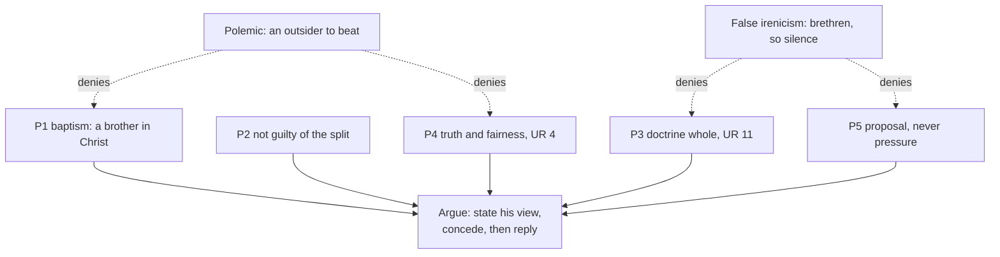

# Apologetics II · Lesson 1.2: What the Church says about other Christians

> ⏱ ~15 min · Module 1: Arguing among Christians · Builds on: [1.1](01-01-shared-ground-and-where-the-argument-is.md), [`ecclesiology-and-mariology` 5.2](../../ecclesiology-and-mariology/lessons/05-02-subsistit-in-and-the-status-of-other-churches.md), [`ecclesiology-and-mariology` 5.3](../../ecclesiology-and-mariology/lessons/05-03-ecumenism-as-doctrine.md), [`ecclesiology-and-mariology` 2.1](../../ecclesiology-and-mariology/lessons/02-01-one.md) · Unlocks: [1.3](01-03-arguing-from-history-without-abusing-it.md)

## Why this matters

Before arguing with a Lutheran about justification or an Orthodox priest about the pope, know whom you are arguing with. The Catholic Church gives a precise answer, and it rules out the two easiest ways to argue: treating the other side as outsiders to be beaten, or as so nearly inside that arguing would be rude. Every later lesson is argued under these rules.

## The idea

Think of siblings disputing their father's will. The dispute is real. But neither may pretend the other is not the father's child, or win by tricking the executor; nor may they stop arguing because they love each other, or the house goes to whoever is loudest. Kinship does not end the argument. It sets its terms.

[`ecclesiology-and-mariology` 5.2](../../ecclesiology-and-mariology/lessons/05-02-subsistit-in-and-the-status-of-other-churches.md) and [5.3](../../ecclesiology-and-mariology/lessons/05-03-ecumenism-as-doctrine.md) taught the doctrine that names the kinship; this lesson takes it whole and argues what it requires of an apologist. The one Church of Christ [subsists in](../reference.md#subsistit-in) the Catholic Church, and many [elements of sanctification and truth](../reference.md#elements-of-sanctification-and-truth) are at work beyond her visible boundaries (LG 8). Baptism in the Trinity's name is true baptism even from a heretic ([`sacraments-and-liturgy` 2.2](../../sacraments-and-liturgy/lessons/02-02-necessity-infants-and-baptism-of-desire-and-blood.md)), so the baptized outside are in real but [imperfect communion](../reference.md#imperfect-communion), and those born into their communities cannot be charged with the separation ([`ecclesiology-and-mariology` 2.1](../../ecclesiology-and-mariology/lessons/02-01-one.md)). The Eastern bodies are called Churches and the Reformation bodies [ecclesial communities](../reference.md#churches-and-ecclesial-communities), by the test of apostolic succession in Orders, which carries the Eucharist. The [hierarchy of truths](../reference.md#hierarchy-of-truths) orders doctrines by nearness to the foundation, not by how firmly they bind ([`fundamental-theology` 4.5](../../fundamental-theology/lessons/04-05-reading-a-documents-weight.md)).

This lesson **states** that criterion and does not argue it; [4.3](04-03-apostolic-succession-and-the-validity-of-orders.md) argues its key input, the validity of orders. New here is what the doctrine **forbids an apologist**: treating the other side as outside Christ; arguing for a rhetorical win; and letting "they are [separated brethren](../reference.md#separated-brethren)" become a reason not to argue. The opposite failure has a conciliar name, [false irenicism](../reference.md#false-irenicism): peace bought by clouding the truth.

## The other side

Every tradition at this table has an ecclesiology that says something hard about the others.

**Lutheran.** Answering the 2007 *Responses*, the Lutheran World Federation's general secretary, Ishmael Noko, said its churches understand themselves to be "fully church" ([`ecclesiology-and-mariology` 5.2](../../ecclesiology-and-mariology/lessons/05-02-subsistit-in-and-the-status-of-other-churches.md)). That is not wounded pride; it is the [Augsburg Confession](../reference.md#augsburg-confession). Article VII (*Triglot Concordia*, 1921) marks the Church by the Gospel rightly taught and the sacraments rightly administered: for true unity "it is enough to agree concerning the doctrine of the Gospel and the administration of the Sacraments." Melanchthon's [*Treatise on the Power and Primacy of the Pope*](../reference.md#treatise-on-the-power-and-primacy-of-the-pope) (1537) meets the criterion head on. Bishop and pastor do not differ by divine right, so "ordination administered by a pastor in his own church is valid by divine law," and "wherever there is a true church, the right to elect and ordain ministers necessarily exists" (Triglot). On these premises episcopal succession is not constitutive, and "ecclesial community" begs the question. *Weight:* the [Book of Concord](../reference.md#book-of-concord) is the confessional standard Lutheran pastors subscribe to, a *norma normata* under scripture, not a magisterium; Noko's statement is an official response with no confessional standing. The same Book of Concord calls the pope "the very Antichrist" ([Smalcald Articles](../reference.md#smalcald-articles), Part II, art. IV). The Lutheran–Catholic commission's *From Conflict to Communion* (2013, §229) reports that Lutherans today reject that identification: a commission's report, which amends no confession and binds no church.

**Reformed.** For the World Alliance of Reformed Churches, Setri Nyomi answered in 2007 that their place in the church is God's gift, not dependent on the Vatican's interpretation (E&M 5.2). The 1646 text of the [Westminster Confession](../reference.md#westminster-confession) (Schaff) calls the pope "that Antichrist, that man of sin and son of perdition" (XXV.6). *Weight:* the subordinate standard of Presbyterian churches, in varying texts; the Orthodox Presbyterian Church's edition omits that clause.

**Anglican.** [Article XIX](../reference.md#thirty-nine-articles): the Church of Rome "hath erred ... also in matters of Faith" (Schaff). *Weight:* formularies whose authority varies across the Communion.

**Orthodox.** The [Holy and Great Council](../reference.md#holy-and-great-council-2016) (Crete, June 2016), in *Relations of the Orthodox Church with the Rest of the Christian World*, speaks of the Orthodox Church "as the One, Holy, Catholic, and Apostolic Church" (§1), and accepts "the historical name" of non-Orthodox Churches and Confessions while asking that the ecclesiological question be clarified (§6): wording that names them without settling what they are. *Weight:* ten autocephalous churches attended; Antioch, Russia, Bulgaria and Georgia did not, and the Russian Church has declined (2016, 2017) to count the council pan-Orthodox or binding on all. Its own [*Basic Principles of Attitude to the Non-Orthodox*](../reference.md#basic-principles-2000) (Bishops' Council, 2000), one autocephalous church's synodal text, calls the Orthodox Church "the true Church of Christ" (§1.1). Separated communities keep "a certain incomplete fellowship" (§1.15), and three rites of reception, by baptism, chrismation or repentance, show that Orthodoxy treats different confessions differently (§1.17). Practice is not uniform, and Orthodoxy issues no binding definitions the Western way.

Nobody's ecclesiology is polite, and John Paul II named the frame: "reciprocity is required" ([*Ut Unum Sint*](../reference.md#reciprocity) 29, 1995).

## The argument

**P1.** A validly baptized Christian is incorporated into Christ and in real, if imperfect, communion with the Catholic Church (Trent, Session VII, *On Baptism*, can. 4, 1547; [UR](../reference.md#unitatis-redintegratio) 3, 22, 1964). *In words:* he is a brother in Christ.

**P2.** Those born into the separated communities cannot be charged with the sin of separation, which came about *quandoque non sine hominum utriusque partis culpa* (UR 3). *In words:* he did not make the split, and your side helped make it.

**P3.** The doctrine must be presented whole: "nothing is so foreign" to ecumenism as a false irenicism that clouds its meaning (UR 11), and all dogmas, however ordered, are believed with the same divine faith (*Mysterium Ecclesiae* 4, 1973). *In words:* charity leaves nothing out, including what the Church says about his community.

**P4.** Ecumenical work begins by avoiding words, judgments and actions that do not represent the separated with truth and fairness (UR 4). It requires study of their outlook and meeting on an equal footing, *par cum pari* (UR 9), theology taught "not polemically" (UR 10), and terms they can really understand (UR 11). *In words:* state his view as he would sign it, and argue only by fair means.

**P5.** Ecumenism removes neither the right nor the responsibility to propose the faith in full to other Christians who freely wish to receive it; it excludes [proselytism](../reference.md#proselytism-and-witness), promotion by means and motives contrary to the Gospel (CDF, *Doctrinal Note on Some Aspects of Evangelization*, 3 December 2007, §12, n. 49). *In words:* the line falls at means, not conclusions.

**∴ C.** Argument with other Christians is lawful, and the doctrine fixes its terms: a brother, never charged with the separation; his position stated as he states it; the Catholic position whole; assent sought only by truth fairly put. "He is outside Christ, so win" denies P1 and P4; "he is a brother, so keep quiet" denies P3 and P5. Whether arguing is a duty, a permission or a distraction is [Boss 1](../syllabus.md)(d)'s question.

**Mark the levels.** ([the ladder](../../fundamental-theology/lessons/04-04-the-ladder-of-doctrinal-authority.md); [levels of authority](../reference.md#levels-of-authority).) That baptism given outside the Church in the Trinity's name, with the Church's intention, is true baptism: **rung 1** (Trent VII, *On Baptism*, can. 4). UR 3's imperfect communion, shared fault and born-into clause, UR 22's sacramental bond, and the Churches/ecclesial-communities classification (*Dominus Iesus* 17, 2000; *Responses* Q4–5, "ratified and confirmed" by Benedict XVI): **rung 3**, defining nothing. UR 11's hierarchy of truths: **no rung**. Its false-irenicism fence, and *Mysterium Ecclesiae* 4 (ratified by Paul VI): **rung 3**. UR 4, 9 and 10, part of the decree's teaching that ecumenism is every Catholic's duty, and *Ut Unum Sint* 29: **rung 3**; "truth and fairness" also applies the moral law against false witness, which binds on its own. The *Doctrinal Note*, approved by Benedict XVI in ordinary form: **rung 3, light grade**; its footnote's sense of "proselytism" comes from a 1995 joint Catholic–World Council of Churches study, with **no magisterial level**. The texts in "The other side" have **no Catholic level**.

**Concession.** Blame for the separations lies with people on both sides. UR 3: "not without fault of people on both sides", qualified by *quandoque*, "at times" (as `ecclesiology-and-mariology` 5.3 renders it; vatican.va's "often enough" stretches the word). "Both sides" assigns no equal shares. The Christian you argue with is not guilty of the separation at all. The CDF's 2007 commentary (which carries no approval of its own) admits its language caused "no little distress" in those communities and among some Catholics. Catholic polemic has its own record of forgery and atrocity story, which [1.3](01-03-arguing-from-history-without-abusing-it.md) sets out.

**The crux.** The "keep quiet" view must deny P3: you cannot tell a brother his community lacks something constitutive and still treat him as a brother. Reciprocity is the Catholic evidence against it, since every ecclesiology at the table makes such a claim. Evidence that exclusive claims, even fairly stated, poison partnership would move it; problem P3 presses that.

## The two failures

Each failure works by denying two of the five premises.

## Worked examples

**Example 1 (clean): "Why talk at all?"** At an invented study day, an Orthodox priest says: "*Dominus Iesus* calls my Church a true particular Church that lacks something. Mine calls itself the one Church. Why talk?" P1 and P2: his Church has true sacraments (UR 15), and he made no schism. P3: say plainly what DI 17 and *Responses* Q4 say, including the lack, and Q4's admission that division leaves the Catholic Church's own universality not fully realised. P4: state his claim at its strength, from Crete §1 and the Moscow text, without hearing it as hostility. Now the reason to talk appears: both hold the one Church visible and undivided, and differ on where it is and whether communion with Rome is internal to it. That is 1.1's [first axis](../reference.md#two-axes), the seat of authority, and both parties think it matters.

**Example 2 (strain): the friend who asks.** A Lutheran friend, after years of argument, is reading the Catechism and asks what he should do. If he asks from conviction to be received, that is the Spirit's work, and it "would not be a question of proselytism in the negative sense" (*Doctrinal Note* §12). The same section excludes undue pressure. UR 4 calls an individual's reconciliation distinct from ecumenical action but not opposed to it. **Where the doctrine stops:** it regulates means and motives and forbids no outcome. It does not say whether to urge him to come now, to stay and work for corporate reconciliation, or to wait; no text ranks individual reception against corporate unity. That is prudence; claiming the documents decide it overstates them.

## Watch out

- **You might think the Lutheran objection to "ecclesial community" is hurt feelings,** but it is an ecclesiology: by Augsburg VII's *satis est* and the *Treatise* on ordination, the Lutheran church is fully church. Answer the criterion.
- **You might think the Orthodox are the softer partner here,** but Crete §1 and the Moscow text identify the Orthodox Church with the one Church, and Crete accepts others' "historical name" without settling what they are. The claims mirror each other.
- **You might think an opposing text binds its whole tradition,** but Crete lacked four churches, and the Book of Concord is a *norma normata*, not a magisterium. Overstating the other side's text is the same error as overstating your own.
- **You might think UR 4's "truth and fairness" is etiquette,** but it is conciliar teaching (rung 3) applying the precept against false witness, so a misquoted confession is a moral failure. The mirror error: the 2007 *Responses* defined nothing.

## One-liner

> The doctrine tells the apologist he argues with a brother in Christ, not guilty of the split, whose church claims as much as his; so it forbids both the polemic that wins and the politeness that will not argue.

## Problems

**P1 (🟢) *(Assign the weight · Exegetical, strict.)*** An apologist preparing for a public exchange with a Lutheran theologian drafts five notes. For each, mark its weight: a Catholic rung with the act that fixes it, or, for another tradition's text, its standing inside that tradition. Correct the note where it misstates the weight. **One line each.**

(a) "UR 4's call to represent separated Christians with 'truth and fairness' is good manners, not teaching."

(b) "The Smalcald Articles' 'very Antichrist' is Lutheran dogma, binding as a magisterium's definition, whatever the 2013 dialogue says."

(c) "Westminster XXV.6 calls the pope Antichrist, so every Presbyterian church confesses it."

(d) "Crete 2016 is the Orthodox Church's binding answer: other bodies have only a 'historical name'."

(e) "The 2007 *Doctrinal Note* forbids trying to convince a Lutheran of Catholic truth, since that is proselytism."

**P2 (🟡) *(Diagnose · Exegetical.)*** An invented talk, written for this problem. At St Dunstan-in-the-Marsh, Wickenford, Canon Winifred Threlkeld (Church of England) opens a joint Anglican–Catholic study group and proposes two ground rules. The Catholic co-organizer, a parishioner, adds two of his own.

> (1) "Each tradition presents its teaching from its own texts, and is questioned before anyone replies."
>
> (2) "No one says that their church is the true Church, or that another lacks anything. Rome calls us brethren now, and brethren do not talk like that."
>
> (3) "Each session ends with a show of hands on which side made the better case."
>
> (4) "Vatican II forbids Catholics to argue for the papacy with separated brethren, so we will mostly listen."

(a) For each rule, say whether a Catholic member can keep it consistently with his Church's teaching. If not, name the failure (polemic, rhetorical win, false irenicism, or misreading "separated brethren") and the text it runs against. **One line per rule.**

(b) Name the one true thing in rule (2). **One sentence.**

**P3 (🔴) *(Apologetic: (a) Exegetical, graded first · (b) reply.)*** At an invented seminary seminar, a Lutheran professor says: "Your Church calls mine an ecclesial community, not a Church in the proper sense, and then calls me a brother and offers dialogue on an equal footing. By my Church's confession we are fully church. Until Rome withdraws that label, its brotherhood is condescension, and its dialogue is not between equals."

(a) State the Lutheran ecclesiology he stands on as the Lutheran confessions state it, naming the texts and their weight. **Three sentences at most.**

(b) Reply in **120 words or fewer**, opening with a **named concession**. You need not argue the criterion itself, since [4.3](04-03-apostolic-succession-and-the-validity-of-orders.md) argues its key input. A reply that concludes the professor is right passes if it is a good reply.

Solutions

**P1** *(Assign the weight · Exegetical, strict)*

**Must hit, strict:**

- (a) **Understated.** It is conciliar teaching, **rung 3**: part of UR's teaching that ecumenism is every Catholic's duty, whose first activity UR 4 names as avoiding words, judgments and actions that misrepresent the separated. *Ut Unum Sint* 29 restates it, and it applies the precept against false witness, which binds independently.
- (b) **Overstated in kind.** The Smalcald Articles (Part II, art. IV) stand in the Book of Concord, the Lutheran confessional standard pastors subscribe to: a *norma normata* under scripture, not a magisterium's definition. *From Conflict to Communion* §229 reports that Lutherans today reject the identification, but it is a commission's report that amends no confession. No Catholic level.
- (c) **Overstated in extent.** Westminster is the subordinate standard of Presbyterian churches, and its text varies by church. The 1646 text has the clause, and the Orthodox Presbyterian Church's edition omits it. No Catholic level.
- (d) **Overstated.** It is the text of a council attended by ten autocephalous churches. Antioch, Russia, Bulgaria and Georgia stayed away, and the Russian Church does not count it pan-Orthodox or binding on all. It is weighty evidence of Orthodox ecclesiology (Moscow's 2000 text says the same, §1.1), but not a binding definition, which Orthodoxy does not issue the Western way. No Catholic level.
- (e) **Wrong in content; weight rung 3, light grade** (a CDF note approved by Benedict XVI). §12 says ecumenism removes neither the right nor the responsibility to propose the faith in full to those who freely wish to receive it. Proselytism (n. 49) means improper means and motives, a sense borrowed from a joint Catholic–WCC study with no magisterial level.

**Wrong turns:** giving (b)–(d) a Catholic rung. The opposite errors: saying the 2013 report repealed Smalcald, or dismissing Crete as one theologian's opinion. Reading (e) as forbidding argument, or calling the Note a definition.

**Model answer:** (a) Rung 3: UR's teaching on the duty of ecumenism, restated in UUS 29, applying the precept against false witness. (b) Book of Concord, *norma normata*, not a magisterium; the 2013 report records Lutheran rejection of the identification but amends nothing. (c) Westminster is a subordinate standard whose text varies; the OPC edition drops the clause. (d) A council of ten churches, not received as pan-Orthodox by Russia; evidence, not a binding definition. (e) Rung 3, light; it keeps the right to propose the faith and forbids only improper means and motives.

---

**P2** *(Diagnose · Exegetical)*

**Accept:** any wording that names the right failure and a text that corrects it.

**Must hit, strict:**

- (1) **Keep.** It is UR 9's study of the others' outlook and equal footing, UR 4's truth and fairness, and the rule of stating a view as its defenders state it.
- (2) **Cannot keep: false irenicism.** UR 11 requires the doctrine whole, and LG 8, DI 17 and *Responses* Q4–5 say what the others lack. Credit noting that the rule would also gag the Canon's own Article XIX ("hath erred"), so it is not even neutral.
- (3) **Cannot keep: a rhetorical win.** A show of hands seeks a crowd's verdict, not free assent. UUS 29 asks the parties to move from antagonism to partnership, and the *Doctrinal Note* §12 excludes improper persuasion.
- (4) **Cannot keep: a misreading of "separated brethren".** UR 4 makes dialogue the place where each side explains its distinctive teaching in depth. UR 11 requires the doctrine whole, and the *Doctrinal Note* §12 keeps the right to propose it.
- (b) **The true thing:** they are brethren. UR 3 says the baptized have a right to be called Christian and are accepted as brothers.

**Wrong turns:** calling rule (2) an excess of charity rather than a demand that the Catholic hide doctrine. Faulting rule (1) as relativism. Reading rule (4) as the humility the council commends. Faulting the Canon for not obeying UR, which does not bind her; the question is what a Catholic member can keep.

**Model answer:** (1) Keep: UR 9's equal footing and UR 4's truth and fairness. (2) No: false irenicism; UR 11 requires the whole doctrine, and the Catholic texts say the others lack something (her own Article XIX would be silenced too). (3) No: a rhetorical win; a vote is not free assent, and UUS 29 asks for partners, not antagonists. (4) No: UR 4 and 11 require the distinctive doctrines to be stated, and the *Doctrinal Note* §12 keeps the right to propose them. (b) Rule (2) rightly calls them brethren (UR 3).

---

**P3** *(Apologetic: (a) Exegetical, graded first · (b) reply)*

**Accept:** any reply, whatever its verdict, that opens with a real concession and separates the conduct of dialogue from the truth of an ecclesiology.

**Must hit, strict (a), graded first:**

- **Augsburg VII:** the Church is the congregation of saints where the Gospel is rightly taught and the sacraments rightly administered, and agreement in these is enough (*satis est*) for true unity.
- **The *Treatise*:** bishop and pastor do not differ by divine right, so ordination by a pastor in his own church is valid by divine law, and a true church always has the right to elect and ordain. So succession in the episcopate is not constitutive of the Church.
- **Weight:** both stand in the Book of Concord, the *norma normata* Lutheran pastors subscribe to, not a magisterium. Credit for adding Noko's 2007 "fully church" as the Federation's official reaction, marked as no confession.

**Must hit (b):**

- **A named concession:** the label asserts a lack his confession denies, on a criterion it rejects, and the CDF's commentary admits "no little distress". UR 3's shared fault also counts.
- **Equal footing** (UR 9, *par cum pari*) governs the conduct of dialogue: each side states its own teaching and is heard as it states it. It is not a prior verdict that the ecclesiologies are equally true. No party at the table grants that, since Augsburg VII's test judges Rome too (reciprocity, UUS 29).
- **Brotherhood rests on baptism** (Trent VII, *On Baptism*, can. 4; UR 3), which the label does not touch. The label grades structure, not faith or holiness.
- **Locate the real dispute:** whether succession in Orders is constitutive, which is 4.3's question.

**Wrong turns:** stating (a) as "Lutherans believe in an invisible church" or "Lutherans reject ordination", a caricature that fails the problem. Stating it from Calvin or Westminster, a blur. Calling the Book of Concord a magisterium. Saying "it is only about structure, so don't be offended" with no concession. Saying the *Responses* defined the label, which overstates rung 3. Asserting that Lutheran orders are invalid as if that settled the charge, which begs the question he raised.

**Model answer (a):** The Augsburg Confession, art. VII, makes the Church the congregation of saints where the Gospel is rightly taught and the sacraments rightly administered, and says agreement in these is enough for true unity. Melanchthon's *Treatise* adds that bishop and pastor do not differ by divine right, so a pastor's ordination in his own church is valid by divine law, and a true church always has the right to ordain. Both stand in the Book of Concord, the *norma normata* Lutheran pastors subscribe to; on that standard his church lacks nothing constitutive.

**Model answer (b), one of several:** Concession: the label asserts a lack your confession denies, on a criterion it rejects, and Rome's own commentary admits it caused "no little distress". But "equal footing" in UR 9 governs how we talk: each states his own teaching and is heard as he states it. It does not decide which ecclesiology is true. Your confession makes an equally exclusive claim, since Augsburg VII's test judges my church too. Nor does the label touch brotherhood. That rests on your baptism, which my Church defines as true, and the label grades structure, not faith. So the real dispute is whether succession in Orders is constitutive, and that is where we should argue.

## Connections

- **Backward:** [1.1](01-01-shared-ground-and-where-the-argument-is.md) located disputes on two axes; this lesson says who stands on the other side of them. The doctrine is [`ecclesiology-and-mariology` 2.1](../../ecclesiology-and-mariology/lessons/02-01-one.md), [5.2](../../ecclesiology-and-mariology/lessons/05-02-subsistit-in-and-the-status-of-other-churches.md) and [5.3](../../ecclesiology-and-mariology/lessons/05-03-ecumenism-as-doctrine.md). [`apologetics-foundations` 1.1](../../apologetics-foundations/lessons/01-01-what-apologetics-is-and-what-it-isnt.md) gave four rules of persuasion for any audience, and P4 is their intra-Christian ground. Baptism's validity is [`sacraments-and-liturgy` 2.2](../../sacraments-and-liturgy/lessons/02-02-necessity-infants-and-baptism-of-desire-and-blood.md), the hierarchy of truths is [`fundamental-theology` 4.5](../../fundamental-theology/lessons/04-05-reading-a-documents-weight.md), and salvation outside the visible Church, argued outward, is [`apologetics-foundations` 8.2](../../apologetics-foundations/lessons/08-02-salvation-outside-the-visible-church.md).
- **Forward:** [1.3](01-03-arguing-from-history-without-abusing-it.md) sets out the Catholic polemical record conceded here. [2.1](02-01-sola-scriptura-at-its-best.md) and [3.1](03-01-justification-as-the-confessions-state-it.md) test P4 hardest, stating *sola scriptura* and *sola fide* as the confessions state them. [4.3](04-03-apostolic-succession-and-the-validity-of-orders.md) argues the input to the criterion this lesson only states, and [5.2](05-02-papal-primacy-as-the-east-reads-it.md) meets the Orthodox ecclesiology quoted here. The module's [boss problem](../syllabus.md) asks whether argument is a duty, a permission or a distraction.
- **Sideways:** UR 4's sentence on unity in essentials, freedom in rite and theology, and charity in all things (*in necessariis unitatem ... in omnibus vero caritatem*) echoes a tag often credited to Augustine. It descends from the Lutheran irenicist Peter Meiderlin, writing as [Rupertus Meldenius](../reference.md#in-necessariis-unitas) (*Paraenesis votiva pro pace ecclesiae*, 1626). John XXIII quoted it as a saying "attributed to various authors" (*Ad Petri Cathedram* 72, 1959). Stating the other side so it would sign is [`philosophical-method` 4.2](../../philosophical-method/lessons/04-02-steelmanning-and-the-burden-of-proof.md)'s steelman, given here a doctrinal ground.
