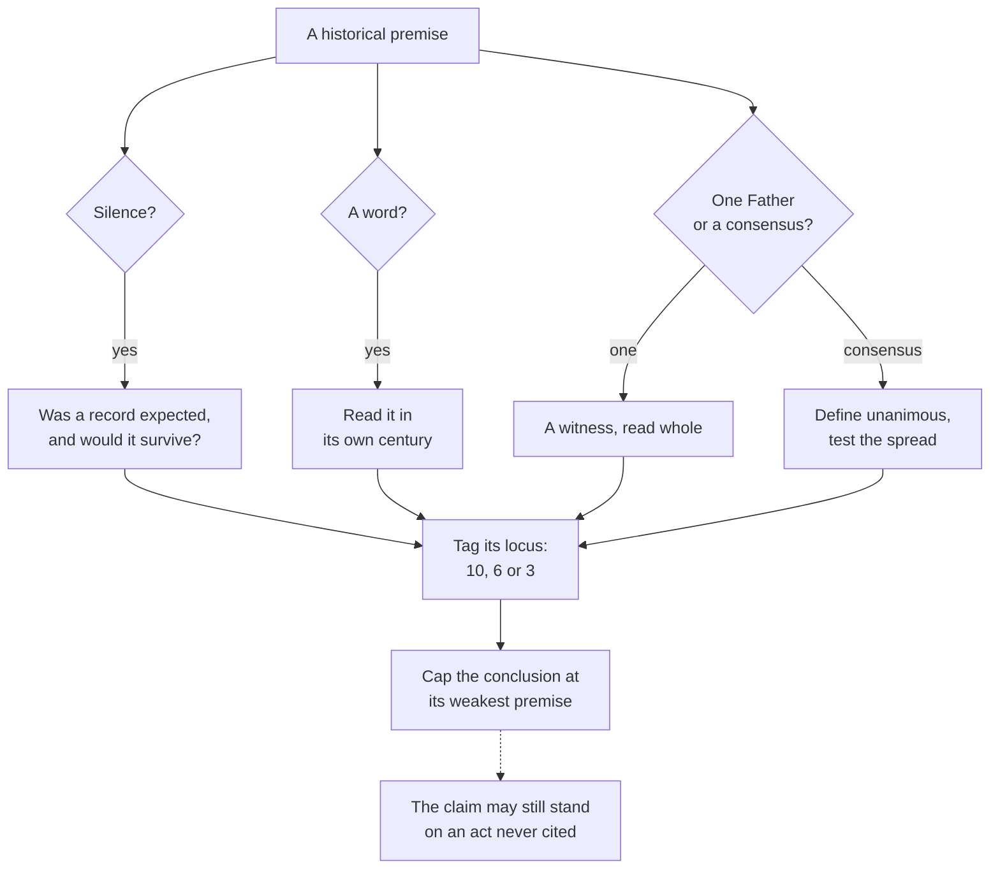

# Apologetics II · Lesson 1.3: Arguing from history without abusing it

> ⏱ ~15 min · Module 1: Arguing among Christians · Builds on: [1.1](01-01-shared-ground-and-where-the-argument-is.md), [1.2](01-02-what-the-church-says-about-other-christians.md), [`patristics` 1.1](../../patristics/lessons/01-01-how-to-read-a-church-father.md), [`fundamental-theology` 5.1](../../fundamental-theology/lessons/05-01-vincent-of-lerins.md), [5.2](../../fundamental-theology/lessons/05-02-newmans-theory-of-development.md), [5.5](../../fundamental-theology/lessons/05-05-the-loci-theologici.md) · Unlocks: [2.1](02-01-sola-scriptura-at-its-best.md), [4.2](04-02-what-the-patristic-record-proves.md), [6.6](06-06-development-or-corruption.md)

## Why this matters

Almost every dispute in this course ends in the archive: did anyone pray to the martyrs before 300? Both sides have misused the archive in the same four ways for four centuries, and an apologist who spots only the other side's misuses is a propagandist. So each abuse here gets a Catholic offender first, and every historical premise gets a ceiling.

## The idea

Historical evidence is testimony: who said, did or believed what, and when. It never shows directly that a doctrine is revealed; that needs a premise about how revelation reaches the Church, the very thing in dispute ([1.1](01-01-shared-ground-and-where-the-argument-is.md)'s first axis). Silence is like the guard dog that did not bark in the night: a clue only because a dog was there to bark.

The tools are the siblings': [`patristics` 1.1](../../patristics/lessons/01-01-how-to-read-a-church-father.md) on weighing Fathers, [`fundamental-theology` 5.1](../../fundamental-theology/lessons/05-01-vincent-of-lerins.md)–[5.2](../../fundamental-theology/lessons/05-02-newmans-theory-of-development.md) on Vincent and Newman, [5.5](../../fundamental-theology/lessons/05-05-the-loci-theologici.md) on the loci. This lesson turns them on four habitual abuses.

**1. [The argument from silence](../reference.md#argument-from-silence) run as proof.** The two-sided rule: a doctrine unattested in 150 is not thereby denied in 150, and not thereby attested either. *Catholic first:* popular apologetics argues that because no church ever claimed Mary's bones, the first Christians knew she was assumed. The checkable record cuts the other way: in the 370s Epiphanius says no one knows her end ([`ecclesiology-and-mariology` 6.4](../../ecclesiology-and-mariology/lessons/06-04-the-assumption.md)). *Protestant:* reading 1 Clement's silence about a bishop at Corinth as proof there was none ([`patristics` 1.2](../../patristics/lessons/01-02-first-clement-and-the-didache.md)). *Orthodox,* used properly: the patriarchs' 1848 reply to Pius IX notes that Chalcedon's canon 28 grounds Rome's rank in the city and is silent about Peter (§13), exactly where a record would be expected; [4.2](04-02-what-the-patristic-record-proves.md) weighs it.

**2. [Anachronism](../reference.md#anachronism).** A word is read in a later century's sense. *Catholic first:* reading Ignatius's "Catholic Church" (*Smyrnaeans* 8) as the Roman communion ([`patristics` 1.3](../../patristics/lessons/01-03-ignatius-of-antioch.md)), and the word "pope" (Example 1). *Protestant:* reading a bare symbol into second-century Eucharistic realism, twin of reading Trent into it ([`sacraments-and-liturgy` 3.1](../../sacraments-and-liturgy/lessons/03-01-the-institution-and-the-earliest-witness.md)). *Orthodox,* and popular on every side: dating "the" schism to 1054 ([`church-history` 4.2](../../church-history/lessons/04-02-east-and-west-the-long-estrangement.md)).

**3. [The cherry-picked Father](../reference.md#cherry-picked-father).** One sentence stands in for a Father. *Catholic first:* "Peter has spoken through Leo" quoted without Chalcedon's examination of Leo's letter against Nicaea and Cyril, as the 1848 patriarchs pressed (§15); and the fake tag "Roma locuta, causa finita" ([`patristics` 4.5](../../patristics/lessons/04-05-augustine-against-the-pelagians.md)). *Protestant and Orthodox:* Gregory the Great's refusal of "universal bishop" quoted without his approving report that Pelagius II annulled John's synod "by the authority of the holy apostle Peter" (Register V.43) ([`patristics` 5.3](../../patristics/lessons/05-03-gregory-the-great.md)).

**4. [The manufactured consensus](../reference.md#manufactured-consensus).** "The Fathers unanimously taught …" is asserted, never counted. *Catholic first:* the claimed consensus that the rock of Matthew 16 is Peter, which [`patristics`](../../patristics/syllabus.md) Boss 5 tests against the spread. *Protestant:* Arthur Cleveland Coxe, the Episcopal bishop who edited the American *Ante-Nicene Fathers*, calls his account of the early papacy what "all candid critics and historians" prove (ANF 5, Elucidation III to Hippolytus). *Orthodox:* the 1848 patriarchs say the [filioque](../reference.md#filioque) has no ground in the Fathers and call the Latin witnesses adulterations (§5, paraphrased).

**Development or corruption, in the record.** A [development](../reference.md#development-of-doctrine) leaves scattered anticipations, grows under new questions, and makes older teaching firmer. A corruption has a birthday with no antecedents, leans on a forged or misread witness, and drops what came before. [Vincent's canon](../reference.md#vincentian-canon) and [Newman's notes](../reference.md#newman-notes) are *tests*: each says what the record must contain, and a test that cannot fail is no test. As a historical audit, Vincent's canon failed the Immaculate Conception ([`fundamental-theology` 5.1](../../fundamental-theology/lessons/05-01-vincent-of-lerins.md)); [6.6](06-06-development-or-corruption.md) runs the notes.

**The past as a weapon.** At Leipzig in 1519 Eck drew Luther into calling papal primacy of human right ([`church-history` 6.1](../../church-history/lessons/06-01-the-late-medieval-church-and-luthers-protest.md)); every dispute became one about the past. The Lutheran *Magdeburg Centuries* (Basel, 1559–74) traced errors century by century; Baronius's *Annales* (from 1588) answered. Maria Monk's fabricated *Awful Disclosures* (1836) was exposed by a Protestant editor and still sold for decades. Against that stands [Francis de Sales's](../reference.md#the-catholic-controversy) *The Catholic Controversy*, written for the Calvinists of Thonon in the mid-1590s (Mackey's translation, 1886). Its preface disowns "a thousand impieties which are attributed to Catholics" and asks readers to "have yet patience to hear the other". It still says "pretended church". Its method was better than its era's.

## The other side

**Anglican: the first six centuries.** John Jewel, soon bishop of Salisbury, preached at Paul's Cross on 26 November 1559 and repeated his challenge, enlarged, in March 1560 ([Jewel's challenge](../reference.md#jewel-challenge)). He listed private Masses, communion in one kind, prayer in a tongue the people do not understand, the bishop of Rome as universal bishop, a corporal presence, the elevation and adoration of the sacrament, images set up to be worshipped. He offered to "give over and subscribe" if anyone could prove any one of them for the first six hundred years by "any one clear or plain clause or sentence" of Scripture, an old doctor, an old general council or an example of the primitive Church (Coxe's text, ANF 3, Elucidation V on Tertullian's *Prescription*). At full strength: the faith and its worship were delivered whole; the age of the Fathers and great councils, which Rome also reveres, wrote enough that anything apostolic would leave one clear sentence; so an article with none is a later addition, and whoever holds it must prove it. One sentence is a deliberately low bar: Tertullian's prescription turned on Rome. **Weight:** a bishop's sermon, not an Anglican formulary (those are the [Thirty-Nine Articles](../reference.md#thirty-nine-articles), the Prayer Book and the Ordinal). Thomas Harding answered it in 1564; Jewel replied in 1565.

**Lutheran: history as decline.** The *Centuries*, under Matthias Flacius, argued at length that errors entered gradually, the papacy chief among them. **Weight:** historians' work, with no standing in the [Book of Concord](../reference.md#book-of-concord).

**Orthodox: the Fathers received, not developed.** The Fathers are not early evidence for a doctrine still growing but the mind of the Church, to be received; a later teaching is tested by agreement with them and the seven councils. The [1848 Encyclical of the Eastern Patriarchs](../reference.md#encyclical-of-the-eastern-patriarchs-1848) made the historical case against Rome on that basis (§§13–15). **Weight:** a synodal letter of four patriarchs, honoured but not an ecumenical council's act.

## The argument

**P1.** Historical evidence is testimony to what was said, done and believed. *In words:* the archive answers "who held what, when", never "is it revealed?"

**P2.** Silence is evidence only where a record was expected and would survive, and then it shows absence from the record, not denial. *In words:* the two-sided rule.

**P3.** A text is evidence for its own sense. *In words:* "catholic", "papa" and "sacrifice" mean what they meant then.

**P4.** One Father is a witness; a consensus must be defined, then shown across the spread. *In words:* count before you claim.

**P5.** A historical premise is [locus 10](../reference.md#loci-and-historical-premises), extrinsic, unless it reports the Fathers teaching (locus 6) or the Church's own practice (locus 3); a conclusion is capped by its weakest load-bearing premise ([`fundamental-theology` 5.5](../../fundamental-theology/lessons/05-05-the-loci-theologici.md)). *In words:* an argument standing on an archive claim reaches "probable".

**∴ C.** History can refute the claim that a doctrine was always explicit, show which way a development ran, and break a factual premise. It cannot by itself prove a doctrine revealed, nor by silence disprove one; its rules bind the Catholic first.

**Mark the levels.** Against [the ladder](../../fundamental-theology/lessons/04-04-the-ladder-of-doctrinal-authority.md) and [levels of authority](../reference.md#levels-of-authority): Trent IV's rule against reading Scripture contrary to the Church's sense or the Fathers' unanimous consent (renewed in *Dei Filius* ch. 2): **at least rung 3**, a restraint, not a method. Vincent's canon, Newman's notes, Fathers as authors, de Sales, Cochlaeus, Coxe: **no magisterial level**; that dogmas take no sense but the Church's: **rung 1** (*Dei Filius* ch. 4, third canon). Jewel, the *Centuries*, the 1848 Encyclical: **no Catholic level**. The Assumption: **rung 1** (1950), resting on the definition, not relics. [Invocation of the saints](../reference.md#invocation-of-saints): **at least rung 3** (Trent XXV's decree, no canon; LG 49–50), presupposed by XXII can. 5 (**rung 1 as worded**). Communion in one kind: **law, no rung** (XXI ch. 2); no divine precept binding all to both kinds (XXI can. 1) and private Masses not unlawful (XXII can. 8): **rung 1 as worded**. [Transubstantiation](../reference.md#transubstantiation): **rung 1** for the change and the term (XIII can. 2), not for Aristotle.

**Concession.** Catholic polemic has its own record of forgery and atrocity story, and the Catholic case has leaned on forged documents. The [Pseudo-Isidorean decretals](../reference.md#pseudo-isidorian-decretals), forged in the province of Reims probably in the 840s, and the [Donation of Constantine](../reference.md#donation-of-constantine) were used in the service of Roman claims ([`church-history` 3.3](../../church-history/lessons/03-03-popes-franks-and-emperors.md); [`ecclesiology-and-mariology` 4.2](../../ecclesiology-and-mariology/lessons/04-02-the-development-of-papal-claims-read-honestly.md)). Johannes Cochlaeus's hostile life of Luther (1549) governed Catholic history-writing for centuries, as Adolf Herte showed (1943).

**The crux.** Can a doctrine be apostolic and not yet explicit in the first centuries' record? Jewel's challenge needs "no"; development needs "yes". The archive cannot settle a claim about how revelation is handed on ([6.6](06-06-development-or-corruption.md)); it can make each side say, before looking, what record its claim predicts.

## The check on a historical premise

The abuses become three checks; the dashed edge: the cap falls on the argument, not the claim.

## Worked examples

**Example 1 (clean): "the bishops of Rome were called popes from the start."** In 250 the Roman clergy wrote to Cyprian of Carthage as "Papa" (ANF Ep. 29, Oxford 36; translated "Father"), and Dionysius of Alexandria calls his predecessor Heraclas "our blessed father", *papa* in the Greek (Eusebius, *Church History* 7.7.4, McGiffert). It was any bishop's title, so it proves nothing about Rome. Coxe, correcting that anachronism, calls the early Roman bishops "no more 'Popes' than Cincinnatus was an emperor", makes Nicholas I (858–867) the first pope "in the modern sense", and dates supremacy as dogma to Pius IX, though Florence had defined Roman primacy over the whole world in 1439 (*Laetentur caeli*). His word check was right; his history was confessional. Primacy is **rung 1** by Florence and *Pastor Aeternus*, not by a word.

**Example 2 (strain): Newman and [*securus judicat orbis terrarum*](../reference.md#securus-judicat-orbis-terrarum).** Augustine wrote that the whole world judges securely that those who divide themselves from it are not good. It is about schism: anyone can see who has separated, though not who is guilty (*Against the Letter of Parmenianus* III.4.24, read in [`patristics` 4.4](../../patristics/lessons/04-04-augustine-against-the-donatists.md)). In 1839 the Anglican Newman heard a rule that "decided ecclesiastical questions on a simpler rule than that of Antiquity": the whole Church's settled judgment is "a final sentence against such portions of it as protest and secede" (*Apologia*, ch. 3). Legitimate? On schism, yes. As a rule outranking antiquity in *doctrinal* disputes it goes beyond the text. The strain is where it stops deciding: Augustine's *orbis* was one empire-wide communion against one province, but in 1839 Christendom was divided three ways, and the Orthodox can turn the sentence on Rome. It settles nothing until one has settled *which* communion is the world, the seat-of-authority question ([1.1](01-01-shared-ground-and-where-the-argument-is.md)) argued in Module 4.

## Watch out

- **You might think Protestants dismiss the early Church as evidence.** Jewel staked his case on six centuries, the Centuriators wrote church history, and Calvin leans on Augustine throughout. "Protestants reject tradition" is a caricature, and it fails.
- **You might think a weak argument for a defined doctrine weakens the doctrine.** If the relic argument fails, the Assumption is still rung 1. The reverse error promotes a historical conclusion because its doctrine is defined. Both confuse the cap on an argument with a claim's level.
- **You might treat Jewel's challenge as the Church of England's position, or the 1848 Encyclical as Orthodoxy defined.** One is a sermon, the other a patriarchal letter; overstating their weight is the error of overstating a Catholic text's.

## One-liner

> History can sink the claim that a doctrine was always explicit, but it cannot by silence or one Father prove a doctrine revealed or refute one, and its rules bind the Catholic arguer first.

## Problems

**P1 (🟢) *(Diagnose · Exegetical.)*** An invented letter to the editor of an invented Catholic weekly, written for this problem, from Ama Serwaa Bonsu:

> "Sir, your correspondent claims that asking the saints to pray for us is a medieval invention. I put a simple question to him: name one Christian writer before the year 500 who objected to it. He cannot. If invoking the martyrs had been an innovation, somebody would have protested, and nobody did. Silence is consent. So the whole Church of the first five centuries prayed to the saints exactly as we do, and that the practice is apostolic is as certain as anything in history."

Also supplied: in *Against Vigilantius* 6 (406), Jerome answers Vigilantius, a presbyter from Gaul, who had written that while we live we can pray for one another, but once we die no one's prayer for another can be heard.

(a) Name the abuse that does the work, quote the sentence where it happens, and say what the two-sided rule lets her evidence show.

(b) Say what the Jerome text does to her argument, twice over.

(c) Give the highest note her argument can carry by [`fundamental-theology` 5.5](../../fundamental-theology/lessons/05-05-the-loci-theologici.md)'s rule, and the act and rung on which the Catholic teaching actually stands.

**120 words or fewer in total.**

**P2 (🟡) *(Close reading · Exegetical.)*** Jerome, two letters, in W. H. Fremantle's translation (*Nicene and Post-Nicene Fathers*, second series, vol. 6, 1893).

(i) Letter 15.2, to Pope Damasus (376 or 377), written from the Syrian desert while three men claimed the see of Antioch:

> "My words are spoken to the successor of the fisherman, to the disciple of the cross. As I follow no leader save Christ, so I communicate with none but your blessedness, that is with the chair of Peter. For this, I know, is the rock on which the church is built! … I know nothing of Vitalis; I reject Meletius; I have nothing to do with Paulinus."

(ii) Letter 146.1, to Evangelus (date unknown), against someone who ranked deacons above presbyters and appealed to a Roman custom:

> "It is not the case that there is one church at Rome and another in all the world beside. … If you ask for authority, the world outweighs its capital. Wherever there is a bishop, whether it be at Rome or at Engubium, whether it be at Constantinople or at Rhegium, whether it be at Alexandria or at Zoan, his dignity is one and his priesthood is one."

(a) For each letter, say what question Jerome is answering, and name the words that fix the scope of the sentence each side likes to quote.

(b) Say how a Catholic apologist over-reads (i) and how a Protestant or Orthodox one over-reads (ii), and give one sentence that holds both letters.

**150 words or fewer.**

**P3 (🔴) *(Apologetic: (a) Exegetical, graded first · (b) reply.)*** Three of the articles in Jewel's challenge, as Coxe prints it: that there was any private Mass anywhere in the first six hundred years; that communion was then ministered to the people in one kind; and that after the consecration there remains "only the accidents and shews, without the substance of bread and wine".

(a) State Jewel's argument at its strongest, as a defender of the challenge would sign it: what it infers, from which premise, where it puts the burden, and why six hundred years. Three sentences.

(b) Reply, opening with a **named concession**. Take the articles on their own terms, say what silence does and does not show about each, and mark levels where you use them. A reply that concludes the challenge succeeds passes if it is a good reply. **130 words or fewer.**

Solutions

**P1** *(Diagnose · Exegetical)*

**Must hit, strict:**

- (a) **The argument from silence run as proof**, in the direction of attestation: "If invoking the martyrs had been an innovation, somebody would have protested, and nobody did. Silence is consent." The two-sided rule: absence of protest neither shows the practice universal nor shows it absent. Silence counts only where a protest would be expected *and* survive, and a protest is expected only if the practice was already widespread and known, which is what she has to prove. Her slide from there to "the whole Church … exactly as we do" adds a manufactured consensus and an anachronism; credit naming them as riders.
- (b) **Twice over.** First, it falsifies her factual premise: someone did object before 500, and Jerome's reply preserves it. Second, Jerome's answer is positive testimony, better than silence, that by 406 a leading writer defended the martyrs' prayer for the living, and that the practice was contested. It witnesses to c. 400, not to the apostles.
- (c) Her load-bearing premise is a claim about the surviving record: **locus 10, extrinsic**, so the cap is **probable at best**. "As certain as anything in history" and "apostolic" both overreach. Had she *shown* the Church's universal practice, that would be locus 3, but she reaches it only through the silence premise, so the cap is set there. The teaching stands on Trent XXV's decree that it is good and useful to invoke the saints (no canon) and on LG 49–50: **at least rung 3**, presupposed by XXII can. 5 (**rung 1 as worded**). By the third corollary her failed argument does not touch it.

**Wrong turns:** answering that the saints should be invoked, which is not what is asked. Calling every argument from silence fallacious. Treating Jerome's reply as proof that the practice is apostolic, which is the same abuse in reverse. Putting the invocation of saints at rung 1 because a canon presupposes it, or calling it "only a pious custom".

**Model answer:** (a) Silence run as proof: "nobody did. Silence is consent." Missing protests show nothing unless the practice was already widespread enough to provoke and preserve one, which is her conclusion. (b) Vigilantius objected, so her premise is false. And Jerome's reply attests the practice, contested, around 400, not in the apostolic age. (c) A locus-10 premise caps her at probable. The teaching stands on Trent XXV and LG 49–50, at least rung 3, presupposed by XXII can. 5.

---

**P2** *(Close reading · Exegetical)*

**Must hit, strict:**

- (a) **(i)** In the Antiochene schism, with three claimants named, Jerome asks Damasus whom to be in communion with (the same letter also asks about "hypostases"; credit, not required). The scope words are "communicate with … the chair of Peter" and the three names: Rome is his touchstone of communion in a disputed succession. **(ii)** Jerome is answering whether deacons may outrank presbyters, a claim defended from a Roman custom. "The world outweighs its capital" answers an appeal to local Roman custom. "His dignity is one and his priesthood is one" is about the equality of bishops' order.
- (b) **Catholic over-read:** (i) as Jerome's doctrine of universal jurisdiction or infallibility. It is a petitioner's appeal, addressed to "the successor of the fisherman", about communion in one schism, though it is real and strong testimony to Rome's place in 376. **Protestant or Orthodox over-read:** (ii) as Jerome's denial of any Roman primacy. It equalizes the sacramental office and rejects a local custom, and says nothing about communion with Peter's see. **Both:** every bishop shares one priesthood and Rome's customs do not bind the world, while communion with Peter's chair was, for Jerome, the test in a disputed succession.

**Wrong turns:** quoting either letter alone as "Jerome's view of the papacy", which is the cherry-pick both ways. Treating (i) as carrying any magisterial weight, when a Father as author has none. Saying (ii) denies that Rome's bishop succeeds the apostles; it says all bishops do.

**Model answer:** (a) (i) answers whom to commune with amid three Antiochene claimants; "communicate with … the chair of Peter" and the three names fix it. (ii) answers a claim for deacons backed by a Roman custom; "the world outweighs its capital" rebuts the custom, and "his priesthood is one" concerns episcopal order. (b) Catholics read (i) as a theory of jurisdiction, but it is a petition about communion. Protestants and Orthodox read (ii) as denying primacy, but it equalizes orders and rejects a custom. Together: all bishops are equal in priesthood, and communion with Peter's chair settled a disputed succession.

---

**P3** *(Apologetic: (a) Exegetical, graded first · (b) reply)*

**Accept:** any reply that opens with a real concession, keeps discipline and doctrine apart, and says what silence shows about each article, whatever its verdict on the challenge.

**Must hit, strict (a), graded first:**

- **Premise:** the faith and worship were delivered whole by the apostles, and the first six centuries left a record full enough that anything apostolic would appear in at least one clear sentence of Scripture, an old doctor, an old general council or the practice of the primitive Church.
- **Inference and burden:** an article with no such sentence is a later addition, and whoever holds it must prove it (Tertullian's prescription turned on Rome). One sentence is a deliberately low bar, so this is an argument from expected record, not bare silence.
- **Six hundred years:** the age of the Fathers and the great councils, which both sides honour.

**Must hit (b):**

- **A named concession:** on the first two articles the record bears Jewel out. Trent XXI ch. 2 itself says the use of both species was "not unfrequent" from the beginning and the one-kind custom came later. The multiplication of private Masses and the traffic in stipends were real abuses.
- **What silence shows:** that those practices are not apostolic in that form. **What it does not show:** that they are unlawful. The Catholic claim is a power over discipline: the one-kind custom is law, no rung; that no divine precept binds all to both kinds (XXI can. 1) and that private Masses are not unlawful (XXII can. 8) are rung 1 as worded. The challenge refutes a claim of antiquity Trent does not make.
- **The third article** demands a doctrine in its later technical words. Trent itself says "species", not "accidents" (XIII can. 2). What would have to be found is the thing, a change of the bread into Christ's body, and that is [6.4](06-04-the-real-presence.md)'s question. Where the challenge succeeds, it yields a probable historical conclusion (locus 10). It reaches "therefore false" only with the further premise that nothing apostolic can become explicit after 600, which is the development question.

**Wrong turns:** stating (a) as *sola scriptura*, or as "Protestants reject the Fathers": Jewel admits doctors, councils and practice as witnesses, and that statement fails the problem. Stating (a) as bare polemic ("Rome is corrupt"). Treating the challenge as an Anglican formulary. Repeating Coxe's claim that it went unanswered, when Harding answered in 1564. In (b), claiming that private Masses and one-kind communion are apostolic, or calling transubstantiation's Aristotelian vocabulary defined.

**Model answer (a):** The apostles delivered the faith and its worship whole, and the first six centuries, the age of Fathers and councils that Rome too reveres, wrote enough that anything apostolic would leave one clear sentence. So any article with none is a later addition, and the burden of proof lies on whoever holds it. Six hundred years is the period both sides honour, and one sentence is all Jewel asks.

**Model answer (b), one of several:** Concession: on private Masses and one-kind communion Jewel read the record rightly. Trent itself says both kinds were "not unfrequent" from the beginning, and multiplied private Masses were an abuse. That silence shows these practices are not apostolic in that form. It does not show them unlawful. What Trent defends here is the Church's power over discipline (XXI ch. 2): no divine precept binds all to both kinds (can. 1), and such Masses are not unlawful (XXII can. 8), both rung 1 as worded. The third article asks for "accidents", a word Trent avoids. The question is whether the Fathers taught a real change, and the challenge's word test cannot decide that. At most the challenge yields a probable historical result about practice.

## Flashback

**From Lesson [1.1](01-01-shared-ground-and-where-the-argument-is.md) (Shared ground, and where the argument actually is):** *(Apologetic: (a) Exegetical, graded first · (b) reply.)* At an invented reading group (written for this problem; no one in it is real), a Lutheran pastor objects to 1.1's [two axes](../reference.md#two-axes) from the [Smalcald Articles](../reference.md#smalcald-articles) (*Concordia Triglotta*, 1921). Part I lists the Trinity and the Incarnation, on which "there is no contention or dispute, since we on both sides confess them." Part II opens with "the first and chief article": Christ "died for our sins, and was raised again for our justification", and "this faith alone justifies us". Further, "upon this article all things depend which we teach and practise in opposition to the Pope, the devil, and the [whole] world."

(a) State the pastor's objection as the Articles ground it, and their weight among Lutherans. **Two or three sentences.**

(b) Reply, opening with a **named concession**. **100 words or fewer.** A reply that concludes the objection succeeds passes if it is a good reply.

Solution

**Accept:** any reply that opens with a real concession and separates what comes first from where an unsettled dispute ends, whatever its verdict.

**Must hit, strict (a), graded first:**

- **Authority downstream.** The Articles set aside the [common inheritance](../reference.md#common-inheritance) as confessed on both sides, then make Christ's work for our justification, received by faith alone, the chief article: everything taught against the papacy depends on it, and the next article rejects the Mass "because the first article does not allow it". The quarrel over authority grew out of the gospel, so the axes invert the order.
- **Weight.** Luther's articles (1537) stand in the [Book of Concord](../reference.md#book-of-concord), which Lutheran pastors subscribe under scripture: a confession, not a magisterium.

**Must hit (b):**

- **A named concession**, flat: the history is the pastor's (the quarrel began over indulgences and turned to who decides at Leipzig in 1519, [`church-history` 6.1](../../church-history/lessons/06-01-the-late-medieval-church-and-luthers-protest.md)); or justification has content of its own, which moved in the [Joint Declaration](../reference.md#joint-declaration) while the axes did not (1.1, Example 2).
- **What the axes claim:** where a dispute ends once exegesis and history leave it open (1.1's P3), not rank or origin. The Articles end there too: they claim certainty for a reading of Romans 3:28 that Trent VI reads otherwise, and reject the Mass on a reading Catholics deny. Who settles a contested reading is axis 2; whether Trent's canons bind is axis 1.

**Wrong turns:** stating (a) as *sola scriptura*, or as "Lutherans care about grace, not authority"; either fails the problem. Calling the Articles Luther's private opinion, a Lutheran magisterium, or Melanchthon's. In (b), "Trent settled it", the external reply 1.1 rules out.

**Model answer (a):** The Articles set aside what both sides confess and make Christ's work for our justification, received by faith alone, the chief article, on which everything taught against the papacy depends, so that even the Mass falls because "the first article does not allow it". Authority is downstream of the gospel, and the axes invert the order. The Articles (Luther, 1537) stand in the Book of Concord, which Lutheran pastors subscribe under scripture: a confession, not a magisterium.

**Model answer (b), one of several:** Concession: the history is yours; the quarrel began over indulgences and turned to authority at Leipzig. But the axes rank nothing by importance or birth. They say where a dispute ends once exegesis and history leave it open. Your chief article claims certainty for a reading of Romans 3:28 that Trent VI reads otherwise, and rejects the Mass on a reading we deny. Who settles that is axis 2; whether Trent binds is axis 1. First in importance, the article still ends on the axes.

## Connections

- **Backward:** weighing a Father against a consensus is [`patristics` 1.1](../../patristics/lessons/01-01-how-to-read-a-church-father.md). Vincent and Newman are [`fundamental-theology` 5.1](../../fundamental-theology/lessons/05-01-vincent-of-lerins.md) and [5.2](../../fundamental-theology/lessons/05-02-newmans-theory-of-development.md), and the loci and the weakest-premise rule are [5.5](../../fundamental-theology/lessons/05-05-the-loci-theologici.md). The two axes are [1.1](01-01-shared-ground-and-where-the-argument-is.md), and the conduct the Church asks of the arguer is [1.2](01-02-what-the-church-says-about-other-christians.md).
- **Forward:** every argument from the Fathers in Modules 4–6 runs this lesson's check, most of all [4.2](04-02-what-the-patristic-record-proves.md) on the record for primacy. [6.6](06-06-development-or-corruption.md) argues whether the notes can ever return "corruption". The module's boss problem reads de Sales himself ([syllabus](../syllabus.md)).
- **Sideways:** [`church-history` 3.3](../../church-history/lessons/03-03-popes-franks-and-emperors.md)'s rule that a forgery is excellent evidence of what its forger wanted is this lesson's anachronism check from the historian's side. [`apologetics-foundations` 4.1](../../apologetics-foundations/lessons/04-01-the-conflict-thesis-tested-in-both-directions.md) runs the same two-directional test on the history of science and religion. Silence, anachronism and the cherry-pick are the same failures there as here.
