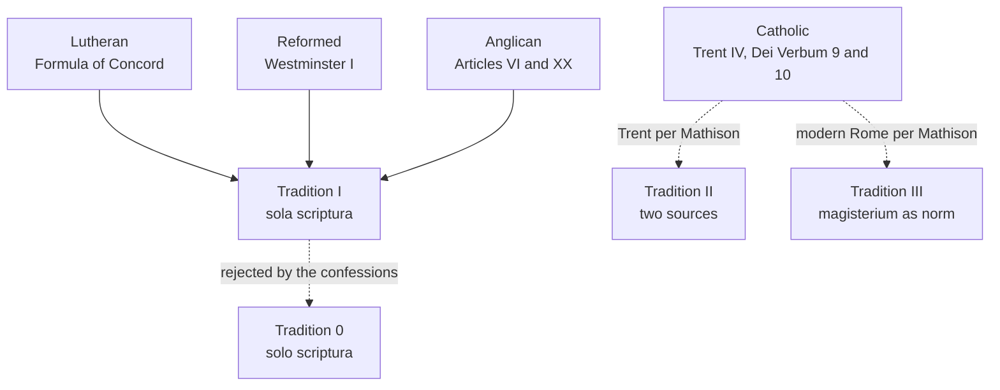

# Apologetics II · Lesson 2.1: Sola scriptura at its best

> ⏱ ~15 min · Module 2: Against sola scriptura · Builds on: [1.1](01-01-shared-ground-and-where-the-argument-is.md), [`fundamental-theology` 3.1](../../fundamental-theology/lessons/03-01-inspiration.md), [`fundamental-theology` 3.4](../../fundamental-theology/lessons/03-04-tradition.md) · Unlocks: [2.2](02-02-the-canon-question.md), [2.3](02-03-tradition-and-what-sufficiency-means.md), [2.4](02-04-perspicuity-tested.md)

## Why this matters

Ask a Catholic apologist what *sola scriptura* means and you will often hear a definition no Reformation confession would sign: every believer alone with his Bible. An easy target, and the wrong one. Module 2 tests the Reformation's formal principle at three joints: canon, sufficiency, clarity. This lesson states it as the confessions and its best defenders state it, and stops before replying.

## The idea

A weights-and-measures office keeps one master standard. Shops measure with rulers calibrated against it, and the rulers carry real authority; when two disagree, both are checked against the master. Throwing the rulers away to eyeball the master is a different system, not loyalty.

That is the shape of [*sola scriptura*](../reference.md#sola-scriptura): scripture the master, the one rule that cannot err; creeds, confessions, councils and pastors the rulers, binding in their place and fallible. Later Lutheran dogmatics called the pair [*norma normans* and *norma normata*](../reference.md#norma-normans-and-norma-normata), the ruling and the ruled rule. Discarding the rulers is [*solo scriptura*](../reference.md#solo-scriptura). The Catholic answer adds an office that says without error what the master reads in a disputed case. The analogy's limit is Module 2's subject: a bar reads itself; scripture must be identified ([2.2](02-02-the-canon-question.md)) and read ([2.3](02-03-tradition-and-what-sufficiency-means.md), [2.4](02-04-perspicuity-tested.md)).

[`fundamental-theology` 3.4](../../fundamental-theology/lessons/03-04-tradition.md) named it only as a foil; this is its first full statement.

## Source

The [Formula of Concord](../reference.md#formula-of-concord) (1577), Epitome, "Of the Summary Content, Rule, and Standard", §1's opening and its last paragraph, *Concordia Triglotta* (St. Louis, 1921), English column:

> We believe, teach, and confess that the sole rule and standard according to which all dogmas together with [all] teachers should be estimated and judged are the prophetic and apostolic Scriptures of the Old and of the New Testament alone ... Other writings ... must not be regarded as equal to the Holy Scriptures, but all of them together be subjected to them, and should not be received otherwise or further than as witnesses ...
>
> ... the Holy Scriptures alone remain the only judge, rule, and standard, according to which, as the only test-stone, all dogmas shall and must be discerned and judged ... But the other symbols and writings cited are not judges, as are the Holy Scriptures, but only a testimony and declaration of the faith ...

Three moves: exclusion ("sole", "alone", "only"; scripture judges teachers as well as doctrines); subordination without discarding (between these paragraphs the Formula pledges itself to the three creeds, the [Augsburg Confession](../reference.md#augsburg-confession), its Apology, the Smalcald Articles and Luther's Catechisms); and judge set apart from witness. The creeds testify how scripture was rightly read and bind whoever confesses them, but never judge beside it. The text has neither *sola scriptura* nor *norma normata*; the Triglot's editor, F. Bente, uses *norma normans* in his introduction.

## The other side

**Lutheran.** The [Book of Concord](../reference.md#book-of-concord) (1580) gathers the creeds, those confessions, the Treatise on the Power and Primacy of the Pope and the Formula, written to settle three decades of Lutheran disputes after Luther's death. Pastors subscribe the Book as a ruled rule under scripture, not as a magisterium, though churches differ in how much of it binds them.

**Reformed.** [Westminster](../reference.md#westminster-confession) chapter I (completed December 1646; Schaff prints the 1647 edition) is the fullest statement:

- *Source* (I.4): authority "dependeth not upon the testimony of any man or church, but wholly upon God", its author.
- *Church and Spirit* (I.5): the Church's testimony may move us to "an high and reverent esteem", and scripture's excellencies evidence it, "yet, notwithstanding, our full persuasion and assurance of the infallible truth ... is from the inward work of the Holy Spirit, bearing witness by and with the Word in our hearts" (the [inward testimony](../reference.md#inward-testimony-of-the-spirit)).
- *Sufficiency* (I.6): the whole counsel of God is "either expressly set down in Scripture, or by good and necessary consequence may be deduced from Scripture", nothing added "by new revelations of the Spirit, or traditions of men".
- *Clarity* (I.7): not all things are alike plain, but what is necessary to salvation is plain somewhere, so the unlearned too, "in a due use of the ordinary means", reach "a sufficient understanding" ([2.4](02-04-perspicuity-tested.md)).
- *Judge* (I.9–10): scripture is the "infallible rule of interpretation" of scripture; the supreme judge is "the Holy Spirit speaking in the Scripture", who examines "all decrees of councils, opinions of ancient writers, doctrines of men, and private spirits".

Synods judge "ministerially" (XXXI.3) but "may err", so they are "a help", not the rule (XXXI.4; XXXI.3 in the American text). Westminster is the subordinate standard of Presbyterian churches. Its inerrancy is shared; its scope ([`fundamental-theology` 3.2](../../fundamental-theology/lessons/03-02-inerrancy.md)) is not argued here.

**Calvin.** [*Institutes*](../reference.md#calvin-institutes) I.7 (1559; tr. Beveridge) is a theologian's book. The Church receiving scripture "does not make that authentic which was otherwise doubtful or controverted" (I.7.2). Conviction rests on "the secret testimony of the Spirit" (I.7.4): scripture is *autopistos*, credible of itself, in Beveridge "carrying its own evidence along with it" (I.7.5). Augustine's "I should not believe the gospel except as moved by the authority of the Catholic Church" (*Against the Epistle of Manichaeus Called Fundamental* ch. 5, §6, tr. Stothert, NPNF1-4) speaks, Calvin answers (I.7.3), of bringing an unbeliever to the gospel: the Church leads the outsider in; the believer's certainty rests elsewhere.

**Anglican.** In the [Thirty-Nine Articles](../reference.md#thirty-nine-articles), nothing scripture neither contains nor proves may be required as of faith (VI), and the Church has authority in controversies under it (XX; [1.1](01-01-shared-ground-and-where-the-argument-is.md)).

**The distinction that has to be got right.** The historian Heiko Oberman (*The Harvest of Medieval Theology*, 1963) found two medieval conceptions: [Tradition I](../reference.md#tradition-i-and-tradition-ii), single-source, tradition as the Church's handing on and interpreting of scripture; and Tradition II, two-source, unwritten apostolic traditions supplying what scripture lacks. The Reformers, on his account, took one side of a medieval disagreement. Keith Mathison's *The Shape of Sola Scriptura* (2001) maps it. *Sola scriptura* is Tradition I: scripture the sole infallible authority, read in the Church under the ancient [rule of faith](../reference.md#rule-of-faith), the creeds real but subordinate. The individualist "Tradition 0" he calls *solo scriptura*, common among modern evangelicals, never the Reformers'; Tradition II he finds dogmatized at Trent, and "Tradition III", the magisterium as itself the norm, in modern Rome. The [Second Helvetic Confession](../reference.md#second-helvetic-confession) (1566, ch. II, in Schaff's English) agrees: since scripture is "not of any private interpretation" (2 Peter 1:20), "we do not allow all kinds of exposition", only readings in accord "with the rule of faith and charity".

**The current defenders.** Michael Kruger's *Canon Revisited* (2012) carries Calvin's line into the canon ([2.2](02-02-the-canon-question.md) states his [self-authenticating](../reference.md#self-authenticating-canon) model). Kevin Vanhoozer's *Biblical Authority after Babel* (2016) calls Protestant interpretive pluralism a failure of practice, not principle, curable by a "plural interpretive unity" among churches in communion. The Orthodox place scripture within Tradition ([1.1](01-01-shared-ground-and-where-the-argument-is.md); Module 5).

## What the reply must answer

1. **Authority's source is shared.** Westminster I.4, Calvin I.7.2 and [*Dei Filius*](../reference.md#dei-filius) (1870, ch. 2) deny that the Church confers it; the dispute is who identifies scripture and settles its reading.
2. **The [canon](../reference.md#canon-of-scripture).** The Formula names its rule without listing it; Westminster and Calvin identify it by the Spirit's witness ([2.2](02-02-the-canon-question.md)).
3. **[Formal sufficiency](../reference.md#material-and-formal-sufficiency).** Not that everything is explicit (I.6 allows consequence), but that scripture interprets itself and, by the Spirit, judges (I.9–10). Material sufficiency is a Catholic option; aim at the formal claim ([2.3](02-03-tradition-and-what-sufficiency-means.md)).
4. **[Clarity](../reference.md#perspicuity) as I.7 states it**, qualifiers included ([2.4](02-04-perspicuity-tested.md)).
5. **Real, fallible authority.** Show why it is not enough; never pretend it is absent ([4.4](04-04-the-visible-church-and-what-replaced-the-papacy.md)).

**What a Catholic may not say after this lesson.** Anything against *solo scriptura* under the name *sola*. "Protestants reject tradition": they reject unwritten additions as a second rule, keeping creeds, Fathers and councils as witnesses. "Luther invented it": Tradition I is medieval. "The inward testimony is condemned fideism": *Dei Filius* (canons on faith, 3) condemns denying that outward signs make revelation credible; Westminster I.5 cites evidences, and Catholic faith too needs the Spirit's interior help ([`fundamental-theology` 2.1](../../fundamental-theology/lessons/02-01-the-act-of-faith.md)). "Trent settled it": an external critique ([`philosophical-method` 4.4](../../philosophical-method/lessons/04-04-arguing-within-a-tradition-the-disputed-question.md)).

**Mark the levels.** On [the ladder](../../fundamental-theology/lessons/04-04-the-ladder-of-doctrinal-authority.md) ([levels of authority](../reference.md#levels-of-authority)): scripture inspired, God its author, is **rung 1** (Trent IV; *Dei Filius*, canons on revelation, 4); *Dei Filius* ch. 2's "not because ... approved by her authority" (Schaff) is chapter text, **at least rung 3**, following from it. The gospel contained "in the written books, and the unwritten traditions", received "with an equal affection of piety, and reverence" (Waterworth), is **rung 1 as worded** ([Trent IV](../reference.md#trent-session-iv), 8 April 1546, sealed by the anathema on knowingly contemning the traditions): equal in reverence, not extent. The denial of formal sufficiency ([*Dei Verbum*](../reference.md#dei-verbum) 9; interpretation entrusted "exclusively" to the teaching office, DV 10) and Trent IV's rule of interpretation are **at least rung 3**. No act condemns "sola scriptura" by name; whether Westminster's or Mathison's formulation falls under Trent IV's anathema is **rung 5**, as is material sufficiency. The other texts have **no Catholic level**, only their standing at home; theologians, and Fathers writing as authors, have **no magisterial level**.

**Concession.** *Sola scriptura* as the confessions state it is not individualism. Catholic polemic that attacks "me and my Bible" attacks a position the Formula, Westminster and the Second Helvetic Confession themselves reject.

**The crux.** Whether a rule that fallible bodies must identify and read can be the *sole infallible* rule, its certainty given by the Spirit's witness through it. The confessions say yes; the Catholic says a list or a disputed reading must somewhere be settled without error, or nothing settled binds as faith. Two findings move it: whether Tradition-I churches kept a common reading of what they call necessary ([2.4](02-04-perspicuity-tested.md)), and whether the earliest Church worked with Tradition I ([2.3](02-03-tradition-and-what-sufficiency-means.md)).

## The map of positions

The confessions sit at Tradition I; the Catholic placement is disputed, and [2.3](02-03-tradition-and-what-sufficiency-means.md) contests it.

## Worked examples

**Example 1 (clean): where a Lutheran gets the Nicene Creed.** Why does a Lutheran pastor confess the non-scriptural *homoousios*? The Formula pledges itself to the creed as "the unanimous, universal Christian faith" of the early Church against heretics ([Rule and Norm](../reference.md#rule-and-norm), §2): a witness that scripture was rightly read against Arius. Westminster's route is "good and necessary consequence" (I.6). The creed binds the pastor who subscribed it, as a ruled rule; "*sola scriptura* cannot account for the creeds" fails.

**Example 2 (strain): a minister against his standard.** An invented case: a Presbyterian minister argues from scripture that a clause of Westminster is wrong, and his presbytery rules that he may not teach it and keep his office. It decides "ministerially", its decision received "also for the power whereby they are made" (XXXI.3); it may err (XXXI.4); the Spirit in scripture is the supreme judge (I.10). The defender adds that standards are amendable (the American revision changed chiefly chapters XXIII and XXXI) and that the ruling binds an office, not a conscience. Here the statement stops determining an answer: it does not say why the minister should prefer the presbytery's reading to his own, beyond the office that made it. Humility, or a magisterium without the name? [2.4](02-04-perspicuity-tested.md) and [4.4](04-04-the-visible-church-and-what-replaced-the-papacy.md) press it.

## Watch out

- **You might think *sola scriptura* means "me and my Bible."** That is *solo scriptura*, which the Second Helvetic Confession (II) and Westminster (I.10, "private spirits") reject. Arguing against it refutes the many who practise it, not the confessions.
- **You might think "self-authenticating" is Calvin's word, or that he gives the Church no role.** Calvin's word is *autopistos* (above); "self-authenticating" is a later translator's and Kruger's. In I.7.2 the Church gives scripture "the stamp of her authority".
- **You might think the Book of Concord is a Lutheran magisterium, or Westminster a museum piece.** Both are subscribed standards, binding and ruled by scripture, neither infallible. The Catholic mirror: Trent never condemned "sola scriptura" by name, and its "equal" is equal reverence, not extent.

## One-liner

> *Sola scriptura* makes scripture the one rule that cannot err and keeps creeds, confessions and synods as real, fallible rules beneath it; argue with that, never with "me and my Bible".

## Problems

**P1 (🟢) *(Diagnose · Exegetical.)*** An invented post on *Keys and Crozier*, a Catholic apologetics blog, written for this problem:

> (1) "*Sola scriptura* means every believer is his own pope: just you, your Bible and the Holy Spirit, with no creed and no church to answer to.
>
> (2) That is why Protestants reject tradition altogether.
>
> (3) Luther made the whole idea up when he broke with Rome.
>
> (4) Trent anathematized *sola scriptura* in 1546, and that closed the question.
>
> (5) The real questions are how anyone knows which books are scripture, and who settles it when two Bible-believing churches read the same verse two ways."

For each numbered sentence, say whether it is a caricature, a historical error, an overstated level, or a fair objection, and name the text or lesson that shows it. **One or two sentences per item.**

**P2 (🟡) *(Apologetic: (a) Exegetical, graded first · (b) reply.)*** Use the Formula of Concord passage in this lesson's Source.

(a) State the Formula's position as a Lutheran theologian would sign it: what it makes the sole rule, what it makes the creeds and the Augsburg Confession, what the line between a judge and a witness amounts to, and the standing the Formula has in Lutheran churches. **Three or four sentences.**

(b) Reply, opening with a **named concession**. Then name the one objection that survives your statement in (a), and the lesson of this module that presses it. **120 words or fewer.** A reply that concludes the Formula's account withstands the objection passes if it is a good reply.

**P3 (🔴, optional) *(Assign the weight · Exegetical, strict.)*** Five sentences from an invented study-group handout, written for this problem. Mark each right or wrong. If wrong, correct it, naming the act (for a Catholic claim) or the text's standing inside its own tradition (for any other).

> (1) "The Formula of Concord is the Lutheran magisterium: its 'sole rule and standard' is an infallible Lutheran definition."
>
> (2) "The Westminster Confession is a seventeenth-century document; a Presbyterian minister today owes it nothing."
>
> (3) "Mathison's *The Shape of Sola Scriptura* is the Reformed churches' official modern restatement, so *solo scriptura* is confessional language."
>
> (4) "Trent IV condemned *sola scriptura* by name under anathema, so whoever holds Westminster I.6 falls under it."
>
> (5) "That scripture and the unwritten traditions are received with equal reverence is a pious opinion, freely disputed among Catholics."

**Two sentences per item.**

Solutions

**P1** *(Diagnose · Exegetical)*

**Accept:** any answer that sorts all five correctly and grounds each in a text or lesson; for (3), "historical error" or "caricature" if the reason given is Oberman's medieval Tradition I.

**Must hit, strict:**

- **(1) Caricature.** This is *solo scriptura* (Mathison's Tradition 0), not the confessions' position: the Second Helvetic Confession (II) refuses "all kinds of exposition" and binds reading to the rule of faith, the Formula pledges itself to the three creeds, and Westminster gives synods real authority (XXXI.3).
- **(2) Caricature by blur.** The confessions reject unwritten traditions as a second rule (Westminster I.6, "traditions of men"; Second Helvetic II), but keep the creeds and Fathers as witnesses (the Formula) and councils as "a help" (Westminster XXXI.4).
- **(3) Historical error.** On Oberman's account Tradition I is a medieval conception the Reformers took up; they took a side in an existing disagreement rather than inventing a principle.
- **(4) Overstated level, and the wrong kind of argument.** No act condemns *sola scriptura* by name. Trent IV's anathema strikes refusing the canon and knowingly and deliberately contemning the traditions; the denial of formal sufficiency is at least rung 3, and whether a given Protestant formulation falls under the anathema is rung 5. "Closed" is an external critique, settling nothing for someone who does not grant Trent.
- **(5) A fair objection.** It survives the correct statement: the canon is [2.2](02-02-the-canon-question.md), and who settles a disputed reading is formal sufficiency and clarity ([2.3](02-03-tradition-and-what-sufficiency-means.md), [2.4](02-04-perspicuity-tested.md)). Credit for noticing the post's only good sentence comes last.

**Wrong turns:** calling (5) another caricature. Correcting (1) by saying Protestants "have a magisterium too", which overstates the other way. Calling (4) correct because Trent IV contains an anathema. Answering (2) by saying the confessions accept unwritten apostolic traditions.

**Model answer:** (1) Caricature: this is *solo scriptura*; the Second Helvetic Confession rejects private interpretation, and the Formula binds its pastors to the creeds. (2) Blur: what the confessions reject is unwritten tradition as a second rule; creeds, Fathers and councils stay as witnesses and helps (Formula; Westminster XXXI.4). (3) Historical error: Oberman's Tradition I is medieval, and the Reformers took one side of an older dispute. (4) Overstated: Trent IV never names *sola scriptura*; its anathema strikes refusing the canon and contemning the traditions, the denial of formal sufficiency is at least rung 3, and whether Westminster falls under the anathema is rung 5. "Closed" is also an external critique. (5) Fair: the canon (2.2) and who settles disputed readings (2.3–2.4) survive the correct statement.

---

**P2** *(Apologetic: (a) Exegetical, graded first · (b) reply)*

**Accept:** any reply that opens with a real concession and names an objection that survives the statement in (a), whatever its verdict.

**Must hit, strict (a), graded first:**

- **The rule.** The prophetic and apostolic scriptures alone are the sole rule and standard and the only judge, by which all doctrines and all teachers are judged.
- **The creeds and confessions.** They are not set aside: Lutherans pledge themselves to the three creeds and to the Augsburg Confession and its companions, and these bind whoever confesses them. But they are received as witnesses and declarations of how scripture was rightly understood and error rejected, never as judges equal to scripture.
- **Standing.** The Formula belongs to the Book of Concord (1580), the confessional standard Lutheran pastors subscribe. Later Lutheran dogmatics calls it a *norma normata* under scripture, the *norma normans*. It is not a magisterium, claims no infallibility of its own, and has no Catholic level.

**Must hit (b):**

- **A named concession:** this is not "me and my Bible". The Formula binds its pastors to the creeds and to a public confession, and its line between judge and witness is coherent; *Dei Verbum* 10 likewise says the teaching office is not above the word but serves it.
- **The surviving objection, named, with its lesson.** Either the reading of the test-stone: the Formula was written to settle disputes among Lutherans, all holding scripture the sole rule, in the three decades after Luther's death (1546), and once subscribed it settled them in practice, so a witness did a judge's work (formal sufficiency, [2.3](02-03-tradition-and-what-sufficiency-means.md), or clarity, [2.4](02-04-perspicuity-tested.md)). Or the canon: the Formula names "the prophetic and apostolic Scriptures" without listing them ([2.2](02-02-the-canon-question.md)).
- **The Lutheran answer, met:** the Formula claims only to testify to what scripture already says, and stays answerable to it; the reply must say how that check works in a live dispute.

**Wrong turns:** stating (a) as "Lutherans reject tradition" or "the creeds have no authority"; either fails the problem. Calling the Formula the Lutheran magisterium. Putting *norma normans* or *sola scriptura* in the Formula's own mouth. Reading Westminster into it ("the Holy Spirit speaking in the Scripture" is Westminster I.10's phrase, not the Formula's). In (b), attacking *solo scriptura*, or answering "Trent condemned it".

**Model answer (a):** The prophetic and apostolic scriptures alone are the sole rule and standard, the only judge by which every doctrine and teacher is judged. The ancient creeds and the Lutheran confessions are not set aside: Lutherans pledge themselves to them, and they bind those who confess them, but as witnesses showing how scripture was rightly understood and error rejected, never as judges beside scripture. The Formula belongs to the Book of Concord (1580), the standard Lutheran pastors subscribe: in later Lutheran terms a *norma normata* under scripture, the *norma normans*. It is not a magisterium and claims no infallibility of its own.

**Model answer (b), one of several:** Concession: this is not "me and my Bible". The Formula binds its pastors to the creeds and a public confession, and its line between judge and witness is coherent; *Dei Verbum* 10 also puts the teaching office under the word. What survives is the reading of the test-stone. The Formula exists because Lutherans, all holding scripture the sole rule, disputed for three decades after Luther's death, and once subscribed it settled those disputes in practice. A witness did a judge's work. The Lutheran answer is that it only testifies to what scripture already says, and stays answerable to it. Then who checks it, and how? That is formal sufficiency, pressed in 2.3 and 2.4.

---

**P3** *(Assign the weight · Exegetical, strict)*

**Must hit, strict:**

- **(1) Wrong, overstated.** The Formula is part of the Book of Concord, the confessional standard Lutheran pastors subscribe: a ruled rule (*norma normata*) under scripture that calls itself a witness, not a judge, and claims no infallibility. Its "sole rule and standard" names scripture, not itself.
- **(2) Wrong, understated.** Westminster is the subordinate standard of Presbyterian churches, which their officers vow to receive, with a strictness that varies by church. It binds office and can be amended (the American revision did so), but it is far from nothing.
- **(3) Wrong, overstated.** Mathison's book (2001) is a theologian's book with no confessional standing, weighed by its arguments; the Reformed confessions are Westminster, the Belgic and the Second Helvetic. *Solo scriptura* is his useful label, not confessional language, though the confessions reject what it names.
- **(4) Wrong, overstated twice.** No act names *sola scriptura*. Trent IV's anathema strikes refusing the canon and knowingly and deliberately contemning the traditions; the denial of formal sufficiency is at least rung 3 (Trent IV with *Dei Verbum* 9–10), and whether Westminster I.6 falls under the anathema is rung 5.
- **(5) Wrong, understated.** It is rung 1 as worded: Trent IV's first decree, sealed by the anathema on contemning the traditions. The equality is of reverence, not of extent; what is freely disputed (rung 5) is material sufficiency, whether some revealed truth is carried by tradition alone ([`fundamental-theology` 3.4](../../fundamental-theology/lessons/03-04-tradition.md)).

**Wrong turns:** marking (3) right because Mathison is Reformed. Placing a Protestant text on the Catholic ladder ("the Formula is rung 3 for Lutherans"). Giving (4) "rung 2" or "heresy". Giving (5) rung 3, or reading "equal reverence" as "equal content".

**Model answer:** (1) Wrong: the Formula is a subscribed confessional standard, a *norma normata* under scripture that calls itself a witness; its "sole rule" is scripture, and it claims no infallibility. (2) Wrong: Westminster is the subordinate standard of Presbyterian churches, which officers vow to receive; it binds office and can be amended. (3) Wrong: a theologian's book with no confessional standing; *solo scriptura* is his label, though the confessions reject what it names. (4) Wrong: Trent IV names no such doctrine; its anathema strikes refusing the canon and contemning the traditions; the denial of formal sufficiency is at least rung 3, and whether Westminster I.6 falls under the anathema is rung 5. (5) Wrong: rung 1 as worded (Trent IV), equal in reverence, not extent; material sufficiency is the freely disputed question.

## Flashback

**From Lesson [1.2](01-02-what-the-church-says-about-other-christians.md) (What the Church says about other Christians):** *(Exegetical, strict · close reading.)* Augustine, Letter 87, §§4, 9–10, to Emeritus, the Donatist bishop at Caesarea, headed "To His Brother Emeritus" (NPNF1-1, tr. J. G. Cunningham; dated 405). Its §§7–8, not quoted, defend the civil powers' action against schismatics.

> [...] you nevertheless perpetuate the evil which was wrought in the division of the Church of Christ by your forefathers. [...] We exhort you to change, in so far as concerns your dissent from the Church; although, as to the sacraments which you had, we admit that they are holy [...]. Do you therefore in like manner desist from the commonplaces of rhetorical exaggeration concerning actions of men [...]; for you see how I am silent concerning deeds of your party, in order to confine the debate to the question upon which the whole matter hinges, namely, the origin of the schism.

(a) Name three things the letter does that 1.2 asks of a Catholic arguing with other Christians, and the premise (P1–P5) each keeps.

(b) Which sentence could a Catholic not write to a Lutheran or Orthodox Christian today? Name the teaching that forbids it, with its weight, and give the letter's weight.

**Two sentences per part.**

Solution

**Accept:** any wording that ties each move to the right premise and keeps the two weights apart.

**Must hit, strict:**

- (a) He calls Emeritus brother and admits his sacraments holy: **P1**, brotherhood resting on baptism given outside (Trent VII, *On Baptism*, can. 4, **rung 1**). He exhorts him to give up his dissent: **P3 and P5**, the doctrine whole and proposed, not [false irenicism](../reference.md#false-irenicism). He keeps silent about the other party's scandals, asks the same of Emeritus ("desist from ... rhetorical exaggeration") and holds the debate to its hinge: **P4**, truth and fairness (UR 4), not a rhetorical win.
- (b) **The sentence:** "you nevertheless perpetuate the evil ... by your forefathers" charges the heir of a separation with its sin. **P2** forbids it: those born into the separated communities cannot be charged with the sin of separation, for which people on both sides were at times to blame ([UR](../reference.md#unitatis-redintegratio) 3, **rung 3**). Augustine, writing as an author, has **no magisterial level**. Credit: his Letter 43.1 ([`ecclesiology-and-mariology` 2.1](../../ecclesiology-and-mariology/lessons/02-01-one.md)) spares those who took an error from their parents, so this charge rests on judging Emeritus obstinate, which UR 3 presumes of no one born into a separated community.

**Wrong turns:** reading "brother" as courtesy; calling the exhortation polemic; choosing "we admit that they are holy" as the forbidden sentence; giving Augustine a rung or UR 3 a definition. Holding up the whole letter as a model: §§7–8 lean on civil pressure, a means P5 excludes (the coercion letters are [`patristics` 4.4](../../patristics/lessons/04-04-augustine-against-the-donatists.md)).

**Model answer:**

(a) He calls Emeritus brother and owns his sacraments as holy (P1), yet exhorts him to give up his dissent, the doctrine whole and proposed (P3, P5). He keeps silent about the other side's scandals and asks the same restraint, to hold the debate to its hinge: the truth and fairness of P4.

(b) Not "you nevertheless perpetuate the evil ... by your forefathers": UR 3 (rung 3) says those born into the separated communities cannot be charged with the sin of separation, for which both sides were at times to blame. Augustine, writing as an author, has no magisterial level.

## Connections

- **Backward:** [1.1](01-01-shared-ground-and-where-the-argument-is.md) put *sola scriptura* on the first axis and showed its many answers on the second; this lesson states it whole. [1.2](01-02-what-the-church-says-about-other-christians.md)'s P4, *Unitatis Redintegratio* 4's "truth and fairness", is the rule it obeys. The Catholic doctrine argued from is [`fundamental-theology` 3.1](../../fundamental-theology/lessons/03-01-inspiration.md) and [3.4](../../fundamental-theology/lessons/03-04-tradition.md); the act of faith is its [2.1](../../fundamental-theology/lessons/02-01-the-act-of-faith.md); internal and external critique are [`philosophical-method` 4.4](../../philosophical-method/lessons/04-04-arguing-within-a-tradition-the-disputed-question.md).
- **Forward:** [2.2](02-02-the-canon-question.md) argues the canon and states Kruger's model; [2.3](02-03-tradition-and-what-sufficiency-means.md) defines formal sufficiency and contests the Tradition II placement; [2.4](02-04-perspicuity-tested.md) tests Westminster I.7. [4.4](04-04-the-visible-church-and-what-replaced-the-papacy.md) asks what real, fallible authority achieved; [6.1](06-01-mary.md) uses the Marian dogmas as a test of warrant; [3.1](03-01-justification-as-the-confessions-state-it.md) states the material principle as this lesson stated the formal one.
- **Sideways:** H. L. A. Hart's rule of recognition, in [`philosophy-of-law`](../../philosophy-of-law/syllabus.md), says a legal system needs a rule identifying what counts as law and officials who practise it; the canon question asks the same of a rule of faith. The Orthodox account of scripture within Tradition, promised by [`fundamental-theology` 3.1](../../fundamental-theology/lessons/03-01-inspiration.md), is given in [1.1](01-01-shared-ground-and-where-the-argument-is.md) and argued in Module 5.
