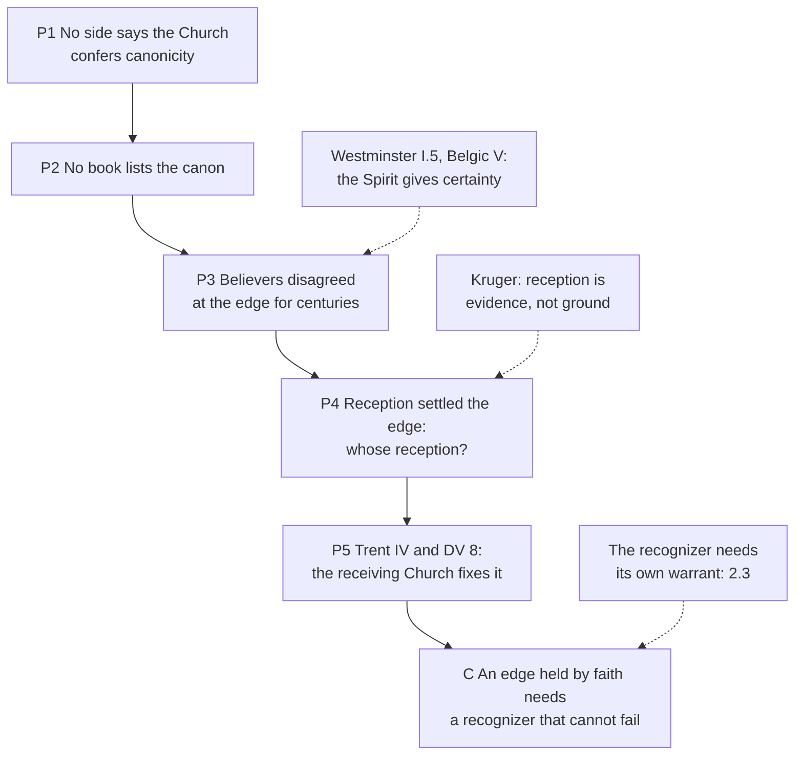

# Apologetics II · Lesson 2.2: The canon question

> ⏱ ~15 min · Module 2: Against sola scriptura · Builds on: [2.1](02-01-sola-scriptura-at-its-best.md), [`old-testament` 6.1](../../old-testament/lessons/06-01-how-the-old-testament-canon-formed.md), [`new-testament` 6.6](../../new-testament/lessons/06-06-the-formation-of-the-canon.md), [`fundamental-theology` 3.3](../../fundamental-theology/lessons/03-03-the-canon-as-defined.md) · Unlocks: [2.3](02-03-tradition-and-what-sufficiency-means.md), [6.3](06-03-penance-purgatory-and-indulgences.md)

## Why this matters

"Who gave you your Bible?" is the Catholic tract's favourite question. Calvin answered it in 1559, quoting his opponents: "who persuade us that this book is to be received with reverence, and that one expunged from the list, did not the Church regulate all these things with certainty?" (*Institutes* I.7.1, Beveridge). Scripture has no inspired table of contents, so [*sola scriptura*](../reference.md#sola-scriptura) must say how a list it does not contain is known. Both sides answer "who made the list?" alike; the argument lies elsewhere.

## The idea

A catalogue of a painter's works does not make a canvas his; it *recognizes* what he painted. Ask a Catholic and a Reformed theologian what the [canon of Scripture](../reference.md#canon-of-scripture) is, and both say: a catalogue, not a commission. Two disputes remain.

1. **Which canvases.** Everyone here receives the same twenty-seven New Testament books. Rome and the Reformation churches dispute the Old Testament's seven [deuterocanonical books](../reference.md#deuterocanon) (Tobit, Judith, Wisdom, Sirach, Baruch, 1–2 Maccabees) and the Greek parts of Esther and Daniel.
2. **How certain the catalogue is.** The Catholic says the Church's recognition cannot fail when she defines. The Reformed say the canvases bear their painter's marks, which the Spirit teaches believers to see, so certainty does not wait on the cataloguer. A slogan current among Reformed writers states the price: "a fallible collection of infallible books".

The history is [`old-testament` 6.1](../../old-testament/lessons/06-01-how-the-old-testament-canon-formed.md) and [`new-testament` 6.6](../../new-testament/lessons/06-06-the-formation-of-the-canon.md); Trent and *Dei Filius* are [`fundamental-theology` 3.3](../../fundamental-theology/lessons/03-03-the-canon-as-defined.md). This lesson argues over what that record proves.

## The other side

[2.1](02-01-sola-scriptura-at-its-best.md) stated the principle; here is what each tradition says about the list. No reply yet.

**Reformed, confessional.** The [Westminster Confession](../reference.md#westminster-confession) (1646; Schaff dates it 1647) names sixty-six books (I.2). The Apocrypha, "not being of divine inspiration, are no part of the Canon", and have "no authority in the Church of God" beyond "other human writings" (I.3). Full persuasion comes from the [inward work of the Spirit](../reference.md#inward-testimony-of-the-spirit) (I.5). The [Belgic Confession](../reference.md#belgic-confession) (1561) applies this to the list itself. Its books are received

> not so much because the Church receives and approves them as such, but more especially because the Holy Ghost witnesseth in our hearts that they are from God, whereof they carry the evidence in themselves (Art. V, Schaff vol. 3).

"Not so much": reception is subordinate, not zero. *Weight:* Westminster is the Presbyterian subordinate standard and Belgic a continental Reformed standard. Neither is a magisterium.

**Calvin.** Beyond [*Institutes*](../reference.md#calvin-institutes) I.7 (2.1), the Church's long consent is a secondary help "to our weakness" (I.8.13). His [*Antidote*](../reference.md#calvin-antidote) (1547) answers Session IV: marking "all the books with the same chalk" defies "the consent of the primitive Church". Jerome reports the earlier common opinion, and Rufinus says the Fathers called Ecclesiasticus, Wisdom, Tobit, Judith and Maccabees "not canonical but ecclesiastical books", read to the people, not used to establish doctrine. Calvin grants that Carthage and Augustine held Trent's view, but since not all agreed, "let us assume that the point was then undecided". Internal evidence tips it: 2 Maccabees' writer begs pardon if he wrote poorly (15:38; DR 15:39), which is "alien … from the majesty of the Holy Spirit". He suspects a motive (2 Maccabees will "prove Purgatory") but does not "entirely disapprove the reading of those books". *Weight:* a theologian's works, not a confession.

**Anglican.** [Article VI](../reference.md#thirty-nine-articles) (Latin 1563, English 1571) counts as canonical the books "of whose aucthoritie was neuer any doubt in the Churche". The others, citing Jerome, the Church reads "for example of lyfe and instruction of manners" but does not apply "to establishe any doctrene" (1571 English, Schaff). *Weight:* Anglican formularies, subscribed variously across the Communion.

**Lutheran.** The [Book of Concord](../reference.md#book-of-concord) has **no canon list**. The Formula's rule, "the prophetic and apostolic Scriptures", is unenumerated (Epitome, Rule and Standard, Triglot). Luther's 1534 Bible printed the deuterocanon apart (`old-testament` 6.1). His [1522 New Testament](../reference.md#luthers-1522-prefaces) numbered twenty-three books and set Hebrews, James, Jude and Revelation after them, unnumbered. In the lesson's translation, these four "have in times past had a different standing" (Hebrews preface). James is not "in the number of the true chief books" (*hewbtbucher*), yet Luther will not "forbid anyone to place and raise him as he pleases". *Weight:* a theologian's prefaces. The straw remark is [`new-testament` 6.3](../../new-testament/lessons/06-03-james-faith-and-works.md)'s.

**The modern restatement.** Michael J. Kruger, a Reformed New Testament scholar, develops the Reformed view in *Canon Revisited* (2012), a study of the New Testament books, as a [self-authenticating canon](../reference.md#self-authenticating-canon). He rejects models that ground the canon in a community's decision, the Roman Catholic among them, or in historians' criteria. On his account canonical books bear three attributes: **divine qualities** (beauty, covenantal unity, spiritual efficacy), **corporate reception** by the Church, and **apostolic origins**. The Holy Spirit enables believers to recognize them. Reception is evidence the books bear, not the ground of their authority. It explains what a bare appeal to the Church does not: how books were known before any council listed them ("use first, list second", `new-testament` 6.6); why reception counts without making the Church Scripture's source (Westminster I.4); why the core was received early and the edges late; and how a believer can be certain without first proving an infallible recognizer. *Weight:* a scholar's book.

## The argument

**P1.** Neither side says the Church confers canonicity. [*Dei Filius*](../reference.md#dei-filius) ch. 2 (24 April 1870): the books are canonical "not because, having been carefully composed by mere human industry, they were afterwards approved by her authority", but because they have God for their author (Schaff vol. 2), as Westminster I.4 and Calvin I.7.2 also say. *In words:* "who made the list?" is not the disagreement.

**P2.** No book of Scripture lists the books of Scripture, so every side knows the list's edge by something beyond their text: reception, Tradition, the Spirit's witness, or several. *In words:* each side owes an account of how the edge is known.

**P3.** Believers who had the Spirit's witness disagreed about the edge for centuries: over Hebrews, James and Revelation (`new-testament` 6.6), over the deuterocanon (`old-testament` 6.1), and in Luther's 1522 ranking against Belgic IV. *In words:* the inward witness, given believer by believer, did not deliver one list.

**P4.** Where the edge was settled, reception settled it, and reception is a church's act. For the New Testament, Catholic, Orthodox and Reformation reception converged on twenty-seven; for the Old, churches that read the deuterocanon in worship received the longer list (Carthage, Augustine, Florence), and the shorter follows Jerome and the synagogue. *In words:* once reception counts, the question is whose.

**P5.** [Trent, Session IV](../reference.md#trent-session-iv) (8 April 1546) names the books "as they have been used to be read in the Catholic Church" and defines them under anathema "entire with all their parts" (Waterworth). [*Dei Verbum*](../reference.md#dei-verbum) 8 (1965) teaches that the full canon is known through Tradition. *In words:* the receiving Church, assisted by the Spirit when she defines, fixes the edge, and the believer holds the list by faith (*Dei Filius* ch. 3).

**∴ C.** An edge held with the certainty of faith, not as a revisable historical judgment, needs a recognizer that cannot fail when it defines. At the disputed edge the Reformed account rests on reception, which is the point at issue.

**Mark the levels.** ([the ladder](../../fundamental-theology/lessons/04-04-the-ladder-of-doctrinal-authority.md); [levels of authority](../reference.md#levels-of-authority).)

- The canon entire with all its parts, deuterocanon included: **rung 1** (Trent IV, first decree, with anathema; *Dei Filius* can. II.4).
- Recognition, not conferral (*Dei Filius* ch. 2): **at least rung 3** as chapter text, its substance following from can. II.4's rung-1 inspiration.
- The canon known through Tradition (DV 8): **rung 3**.
- Florence's [decree for the Copts](../reference.md#council-of-florence) (4 February 1442) "receives and venerates" the books (*suscipit et veneratur*, DS 1334–1335) without anathema or the word "canonical": **at least rung 3**, not manifestly a definition (can. 749 §3).
- "Deuterocanonical" is a historians' label: **no rank**. Jerome's and Cajetan's doubts, and other traditions' texts, have **no magisterial level**.

**Concession.** The Reformers did not invent their Old Testament: the Reformed and Anglican list is the Hebrew canon Jerome defended (`old-testament` 6.1), and Article VI cites him. Jerome doubted the deuterocanon, and Cardinal Cajetan, Luther's examiner in 1518 ([`church-history` 6.1](../../church-history/lessons/06-01-the-late-medieval-church-and-luthers-protest.md)), still ranked Judith, Tobit and Maccabees with Jerome in his commentary on the historical books. The Catholic canon was not defined under anathema before 1546; Florence listed it without one.

**The crux.** Can a recognition carry more certainty than the body that recognizes? `fundamental-theology` 3.3 P3(b) asked whether "recognize" describes Trent's act; this asks how sure its result can be. Reformed: certainty never passes through the recognizer; it comes from the Spirit's witness to what the books are (Westminster I.5, Belgic V, Kruger), so a confession's list may be fallible while no book on it is. Catholic: P3 shows that witness did not fix the edge, so only a recognizer that cannot fail makes the edge an object of faith. That recognizer needs its own warrant, the [circle](../reference.md#circularity-objection) of [2.3](02-03-tradition-and-what-sufficiency-means.md). What would move it: for the Reformed, an account of how the Spirit's witness tells Esther from Wisdom without borrowing a church's reception; for the Catholic, who carries the [larger burden](../reference.md#burden-of-the-catholic-claim), a warrant for the recognizer that does not presuppose it ([`fundamental-theology` 2.2](../../fundamental-theology/lessons/02-02-credibility-and-the-preambles-of-faith.md)'s motives of credibility).

## The argument map

The Reformed objections bite at P3 and P4, where the argument passes from the books to their receivers.

## Worked examples

**Example 1 (clean): Hebrews.** Luther's 1522 preface denies it to Paul or any apostle (2:3), praises its learning and lists it unnumbered. Belgic IV and Trent count it among Paul's fourteen; Westminster I.2 lists it after Paul's letters, unattributed. Run the argument. P3: two Reformation churches ranked one book differently. P4: the Reformed confessions sided with the churches' long reception against Luther's ranking, which a Reformed reply can grant gladly, since corporate reception is one of Kruger's attributes. Both sides use reception: the Reformed as evidence the book bears, the Catholic as the act of a Church that cannot fail when she defines.

**Example 2 (strain): the Wisdom of Solomon.** Jerome let it be read for edification, not to ground doctrine (`old-testament` 6.1's Source); Athanasius in 367 set it outside the canon among books to be read; Carthage and Augustine counted it in; Florence listed it. Run P4: whose reception? The Church's own reception splits, and history alone yields Calvin's "undecided". Here the argument stops determining an answer. To get from "undecided before 1546" to "defined in 1546", the Catholic needs a premise no historian supplies: that the Church's later definitive judgment settles what earlier reception left open. That is P5's authority claim, which 2.3 and Module 4 must carry. So Trent answers the shorter list (`fundamental-theology` 3.3's question) with authority, not with a better history.

## Watch out

- **You might think "Protestants made up their own Old Testament",** but the Reformed and Anglican list is the Hebrew canon Jerome defended, and the traditions differ over the rest: Westminster I.3 gives it no authority, Article VI reads it for example of life, Luther printed it apart. "Protestants" is the blur; name the text.
- **You might think Luther cut Hebrews, James, Jude and Revelation from his Bible,** but he printed all four, last, with prefaces that rank them and forbid no one to rank James higher. A prefatory judgement is not an excision, and the Lutheran confessions never adopted his rankings.
- **You might think Florence defined the canon in 1442, or that "deuterocanonical" means second-class,** but Florence's list has no anathema and not even the word "canonical" (at least rung 3), while Trent's single list is rung 1 for all seventy-three books. One error overstates a level, the other understates one.

## One-liner

> Both sides say the Church recognized the canon rather than made it; the dispute is whether that recognition can carry the certainty of faith, which at the edge the record alone cannot settle.

## Problems

**P1 (🟢)** *(Close reading · Exegetical)* Two texts from Schaff's *Creeds of Christendom* vol. 3 (public domain). The Thirty-Nine Articles, Article VI, in the 1571 English (old spelling, as Schaff prints it):

> In the name of holy Scripture, we do vnderstande those Canonicall bookes of the olde and newe Testament, of whose aucthoritie was neuer any doubt in the Churche. [*The list follows.*] And the other bookes, (as Hierome sayth) the Churche doth reade for example of lyfe and instruction of manners: but yet doth it not applie them to establishe any doctrene. [*The list follows.*] All the bookes of the newe Testament, as they are commonly receaued, we do receaue and accompt them for Canonicall.

The Westminster Confession I.3:

> The books commonly called Apocrypha, not being of divine inspiration, are no part of the Canon of the Scripture; and therefore are of no authority in the Church of God, nor to be any otherwise approved, or made use of, than other human writings.

(a) Under each text, what may a church do with the deuterocanonical books, and what may it not do? Name the words that decide it.

(b) Article VI uses one test for the Old Testament books and another for the New. Name both, and say why the difference matters, using a book that [`old-testament` 6.1](../../old-testament/lessons/06-01-how-the-old-testament-canon-formed.md) or [`new-testament` 6.6](../../new-testament/lessons/06-06-the-formation-of-the-canon.md) tracked.

**Two sentences per part.**

**P2 (🟡)** *(Diagnose · Exegetical)* Four sentences from *Who Bound the Book?*, an invented Catholic tract written for this problem (no real author, parish or publisher):

> (1) Without the Catholic Church there would be no Bible: the Church gave these books their authority when she chose them, and every Protestant who quotes Scripture is borrowing that authority.
>
> (2) Until Luther nobody in the Church had ever doubted Tobit or Maccabees; the doubts were invented to get rid of purgatory.
>
> (3) The Council of Florence had already infallibly defined all forty-six books in 1442, so Trent only repeated a dogma.
>
> (4) Every book in the Protestant Old Testament is also in the Catholic one.

One sentence is right: say which. For each of the other three, name the error and correct it, giving a level where one is involved. **One sentence each.**

**P3 (🔴)** *(Apologetic: (a) Exegetical, graded first · (b) reply)* A Reformed study group is reading Calvin's *Antidote* to Trent's Session IV (1547) and asks a Catholic guest to answer it.

(a) State Calvin's case against receiving the deuterocanon as the *Antidote* gives it: the authority he appeals to, what he concedes, the internal argument he adds, and the use of the books he still allows. Say what weight the text has.

(b) Reply. Open with a **named concession**. Say whether the historical record alone decides between Calvin and Trent, and name the premise a Catholic must add.

**150 words or fewer in total.** A reply that concludes Calvin is right passes if it is a good reply.

Solutions

**P1** *(Close reading · Exegetical)*

**Must hit, strict:**

- **(a) Article VI:** the Church may read the books publicly ("doth reade for example of lyfe and instruction of manners") but may not use them as a premise ("not applie them to establishe any doctrene"). They have a place in worship and none in doctrine.
- **(a) Westminster I.3:** the books have "no authority in the Church of God" and may be "approved, or made use of" no "otherwise … than other human writings". A church may use them as it may use any other human writing, but not as Scripture and not with the Church's authority. The ground is stated: "not being of divine inspiration".
- **(b) The two tests:** for the Old Testament, books "of whose aucthoritie was neuer any doubt in the Churche"; for the New, books "as they are commonly receaued", that is, reception.
- **(b) Why it matters:** the first test, applied strictly, fails books both lists keep. Esther was left out by Melito and set apart by Athanasius (`old-testament` 6.1, Example 1); James, Jude and 2 Peter were "disputed" for Eusebius (`new-testament` 6.6). So the Article cannot use "never doubted" on the New Testament, and there it falls back on reception, the very criterion the Catholic argument presses in P4.

**Wrong turns:** treating the two texts as one "Protestant" view; they differ on use. Reading Westminster as forbidding anyone to read the books at all, when it denies them only standing above human writings. Saying Article VI calls them canonical of a second rank, when it never calls them canonical. Concluding from (b) that Anglicans accept the deuterocanon.

**Model answer:** (a) Article VI lets the Church read them "for example of lyfe and instruction of manners" but forbids applying them "to establishe any doctrene", so they belong in worship and never in proof. Westminster gives them "no authority in the Church of God", no more than "other human writings", because they are "not … of divine inspiration". (b) The Old Testament test is never doubted in the Church; the New Testament test is "commonly receaued". The first would fail Esther, which Melito omitted, and James and 2 Peter, which Eusebius called disputed, so for the New Testament the Article quietly relies on reception.

---

**P2** *(Diagnose · Exegetical)*

**Accept:** any wording that makes the moves below, one sentence each.

**Must hit, strict:**

- **(4) is right.** All thirty-nine books are in the Catholic Old Testament. The Catholic Esther and Daniel also carry Greek parts, which does not make a Protestant book missing.
- **(1) makes the Church confer canonicity.** *Dei Filius* ch. 2 denies that the books are sacred because the Church approved them (at least rung 3 as chapter text, its substance following from the rung-1 inspiration of can. II.4). Calvin I.7.2 and Westminster I.4 say the same, so "who made the list" is common ground, and the dispute lies at the list's edge and in the certainty of the recognition.
- **(2) manufactures a consensus** ([1.3](01-03-arguing-from-history-without-abusing-it.md)). Jerome excluded those books from the canon in the 390s, Rufinus reports the same of earlier Fathers, and Cardinal Cajetan still ranked them with Jerome in Luther's own lifetime. The purgatory motive is half true, since Calvin says 2 Maccabees will now "prove Purgatory", but the doubt is eleven centuries older than that quarrel.
- **(3) overstates a level.** Florence's decree for the Copts "receives and venerates" the books with no anathema on the list and without the word "canonical". It is at least rung 3, and whether it defined the list is not manifest (can. 749 §3). The definition, rung 1, is Trent's.

**Wrong turns:** correcting (1) by giving the Church no role at all (the books were "delivered as such to the Church", and DV 8 has the canon known through Tradition). Correcting (2) by saying the Church never accepted the books before Trent, when Carthage, Augustine and Florence did. Correcting (3) by giving Florence's list no authority. Calling (4) false because of the Greek parts of Esther.

**Model answer:** (4) is right: the thirty-nine are all among the forty-six. (1) *Dei Filius* ch. 2 (at least rung 3, grounded in rung-1 inspiration) denies that the Church's approval makes the books sacred, and Calvin and Westminster agree, so the quarrel is over the list's edge, not its author. (2) Jerome excluded them in the 390s, Rufinus reports earlier Fathers doing so, and Cajetan still ranked them with Jerome in Luther's lifetime, so the doubt is ancient, whatever use was later made of it against purgatory. (3) Florence received and venerated the books without an anathema or the word "canonical" (at least rung 3, not manifestly defined); Trent defined them (rung 1).

---

**P3** *(Apologetic: (a) Exegetical, graded first · (b) reply)*

**Accept:** any reply that opens with a real concession, answers whether the record decides, and names the premise, whatever its verdict.

**Must hit, strict (a), graded first:**

- **Appeal:** the "consent of the primitive Church". Jerome reports the earlier common opinion, and Rufinus, with Jerome, says the Fathers called Ecclesiasticus, Wisdom, Tobit, Judith and Maccabees "ecclesiastical" and not canonical books: read to the people, not entitled to establish doctrine.
- **Concession:** Carthage and Augustine (*On Christian Doctrine*) held Trent's view. Since Augustine says not all agreed, Calvin takes the point to have been "then undecided".
- **Internal argument:** 2 Maccabees' writer asks pardon if he has written poorly (15:38; DR 15:39), which Calvin finds alien to the Spirit's majesty.
- **Use allowed:** he does not wholly disapprove of reading the books. His charge is that Trent gave them an authority they never had (and he suspects the motive: purgatory and the saints from 2 Maccabees, satisfactions from Tobit).
- **Weight:** a theologian's polemical tract, not a confession. The Reformed confessional texts are Westminster I.3 and Belgic VI.

**Must hit (b):**

- **A named concession,** stated flatly. For example: Jerome and Rufinus held what Calvin says they held; or Augustine's own words show the question was disputed in his day; or the books had no anathema behind them before 1546.
- **Whether the record decides:** no. Jerome and Athanasius stand against Carthage, Augustine and Florence, so on history alone "undecided" is a fair verdict.
- **The premise a Catholic must add:** that the Church's later definitive judgment, assisted by the Spirit, settles what earlier reception left open. Say that this is an authority claim needing its own warrant (2.3; Module 4).
- **Credit, not required,** for answering the internal argument: inspiration works through a true human author's own powers ([`fundamental-theology` 3.1](../../fundamental-theology/lessons/03-01-inspiration.md)), so an author's modest apology is no evidence against it. Luke's prologue reports research in the same way.

**Wrong turns:**

- Stating (a) as "Calvin threw the books out of the Bible" or "forbade reading them". That is a caricature, and it fails the problem.
- Calling the *Antidote* "the Reformed position" or a confession.
- Saying Calvin denied that Augustine or Carthage accepted the books.
- In (b), claiming that the Church received the books everywhere and always (a manufactured consensus), or that the record proves Trent right.

**Model answer (a):** Calvin appeals to the consent of the primitive Church. Jerome reports the earlier common view, and Rufinus says the Fathers called Ecclesiasticus, Wisdom, Tobit, Judith and Maccabees ecclesiastical, not canonical: read to the people, not to establish doctrine. He grants that Carthage and Augustine held Trent's view, but since not all agreed he calls it then undecided. Internal evidence tips it, since 2 Maccabees' author begs pardon for his style, which is unworthy of the Spirit. He does not forbid reading them. It is a theologian's tract, not a confession.

**Model answer (b), one of several:** Concession: Jerome and Rufinus report exactly that, and Augustine admits the dispute. The record alone does not decide; it splits Father against council. What a Catholic must add is that the Church's later definition settles what earlier reception left open, which is an authority claim needing its own warrant. The pardon is no objection, since inspired authors write as true authors.

## Flashback

**From Lesson [1.3](01-03-arguing-from-history-without-abusing-it.md) (Arguing from history without abusing it):** *(Close reading · Exegetical, strict.)* 1 Clement, Rome's letter to Corinth, conventionally dated about 95–97 (ANF 1, tr. Roberts and Donaldson):

> (i) "... being justified by our works, and not our words." (ch. 30)
>
> (ii) "... not justified by ourselves, nor by our own wisdom, or understanding, or godliness, or works which we have wrought in holiness of heart; but by that faith through which, from the beginning, Almighty God has justified all men" (ch. 32)
>
> (iii) "Shall we become slothful in well-doing, and cease from the practice of love? God forbid ..." (ch. 33)

An invented Reformed blogger cites (ii) as the first Father's *sola fide*; an invented Catholic answers with (i).

(a) Name the two abuses both commit, and say what the sentences attest together.

(b) Say what the letter can refute, what it cannot prove, and the highest note an argument resting on it reaches.

**100 words or fewer in total.**

Solution

**Must hit, strict:**

- (a) **The [cherry-picked Father](../reference.md#cherry-picked-father), both ways.** The letter qualifies each sentence: (iii) follows (ii) at once and refuses the inference that works may lapse; (i) sets deeds against *words*, loose talk (the chapter warns against evil-speaking), not against faith.
- (a) **[Anachronism](../reference.md#anachronism), both ways.** Each hears "justified" in a sixteenth-century sense. Clement does not ask whether justifying righteousness is imputed or inherent, or what works done in grace contribute.
- (a) **Attests** that about 95–97 the Roman church said in one breath that God justifies "by that faith", not by our works or godliness, and that the justified must not slacken in good works.
- (b) **Refutes** any claim that no early writer set faith against our own works, or that early teaching let works lapse. **Cannot prove** either side's doctrine. One Father is a witness, not the Fathers' consent ([locus 6](../reference.md#loci-and-historical-premises)), and the step to "the early Church" adds a locus-10 premise: **probable at best**.

**Wrong turns:** deciding which side Clement "really" supports, which repeats the abuse; dismissing the letter, which is real testimony; turning Clement into "the Fathers", a [manufactured consensus](../reference.md#manufactured-consensus). Credit for noting that ANF's chapter headings are the editors', not Clement's, and that the Catholic misstates Trent too: VI ch. 8 (chapter text, at least rung 3) says nothing preceding justification, "whether faith or works", merits it.

**Model answer:**

(a) Both cherry-pick, and both read "justified" anachronistically: (iii) at once qualifies (ii), and (i) sets deeds against talk, not against faith. Together they attest that around 95–97 Rome said in one breath that God justifies by faith, not by our works, and that the justified must keep working.

(b) The letter refutes anyone who says no early writer set faith against our own works, or that early Christians let works lapse. It never raises imputation or merit, and one Father is a witness, not consent, so an argument resting on it reaches probable at best.

## Connections

- **Backward:** the lists, Jerome against Augustine and Luther's 1534 heading are [`old-testament` 6.1](../../old-testament/lessons/06-01-how-the-old-testament-canon-formed.md). "Use first, list second", Kruger's corporate reception in historical dress, is [`new-testament` 6.6](../../new-testament/lessons/06-06-the-formation-of-the-canon.md). Trent IV and *Dei Filius* on recognition are [`fundamental-theology` 3.3](../../fundamental-theology/lessons/03-03-the-canon-as-defined.md), whose P3(b) asked whether "recognise" is too weak; this lesson asked how certain the recognition is. Westminster I and Calvin I.7 were stated in [2.1](02-01-sola-scriptura-at-its-best.md). The straw remark is [`new-testament` 6.3](../../new-testament/lessons/06-03-james-faith-and-works.md). This lesson answers [`old-testament` 6.2](../../old-testament/lessons/06-02-tobit-judith-baruch-and-the-maccabees.md)'s forward reference to the Protestant case against Tobit, Judith, Baruch and Maccabees.
- **Forward:** [2.3](02-03-tradition-and-what-sufficiency-means.md) takes up the circle: the Church certifies Scripture and Scripture certifies the Church. 2 Maccabees 12 and prayer for the dead return in [6.3](06-03-penance-purgatory-and-indulgences.md), with the doctrine in [`creation-grace-last-things` 6.3](../../creation-grace-last-things/lessons/06-03-purgatory.md). Boss 2(b) asks for the self-authentication model as its defenders state it, with what it explains ([syllabus](../syllabus.md)).
- **Sideways:** the Spirit's witness has a philosophical twin in [`philosophy-of-religion` 5.2](../../philosophy-of-religion/lessons/05-02-reformed-epistemology.md). Plantinga's model of warranted belief draws on Calvin, and the son-of-Great-Pumpkin objection (any community can certify its own paradigms) is the epistemologist's form of "every church claims the Spirit". The parity reply there (no one has a non-circular check on perception either) is the Reformed reply here. [`apologetics-foundations` 1.2](../../apologetics-foundations/lessons/01-02-three-strategies.md)'s Van Til generalizes Calvin I.7 into a whole apologetic method. Jerome's own texts are [`patristics` 4.2](../../patristics/lessons/04-02-jerome.md). Augustine's "I should not believe the gospel except as moved by the authority of the Catholic Church" (*Against the Fundamental Epistle* 5, NPNF) is the patristic sentence both sides claim; Calvin reads it as the unbeliever's way in, not the believer's ground (*Institutes* I.7.3).
