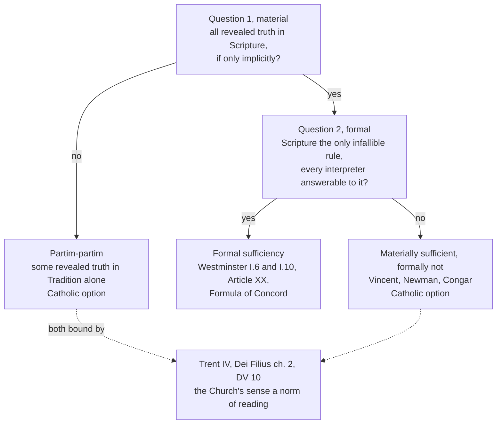

# Apologetics II · Lesson 2.3: Tradition, and what "sufficiency" means

> ⏱ ~15 min · Module 2: Against sola scriptura · Builds on: [2.1](02-01-sola-scriptura-at-its-best.md), [2.2](02-02-the-canon-question.md), [`fundamental-theology` 3.4](../../fundamental-theology/lessons/03-04-tradition.md), [`patristics` 2.1](../../patristics/lessons/02-01-irenaeus-against-the-gnostics.md), [`patristics` 3.2](../../patristics/lessons/03-02-basil-the-great.md) · Unlocks: [2.4](02-04-perspicuity-tested.md), [6.6](06-06-development-or-corruption.md)

## Why this matters

"Catholics think the Bible is missing half of God's word." Many Protestants have heard it, and some Catholics have said it. No Catholic is bound to hold that view. The real disagreement is narrower and harder: not whether Scripture *contains* the faith, but whether it *settles its own reading* with no interpreter whose judgment binds. Separate the two questions and half the polemic on both sides falls away.

## The idea

Think of a constitution. Is every law in the text, at least by implication? Does the text settle its own disputes, every court a fallible reader any citizen may correct from it, or is some court's reading final? Yes to the first fits no to the second.

Those are [material and formal sufficiency](../reference.md#material-and-formal-sufficiency). **Material**: every revealed truth is in Scripture, at least implicitly. **Formal**: Scripture is also its own sufficient rule of interpretation: after the apostles the only infallible norm, every other authority (creed, council, Church) fallible and answerable to it. [`fundamental-theology` 3.4](../../fundamental-theology/lessons/03-04-tradition.md) set material sufficiency against [*partim–partim*](../reference.md#partim-partim) (some revealed truths in tradition alone), traced Trent's change from "partly … partly" to "and", and graded the question freely disputed. This lesson takes it as settled and argues the formal question.

Answering Pusey's patristic case that "the whole Christian faith is contained in Scripture", Newman called the Catholic–Anglican difference "merely one of words". Catholics deny only that every article may be "logically proved, independently of the teaching and authority of the Tradition", which Athanasius used "first as suggesting, then as authoritatively ruling" a text's meaning (*Letter to Pusey*, 1865, §2). The first clause concedes the material point; the second keeps the formal one.

## The other side

Every Reformation confession holds formal sufficiency; none holds it as "me and my Bible" ([2.1](02-01-sola-scriptura-at-its-best.md)).

**Reformed.** [Westminster](../reference.md#westminster-confession) I.6 (1647, Schaff): the whole counsel of God is "either expressly set down in Scripture, or by good and necessary consequence may be deduced from Scripture: unto which nothing at any time is to be added, whether by new revelations of the Spirit, or traditions of men." I.9–10 make Scripture its own "infallible rule of interpretation" and the Spirit speaking in it the judge of councils and "private spirits" alike. The [Second Helvetic Confession](../reference.md#second-helvetic-confession) (1566, ch. II) reads by "the rule of faith and charity" and rejects traditions that, "being compared with the Scriptures, disagree with them". Calvin adds the order of dependence: the Church is built on the apostles' doctrine (Eph 2:20), so that doctrine "must have had its certainty" first (*Institutes* I.7.2, Beveridge).

**Lutheran.** The [Formula of Concord](../reference.md#formula-of-concord)'s Epitome makes Scripture "the only judge, rule, and standard"; the creeds are "not judges" but "a testimony and declaration of the faith" (Triglot). Martin Chemnitz, one of the Formula's six authors, answered Trent's decree in his [*Examen*](../reference.md#chemnitz-examen) (1565–73, Part I). He sorts the Fathers' "traditions" into eight kinds and finds seven compatible with Scripture's sole authority, among them the canon's handing-on, the rule of faith, the Fathers' consensus and ancient rites. He rejects the eighth, Trent's: doctrines of faith and morals that no testimony of Scripture proves.

His showcase is [Basil's chapter 27](../reference.md#unwritten-tradition): the Fathers' unwritten traditions are rites (the cross, facing east, triple immersion, blessing the font). What Scripture's sense supports (the baptismal confession, the renunciation of Satan, the doxology) he receives gladly; the rest are customs credited to the apostles without proof, some dropped by Rome itself. "The same force" is a hyperbole: baptism without triple immersion is still baptism. After Erasmus, he doubts the chapter is Basil's. Protestant readers add Letter 189.3, "let God-inspired Scripture decide between us" (NPNF), also transmitted among Gregory of Nyssa's works.

**Anglican.** [Article VI](../reference.md#thirty-nine-articles) (1571, spelling modernized): Scripture "containeth all things necessary to salvation", and nothing unprovable from it may be required as an article of faith. Article XX gives the Church "authority in Controversies of Faith" as "a witness and a keeper of holy Writ", never to enforce anything besides Scripture as necessary to salvation.

**The regress.** Pushed a step, Calvin's point is the strongest [circularity objection](../reference.md#circularity-objection). That *this* Church is Scripture's interpreter is argued from disputed texts (Matt 16:18; 1 Tim 3:15) and disputed history, and its definitions must themselves be read. Either the Church certifies the texts that certify the Church, a circle, or the Catholic chose Rome by his own fallible judgment, the private judgment he will not trust with Scripture.

Weight: Westminster and the Second Helvetic are Reformed standards, the Formula a [*norma normata*](../reference.md#norma-normans-and-norma-normata), the Articles of varying authority; the *Institutes* and *Examen* are theologians' books.

## The argument

**P1.** The New Testament hands on the apostolic teaching in two modes: "hold the traditions [*paradoseis*], which you have learned, whether by word or by our epistle" (2 Thess 2:15, DR 2:14). Paul praises Corinth for keeping the traditions he handed on (*paredōka … paradoseis*, 1 Cor 11:2; the DR, after the Vulgate's *praecepta*, has "ordinances"). *In words:* the first churches received the gospel from people as well as from letters.

**P2.** It treats that teaching as a deposit (*parathēkē*, 1 Tim 6:20; 2 Tim 1:14) entrusted to "faithful men who shall be fit to teach others also" (2 Tim 2:2). *In words:* the handing-on has keepers, and they are teachers.

**P3.** The Reformation's strongest text does not state formal sufficiency. 2 Timothy 3:16–17 calls Scripture God-breathed (*theopneustos*) and "profitable" (*ōphelimos*), so that the man of God may be complete (*artios*), "furnished" (*exērtismenos*) for every good work; and the "holy scriptures" Timothy knew from infancy (3:15) were the Old Testament. *In words:* "profitable" is not "alone".

**P4.** When heretics argued from the same books, the second-century Church settled readings by the [rule of faith](../reference.md#rule-of-faith) of the apostolic churches ([`patristics` 2.1](../../patristics/lessons/02-01-irenaeus-against-the-gnostics.md), [2.3](../../patristics/lessons/02-03-tertullian.md)). Vincent of Lérins joined both halves: the canon is "complete, and sufficient of itself for everything", yet, read in different senses, needs "the authority of the Church's interpretation" (*Commonitorium* 2, Heurtley). *In words:* the early Church held material sufficiency and denied formal sufficiency together.

**P5.** No text of Scripture or the early Church says that after the apostles only the text is infallible. *In words:* formal sufficiency is inferred, not read.

**∴ C.** Scripture may be materially sufficient; it is not formally sufficient. [*Dei Verbum*](../reference.md#dei-verbum) 10 (1965, paraphrased) commits the one deposit to the whole Church, and its authentic interpretation "exclusively" to the teaching office, which "is not above the word of God, but serves it". *In words:* the Bible may hold everything; it does not settle its own reading.

Each of P1–P3 is weak alone: the Thessalonian traditions may all have been written later, 2 Timothy 2:2 promises no immunity from error, and "profitable" allows "alone". The case is cumulative: a pattern of tradition with keepers, a second century that matches it, and silence where formal sufficiency needs a text. It rests on no claim about Pauline authorship ([`new-testament` 6.1](../../new-testament/lessons/06-01-the-disputed-pauline-letters-and-the-pastorals.md)). And C shows only that formal sufficiency is unsupported; who holds the interpreting office is Module 4's question.

**Mark the levels** ([the ladder](../../fundamental-theology/lessons/04-04-the-ladder-of-doctrinal-authority.md); [levels of authority](../reference.md#levels-of-authority)). [Trent IV](../reference.md#trent-session-iv) (8 April 1546, Waterworth) receives Scripture and the apostolic traditions "with an equal affection of piety, and reverence", condemning anyone who "knowingly and deliberately" contemns them: **rung 1 as worded**, equal in reverence, not extent. Material sufficiency against *partim–partim*: **rung 5**. The Church's sense, with the Fathers' unanimous consent, as norm of interpretation (Trent IV's second decree, penalties not anathema; [*Dei Filius*](../reference.md#dei-filius) ch. 2; DV 10): **at least rung 3**; so is the denial of formal sufficiency, though no act condemns [*sola scriptura*](../reference.md#sola-scriptura) by name. Whether Trent's anathema reaches Westminster I.6, Article VI or Chemnitz: **rung 5**; no act applies it. Newman, Congar, Chemnitz, the Fathers as authors: **no magisterial level**; other traditions' texts: **no Catholic level**.

**Concession.** Material sufficiency is a legitimate and widely held Catholic position: Yves Congar (*Tradition and Traditions*, 1960–63) held that Catholics may admit it, J. R. Geiselmann argued in the 1950s that Trent's drafting left room for it, and Newman called the difference from Pusey verbal. "Catholics say the Bible is incomplete" attacks a view no Catholic is bound to hold. The tradition texts, one at a time, prove little. The confessions do not reject tradition; they subordinate it.

**The crux.** Can a post-apostolic act of interpretation share the gospel's infallibility without being inspired? The Reformed say no: inspiration ended with the apostles, and every synod "may err" (Westminster XXXI.4). The Catholic says yes: the Spirit was promised to Peter's successors not for new doctrine "but that by his assistance they might inviolably keep and faithfully expound" the deposit (*Pastor Aeternus* ch. 4, Schaff); DV 10 says the same of the teaching office. What would move it: whether the promises (Matt 28:20; John 16:13) run to the apostles alone or to the Church through time, and the record. The Catholic argument fails if the second-century rule never decided between rival readings, or if apostolic churches taught contrary doctrines as apostolic.

## The two questions

Every Catholic answer ends in the bottom box; every Reformation confession at formal sufficiency. The dispute lives at Question 2.

## Worked examples

**Example 1 (clean): Irenaeus's thought experiment.** In *Against Heresies* 3.4.1 (ANF, Roberts and Rambaut), in "a dispute relative to some important question", Irenaeus would "have recourse to the most ancient Churches" to "learn from them what is certain and clear"; had the apostles "not left us writings", we would follow the tradition they handed on. In 3.4.2 barbarian converts keep the faith "without paper or ink". *Material:* they hold the rule of faith, the same content Scripture holds, not extra content, as [`patristics` 2.1](../../patristics/lessons/02-01-irenaeus-against-the-gnostics.md) reads it; concede that in full. *Formal:* in a dispute Irenaeus sends you first to the apostolic churches, and only then (3.5.1) to "the Scriptural proof". Verdict: materially sufficient, formally not.

**Example 2 (strain): who certifies the certifier?** Catholic fundamental theology answers in two steps ([`fundamental-theology` 2.2](../../fundamental-theology/lessons/02-02-credibility-and-the-preambles-of-faith.md)): the New Testament books, read first as historical sources, with the Church's visible marks (a [motive of credibility](../reference.md#motive-of-credibility)), ground a reasonable judgment that Christ founded a teaching Church; that Church, believed on God's authority, then teaches which books are inspired and what they mean. A spiral, not a circle. The cost: the first step is the inquirer's own fallible judgment, and his certainty of faith outruns it, as the Reformed believer's does when it rests on the Spirit's witness (Westminster I.5; the mirror circle of [2.2](02-02-the-canon-question.md)). Here the argument stops determining an answer: the Catholic is no worse off than the Reformed on circularity, and not shown to be better off. The choice returns to the crux.

## Watch out

- **You might think *sola scriptura* rejects tradition,** but Chemnitz accepts seven kinds, the Formula keeps the creeds as witnesses, and the Second Helvetic reads by the rule of faith. "Me and my Bible" is [*solo scriptura*](../reference.md#solo-scriptura), which no confession holds.
- **You might think Trent defined that some revealed truth is in tradition alone,** but it wrote "and" where its draft had "partly … partly"; the extent question is rung 5. So Trent did not dogmatize [Tradition II](../reference.md#tradition-i-and-tradition-ii), as Mathison holds ([2.1](02-01-sola-scriptura-at-its-best.md)). The mirror overstatement is "material sufficiency is *the* Catholic view": it is an option, and Vatican II left the question open.
- **You might think Irenaeus and Tertullian refute the Reformers directly,** but their opponents rejected the rule of faith, and Lutheran and Reformed churches confess the creeds. What transfers is the structure, the rule as a norm of reading; Tertullian's prescription ([`patristics` 2.3](../../patristics/lessons/02-03-tertullian.md)) bars outsiders, not creed-confessing Christians.
- **You might think the *Examen* states the Lutheran position,** but it is a theologian's book, weighty because its author helped write the Formula; Lutherans confess the Formula's "Rule and Standard".

## One-liner

> Catholics may hold that Scripture contains the whole faith; the dispute with the Reformation is whether it settles its own reading, and neither the New Testament nor the second century says it does.

## Problems

**P1 (🟢) *(Close reading · Exegetical.)*** 2 Timothy 2:2 (DR): "And the things which thou hast heard of me by many witnesses, the same commend to faithful men who shall be fit to teach others also." The Greek: *ha ēkousas par' emou dia pollōn martyrōn, tauta parathou pistois anthrōpois, hoitines hikanoi esontai kai heterous didaxai*. *Parathou* is the imperative of *paratithēmi*, "entrust, deposit", the verb behind *parathēkē*, "deposit" (1 Tim 6:20; 2 Tim 1:14).

(a) Name the links in the chain the verse describes, and say what *parathou* adds that "teach" would not.

(b) State one thing the verse establishes for the case against formal sufficiency, and two things it does not establish.

(c) Say why a post-Pauline date for 2 Timothy would not remove the verse from the argument.

**Two sentences per part at most.**

**P2 (🟡) *(Apologetic: (a) Exegetical, graded first · (b) reply.)*** A Catholic speaker quotes Basil, *On the Holy Spirit* 27.66 (NPNF, Jackson): of the Church's beliefs and practices, some come from written teaching, others are "delivered to us 'in a mystery' by the tradition of the apostles; and both of these in relation to true religion have the same force."

(a) State Martin Chemnitz's reading of this chapter as his *Examen* gives it, and say what standing the *Examen* has among Lutherans.

(b) Reply, opening with a **named concession**. A reply concluding that Chemnitz's reading succeeds passes if it is a good reply.

**150 words or fewer in total.**

**P3 (🔴, optional) *(Diagnose · Exegetical.)*** The opening statement of Elspeth Gairdner, a Reformed laywoman, at a church-hall debate (invented, written for this problem; no real person said it):

> "Rome's position is simple. At Trent she anathematized everyone who holds that Scripture contains all things necessary to salvation, which means every Anglican who signs Article VI and every Presbyterian who signs Westminster I.6. So every Catholic must believe the Bible is incomplete. Vatican II made it worse: *Dei Verbum* says the Magisterium alone may interpret Scripture, which puts the Pope above the Bible. We Reformed carry no tradition at all; it's the believer and the Bible, as Westminster says. Even Basil the Great, the Catholics' favourite witness for tradition, wrote: 'Let God-inspired Scripture decide between us.'"

Name **four** errors. For each, give the correction and the text that shows it, and say whether the error is a falsehood, an overstated level, or a caricature. **Two sentences per error at most.**

Solutions

**P1** *(Close reading · Exegetical)*

**Must hit, strict:**

- **(a)** Four links: Paul, Timothy, "faithful men", and the "others" they will teach. *Parathou* is deposit language, the verb of *parathēkē*: the teaching is handed over as a trust to be kept intact, not only passed on as instruction, which ties the verse to "keep that which is committed to thy trust" (1 Tim 6:20).
- **(b)** Establishes: a deliberate chain of qualified teachers transmitting what was *heard*, publicly attested "by many witnesses" and so no secret tradition. Does not establish: (i) that what is handed on differs in content from what is or will be written, so the material question is untouched; (ii) that the teachers or their successors are kept from error, since the verse gives a duty, not a promise. Credit as a third: it does not name an office (bishop) or a single see.
- **(c)** If the Pastorals are later, the verse records how the generation after Paul understood transmission, which is still early evidence for the pattern P4 needs. No reading should rest on authorship either way ([`new-testament` 6.1](../../new-testament/lessons/06-01-the-disputed-pauline-letters-and-the-pastorals.md)).

**Wrong turns:** reading the verse as proof of an infallible magisterium or of episcopal succession, which is the Catholic over-reading. Reading it as "teach only what is written", when the verse says "heard". Treating *parathou* as *paradidōmi* or finding *paradosis* in this verse. Resting (c) on Pauline authorship.

**Model answer:** (a) Paul, Timothy, faithful men, others. *Parathou* makes the teaching a deposit held in trust, the language of 1 Timothy 6:20, not just a lesson to repeat. (b) It shows a planned chain of qualified teachers handing on what was heard publicly. It does not show that the content goes beyond Scripture, nor that the chain is protected from error. (c) A later date makes it the next generation's own account of how the faith was handed on, which is still early evidence for the pattern.

---

**P2** *(Apologetic: (a) Exegetical, graded first · (b) reply)*

**Accept:** any reply that opens with a real concession and engages Chemnitz's distinction between rite and doctrine on its own terms, whatever its verdict.

**Must hit, strict (a), graded first:**

- **Rites, not dogmas.** When the Fathers praise unwritten tradition they mean ancient rites and customs (the sign of the cross, facing east, the blessing of the font and the oil, triple immersion), not doctrines of faith beyond Scripture.
- **Two classes.** What Scripture's sense supports (the baptismal confession, the renunciation of Satan, the doxology) he receives gladly, so there is no dispute about it. The rest are customs credited to the apostles without proof, some dropped even by Rome.
- **"The same force" is a hyperbole** that cannot stand: a baptism without triple immersion or the sign of the cross is still a baptism. Credit for adding his doubt, after Erasmus, that the chapter is Basil's.
- **Standing:** a theologian's book (1565–73) by one of the Formula's six authors, highly regarded, not a confession. The Lutheran confessional text is the Formula's "Rule and Standard".

**Must hit (b):**

- **A named concession,** for example: nearly every item is a rite, several were credited to the apostles without evidence, and "the same force" cannot mean that facing east binds like the baptismal command. Those are traditions with a small *t* ([`fundamental-theology` 3.4](../../fundamental-theology/lessons/03-04-tradition.md)).
- **Move the question from material to formal.** The chapter's point is a doctrine, the Spirit's rank, defended by a rite, the doxology "with the Spirit" ([`patristics` 3.2](../../patristics/lessons/03-02-basil-the-great.md)). So it is weak evidence for extra doctrines and stronger evidence that received worship worked as a norm of reading Scripture. Credit for adding 27.67, where Basil asks his opponents for the written source of the baptismal confession itself.
- **Turn Chemnitz's own sorting:** he admits the doxology because Scripture's sense supports it, but that was exactly what Basil's opponents denied. What settled it was the Church's received practice.
- **A limit, honestly:** the chapter shows tradition as a norm, not that the norm is infallible, and Letter 189.3, if Basil's, sends conflicting customs to Scripture's judgment.

**Wrong turns:** stating (a) as "Chemnitz rejects all tradition", which is the caricature, since he accepts seven kinds, and fails the problem. Calling the *Examen* a Lutheran confession or part of the Book of Concord. Assigning the reading to "Protestants" as a bloc. Replying with *partim–partim* ("so some doctrines are in tradition alone"), which concedes Chemnitz's frame and argues the wrong question. Treating the authenticity doubt as decisive: NPNF's note reports Casaubon's defence of the chapter and early Syriac evidence for it.

**Model answer (a):** The Fathers' unwritten traditions are rites, not doctrines beyond Scripture, as Basil's list (the cross, facing east, triple immersion) shows. What Scripture's sense supports, like the baptismal confession and the doxology, Chemnitz gladly accepts; the rest are customs credited to the apostles without proof, and "the same force" is a hyperbole, since baptism without triple immersion is still baptism. The *Examen* is a theologian's book by an author of the Formula, not a confession.

**Model answer (b), one of several:** Concession: most of Basil's items are rites, several have lapsed, and facing east does not bind like baptism. Yet the chapter defends a doctrine: the doxology "with the Spirit" mattered because the Spirit's rank was disputed, and received worship was Basil's norm for reading Scripture. Chemnitz accepts the doxology as scriptural, but that was the point in dispute. The chapter tells against formal sufficiency, not for extra doctrines, though it does not show the norm infallible.

---

**P3** *(Diagnose · Exegetical)*

**Accept:** any four of the five errors below, each with its correction, its text and a fitting label.

**Must hit, strict (any four):**

1. **Trent's anathema.** It falls on anyone who "knowingly and deliberately" contemns the apostolic traditions (and rejects the canon), not on anyone who holds that Scripture contains all things necessary. Whether it reaches Article VI or Westminster I.6 is rung 5, since no act applies it. *Overstated level* (credit *falsehood*).
2. **"Every Catholic must believe the Bible is incomplete."** Material sufficiency is a legitimate and widely held Catholic position (Congar; Geiselmann; Newman's "merely one of words"), and the extent question is rung 5. *Falsehood.*
3. **Dei Verbum.** DV 10 commits the deposit to the whole Church and only its *authentic* interpretation "exclusively" to the teaching office, which "is not above the word of God, but serves it". *Falsehood* (a misreading of a real word).
4. **"No tradition at all."** Her own confessions disagree: Westminster I.10 judges "private spirits" with councils, and the Second Helvetic reads by "the rule of faith and charity". *Caricature* of her own side ([*solo scriptura*](../reference.md#solo-scriptura)).
5. **Basil.** Letter 189 is also transmitted among Gregory of Nyssa's works, so its author is disputed. And quoting it while omitting *On the Holy Spirit* 27's "the same force" is the [cherry-picked Father](../reference.md#cherry-picked-father); the letter sends conflicting customs to Scripture, which a Catholic grants. *Caricature* by selective quotation.

**Wrong turns:** correcting error 2 by saying material sufficiency is *the* Catholic doctrine, which overstates in the other direction. Correcting error 3 by denying that "exclusively" is in DV 10. Correcting error 1 by saying Trent condemned nothing Protestant: the anathema is real and rung 1 as worded, and only its application is open.

**Model answer:** First, Trent anathematizes knowing contempt of the apostolic traditions, not the belief that Scripture contains all necessary things; no act applies it to Article VI (overstated level). Second, Catholics may hold material sufficiency, as Congar did, and Newman called the difference verbal (falsehood). Third, DV 10 commits the deposit to the whole Church and gives the teaching office, which serves the word, only authentic interpretation (falsehood). Fourth, Westminster I.10 judges private spirits too, and the Second Helvetic reads by the rule of faith, so "the believer and the Bible" is not her confession (caricature).

## Flashback

**From Lesson [2.1](02-01-sola-scriptura-at-its-best.md) (Sola scriptura at its best):** *(Apologetic: (a) Exegetical, graded first · (b) reply.)* An invented parish handout (written for this problem) prints, under the heading "*Sola scriptura* refuted in one sentence", Augustine's "I should not believe the gospel except as moved by the authority of the Catholic Church" (*Against the Epistle of Manichaeus Called Fundamental* ch. 5, §6, tr. Stothert, NPNF1-4). A Reformed reader answers from Calvin.

(a) State Calvin's answer as the [*Institutes*](../reference.md#calvin-institutes) gives it: what the sentence describes (I.7.3), where the believer's certainty rests instead (I.7.4–5), what role the Church keeps (I.7.2), and the text's weight. **Three sentences.**

(b) Reply, opening with a **named concession**. **100 words or fewer.** A reply that concludes Calvin's reading is right passes if it is a good reply.

Solution

**Accept:** any reply that opens with a real concession and engages Calvin's line between the outsider's way in and the believer's ground, whatever its verdict.

**Must hit, strict (a), graded first:**

- **The way in.** Arguing against the Manichees, Augustine speaks of bringing someone who does not yet believe to the gospel: the Church's authority leads the outsider in.
- **The ground.** The believer's certainty rests on "the secret testimony of the Spirit" (I.7.4); scripture is *autopistos*, "carrying its own evidence along with it" (I.7.5, Beveridge).
- **The Church's role.** It gives scripture "the stamp of her authority" but "does not make that authentic which was otherwise doubtful" (I.7.2).
- **Weight.** A theologian's book (1559), not a confession. Augustine, writing as an author, has no magisterial level.

**Must hit (b):**

- **A named concession**, flat: the handout misuses the sentence. It does not make the Church the source of scripture's authority, which [*Dei Filius*](../reference.md#dei-filius) ch. 2 (at least rung 3) denies as firmly as Calvin.
- **The real dispute:** who identifies scripture and settles its reading. Calvin grants that the Church identifies it for the outsider; can the believer's certainty then reach the list and disputed readings without a recognizer that cannot err? That is 2.1's crux. Credit for Augustine's next lines, where Catholic authority still commends Acts to him.

**Wrong turns:** stating (a) as "Calvin gives the Church no role" or "Calvin rejects Augustine" (he claims Augustine for his side); either fails the problem. "Self-authenticating" as Calvin's word. In (b), calling the inward testimony fideism (Westminster I.5 cites evidences, and Catholic faith too needs the Spirit's interior help), "Trent settled it", or attacking *solo scriptura*.

**Model answer (a):** Augustine, arguing against the Manichees, describes how someone who does not yet believe is brought to the gospel: the Church leads the outsider in. The believer's certainty rests on the secret testimony of the Spirit, scripture carrying its own evidence, and the Church sets the stamp of her authority on scripture without making authentic what was doubtful. The *Institutes* is a theologian's book, not a Reformed confession.

**Model answer (b), one of several:** Concession: the handout misuses Augustine, who never makes the Church the source of scripture's authority; *Dei Filius* ch. 2 denies that as firmly as Calvin. But Augustine goes on: weaken the Catholics' authority and "I shall no longer be able to believe the gospel either", and he receives Acts because Catholic authority commends it. The Church still tells him which books are the gospel. Whether the Spirit's witness can do that without a recognizer that cannot err is 2.1's crux; one sentence cannot settle it.

## Connections

- **Backward:** [`fundamental-theology` 3.4](../../fundamental-theology/lessons/03-04-tradition.md) supplied material sufficiency, Trent's drafting and DV 9–10; [2.1](02-01-sola-scriptura-at-its-best.md) stated *sola scriptura* and its difference from *solo*; [2.2](02-02-the-canon-question.md) met the self-attestation circle on the canon. The texts argued here were read in [`patristics` 2.1](../../patristics/lessons/02-01-irenaeus-against-the-gnostics.md), [2.3](../../patristics/lessons/02-03-tertullian.md) and [3.2](../../patristics/lessons/03-02-basil-the-great.md); Vincent is [`fundamental-theology` 5.1](../../fundamental-theology/lessons/05-01-vincent-of-lerins.md).
- **Forward:** [2.4](02-04-perspicuity-tested.md) tests the other half of the formal claim, Westminster I.7's clarity. Module 4 ([4.1](04-01-the-petrine-texts-argued.md)–[4.4](04-04-the-visible-church-and-what-replaced-the-papacy.md)) asks which body holds the interpreting office. [6.6](06-06-development-or-corruption.md) asks how an implicit truth becomes explicit without becoming new, the question material sufficiency leaves standing.
- **Sideways:** the Reformed answer to the mirror circle has a philosophical twin in Plantinga's warranted basic belief ([`philosophy-of-religion` 5.2](../../philosophy-of-religion/lessons/05-02-reformed-epistemology.md)). Hobbes met the same question, who speaks for God when readers of one Scripture disagree, and gave the last word to the sovereign as supreme pastor ([`history-of-political-thought` 3.4](../../history-of-political-thought/lessons/03-04-hobbes-the-sovereign-and-the-church.md)). The crux method is [`philosophical-method` 4.3](../../philosophical-method/lessons/04-03-finding-the-crux.md).
