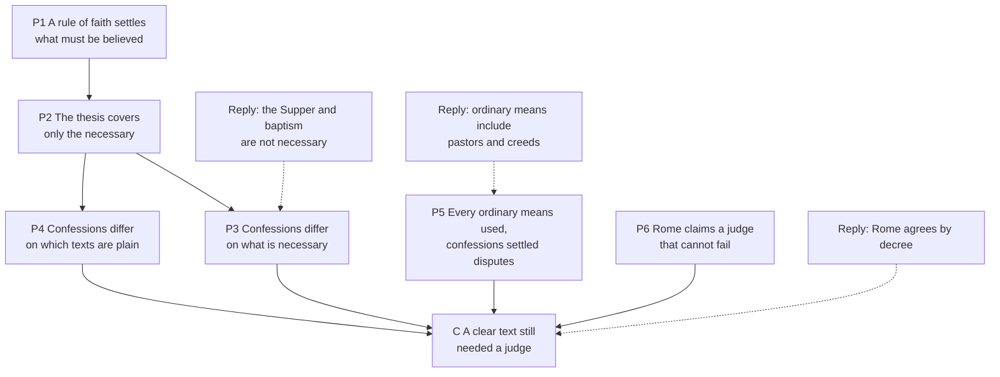

# Apologetics II · Lesson 2.4: Perspicuity tested

> ⏱ ~15 min · Module 2: Against sola scriptura · Builds on: [2.1](02-01-sola-scriptura-at-its-best.md), [2.2](02-02-the-canon-question.md), [2.3](02-03-tradition-and-what-sufficiency-means.md) · Unlocks: [3.1](03-01-justification-as-the-confessions-state-it.md), [4.4](04-04-the-visible-church-and-what-replaced-the-papacy.md)

## Why this matters

In October 1529 Luther and Zwingli sat at one table in Marburg, both holding Scripture the only rule of faith, and parted without agreeing what "This is my body" means. Catholic apologists tell the story as the refutation of [perspicuity](../reference.md#perspicuity), the clarity of Scripture. It refutes less than they think: the confessions wrote their thesis to survive it. This lesson finds where the record still bites.

## The idea

A road atlas is clear: anyone who reads maps can drive from Glasgow to London with it. That does not make every lane legible, spare a learner a teacher, or stop drivers arguing about a junction. The clarity thesis claims that much for Scripture: what you need for salvation is plainly marked somewhere, and anyone using the ordinary helps can find it. So the Catholic objection cannot be "the map is blurry." It must be that when drivers with the same atlas dispute the destination itself, the atlas does not settle it, and someone has to.

Perspicuity is the working claim behind formal sufficiency ([2.3](02-03-tradition-and-what-sufficiency-means.md)). The record is told in [`church-history` 6.2](../../church-history/lessons/06-02-reformations-beyond-wittenberg.md) and [`sacraments-and-liturgy` 3.2](../../sacraments-and-liturgy/lessons/03-02-the-controversies-that-forced-precision.md), and Trent's rule of interpretation in [`patristics` 1.1](../../patristics/lessons/01-01-how-to-read-a-church-father.md); this lesson argues over what they prove.

## The other side

**Reformed: Westminster I.7.** The [Westminster Confession](../reference.md#westminster-confession) (completed by the Assembly in December 1646; Schaff, *Creeds* vol. 3, dates it 1647) opens with a concession: "All things in Scripture are not alike plain in themselves, nor alike clear unto all." Its proof-text, in Schaff's footnote, is 2 Peter 3:16. The promise that follows has three qualifiers:

1. **Scope:** only "those things which are necessary to be known, believed, and observed, for salvation".
2. **Means:** these are set out clearly "in some place of Scripture or other", for learned and unlearned alike, "in a due use of the [ordinary means](../reference.md#ordinary-means)". The Shorter Catechism names them: Christ's "ordinances, especially the word, sacraments, and prayer", with preaching foremost (Q.88–89).
3. **Measure:** "a sufficient understanding of them", not agreement on everything.

The Spirit's "inward illumination" is needed for saving understanding (I.6). Disputed senses "must be searched and known by other places that speak more clearly" (I.9). Westminster is the subordinate standard of Presbyterian churches. The Particular Baptists' confession (London, 1677, reissued 1689) repeats the article almost word for word (ch. 1 §7). The Second Helvetic Confession (1566, ch. II) shows that Reformed reading is not private. It reads Scripture by its language, circumstances and comparison of places, under "the rule of faith and charity", and it consults the Fathers.

**Lutheran: Luther's twofold clarity.** Erasmus had counted free will among Scripture's dark matters. Luther's *The Bondage of the Will* (1525; Henry Cole's translation, 1823) answers that the *things* of Scripture are all in the light, though some words remain obscure, and what is dark in one place is plain in another. Scripture "simply confesses the trinity of God, the humanity of Christ, and the unpardonable sin"; "how these things are the scripture does not say, nor is it necessary to be known." Its clearness is [twofold](../reference.md#external-and-internal-clarity): "the one is external, placed in the ministry of the word; the other internal, placed in the understanding of the heart." Internal clarity is the Spirit's gift to the believer. External clarity belongs to the word publicly proclaimed, and Luther later ties it to the preachers' public judgment of doctrine. He aims it at enthusiasts who subject Scripture to their own spirit, and at a saying he met among the papal party: that Scripture is obscure and its interpreter must be sought from Rome. The book is a theologian's polemic, not a confession. The [Formula of Concord](../reference.md#formula-of-concord) commends it on free will (Solid Declaration II.44, Triglot), and takes Scripture as its "sole rule and standard" ([2.1](02-01-sola-scriptura-at-its-best.md)).

**The replies to the argument from division.** The usual Catholic argument: the quarrels over baptism and the Supper were between men who all held this thesis. Scripture itself admits "certain things hard to be understood, which the unlearned and unstable wrest" (2 Peter 3:16, Douay–Rheims), and it shows a reader asking "how can I, unless some man shew me?" (Acts 8:31). The defenders answer in three ways.

1. *Never claimed.* The thesis covers what is necessary for salvation. On the Reformed and Baptist reading, the mode of Christ's presence and the subjects of baptism are not in that class. At Marburg both sides agreed fourteen articles and most of a fifteenth, on the Supper: both kinds, no Mass as a work for others, a sacrament of the true body and blood, and spiritual eating "specially necessary to every true Christian". They recorded disagreement only on whether the body and blood "are corporally present in the bread and wine", and pledged charity "so far as the conscience of each will permit" (Schaff, *History of the Christian Church* VII §108).
2. *Ordinary means are not "me and my Bible".* Preaching, pastors, catechisms, creeds and synods are the means, and the Ethiopian understood through Philip.
3. *Not like for like.* Catholics agree because a body decides, not because the text is plain to all. Where Rome has not decided, they divide as sharply. Dominicans and Jesuits argued over grace before Rome for nine years, and Paul V ended it in 1607 by deciding nothing and forbidding either side to brand the other ([`creation-grace-last-things` 5.5](../../creation-grace-last-things/lessons/05-05-the-de-auxiliis-controversy.md)).

## The argument

**P1.** A [rule of faith](../reference.md#rule-of-faith) settles, for those who hold it, what must be believed. Westminster's supreme judge is the one "in whose sentence we are to rest" (I.10), and Luther's external clarity judges doctrine "for others also". *In words:* the thesis says Scripture settles disputes.

**P2.** By its own scope, the thesis is tested only by disputes about what is necessary. *In words:* test it on cases the confessions call necessary.

**P3.** The parties disagreed about what is necessary. The [Augsburg Confession](../reference.md#augsburg-confession) IX (1530, Triglot) teaches that baptism "is necessary to salvation", and condemns "the Anabaptists, who reject the baptism of children". Westminster XXVIII.5 denies that grace and salvation are "so inseparably annexed unto it" that none is saved without it. *In words:* what falls inside the scope clause was itself disputed.

**P4.** They disagreed about which texts are plain. The Formula of Concord (1577), Epitome VII, condemns a Sacramentarian error: the teaching that the words of institution are "obscure expressions, whose meaning must be sought first in other passages of Scripture". That was the Reformed method, which Westminster I.9 later generalized. *In words:* "Scripture interprets Scripture" does not say which passage is the plain one.

**P5.** They used every ordinary means: the original languages, preaching, the Fathers, a face-to-face colloquy. Inside each party, a confession its ministers subscribed settled such disputes. *In words:* this was neither solo reading nor reading alone.

**P6.** Rome claims that office as a judge. Trent IV forbids interpreting Scripture in faith and morals against the sense of "holy mother Church, — whose it is to judge of the true sense and interpretation of the holy Scriptures" (Waterworth, 1848), and *Dei Verbum* 10 entrusts authentic interpretation exclusively to the living teaching office. *In words:* both sides apply the text through a judge, and only one claims its judge cannot fail.

**∴ C.** Clarity about necessary things, reached by the ordinary means, settled neither the disputes the parties held necessary nor the prior question of what is necessary. Inside each tradition a confession settled them, and between traditions nothing did. *In words:* not that Scripture is obscure, but that a clear text still needs a judge.

**Mark the levels.** ([the ladder](../../fundamental-theology/lessons/04-04-the-ladder-of-doctrinal-authority.md); [levels of authority](../reference.md#levels-of-authority).) That Scripture is obscure: **not taught**. No act defines it, and *Dei Verbum* 25 urges all the faithful to read Scripture often (CCC 133). The [rule of interpretation](../reference.md#rule-of-interpretation), not against the Church's sense or the Fathers' unanimous consent: **at least rung 3**, Trent IV's second decree (whose interpretation clause carries penalties by law, not an anathema), renewed in *Dei Filius* ch. 2 and restated in DV 10, whose "exclusively" is likewise **at least rung 3**. The denial of [formal sufficiency](../reference.md#material-and-formal-sufficiency): **at least rung 3**. Whether Westminster I.7 falls under a Tridentine anathema: **rung 5**, since no act applies one. The *de auxiliis* schools: **rung 5**; the 1607 formula: **law, no rung**. The Protestant confessions: **no Catholic level**; their weight in their own traditions is marked above.

**Concession.** Westminster's clarity thesis is modest and carefully qualified, and Catholic unity is achieved by authority rather than by clarity, so the argument from Protestant division alone is not a like-for-like comparison. Marburg agreed on far more than it divided over.

**The crux.** Is a rule of faith that needs an authority to apply it still a rule of faith *alone*? The Reformed say yes. Ministers and synods apply it ministerially, are judged by it (I.10) and may err, so "alone" means alone infallible and supreme, not alone present. The Catholic says the working rule then includes the one who applies it, so "Scripture alone" names the norm, not the rule. What would move it: whether a fallible application has ever settled a necessary dispute for both parties ([4.4](04-04-the-visible-church-and-what-replaced-the-papacy.md)), and, against the Catholic, whether his infallible judge can be identified without the circle of [2.3](02-03-tradition-and-what-sufficiency-means.md).

## The argument map

O1 is the reply P3 must beat; O3 is conceded, and leads to the crux.

## Worked examples

**Example 1 (clean): baptism, 1525–1647.** Run I.7's qualifiers. *Scope:* is infant baptism among the things "necessary … for salvation"? Augsburg IX says baptism is, and that children are to be baptized. The Schleitheim articles (1527) exclude infant baptism, and the Baptist confession makes professing believers "the only proper subjects of this ordinance" (ch. 29 §2; [`sacraments-and-liturgy` 2.2](../../sacraments-and-liturgy/lessons/02-02-necessity-infants-and-baptism-of-desire-and-blood.md)). *Means:* Zurich's first adult baptisms were performed by Zwingli's own students ([`church-history` 6.2](../../church-history/lessons/06-02-reformations-beyond-wittenberg.md)). *Measure:* a sufficient understanding of which truths? The Lutheran says the Anabaptists missed a necessary point, the Reformed that the point is not necessary, the Baptist that the Lutherans misread a plain command. The qualifiers do not fail; they move the dispute to what is necessary, which the rule cannot settle.

**Example 2 (strain): Marburg.** The thesis's best case: fourteen articles and most of a fifteenth agreed, the disagreement confined to the corporal presence, charity pledged. That looks like I.7 working. Against it, Schaff's account has Luther refusing Zwingli's offered hand, and in 1577 the Formula condemned the Sacramentarian doctrine. Yet the Preface to the Book of Concord says its condemnations are not aimed at "those men who err from a certain simplicity of mind", nor at whole churches. A doctrine can divide confessions without being declared necessary to salvation. Here the argument stops. The record shows the parties could not agree whether the matter was necessary, not that a necessary matter stayed unclear by their own standard, and Rome too left a question open in 1607. What survives is narrower: one judge's 1607 suspension bound both orders, while Wittenberg and Zurich drew the line between decided and open in different places.

## Watch out

- **You might think the thesis says every verse is plain to every reader,** but Westminster I.7 opens by denying it, citing 2 Peter 3:16. This is the clarity form of the [*solo scriptura*](../reference.md#solo-scriptura) blur.
- **You might think Luther and Westminster hold one thesis,** but Luther's covers all the *things* of Scripture (not every word) and places external clarity in the ministry of the word; Westminster's covers what is necessary. *The Bondage of the Will* is Luther's book, not a Lutheran confession.
- **You might think the Catholic Church teaches that Scripture is obscure,** as Luther charged, but no act says so, and *Dei Verbum* 25 urges every Christian to read it. Nor overstate the rule of interpretation: **at least rung 3**, with penalties, not an anathema.

## One-liner

> The confessions claim clarity only for what is necessary, through the ordinary means; their heirs disagreed about what is necessary, and that needs a judge.

## Problems

**P1 (🟢) *(Close reading · Exegetical.)*** Luther, *The Bondage of the Will* (1525), tr. Henry Cole (London, 1823). The first paragraph is from Cole's Sect. IV; the second from Sect. XXXIV, where Luther distinguishes two judgments by which doctrines are tried:

> The clearness of the scripture is twofold … The one is external, placed in the ministry of the word; the other internal, placed in the understanding of the heart. If you speak of the internal clearness, no man sees one iota in the scriptures, but he that hath the Spirit of God. … If you speak of the external clearness, nothing whatever is left obscure or ambiguous; but all things that are in the scriptures, are by the Word brought forth into the clearest light, and proclaimed to the whole world.
>
> The other, then, is the external judgment; by which, we judge, to the greatest certainty, of the spirits and doctrines of all men; not for ourselves only, but for others also … This judgment is peculiar to the public ministry of the word and the external office, and especially belongs to teachers and preachers of the word. … This is what we before called, 'the external clearness of the holy scripture.'

(a) What is each clarity a property of, and where does Luther place each? Which words decide it?

(b) A Lutheran and a Reformed preacher publicly contradict each other on what a text of Scripture says. Which clarity is in question, and what does this passage commit Luther to saying about one of them?

(c) Name one way Luther's claim is wider than Westminster I.7's, and one way it is not a claim about private readers.

**Two sentences per part.**

**P2 (🟡) *(Apologetic: (a) Exegetical, graded first · (b) reply.)*** An invented tract, written for this problem, from Pastor DeShawn Merriweather of Ebenezer Gospel Hall, Pitlochan (a Baptist congregation):

> "Rome loves to say that Luther and Zwingli both believed the Bible was clear and still couldn't agree on 'This is my body.' So what? The Bible is plain to anyone who reads it honestly with the Holy Spirit. You need no pastor, no creed and no council to tell you what it says. Luther and Zwingli were still half Roman and brought the priests' baggage to the text. Open the Book for yourself and you will find believer's baptism and a memorial Supper on every page. Rome needs a pope because her doctrines aren't in the Bible."

(a) State the reply to the Marburg argument that the clarity thesis's confessional defenders would give at full strength, from Westminster I.7 or the Baptist confession's chapter 1 §7, including what the ordinary means are. Keep what they would sign, drop what they would not, and name what you dropped.

(b) Reply, opening with a **named concession**. A reply concluding that the clarity thesis survives the record passes if it is a good reply.

**80 words for (a), 100 for (b).**

**P3 (🔴, optional) *(Find the crux · Exegetical.)*** Deuteronomy 17:8–12 (Douay–Rheims) sends "a hard and doubtful matter in judgment" to the priests and the judge at the chosen place, who "shall shew thee the truth of the judgment". "According to his law; and thou shalt follow their sentence", and "he that will be proud, and refuse to obey the commandment of the priest … that man shall die." In Cole's Sect. XXXV Luther offers this passage as his first proof of external clarity. The priests judge by the law of the Lord, "but how will they judge thus, if the law of the Lord be not externally most clear". A Catholic reads the same passage as the Old Testament's plainest case of a clear law that still needs a court whose sentence binds.

(a) Name the single premise on which the two readings divide.

(b) Say what evidence or argument would move it.

**100 words or fewer.**

Solutions

**P1** *(Close reading · Exegetical)*

**Must hit, strict:**

- (a) Internal clarity is a property of the believer's heart, "placed in the understanding of the heart", and comes only by the Spirit ("no man sees one iota … but he that hath the Spirit of God"). External clarity belongs to the word as publicly proclaimed, "placed in the ministry of the word". The second paragraph confirms this: external clarity is what the "public ministry of the word and the external office" uses to judge doctrine "for others also".
- (b) External clarity is in question, because the dispute is public and concerns what the word says. Since external clarity leaves "nothing whatever … obscure or ambiguous", Luther must lay the fault on one of the two preachers, not on the text. In this passage, the only resource for doing so is internal blindness or a misuse of the public ministry.
- (c) *Wider:* Luther claims "all things that are in the scriptures" are brought to the clearest light, not only "those things which are necessary … for salvation" (I.7). (At the end of Sect. III he grants that some *words* stay obscure, so his claim is about the things, not every phrase.) *Not private:* external clarity is exercised in the public ministry, "especially" by "teachers and preachers", and it judges "for others also", so it is ecclesial and public, not one reader's.

**Wrong turns:** making external clarity "grammar anyone can parse" and internal clarity "spiritual depth", which misses where Luther *places* each. Answering (b) with "the text is unclear", the one answer this passage rules out. Saying Luther's clarity is as restricted as Westminster's. Treating *The Bondage of the Will* as a Lutheran confession.

**Model answer:** (a) Internal clarity is the believer's understanding, given only by the Spirit ("placed in the understanding of the heart"). External clarity is the word's own clarity in public proclamation, "placed in the ministry of the word", and the second paragraph ties it to the "public ministry" that judges doctrine "for others also". (b) External clarity is in question, and since it leaves "nothing whatever … obscure or ambiguous", Luther must lay the fault on one preacher, not on the text. (c) It is wider because it covers "all things that are in the scriptures", not only what is necessary for salvation. It is not private because it is exercised by the public ministry of preachers, for others.

---

**P2** *(Apologetic: (a) Exegetical, graded first · (b) reply)*

**Accept:** any reply that states the qualified thesis correctly, opens with a real concession, and engages the question of which disputes were treated as necessary, whatever its verdict.

**Must hit, strict (a), graded first:**

- **Scope:** only what is "necessary to be known, believed, and observed, for salvation" is promised clear. The mode of the presence and the subjects of baptism are not, on the Reformed and Baptist reading, in that class, so Marburg's split does not touch the thesis. Marburg agreed on fourteen articles and most of the fifteenth.
- **Means and measure:** the promise holds "in a due use of the ordinary means": the word read and especially preached, sacraments and prayer (Shorter Catechism Q.88–89). It holds for "a sufficient understanding", not for agreement on everything.
- **Dropped, and named:** "no pastor, no creed, no council" (the ordinary means are the ministry, and Westminster I.10 examines councils rather than discarding them); "plain to anyone … on every page" (I.7: "not alike plain … nor alike clear unto all"); "half Roman" (ad hominem); "Rome's doctrines aren't in the Bible" (a sufficiency claim, [2.3](02-03-tradition-and-what-sufficiency-means.md)'s question, not clarity).

**Must hit (b):**

- **A named concession:** the thesis is modest and qualified, and Catholic unity comes by authority, not clarity, so division alone is not a like-for-like comparison.
- **Which disputes were treated as necessary:** Augsburg IX calls baptism "necessary to salvation" and condemns the Anabaptists. The Formula condemns the Sacramentarian reading of the words of institution. So the line between necessary and not was itself disputed by parties using every ordinary means.
- **Push to the crux:** something has to judge what is necessary and what the text says about it. Inside each tradition a subscribed confession did, so ask whether that is still Scripture *alone*.

**Wrong turns:** stating (a) as "anyone can understand the Bible alone", which is the caricature and fails the problem. Treating the tract as the Baptist confession's position. Writing "Protestants" as one bloc when Augsburg IX and Westminster XXVIII.5 disagree. In (b), quoting 2 Peter 3:16 as if it refuted Westminster, or claiming the Church teaches that Scripture is obscure.

**Model answer (a):** Westminster I.7, and the Baptist confession after it, promise clarity only for things "necessary … for salvation". They promise it in "a due use of the ordinary means", meaning the word read and preached, the sacraments and prayer, and they promise "a sufficient understanding", not unanimity. The presence and baptism's subjects are not in that class, and Marburg agreed on the rest. Dropped: "no pastor, creed or council", "plain on every page", the ad hominem, and the pope jibe, which is about sufficiency.

**Model answer (b), one of several:** Concession: the thesis is modest, and Rome's unity comes from authority, not clarity, so division alone proves little. But the confessions did not agree on what is necessary. Augsburg IX calls baptism "necessary to salvation" and condemns the Anabaptists, while the Baptist confession counts only professing believers as baptism's proper subjects. All of them used every ordinary means. What settled such questions inside each church was a subscribed confession. So the real question is whether a rule that needs an authority to apply it is still Scripture alone.

---

**P3** *(Find the crux · Exegetical)*

**Must hit, strict (a):** both readings grant that the law is clear enough to judge by ("According to his law") and that the court's sentence binds ("thou shalt follow their sentence"). They divide on **why the sentence binds a party who reads the law otherwise**. For Luther, the court declares what the law already makes externally clear, so its authority is the law's. For the Catholic, the matter was "hard and doubtful" to the parties, and 17:12 punishes refusing the sentence. So the court's judgment adds a binding authority the text alone did not supply.

**Must hit, strict (b):** evidence that bears on that premise. One kind is exegesis of 17:12: is the "proud" man one who defies the evident law, or anyone who refuses the sentence? Another is whether the Mosaic court continues in a New Testament office, or is fulfilled in the public ministry of the word (Luther's external judgment). A third is whether that court's sentence could be appealed back to the law by the losing party.

**Wrong turns:** naming "is Scripture clear?" or "do we need teachers?", which both readings grant. Reading Luther as rejecting the court; he uses it. Claiming the passage proves papal infallibility, when it speaks of neither. Giving a verdict instead of a premise.

**Model answer:** (a) Both grant the law is clear enough to judge by and the sentence binds. They divide on whether it binds because it declares what the law already makes plain (Luther), or because it is the court's sentence on a matter the parties found "hard and doubtful" (Catholic). (b) Whether 17:12's "proud" man is one who defies the evident law or any dissenter from the sentence, and whether the court continues in a New Testament office or in the ministry of the word.

## Flashback

**From Lesson [2.2](02-02-the-canon-question.md) (The canon question):** *(Assign the weight · Exegetical, strict.)* Five revision flashcards from an invented seminary reading group (written for this problem). Give the real weight of what each card names (a rung on [the ladder](../../fundamental-theology/lessons/04-04-the-ladder-of-doctrinal-authority.md), a standing outside it, or a standing inside its own tradition), and say whether the card overstates or understates it. **One sentence each.**

> (1) "*Dei Verbum* 8 teaches that the canon is known through Tradition, so that is defined dogma."
>
> (2) "Luther's 1522 preface, keeping James out of 'the true chief books', is the Lutheran confessional verdict."
>
> (3) "Westminster I.3 on the Apocrypha is one assembly's opinion; no church is bound by it."
>
> (4) "Cajetan doubted Judith and Tobit in Luther's lifetime, so a Catholic may still treat their canonicity as open."
>
> (5) "Article VI is the Anglican magisterium's definition of the canon, binding every province alike."

Solution

**Must hit, strict:**

- **(1) Overstates.** [*Dei Verbum*](../reference.md#dei-verbum) 8 is **rung 3**, authentic teaching owed religious submission of mind and will, and defines nothing. What is defined (**rung 1**) is the list itself: [Trent, Session IV](../reference.md#trent-session-iv), with anathema, repeated in *Dei Filius* can. II.4.
- **(2) Overstates.** The 1522 prefaces are a theologian's prefaces. The [Book of Concord](../reference.md#book-of-concord) has no canon list and never adopted his rankings, and Luther himself would not forbid anyone to "place and raise" James as he pleased.
- **(3) Understates.** The [Westminster Confession](../reference.md#westminster-confession) is the subordinate standard of Presbyterian churches: a confession under Scripture, though not a magisterium.
- **(4) Understates.** Since 8 April 1546 all the books, "entire with all their parts", are **rung 1**. Cajetan's doubt, written before that definition, has **no magisterial level**, and the concession that nothing was defined under anathema before 1546 frees no Catholic now.
- **(5) Overstates.** The [Thirty-Nine Articles](../reference.md#thirty-nine-articles) are Anglican formularies whose subscription and authority vary across the Communion: a formulary, not a magisterial definition, and not binding every province alike.

**Wrong turns:** placing (2), (3) or (5) on the Catholic ladder; other traditions' texts are weighed inside their own tradition. Overcorrecting (2) into "Luther cut James" (he printed it, unnumbered at the end with Hebrews, Jude and Revelation), (3) into "a Presbyterian magisterium", or (1) into "no authority". Answering (4) from Florence's 1442 list (at least rung 3) instead of Trent's definition. Grading the Catholic cards more gently.

**Model answer:** (1) Overstates: DV 8 is rung 3, not a definition; the list itself is rung 1 by Trent IV. (2) Overstates: a theologian's prefaces, which the Book of Concord, having no canon list, never adopted. (3) Understates: the Presbyterian subordinate standard, a confession under Scripture, not a magisterium. (4) Understates: since Trent IV every book is rung 1, and Cajetan's earlier doubt has no magisterial level. (5) Overstates: an Anglican formulary, subscribed variously across the Communion, not a magisterium's definition.

## Connections

- **Backward:** [2.1](02-01-sola-scriptura-at-its-best.md) stated *sola scriptura* and Westminster I.9–10, and [2.3](02-03-tradition-and-what-sufficiency-means.md) defined formal sufficiency, whose working claim this lesson tested. Vincent of Lérins argued from readers who share a text and divide over it in 434 ([`fundamental-theology` 5.1](../../fundamental-theology/lessons/05-01-vincent-of-lerins.md)). Acts 8:30–35 is [`old-testament` 4.3](../../old-testament/lessons/04-03-the-servant-of-the-lord.md)'s Source, read there for the Servant's literal sense, and the eunuch's question is a question about prophecy fulfilled. 2 Peter 3:15–16 is [`new-testament` 6.4](../../new-testament/lessons/06-04-peter-jude-and-the-letters-of-john.md)'s Source, read there for "the other scriptures". This lesson uses both only for what they say about readers, and neither use rests on Petrine authorship.
- **Forward:** Module 3 ([3.1](03-01-justification-as-the-confessions-state-it.md)) takes the case every party called necessary, justification, where Lutherans divided among themselves until the Formula settled it ([Osiander](../reference.md#osiander-controversy)). [4.4](04-04-the-visible-church-and-what-replaced-the-papacy.md) asks whether a fallible authority can do the settling P6 found. [6.4](06-04-the-real-presence.md) reads the Formula's Supper article in full.
- **Sideways:** Hart's open texture is the jurist's form of this dispute: a rule with a clear core and a penumbra where a judge must decide ([`philosophy-of-law`](../../philosophy-of-law/syllabus.md) 3.1). [`trinity-and-god` 2.2](../../trinity-and-god/lessons/02-02-the-father-and-the-son-in-the-new-testament.md)'s rule, "what a text settles on its own", is the Catholic exegete's half of the crux. The method is [`philosophical-method` 4.3](../../philosophical-method/lessons/04-03-finding-the-crux.md).
