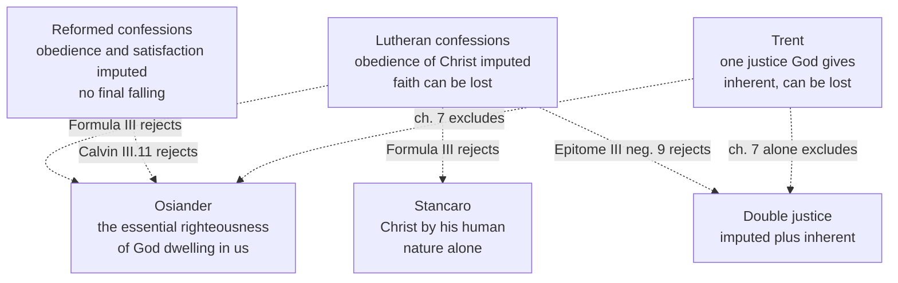

# Apologetics II · Lesson 3.1: Justification as the confessions state it

> ⏱ ~15 min · Module 3: Against sola fide · Builds on: [2.4](02-04-perspicuity-tested.md), [`christology` 5.4](../../christology/lessons/05-04-penal-substitution-and-the-catholic-assessment.md), [`new-testament` 5.1](../../new-testament/lessons/05-01-galatians-faith-law-and-the-gentiles.md), [`new-testament` 5.2](../../new-testament/lessons/05-02-romans-1-4-the-righteousness-of-god.md) · Unlocks: [3.2](03-02-trent-session-vi-against-the-confessions.md), [3.3](03-03-paul-and-james.md), [3.4](03-04-the-joint-declaration-merit-and-reward.md)

## Why this matters

"This whole doctrine is to be referred to that conflict of the terrified conscience; neither can it be understood apart from that conflict" (Augsburg Confession XX, Triglot). A Catholic who hears [*sola fide*](../reference.md#sola-fide) as "believe, then do as you like" has missed both. Lutheran and Reformed must also be kept apart: they differ on two points Catholic polemic charges to both. This lesson states it and stops.

## The idea

Luther's picture (*On Christian Liberty*, 1520; tr. Grignon, in Wace and Buchheim, 1883): faith "unites the soul to Christ, as the wife to the husband", so that "whatsoever Christ possesses, that the believing soul may take to itself and boast of as its own". A bankrupt woman marries a rich man. On the wedding day his estate is hers and her debts are his, by the vow, not by her housekeeping. Her life will change, or the marriage is a sham, but the change is not why the estate is hers.

The confessions turn the picture into a verdict. What counts before God is Christ's obedience, credited to the believer ([imputation](../reference.md#imputation)) and remaining Christ's ([alien righteousness](../reference.md#alien-righteousness)). "Justify" means to declare righteous ([forensic justification](../reference.md#forensic-justification)). Faith is trust in the promise ([fiducial faith](../reference.md#fiducial-faith)) and receives the verdict as an [instrument](../reference.md#faith-as-instrument), not a merit. Renewal follows, necessarily, and is no part of the ground. The believer is righteous and still a sinner ([*simul iustus et peccator*](../reference.md#simul-iustus-et-peccator)), and may be sure of his standing ([assurance](../reference.md#assurance)).

[`creation-grace-last-things` 5.1](../../creation-grace-last-things/lessons/05-01-trent-session-vi-justification.md) sketched the Lutheran texts to show what Trent aimed at; [`christology` 5.4](../../christology/lessons/05-04-penal-substitution-and-the-catholic-assessment.md) stated the Reformed doctrine of the cross, not reopened here. Here it is stated whole, from texts neither used; [3.2](03-02-trent-session-vi-against-the-confessions.md) replies.

## The other side

**Lutheran.** The [Augsburg Confession](../reference.md#augsburg-confession) (1530) IV, in the *Concordia Triglotta* (1921; English by F. Bente and W. H. T. Dau): men "cannot be justified before God by their own strength, merits, or works, but are freely justified for Christ's sake", through faith, when they believe their sins forgiven. "This faith God imputes for righteousness in His sight." Article VI: this faith "is bound to bring forth good fruits", and good works are necessary "because of God's will", though not to "merit justification". Article XX: faith is not "merely the knowledge of the history". Article XII condemns those "who deny that those once justified can lose the Holy Ghost".

Melanchthon's [Apology](../reference.md#apology-of-the-augsburg-confession) (1531) adds three things. *The terrified conscience*: "terrified consciences waver and hesitate", pile up works, and despair without the gospel of free remission (IV.20). *Faith as trust*: justifying faith is "to wish and to receive the offered promise" (IV, "What Is Justifying Faith?"); it alone "renders us acceptable to God", so love is "an effect following" (IV.116). *Two senses of "justify"*: Scripture says both "made" and "pronounced" just (IV.72), and in forensic usage "to acquit a guilty one and declare him righteous, but on account of the righteousness of another, namely, of Christ" (Triglot Art. III, §§184–185; Latin *propter alienam iustitiam*). Here is alien righteousness, a term Bente notes is also Luther's.

The [Formula of Concord](../reference.md#formula-of-concord) (1577), III, settles a Lutheran quarrel and names no one. "One side" made our righteousness God's "essential righteousness" dwelling in us; "others", Christ's human nature alone (Bente names Osiander and Stancaro: the [Osiander controversy](../reference.md#osiander-controversy)). Against both, our righteousness is "the entire Christ according to both natures, in His obedience alone" (Epitome III, affirmative 1), imputed to us (aff. 2); faith is "the means and instrument" that lays hold of Christ, "for whose sake this faith is imputed to us for righteousness" (aff. 3); "justify" means "to absolve, that is, to declare free from sins", and the Apology's "regeneration" is used "in the same sense" (aff. 5). It rejects justification as "actually being made righteous ... because of love infused" (negative 3), and justification partly by imputation and partly "by the new obedience begun in them" (neg. 9). The Solid Declaration puts God's indwelling after the righteousness of faith (III.54) and seeks all our righteousness outside ourselves (*extra nos*, III.55). All three texts stand in the [Book of Concord](../reference.md#book-of-concord) (1580), which Lutheran pastors subscribe as a *norma normata* under scripture, not a magisterium.

**Reformed.** The [Westminster Confession](../reference.md#westminster-confession) (1647, Schaff) XI.1: God justifies "not by infusing righteousness into them, but by pardoning their sins, and by accounting and accepting their persons as righteous"; "nor by imputing faith itself, the act of believing, or any other evangelical obedience to them, as their righteousness; but by imputing the obedience and satisfaction of Christ unto them". XI.2: faith is "the alone instrument of justification; yet is it not alone in the person justified ... but worketh by love". The justified "can never fall from the state of justification", though sin brings "God's fatherly displeasure" (XI.5; XVII.1). Sanctification is real, toward "true holiness, without which no man shall see the Lord" (XIII.1). The [Heidelberg Catechism](../reference.md#heidelberg-catechism) (1563): "Not that I am acceptable to God on account of the worthiness of my faith" (Q.61). Westminster is the Presbyterian subordinate standard, Heidelberg a Continental Reformed one.

Calvin's [*Institutes*](../reference.md#calvin-institutes) (Beveridge), a theologian's book: union with Christ brings "a twofold benefit", reconciliation and sanctification (III.11.1); justification is "the acceptance with which God receives us into his favor as if we were righteous", in forgiveness and "the imputation of the righteousness of Christ" (III.11.2). Against Osiander (III.11.5–12) he ranks "the mystical union" highest while refusing to "transfuse the divine essence into men". And "Christ, therefore, justifies no man without also sanctifying him" (III.16.1).

**Anglican.** [Article XI](../reference.md#thirty-nine-articles) (1571): "We are accounted righteous before God, only for the merit of our Lord and Saviour Jesus Christ by Faith"; justification "by Faith only, is a most wholesome Doctrine, and very full of comfort", as "the Homily of Justification" expounds. Article XII: good works "spring out necessarily of a true and lively Faith". Their standing varies across the Communion.

**Where Lutheran and Reformed part.**

| | Lutheran | Reformed |
|---|---|---|
| Is faith imputed? | "This faith God imputes" (Augsburg IV); faith is righteousness "imputatively" (Apology III.186) | "nor by imputing faith itself" (Westminster XI.1); not "the worthiness of my faith" (Heidelberg Q.61) |
| Can the justified fall? | Yes: Augsburg XII; David (Smalcald III.3); Formula Epitome IV neg. 3 | No: Westminster XI.5, XVII.1 |
| Assurance | Doubt forbidden (Epitome III aff. 6; Apology IV.119) | "Infallible assurance", not of faith's essence, may come late (Westminster XVIII.2–3); Calvin: faith is "firm and sure knowledge" (III.2.7), amid "a perpetual struggle" (III.2.17) |

The first row is mostly wording: both count faith only as receiving Christ (Apology III.187; Heidelberg Q.61); the second is real.

## What the reply must answer

1. **The [formal cause](../reference.md#formal-cause).** The confessions deny that the righteousness that counts is infused (Westminster XI.1; Epitome III neg. 3) and refuse [double justice](../reference.md#double-justice) (neg. 9), as Trent's "alone" does. The reply must show why a righteousness God makes inherent is the ground, not claim the confessions deny renewal.
2. **Faith.** Trust that receives, against faith as "the beginning ... the foundation, and the root" of a justice that includes hope and charity (Trent VI ch. 8, Waterworth). "Faith" and "justify" may not mean the same on both sides ([3.2](03-02-trent-session-vi-against-the-confessions.md)).
3. **Assurance:** the Lutheran ban on doubt and Westminster's later assurance, met separately.
4. **[Falling away](../reference.md#perseverance).** The Lutherans side with Trent (VI can. 23); only Westminster contradicts it.
5. **[Merit](../reference.md#merit).** The confessions require works and deny that they merit justification; Catholic merit must be stated so the objection misses ([3.4](03-04-the-joint-declaration-merit-and-reward.md)).

**Ruled out.** "Lutherans say works don't matter" (Augsburg VI; Epitome IV). "Faith alone is bare assent" (Augsburg XX). "Calvin and Luther taught the same thing". "Protestants teach once saved, always saved" (Westminster, not the Book of Concord).

**Mark the levels.** On [the ladder](../../fundamental-theology/lessons/04-04-the-ladder-of-doctrinal-authority.md) ([levels of authority](../reference.md#levels-of-authority)), every text above has **no Catholic level**, only standing inside its tradition; Luther, Osiander and Calvin wrote as theologians. The reply rests on [Trent VI](../reference.md#trent-session-vi)'s canons, **rung 1 as worded**: can. 11 (not *sole* imputation; grace inheres), can. 12 (faith not mere confidence), can. 9 ("faith alone" only "in such wise as to mean" nothing else co-operates), cans. 13–14 (certainty not required), can. 23 (grace can be lost), can. 32 (merit). Ch. 7's "alone" and ch. 9's limit on certainty are chapter text, **at least rung 3**. Whether a given confession falls under a canon is **rung 5**; the [Joint Declaration](../reference.md#joint-declaration)'s judgment on the Lutheran teaching it presents has no rung of its own ([`creation-grace-last-things` 5.2](../../creation-grace-last-things/lessons/05-02-the-1999-joint-declaration.md)).

**Concession.** The Reformation doctrine protects something late-medieval preaching and practice genuinely obscured: that grace is unowed and comes first, and that a terrified conscience may rest on Christ's promise instead of a heap of works. Augsburg XX's complaint that consciences "were plagued with the doctrine of works" described real preaching, from [*facere quod in se est*](../../creation-grace-last-things/lessons/04-02-the-necessity-of-grace.md) heard as effort that earns grace to indulgences preached for the dead in 1517 ([`church-history` 6.1](../../church-history/lessons/06-01-the-late-medieval-church-and-luthers-protest.md)).

**The crux.** Whether the righteousness for which God accepts a sinner can remain Christ's, counted to him, or must be God's gift made his own. The confessions deny it is in us; Trent (can. 11) denies it is only counted. What would move it: whether Paul's *logizomai* (Rom 4:3–5) credits what is absent or declares what God makes true ([`new-testament` 5.2](../../new-testament/lessons/05-02-romans-1-4-the-righteousness-of-god.md)), and whether God's verdict can leave its object unchanged.

## The map of positions

Both families and Trent shut out Osiander and double justice; the families part over falling, and from Trent over whether the one righteousness is counted or given.

## Worked examples

**Example 1 (clean): David.** A justified man commits adultery and murder (2 Samuel 11–12). Lutheran: the [Smalcald Articles](../reference.md#smalcald-articles) (1537, III.3) name him: when holy men fall "into manifest sins, as David into adultery, murder, and blasphemy", then "faith and the Holy Ghost has departed from them"; repentance restores them (Augsburg XII). Reformed: believers may "fall into grievous sins" and "for a time continue therein", incurring "God's displeasure" (Westminster XVII.3), yet "can never fall from the state of justification" (XI.5). Two verdicts on one case; Trent sides with the Lutherans that grace is lost (VI ch. 15; can. 23).

**Example 2 (strain): the believer who cannot feel sure.** Invented: a Lutheran and a Presbyterian each say, "I trust Christ, but I cannot feel forgiven." The Lutheran pastor points to the promise: the Formula forbids doubting despite "many weaknesses" (Epitome III aff. 6). The Presbyterian hears that a true believer "may wait long" for assurance, reached partly through "the inward evidence of those graces" (Westminster XVIII.2–3). Here the statement stops determining an answer. Neither confession tells weak faith from none, and Westminster's evidence of graces points the doubter to his own renewal, which both confessions keep out of the ground of acceptance.

## Watch out

- **You might think the Reformation made justification a legal fiction that leaves the sinner as he was.** The confessions require the renewal that follows (Calvin III.16.1; Westminster XIII.1; Epitome IV aff. 3). They deny only that it belongs to the ground of acceptance.
- **You might think "Protestants" hold one doctrine.** The Book of Concord says the justified can fall; Westminster says they cannot. Augsburg says God imputes faith; Westminster denies it in words.
- **You might think *simul iustus et peccator* and "alien righteousness" are confessional formulas.** The *simul* is Luther's (*Galatians*, 1535, on 3:6), in no text of the Book of Concord; "alien righteousness" is Luther's and the Apology's, not Augsburg IV's. Nor is the Book of Concord a magisterium, or the *Institutes* a confession.
- **You might think Trent condemned faith alone, or imputation, outright.** Can. 9 condemns "faith alone" in one stated sense, and can. 11 *sole* imputation; ch. 8 says we are "justified by faith". Anything more overstates the canons.

## One-liner

> The confessions ground acceptance wholly on Christ's obedience counted to faith and require the renewal that follows; Lutherans let the justified fall, and Westminster does not.

## Problems

**P1 (🟢) *(Close reading · Exegetical, strict.)*** Melanchthon, *Apology of the Augsburg Confession* IV.114–117, in the *Concordia Triglotta* (1921; English by F. Bente and W. H. T. Dau; a bracketed gloss and three phrases omitted):

> And because it receives the remission of sins, and reconciles us to God, by this faith we are … accounted righteous for Christ's sake before we love and do the works of the Law, although love necessarily follows. Nor, indeed, is this faith an idle knowledge, neither can it coexist with mortal sin, but it is a work of the Holy Ghost … And because this faith alone receives the remission of sins, and renders us acceptable to God, and brings the Holy Ghost, it could be more correctly called *gratia gratum faciens*, grace rendering one pleasing to God, than an effect following, namely, love. Thus far … we have shown … that by faith alone we obtain the remission of sins for Christ's sake, and that by faith alone we are justified, i. e., of unrighteous men made righteous, or regenerated.

(a) Does "of unrighteous men made righteous, or regenerated" teach that the righteousness which justifies is infused? Name the words of the passage that decide how Melanchthon uses it, and the later Lutheran text that rules on the Apology's word.

(b) What does "neither can it coexist with mortal sin" imply about whether the justified can fall from grace, and which confession denies that they can?

(c) What title does Melanchthon move from love to faith, and on what ground?

**Two sentences per part.**

**P2 (🟡) *(Apologetic: (a) Exegetical, graded first · (b) reply.)*** Invented, written for this problem: at an ecumenical evening, a Presbyterian elder tells a Catholic friend, "Your Church adds your works to Christ's. Ours rests on Christ alone."

(a) State the doctrine the elder relies on as Westminster XI.1–2 states it: what justification is and is not, what is imputed and what is not, and what faith does. **About 100 words.**

(b) Reply, opening with a **named concession**, and limited to this: which part of the elder's sentence a Catholic can grant, which part the reply in [3.2](03-02-trent-session-vi-against-the-confessions.md) must contest, and why "your doctrine is a legal fiction" is not that reply. A reply concluding that the elder is right passes if it is a good reply. **About 80 words.**

**P3 (🔴, optional) *(Diagnose · Exegetical, strict.)*** An invented newsletter column, written for this problem: "From the pastor's study", by Pastor Anneliese Brodtkorb, St Ansgar Lutheran Church, Haldersby.

> "Our Augsburg Confession teaches that a Christian is *simul iustus et peccator*, at once righteous and a sinner. Our faith is no idle thing: it is bound to bring forth good fruits. Our Presbyterian neighbours hold 'once saved, always saved', so on their view a believer may live as he likes and still be sure of heaven. Worse, the Westminster Confession denies that faith is imputed for righteousness, so they have quietly given up justification by faith. And Rome, of course, condemned justification by faith at Trent."

Name the **four** errors and the one sentence that is correct as it stands. For each error give the correction and the text that supports it. **Two sentences per error.**

Solutions

**P1** *(Close reading · Exegetical, strict)*

**Must hit, strict:**

- (a) No. The sentence pairs "by faith alone we are justified" with "by faith alone we obtain the remission of sins", and the passage says faith "receives the remission of sins, and renders us acceptable to God" while love is "an effect following", so "made righteous" names the passage from guilty to accepted, not an infused quality. The Formula rules on the word: where "regeneratio and vivificatio" stand for justification, "as in the Apology, this is done in the same sense", to absolve (Epitome III aff. 5).
- (b) A faith that cannot coexist with mortal sin is lost by mortal sin, so the justified can fall from grace, as Augsburg XII and the Smalcald Articles (III.3) also teach. Westminster denies it: the justified "can never fall from the state of justification" (XI.5; XVII.1).
- (c) *Gratia gratum faciens*, the schoolmen's name for the grace that makes one pleasing to God, which they tied to charity. Melanchthon gives it to faith because faith alone "receives the remission of sins, and renders us acceptable", while love "necessarily follows" as an effect.

**Wrong turns:** reading (a) as Melanchthon teaching infused righteousness, or as proof that the Lutherans "really" agree with Trent: the passage puts acceptance before love. Credit, but do not require, the further point that the Apology uses both senses of "justify" (IV.72), which is why its words can pass Trent's "made just" without meeting it. In (b), saying "Protestants" hold perseverance, or reading the clause as indifference to sin. In (c), concluding love is unnecessary.

**Model answer:** (a) No. Melanchthon sets "justified" beside "obtain the remission of sins" and says faith "renders us acceptable" while love follows, so "made righteous" means made acceptable; the Formula later says the Apology's "regeneration" means absolution in the same sense (Epitome III aff. 5). (b) If faith cannot coexist with mortal sin, a justified man who sins mortally loses it, which Augsburg XII and Smalcald III.3 also teach. Westminster denies this: the justified "can never fall from the state of justification" (XI.5). (c) *Gratia gratum faciens*, the grace that makes one pleasing to God, which the schools assigned to charity. He gives it to faith because faith alone receives remission and makes us acceptable, and love follows as its effect.

---

**P2** *(Apologetic: (a) Exegetical, graded first · (b) reply)*

**Accept:** any (b) that opens with a real concession and puts the dispute at the ground of acceptance, whatever its verdict.

**Must hit, strict (a), graded first:**

- **What justification is:** God freely justifies "not by infusing righteousness into them, but by pardoning their sins, and by accounting and accepting their persons as righteous", not for anything wrought in them or done by them, but for Christ's sake alone (XI.1).
- **What is imputed:** "the obedience and satisfaction of Christ"; **not imputed:** "faith itself, the act of believing, or any other evangelical obedience" (XI.1).
- **Faith:** receives and rests on Christ and his righteousness and is God's gift (XI.1); it is "the alone instrument of justification", yet "not alone in the person justified", "no dead faith, but worketh by love" (XI.2).

**Must hit (b):**

- **A named concession,** for example: Westminster rests acceptance wholly on Christ and still requires holiness (faith "worketh by love", XI.2; real sanctification, XIII.1), so calling it antinomian misses it.
- **Grant:** Christ alone merits justification. Trent names his passion its meritorious cause (VI ch. 7) and makes grace go first (cans. 1–3).
- **Contest:** "not by infusing righteousness", that is, whether the righteousness for which God accepts is Christ's only as counted (XI.1) or God's gift inhering in the soul (can. 11). "Adds your works" is the elder's description of Trent, and the reply must show why it does not fit.
- **Not "legal fiction":** the verdict rests on a real righteousness, Christ's, and comes with real renewal; the question is whether that renewal belongs to the ground.

**Wrong turns:** in (a), "the Reformed count faith as righteousness" (XI.1 denies it in words); stating Augsburg IV as the Reformed view; presenting Calvin as "the Reformed confession"; "works don't matter"; dropping "not by infusing". These fail the problem. In (b), conceding that Trent makes works a co-merit beside Christ, which ch. 7 and cans. 1–3 exclude; or replying with the legal-fiction charge.

**Model answer (a):** Westminster XI.1: God freely justifies those he calls, not by infusing righteousness but by pardoning their sins and accounting and accepting their persons as righteous, for Christ's sake alone, not for anything in or done by them. He imputes not faith or any evangelical obedience but Christ's obedience and satisfaction, which they receive and rest on by faith, itself God's gift. XI.2: faith is the alone instrument of justification, yet never alone in the justified; it is no dead faith but works by love.

**Model answer (b), one of several:** Concession: this doctrine rests on Christ alone and still demands a faith that works by love; it is not antinomian. A Catholic grants "Christ alone" as the one who merits: Trent makes his passion the meritorious cause and grace prior to all. The reply must contest "not by infusing": whether God accepts us for a righteousness only counted, or for his gift made ours. "Legal fiction" misses, because the verdict rests on Christ's real righteousness and renewal follows.

---

**P3** *(Diagnose · Exegetical, strict)*

**Must hit, strict:**

- **Correct sentence:** the second. "Bound to bring forth good fruits" is Augsburg VI's own wording, and the Apology calls justifying faith no "idle knowledge" (IV.115).
- **Error 1, the *simul*.** The formula is Luther's (*Galatians*, 1535, on 3:6) and appears in no text of the Book of Concord, Augsburg included. The teaching is Lutheran; the attribution to the Confession is wrong.
- **Error 2, the Presbyterians.** Westminster does teach that true believers "can neither totally nor finally fall away" (XVII.1), and that is the real difference from Augsburg XII. "Live as he likes" is the caricature: they may fall into grievous sins that bring God's displeasure (XVII.3), "true holiness" is that "without which no man shall see the Lord" (XIII.1), and assurance belongs to those "endeavoring to walk in all good conscience" (XVIII.1).
- **Error 3, imputing faith.** XI.1 denies that faith itself is imputed as the righteousness, while XI.2 makes faith "the alone instrument of justification". The Lutheran texts also count faith only as it receives Christ (Apology III.186–187), so the difference is one of wording, not a surrender of *sola fide*.
- **Error 4, Trent.** Trent says we are "justified by faith", faith being "the beginning ... the foundation, and the root of all Justification" (VI ch. 8). Can. 9 condemns "faith alone" only in a stated sense, nothing else co-operating and no preparation of the will.

**Wrong turns:** marking the second sentence wrong; "correcting" error 2 by denying that Westminster teaches perseverance; "correcting" error 3 by saying Westminster affirms that faith is imputed; "correcting" error 4 by saying Trent accepted *sola fide*; giving the *simul* to the Apology or the Formula; calling the Book of Concord the column's infallible authority.

**Model answer:** The second sentence is correct: Augsburg VI says faith "is bound to bring forth good fruits". (1) *Simul iustus et peccator* is Luther's formula, from the 1535 *Galatians*, and no confession in the Book of Concord uses it. (2) Westminster does hold that true believers cannot finally fall (XVII.1), which Augsburg XII denies; but it says believers who sin incur God's displeasure (XVII.3) and that without holiness no one sees the Lord (XIII.1). (3) Westminster XI.1 denies that faith is the righteousness imputed, and XI.2 calls faith the alone instrument, so this is a difference of wording; the Apology too counts faith only as it receives Christ. (4) Trent VI ch. 8 says we are justified by faith, its beginning, foundation and root, and can. 9 condemns only a sense of "faith alone".

## Flashback

**From Lesson [2.3](02-03-tradition-and-what-sufficiency-means.md) (Tradition, and what "sufficiency" means):** *(Close reading · Apologetic: (a) Exegetical, graded first · (b) reply.)* The [Second Helvetic Confession](../reference.md#second-helvetic-confession) (1566), ch. II (Schaff, vol. 3):

> we do not despise the interpretations of the holy Greek and Latin fathers … but we do modestly dissent from them when they are found to set down things differing from … the Scriptures. … And in the same order we also place the decrees and canons of councils. … in controversies … we can not admit any other judge than God himself, pronouncing by the Holy Scriptures …

(a) State the chapter's position on the Fathers, councils and the judge of controversies, and the Confession's weight. **Three sentences.**

(b) Reply, opening with a **named concession** about the Fathers; then name the clause where the disagreement lies, and what would move it. **100 words or fewer.** A reply concluding that the Confession is right passes if it is a good reply.

Solution

**Accept:** any (b) that opens with a real concession and locates the dispute at the standing of post-apostolic interpretation, whatever its verdict.

**Must hit, strict (a), graded first:**

- **Fathers** not despised, but "modestly" dissented from where they differ from Scripture; **councils** "in the same order".
- **The judge:** in controversies, God alone, speaking by Scripture: [formal sufficiency](../reference.md#material-and-formal-sufficiency). Tradition is subordinated, not rejected.
- **Weight:** a Reformed standard, not a magisterium; no Catholic level.

**Must hit (b):**

- **A named concession:** the Fathers as authors have no magisterial level, and a Catholic too may dissent from a single Father; what binds is the Church's sense and their *unanimous* consent (Trent IV's second decree, **at least rung 3**).
- **The clause:** councils "in the same order", so no post-apostolic act of interpretation shares Scripture's infallibility. That is 2.3's crux.
- **What would move it:** whether the promises (Matt 28:20; John 16:13) run to the apostles alone or to the Church through time, and whether the second-century [rule of faith](../reference.md#rule-of-faith) in fact settled rival readings.

**Wrong turns:** stating (a) as "the Reformed reject the Fathers and councils" or "me and my Bible" ([*solo scriptura*](../reference.md#solo-scriptura)): the caricature, which fails the problem. Calling it "the Protestant view", or a magisterium. In (b), arguing *partim–partim*, the wrong question; saying Trent's anathema reaches this chapter (**rung 5**: no act applies it); claiming to show which body holds the office (Module 4's question).

**Model answer (a):** The Confession does not despise the Fathers' interpretations but modestly dissents where they differ from Scripture, and ranks councils the same way. In controversies it admits no judge but God pronouncing by the Scriptures. It is a Reformed standard, not a magisterium.

**Model answer (b), one of several:** Concession: a Father writing as an author has no magisterial weight, and a Catholic may dissent from a single Father; what binds is the Church's sense and the Fathers' unanimous consent. The disagreement is "in the same order": councils as fallible as one Father, so no post-apostolic reading shares Scripture's infallibility. That turns on whether Christ's promises reach the Church through time, and whether the second-century rule of faith really settled rival readings.

## Connections

- **Backward:** [2.4](02-04-perspicuity-tested.md) tested the confessions' clarity claim; here two families read Romans 4 with one principle and part over falling and over how to word faith's imputation. Trent's decree and the Reformers sketched beside it are [`creation-grace-last-things` 5.1](../../creation-grace-last-things/lessons/05-01-trent-session-vi-justification.md); the satisfaction background, Westminster XI.3 and Heidelberg Q.37 are [`christology` 5.4](../../christology/lessons/05-04-penal-substitution-and-the-catholic-assessment.md); *erga nomou*, *logizomai* and Luther's *allein* are [`new-testament` 5.1](../../new-testament/lessons/05-01-galatians-faith-law-and-the-gentiles.md)–[5.2](../../new-testament/lessons/05-02-romans-1-4-the-righteousness-of-god.md).
- **Forward:** [3.2](03-02-trent-session-vi-against-the-confessions.md) sets Trent VI against these texts clause by clause, and argues free will and the Reformed doctrine of election, which the confessions tie to this article. [3.3](03-03-paul-and-james.md) reads Paul and James, with the Apology's reply on James 2:24 (Triglot Art. III). [3.4](03-04-the-joint-declaration-merit-and-reward.md) weighs the Joint Declaration and merit; [6.3](06-03-penance-purgatory-and-indulgences.md) meets Augsburg XII's account of repentance.
- **Sideways:** imputation is bookkeeping language, and Paul's "put that to my account" (*elloga*, Philemon 18) is read as debt logic in [`theology-of-debt` 2.4](../../theology-of-debt/lessons/02-04-the-bond-and-the-ransom.md). How mortal sin loses grace, the point on which Lutherans and Trent agree against Westminster, is [`moral-theology` 3.4](../../moral-theology/lessons/03-04-sin-mortal-and-venial.md). The crux method is [`philosophical-method` 4.3](../../philosophical-method/lessons/04-03-finding-the-crux.md).
