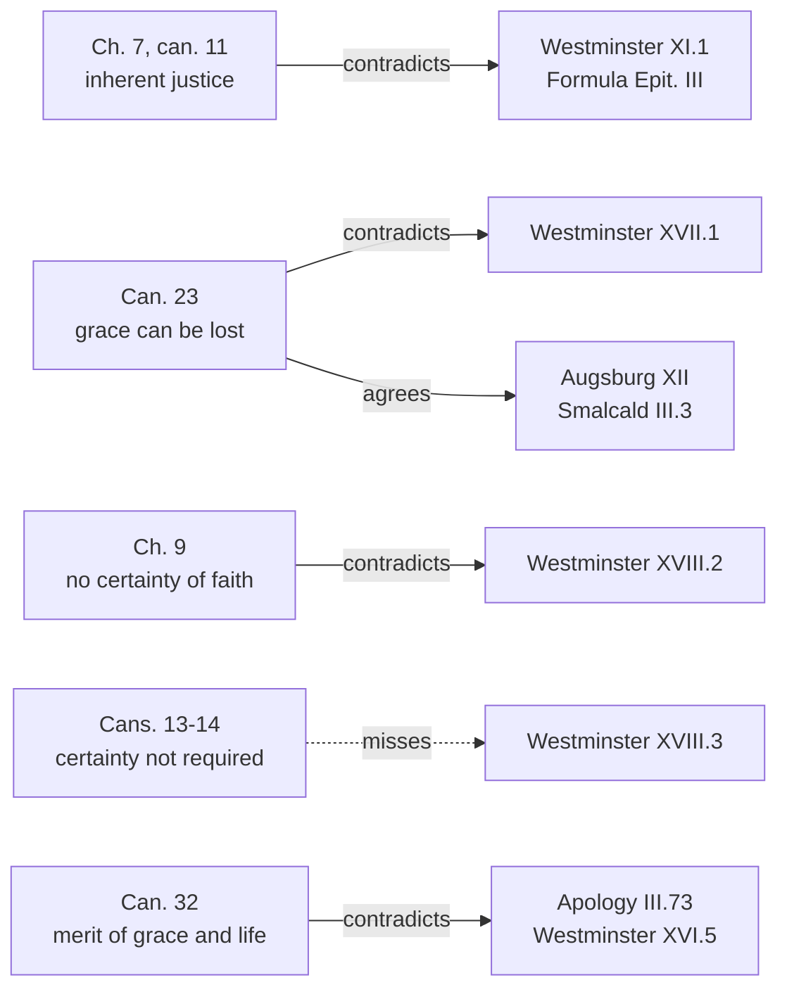

# Apologetics II · Lesson 3.2: Trent Session VI against the confessions

> ⏱ ~15 min · Module 3: Against sola fide · Builds on: [3.1](03-01-justification-as-the-confessions-state-it.md), [`creation-grace-last-things` 5.1](../../creation-grace-last-things/lessons/05-01-trent-session-vi-justification.md), [`philosophical-method` 4.3](../../philosophical-method/lessons/04-03-finding-the-crux.md) · Unlocks: [3.3](03-03-paul-and-james.md), [3.4](03-04-the-joint-declaration-merit-and-reward.md)

## Why this matters

Every Catholic–Protestant argument about justification cites Trent, mostly badly. Catholic tracts treat all thirty-three canons as hits on Luther; Protestant tracts treat them as anathemas on faith. Set the decree beside the confessions clause by clause and the dispute gets smaller and sharper: it collides at four points and misses at several others.

## The idea

Two delegations sign a treaty in two languages. In one, "peace" means the guns have stopped; in the other, that the enemies are friends. Some clauses clash; others only seem to. A good reader sorts them before arguing.

[Session VI](../reference.md#trent-session-vi) (13 January 1547) is [`creation-grace-last-things` 5.1](../../creation-grace-last-things/lessons/05-01-trent-session-vi-justification.md)'s and the confessions are [3.1](03-01-justification-as-the-confessions-state-it.md)'s; both are assumed here. A confessional clause that asserts what a canon condemns, *in the sense the canon states*, **contradicts** it. One that uses the word in another sense **passes by**. If no confession asserts the proposition, the canon **misses** the confessions, whoever else it struck ([contradiction and passing-by](../reference.md#contradiction-and-passing-by)).

Two fronts are only marked. On free will, can. 5 condemns, nearly word for word, a proposition of Luther's already condemned in 1520 (free will after sin *res de solo titulo*, "a thing with only a name"; [*Exsurge Domine*](../reference.md#exsurge-domine) prop. 36), while Augsburg XVIII grants the will "some liberty to choose civil righteousness". What remains is narrow: whether the will, moved by prevenient grace, co-operates in preparing for justification (ch. 5; can. 4), which the Formula of Concord denies: before conversion there are "only two efficient causes", the Holy Ghost and the Word (Epitome II). Election is [`creation-grace-last-things` 5.4](../../creation-grace-last-things/lessons/05-04-predestination.md)'s; can. 17's predestination "unto evil" is a thesis Westminster also disowns (III.1).

## The other side

**Lutheran: Chemnitz.** Martin Chemnitz (1522–1586), a principal author of the [Formula of Concord](../reference.md#formula-of-concord), answered in his [*Examination of the Council of Trent*](../reference.md#chemnitz-examen) (1565–73). On justification (paraphrased from the Latin) he charges that the decrees imply Lutherans teach forgiveness without renewal; they teach renewal comes with reconciliation, distinguished so that faith rests on the Mediator, not on a newness barely begun. He refuses to make it a war over the word "justify". The question is what a sinner can set against God's judgment: Christ's satisfaction, obedience and merit, or the newness begun in us. **Weight:** a theologian's book, with no confessional standing.

**Reformed: Calvin.** Calvin replied with the [*Antidote*](../reference.md#calvin-antidote) (1547; Beveridge's translation, *Tracts* vol. 3, 1851). Against can. 9: "faith alone" never meant "a faith devoid of charity". On can. 11: "It is therefore faith alone which justifies, and yet the faith which justifies is not alone." Can. 10 trades on an equivocation, for "the adverb formally is used in both senses." Against ch. 9: "they are ignorant of the whole nature of faith who mingle doubt with it." **Weight:** a theologian's tract.

**The confessions on the four points:**

- *Inherent justice.* [Westminster](../reference.md#westminster-confession) XI.1 justifies "not by infusing righteousness into them" but by "imputing the obedience and satisfaction of Christ"; the Formula rejects being made righteous "because of love infused by the Holy Ghost" (Epitome III, negative 3).
- *Falling away.* Westminster XVII.1: the saints "can neither totally nor finally fall away from the state of grace". [Augsburg](../reference.md#augsburg-confession) XII condemns "the Anabaptists, who deny that those once justified can lose the Holy Ghost".
- *Assurance.* Westminster XVIII.2: "an infallible assurance of faith", though not of "the essence of faith" (XVIII.3). The [Apology](../reference.md#apology-of-the-augsburg-confession) (IV.119) charges Rome with bidding consciences "doubt whether they obtain remission of sins".
- *Merit.* Works merit "other rewards, bodily and spiritual", not remission, grace or justification (Apology III.73, Triglot numbering). Westminster XVI.5: "We can not, by our best works, merit pardon of sin, or eternal life".

**Weight:** Augsburg, the Apology, the Smalcald Articles and the Formula (*Concordia Triglotta*, 1921) belong to the [Book of Concord](../reference.md#book-of-concord), the Lutheran confessional standard pastors subscribe, a norm under Scripture. Westminster (Schaff, vol. 3) is the subordinate standard of Presbyterian churches.

**A question on both sides.** Catholic scholars ask a narrower form of the question whether the drafters had Luther in view. The ecumenical study *The Condemnations of the Reformation Era: Do They Still Divide?* (German 1986, eds Karl Lehmann and Wolfhart Pannenberg) asked whether the condemnations still strike "today's partner", and broadly concluded that on justification they no longer divide; its results remain disputed ([the 1986 study](../reference.md#condemnations-of-the-reformation-era)). Lehmann warned in 1998 that this does not make them simply "without object" (both phrases: lesson's translation). **Weight:** no magisterial level.

## The argument

**P1.** A canon condemns a proposition in its stated sense, and names no one. *In words:* a clause falls under a canon only if it says what the canon condemns.

**P2.** On inherent justice the texts collide. Ch. 7 makes the single [formal cause](../reference.md#formal-cause) a justice received "within us"; can. 11 condemns justification "by the sole imputation of the justice of Christ", excluding inherent grace and charity. Westminster XI.1 ("not by infusing") and Epitome III negative 3 deny what ch. 7 affirms. Both closed the middle road: Trent with "alone" against [double justice](../reference.md#double-justice), the Formula by rejecting justification "jointly" by imputed righteousness and "the new obedience begun in them" (Epitome III, negative 9). *In words:* a contradiction both sides made sure of.

**P3.** On falling away they collide, with the Reformed only. Can. 23 condemns saying the justified cannot "lose grace", or that one who falls "was never truly justified"; Westminster XVII.1 and XI.5 assert the first. The Lutherans side with Trent: Augsburg XII, and the [Smalcald Articles](../reference.md#smalcald-articles) (III.3), which reject the claim that one who sins after receiving faith "never truly had the Spirit and faith". *In words:* [perseverance](../reference.md#perseverance) of the saints is Reformed doctrine, not the Reformation's.

**P4.** On [assurance](../reference.md#assurance) they collide in the chapter, not in cans. 13–14. Ch. 9 denies anyone "a certainty of faith, which cannot be subject to error" that he has grace (*certitudine fidei, cui non potest subesse falsum*); Westminster XVIII.2 promises "an infallible assurance of faith" (*infallibilis quaedam fidei certitudo*). Cans. 13–14 condemn making certainty necessary to forgiveness, which XVIII.3 also denies. *In words:* neither requires assurance; they divide on whether it can be infallible.

**P5.** On [merit](../reference.md#merit) they collide narrowly. Can. 32: the justified truly merit "increase of grace, eternal life", and "an increase of glory". The Apology grants "different rewards according to different labors", denying merit only of remission, grace and justification; Westminster XVI.5 denies merit of pardon and eternal life. *In words:* the clash is over grace and eternal life, not reward; [3.4](03-04-the-joint-declaration-merit-and-reward.md) argues it.

**P6.** Where the key word shifts, they pass by. "Justify" is to absolve in the Formula (Epitome III, affirmative 5), a translation into grace in Trent (ch. 4); [`philosophical-method` 4.3](../../philosophical-method/lessons/04-03-finding-the-crux.md) splits it. "Faith" is, for Trent, assent to what God reveals, living only with hope and charity (ch. 6–7); for the confessions, trust in the promise ([fiducial faith](../reference.md#fiducial-faith); Epitome III, affirmative 4). "Instrument" is baptism in Trent (ch. 7), receiving faith in Westminster XI.2: two causal slots ([faith as instrument](../reference.md#faith-as-instrument)). Can. 12 is the exception: it takes the confessions' own sense, confidence in the mercy that remits sins, and condemns making it the whole of justifying faith; whether a given confession asserts that is **rung 5**. *In words:* a canon and an article using one word in two senses can both be true.

**∴ C.** Session VI contradicts the confessions on four points (inherent justice, assurance, merit of grace and eternal life, and, with the Reformed, falling away) and passes them where "justify", "faith" or "instrument" shifts. *In words:* the Catholic must defend the four and may not count the passings as wins.

**Mark the levels.** On [the ladder](../../fundamental-theology/lessons/04-04-the-ladder-of-doctrinal-authority.md) ([levels of authority](../reference.md#levels-of-authority)): **rung 1**, each canon as worded: cans. 11, 13–14, 16, 23 with 27, and 32. **At least rung 3**: ch. 7's "alone"; ch. 9's denial of a certainty of faith; ch. 12. The decree's fence (the proem and the close of ch. 16) binds Catholics to the chapters' doctrine without making every sentence a definition ([chapters and canons](../reference.md#chapters-and-canons)). **Rung 5**: whether a named confessional clause asserts what a canon condemns; no act applies the canons to Westminster or the Formula ([application of a condemnation](../reference.md#application-of-a-condemnation)); [Joint Declaration](../reference.md#joint-declaration) §41, with no rung of its own, judges only the Lutheran teaching it presents. **No Catholic level**: the texts weighed above.

**Concession.** Some canons and articles pass each other because the words differ, and a Catholic apologist who reads every canon as a hit on Luther is reading carelessly. Cans. 19 and 21 condemn antinomian propositions the Lutherans also reject (Augsburg VI; Formula, Epitome VI), and can. 23's "never truly justified" is condemned in the Smalcald Articles too.

**The crux.** Neither side denies that the justified are inwardly renewed; Trent puts renewal inside justification, the confessions in sanctification. So "inherent or imputed?" is the first layer, and Trent answers that the justice "called ours" is God's too, "infused into us of God" (ch. 16). Underneath is the premise Chemnitz named: *can a righteousness real but imperfect in degree stand at God's judgment?* Westminster: our best works "can not endure the severity of God's judgment" (XVI.5). Trent: venial sins do not make the just cease to be just (ch. 11), and they have "fully satisfied the divine law according to the state of this life" (ch. 16). A Protestant would be moved by showing that God judges his children by charity's fulfilment of the law (Romans 13:10), not its full rigour; a Catholic, by showing that Scripture judges the justified by that rigour (Galatians 3:10; James 2:10).

## The map of positions

Solid arrows meet; the dashed one is a miss.

## Worked examples

**Example 1 (clean): the parish Q&A.** On a parish website, Fr Jarosław Pietrzykowski (both invented for this lesson) is asked whether Trent condemned a reader's Lutheran fiancé. He answers: "Yes. All thirty-three canons were aimed at Luther: canons 19–21 condemn the Lutheran idea that Christians needn't keep the commandments, canon 23 the idea that you can't lose your salvation." Run the test. Cans. 19 and 21 condemn saying nothing besides faith is commanded, or that Christ is not also "a legislator whom to obey"; Augsburg VI calls good works "commanded by God" necessary. They miss. Can. 20 is harder, since Augsburg XV will not bind consciences to church ordinances "as though such observance was necessary to salvation". Can. 23 condemns what Augsburg XII and Smalcald III.3 condemn: it strikes Westminster, not Wittenberg. Better examples: cans. 11 and 32.

**Example 2 (strain): Westminster on assurance.** Cans. 13–14 miss Westminster (XVIII.3); ch. 9 meets XVIII.2, but at least rung 3, not defined. The canon that might reach is 16: no one may claim "an absolute and infallible certainty" of final perseverance "unless he have learned this by special revelation". Westminster joins infallible assurance of grace (XVIII.2) to the certain perseverance of all in grace (XVII.1–2), reached "without extraordinary revelation" (XVIII.3). Yet the assurance may be "shaken, diminished, and intermitted" (XVIII.4). Does "absolute" mean unconditioned, which Westminster's certainty is, or never shaken, which it is not? The canon does not say, and no act has said. The method locates the question and stops.

## Watch out

- **You might think "the Reformation" denied that the justified can fall from grace,** but the Lutheran confessions teach that they can (Augsburg XII; Smalcald III.3). "Protestants believe once saved, always saved" is the blur, and Westminster XVII.3, on the saints' "grievous sins", rules out "live as you like" too.
- **You might think the tag "faith alone justifies, but the faith that justifies is never alone" is confessional wording,** but it is Calvin's *Antidote*; the Formula credits the idea to Luther (SD III.41).
- **You might think Trent defined that no one can be sure he is in grace,** but ch. 9's denial is at least rung 3, the canons condemn only requiring certainty, and ch. 9 forbids doubting God's mercy. The mirror error weighs the other side up: Chemnitz and Calvin wrote books, not confessions.

## One-liner

> Session VI collides with the confessions on inherent justice, assurance, merit and (with the Reformed only) falling away, and passes them wherever "justify", "faith" or "instrument" shifts.

## Problems

**P1 (🟢) *(Exegetical, strict · close reading.)*** Two texts.

> **Trent, Session VI, can. 28** (Waterworth, 1848) condemns anyone who says "that, grace being lost through sin, faith also is always lost with it; or, that the faith which remains, though it be not a lively faith, is not a true faith; or, that he who has faith without charity is not a Christian."
>
> **Apology of the Augsburg Confession IV.48** (*Concordia Triglotta*, 1921; the bracketed additions from the German omitted): "The adversaries feign that faith is only a knowledge of the history, and therefore teach that it can coexist with mortal sin. Hence they say nothing concerning faith, by which Paul so frequently says that men are justified, because those who are accounted righteous before God do not live in mortal sin. But that faith which justifies is not merely a knowledge of history, … but it is to assent to the promise of God, in which, for Christ's sake, the remission of sins and justification are freely offered."

(a) Does the Apology assert what can. 28 condemns? Name the word that decides it, and its sense in each text.

(b) Is the Apology's report of "the adversaries" fair to Session VI? Name one thing it gets right and one thing it leaves out, citing a chapter.

(c) Once the word is split, does any disagreement remain between the two texts? Name it, with the words on each side.

**Two sentences per part.**

**P2 (🟡) *(Apologetic: (a) Exegetical, graded first · (b) reply.)*** Trent VI can. 23 condemns anyone who says that a man once justified cannot lose grace, and that one who falls and sins was never truly justified.

(a) Name the tradition whose confession contradicts this canon, and say which tradition's confessions agree with it. Then state the contradicting doctrine from its confession, by chapter and section, in words its defenders would sign: what the justified cannot do, what they still can, and on what their perseverance depends. **Four sentences.**

(b) Reply, opening with a **named concession**, and name the premise on which the dispute turns. **120 words or fewer.** A reply that concludes the objection succeeds passes if it is a good reply.

**P3 (🔴) *(Exegetical, strict · assign the weight.)*** For each claim, say whether it is right and give the weight: a rung on [the ladder](../../fundamental-theology/lessons/04-04-the-ladder-of-doctrinal-authority.md) with the act that fixes it, or the text's standing in its own tradition. Traps run both ways. **One or two sentences per item.**

(a) "That grace once received can be lost, and not only by unbelief, is only a chapter of Trent (ch. 15), so it is authentic teaching at most."

(b) "Ch. 16 calls the chapters doctrine 'which whoso receiveth not faithfully and firmly cannot be justified'. So ch. 9's denial of a certainty of faith is defined, and Westminster XVIII.2 falls under Trent's anathema."

(c) "The Smalcald Articles' teaching that faith and the Holy Ghost depart from saints who fall into manifest sins is Luther's private opinion, binding on no Lutheran."

(d) "Chemnitz's *Examen* carries the Formula of Concord's authority, since Chemnitz co-wrote the Formula."

Solutions

**P1** *(Exegetical, strict · close reading)*

**Must hit, strict:**

- (a) **No; they pass by on "faith".** In can. 28, faith is the assent that can survive the loss of grace by mortal sin, true though not "lively" (ch. 15: grace is lost "though faith be not lost"). In the Apology, justifying faith is assent to the promise "for Christ's sake", trust that receives remission, which cannot coexist with mortal sin. The Apology denies that *its* faith survives mortal sin; the canon affirms that *Trent's* faith can.
- (b) **Right:** Session VI does teach that a faith can coexist with mortal sin (ch. 15; can. 28). **Left out:** Trent's faith is not "only a knowledge of the history". Ch. 6 has the sinner believing "this especially, that God justifies the impious by His grace"; ch. 8 makes faith "the beginning … the foundation, and the root of all Justification", and ch. 7 says it lives only with hope and charity.
- (c) **Yes: what the faith that survives mortal sin is.** Can. 28 calls it "a true faith" though not living, and ch. 15 says grace is lost "though faith be not lost", so it is still the faith God gave. The Apology treats it as "only a knowledge of the history", not the faith Paul calls justifying. Credit, not required: on the loss of grace itself the two agree (ch. 15; Augsburg XII; Smalcald III.3).

**Wrong turns:** answering (a) "yes, the Apology says faith is lost with grace, so it is condemned", which ignores the shift in the word and is the commonest misreading. Answering (b) by calling the report simply false: Trent does hold that a dead faith remains. Saying in (c) that nothing remains once the word is split, or that Lutherans hold "once saved, always saved". Treating either text as defining the other's sense.

**Model answer:** (a) No. They pass by on "faith": the canon's faith is the assent that survives mortal sin as true but not living (ch. 15), the Apology's is trust in the promise that receives remission, and each denies only what the other does not assert. (b) The report is right that Trent lets a faith coexist with mortal sin (ch. 15; can. 28). It leaves out that this faith already believes "that God justifies the impious by His grace" (ch. 6) and is the root of justification (ch. 8), not bare history. (c) Yes, a narrower one: whether the assent that survives mortal sin is still true faith, God's gift, as can. 28 ("a true faith") and ch. 15 hold. The Apology counts it "only a knowledge of the history", outside the faith that justifies.

---

**P2** *(Apologetic: (a) Exegetical, graded first · (b) reply)*

**Accept:** any reply that opens with a real concession, finds the premise on which the dispute turns, and argues from the texts, whatever its verdict.

**Must hit, strict (a), graded first:**

- **The tradition is Reformed** (Westminster XVII; XI.5). The **Lutheran** confessions agree with the canon: Augsburg XII; Smalcald III.3, which also rejects "never truly had the Spirit and faith".
- **Cannot:** those accepted in the Beloved, effectually called and sanctified, "can neither totally nor finally fall away from the state of grace" (XVII.1); they "can never fall from the state of justification" (XI.5).
- **Can:** fall into "grievous sins", continue in them "for a time", incur God's displeasure, grieve the Spirit, lose some measure of graces and comforts (XVII.3), and come under "God's fatherly displeasure" until they repent (XI.5).
- **Depends:** "not upon their own freewill", but on the immutability of election, the merit and intercession of Christ, the abiding Spirit and seed of God, and the covenant of grace (XVII.2).

**Must hit (b):**

- **A named concession**, e.g. that perseverance is God's gift and not the believer's achievement. Trent agrees: no one perseveres "without the special help of God" (can. 22), and the gift comes from "Him, who is able to establish him who standeth" (ch. 13).
- **The premise:** whether everyone truly justified is also given final perseverance, i.e. whether "justified" and "elect to persevere" name the same people. Westminster joins them (XVII.2; XI.4); Trent separates them (ch. 12–13; can. 23).
- **A textual move**, e.g. both texts use Philippians 1:6 and 2 Peter 1:10 (Westminster's proofs to XVII.1; Trent ch. 13 and 11), Trent with the condition "unless men be themselves wanting to His grace"; or the warnings to the justified (1 Corinthians 9:27, which Trent ch. 11 quotes).

**Wrong turns:** stating (a) as "Protestants believe once saved, always saved", or attributing it to Lutherans, is the blur and fails the problem. So does the "live as you like" caricature, which XVII.3 and XVIII.3 ("so far is it from inclining men to looseness") refute. Stating (a) as can. 23's first clause, that the justified "can sin no more": Westminster denies that. Replying with proof texts alone, without the premise.

**Model answer (a):** This is the Reformed doctrine (Westminster XVII; XI.5); the Lutheran confessions agree with Trent (Augsburg XII; Smalcald III.3). Those whom God has accepted in his Beloved, effectually called and sanctified, can neither totally nor finally fall away from the state of grace, but will certainly persevere and be saved (XVII.1). They may still fall into grievous sins for a time, grieve the Spirit, lose some of their graces and comforts and come under God's fatherly displeasure until they repent (XVII.3; XI.5). Their perseverance depends not on their free will but on the unchangeable decree of election, Christ's merit and intercession, the abiding Spirit and the covenant of grace (XVII.2).

**Model answer (b), one of several:** Concession: Westminster is right that perseverance is God's gift, not our feat, and Trent says so; no one perseveres without God's special help (can. 22). The texts even share their verses. Westminster proves XVII.1 from Philippians 1:6; Trent ch. 13 echoes the same verse with "unless men be themselves wanting to His grace". The dispute turns on one premise: is everyone truly justified also elect to final perseverance? Westminster ties perseverance to election and justification to the elect; Trent separates them. Scripture's warnings addressed to the justified, Paul's fear of becoming "a cast-away" (1 Corinthians 9:27), read most naturally on Trent's side.

---

**P3** *(Exegetical, strict · assign the weight)*

**Must hit, strict:**

- (a) **Wrong; it understates.** Can. 23 condemns saying the justified cannot "lose grace", and can. 27 condemns saying grace is lost only by unbelief: **rung 1** for the contradictories. Ch. 15 restates what the canons define.
- (b) **Wrong twice.** The fence binds Catholics to the chapters' doctrine but does not make every sentence a definition: ch. 9's denial is **at least rung 3** (can. 749 §3 defaults down). The anathemas belong to the canons; cans. 13–14 condemn making certainty necessary, which Westminster XVIII.3 also denies. The canon that might reach Westminster is 16, and that application is **rung 5**: no act has made it.
- (c) **Wrong; it understates the other side.** The Smalcald Articles belong to the **Book of Concord**, the Lutheran confessional standard to which pastors subscribe, a norm under Scripture; Augsburg XII teaches the same. Not a magisterial definition either: no Catholic rung.
- (d) **Wrong; it overstates.** The *Examen* is a theologian's book with no confessional standing; co-authorship does not transfer the Formula's status. The Formula itself is part of the Book of Concord.

**Wrong turns:** (a) at rung 3 because ch. 15 is cited. (b) "rung 1 because of the fence", or "only the canons count, so ch. 9 binds no one" (the error [`creation-grace-last-things` 5.1](../../creation-grace-last-things/lessons/05-01-trent-session-vi-justification.md) P3 corrects). Saying cans. 13–14 condemn Westminster. (c) calling the Smalcald Articles "Lutheran dogma defined", or a Lutheran "magisterium". (d) giving Chemnitz's book any Catholic rung, or calling it "the Lutheran confession on Trent".

**Model answer:** (a) Wrong: can. 23 and can. 27 define that grace can be lost, and by sins other than unbelief, so the contradictories are rung 1; ch. 15 only restates them. (b) Wrong twice: the fence binds Catholics to ch. 9's doctrine, at least rung 3, without making it a definition. The canons that carry anathemas (13–14) condemn requiring certainty, which Westminster XVIII.3 also rejects; can. 16 might reach Westminster, but that application is rung 5. (c) Wrong: the Smalcald Articles are part of the Book of Concord, the confessional standard Lutheran pastors subscribe under Scripture, and Augsburg XII agrees. (d) Wrong: the *Examen* is a theologian's book; Chemnitz's share in writing the Formula gives his own book no confessional standing.

## Flashback

**From Lesson [2.4](02-04-perspicuity-tested.md) (Perspicuity tested):** *(Exegetical, strict · diagnose.)* An invented parish-bulletin column (written for this problem) defends the Magisterium in five claims:

> (1) "The Church teaches that Scripture is too obscure for lay people to read."
>
> (2) "Presbyterians hold that anyone alone with a Bible will understand every passage."
>
> (3) "Trent anathematized anyone who interprets Scripture against the Church's sense."
>
> (4) "The Formula of Concord condemned calling Christ's words of institution obscure expressions, to be explained from other passages."
>
> (5) "Catholics never divide over doctrine, because they read Scripture with the Church."

Say which claims are right. Correct each wrong one from a text or act that Lesson 2.4 cites, giving the level wherever one is at stake. **One or two sentences each.**

Solution

**Must hit, strict:**

- **(1) Wrong.** That Scripture is obscure is **not taught**; *Dei Verbum* 25 urges all the faithful to read it often (CCC 133). What binds is the [rule of interpretation](../reference.md#rule-of-interpretation), not a ban on reading.
- **(2) Wrong: the caricature.** [Westminster](../reference.md#westminster-confession) I.7 grants that not all is "alike plain", and promises only what is necessary for salvation, "in a due use of the ordinary means": the word, above all preached, with sacraments and prayer (Shorter Catechism Q.88–89).
- **(3) Wrong level.** Trent IV's rule carries "the penalties by law established", not an anathema: **at least rung 3**, renewed in *Dei Filius* ch. 2 and *Dei Verbum* 10. Credit: the decree's one anathema, from a canon of Lateran V, falls on unlicensed printers.
- **(4) Right.** The [Formula of Concord](../reference.md#formula-of-concord), Epitome VII, rejects calling them "obscure expressions, whose meaning must be sought first in other passages": the parties divided over which texts are plain.
- **(5) Wrong: not like for like.** Catholics agree where a body decides; where Rome has not, they divide. On grace, Paul V ended nine years of dispute in 1607 by deciding nothing and forbidding either side to brand the other (**law, no rung**; the schools, **rung 5**).

**Wrong turns:** "correcting" (4). Overcorrecting (2) into "Presbyterians think Scripture obscure". Putting (3) at rung 1 because a council spoke, or at no level because no canon carries it. Grading the claims that flatter the Catholic side gently.

**Model answer:** (1) Wrong: no act teaches obscurity, and DV 25 urges everyone to read Scripture; the rule of interpretation binds. (2) Wrong: I.7 grants that not all is plain, and promises what is necessary through the ordinary means, chiefly preaching. (3) Wrong level: "penalties by law", no anathema, so at least rung 3. (4) Right: Epitome VII. (5) Wrong: Catholics agree by decision; on grace, Paul V decided nothing in 1607 and forbade either school to brand the other.

## Connections

- **Backward:** the decree read whole, with double justice and Osiander, is [`creation-grace-last-things` 5.1](../../creation-grace-last-things/lessons/05-01-trent-session-vi-justification.md); the confessions in their own words are [3.1](03-01-justification-as-the-confessions-state-it.md). The "justify" split and the crux beneath it were found in [`philosophical-method` 4.3](../../philosophical-method/lessons/04-03-finding-the-crux.md). The object of assurance, tested on the Joint Declaration, is [`creation-grace-last-things` 5.4](../../creation-grace-last-things/lessons/05-04-predestination.md)'s flashback, and election its body.
- **Forward:** [3.3](03-03-paul-and-james.md) takes the texts both sides cite, Romans and James (ch. 10 cites James 2:24 for the increase of justice). [3.4](03-04-the-joint-declaration-merit-and-reward.md) argues merit and asks what Joint Declaration §41 did to these canons. The module's Boss 3(b) makes the two full lists on its own supplied clauses ([syllabus](../syllabus.md)).
- **Sideways:** the crux turns on venial sin, a sin that does not end justice ([`moral-theology` 3.4](../../moral-theology/lessons/03-04-sin-mortal-and-venial.md)). The instrument that passes Westminster XI.2 is baptism, the "sacrament of faith" ([`sacraments-and-liturgy` 2.1](../../sacraments-and-liturgy/lessons/02-01-baptism-the-rite-and-its-effects.md)). Trent as an event, and the reform it carried, is [`church-history` 6.4](../../church-history/lessons/06-04-trent-and-catholic-reform.md).
