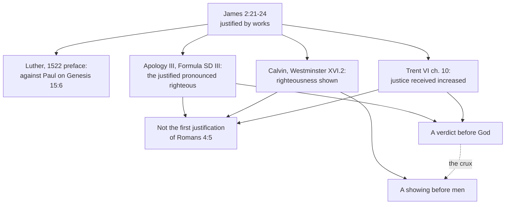

# Apologetics II · Lesson 3.3: Paul and James

> ⏱ ~15 min · Module 3: Against sola fide · Builds on: [3.1](03-01-justification-as-the-confessions-state-it.md), [3.2](03-02-trent-session-vi-against-the-confessions.md), [`new-testament` 6.3](../../new-testament/lessons/06-03-james-faith-and-works.md), [`new-testament` 5.4](../../new-testament/lessons/05-04-the-new-perspective-on-paul.md) · Unlocks: [3.4](03-04-the-joint-declaration-merit-and-reward.md)

## Why this matters

James 2:24 is the one verse in the New Testament where the noun "faith" stands beside "alone", and it says "not". Catholic tracts treat that as the end of the argument. The Lutheran and Reformed confessions read it carefully, and well. This lesson asks what each does with James, which Catholic reading survives the best reply, and what the New Perspective changed.

## The idea

An orchestra hires a violinist after one audition. Months later she plays the hard solo at a premiere, and a critic writes that the night "justified the appointment": it *showed* the hiring right. The board, renewing her contract on the season's playing, *judged* her by her work to be what the audition said. Her teacher says she *became* more of a violinist.

That is James 2 among the confessions. Romans 4 is the audition: God "justifieth the ungodly" (4:5), and no work comes first. James 2:21 is the premiere, Abraham offering Isaac decades after Genesis 15:6. The Reformed read James's "justified" as the critic does, the Lutheran Apology roughly as the board does, and Trent as the teacher does: none of them makes James describe the audition.

[`new-testament` 6.3](../../new-testament/lessons/06-03-james-faith-and-works.md) set the two verses side by side, gave *pistis*, *erga* and *dikaioō*, read Abraham twice and reported Luther's "epistle of straw"; that exegesis is assumed. This lesson argues which reading of James is true, and what follows for [*sola fide*](../reference.md#sola-fide).

## The other side

**Luther, 1522.** His preface to James and Jude (lesson's translations) praised the letter for setting up "no human teaching", yet denied an apostle wrote it. His first reason: "flatly against Saint Paul", it gives justification to works and draws Genesis 15:6, a verse about Abraham's faith, onto his offering of Isaac. He foresaw the harmonizing gloss and refused it on that point: even if a gloss could be found for this justification by works, the letter cannot be defended there (*Ob nu dißer Epistel woll mocht geholffen ... kan man doch sie darynn nit schutzen*). See [Luther on James](../reference.md#luther-on-james); the canon question is [2.2](02-02-the-canon-question.md)'s. *Weight:* a translator's preface, in no confession.

**Lutheran, confessional.** The [Apology](../reference.md#apology-of-the-augsburg-confession) (Melanchthon, 1531) answers James 2:24 in Article III by the Triglot's numbering (§§123–132). The verse is "more against the adversaries than against us" (§124), since James keeps faith in view. His works "follow faith, and show that faith is not dead", the works "of those who have been justified" (§125). Sections 129–131, which P1 reads, grant James his point and define his "justified". The [Formula of Concord](../reference.md#formula-of-concord) (Solid Declaration III.42–43) adopts this answer by name. *Weight:* both are in the [Book of Concord](../reference.md#book-of-concord), the *norma normata* Lutheran pastors subscribe under Scripture, not a magisterium.

**Reformed.** [Calvin](../reference.md#calvin-institutes) (*Institutes* III.17.11–12, Beveridge) says Rome's use of James rests on "a double paralogism, the one in the term faith, the other in the term justifying".

- *Faith:* James attacks "an empty opinion", the faith of one who only claims it ("if a man say he hath faith", 2:14), which the devils share (2:19).
- *Justify:* Genesis 15:6 was spoken before Ishmael's birth, decades before Isaac was bound. "If it is absurd to say that the effect was prior to its cause", James speaks "of the manifestation, not of the imputation of righteousness".
- *Before whom:* his commentary on James (dedicated 1551; John Owen's translation, Calvin Translation Society, 1855) says Paul means "the gratuitous imputation of righteousness before the tribunal of God; and James, the manifestation of righteousness by the conduct, and that before men".
- *Against Trent ch. 10 itself:* his *Antidote* (1547; Beveridge's *Tracts*, 1851) answers that James "uses justification to signify, not the cause of righteousness, but the proof of it".

The [vindicative sense](../reference.md#vindicative-sense-of-dikaioo) of the verb is real: the people "justified God" (*edikaiōsan ton theon*, Luke 7:29), and Paul quotes Psalm 51:4 (DR 50:6), "That thou mayest be justified in thy words" (Romans 3:4).

The confession builds the reading in. [Westminster](../reference.md#westminster-confession) XI.2 calls faith "the alone instrument of justification", yet "no dead faith, but worketh by love", proving the first clause from texts including Romans 3:28 and the second from James 2:17, 22, 26 and Galatians 5:6. XVI.2 calls good works "the fruits and evidences of a true and lively faith", proved from James 2:18, 22 (Schaff). *Weight:* Westminster is the subordinate standard of Presbyterian churches; Calvin's books are a theologian's.

## The argument

**P1.** Every party reads [James 2:21–24](../reference.md#readings-of-james-2) of people already justified. The Apology: the works "of those who have been justified" (§125). Calvin: "something posterior is pointed out here" (commentary on 2:23). Trent files 2:24 under ch. 10, "the increase of Justification received", after chs. 5–9 have treated first justification. *In words:* "James refutes Paul" is nobody's confessional position.

**P2.** On first justification the Catholic signs Paul's exclusion: none of the things that precede it, "whether faith or works", merit its grace ([Trent VI](../reference.md#trent-session-vi) ch. 8, Waterworth). *In words:* Romans 4:4–5 is not the Catholic's opponent.

**P3.** James's verbs describe something that happens to the faith, not only to onlookers. Faith "was working together with" his works (*synērgei*) and "was brought to completion" by them (*eteleiōthē*, 2:22, lesson's rendering), inside a frame of judgment and salvation (2:12–14: "Shall faith be able to save him?"). Calvin must gloss *eteleiōthē* as "not because it received thence its own perfection, but because it was thus proved to be true". *In words:* "before men" is brought to the text, not found in it.

**P4.** Paul also knows a verdict that takes works into account. God "will render to every man according to his works" (Romans 2:6), and "the doers of the law shall be justified" (2:13), which the Apology reads of believers. *In words:* a later verdict that weighs works is Pauline too.

**P5.** Trent's doctrine needs only this much: works done in grace preserve and increase the justice received, and are not "merely the fruits and signs" of justification (can. 24). *In words:* the Catholic needs from James God's verdict on works done in faith, not a second way in.

**∴ C.** James 2:21–24 is best read as God's approving verdict on a faith brought to completion in works. That reading fits can. 24 and needs no quarrel with Romans 4; the premise to deny is the Reformed "before men". Whether the verdict is also an *increase* of justice, as ch. 10 applies the verse, is a further step the text supports less well (Example 2).

**Mark the levels** ([the ladder](../../fundamental-theology/lessons/04-04-the-ladder-of-doctrinal-authority.md); [levels of authority](../reference.md#levels-of-authority)).

- James is canonical and inspired: **rung 1**, Trent IV's decree on the canon, sealed by anathema.
- Good works preserve and increase the justice received, not merely its fruits and signs: **rung 1 as worded** (VI can. 24).
- *Sola fide* condemned only "in such wise as to mean" that nothing else is required to co-operate: **rung 1 as worded** (can. 9).
- Nothing preceding justification merits it: **rung 1** in substance (cans. 1–3, with Orange II); ch. 8's own wording **at least rung 3**.
- Ch. 10's citation of James 2:24 is the council's reasoning, not its definition: the sense of James 2:21–24 is **rung 5**, inside can. 24's fence.
- The New Perspective: a hypothesis, **rung 5** ([`new-testament` 5.4](../../new-testament/lessons/05-04-the-new-perspective-on-paul.md)). The 1998 Catholic Response's call for further study (§7): a request, not a teaching. Other traditions' texts: no Catholic level.

**Concession.** The vindicative sense of *dikaioō* is real, and Calvin's reading of James has genuine textual support in "Shew me thy faith" (2:18) and in the order of Genesis. Catholic readings that make James simply "refute" Paul flatten both writers: they make James deny what Trent ch. 8 affirms about first justification, and Paul's faith the demons' assent.

**The crux.** Is James's "justified" a verdict *before God* that takes works done in faith into account, or a showing *before men* of a verdict already given? (Not whether it is Romans 4:5's act: every confession says it is not.) James 2:12–14 and 2:23 ("friend of God") pull toward God's verdict; 2:18 and the Genesis chronology pull toward a showing. The Apology's forensic "pronounced righteous", paired with Romans 2:13 ("just before God"), sides with a verdict, so against the Lutherans the live question is not James but can. 24's "cause of the increase" and merit: [3.4](03-04-the-joint-declaration-merit-and-reward.md)'s.

## The map of positions

The confessions agree on what James is not describing and divide over the audience of his "justified".

## Worked examples

**Example 1 (clean): what the New Perspective did to the dispute.** Dunn reads [works of the law](../reference.md#works-of-the-law) as Israel's boundary markers ([`new-testament` 5.4](../../new-testament/lessons/05-04-the-new-perspective-on-paul.md)), and a Catholic apologist may hope the [New Perspective](../reference.md#new-perspective-on-paul) hands him Paul. He does not need it, since Trent ch. 8 already excludes *every* work before justification (P2). And it misses the crux: Wright keeps justification a verdict, God's declaration of who belongs to his people, and rejects the picture of the judge's own righteousness passing to the defendant. Neither is a step toward Trent's inherent justice.

The resistance shows where the nerve is. John Piper's *The Future of Justification: A Response to N. T. Wright* (2007) defended the [imputation](../reference.md#imputation) of Christ's righteousness; Wright replied in *Justification: God's Plan and Paul's Vision* (2009). In 2007 the Presbyterian Church in America's General Assembly recommended declarations on the New Perspective and the Federal Vision "as a faithful exposition of the Westminster Standards" (a judgment, not an amendment); one rejects any denial that Christ's "perfect obedience and satisfaction" is imputed to believers. The 1998 Catholic Response (§7) asked that further study take in the whole New Testament, not Paul alone, which puts James back on the table. The referent of Paul's "works" moved; the sixteenth-century crux did not.

**Example 2 (strain): "still further justified".** Trent ch. 10 says the justified, "faith co-operating with good works, increase in that justice which they have received ... and are still further justified, as it is written", citing Revelation 22:11, Sirach 18:22 and James 2:24 (Waterworth). This is the [increase of justification](../reference.md#increase-of-justification) applied to James; its best word is *eteleiōthē*, and it strains. James never says "more" or "further"; the increase comes from the other texts, which are weak. "Let him be justified still" follows the Vulgate; the critical Greek (Tischendorf's, for one) reads "let the righteous still do righteousness" (*dikaiosynēn poiēsatō eti*). Calvin's *Antidote* disputed the rendering of Sirach too. And James's frame, judgment and salvation (2:12–14), fits a verdict better than growth. So the text carries God's verdict on a completed faith, not by itself an *increase*. Nothing defined is lost: can. 24 defines the increase on its own authority.

## Watch out

- **You might think the Lutheran confessions reject James,** since Luther called it "a right strawy epistle" beside John, Paul and 1 Peter (lesson's rendering of *eyn rechte stroern Epistel gegen sie*), but the Apology answers 2:24 point by point and calls James "right", and the Formula adopts that answer. Giving the 1522 preface as "the Lutheran position" turns a translator's preface into a confession.
- **You might think Lutherans and Reformed read James alike,** but they part on the verb. The Apology's James is "pronounced righteous in a forensic sense", and it reads Romans 2:13 of believers. Calvin's James is shown righteous "before men", and he reads Romans 2:13 as the law's own terms, which nobody meets (*Institutes* III.17.13). Name the confession.
- **You might think a Catholic who reads James as Calvin does has given up Trent,** but ch. 10's citation is not a definition; the exegesis is rung 5. The fence is can. 24 (rung 1): no reading may conclude that works are "merely the fruits and signs" of justification. Promoting the citation to dogma and demoting can. 24 to opinion are the twin level errors.

## One-liner

> Every confession reads James 2:24 of people already justified; the dispute is whether his "justified" is God's verdict on a faith completed in works or a showing of it before men, and the Catholic case needs only the first.

## Problems

**P1 (🟢)** *(Close reading · Exegetical)* The Apology of the Augsburg Confession, Art. III, §§129–131 (*Concordia Triglotta*, 1921, English; omissions marked, among them the Triglot's bracketed additions from the German):

> Accordingly, James is right in denying that we are justified by such a faith as is without works. But when he says that we are justified by faith and works, he certainly does not say that we are born again by works. [...] Nor does he describe the mode of justification, but only of what nature the just are, after they have been already justified and regenerated. [...] And here to be justified does not mean that a righteous man is made from a wicked man, but to be pronounced righteous in a forensic sense, as also in the passage Rom. 2,13: The doers of the Law shall be justified. [...] so, too, we believe concerning the words of James: By works a man is justified, and not by faith alone, because men having faith and good works are certainly pronounced righteous.

(a) What does the passage grant James?

(b) Name the two things it says James is *not* doing, and the sense of "justified" it refuses.

(c) What sense does it give "justified" in 2:24, and which verse of Paul does it pair with it? How does that sense differ from Calvin's "manifestation ... before men"?

**Two sentences per part.**

**P2 (🟡)** *(Diagnose · Exegetical)* Five sentences from an invented apologetics vlog transcript, written for this problem. The speaker, Rommel Dimaculangan, is a Catholic vlogger; he and his channel are not real.

> (1) In the Greek of James 2:24, *ouk ek pisteōs monon*, "not from faith alone", is the only place in the New Testament where the noun "faith" is joined to "alone".
>
> (2) So the only time the Bible says "faith alone", it says "not by faith alone": case closed, *sola fide* refuted by a word count.
>
> (3) The Lutherans know it, which is why their own confessions never touch James 2:24 and just repeat Luther's "epistle of straw".
>
> (4) Calvinists dodge with "justified before men", a meaning the Greek verb never has.
>
> (5) And since the New Perspective proved that Paul's "works of the law" meant only circumcision and food laws, Paul now says exactly what Trent says.

One sentence is right: say which. For each of the other four, name the error and correct it, giving a level or a weight where one is involved. **One sentence each.**

**P3 (🔴)** *(Apologetic: (a) Exegetical, graded first · (b) reply)* At an invented Reformed–Catholic study evening (nobody here is real), a Presbyterian elder says: "James does not need Rome to reconcile him with Paul. Read him as our Confession and Calvin read him, and 2:24 is no trouble at all."

(a) State the Reformed reading of James 2:21–24 as Westminster XI.2 and XVI.2 (with their proof texts) and Calvin's *Institutes* III.17.11–12 state it: what "faith" and "justified" mean in James, the argument from Genesis, and where the reading puts good works.

(b) Reply. Open with a **named concession**, and name the one premise you deny.

**(a) 90 words or fewer; (b) 110 words or fewer.** A reply that concludes the elder is right passes if it is a good reply.

Solutions

**P1** *(Close reading · Exegetical)*

**Must hit, strict:**

- **(a) The grant:** James "is right" to deny that a faith without works justifies. And his sentence "by works a man is justified" is true in a sense: people "having faith and good works are certainly pronounced righteous". The Formula (SD III.42) quotes the Latin of the first grant and calls such faith dead.
- **(b) Not doing:** James does not say we are "born again by works", and he does not "describe the mode of justification", only "of what nature the just are" once already justified and regenerated. **Refused sense:** "justified" here does not mean "a righteous man is made from a wicked man" (a factitive, making-righteous sense).
- **(c) Sense:** "pronounced righteous in a forensic sense", the sense of Romans 2:13, "The doers of the Law shall be justified", read as true of believers whose works follow faith. **Difference:** the Apology's pronouncement is a verdict on the just, with no "before men" restriction. Calvin's "manifestation" is a showing to human observers, and Calvin reads Romans 2:13 hypothetically.

**Wrong turns:** saying the Apology rejects James or follows Luther's 1522 preface. Reading "pronounced righteous" as Calvin's "shown before men" (the Lutheran/Reformed blur). Saying the Apology makes works a cause of justification: it says the just are pronounced righteous, and what makes them just is not in this passage. Calling this Luther's own text: it is Melanchthon's, in the Book of Concord.

**Model answer:** (a) It grants that James is right to deny that a workless faith justifies, and that people with faith and good works are truly pronounced righteous. So 2:24 stands as written. (b) James does not say we are born again by works, and he does not describe the mode of justification, only what the already justified are like. It refuses the sense "made righteous from wicked". (c) "Justified" means pronounced righteous in a forensic sense, as in Romans 2:13, "the doers of the Law shall be justified", read of believers. That is a verdict on the just, where Calvin's is a showing before men (and Calvin reads Romans 2:13 hypothetically).

---

**P2** *(Diagnose · Exegetical)*

**Accept:** any wording that makes the moves below, one sentence each.

**Must hit, strict:**

- **(1) is right.** *Ouk ek pisteōs monon* in 2:24 is the New Testament's only joining of the noun "faith" with "alone". (Credit, not required: "only believe", *monon pisteue*, in Mark 5:36 and Luke 8:50, is a verb in a healing story, so it is no counterexample.)
- **(2) A word count refutes no doctrine.** The "faith" James denies is the bare assent of 2:19, which the Apology also says does not justify. The Reformed formula is "the alone instrument", yet "not alone" in the person (Westminster XI.2). The Lutheran and Reformed doctrines rest on Romans 3:28's "by faith, without the works of the law", not on the phrase. (Trent condemns *sola fide* only in the sense of can. 9, rung 1 as worded.)
- **(3) False, and a weight error.** The Apology (Art. III §§123–132, Triglot) answers 2:24 directly and calls James "right", and the Formula (SD III.42–43) adopts that answer. Luther's 1522 preface is a translator's preface with no confessional standing.
- **(4) False.** *Dikaioō* is vindicative in Luke 7:29 ("justified God") and Romans 3:4, so the Reformed reading has real lexical support. The Catholic should contest whether 2:21–24 is a verdict before men or before God, not whether the sense exists.
- **(5) Overstated twice.** The New Perspective is a scholarly hypothesis (rung 5), and Dunn himself later allowed that the phrase covers the whole Law. Even on its terms it moves the referent of "works", not the crux: Wright keeps justification a verdict and does not teach Trent's inherent justice.

**Wrong turns:** calling (1) false because of Mark 5:36. Correcting (2) by saying James and Paul mean the same thing by "faith". Correcting (3) by citing only the later removal of the straw remark: the point is the confession, not the preface's history. Correcting (4) by asserting that James means "before men" (that is the Reformed verdict, not a correction). Treating (5) as defined or forbidden for Catholics.

**Model answer:** (1) is right: 2:24's *ouk ek pisteōs monon* is the only place the noun "faith" is joined to "alone". (2) A word count refutes nothing: James denies that bare assent justifies, as the Apology does too, and the confessions rest *sola fide* on Romans 3:28 while saying justifying faith is never alone (Westminster XI.2). (3) The Apology (Art. III §§123–132) answers 2:24 and calls James "right", and the Formula adopts that answer; Luther's preface is not a confession. (4) The verb is vindicative in Luke 7:29 and Romans 3:4, so the demonstrative reading has support, and the real question is the verdict's audience. (5) The New Perspective is a rung-5 hypothesis that moves what "works of the law" means but leaves Wright's verdict nowhere near Trent's inherent justice.

---

**P3** *(Apologetic: (a) Exegetical, graded first · (b) reply)*

**Accept:** any reply that opens with a real concession, names one premise and engages it, whatever its verdict.

**Must hit, strict (a), graded first:**

- **Two equivocations** (Calvin's "double paralogism"). James's *faith* is an empty profession ("if a man say", 2:14), the devils' belief (2:19). His *justified* means the manifestation, not the imputation, of righteousness.
- **The argument from Genesis.** The reckoning of Genesis 15:6 came long before the offering of Isaac (Ishmael was born, and grown, in between). An effect cannot precede its cause, so James's "justified by works" is something later: the proof of a righteousness already reckoned.
- **Westminster.** Faith is "the alone instrument" (XI.2, Romans 3:28), yet "no dead faith, but worketh by love" (James 2:17, 22, 26). Good works are "the fruits and evidences of a true and lively faith" (XVI.2, James 2:18, 22).
- **Where works go.** Works are the evidence of justification and never its ground; Paul says how one is justified, James how the justified are known. **Weight:** Westminster is the Presbyterian subordinate standard; the *Institutes* is a theologian's book.

**Must hit (b):**

- **A named concession,** stated flatly. For example: the vindicative sense is real (Luke 7:29; Romans 3:4), the Genesis chronology is correct, and James is not describing first justification, as Trent agrees.
- **The premise denied, named.** The strongest choice is the "before men" restriction, the claim that works enter no verdict before God. Evidence: 2:12–14 frames the passage with judgment and salvation; *synērgei* and *eteleiōthē* (2:22) say something happened to the faith, which Calvin must gloss as "proved to be true"; Romans 2:6, 13 gives Paul a judgment according to works.
- **Honesty about reach.** Credit for saying this establishes a verdict before God that takes works done in faith into account. It does not by itself prove Trent's increase (can. 24 stands on its own) or merit (3.4).

**Wrong turns:**

- Stating (a) as "Calvinists say works don't matter". Westminster XVI.2 and XI.2 contradict it, so this is the caricature, and it fails the problem.
- Giving the Apology's "pronounced righteous" as the Reformed reading (the Lutheran/Reformed blur).
- Tying the Reformed reading to Luther's 1522 preface, which rejects the harmony the Reformed reading defends.
- Saying Westminster makes faith itself the believer's righteousness (XI.1 denies it).
- In (b), denying that the vindicative sense exists, or claiming that Trent defined the sense of James 2:24.

**Model answer (a):** James attacks a professed faith, the devils' assent (2:14, 19), and his "justified" means righteousness manifested, not imputed. Genesis 15:6 reckoned Abraham righteous years before he offered Isaac, and an effect cannot precede its cause, so James speaks of a later proof. Westminster: faith is the alone instrument (Romans 3:28) yet no dead faith (James 2:17, 22, 26), and works are the fruits and evidences of true faith (James 2:18, 22). Works evidence justification; they never ground it.

**Model answer (b), one of several:** Concession: the vindicative sense is real (Luke 7:29), the chronology is right, and James is not describing first justification, as Trent agrees. I deny that James's verdict is only "before men". His question is whether faith can "save" a man who will be "judged" (2:12–14), and he says faith "worked with" Abraham's works and was "made perfect" by them, which Calvin must reword as "proved". Paul too has God render to each according to works (Romans 2:6). So works done in faith enter God's verdict. That does not yet prove Trent's increase or merit.

## Flashback

**From Lesson [3.1](03-01-justification-as-the-confessions-state-it.md) (Justification as the confessions state it):** *(Reconstruct and find the crux · Exegetical, strict.)* Calvin, [*Institutes*](../reference.md#calvin-institutes) III.16.1 (Beveridge, 1845), answering the charge that justification by faith destroys good works:

> We dream not of a faith which is devoid of good works, nor of a justification which can exist without them … we, however, place justification in faith, not in works. … Christ, therefore, justifies no man without also sanctifying him. … Though we distinguish between them, they are both inseparably comprehended in Christ. … you cannot possess him without being made a partaker of his sanctification: for Christ cannot be divided.

(a) Reconstruct the argument as P1–P3 ∴ C, and give the text's weight. **One line per step; one sentence on weight.**

(b) Name the premise [Trent VI](../reference.md#trent-session-vi) accepts and the one it denies, with the canon and its level, and say what would move the dispute. **Three sentences.**

Solution

**Must hit, strict:**

- **(a)** Any numbering with these moves: faith possesses Christ; Christ cannot be divided, so whoever has him shares his sanctification; justification and sanctification are distinct, and justification is placed in faith, not in works; ∴ no one is justified without being sanctified, yet no one is justified by it, so faith does not destroy works. **Weight:** a theologian's book; the confessional form is Westminster XI.2, faith "not alone in the person justified".
- **(b) Accepted:** the inseparability. Trent goes further: justification is "not remission of sins merely, but also the sanctification and renewal of the inward man" (ch. 7).
- **(b) Denied:** the placing, read with III.11.2 (forgiveness and imputation), which leaves renewal outside the righteousness for which God accepts. Can. 11 condemns justification by the *sole* imputation of Christ's justice "to the exclusion of" grace and charity "inherent in them": **rung 1 as worded**. Whether Calvin's text falls under it is **rung 5**.
- **(b) What would move it:** 3.1's crux, the [formal cause](../reference.md#formal-cause): can that righteousness remain Christ's, counted, or must it be God's gift made ours? That turns on whether Paul's *logizomai* (Rom 4:3–5) credits what is absent or declares what God makes true.

**Wrong turns:** reconstructing Calvin as a legal fiction that lets holiness wait: the caricature, which fails the problem. Making faith itself the righteousness (Heidelberg Q.61 denies it). Calling the *Institutes* a confession or "the Protestant view". In (b), saying Trent denies the inseparability, or that the dispute is whether works are necessary.

**Model answer:** (a) P1: faith possesses Christ. P2: Christ cannot be divided, so whoever has him shares his sanctification. P3: the two are distinct, and justification is placed in faith, not works. ∴ C: no one is justified without being sanctified, yet not by it. A theologian's book; Westminster XI.2 is the confessional form. (b) Trent accepts the inseparability, and ch. 7 counts renewal as part of justification itself. It denies P3's placing: can. 11, rung 1 as worded, condemns sole imputation to the exclusion of inherent grace and charity. It would move on whether *logizomai* credits what is absent or declares what God makes true.

## Connections

- **Backward:** [`new-testament` 6.3](../../new-testament/lessons/06-03-james-faith-and-works.md) did the exegesis this lesson assumes: the three words, Abraham read twice, the three readings of James's "justified", Luther's straw remark. Its sibling lessons supply Paul's side: [`new-testament` 5.2](../../new-testament/lessons/05-02-romans-1-4-the-righteousness-of-god.md) (Romans 3–4 and Luther's *allein*) and [5.4](../../new-testament/lessons/05-04-the-new-perspective-on-paul.md) (Sanders, Dunn, Wright). The decree is [`creation-grace-last-things` 5.1](../../creation-grace-last-things/lessons/05-01-trent-session-vi-justification.md). [3.1](03-01-justification-as-the-confessions-state-it.md) stated the confessions' doctrine of justification, and [3.2](03-02-trent-session-vi-against-the-confessions.md) set Trent against them.
- **Forward:** [3.4](03-04-the-joint-declaration-merit-and-reward.md) takes up what the crux leaves against the Lutherans: can. 24's "cause of the increase", can. 32's merit, and the Apology's objection to both. Merit as doctrine is [`creation-grace-last-things` 5.3](../../creation-grace-last-things/lessons/05-03-merit.md). Boss 3(d) asks for the merit reply ([syllabus](../syllabus.md)).
- **Sideways:** the crux technique is [`philosophical-method` 4.3](../../philosophical-method/lessons/04-03-finding-the-crux.md)'s. Can. 24's "increase" has its mechanism in [`moral-theology` 3.1](../../moral-theology/lessons/03-01-virtue-acquired-and-infused.md): acts done from an infused habit do not build a new habit but strengthen the one given, so the Catholic "increase" never means works building justice from below, which is the misreading the Reformed "fruits and evidences" guards against. Genesis 22 in the four senses is [`old-testament` 1.2](../../old-testament/lessons/01-02-the-senses-of-scripture.md)'s; this lesson reads it only as the event James names.
