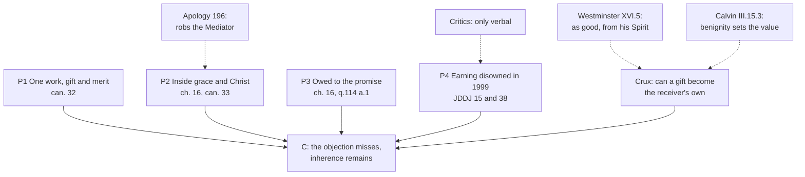

# Apologetics II · Lesson 3.4: The Joint Declaration, merit, and reward

> ⏱ ~15 min · Module 3: Against sola fide · Builds on: [3.2](03-02-trent-session-vi-against-the-confessions.md), [3.3](03-03-paul-and-james.md), [`creation-grace-last-things` 5.2](../../creation-grace-last-things/lessons/05-02-the-1999-joint-declaration.md), [5.3](../../creation-grace-last-things/lessons/05-03-merit.md), [4.3](../../creation-grace-last-things/lessons/04-03-sanctifying-grace-the-indwelling-and-divinization.md) · Unlocks: [4.1](04-01-the-petrine-texts-argued.md)

## Why this matters

On 31 October 1999 the Catholic Church and the Lutheran World Federation signed at Augsburg a statement that the sixteenth-century condemnations on justification miss each other's teaching as a joint text presents it. Critics on both sides replied that nothing had been agreed, only worded. The fastest test is the word many Protestants hear as the quarrel's heart: *merit*. If Catholics teach that the saved earn heaven, 1999 was a truce in costume.

## The idea

Two maps drawn in different projections can disagree about every line and still show one coast; if one shows an island the other lacks, they map different coasts. The [Joint Declaration](../reference.md#joint-declaration) claims the first case: a "consensus in basic truths" (§§40, 43), the remaining differences being of "language, theological elaboration, and emphasis" (§40). Ecumenists later named the method [differentiated consensus](../reference.md#differentiated-consensus); the phrase is not in the 1999 texts. The critics claim the second case. Whether it is real agreement or a postponement is a question this course treats as open.

Merit is where to look. Both sides promise a reward to the good works of the justified; the quarrel is over what it crowns: a gift that has become truly the person's own, or works God accepts for Christ's sake despite their stain. [`creation-grace-last-things` 5.2](../../creation-grace-last-things/lessons/05-02-the-1999-joint-declaration.md) read the Declaration's claims, limits and level; [5.3](../../creation-grace-last-things/lessons/05-03-merit.md) taught [merit](../reference.md#merit) as doctrine and stated the Lutheran objection without replying. This lesson argues both.

## The other side

**Critics, from both ends.** Early in 1998 over 140 German Protestant theology professors signed a Tübingen statement that the Declaration had not shown the consensus it claimed, only covered the differences with wording. Eberhard Jüngel (*Um Gottes willen — Klarheit!*, 1997) argued that calling justification "an indispensable criterion" (§18) demotes the article by which, for the Reformation, all doctrine is judged. From the Catholic side, Christopher Malloy (*Engrafted into Christ*, 2005) argued that the Catholic paragraphs never name Trent's inherent [formal cause](../reference.md#formal-cause), so the *simul*, a justification that never grows, and the denial of true merit pass unchallenged, Annex or no Annex. The [critics](../reference.md#critics-of-the-joint-declaration) make one charge from opposite ends: the agreement is verbal. **Weight:** theologians' arguments, binding no church.

**Lutheran, on merit.** The [Apology](../reference.md#apology-of-the-augsburg-confession) (Melanchthon, 1531), Art. III in the Triglot's numbering, grants rewards: good works are "meritorious ... for other rewards, bodily and spiritual, in this life and after this life" (§73, on 1 Corinthians 3:8). It rejects meriting grace and eternal life *de condigno* ([condign and congruous merit](../reference.md#condign-and-congruous-merit)), for four reasons (§§195–203). That doctrine makes works done from the habit of love a righteousness "worthy by itself" of eternal life, robbing Christ, who is "Mediator perpetually, and not merely in the beginning of justification". It leaves consciences without peace, because "the Law always accuses us, even in good works". No one can tell when a work is condign, so the distinction was devised "to elude the Scriptures". And the whole Church confesses, with Augustine, that eternal life comes through mercy. The [Formula of Concord](../reference.md#formula-of-concord) adds that God "promises a glorious reward in this life and the life to come" (Solid Declaration IV.38; all *Concordia Triglotta*, 1921). **Weight:** the [Book of Concord](../reference.md#book-of-concord), the standard Lutheran pastors subscribe, a norm under Scripture, not a magisterium.

**Reformed, on merit.** [Westminster](../reference.md#westminster-confession) XVI.5 (Schaff) denies that our best works merit pardon or eternal life. Its reasons: the "great disproportion" between them and the glory to come, the "infinite distance" between us and God, our having done only our duty (Luke 17:10), and this:

> as they are good, they proceed from his Spirit; and as they are wrought by us, they are defiled and mixed with so much weakness and imperfection that they can not endure the severity of God's judgment.

Yet God, looking on them in his Son, is "pleased to accept and reward that which is sincere" (XVI.6). [Calvin](../reference.md#calvin-institutes) regrets that "merit" was ever applied to works before God's tribunal (*Institutes* III.15.2, Beveridge). God recompenses them "not because they so deserve, but because the divine benignity is pleased of itself to set this value upon them" (III.15.3). **Weight:** Westminster is the subordinate standard of Presbyterian churches; the *Institutes* is a theologian's book. The Apology argues from Christ's office, Westminster from disproportion and stain.

## The argument

**P1.** Trent condemns setting gift against merit. The works of the justified are "the gifts of God" and "also the good merits of him that is justified", by which he does "truly merit" increase of grace, eternal life and an increase of glory ([Session VI](../reference.md#trent-session-vi), 13 January 1547, can. 32, Waterworth). *In words:* one work is wholly gift and truly merit.

**P2.** Merit lives inside grace and Christ's mediation. Nothing before justification merits its grace (ch. 8). Christ's virtue flows into the justified "as the head into the members", and "always precedes and accompanies and follows their good works, which without it could not in any wise be pleasing and meritorious before God" (ch. 16). Can. 33 condemns saying the decree takes anything from Christ's merits. *In words:* Christ mediates every meritorious act, as the Apology demands.

**P3.** The reward is owed to God's promise, not to the work's weight. Eternal life is held out "as a grace mercifully promised ... and as a reward which is according to the promise of God Himself" (ch. 16). God is debtor only to his own ordination, Aquinas granting the disproportion (ST I-II q.114 a.1 and ad 3); mercy is the "first cause", merit a "subsequent cause" (a.3 ad 2). *In words:* no Catholic claims a wage; every side promises a reward.

**P4.** In 1999 the Church confirmed a common confession that we are accepted by God "not because of any merit on our part" (§15), and a Catholic explication that calling good works "meritorious" means a reward in heaven promised to works that remain gifts (§38). *In words:* the Church has officially disowned the "earning heaven" reading.

**∴ C.** The earning objection misses Trent, and in 1999 both partners said so. What survives is narrower and real: whether the gift God crowns inheres in the justified, so that he "will have the things which are His own gifts be their merits" (ch. 16). *In words:* the coast is shared on gratuity; whether inherence is an island is the open question.

**Mark the levels.** On [the ladder](../../fundamental-theology/lessons/04-04-the-ladder-of-doctrinal-authority.md) ([levels of authority](../reference.md#levels-of-authority)). **Rung 1:** cans. 32 (true merit; works both gifts and merits), 26 and 31 (hope of the eternal recompense "through His mercy and the merit of Jesus Christ"), 33 as worded (nothing taken from Christ's merits), and 1–3 with Orange II can. 18 (no merit before the first grace). **At least rung 3:** ch. 8's wording and ch. 16's grounds, except the gift–merit pairing that can. 32 carries. **Rung 4:** *condign* and *congruous*, words no act uses. **Rung 5:** whether condign worth is intrinsic to grace (Thomists, q.114 a.3) or God's free acceptance of an act done in charity (Scotists). The Declaration and the [Official Common Statement and Annex](../reference.md#official-common-statement-and-annex): **no rung of their own**, yet official acts of the Church as a party; §41's correctness, **rung 5**. The [1998 Response](../reference.md#catholic-response-1998): official, its assessments without rung, its doctrine Trent's. "Differentiated consensus" and Newman's lectures carry **no magisterial level**.

**Concession.** The Annex, which Rome signed, concedes more than Catholic apologists usually admit. Justification is "by faith alone", apart from works, with cooperation in the Spirit's power (2C). Lutherans and Catholics can together call the Christian [*simul iustus et peccator*](../reference.md#simul-iustus-et-peccator) in a stated sense (2A). The doctrine of justification is the "measure or touchstone" no teaching may contradict (Annex 3). Any reward is "a reward of grace, on which we have no claim" (2E). Nor was it a liberal slip: *Lutheran World Information* reported (23 October 1999) that Bishop Johannes Hanselmann together with Cardinal Joseph Ratzinger, whose congregation had prepared the 1998 reservations, initiated part of the process behind it.

**The crux.** Westminster and Aquinas share a premise, that the good in a just man's work is the Spirit's, and draw opposite conclusions: so it is not his merit (XVI.5); so it merits condignly, its worth depending "on the dignity of grace" (q.114 a.3). The premise one side must deny: *a gift of God can become the recipient's own without ceasing to be God's.* Beneath lies [3.2](03-02-trent-session-vi-against-the-confessions.md)'s crux, inherent or imputed. What would move it: is Scripture's reward language forensic or real? Paul awaits "a crown of justice which the Lord the just judge will render" (2 Timothy 4:8, DR; *ho dikaios kritēs* (ὁ δίκαιος κριτής) *apodōsei*, "the just judge will give back as due", this lesson's rendering). Sardis's faithful walk in white "because they are worthy" (Revelation 3:4 [DR Apocalypse 3:4]; *axioi eisin*, ἄξιοί εἰσιν). The Reformed read "just" as fidelity to a promise and "worthy" as worth in Christ; if those readings fail, their premise does.

## The argument map

The Lutheran objection lands on P2; the Reformed one goes past it to the crux, where 1999 left the matter.

## Worked examples

**Example 1 (clean): Newman's via media.** Reprinting his Anglican lectures of 1838 in 1874, Newman said their drift was "to show that there is little difference but what is verbal in the various views on justification" ([*Lectures on Justification*](../reference.md#lectures-on-justification), Advertisement to the third edition). Lecture 6 traces both rival answers to one source: "It is the Divine Presence that justifies us, not faith, as say the Protestant schools, not renewal, as say the Roman" (§7).

Run the argument. Where Newman meets Trent he is right by Trent's lights: something inward makes the justified just, and bare imputation is "no answer at all" (§3). His Presence is [uncreated grace](../reference.md#created-and-uncreated-grace) ([`creation-grace-last-things` 4.3](../../creation-grace-last-things/lessons/04-03-sanctifying-grace-the-indwelling-and-divinization.md)), which Aquinas makes the ground of merit's worth: the indwelling Spirit is "a sufficient cause of life everlasting" (q.114 a.3 ad 3). Where he diverged, he withdrew. In 1874, a Catholic, he took back whatever contradicted Trent's single, inward formal cause, noting that its fathers wrote now "grace", now "charity", to avoid deciding whether these are one thing or two (Pallavicino, as he quotes him). The via media met Trent where 1999 did and was corrected where 1999 left the canons standing. A Catholic keeps its priority of God's self-gift: the crowned merits are his before they are ours.

**Example 2 (strain): "no claim".** Annex 2E, after quoting the Formula on God's promised reward (SD IV.38), calls any reward "a reward of grace, on which we have no claim". Does that meet can. 32? By P3, yes: what is owed rests on God's promise, so "no claim" means none of our own. But Aquinas calls the inheritance "due by right of adoption" (q.114 a.3), and a right is close kin to a claim. A Thomist must gloss 2E; a Scotist, for whom merit rests on God's free acceptance, hardly needs to. Calvin's "not because they so deserve" lies beyond both, and can. 32 forbids it. Here the argument stops determining an answer. Trent says "truly merit", never "condign", and chooses no school; the Annex has no rung; whether 2E fits can. 32 is rung 5. A Catholic may read 2E as orthodox, not as the Church choosing Scotus over Thomas.

## Watch out

- **You might think Lutherans deny that good works are rewarded.** The Apology calls them "meritorious" for rewards in this life and the next (§73), and the Formula promises "a glorious reward" (SD IV.38). They deny meriting grace and eternal life. "Protestants say works earn nothing" is the caricature; crediting Westminster's reasons to the Apology is the blur.
- **You might think the Annex repealed can. 32, or that Trent defined condign merit.** Can. 32 is rung 1 and unrevoked; "condign" is a school word (rung 4); the Annex has no rung.

## One-liner

> Catholic merit is a promised reward crowning God's gifts as truly the person's own, not a wage; 1999 agreed on the gift and left the "truly" standing.

## Problems

**P1 (🟢) *(Exegetical · diagnose.)*** A blog post by Ambrose Kettleby, a Catholic traditionalist. The post and its author are invented for this problem.

> 1. Trent anathematized Luther by name, and in 1999 Rome admitted he had been right all along.
>
> 2. The Lutherans gave up nothing: the Annex is Luther from the first line to the last.
>
> 3. No wonder Germany's Protestant theology professors cheered Rome's surrender.
>
> 4. Even the Vatican's own 1998 Response had said that some of the remaining differences concern substance, not just language.
>
> 5. The Annex was some ecumenist's work; Cardinal Ratzinger would never have touched it.

Four sentences are wrong and one is right. Say which one is right and why, and correct the other four, each from a text this lesson or [`creation-grace-last-things` 5.2](../../creation-grace-last-things/lessons/05-02-the-1999-joint-declaration.md) cites. **150 words or fewer.**

**P2 (🟡) *(Apologetic: (a) Exegetical, graded first · (b) reply.)*** The target is the *Apology* of the Augsburg Confession, Art. III, against *meritum condigni* (§§195–203 in the Triglot's numbering).

(a) State its objection in words a Lutheran theologian would sign: what it says the doctrine claims, its four arguments, and what the Apology itself grants about rewards (§73). **Three sentences.**

(b) Reply to its first argument, that condign merit robs Christ of his office as Mediator. Open with a **named concession**, then say whether the Apology's description of the doctrine fits Trent's Session VI, naming the words that decide it. **120 words or fewer.** A reply that concludes the objection succeeds passes if it is a good reply.

**P3 (🔴) *(Evaluative · apply to a hard case.)*** Is the 1999 consensus a real agreement or a postponement? Any verdict. Say what each answer would have to mean, give the strongest evidence for the verdict you reject, and run one test case on named texts. **150 words or fewer.**

Solutions

**P1** *(Exegetical · diagnose)*

**Accept:** any answer that names sentence 4 as right and corrects the other four from texts in this lesson or `creation-grace-last-things` 5.2.

**Must hit, strict:**

- **Sentence 4 is right.** The Response (25 June 1998, clarification 5) called the agreement high but said some differences concern "aspects of substance", against §40.
- **1:** Trent's canons condemn propositions in a stated sense ("If any one saith") and name no one. §41 judges only the Lutheran teaching "presented in this Declaration", and §42 keeps the condemnations as "salutary warnings"; nothing says they were wrong when issued. Credit, not required: Luther was excommunicated by Leo X's *Decet Romanum Pontificem* (3 January 1521), not by Trent.
- **2:** the Annex writes Lutheran confessional texts in on ground Catholics had pressed. Any two: cooperation in the Spirit's power, with the Formula's "we can and must cooperate" once the Spirit has begun (2C); the Apology on doing good works lest one fall from one's call (2D); the Formula on God's promised reward (2E, SD IV.38).
- **3:** over 140 German Protestant theology professors signed objections early in 1998 that the Declaration had not shown the consensus it claimed.
- **5:** *Lutheran World Information* (23 October 1999) reported that part of the process leading to the Official Common Statement and Annex was initiated by Bishop Hanselmann together with Cardinal Ratzinger.

**Wrong turns:** "correcting" sentence 4. Correcting 1 by saying the Declaration revoked the canons, which overstates a text with no rung. Correcting 3 by saying the professors thought Lutherans had won, when they denied the consensus. Treating the Annex as a Catholic definition.

**Model answer:** Sentence 4 is right: the 1998 Response said some differences concern "aspects of substance", against §40. (1) Trent's canons condemn propositions and name no one; Leo X, not Trent, excommunicated Luther. §41 judges only the teaching presented in the Declaration, and §42 keeps the condemnations as "salutary warnings". (2) The Annex quotes the Formula on cooperating with the Spirit, the Apology on good works done lest one fall away, and the Formula on God's promised reward. (3) Over 140 German Protestant professors objected in 1998 that the claimed consensus had not been shown. (5) *Lutheran World Information* reported in 1999 that Bishop Hanselmann and Cardinal Ratzinger initiated part of the process that produced the Annex.

---

**P2** *(Apologetic: (a) Exegetical, graded first · (b) reply)*

**Accept:** any reply that opens with a real concession and meets the Mediator argument with Session VI's own words, whatever its verdict, provided (a) states the Lutheran position as the Apology states it.

**Must hit, strict (a), graded first:**

- **The target, as the Apology describes it:** works done with the help of the habit of love form a righteousness "worthy by itself to please God, and worthy of eternal life", with no need of Christ as Mediator; grace and eternal life merited *de condigno* (§195).
- **The four arguments:** (1) it robs Christ, who is "Mediator perpetually, and not merely in the beginning of justification" (§§196–197); (2) it leaves consciences in doubt, because the law always accuses, even in good works (§§198–199); (3) no conscience can know when a work is condign, and the condign/congruous distinction was devised to elude Scripture (§200); (4) the whole Church confesses, with Augustine, that eternal life comes through mercy (§§201–203).
- **What it grants (§73):** good works are meritorious, not for remission, grace or justification, but for other rewards, bodily and spiritual, in this life and after it. Credit: different rewards for different labours (1 Cor 3:8).

**Must hit (b):**

- **A named concession,** for example: a doctrine that made works worthy "by itself", apart from Christ, would rob the Mediator. Or: the Apology keeps reward, and even the word "meritorious" (§73).
- **Fit:** the description does not fit Session VI. Christ's virtue "always precedes and accompanies and follows" the works, "which without it could not in any wise be pleasing and meritorious before God" (ch. 16; head and members). Can. 26 places the recompense "through His mercy and the merit of Jesus Christ", and can. 33 (rung 1) denies that the decree takes anything from Christ's merits. Credit: Trent never says "condign".
- **Credit, not required:** saying what survives, that the deeper dispute is whether the gift can be the member's own (the crux).

**Wrong turns:** stating (a) as "Lutherans deny any reward" or "Lutherans say works don't matter". That is the caricature, and it fails the problem. Giving Westminster's disproportion argument as the Apology's. Citing the Apology as a magisterium, or as Calvin. Saying "Trent defined condign merit". Replying that Christ is needed only for the first justification, which grants the objection.

**Model answer (a):** The Apology says the adversaries make works done from the habit of love a righteousness worthy by itself of grace and eternal life (*de condigno*), needing no Mediator. That robs Christ, Mediator perpetually and not only at the start; it leaves consciences in doubt, since the law always accuses; no one can tell when a work is condign, a distinction invented to elude Scripture; and the whole Church confesses eternal life through mercy. Yet good works are meritorious for other rewards, bodily and spiritual, in this life and after it, just not for remission, grace or justification (§73).

**Model answer (b), one of several:** Concession: a merit that made works worthy by themselves, without Christ, would rob the Mediator, and the Apology is right to refuse it. But that is not Session VI. Trent says Christ's virtue "always precedes and accompanies and follows" every good work, "which without it could not in any wise be pleasing and meritorious". It makes Christ the head of the member who merits, places the reward "through His mercy and the merit of Jesus Christ" (can. 26), and anathematizes the claim that this takes from his merits (can. 33). Christ is Mediator of every meritorious act, as the Apology demands. What remains is whether his gift can be truly the member's own.

---

**P3** *(Evaluative · apply to a hard case)*

**Must hit, any verdict:**

- **Define both answers.** Real agreement: the common confession (§15) is one faith, and the differences of §§18–39 do not touch it (§40). Postponement: differences of substance relabelled as emphasis and left for later.
- **Strongest evidence against your verdict.** If you say real: the Response's clarification 5 ("aspects of substance"), Malloy's charge that the inherent formal cause is never named, the German professors, Jüngel. If you say postponement: the Annex took up the Response's points, the Church then confirmed the Declaration "in its entirety", and both partners excluded the earning reading and bare imputation (§§15, 22, 38; Annex 2A–2E).
- **One test case on named texts.** For example merit (can. 32 and ch. 16 against §§38–39 and Annex 2E), the *simul* (Trent V can. 5 against §29 and Annex 2A), or the formal cause (ch. 7 and can. 11 against §§22–24).
- **The limit and the level.** §41 judges teaching "as presented", so even a real agreement revokes no canon (rung 1 stands). Its correctness is rung 5, so a Catholic may hold either verdict.

**Wrong turns:** treating the verdict as settled by the signing, or by the Response. Equating "postponement" with "worthless", when a dispute narrowed is itself a result. Counting §43's open questions (authority, ministry, sacraments) against the consensus on justification. Saying all Protestants rejected it: Methodist (2006), Anglican (2016) and Reformed (2017) bodies associated with it.

**Model answer, one of several:** Real agreement, narrower than its headline. Real agreement means one faith under two idioms; postponement means substance relabelled as emphasis. The best case for postponement is Rome's own Response, which found "aspects of substance" a year before signing, and Malloy's point that the Catholic paragraphs never name the inherent formal cause. Test case, merit: §38 explains "meritorious" as a reward promised to works that stay gifts, and Annex 2E calls every reward one of grace, on which we have no claim. Can. 32's "truly merit" survives that, read through ch. 16's promise, but only on a gloss of "no claim". So gratuity is agreed. Inherence, the ground of "truly", is named nowhere and was left standing. §41's correctness is rung 5, and the canons stay rung 1 on either verdict.

## Flashback

**From Lesson [3.2](03-02-trent-session-vi-against-the-confessions.md) (Trent Session VI against the confessions):** *(Apologetic: (a) Exegetical, graded first · (b) reply.)* Calvin's [*Antidote*](../reference.md#calvin-antidote) replies to can. 11 (Beveridge, *Tracts* vol. 3, 1851):

> "It is therefore faith alone which justifies, and yet the faith which justifies is not alone: just as it is the heat alone of the sun which warms the earth, and yet in the sun it is not alone, because it is constantly conjoined with light. ... it is not us that these Tridentine Fathers anathematize so much as Paul, to whom we owe the definition that the righteousness of man consists in the forgiveness of sins."

(a) State Calvin's position as he gives it: what the heat and the light stand for, what alone justifies and what always accompanies it, and the text's weight. **Three sentences.**

(b) Reply, opening with a **named concession**. Does can. 11 contradict Calvin or pass him by, on which words, and where does the dispute then rest? **120 words or fewer.** A reply concluding that Calvin has Paul on his side passes if it is a good reply.

Solution

**Accept:** any verdict, after a real concession, naming the canon's words and Calvin's.

**Must hit, strict (a), graded first:**

- **The analogy.** Heat is faith, which alone justifies; light is regeneration, always joined to faith but doing none of the justifying. So "faith alone" never means a faith without love (his preceding words deny "a dead faith").
- **The definition.** Righteousness consists in the forgiveness of sins, from Paul (Romans 4:6–7).
- **Weight.** A theologian's tract, not a confession; the confessional counterpart is [Westminster](../reference.md#westminster-confession) XI.2.

**Must hit (b):**

- **A named concession.** Calvin's faith is never loveless, so the "dead faith" charge misses him. Trent too gives renewal with forgiveness (ch. 7).
- **A contradiction, on the definition** ([contradiction and passing-by](../reference.md#contradiction-and-passing-by)). Can. 11 condemns justification "by the sole imputation of the justice of Christ, or by the sole remission of sins, to the exclusion of the grace and the charity ... inherent in them" (Waterworth); either clause meets Calvin. The light does not help: the canon excludes charity from what justifies, not from the person.
- **Where it rests.** On 3.2's crux: can a righteousness real but imperfect stand at God's judgment? Can. 11 is **rung 1** as worded; applying it to Calvin is **rung 5**. Credit: Romans 5:5, which can. 11 borrows; Calvin's next lines read its charity as God's love for us, not ours.

**Wrong turns:** stating (a) as "faith without works saves": the caricature fails the problem. Crediting the line to Luther, or calling the *Antidote* a confession. In (b), a passing-by because charity is always present.

**Model answer (a):** Faith alone justifies, as heat alone warms; yet it is never alone, as heat in the sun is joined to light, so regeneration always accompanies faith while doing no justifying. Righteousness, by Paul's definition, is the forgiveness of sins. This is Calvin's tract, a theologian's book, not a confession.

**Model answer (b), one of several:** Concession: Calvin's faith is never dead, and Trent agrees that renewal comes with forgiveness. But can. 11 contradicts him: it condemns justification "by the sole remission of sins, to the exclusion of" inherent charity, and Calvin makes righteousness consist "in the forgiveness of sins", renewal present yet doing no justifying. His light cannot help, since the canon asks what justifies, not who is renewed. The dispute rests where 3.2 left it: can a real but imperfect righteousness stand at God's judgment?

## Connections

- **Backward:** Module 3's other concession, on late-medieval preaching, is [3.1](03-01-justification-as-the-confessions-state-it.md)'s. [`creation-grace-last-things` 5.2](../../creation-grace-last-things/lessons/05-02-the-1999-joint-declaration.md) read the Declaration, the Response and the Annex as texts. [5.3](../../creation-grace-last-things/lessons/05-03-merit.md) gave merit as doctrine and stated the Apology, [4.3](../../creation-grace-last-things/lessons/04-03-sanctifying-grace-the-indwelling-and-divinization.md) gave uncreated grace, and [5.1](../../creation-grace-last-things/lessons/05-01-trent-session-vi-justification.md) gave the decree. [3.2](03-02-trent-session-vi-against-the-confessions.md) found the inherence crux that this lesson's crux sits on, and [3.3](03-03-paul-and-james.md) read Paul and James. [`ecclesiology-and-mariology` 5.3](../../ecclesiology-and-mariology/lessons/05-03-ecumenism-as-doctrine.md) asked whether the method is false irenicism and deferred the verdict here, and [1.1](01-01-shared-ground-and-where-the-argument-is.md)'s Example 2 showed that 1999 moved the material question while the axes stayed put.
- **Forward:** the module's Boss 3 close-reads Newman's Lecture 6 and asks for the merit apologetic against the Lutheran doctrine ([syllabus](../syllabus.md)). [4.1](04-01-the-petrine-texts-argued.md) turns to authority, first on §43's list of open questions. Anthony Lane's Reformed evangelical assessment, *Justification by Faith in Catholic–Protestant Dialogue* (2002), argues that agreement on justification would not by itself end the Reformation, because authority lies deeper. [6.3](06-03-penance-purgatory-and-indulgences.md) takes up merit's other currency, satisfaction and the treasury.
- **Sideways:** "a reward, not a wage" is [`theology-of-debt` 2.4](../../theology-of-debt/lessons/02-04-the-bond-and-the-ransom.md)'s, and P3 rests on it. The crux is a case of [`philosophical-method` 4.3](../../philosophical-method/lessons/04-03-finding-the-crux.md)'s rule: two parties share a premise and draw opposite conclusions, so look for the premise one side must deny. Newman's 1874 corrections of his 1838 lectures are a small case of the test [`fundamental-theology` 5.2](../../fundamental-theology/lessons/05-02-newmans-theory-of-development.md) applies to doctrine: what was kept, and what was withdrawn as a corruption of the idea.
