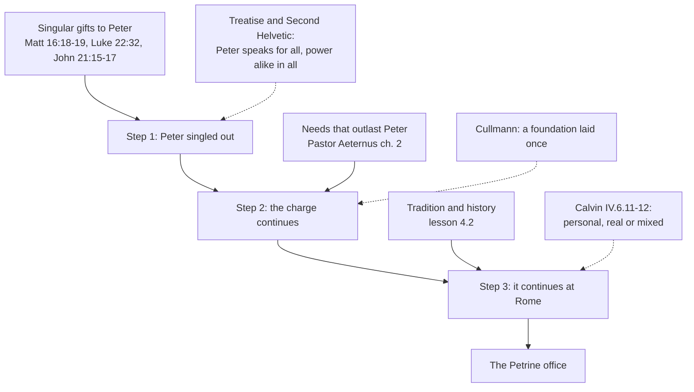

# Apologetics II · Lesson 4.1: The Petrine texts argued

> ⏱ ~15 min · Module 4: The Church, the papacy, and the Reformation's alternatives · Builds on: [`ecclesiology-and-mariology` 4.1](../../ecclesiology-and-mariology/lessons/04-01-the-petrine-texts.md), [`new-testament` 2.2](../../new-testament/lessons/02-02-matthew.md), [1.3](01-03-arguing-from-history-without-abusing-it.md) · Unlocks: [4.2](04-02-what-the-patristic-record-proves.md), [5.2](05-02-papal-primacy-as-the-east-reads-it.md), Boss 4 ([syllabus](../syllabus.md))

## Why this matters

Ask a Catholic tract why there is a pope and it points to Matthew 16. Ask a Presbyterian minister why there is not and he points to Matthew 18. This lesson argues the Catholic reading step by step. The first step is easier than its critics once allowed, and the step the case most needs is not one the page takes by itself.

## The idea

A firm's charter names one partner as the holder of the office keys, charged to steady the others; every partner can sign contracts. When she dies, does her post continue? The charter does not say "and her successors". One reader says the post was hers personally. Another says it exists because the firm needs it, and the need outlives her. Grammar settles that she was singled out, not whether the post outlived her.

That is the Petrine dispute, in three steps:

1. **The exegetical step.** Do the texts single Peter out from the Twelve?
2. **The perpetuity step.** Does what he was given continue after him?
3. **The Rome step.** If it continues, where?

[`ecclesiology-and-mariology` 4.1](../../ecclesiology-and-mariology/lessons/04-01-the-petrine-texts.md) laid out the [Petrine texts](../reference.md#petrine-texts) (Matthew 16:17–19, Luke 22:31–32, John 21:15–17) and the distinction between a [Petrine function and a Petrine office](../reference.md#petrine-function-and-petrine-office). This lesson argues from that layout and grades what each step can bear.

## The other side

`ecclesiology-and-mariology` 4.1 stated Melanchthon's, Calvin's ([*Institutes*](../reference.md#calvin-institutes) IV.6.4–8), Cullmann's and the Orthodox readings. Each is reloaded briefly, with additions. No reply here.

**Lutheran, confessional.** Melanchthon's [*Treatise on the Power and Primacy of the Pope*](../reference.md#treatise-on-the-power-and-primacy-of-the-pope) (Smalcald, 1537) reads all three texts (Triglot §§22–30). Peter "is the representative of the entire assembly of apostles" (§23): what 16:19 says to him in the singular, Matthew 18:18 and John 20:23 say to all in the plural. The [keys](../reference.md#power-of-the-keys) belong "principally and immediately" to the Church (§24). The rock is the ministry of Peter's confession: "Upon this rock, i.e., upon this ministry" (§25). "Feed" means teaching the Word, which Peter shares with the others (§30). *Weight:* part of the [Book of Concord](../reference.md#book-of-concord), the standard Lutheran pastors subscribe under Scripture; not a magisterium.

**Reformed, confessional.** They argue from the keys and Christ's headship more than from the rock.

- The [Westminster Confession](../reference.md#westminster-confession) XXX.1–2: Christ set "a government in the hand of Church officers", and "to these officers the keys of the kingdom of heaven are committed".
- The [Heidelberg Catechism](../reference.md#heidelberg-catechism) Q. 83: the office of the keys is "the preaching of the holy Gospel and Church discipline".
- The [Second Helvetic Confession](../reference.md#second-helvetic-confession) (Bullinger, 1566; English of Schaff's third edition) goes furthest. Christ needs no vicar, "for he is said to have a substitute, who is absent; but Christ is present with his Church" (XVII.8). The [key of David](../reference.md#key-of-david) (Isaiah 22:22; Revelation 3:7) is Christ's own, a power he "does not transfer". Ministers hold a steward's keys, a "ministerial power", and that power "is the same and alike in all" (XVIII.13–16). Peter convened and proposed in Acts, yet "neither was above the rest" (XVIII.17).

*Weight:* Westminster is the Presbyterian subordinate standard; Heidelberg (1563) is a Reformed catechism with confessional standing; Schaff reports the Second Helvetic "adopted, or at least highly approved" across the Reformed churches.

**Calvin, past IV.6.4–8** (already stated: keys as preaching, the rock as the confession, rank without power). In IV.6.11 Calvin concedes, for argument, "that the primacy of the Church was fixed in Peter, with the view of remaining for ever by perpetual succession". In IV.6.12 he sets a trilemma: "whether they hold the privilege to be personal, or real, or mixed". If personal, place is irrelevant. If real, tied to a see, it stays at Antioch, where on his opponents' own account Peter sat first. *Weight:* a theologian's book, not a confession.

**Cullmann.** Oscar Cullmann, a Lutheran exegete, wrote *Peter: Disciple, Apostle, Martyr* (German 1952; English 1953, revised 1962). For him the rock is Peter himself. Peter's role is the once-laid foundation, though, and the text gives no basis for successors. His Part Two divides "the exegetical question" from "the application of Matthew 16:17–19 to the later church": this lesson's separation. *Weight:* an exegete's book.

**The Reformed argument, in one line:** a personal prerogative is not an office. Making one out of the other is "wresting a single fact into a perpetual enactment" (IV.6.8). The Orthodox reading (Peter's chair held by every bishop who keeps his faith) is [5.2](05-02-papal-primacy-as-the-east-reads-it.md)'s.

## The argument

**P1.** The texts set singular gifts beside shared ones. Binding and loosing (Matthew 18:18), forgiving and retaining (John 20:23) and the thrones (Luke 22:30) go to the Twelve. The name and the keys (Matthew 16:18–19, *soi*), the prayer and the charge to strengthen (Luke 22:32, *sou*), and the flock (John 21:15–17) go to Peter. *In words:* the New Testament distinguishes what all the apostles receive from what one receives.

**P2.** The exegetical step is now widely conceded outside Catholicism. Cullmann reads the rock as Peter, and many Protestant commentators on Matthew have done so since (a report, not a count). Calvin grants Peter a place as "the first among the faithful" (IV.6.5). *In words:* the live question is no longer whether Peter was singled out.

**P3.** The singular gifts answer needs that outlast Peter: a Church that Hades will not overpower (16:18), brethren who will need strengthening (Luke 22:32), a flock to feed and shepherd (*poimaine*, John 21:16). *In words:* the purpose of the gift outlives its first holder.

**P4.** Both sides grant leadership under Christ. Luke 22:26 forbids Gentile lordship, yet presupposes "he that is the greater" and "the leader" (*ho hēgoumenos*). The Second Helvetic grants ministers a steward's keys and a convenor "for order's sake" (XVIII.14, 16). The key image is itself a steward's. In Isaiah 22:20–22 the king's key is laid on Eliacim with the robe and power taken from Sobna, an office passing between holders (`ecclesiology-and-mariology` 4.1, P1). Revelation 3:7, the key of David in Christ's hand, fits the image: the king holds the key and lays keys on a steward. *In words:* the dispute is not whether anyone holds keys under Christ but whether Christ set one steward over the house.

**P5.** A charge given for a lasting need is presumptively given for as long as the need lasts. This is the [perpetuity argument](../reference.md#perpetuity-argument), and it is *Pastor Aeternus* ch. 2's own reasoning: what Christ "established in the person of the blessed Apostle Peter to secure the perpetual welfare and lasting good of the Church, must, by the same institution, necessarily remain unceasingly in the Church" (Schaff vol. 2).

**∴ C.** The texts make it reasonable to read Peter's pastoral charge as meant to continue. They also put "the same and alike in all" under strain at every singular. They name no successor and no Rome. The step from function to office is taken by reading the texts with the Church's tradition, which is [4.2](04-02-what-the-patristic-record-proves.md)'s evidence.

**Mark the levels** ([the ladder](../../fundamental-theology/lessons/04-04-the-ladder-of-doctrinal-authority.md); [levels of authority](../reference.md#levels-of-authority)).

- Peter received from Christ directly a [primacy](../reference.md#petrine-primacy) of true jurisdiction, not of [honour](../reference.md#primacy-of-honour) only: **rung 1**, the canon of [*Pastor Aeternus*](../reference.md#pastor-aeternus) ch. 1.
- Peter has perpetual successors by divine right, and the Roman pontiff is that successor: **rung 1**, the canon of ch. 2.
- Ch. 1's reading, the primacy "promised" in Matthew 16 and conferred in John 21 "according to the testimony of the Gospel", is chapter teaching, not the definition: **at least rung 3**. Ch. 4's use of Luke 22:32 for the see is taught, not defined.
- The referent of "this rock": **rung 5**.
- The college's share in binding and loosing (*Lumen Gentium* 22, quoted in CCC 881): **rung 3 at its heaviest**.
- The promise about the gates of Hades, read as the Church's [indefectibility](../reference.md#indefectibility): **at least rung 3**.
- The bishops succeed the apostles as pastors (LG 20; CCC 860–862 locates it): **at least rung 3**.
- Other traditions' texts have no Catholic level; their weight is given above.

**Concession.** Matthew 16 alone does not reach an office with successors. The exegesis gets you Peter, not the papacy. The Reformed confessions are also right that binding and loosing were given to all the apostles, and that the keys are exercised first in preaching and discipline. The Catholic Church teaches the first itself.

**The crux.** Can a personal commission in the Gospels found an office that continues? The Reformation reader: a charge given to a person ends with him unless the text says otherwise (Calvin's "personal" horn, Cullmann's foundation). The Catholic: a charge given for a lasting need continues unless the text says otherwise (P5). What would move it: New Testament evidence of a personal charge continuing after its holder, or a principled way to tell the unrepeatable parts of an apostle's commission from the permanent ones. The Catholic side owes the second, since the [larger claim carries the larger burden](../reference.md#burden-of-the-catholic-claim). The New Testament's silence about a successor neither denies one nor attests one ([argument from silence](../reference.md#argument-from-silence), [1.3](01-03-arguing-from-history-without-abusing-it.md)).

## The argument map

The texts carry step 1 well. Step 2 needs a premise about purpose, and step 3 needs evidence the Gospels do not contain.

## Worked examples

**Example 1 (clean): Calvin's concession.** In IV.6.11 Calvin grants, for argument, steps 1 and 2, then fights at step 3: "Still how will they prove that his See was so fixed at Rome". Answering him with Matthew 16 brings evidence for a granted step; the Gospels never mention Rome. *Pastor Aeternus* ch. 2 grounds Rome on history instead: Peter presides in the see "founded by him, and consecrated by his blood". In the trilemma's terms that is "mixed": a personal charge bound to a see. Whether the history holds is 4.2's question. Each step needs its own evidence.

**Example 2 (strain): Matthias and James.** In Acts 1:20–26 Judas's "bishopric" (*episkopēn*) is given to another, so a place among the Twelve was filled. In Acts 12:2 James the brother of John is killed, and nobody replaces him. Cullmann's reading fits the second case: foundation stones are not relaid. The Catholic reply is CCC 860: the apostles' office has an aspect that cannot be passed on, being chosen witnesses of the Resurrection and so "foundation stones", and a pastoral aspect that continues. CCC 881 calls Peter's pastoral office part of the Church's foundation, "continued" by the bishops under the pope. Here the argument stops: the texts do not sort Peter's gifts into the two aspects. The rock is Matthew's most foundational image, so on the Catholic split it is the gift hardest to read as passing on. The keys and the flock carry it better. That sorting is the Church's reading, not the page's.

## Watch out

- **You might think "the Protestant reading" is that the rock is Christ and *Petros* a pebble,** but the Lutheran confession reads the rock as the ministry of Peter's confession (Treatise §25). The Reformed confessions argue from the keys and Christ's headship, and Cullmann, a Lutheran, read the rock as Peter. Name the text. "Protestants say" is the blur this course fails.
- **You might think Vatican I defined that Matthew 16 and John 21 prove the primacy,** but the canons define the primacy and the succession (rung 1). Which verse carries what is chapter teaching, and the rock's referent is rung 5. The mirror error: calling the *Institutes* or Cullmann's book "the Reformed position" or "the Lutheran position".
- **You might think that because the exegesis stops at Peter, succession is open for Catholics,** but the ch. 2 canon is rung 1. The concession is about what the page proves, not about what the Church holds.

## One-liner

> The Petrine texts single Peter out, and many of the Church's critics now say so; whether what he was given outlives him is settled by a premise about purpose and by history, not by the grammar of *soi*.

## Problems

**P1 (🟢)** *(Close reading · Exegetical)* Luke 22:24–26, 29–32 (Douay-Rheims, Challoner). The Douay keeps the Greek's number: "you" is plural, "thee" and "thou" singular.

> And there was also a strife amongst them, which of them should seem to be the greater. And he said to them: The kings of the Gentiles lord it over them; and they that have power over them are called beneficent. But you not so: but he that is the greater among you, let him become as the younger: and he that is the leader, as he that serveth. [...] And I dispose to you, as my Father hath disposed to me, a kingdom; That you may eat and drink at my table, in my kingdom: and may sit upon thrones, judging the twelve tribes of Israel. And the Lord said: Simon, Simon, behold Satan hath desired to have you, that he may sift you as wheat. But I have prayed for thee, that thy faith fail not: and thou, being once converted, confirm thy brethren.

(a) Sort vv. 29–32 into what is given to the Twelve and what to Simon. Give the Greek pronoun behind v. 31's "you" and v. 32's "thee", and say what the shift does in this scene.

(b) The Second Helvetic Confession cites v. 26 when it says that the Lord "forbade unto his disciples all dominion" (XVIII.13) and that ministerial power "is the same and alike in all" (XVIII.16). Which words of vv. 25–26 support the first claim? Which words tell against reading the verses as the second?

**120 words or fewer.**

**P2 (🟡)** *(Diagnose · Exegetical)* Four sentences from an invented Catholic parish tract on the papacy, written for this problem (no real author, parish or publisher):

> (1) In Matthew 16:18–19 Jesus speaks to Simon in the singular throughout: the naming and the promise of the keys are addressed to him, not to the Twelve.
>
> (2) Protestant scholars now admit that the rock is Peter, so the Reformation's case against the papacy has collapsed from within.
>
> (3) "The gates of hell shall not prevail" means that no pope can ever teach error.
>
> (4) Matthew 18:18 is only about settling quarrels between brothers; it gives nobody any real authority.

One sentence is right: say which. For each of the other three, name the error and correct it, giving a level where one is involved. **One sentence each.**

**P3 (🔴)** *(Apologetic: (a) Exegetical, graded first · (b) reply)* From an invented Reformation Sunday sermon by the Rev. Murdo Macrorie at Grace Reformed Church, Kilbarrow (a Westminster-subscribing Presbyterian; nobody here is real):

> "Rome builds a throne on one verse, Matthew 16:19. Read on. Two chapters later the same Lord says to all the disciples, 'Whatsoever ye shall bind on earth shall be bound in heaven.' After the resurrection he breathes on them all: 'Whose soever sins ye remit, they are remitted.' What Peter received, the apostles received together, and our Confession says where the keys are now: committed to the officers of Christ's Church. There is one Head, and he is not absent. The keys are not a crown."

(a) State the Reformed doctrine of the keys that the sermon draws on, as Westminster XXX.1–2 and the Second Helvetic Confession XIV.8 and XVIII.13–16 state it, and the conclusion it draws about Matthew 16:19.

(b) Reply. Open with a **named concession**, and name the one premise of the sermon you deny.

**150 words or fewer in total.** A reply that concludes the sermon is right passes if it is a good reply.

Solutions

**P1** *(Close reading · Exegetical)*

**Must hit, strict:**

- **(a) To the Twelve, plural:** the kingdom "I dispose to you", eating and drinking at the table, and "thrones, judging the twelve tribes" (vv. 29–30). Satan "hath desired to have you" uses *hymas*, all of them (v. 31).
- **(a) To Simon, singular:** "I have prayed for thee" uses *peri sou*. "Thy faith", "thou ... confirm thy brethren" (*stērison*) follow (v. 32).
- **(a) The shift:** in a scene where authority is shared and every apostle will be sifted, one man is prayed for and given a charge toward the rest. The charge follows his own turning back (*epistrepsas*), so it is given to a man who will fail.
- **(b) Support for "forbade all dominion":** "The kings of the Gentiles lord it over them ... But you not so". Lordship of the Gentile kind is excluded.
- **(b) Against "the same and alike in all":** "he that is the greater among you" and "he that is the leader" (*ho hēgoumenos*, Hebrews 13:7 and 17's word for church leaders). The verse governs how a greater one and a leader behave. It does not abolish them, and v. 32 then gives one man a charge toward the others.

**Wrong turns:** reading the passage as proving an office with successors (the charge concerns one man on one night; see [`ecclesiology-and-mariology` 4.1](../../ecclesiology-and-mariology/lessons/04-01-the-petrine-texts.md) Ex 1). Reading v. 26 as forbidding any leader. Missing that v. 31's "you" is plural. Turning (b) into a verdict on the papacy.

**Model answer:** (a) The Twelve together receive the kingdom, the table and the thrones (vv. 29–30), and all of them (*hymas*) will be sifted. Simon alone is prayed for (*peri sou*) and told to confirm his brethren once he has turned back. Shared authority and a single charge sit in one scene. (b) "The kings of the Gentiles lord it over them ... But you not so" supports a ban on dominion. But "he that is the greater among you" and "he that is the leader" presuppose a greater one and a leader, and v. 32 at once gives one man a charge toward the others. So the text does not say the power is alike in all.

---

**P2** *(Diagnose · Exegetical)*

**Accept:** any wording that makes the moves below, one sentence each.

**Must hit, strict:**

- **(1) is right.** *Soi legō*, *su ei Petros*, *dōsō soi*: the address of 16:18–19 is singular throughout.
- **(2) conflates two steps and two kinds of text.** Conceding that the rock is Peter concedes the exegetical step, not succession. The classic conceder, Cullmann, denied successors. "Protestant scholars" are not the confessions either: the Lutheran Treatise (§25) still reads the rock as the ministry of the confession.
- **(3) overstates and misplaces.** The promise is that the Church survives, which is indefectibility (at least rung 3) and says nothing about any pope's conduct. What Vatican I defined (rung 1) is infallibility only under the four conditions of *Pastor Aeternus* ch. 4, not that a pope never errs.
- **(4) understates.** Matthew 18:18 gives binding and loosing to the disciples in the plural, and the Catholic Church itself teaches that the binding and loosing given to Peter was granted also to the college joined with its head (LG 22, quoted in CCC 881; rung 3 at its heaviest).

**Wrong turns:** calling (1) false because Peter answered for all. That is the Treatise's interpretation, and it does not change the grammar. Correcting (3) by denying that the pope can teach infallibly at all. Correcting (4) by making 18:18 grant the keys (it never mentions them). Answering (2) with "no Protestant thinks the rock is Peter", which is false.

**Model answer:** (1) is right: the address is singular throughout (*soi*, *su*). (2) Conceding the rock concedes Peter, not successors; Cullmann made that concession and denied succession, and the Lutheran confession still reads the rock as the ministry of Peter's confession. (3) The promise secures the Church's survival (indefectibility, at least rung 3), and Vatican I defined infallibility only under four conditions (rung 1), not a pope who never errs. (4) Matthew 18:18 gives binding and loosing to all the disciples, and the Church teaches that the college shares it with its head (LG 22, rung 3 at its heaviest).

---

**P3** *(Apologetic: (a) Exegetical, graded first · (b) reply)*

**Accept:** any reply that opens with a real concession, names one premise and engages it, whatever its verdict.

**Must hit, strict (a), graded first:**

- **Westminster XXX.1–2:** Christ, as king and head, appointed a government in the hands of church officers, distinct from the civil magistrate. To those officers the keys are committed: to retain and remit, to shut the kingdom by the Word and censures, and to open it by the gospel and absolution from censures.
- **Second Helvetic XIV.8:** all ministers truly called have and exercise the keys when they preach. The keys were promised in Matthew 16:19 and delivered in John 20:23.
- **Second Helvetic XVIII.13–16:** the absolute power, the key of David (Revelation 3:7; Isaiah 22:22), Christ keeps. Ministers hold a ministerial, steward's power, "the same and alike in all". One may convene "for order's sake" without greater authority.
- **The conclusion:** Matthew 16:19 gives Peter nothing his colleagues lacked, and no one holds the keys as a head over the rest, since Christ the only head is present (XVII.8).

**Must hit (b):**

- **A named concession,** stated flatly. For example: binding and loosing and the remitting of sins were given to all the apostles. The keys are exercised first in preaching and discipline. The Catholic Church teaches that the college shares the binding and loosing.
- **The premise denied, named.** The strongest choice is the inference from "shared" to "the same and alike in all". A shared power can still have a distinct charge inside it: Luke 22:29–32 gives shared thrones and a singular charge in one scene, and the Second Helvetic itself grants a convenor. The texts' singulars are evidence of exactly such a charge.
- **Honesty about reach.** Credit, though it is not required, for saying the reply establishes a singular charge within a shared power, not a successor at Rome.

**Wrong turns:**

- Stating (a) as Calvin's *Institutes* IV.6. That is a theologian's book, and the problem asks for the confessions.
- Stating (a) as "Presbyterians reject church authority" or "the keys are just private faith". Westminster XXX gives real power of censure, so this is a caricature, and it fails the problem.
- Giving the Lutheran Treatise's "the keys belong immediately to the Church" as Westminster's doctrine. Westminster commits them to officers.
- Saying the Reformed allow no presiding role at all.
- In (b), denying that 18:18 gives binding and loosing to all, or claiming the texts prove the papacy.

**Model answer (a):** Christ set his Church's government in the hands of officers, and to them the keys are committed: to remit and retain, shutting the kingdom by Word and censure and opening it by the gospel and absolution (WCF XXX.1–2). Ministers use the keys when they preach; promised in 16:19, they were delivered in John 20:23. Christ keeps the key of David, and ministers hold a steward's power, alike in all (Second Helvetic XIV.8; XVIII.13–16). So Peter received nothing the others lacked.

**Model answer (b), one of several:** Concession: binding, loosing and remitting were given to all the apostles, and Rome teaches that the college shares them. I deny the step from "shared" to "alike in all". In Luke 22 the Twelve share the thrones, yet Peter alone is charged to confirm them, and the Second Helvetic itself grants a convenor. One man charged within a shared power is what 16:19 and John 21 describe. Succession is a further argument.

## Flashback

**From Lesson [3.3](03-03-paul-and-james.md) (Paul and James):** *(Apologetic: (a) Exegetical, graded first · (b) reply.)* The [Apology of the Augsburg Confession](../reference.md#apology-of-the-augsburg-confession), Art. III, §§123–125 (*Concordia Triglotta*, 1921, English), on James 2:24:

> If the adversaries do not attach their own opinions concerning the merits of works, the words of James have in them nothing that is of disadvantage. [...] the passage is more against the adversaries than against us. For the adversaries teach that man is justified by love and works. Of faith, by which we apprehend Christ as Propitiator, they say nothing. [...] here such works are spoken of as follow faith, and show that faith is not dead, but living and efficacious in the heart. [...] he speaks of the works of those who have been justified [...]

(a) State the Apology's answer as it gives it: why James does the Lutherans no harm, why he tells against their opponents, and which works he means. Give the text's weight. **Two or three sentences.**

(b) Reply, opening with a **named concession**. Then say where a Lutheran and a Catholic still divide once James is read this way. **110 words or fewer.** A reply that concludes the Apology has taken James from the Catholic case altogether passes if it is a good reply.

Solution

**Accept:** any reply, whatever its verdict, that opens with a real concession and locates the remaining dispute.

**Must hit, strict (a), graded first:**

- **No harm:** James tells against the Lutherans only if the adversaries' opinions on the merit of works are read into him (§123).
- **Against the adversaries:** they teach justification by love and works and are silent on faith; James keeps faith (§124).
- **Which works:** those that follow a living faith and show it, the works of people already justified (§125). James is not describing how one is first justified.
- **Weight:** Melanchthon's text, in the [Book of Concord](../reference.md#book-of-concord), the *norma normata* Lutheran pastors subscribe; not a magisterium. Credit for adding that the Formula (SD III.42–43) adopts the answer.

**Must hit (b):**

- **A named concession,** flat: James teaches no merit of forgiveness or first grace, and his works are those of the justified. Trent agrees (VI ch. 8, "whether faith or works"; ch. 10).
- **Where they divide:** the Apology's own "justified" for James (§131: pronounced righteous, as in Romans 2:13) is a verdict before God, nearer Trent than Calvin's "before men". The live question is can. 24 (**rung 1** as worded), which defines the [increase](../reference.md#increase-of-justification) on its own authority: are works done in grace "merely the fruits and signs" of justification or a cause of its increase, and so merit ([3.4](03-04-the-joint-declaration-merit-and-reward.md))?

**Wrong turns:** stating (a) as "Lutherans reject James" or from Luther's 1522 preface (in no confession), which fails the problem; giving the Apology Calvin's "before men" (the Lutheran/Reformed blur); calling it Luther's text or a magisterium; saying Trent defined the sense of 2:24 (**rung 5**). Credit for noting that the adversaries wrote before Trent, whose ch. 8 calls faith "the root of all Justification" (Waterworth).

**Model answer (a):** James harms the Lutheran doctrine only if the adversaries' opinions on merit are read into him; he tells more against them, since they teach justification by love and works and are silent on faith, while he keeps it. His works follow a living faith: they are the works of people already justified. The Apology is Melanchthon's, in the Book of Concord Lutheran pastors subscribe as a *norma normata*.

**Model answer (b), one of several:** Concession: the Apology is right that James teaches no merit of forgiveness or first grace, and that his works are those of the justified. Trent agrees (chs. 8 and 10), and tracts that turn 2:24 against Romans 4 deserve the rebuke. So James is not where we divide. The Apology's own "justified" there is God's verdict on people with faith and works, as in Romans 2:13: nearer Trent than Calvin's "before men". What remains is whether works done in grace are merely fruits and signs or a cause of the increase of justice (can. 24), and so merit.

## Connections

- **Backward:** [`ecclesiology-and-mariology` 4.1](../../ecclesiology-and-mariology/lessons/04-01-the-petrine-texts.md) laid out the texts and stated Melanchthon, Calvin, Cullmann and the Orthodox reading. Its problems already set Isaiah 22's key, the 16:19 and 18:18 crux, and the Calvin–Cullmann statement. [`new-testament` 2.2](../../new-testament/lessons/02-02-matthew.md) places the passage in Matthew's narrative, and whether it goes back to Jesus is that course's Boss 2. [`ecclesiology-and-mariology` 4.3](../../ecclesiology-and-mariology/lessons/04-03-vatican-i-and-pastor-aeternus.md) reads the canons of *Pastor Aeternus* chs. 1–2. [1.3](01-03-arguing-from-history-without-abusing-it.md) supplies the rule on arguments from silence.
- **Forward:** [4.2](04-02-what-the-patristic-record-proves.md) weighs the evidence step 3 needs, starting with Melanchthon's historical argument that Rome's authority "first arose" from a human law, Nicaea's resolution (Treatise §12). [4.3](04-03-apostolic-succession-and-the-validity-of-orders.md) argues succession as a question about orders. [5.2](05-02-papal-primacy-as-the-east-reads-it.md) gives the Orthodox reading of the same texts. Boss 4(d) asks for the whole Petrine case with two concessions ([syllabus](../syllabus.md)).
- **Sideways:** Cullmann's split between the exegetical question and its "application ... to the later church" is where [`fundamental-theology` 5.2](../../fundamental-theology/lessons/05-02-newmans-theory-of-development.md)'s theory of development enters. The perpetuity step is the kind of step development exists to license, so "function to office" is a development question before it is an exegetical one. The crux technique is [`philosophical-method` 4.3](../../philosophical-method/lessons/04-03-finding-the-crux.md)'s.
