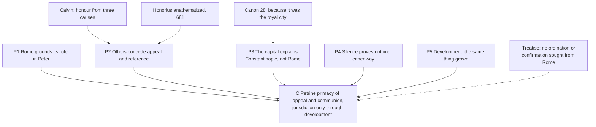

# Apologetics II · Lesson 4.2: What the patristic record proves

> ⏱ ~15 min · Module 4: The Church, the papacy, and the Reformation's alternatives · Builds on: [4.1](04-01-the-petrine-texts-argued.md), [1.3](01-03-arguing-from-history-without-abusing-it.md), [`ecclesiology-and-mariology` 4.2](../../ecclesiology-and-mariology/lessons/04-02-the-development-of-papal-claims-read-honestly.md), [`christology` 2.5](../../christology/lessons/02-05-monothelitism-and-constantinople-iii.md) · Unlocks: [4.3](04-03-apostolic-succession-and-the-validity-of-orders.md), [5.2](05-02-papal-primacy-as-the-east-reads-it.md), [6.6](06-06-development-or-corruption.md)

## Why this matters

[4.1](04-01-the-petrine-texts-argued.md) ended where exegesis runs out: Matthew 16 gets you Peter, not a see with successors. History has to carry the succession step, and the Lutheran confessions saw that in 1537: Melanchthon's *Treatise* rests its case on an ancient Church that, it says, never treated Rome's bishop as its lord. This lesson grades what the first-millennium evidence proves, starting with what it concedes.

## The idea

Picture a family firm whose founder, the story goes, made the eldest branch head. Its letters show it writing to the others as one responsible for them; the others sometimes send it their disputes and sometimes tell it to mind its own affairs; no letter says "head office". Was its standing headship, the seed of headship, or courtesy to the oldest house?

That is the patristic dispute. Its texts are read elsewhere, not here: 1 Clement, Ignatius, Irenaeus 3.3.2 and Cyprian's ch. 4 ([`patristics` 1.2](../../patristics/lessons/01-02-first-clement-and-the-didache.md), [1.3](../../patristics/lessons/01-03-ignatius-of-antioch.md), [2.1](../../patristics/lessons/02-01-irenaeus-against-the-gnostics.md), [2.4](../../patristics/lessons/02-04-cyprian-of-carthage.md)), Leo and Gregory ([5.2](../../patristics/lessons/05-02-leo-the-great.md), [5.3](../../patristics/lessons/05-03-gregory-the-great.md)), Victor ([`church-history` 1.2](../../church-history/lessons/01-02-bishops-canon-and-the-parting-of-the-ways.md)), Sardica ([`ecclesiology-and-mariology` 4.4](../../ecclesiology-and-mariology/lessons/04-04-infallibility-in-exercise-and-the-ordinary-universal-magisterium.md), Flashback). [`ecclesiology-and-mariology` 4.2](../../ecclesiology-and-mariology/lessons/04-02-the-development-of-papal-claims-read-honestly.md) traced the development with [three questions](../reference.md#claimed-conceded-defined): what Rome claimed, what others conceded, what has since been defined. Those lessons stop at "the readings differ"; this one argues.

**Four concessions come first:**

- The claims grew, visibly.
- Forgeries served them: the [Pseudo-Isidorean Decretals](../reference.md#pseudo-isidorian-decretals) (Frankish, probably the 840s) and the [Donation of Constantine](../reference.md#donation-of-constantine), exposed by Lorenzo Valla in 1440 ([`church-history` 3.3](../../church-history/lessons/03-03-popes-franks-and-emperors.md)).
- An ecumenical council, Constantinople III (681), anathematized a pope, [Honorius](../reference.md#honorius), and a pope confirmed it.
- Klaus Schatz's *Papal Primacy* (1990; English 1996), a Catholic history, grants that no Christian of 100 or 200 would have called Rome's bishop head of all Christians.

## The other side

**The Lutheran confession.** Melanchthon's [*Treatise on the Power and Primacy of the Pope*](../reference.md#treatise-on-the-power-and-primacy-of-the-pope) (Smalcald, 1537) stands in the [Book of Concord](../reference.md#book-of-concord), which Lutheran pastors subscribe: a *norma normata* under Scripture, not a magisterium. Its historical section (§§12–21 in the Latin numbering; the Triglot's English heads them VI–XI) argues from practice. Nicaea gave Alexandria the East and Rome the "suburban" churches: "From this start by a human law, i. e., the resolution of the Council, the authority of the Roman bishop first arose" (§12). Bishops were chosen locally, so "neither ordination nor confirmation was sought from a bishop of Rome in the greater part of the world" (§15); one overseer of the whole world is impossible (§16). Synods met without Rome presiding (§17). Jerome makes every bishop "of the same dignity and priesthood" (§18). Gregory refused "universal bishop" and says Chalcedon's offer of the primacy was not accepted (§19). Emperors confirmed Roman bishops, and the emperor Phocas had to settle Rome's contest with Constantinople (§§20–21). What is denied is divine right, not every primacy: Melanchthon signed the Smalcald Articles allowing that, if the pope would allow the Gospel, his superiority over the bishops might be conceded "by human right" (Triglot).

The base text is [Nicaea's canon 6](../reference.md#nicaea-canon-6) (325), in Percival: "Let the ancient customs in Egypt, Libya and Pentapolis prevail, that the Bishop of Alexandria have jurisdiction in all these, since the like is customary for the Bishop of Rome also." Percival records the Latin versions: Rufinus's *suburbicariarum ecclesiarum*, which the *Treatise* follows; the Prisca's *principatum* for Rome's bishop; and manuscripts opening "The Church of Rome hath always had a primacy", the form the legate Paschasinus read at Chalcedon.

**Calvin** ([*Institutes*](../reference.md#calvin-institutes) IV.6.16–IV.7.1; a theologian's book, not a confession) concedes more. The early Church gave Rome "high honour" for three causes: the belief, prevailing "I know not how", that Peter founded it; "the seat of empire"; and Rome's steadiness, which made it a "haven" for exiled bishops (IV.6.16). Nicaea made its bishop "only one of the chief", not "head of all" (IV.7.1).

**The strongest single text** is Chalcedon's [canon 28](../reference.md#canon-28-of-chalcedon) (451): "the Fathers rightly granted privileges to the throne of old Rome, because it was the royal city" (Percival), so New Rome takes equal privileges and second rank, as Constantinople I's canon 3 (381) had ranked it "because Constantinople is New Rome". Hence the counter-reading: a [primacy of honour](../reference.md#primacy-of-honour), produced by the capital and the apostles' graves, enlarged by human law. The Reformed and Anglican confessions deny the headship without arguing the record ([Westminster](../reference.md#westminster-confession) XXV.6; [Article](../reference.md#thirty-nine-articles) XXXVII).

The medieval end is the [Tierney thesis](../reference.md#tierney-thesis): the medievalist Brian Tierney (*Origins of Papal Infallibility, 1150–1350*, 1972) argued that irreformable papal teaching was first urged about 1280 by the Franciscan Peter John Olivi, to bind later popes to *Exiit qui seminat*, and was resisted by John XXII ([`ecclesiology-and-mariology` 4.2](../../ecclesiology-and-mariology/lessons/04-02-the-development-of-papal-claims-read-honestly.md), Ex 2). The Orthodox reading of the millennium is [5.2](05-02-papal-primacy-as-the-east-reads-it.md)'s.

## The argument

**P1.** Rome grounded its role in Peter, never in the city. At Ephesus (431) the Roman legate Philip told the council that Peter "lives and judges in his successors" (Percival). Leo refused canon 28 because "things secular stand on a different basis from things divine": Constantinople, royal as it was, could not be made an apostolic see (Letter CIV.3, 22 May 452). *In words:* wherever Rome states a ground, the ground is Peter.

**P2.** At decisive moments others conceded more than precedence. A synod at [Sardica](../reference.md#sardica) (343 or 344), which most Eastern bishops had left, let Rome's bishop decide whether a condemned bishop's case was retried, to "honour the memory of Peter the Apostle" (canon 3, Percival's Greek). Chalcedon acclaimed the *Tome*, "Peter has spoken thus through Leo", and Constantinople III, "Peter spoke through Agatho", both after testing the letters against the Fathers ([`patristics` 5.2](../../patristics/lessons/05-02-leo-the-great.md); for 681, Session VIII in Percival). *In words:* others conceded appeal and doctrinal reference, on Peter's warrant.

**P3.** The capital explains Constantinople's rise, not Rome's role. Canon 28, and Chalcedon's canon 9 sending appeals "to the throne of the Imperial City of Constantinople", built an Eastern hierarchy on the empire; the Petrine ground is the one Rome gave and the East used for Leo and Agatho. *In words:* the royal city explains one theory, not the whole record.

**P4.** By [1.3](01-03-arguing-from-history-without-abusing-it.md)'s rule, early [silence](../reference.md#argument-from-silence) about jurisdiction neither denies nor attests it; and Irenaeus did rebuke Victor, Cyprian defy Stephen. *In words:* "honour only" fails P1–P3; "1870 already" fails P4.

**P5.** The Church's own account is development. The CDF's 1998 commentary on the Profession of Faith (§11) says the primacy was "always believed as a revealed fact", while whether the conceptual working-out of "jurisdiction" belonged to revelation stayed open until 1870 (paraphrase). Newman's notes, run on this trajectory in [`ecclesiology-and-mariology` 4.2](../../ecclesiology-and-mariology/lessons/04-02-the-development-of-papal-claims-read-honestly.md), assign burdens rather than prove. *In words:* the claim is that what grew is the same thing grown.

**∴ C.** The record proves a [primacy of appeal and communion](../reference.md#primacy-of-appeal-and-communion) with a Petrine warrant, claimed by Rome and conceded by others when it mattered. It does not by itself prove [universal ordinary jurisdiction](../reference.md#universal-ordinary-jurisdiction); that step needs a theory of [development](../reference.md#development-of-doctrine). *In words:* the record carries the Catholic case to the door of development, and no further.

**Mark the levels.** ([the ladder](../../fundamental-theology/lessons/04-04-the-ladder-of-doctrinal-authority.md); [levels of authority](../reference.md#levels-of-authority).) Peter's primacy of jurisdiction, perpetual successors in the Roman see, and full, supreme, ordinary and immediate jurisdiction: **rung 1** (*[Pastor Aeternus](../reference.md#pastor-aeternus)*, 1870, canons of chs. 1–3); Florence's primacy definition (1439) likewise, the sense of its *quemadmodum* clause disputed. *Pastor Aeternus*'s histories, Philip's sentence included: **taught, not defined**. Whether the record *by itself* proves jurisdiction: a historian's judgment, **no rung**, freely argued. The 1998 commentary's classifications: **rung 3, light grade at most**. Honorius's anathema: a historical fact, **not a level**. Nicaea's canon 6, Sardica's canons, canon 28: **law, no doctrinal rung**. Forgeries: **no authority**; Schatz, Tierney, Newman's notes: **no magisterial level**.

**Concession.** The *Treatise*'s facts are facts. No Eastern church sought ordination or confirmation of its bishops from Rome; councils met without Rome presiding; Gregory refused the universal title; Chalcedon built a hierarchy of sees on the empire, and the East kept it. Hefele, the Catholic historian of the councils whom Percival prints, judged that canon 6 concerns Rome's power as a patriarch, not "the primacy of the Bishop of Rome over the whole Church".

**The crux.** Is a primacy of appeal and communion universal jurisdiction developed, or a different thing? Gregory states the hinge (Letter IX.59, Barmby, NPNF2 13): "if any fault is found in bishops, I know not what bishop is not subject to it. But when no fault requires it to be otherwise, all according to the principle of humility are equal." The Catholic reads one power, used sparingly; the Lutheran and the Orthodox, a court of correction among equals. What would move it: first-millennium cases of Rome exercising ordinary jurisdiction in another patriarchate with no fault or appeal in question (their scarcity is the *Treatise*'s point); or a reason why power to judge any bishop "if any fault is found" is not already jurisdiction over all.

## The argument map

The objections leave P1 standing and press on what kind of thing was conceded: the crux.

## Worked examples

**Example 1 (clean): Calvin's three causes.** Put IV.6.16 through the three questions. *Conceded*, by Calvin: the early Christians "uniformly" honoured Rome, first because they believed Peter founded it. His third cause, Rome as a "haven" for bishops driven from their sees, is the appeal function under another name. So Calvin's own account delivers P1 and P2: honour on Petrine grounds, and refuge for the condemned. His second cause, the seat of empire, is the one canon 28 states and Leo rejected. What Calvin denies is the next step: "on this" no primacy of authority can be reared (IV.6.17). The argument narrows the dispute to the crux without pretending the honour was jurisdiction.

**Example 2 (strain): Constantinople III.** Agatho's letter, read at the fourth session (15 November 680), says the apostolic church of Rome "has never erred from the path of the apostolic tradition" (Percival). The council's address to the emperor answers "Peter spoke through Agatho", and in the same address anathematizes "Honorius, who was the ruler (proedron) of Rome"; Leo II confirmed the council. What that does to infallibility is [`ecclesiology-and-mariology` 4.4](../../ecclesiology-and-mariology/lessons/04-04-infallibility-in-exercise-and-the-ordinary-universal-magisterium.md)'s Ex 2 (the letter met none of the 1870 conditions). The strain falls on P2. The bishops of 681 treated Rome's faith as the reference *and* judged a Roman bishop by it. A Catholic reads a see whose faith held while one occupant failed; a Lutheran or Orthodox reader, a council that received Agatho's letter because it was orthodox, not as orthodox because it was Roman. The acts support both, and the argument stops there. The medieval record adds nothing older: Innocent III and *Unam Sanctam* (1302; its closing sentence not manifestly defined, [`ecclesiology-and-mariology` 4.2](../../ecclesiology-and-mariology/lessons/04-02-the-development-of-papal-claims-read-honestly.md)) show what Rome later claimed, not what the first millennium conceded.

## Watch out

- **You might think the Lutheran confession and Calvin deny Rome any early standing,** but the *Treatise* says Rome's authority "first arose" by human law and Calvin grants "high honour". Attacking "no primacy at all" fights nobody; so does calling the *Treatise*'s argument Calvin's.
- **You might think *Pastor Aeternus* defined the history it tells,** but its narrative is the act's reasoning, taught not defined. What it defines (rung 1) is the primacy, the succession and the jurisdiction; calling those "a reading of the evidence" understates them.
- **You might think canon 28 is the whole Church's theory, or negligible,** but it is Eastern law, passed in the legates' absence and refused by Leo, and also real evidence of a rival theory the East kept.
- **You might think Tierney showed the papacy is medieval,** but his thesis concerns infallibility as irreformable teaching, and says nothing against the first-millennium primacy. Alfons Stickler, prefect of the Vatican Library, disputed it in 1974.

## One-liner

> The first millennium proves a Petrine primacy of appeal and communion, more than honour and less than 1870's jurisdiction; whether the second is the first grown is the question development has to answer.

## Problems

**P1 (🟢) *(Diagnose · Exegetical.)*** Two invented texts, written for this problem; nobody real wrote them.

> **Gabriela Mourão, in a diocesan magazine:** "Every Father from Clement to Gregory acknowledged the pope as ruler of the whole Church. Even Calvin admits the early Christians honoured Rome because Christ made Peter its head. And Vatican I defined this unanimous patristic witness when it defined the primacy."

> **Hendrik Wiersema (`dordrecht_elder`), on a forum:** "Before the forged decretals of the ninth century, no bishop ever took his case to Rome. The Lutheran confessions and Calvin agree that the early Church gave Rome nothing but courtesy. And Tierney proved the papacy itself was invented in the thirteenth century."

Name **two** errors in each text and correct each from the record. **One or two sentences per error.**

**P2 (🟡) *(Close reading · Exegetical.)*** Council of Ephesus, Session III (431), in Percival's translation (NPNF2 14). First the Roman legate Philip; then Cyril of Alexandria, answering the legates' statements.

> **Philip:** There is no doubt, and in fact it has been known in all ages, that the holy and most blessed Peter, prince (exarchos) and head of the Apostles, pillar of the faith, and foundation (themelios) of the Catholic Church, received the keys of the kingdom from our Lord Jesus Christ …: who down even to to-day [*sic*] and forever both lives and judges in his successors. The holy and most blessed pope Coelestine, according to due order, is his successor and holds his place, and us he sent to supply his place …
>
> **Cyril:** … they have made their profession in the place of the Apostolic See, and of the whole of the holy synod of the … bishops of the West. Wherefore let those things which were defined by the most holy Coelestine … be carried into effect, and the vote cast against Nestorius … by the holy Synod … be agreed to universally …

(a) What does Philip claim, and which words carry the claim that Peter's role continues?

(b) What does Cyril concede, and which words leave open whose judgment is being carried out?

(c) *Pastor Aeternus* ch. 2 quotes Philip's sentence. What weight does the sentence have there, and what in that chapter is defined?

**Two sentences per part.**

**P3 (🔴, optional) *(Apologetic: (a) Exegetical, graded first · (b) reply, Evaluative: any verdict.)***

(a) State the *Treatise*'s argument from the practice of the ancient Church (§§13–21; the Triglot's English VII–XI; leave §12 and Nicaea aside) as a Lutheran pastor who subscribes it would state it, and say what weight the *Treatise* has among Lutherans. **Four sentences at most.**

(b) How much weight can the first-millennium record bear for universal jurisdiction? Reply in **150 words or fewer**, opening with a **named concession**. Any verdict passes, including that the record cannot bear it, if the reply is a good one.

Solutions

**P1** *(Diagnose · Exegetical)*

**Accept:** any two errors per text from the lists below, each with a correction drawn from the record.

**Must hit, strict:**

- **Mourão, error 1: a [manufactured consensus](../reference.md#manufactured-consensus).** Irenaeus rebuked Victor, Cyprian defied Stephen, Gregory refused the universal title, and Schatz, a Catholic historian, grants that no Christian of 100 or 200 would have called Rome's bishop head of all Christians.
- **Mourão, error 2: Calvin misreported.** IV.6.16 grants "high honour" for three causes (the belief, "I know not how", that Peter founded the church; the seat of empire; Rome as a haven), and IV.6.17 denies that a primacy can be built on it.
- **Mourão, error 3: the level overstated.** Vatican I defined the primacy, the succession and the jurisdiction (rung 1); its historical narrative is the act's reasoning, taught not defined, and no act defines a unanimous patristic witness.
- **Wiersema, error 1: appeals are older than the forgeries by five centuries.** Sardica (343 or 344) let Rome's bishop decide whether a condemned bishop's case was retried, and Calvin himself records exiled bishops taking refuge in Rome.
- **Wiersema, error 2: the confessions understated and blurred.** The Lutheran *Treatise* says Rome's authority "first arose" by human law, and Melanchthon would concede papal superiority by human right; Calvin grants "high honour". "The Lutheran confessions and Calvin" are not one source, and Calvin's book is not a confession.
- **Wiersema, error 3: Tierney misused.** His thesis concerns infallibility as irreformable papal teaching (Olivi, about 1280), not the papacy or its primacy, and it is a historian's thesis that Catholic scholars disputed (Stickler, 1974).

**Wrong turns:** correcting Mourão by saying the Fathers gave Rome no special place, which swaps one error for Wiersema's. Correcting Wiersema by saying the forgeries played no part: they served the claims (the second concession). Calling the *Treatise* Calvinist. Using Tierney as evidence about the first millennium in either direction.

**Model answer:** Mourão: "every Father" manufactures a consensus. Irenaeus rebuked Victor and Cyprian defied Stephen, and Schatz grants that no one in 100 or 200 called Rome's bishop head of all Christians. Vatican I defined the primacy itself (rung 1); its history is reasoning, and no act defines a patristic unanimity. Wiersema: appeals to Rome are five centuries older than the forgeries, since Sardica gave Rome's bishop the decision on retrying a deposed bishop. And the *Treatise* grants Rome a human-law authority and Calvin "high honour", so "nothing but courtesy" understates both.

---

**P2** *(Close reading · Exegetical)*

**Must hit, strict:**

- **(a)** Philip claims that Peter, "head of the Apostles … foundation of the Catholic Church", received the keys, and that Celestine is his successor "according to due order", whose place the legates "supply" in the synod. Continuity is carried by "down even to to-day and forever both lives and judges in his successors". It is a legate's speech recorded in the acts, not a conciliar decree.
- **(b)** Cyril concedes that the legates speak "in the place of the Apostolic See" and that what Celestine "defined" is to "be carried into effect". But the same sentence sets "the vote cast … by the holy Synod" beside it, to "be agreed to universally", and the legates speak for "the whole of the holy synod … of the West" too. Whether the council executed Rome's judgment or confirmed it by its own is exactly what the readings dispute. The council neither contradicts Philip nor adopts his sentence as its own.
- **(c)** In *Pastor Aeternus* ch. 2 the quotation is part of the chapter's reasoning: **taught, not defined**. Philip's speech in itself has **no magisterial level**. What ch. 2 defines (**rung 1**, its canon) is that Peter has perpetual successors in the primacy by Christ's institution, and that the Roman pontiff is that successor.

**Wrong turns:** "Ephesus declared that Peter lives in his successors" (the words are Philip's). Reading Cyril as rejecting the claim. Calling the sentence defined because Vatican I quotes it, or calling the quotation weightless when it is the act's own reasoning.

**Model answer:** (a) Philip claims that Peter, head of the apostles, received the keys and still "lives and judges in his successors", and that Celestine holds his place "according to due order". The legates "supply his place" in the synod, so they speak for Peter's see. (b) Cyril grants that they speak "in the place of the Apostolic See" and that what Celestine "defined" must be carried out. But he sets beside it the vote "cast … by the holy Synod", and that leaves open whether the council executed Rome's judgment or confirmed it by its own. (c) In *Pastor Aeternus* ch. 2 the sentence is the chapter's reasoning, taught not defined, and Philip's speech has no magisterial level. The canon defines (rung 1) that Peter has perpetual successors in the primacy by divine institution and that the Roman pontiff is that successor.

---

**P3** *(Apologetic: (a) Exegetical, graded first · (b) reply, Evaluative)*

**Accept:** any verdict on (b), if (a) is right and the reply opens with a named concession and makes the moves below.

**Must hit, strict (a), graded first:**

- **The facts it cites:** bishops chosen by their own churches with neighbouring bishops (Cyprian calls it divine tradition), so neither ordination nor confirmation was sought from Rome in most of the world; many synods without Rome presiding; Jerome's "same dignity and priesthood"; Gregory's refusal of "universal bishop", with Chalcedon's offer declined; emperors confirming Roman bishops, and Phocas settling the contest with Constantinople.
- **The inference:** the ancient Church did not acknowledge a superiority by divine right, and one bishop overseeing the whole world is impossible, so it was not instituted by Christ. Rome's authority is of human law; the argument does not deny it every authority.
- **The weight:** part of the Book of Concord, the confessional standard Lutheran pastors subscribe, a *norma normata* under Scripture; not a magisterium.

**Must hit, any verdict (b):**

- A **named concession** stated flatly, with no "but" in the same sentence (for example, that no Eastern church sought ordination or confirmation from Rome).
- Distinguish a primacy of appeal, doctrinal reference and communion from ordinary, immediate jurisdiction, and say which the record supports.
- Apply 1.3's silence rule both ways, and face the best evidence on each side: canons 9 and 28 or Gregory's "all … are equal" against Sardica, Philip, and Leo's Letter CIV.
- Say what the verdict leaves to a theory of development, and note that the rung-1 doctrine does not wait on a historian's verdict, though an apologetic argument from history does.

**Wrong turns:** stating (a) as "Lutherans deny Rome any primacy", which fails the problem; attributing the argument to Calvin; calling the *Treatise* a magisterial act, or "only Melanchthon's opinion". In (b), citing *Pastor Aeternus*'s narrative as historical proof; treating the record as unambiguous in either direction; arguing Nicaea's canon 6, which the problem set aside.

**Model answer (a):** The ancient churches chose and ordained their own bishops with their neighbours, and neither ordination nor confirmation was sought from Rome in most of the world. Councils met without Rome presiding, Jerome made every bishop equal in dignity, Gregory refused the title "universal", and the contest with Constantinople ended only by an emperor's decree. So the ancient Church did not acknowledge a Roman superiority by divine right, and such a superiority is in any case impossible: Rome's authority is of human law. The *Treatise* stands in the Book of Concord, which Lutheran pastors subscribe as a norm under Scripture, not as a magisterium.

**Model answer (b), one of several:** Concession: no Eastern church sought ordination or confirmation from Rome in the first millennium. The record still bears more than honour. Rome grounded its role in Peter (Philip, 431; Leo's refusal of canon 28), and others conceded appeal and doctrinal reference on that ground (Sardica; the acclamations of 451 and 681). It does not bear ordinary, immediate jurisdiction in other patriarchates. Gregory's "when no fault requires it … all … are equal" describes a court of correction, and the silence of the earliest centuries proves nothing either way. So the record supports a primacy of appeal and communion. Whether that is jurisdiction undeveloped or a different thing, history alone cannot say; that is development's question. The doctrine's rung does not depend on my verdict, but my argument from history stops here.

## Flashback

**From Lesson [3.4](03-04-the-joint-declaration-merit-and-reward.md) (The Joint Declaration, merit, and reward):** *(Apologetic: (a) Exegetical, graded first · (b) reply.)* On an invented radio phone-in about the Reformation (written for this problem; nobody in it is real), a Catholic caller says the Reformed "deny that God rewards good works at all". The next caller, a Presbyterian ruling elder, reads him the [Westminster Confession](../reference.md#westminster-confession), ch. XVI.

(a) State XVI.5–6 as the elder would: what XVI.5 denies, its four reasons, and what XVI.6 grants. Give the text's weight, and say how its case against [merit](../reference.md#merit) differs from the Lutheran [Apology](../reference.md#apology-of-the-augsburg-confession)'s. **Three sentences.**

(b) Reply, opening with a **named concession**. Say which of Westminster's reasons Catholic doctrine already grants, and where the two sides part. **120 words or fewer.** A reply that concludes Westminster is right passes if it is a good reply.

Solution

**Accept:** any verdict, if (a) states the chapter as it states itself and (b) opens with a real concession and locates the parting.

**Must hit, strict (a), graded first:**

- **Denial (XVI.5, Schaff):** our best works cannot "merit pardon of sin, or eternal life". Merit is denied, not reward.
- **Reasons:** the "great disproportion" to the glory to come; the "infinite distance" between us and God; having done all, we have done "but our duty" (Luke 17:10); as good the works "proceed from his Spirit", and as wrought by us they are "defiled" and cannot endure God's judgment.
- **Grant (XVI.6):** God, looking on them "in his Son", is pleased "to accept and reward that which is sincere".
- **Weight and contrast:** the Presbyterian subordinate standard, not a magisterium. It argues from disproportion and stain; the Apology argues from Christ's office as perpetual Mediator, and calls works "meritorious" for other rewards (§73).

**Must hit (b):**

- **A named concession,** flat: the disproportion is real; or XVI.6 keeps the reward the caller denied.
- **Granted:** the facts behind the first three reasons, not that they exclude merit. Aquinas has God and man "infinitely apart" and merit resting on "the Divine ordination" (ST I-II q.114 a.1, English Dominican Province); Trent's reward is "according to the promise of God Himself" ([Session VI](../reference.md#trent-session-vi) ch. 16, Waterworth). The works are "the gifts of God" (can. 32).
- **The parting:** from that premise Westminster concludes they are not our merit; can. 32 (**rung 1**) makes them "also the good merits" of the justified. The disputed premise: a gift can become the recipient's own without ceasing to be God's.

**Wrong turns:** "the Reformed deny any reward" in (a), the caller's caricature, which fails the problem; the Apology's Mediator argument given as Westminster's; in (b), a wage owed to the work's own weight, or Trent "defining" [*condign*](../reference.md#condign-and-congruous-merit) merit (a school word, rung 4).

**Model answer (a):** XVI.5 denies that our best works merit pardon or eternal life: they are disproportionate to glory, we are infinitely distant from God, we have done only our duty, and works that are good as the Spirit's are too defiled, as ours, to endure his judgment. Yet XVI.6 has God, looking on them in his Son, accept and reward what is sincere. It is the Presbyterian subordinate standard, arguing from disproportion and stain where the Lutheran Apology argues from Christ's office as Mediator.

**Model answer (b), one of several:** Concession: the disproportion is real, and XVI.6 keeps a reward. A Catholic grants the facts behind three reasons, not that they exclude merit: Aquinas has God and man "infinitely apart" and merit resting on God's ordination, and Trent's reward is "according to the promise of God Himself". The works are also, he grants, "the gifts of God". The sides part on what follows: for Westminster, what is the Spirit's and stained in us is not our merit; for Trent, the gifts are "also the good merits" of the justified. The question is whether a gift can become truly ours without ceasing to be God's.

## Connections

- **Backward:** [4.1](04-01-the-petrine-texts-argued.md) ended with Peter and no office; [1.3](01-03-arguing-from-history-without-abusing-it.md) supplied the rules on silence and manufactured consensus. The texts are `patristics`' ([5.2](../../patristics/lessons/05-02-leo-the-great.md), [5.3](../../patristics/lessons/05-03-gregory-the-great.md)) and the events `church-history`'s ([1.2](../../church-history/lessons/01-02-bishops-canon-and-the-parting-of-the-ways.md), [2.2](../../church-history/lessons/02-02-ephesus-chalcedon-and-leos-rome.md), [3.3](../../church-history/lessons/03-03-popes-franks-and-emperors.md)). The development narrative and Newman's notes on it are [`ecclesiology-and-mariology` 4.2](../../ecclesiology-and-mariology/lessons/04-02-the-development-of-papal-claims-read-honestly.md). Honorius as event is [`christology` 2.5](../../christology/lessons/02-05-monothelitism-and-constantinople-iii.md), and as a test of infallibility [`ecclesiology-and-mariology` 4.4](../../ecclesiology-and-mariology/lessons/04-04-infallibility-in-exercise-and-the-ordinary-universal-magisterium.md).
- **Forward:** [4.3](04-03-apostolic-succession-and-the-validity-of-orders.md) moves from the see to the succession of orders. [5.2](05-02-papal-primacy-as-the-east-reads-it.md) states the Orthodox reading of this millennium in its own categories and returns to this lesson's open question. [6.6](06-06-development-or-corruption.md) asks whether Newman's notes could ever return "corruption", the question this lesson's conclusion hands on. Boss 4 ([syllabus](../syllabus.md)) sets the *Treatise* §12 against Nicaea's canon 6 and asks for the whole Petrine case.
- **Sideways:** Tierney's earlier *Foundations of the Conciliar Theory* and conciliarism as political theory are [`history-of-political-thought` 2.5](../../history-of-political-thought/lessons/02-05-marsilius-and-conciliarism.md). The two theories of precedence at Chalcedon, imperial and Petrine, are graded as history in `church-history` Boss 2. The same question, a function in the record and an office claimed from it, is asked of the single bishop in [`ecclesiology-and-mariology` 3.1](../../ecclesiology-and-mariology/lessons/03-01-bishops-and-apostolic-succession.md): a Catholic who calls the episcopate's second-century emergence a development owes the same argument for the primacy.
