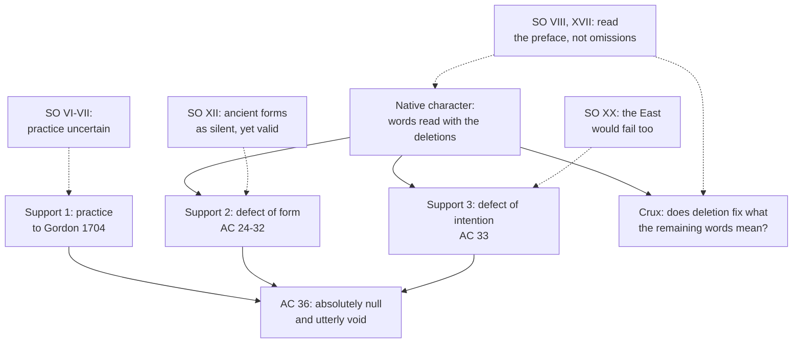

# Apologetics II · Lesson 4.3: Apostolic succession and the validity of orders

> ⏱ ~15 min · Module 4: The Church, the papacy, and the Reformation's alternatives · Builds on: [`ecclesiology-and-mariology` 2.4](../../ecclesiology-and-mariology/lessons/02-04-apostolic.md), [`ecclesiology-and-mariology` 3.1](../../ecclesiology-and-mariology/lessons/03-01-bishops-and-apostolic-succession.md), [`sacraments-and-liturgy` 5.1](../../sacraments-and-liturgy/lessons/05-01-holy-orders-the-three-degrees.md) · Unlocks: [4.4](04-04-the-visible-church-and-what-replaced-the-papacy.md), [6.5](06-05-the-sacrifice-of-the-mass.md)

## Why this matters

In 1896 Leo XIII declared that "Ordinations carried out according to the Anglican rite have been and are absolutely null and utterly void" (Art and Book Company's 1896 English). Five months later the archbishops of Canterbury and York replied that his reasoning would void Rome's ancient ordinations too. [`ecclesiology-and-mariology` 5.2](../../ecclesiology-and-mariology/lessons/05-02-subsistit-in-and-the-status-of-other-churches.md) sorts communions by valid orders and admits that its sorting "inherits a sacramental verdict it does not itself argue". This lesson argues it and finds the premise the two documents divide on.

## The idea

Two questions get blurred. **Must a ministry come through a chain of ordinations at all?** That is the [apostolic succession](../reference.md#apostolic-succession) question, and on it the Lutheran and Reformed confessions part from Rome, the Orthodox and the Anglicans. **Did this chain carry what it claimed?** That is the validity question, on which Rome parts from Canterbury, which claimed the succession. The Reformed do not lose the second argument; they decline to enter it.

A miniature. Reformers who deny a town any right to tax strike every mention of taxing from the councillors' oath, which still says "receive the office of councillor". Can the new councillor tax? One lawyer reads the words alone: the oldest oaths never mentioned taxes either. Another reads them with the deletion: "councillor" now means one without that power. That is 1896–97 in one case.

`ecclesiology-and-mariology` 2.4 and 3.1 taught succession as doctrine; `sacraments-and-liturgy` 5.1 taught orders and ceded *Apostolicae Curae* to this lesson, which argues it.

## Source

*Saepius Officio* ch. XII, in the archbishops' English version (Longmans, 1897), on Rome's own forms:

> in the most ancient Roman formulary used, as it seems, at the beginning of the third century after Christ ... nothing whatever is said about "high priesthood" or "priesthood" nor about the sacrifice of the Body and Blood of Christ. ... Again in the old Roman Sacramentary, which may perhaps be assigned to the VIth century ... in none of that series of prayers is anything said of the power of sacrificing or of the remission of sins. ... Yet this form is undoubtedly valid. ... But the Pope who appeals to the Council of Trent must submit to be judged by it. Either then these Roman formulas were valueless because of their defect in the matter of sacrifice and remitting sins, or else the authority of that Council is of no value in settling this question about the necessary form of Order.

Read the shape: a dilemma resting on a premise Rome shares, the validity of the ancient forms. One horn voids them; the other makes Trent's account of a priest's powers no test of what an ordination prayer must say. It does not claim the Ordinal's words suffice, only that silence about sacrifice cannot alone be the defect. Its third-century "formulary" is the *Canons of Hippolytus* in Achelis's 1891 edition (n. 11).

## The other side

**Lutheran.** `ecclesiology-and-mariology` 2.4 stated Augsburg V and XIV ([*rite vocatus*](../reference.md#rite-vocatus): no one may publicly teach or administer the sacraments "unless he be regularly called"). The Apology (XIV) calls it "our greatest wish to maintain church-polity and the grades in the Church", grades made "by human authority", if the bishops would tolerate the evangelical doctrine. Melanchthon's [*Treatise on the Power and Primacy of the Pope*](../reference.md#treatise-on-the-power-and-primacy-of-the-pope) (1537) holds, with Jerome, that bishop and pastor are one grade by divine right, so "ordination administered by a pastor in his own church is valid by divine law" (§65, Triglot). All three stand in the [Book of Concord](../reference.md#book-of-concord), which Lutheran pastors subscribe as a norm under scripture.

**Reformed.** The [Second Helvetic Confession](../reference.md#second-helvetic-confession) (Bullinger, 1566; English in Schaff vol. 3's appendix) calls the ministry "a most ancient ordinance of God himself, not a new device appointed by men" (XVIII). Ministers are lawfully elected and "ordained by the elders with public prayer, and laying on of hands". Ministry and priesthood are "things far different": all believers are priests, and Christ appointed ministers of word and sacrament, not priests to offer the host. Bishops rank over elders by custom, not divine rule. Churches without the true marks gain nothing when they "brag of the succession of bishops" (XVII), and ordination is "very profitable, but no sacrament" (XIX). The [Belgic Confession](../reference.md#belgic-confession) (1561, XXXI) agrees. This is [succession in doctrine](../reference.md#succession-in-doctrine): a theory of what the apostles handed on, not an evasion. Both are subordinate standards of Reformed churches, not a magisterium.

**Anglican.** The Ordinal's preface (1550) claims these orders "from the Apostles tyme" and intends them "continued"; [Article XXXVI](../reference.md#thirty-nine-articles) says Edward's book "doth conteyne all thinges necessarie to suche consecration and orderyng" (Schaff, 1571 English); the Articles are formularies whose subscription varies across the Communion. [*Saepius Officio*](../reference.md#saepius-officio) (19 February 1897), signed by Frederick Temple and William Maclagan, answers point by point:

- the judgment hinges on practice and form, with intention "attached" (V), and the practice was uncertain (VI–VII);
- matter is the laying on of hands, form a prayer fitting the ministry, and intention is judged as "externally manifested", but from public formularies, "not from its omissions and reforms" (VIII–IX);
- the 1550 priest's form, giving the keys and making him "a faithful despensor of the word of god, and of his holy Sacramentes", suits "no other ministry of the Church but that of a Priest" (XV), and the preface declares the intention (XVII);
- the reasoning [proves too much](../reference.md#proves-too-much): the ancient Roman forms fail it (XII), and in ch. XX so do the Eastern churches, whose catechisms (the Orthodox Confession of about 1640; the Russian Longer Catechism, 1839) name no power of sacrifice.

It carries its two signatories' authority, not a synod's.

## The argument

**P1.** Orders is a sacrament instituted by Christ, conferring a character and a priesthood with power to consecrate and offer (Trent XXIII cans. 1, 3, 4). *In words:* there is a definite thing to hand on, so the handing-on can fail.

**P2.** The form must signify the order conferred, because the matter, the laying on of hands, "by itself signifies nothing definite" (*Apostolicae Curae* §24, 1896 English). The archbishops agree (IX). *In words:* the words must say which order.

**P3.** What a form signifies is fixed by its words as the rite and the Church using it determine them: "any words in the Anglican Ordinal, as it now is, which lend themselves to ambiguity, cannot be taken in the same sense as they possess in the Catholic rite" (§31). *In words:* context is part of meaning.

**P4.** The [Edwardine Ordinal](../reference.md#edwardine-ordinal) was made by striking from the Pontifical what spoke of sacrifice and the sacrificing priesthood (§30). The archbishops record the removals, the formula giving "the power of offering sacrifice" among them (XVIII), in a Church whose Article XXXI condemned the sacrifices of Masses. *In words:* both sides record the deletion and dispute its meaning.

**P5.** Silence is not deletion. The ancient prayers said nothing of sacrifice inside a Church that offered it daily; the Ordinal says nothing because the sacrifice was removed. *In words:* the parallel compares texts, not texts in context.

**∴ C.** In the Ordinal, "priest" signifies a ministry of word and sacrament without the sacrificing priesthood: the [defect of form](../reference.md#defect-of-form). A rite changed to reject what the Church does carries an intention "adverse to and destructive of the Sacrament" (§33): the [defect of intention](../reference.md#defect-of-intention). The first support, the Holy See's practice from Julius III to the Gordon case of 1704 (§§7–22), confirms; it is not the argument.

**Mark the levels** ([the ladder](../../fundamental-theology/lessons/04-04-the-ladder-of-doctrinal-authority.md); [levels of authority](../reference.md#levels-of-authority)). Orders and its priesthood: **rung 1** (Trent XXIII cans. 1, 3, 4). Bishops succeeding the apostles by divine institution: **at least rung 3** (`ecclesiology-and-mariology` 3.1). [*Apostolicae Curae*](../reference.md#apostolicae-curae), an apostolic letter and not a bull: **rung 2, as the CDF's 1998 *Doctrinal Commentary* on the *Professio fidei* (§11) classifies it**, among truths connected with revelation by historical necessity yet "not able to be declared as divinely revealed". Some Catholic theologians dispute whether an illustrative list, offered "without any intention of completeness or exhaustiveness", fixes a level, since its classifications weigh **rung 3, light**, at most; older writers held Leo's act itself infallible, a judgment on a [dogmatic fact](../reference.md#dogmatic-fact) (the 1907 *Catholic Encyclopedia*). On no reading is the question open: the floor is a papal judgment given "by Our authority, of Our own motion and certain knowledge" (*certa scientia*). Never rung 1, and the commentary does not call it a dogmatic fact. A particular Anglican line since 1932: **rung 5**, judged case by case. UR 22's sorting test: **rung 3**. The confessions, the Articles, *Saepius Officio* and [ARCIC](../reference.md#arcic): **no Catholic level**.

**Concession.** The archbishops' argument from the ancient forms is serious. The earliest Roman ordination prayers they cite do not name the power to offer sacrifice, Rome holds those ordinations valid, and so the Ordinal's silence about sacrifice cannot, taken alone, be its defect.

**The crux.** Whether what a rite deliberately leaves out fixes what its remaining words mean: is a form judged by its words alone, or as the rite and the intending Church determine them? The archbishops read intention "not from its omissions"; Leo reads the omissions as the Ordinal's [native character](../reference.md#native-character-of-the-ordinal) (§31). Proof that the framers meant by "priest" what the Pontifical meant would move Leo's side; proof that deliberate deletion is public speech would move the archbishops'.

## The argument map

Each objection lands on a support; the decisive one, on the native character.

## Worked examples

**Example 1 (clean): a Reformed ordination.** A Swiss Reformed minister is elected and ordained by the elders with prayer and hands. Read his intention by the archbishops' own test, the public formulary: the confession says he is no offering priest and ordination no sacrament. By P1–P3 nothing Rome calls priestly orders is conferred, and the Reformed agree. The dispute sits wholly at P1, whether Christ instituted a sacrificing priesthood, which is [6.5](06-05-the-sacrifice-of-the-mass.md)'s question.

**Example 2 (strain): an Old Catholic co-consecrator.** After the Bonn Agreement (2 July 1931) put the Church of England in communion with the Old Catholic churches of the Union of Utrecht, Old Catholic bishops joined Anglican consecrations from 1932 (per their bishops' conference). Rome counts their orders valid. P3 now cuts both ways: if context fixes meaning, the co-consecrator brings his own, a church that holds the Eucharistic sacrifice. Can his intention supply what the rite lacks? *Apostolicae Curae* judged the rite, not this minister, and no act answers in general. Rome has answered a case: in 1994 Cardinal Hume ordained Graham Leonard, former bishop of London, priest *conditionally* (can. 845 §2), because an Old Catholic bishop had taken part in Leonard's 1964 consecration. Hume's statement spoke of a "prudent doubt" in a well-documented case and reaffirmed *Apostolicae Curae*. Here the argument stops determining an answer.

## Watch out

- **You might think the Reformation churches simply "rejected apostolic succession",** but that blurs three positions: Anglicans claimed it, the Apology wished to keep the bishops' grades, and the Second Helvetic ordains with hands and places succession in doctrine.
- **You might think *Apostolicae Curae* turned on the missing chalice or on Parker's consecration,** but §§20–21 set both aside. Nor did the archbishops compare the Roman rites of 1550, whose Pontifical named the power of offering sacrifice outright (XVIII); they went to the ancient forms and the East.
- **Levels, both ways.** "An ex cathedra dogma; denying it is heresy" overstates: rung 2, and rejecting definitive teaching falls under can. 750 §2, not can. 751. "A disciplinary ruling ARCIC reopened" understates: ARCIC's *Elucidation* (1979, §6) asked for "a reappraisal" with no level of its own, and the 1998 commentary still lists the letter.

## One-liner

> The Reformed decline the succession argument and the Anglicans enter it, and the dispute with Canterbury turns on one premise: whether what a rite deliberately removes fixes what its remaining words mean.

## Problems

**P1 (🟢)** *(Assign the weight · Exegetical, strict.)* An invented exchange, written for this problem, in the invented diocesan magazine *The Brackenholt Messenger*. Fr Lancelot Pendry, an Anglo-Catholic priest, writes:

> (1) "*Apostolicae Curae* was a disciplinary ruling of the Holy Office, as revisable as the 1616 decree against Copernicus."
>
> (2) "In 1979 Rome's own dialogue commission called for its reappraisal, so the question is now officially open."

The editor's reply, printed beneath:

> (3) "On the contrary, Leo XIII spoke ex cathedra: the nullity of Anglican orders is a dogma, and to deny it is heresy."
>
> (4) "And the CDF's 1998 commentary infallibly defined it as a dogmatic fact."

For each numbered claim, name the act it invokes, give that act's real weight (a rung, or a standing outside the ladder), and say whether the claim overstates or understates. **One or two sentences per claim.**

**P2 (🟡)** *(Apologetic: (a) Exegetical, graded first · (b) reply.)*

(a) State the Reformed doctrine of the ministry as the Second Helvetic Confession (chs. XVII–XIX) states it: what the ministry is, how a minister is made, what a minister is not, and what the confession says of a succession of bishops.

(b) Reply as a Catholic, opening with a **named concession**.

**150 words or fewer in total.** A reply that concludes the Reformed position stands passes if it is a good reply.

**P3 (🔴)** *(Apply to a hard case · Evaluative.)* Invented, written for this problem. Fr Pendry later seeks reception into the Catholic Church. He was ordained priest in 1990, by the Anglican rite, by a bishop in whose 1975 consecration an Old Catholic bishop took part. He writes: "My orders are at least doubtful, so Rome must ordain me conditionally, not absolutely."

(a) Say what *Apostolicae Curae* settles for his case and what it leaves, naming what governs the rest.

(b) Any verdict: is the Anglican orders question closed? Name the one fact about his line you would most want documented, and why.

**120 words or fewer.**

Solutions

**P1** *(Assign the weight · Exegetical, strict)*

**Must hit, strict:**

- **(1) Understates.** The act is Leo XIII's own apostolic letter (13 September 1896), given "by Our authority, of Our own motion and certain knowledge" after the cardinals of the Holy Office advised him (§34). It is not a dicastery ruling. It is rung 2 as the CDF's 1998 commentary classifies it, with a floor no reading takes below a papal judgment, so it is not open. The 1616 decree was the Congregation of the Index's disciplinary act, a different kind of act.
- **(2) Understates the letter and overstates the commission.** ARCIC I's *Ministry and Ordination: Elucidation* (1979, §6) asked for "a reappraisal". It is a dialogue report with no magisterial level. The Catholic Church's official Response (1991, the CDF with the Pontifical Council for Promoting Christian Unity) did not take the request up, the 1998 commentary still lists the letter, and Hume's 1994 statement said Rome had not re-evaluated it.
- **(3) Overstates.** The CDF places the judgment among truths "not able to be declared as divinely revealed": rung 2, not rung 1. Rejecting it falls under can. 750 §2, not heresy under can. 751. Whether Leo's act was itself an infallible judgment is disputed; "dogma" is wrong on every reading.
- **(4) Overstates.** The *Doctrinal Commentary* (29 June 1998), signed by the prefect and secretary, defines nothing. It lists examples "without any intention of completeness or exhaustiveness", at rung 3, light, at most for its classifications. The weight is Leo's act. It does not call the letter a dogmatic fact: its parenthesis follows the canonizations.

**Wrong turns:** marking the word "infallible" as the error in (3)–(4). Rung-2 truths are held on the infallibility of the magisterium in such matters (commentary §6); the errors are "dogma", "heresy" and "defined". Calling the letter a bull, or "freely disputed". Treating ARCIC as Rome's teaching. Grading the editor's claims leniently because they favour the Catholic side.

**Model answer:** (1) Understates: an apostolic letter given by Leo's own authority "with certain knowledge", rung 2 by the CDF's 1998 classification and on no reading open; the 1616 decree was the Index's disciplinary act. (2) Understates the letter and overstates ARCIC: its 1979 *Elucidation* is a dialogue report with no level; the official 1991 Response and the 1998 commentary left the judgment standing. (3) Overstates: rung 2, "not able to be declared as divinely revealed"; denial falls under can. 750 §2, not heresy. (4) Overstates: a CDF commentary that illustrates (rung 3, light, at most), defines nothing and does not call the letter a dogmatic fact.

---

**P2** *(Apologetic: (a) Exegetical, graded first · (b) reply)*

**Accept:** any reply that opens with a named concession and treats the Reformed view as a doctrine of ministry, not as the lack of one, whatever its verdict.

**Must hit, strict (a), graded first:**

- The ministry is an ordinance of God, "not a new device appointed by men", through which God works (XVIII).
- A minister is made by lawful ecclesiastical election and ordained "by the elders with public prayer, and laying on of hands"; those who run uncalled are condemned.
- A minister is not a priest: all believers are priests, ministers are appointed to teach and administer the sacraments, not to offer the host for the living and the dead; ordination is profitable but no sacrament (XIX); bishops stand over elders by custom, not divine rule.
- A succession of bishops without the true marks proves nothing (XVII); what matters is the apostles' doctrine ("it is sufficient for us that, so much as concerns ministers, we have the doctrine of the apostles", XVIII).

**Must hit (b):**

- **A named concession**, flat: for example, that the Reformed keep ordination by prayer and hands and claim nothing Rome denies them, or that bishop and presbyter overlap in the New Testament and in Jerome.
- **Locate the dispute at P1.** It is not a defect of rite but whether Christ instituted a sacrificing priesthood (Trent XXIII cans. 1, 3, rung 1), which is [6.5](06-05-the-sacrifice-of-the-mass.md)'s ground.
- **Answer "succession in doctrine".** Catholic teaching holds the line and the doctrine together (LG 20); a doctrine with no public line has no public test of who keeps it ([4.4](04-04-the-visible-church-and-what-replaced-the-papacy.md)).

**Wrong turns:** stating (a) as "the Reformed reject ordination" or "anyone may preach", which XVIII condemns. Stating the Lutheran *Treatise* or Augsburg as "the Reformed position", or Calvin's *Institutes* as its confession. Replying with *Apostolicae Curae*'s defect of form, which answers Canterbury, not Zurich. Treating the Second Helvetic as a magisterium.

**Model answer (a):** The ministry is God's own ordinance, through which he gathers and governs his Church. Ministers are lawfully elected and ordained by the elders with prayer and hands. They are ministers of word and sacrament, not priests: every believer is a priest, Christ appointed no one to offer the host, and ordination is no sacrament. Bishops rank over elders by custom only. A succession of bishops without the apostles' doctrine is a boast, not a mark.

**Model answer (b), one of several:** Concession: this view ordains with hands and prayer and claims no priesthood Rome denies it, so it is consistent. The dispute is therefore not about rites but about whether Christ instituted a priesthood to offer the Eucharist, which Trent defines and 6.5 argues. On succession, Catholics hold doctrine and line together: Irenaeus's lists were public evidence of where the doctrine was kept, and a doctrine with no line lacks that test.

---

**P3** *(Apply to a hard case · Evaluative)*

**Must hit, any verdict:**

- **Settled:** the judgment on the Anglican rite, for defect of form and intention. It is rung 2 by the CDF's classification and on no reading open.
- **Left:** particular lines since 1932, judged case by case under can. 845 §2, which prescribes conditional conferral when a prudent doubt remains after diligent inquiry. Leonard (1994) is the best-known example: Rome found the doubt in his documented case.
- **Two links, kept apart.** Leonard's doubt arose from a consecration in which the Old Catholic bishop himself laid on hands. Pendry's case has a further link: the Old Catholic bishop took part in his ordaining bishop's consecration, and that bishop, an Anglican, then ordained Pendry by the Anglican rite. Even granting the bishop valid orders, whether his intention could supply what the rite lacks is the crux again, and no act answers it.
- **A verdict with its cost,** and the fact to document: for example, the record of the 1975 consecration (who laid on hands, with what words and intention), since without it the second link never arises.

**Wrong turns:** "closed, so ordain absolutely without inquiry", which ignores can. 845 §2 and the Leonard case. "Open, so AC no longer binds", which confuses a line with the rite. Treating Old Catholic presence anywhere in a line as automatically conferring validity.

**Model answer, one of several:** The 1896 judgment on the rite stands and is not open. What it leaves is whether a particular line carries orders, which Rome decides case by case under can. 845 §2. Pendry's case is weaker than Leonard's. The Old Catholic bishop laid hands on Pendry's consecrator, not on Pendry, who was ordained by an Anglican bishop using the Anglican rite. Verdict: closed in principle, open only in documented particulars. I would want the record of the 1975 consecration first, because only a valid consecrator raises the further question whether his intention could supply what the rite lacked. That question no act has answered, which is the cost of my verdict.

## Flashback

**From Lesson [4.1](04-01-the-petrine-texts-argued.md) (The Petrine texts argued):** *(Apologetic: (a) Exegetical, graded first · (b) reply.)* Calvin, [*Institutes*](../reference.md#calvin-institutes) IV.6.10 (Beveridge, 1845), on Ephesians 4:

> Paul sometimes depicts a living image of the Church, but makes no mention of a single head. … "And he gave some, apostles; and some, prophets; and some, evangelists; and some, pastors and teachers." Why does he not say, that one presided over all to act as his substitute? The passage particularly required this, and it ought not on any account to have been omitted if it had been true. … He attributes nothing to men but a common ministry, and a special mode to each.

(a) State Calvin's argument: what he takes the passage to be, why its silence counts, and what he concludes. Give the text's weight. **Two or three sentences.**

(b) Reply, opening with a **named concession**, and apply the rule on [arguments from silence](../reference.md#argument-from-silence) that 4.1 uses. **100 words or fewer.** A reply concluding that Calvin's argument succeeds passes if it is a good reply.

Solution

**Accept:** any reply that opens with a real concession and weighs the silence instead of waving it away, whatever its verdict.

**Must hit, strict (a), graded first:**

- **The argument.** Ephesians 4 is Paul's picture of the Church and its ministries, and it "particularly required" a single head under Christ to be named, if one existed: silence where mention is expected.
- **The conclusion.** A substitute head is foreign to Christ's institution; men hold only "a common ministry" (credit IV.6.9: such an office must first be shown ordained by Christ).
- **Weight.** A theologian's book, not a confession; the confessional form is the [Second Helvetic](../reference.md#second-helvetic-confession)'s denial that Christ, being present, needs a vicar (XVII.8).

**Must hit (b):**

- **A named concession,** flat: Ephesians 4 names no Petrine office, and the New Testament names no successor anywhere.
- **The rule applied.** Silence weighs only as far as the author had to speak. Verse 11 lists kinds of gift, Peter falls under "apostles", and a list of kinds is not a table of ranks; nor does one passage cancel the singular gifts (Matthew 16:18–19; Luke 22:32; John 21:15–17).
- **Honest reach.** Whether Peter's charge continued as an office is still the [perpetuity step](../reference.md#perpetuity-argument).

**Wrong turns:** "Calvin denies all order in the Church" (he grants ministries, and Peter a place as "the first among the faithful", IV.6.5); the *Institutes* as "the Reformed confession"; "silence never proves anything"; Ephesians 4 read as implying a Petrine office.

**Model answer (a):** Calvin reads Ephesians 4 as Paul's picture of the Church and its ministries. Since the passage required a single head under Christ to be named if there were one, its silence shows such a substitute is foreign to Christ's institution. The *Institutes* is a theologian's book, not a confession.

**Model answer (b), one of several:** Concession: Ephesians 4 names no Petrine office, where mention might be expected. But silence weighs only as far as Paul had to speak: verse 11 lists kinds of gift, Peter falls under "apostles", and a list of kinds is not a table of ranks. Nor does one passage cancel the singular gifts to Peter in Matthew 16, Luke 22 and John 21. That answers the silence and no more: whether his charge continued as an office is still the perpetuity step.

## Connections

- **Backward:** succession as doctrine is [`ecclesiology-and-mariology` 2.4](../../ecclesiology-and-mariology/lessons/02-04-apostolic.md) and [3.1](../../ecclesiology-and-mariology/lessons/03-01-bishops-and-apostolic-succession.md); the sorting of communions by valid orders, whose key input this lesson argues, is [5.2](../../ecclesiology-and-mariology/lessons/05-02-subsistit-in-and-the-status-of-other-churches.md). Matter, form and the 1947 settlement are [`sacraments-and-liturgy` 5.1](../../sacraments-and-liturgy/lessons/05-01-holy-orders-the-three-degrees.md); "doing what the Church does" is its [1.2](../../sacraments-and-liturgy/lessons/01-02-matter-form-minister-intention.md). Rung 2 and the commentary are [`fundamental-theology` 4.4](../../fundamental-theology/lessons/04-04-the-ladder-of-doctrinal-authority.md).
- **Forward:** [4.4](04-04-the-visible-church-and-what-replaced-the-papacy.md) asks what the Reformation put in place of the papacy and the bishops; [6.5](06-05-the-sacrifice-of-the-mass.md) argues P1, the sacrifice the Ordinal removed and Article XXXI condemned. The ordination of women, which the CDF's 1982 *Observations* and the 1991 Response name as a further, doctrinal obstacle, is [`sacraments-and-liturgy` 5.2](../../sacraments-and-liturgy/lessons/05-02-the-reservation-of-priestly-ordination.md)'s.
- **Sideways:** the Ordinal's political setting, Edward VI's regime, is [`church-history` 6.3](../../church-history/lessons/06-03-the-english-reformations.md). The crux is the textualist's quarrel with the purposivist in legal interpretation: whether a statute means what its words say, or what its drafters' deletions show they meant.
