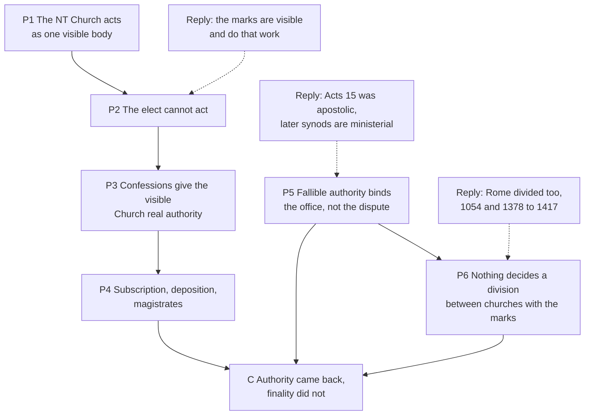

# Apologetics II · Lesson 4.4: The visible Church, and what replaced the papacy

> ⏱ ~15 min · Module 4: The Church, the papacy, and the Reformation's alternatives · Builds on: [4.3](04-03-apostolic-succession-and-the-validity-of-orders.md), [2.4](02-04-perspicuity-tested.md), [`ecclesiology-and-mariology` 2.1](../../ecclesiology-and-mariology/lessons/02-01-one.md), [`church-history` 6.2](../../church-history/lessons/06-02-reformations-beyond-wittenberg.md) · Unlocks: [5.1](05-01-the-filioque-two-questions-kept-apart.md), [7.2](07-02-the-reformations-grievances.md)

## Why this matters

In 1619 a Reformed synod at Dordrecht deposed pastors it judged teachers of error and required every future minister to subscribe its decisions. The Reformation removed the pope, not the need to decide who may preach and what counts as the gospel. The Catholic argument is not that Protestants lack a Church or authority. It is that the alternatives had to become authorities too, and that the dispute is over what they disclaimed.

## The idea

A club whose true membership only God knows still needs a secretary. Every Reformation confession holds that the Church in its truest sense is a company God alone fully knows (true believers for the Lutheran *Apology*, the elect for Calvin and Westminster), and that it shows itself in a visible community, known by [marks](../reference.md#marks-of-the-church), with ministers, discipline and synods. [`ecclesiology-and-mariology` 2.1](../../ecclesiology-and-mariology/lessons/02-01-one.md) and [5.2](../../ecclesiology-and-mariology/lessons/05-02-subsistit-in-and-the-status-of-other-churches.md) stated these accounts, the [*satis est*](../reference.md#satis-est) among them, without answering. This lesson argues.

So the question is not [visible against invisible](../reference.md#visible-and-invisible-church). It is who settles a dispute in the visible Church, and with what kind of authority. The Catholic answer is an authority whose highest judgments in faith are final; the Reformation answer, one that is real, [ministerial](../reference.md#ministerial-authority) and openly fallible.

## Source

The [Synod of Dort](../reference.md#synod-of-dort), *Sentence on the Remonstrants* (1619), from the Latin printed in Schaff, *Creeds of Christendom* vol. 3 (lesson's translation, abridged):

> The Synod, aware of its authority from the word of God, following in the footsteps of all lawful synods, and strengthened by the authority of the States-General, declares and judges that those pastors who made themselves leaders of factions and teachers of errors are guilty … of corrupting religion and of rending the Church's unity. … It forbids them every ecclesiastical office and removes them from their posts. … [The lower assemblies] are to admit no one to the sacred ministry who refuses to subscribe this doctrine and to teach it.

Read its three moves. Its **ground** is authority "from the word of God" (*ex verbo Dei*), not inerrancy. Its **acts** are the New Testament church's: judgment, removal from office (*ab officiis suis abdicat*), a test for admission (*subscribere*). Its **enforcement** runs through the magistrate. The Remonstrants appealed to Scripture; the Synod judged the appeal.

## The other side

**Lutheran.** [Augsburg VII](../reference.md#augsburg-confession) (1530, Triglot) calls the Church "the congregation of saints, in which the Gospel is rightly taught and the Sacraments are rightly administered", and agreement there "is enough" for unity. The [Apology](../reference.md#apology-of-the-augsburg-confession) (1531, VII–VIII) calls it "originally a fellowship of faith and of the Holy Ghost in hearts", yet adds: "Neither, indeed, are we dreaming of a Platonic state" (Triglot §20). It exists, with outward marks. The [Book of Concord](../reference.md#book-of-concord) is a subscribed [*norma normata*](../reference.md#norma-normans-and-norma-normata), not a magisterium.

**Reformed.** Calvin (*[Institutes](../reference.md#calvin-institutes)* IV.1.7, Beveridge) says Scripture speaks of the Church "in two ways": all the elect, as God sees them, and the whole professing body, hypocrites mixed in:

> as it is necessary to believe the invisible Church, which is manifest to the eye of God only, so we are also enjoined to regard this Church which is so called with reference to man, and to cultivate its communion.

She is the believers' mother (IV.1.4), found wherever word and sacraments are (IV.1.9), and "no man may with impunity spurn her authority … or make sport of her censures" (IV.1.10). Discipline is her "sinews" (IV.12.1).

[Westminster](../reference.md#westminster-confession) XXV (1647, Schaff) confesses two catholic Churches. The invisible one is "the whole number of the elect" (XXV.1). The visible one is all who profess the true religion, "out of which there is no ordinary possibility of salvation" (XXV.2), given the ministry and ordinances (XXV.3). Its officers hold the [keys](../reference.md#power-of-the-keys), up to excommunication (XXX.2–4). Synods "ministerially … determine controversies of faith" (XXXI.3; XXXI.2 in the American numbering), and their decrees,

> if consonant to the Word of God, are to be received with reverence and submission, not only for their agreement with the Word, but also for the power whereby they are made

though every post-apostolic synod "may err" (XXXI.4). The [Belgic Confession](../reference.md#belgic-confession) (1561) adds discipline as a third mark (art. 29). Westminster is the Presbyterian subordinate standard (the PCUSA's 1903 revision rewrote XXV.6, which called the pope "that Antichrist"); the *Institutes* is a theologian's book.

**Anglican.** [Article XIX](../reference.md#thirty-nine-articles) (1571): the visible Church is "a congregation of faithful men" with the pure Word and the sacraments duly ministered, and Rome "hath erred". Article XX gives the Church "authority in Controversies of Faith" under Scripture; XXI lets councils err. The Articles' standing varies across the Communion; the American revision (1801) drops XXI.

**The reply to fragmentation.** Catholic unity rests on authority, not agreement, so proves nothing about clarity ([2.4](02-04-perspicuity-tested.md)). An arbiter whose own authority is disputed cannot settle disputes with those who reject it: Rome's claim prevented neither 1054 nor 1517. And churches can end divisions by agreement, as Leuenberg (1973) did for European Lutheran and Reformed churches ([`ecclesiology-and-mariology` 2.1](../../ecclesiology-and-mariology/lessons/02-01-one.md)).

## The argument

**P1.** The New Testament addresses a Church that acts as one visible body: it receives letters (1 Cor 1:2), hears cases (Matt 18:17), puts "the evil one" away (1 Cor 5:13), and issues decisions "to keep" (Acts 16:4, DR). *In words:* you can write to it, appeal to it, and be put out of it.

**P2.** The company of the elect, as such, can do none of this, since "to God alone must be left the knowledge of his Church" (Calvin IV.1.2). *In words:* the elect cannot hold a meeting.

**P3.** So the confessions give the visible Church real authority: the keys (Westminster XXX), synods (XXXI.3), authority in controversies (Article XX), discipline (Belgic 28–29). *In words:* this is the strongest Protestant reply, and the argument grants it.

**P4.** That authority acted as authority. Subscription: Bente's introduction to the Triglot reports about 8,000 signatures to the Formula of Concord, and suspension for refusers in Mecklenburg. Deposition: Dort. Consistories: Geneva, 1541. Magistrates: Augsburg 1555 ([`church-history` 6.2](../../church-history/lessons/06-02-reformations-beyond-wittenberg.md)), Westminster XXIII.3 in 1647 ("all blasphemies and heresies be suppressed"), Article XXXVII. *In words:* authority reappeared in a new place.

**P5.** At Jerusalem "the apostles and ancients" (Acts 15:6) ended a dispute about the gospel for all the churches, as the decision of "the Holy Ghost and … us" (15:28). An authority that may err in faith can bind an office, but not end such a dispute for anyone who reads Scripture otherwise. *In words:* the Remonstrant kept his reading and lost his pulpit.

**P6.** Hence the [fragmentation argument](../reference.md#fragmentation-argument), stated properly. When two churches bearing the marks divide over what each treats as necessary, as Lutheran and Reformed did over the Supper (Formula of Concord VII), no judgment exists that both must accept. The division can be borne (Calvin IV.1.12) or ended by agreement, never decided. *In words:* structure, not a head count.

**∴ C.** The Reformation replaced the papacy not with Scripture alone but with visible authorities, confessional, synodal and royal, which do much of its work and disclaim finality in faith. *In words:* authority came back; finality did not.

**Mark the levels** ([the ladder](../../fundamental-theology/lessons/04-04-the-ladder-of-doctrinal-authority.md); [levels of authority](../reference.md#levels-of-authority)). The Church as a visible society, one complex reality with the Mystical Body: **at least rung 3** (*Lumen Gentium* 8; *Mystici Corporis* §14, rung 3 at its heaviest). Constance condemned Hus's article that the universal Church is "the totality of the predestined" (DS 1201, 1415) under a global censure (Martin V, *Inter cunctas*, DS 1251), so its contradictory is **at least rung 3, no precise note**. Whether Westminster XXV.1 falls under it is **rung 5**: no act applies it, and Westminster, unlike Hus (art. 3), counts reprobate professors in the visible Church. Communion with Peter's successor as a bond of unity: **rung 1** ([*Pastor Aeternus*](../reference.md#pastor-aeternus) ch. 3 canon). [Indefectibility](../reference.md#indefectibility): **at least rung 3**, silent on conduct. [*Haec Sancta*](../reference.md#haec-sancta): **disputed, no level**. Other traditions' texts: **no Catholic level**, with each one's own weight marked above; the Canons of Dort are a Dutch Reformed standard, the Sentence a synod's judicial act.

**Concession.** The confessions never taught a merely invisible Church: Westminster puts "no ordinary possibility of salvation" outside the visible one, and Calvin calls her mother. The Western Church before 1417 had its own visible-unity failure: for thirty-nine years Latin Christians could not agree who the pope was ([`church-history` 5.4](../../church-history/lessons/05-04-avignon-the-great-schism-and-the-councils.md)).

**The crux.** Can an openly fallible authority do the settling the New Testament church needed done? The Reformed side denies P5: Acts 15 was apostolic and is now Scripture, and the later Church needs only ministerial, revisable judgment, with conscience answerable to God alone (Westminster XX.2). The Catholic side denies that the function ended with the apostles: the "ancients" sat with them, and the Church is "the pillar and ground of the truth" (1 Tim 3:15). What would move it: exegesis of whether the New Testament hands the function on, and the second-century record of synods.

## The argument map

P3 absorbs O1; the argument stands or falls on O2.

## Worked examples

**Example 1 (clean): England.** Here the Crown replaced the papacy. Article XXXVII (1571 English, spelling modernized) gives the queen "the chief government of all estates of this Realm, whether they be Ecclesiastical or Civil, in all causes". It denies princes "the ministering either of God's word, or of Sacraments", and ends: "The bishop of Rome hath no jurisdiction in this Realm of England." P1–P3 hold. P4 holds in its purest form: Rome's jurisdiction passed by statute to a lay "supreme governor" ([`church-history` 6.3](../../church-history/lessons/06-03-the-english-reformations.md)), defended as the prerogative Scripture gives "all godly Princes". That is the [royal supremacy](../reference.md#royal-supremacy) as theology, a governing power, not a priestly one. When the American revision (1801) denied the magistrate authority "in things purely spiritual", someone else had to govern.

**Example 2 (strain): 1378–1417.** A Reformed critic's best counter is the [Western Schism](../reference.md#western-schism): two claimants, then three, for thirty-nine years, ended through a council whose *Haec Sancta* claimed power immediately from Christ, a strong reading later acts closed off ([`ecclesiology-and-mariology` 4.2](../../ecclesiology-and-mariology/lessons/04-02-the-development-of-papal-claims-read-honestly.md)). The arbiter failed exactly where the argument needs one. The Catholic reply has substance: every obedience held one principle, one pope, and disputed a fact, whose election was valid, and it ended with one undoubted pope ([`church-history` 5.4](../../church-history/lessons/05-04-avignon-the-great-schism-and-the-councils.md)). Here the argument stops determining an answer. It shows the Church needs an identifiable final authority, not that identification is always possible, and a Protestant can call his own divisions disputes of application inside a shared principle. What survives: the schism ended because every party wanted the same office filled.

## Watch out

- **You might think the Reformers taught an invisible Church,** but that is the caricature. Westminster XXV.2–3, Calvin IV.1.4 and the *Apology* all affirm a visible Church with ministry and discipline. The real target is the claim that the Church in its truest sense is the hidden company, known on earth by marks. Even *Mystici Corporis* §14 aims at an invisible bond uniting differing communities, not at Westminster.
- **You might think "Protestant ecclesiology" is one position,** but the *Apology*'s Church proper is the true believers, Westminster's the elect; Augsburg names two marks, the Belgic three; the Articles add the Crown.
- **You might think Constance condemned Protestant ecclesiology,** but it censured Hus's articles globally a century earlier (at least rung 3), and applying that to a confession is rung 5. The mirror error: visibility is not "Bellarmine's opinion" but *Lumen Gentium* 8, at least rung 3.
- **You might think the fragmentation argument needs a number,** but the usual 33,000 (*World Christian Encyclopedia*, 2001) counts organized bodies country by country, splits the Catholic Church into 242, and is mostly independent churches. The argument is structural.

## One-liner

> The Reformation kept a visible Church with real authority; it disclaimed finality, and the dispute is whether the New Testament church had it.

## Problems

**P1 (🟢) *(Diagnose · Exegetical.)*** On an invented episode of *Pews Apart*, a Catholic–Reformed debate podcast (written for this problem; nobody said it), the Catholic co-host opens:

> "There are thirty-three thousand Protestant denominations, so *sola scriptura* obviously produces chaos. Protestants believe the true Church is invisible, so they can't excommunicate anybody. When they threw out the pope they threw out church authority altogether. And we Catholics have never had a question about who's in charge."

Name **four** errors. For each, give the correction and the text or record that supports it. **Two sentences per error at most.**

**P2 (🟡) *(Apologetic: (a) Exegetical, graded first · (b) reply.)*** Later in the episode the Catholic co-host retreats to this lesson's argument: "Fine, you have visible marks. But a synod that admits it may err can't settle anything."

(a) State the reply a Reformed theologian would give, naming the texts, from Westminster XXV.2–3, XXX and XXXI.3, or from Calvin *Institutes* IV.1.9–10.

(b) Reply, opening with a **named concession**. A reply concluding that the Reformed answer succeeds passes if it is a good reply. **150 words or fewer in total.**

**P3 (🔴, optional) *(Find the crux · Exegetical.)*** An invented blog post by Torben Aaskov, a Lutheran seminarian (written for this problem):

> "Catholic friends say we replaced the pope with the Book of Concord. We didn't. The *satis est* asks agreement in the gospel and the sacraments, nothing more, and the Book of Concord is a *norma normata*, ruled by Scripture, not ruling it. Yes, Saxony required pastors to subscribe the Formula, and Mecklenburg suspended those who wouldn't. That isn't papal authority. A congregation has a right to know its pulpit teaches what its confession says, and a pastor who can't sign is free to preach elsewhere. Authority over who holds an office is not authority over anyone's conscience."

(a) Name the single premise on which Torben and this lesson's Catholic argument divide. (b) Say what evidence or argument would move it, for either side. **100 words or fewer.**

Solutions

**P1** *(Diagnose · Exegetical)*

**Accept:** any four of the five errors below, each with its correction.

**Must hit, strict (any four):**

1. **The count.** There is no agreed counting method. The usual figure, from the *World Christian Encyclopedia* (2001), counts organized bodies country by country, splits the Catholic Church into 242 such bodies by country and rite, and puts most of its total among independent churches, not confessional Protestants. The real argument is structural (P6): nothing decides a division between two churches that both bear the marks.
2. **"Can't excommunicate."** Westminster XXV.2 confesses a visible catholic Church, and XXX.4 gives its officers suspension and excommunication. The Belgic Confession makes discipline a mark (art. 29), and Calvin calls discipline the Church's "sinews" (IV.12.1).
3. **"Threw out church authority."** Article XX gives the Church "authority in Controversies of Faith", and Westminster XXXI.3 has synods determine controversies "ministerially". Dort deposed ministers in 1619, and Lutheran territories required subscription to the Formula of Concord.
4. **"Never had a question about who's in charge."** From 1378 to 1417 the Latin Church had two, then three, claimants, and contemporaries could not agree which was pope ([`church-history` 5.4](../../church-history/lessons/05-04-avignon-the-great-schism-and-the-councils.md)).
5. **"Protestants" as a bloc.** The *Apology*'s Church proper is the true believers, Westminster's the elect. Augsburg has two marks, the Belgic three, and the 1571 Articles add the Crown's government.

**Wrong turns:** correcting the count with a smaller number, when the fault is the method, not the size. Conceding the invisibility charge because Westminster XXV.1 says "invisible", which reads XXV.1 without XXV.2. Over-correcting error 4 into "so the papal claim is false": the schism was a dispute of fact inside a shared principle (Example 2).

**Model answer:** First, the figure has no agreed method. Its source counts bodies country by country, splits the Catholic Church into 242, and is mostly independents; the real argument is that nothing decides a division between churches with the marks. Second, Westminster XXV.2 confesses a visible Church and XXX.4 provides excommunication, and the Belgic Confession makes discipline a mark. Third, Article XX gives the Church authority in controversies of faith, and Dort deposed ministers in 1619. Fourth, from 1378 to 1417 Latin Christians could not agree who the pope was.

---

**P2** *(Apologetic: (a) Exegetical, graded first · (b) reply)*

**Accept:** any reply that opens with a real concession and meets ministerial authority on its own terms, whatever its verdict.

**Must hit, strict (a), graded first:**

- **A visible Church with God-given means:** Westminster XXV.2–3 (the visible catholic Church, given the ministry, oracles and ordinances), or Calvin IV.1.7–9 (two senses of "Church"; word and sacraments as marks).
- **Real authority:** the keys, up to excommunication (XXX.2–4), or "no man may with impunity spurn her authority … or make sport of her censures" (IV.1.10). Synods "ministerially" determine controversies, and their decrees bind "for the power whereby they are made" (XXXI.3).
- **Ministerial and subordinate:** that authority stands under Scripture and may err (XXXI.4). It settles what a church teaches and does, and Scripture corrects it, not a higher human court. So it settles things in the only way the confessions think any post-apostolic body can.

**Must hit (b):**

- **A named concession:** this is real authority, not private judgment. P3 is granted, and a decision binding "for the power whereby" it is made is more than advice.
- **Put the disagreement at finality.** In Acts 15 "the apostles and ancients" decided, and the churches received "decrees for to keep" (16:4). The question is whether that function continued after the apostles.
- **Name a cost or limit honestly:** for example, infallibility at the top did not prevent 1054 or the schism of 1378–1417.

**Wrong turns:** stating (a) as "the Church is invisible, so authority is each believer's", which is the caricature and fails the problem. Presenting Calvin as "the Reformed confession". Making Westminster say synods cannot err. In (b), arguing against *solo scriptura*.

**Model answer (a):** The Church is visible as well as invisible. Christ gave the visible catholic Church the ministry and ordinances (Westminster XXV.2–3) and the keys, up to excommunication (XXX). Synods "ministerially" determine controversies, and their decrees, if consonant with the Word, bind "for the power whereby they are made" (XXXI.3). That authority is real and fallible, under Scripture, and fallibility does not stop it settling things.

**Model answer (b), one of several:** Concession: that is real authority. A synod whose decrees bind as God's ordinance is no private judgment, and Dort shows it settles things. What it settles is a church's practice and its pulpits. In Acts 15 "the apostles and ancients" ended a dispute about the gospel for every church. If later synods may err in faith, the losing party can keep his reading of Scripture against them. The question is whether that function ended with the apostles. Rome has to explain 1378, but that schism ended under one undoubted pope.

---

**P3** *(Find the crux · Exegetical)*

**Must hit, strict (a):** the premise is whether **authority over who holds teaching office and what a church publicly teaches differs in kind from authority over its members' faith**. Torben says it does: office, not conscience. The Catholic argument says the New Testament church's decisions bound the churches themselves ("decrees for to keep", Acts 16:4). So fallible confessional authority differs from Rome's in degree, revisable rather than final, not in kind.

**Must hit, strict (b):** evidence that bears on that premise. Exegetically: did Acts 15–16 and 1 Corinthians 5 bind all members or only leaders? Historically: did confessional discipline reach lay members for doctrine (Westminster XXX's censures fall on "offending brethren"; admission to the Supper), or only office-holders? And was "free to preach elsewhere" real where subjects' only right was to leave ([`church-history` 6.2](../../church-history/lessons/06-02-reformations-beyond-wittenberg.md))? If discipline reached only office-holders, Torben's line holds. If it reached belief, the line blurs.

**Wrong turns:** naming "visible versus invisible Church", which both sides grant. Naming the *satis est*'s sufficiency, which Torben's argument does not turn on. Calling the Book of Concord a magisterium, which overstates its weight inside Lutheranism. Answering with a verdict instead of a premise.

**Model answer:** (a) Whether binding a church's offices and public teaching is a different kind of authority from binding its members' faith. Torben says yes. The Catholic says the apostolic decisions bound the churches, so the difference is one of finality, not kind. (b) Whether the New Testament decisions bound members or only leaders, and whether Lutheran discipline in practice reached lay belief (admission to the Supper, censures) or stopped at the pulpit.

## Flashback

**From Lesson [4.2](04-02-what-the-patristic-record-proves.md) (What the patristic record proves):** *(Assign the weight · Exegetical, strict.)* An invented study-group handout (written for this problem) makes five claims. Give the real weight of the act or text each names (a rung, a standing outside the ladder, or a standing inside its own tradition), and say whether the claim overstates or understates it. **One sentence each.**

> (1) "Chalcedon's canon 28 is conciliar doctrine: Rome ranks first because it was the royal city."
>
> (2) "Melanchthon's *Treatise on the Power and Primacy of the Pope* is one reformer's opinion, not a Lutheran text."
>
> (3) "Florence's primacy decree (1439) was a failed reunion formula and binds no one."
>
> (4) "The CDF's 1998 commentary says the primacy was 'always believed as a revealed fact', so no Catholic may judge that the early record alone falls short of jurisdiction."
>
> (5) "Universal ordinary jurisdiction is Vatican I's reading of the evidence, revisable if historians conclude otherwise."

Solution

**Must hit, strict:**

- **(1) Overstates.** [Canon 28](../reference.md#canon-28-of-chalcedon) is **law, no doctrinal rung**: Eastern law, passed in the legates' absence and refused by Leo (Letter CIV). Credit adding that it is still real evidence of the imperial theory the East kept.
- **(2) Understates.** The *Treatise* stands in the [Book of Concord](../reference.md#book-of-concord), which Lutheran pastors subscribe as a *norma normata* under Scripture: a confession, though not a magisterium.
- **(3) Understates.** Florence's primacy definition is **rung 1**, the sense of its *quemadmodum* clause disputed. The act fixes the level, not the union's fate.
- **(4) Overstates.** The commentary's classifications weigh **rung 3, light grade at most**, and it grants that whether the conceptual working-out of "jurisdiction" belonged to revelation stayed open until 1870 (paraphrase). Whether the record by itself proves jurisdiction is a historian's judgment, **no rung**, freely argued.
- **(5) Understates.** Peter's primacy, the succession and full, supreme, ordinary and immediate jurisdiction are **rung 1** ([*Pastor Aeternus*](../reference.md#pastor-aeternus), canons of chs. 1–3). Only the history the chapters tell is taught, not defined.

**Wrong turns:** grading (4) leniently because it favours the Catholic side; overcorrecting (2) into "the Lutheran magisterium"; calling (3) freely disputed; treating canon 28's lack of a rung as making it worthless evidence, which confuses a text's level with its weight as evidence.

**Model answer:** (1) Overstates: canon 28 is law with no doctrinal rung, Eastern law Leo refused, though real evidence of a rival theory. (2) Understates: the *Treatise* belongs to the Book of Concord, which Lutheran pastors subscribe as a norm under Scripture, not a magisterium. (3) Understates: Florence's primacy definition is rung 1, whatever became of the union. (4) Overstates: the commentary's classifications weigh rung 3, light grade at most, and what the early record alone proves is a historian's question, freely argued. (5) Understates: the jurisdiction is rung 1; only *Pastor Aeternus*'s history is taught, not defined.

## Connections

- **Backward:** [4.1](04-01-the-petrine-texts-argued.md)–[4.3](04-03-apostolic-succession-and-the-validity-of-orders.md) argued Peter, the patristic record and orders; this lesson asks what the Reformation put in their place. [2.4](02-04-perspicuity-tested.md) is its companion: unity by clarity against unity by authority. The doctrines argued here are [`ecclesiology-and-mariology` 2.1](../../ecclesiology-and-mariology/lessons/02-01-one.md) (the three bonds, the *satis est*), [1.1](../../ecclesiology-and-mariology/lessons/01-01-what-ecclesiology-asks.md) (Bellarmine's visible Church as a membership minimum) and [1.3](../../ecclesiology-and-mariology/lessons/01-03-the-body-of-christ.md) (*Mystici Corporis*).
- **Forward:** [5.2](05-02-papal-primacy-as-the-east-reads-it.md) and [5.3](05-03-vatican-i-read-by-orthodox-theologians.md) put the same question to the East, whose conciliar answer is neither papal nor Reformation. [7.1](07-01-the-inquisition-and-the-galileo-affair.md) and the module 7 Boss turn Westminster XXV.5 and XXXI.4 against the argument from institutional error. [7.2](07-02-the-reformations-grievances.md) weighs the grievances that made the alternatives seem necessary.
- **Sideways:** Hobbes's sovereign as supreme pastor ([`history-of-political-thought` 3.4](../../history-of-political-thought/lessons/03-04-hobbes-the-sovereign-and-the-church.md)) is the royal supremacy taken to its limit. Confessionalization ([`church-history` 6.2](../../church-history/lessons/06-02-reformations-beyond-wittenberg.md)) is P4 told as social history: Lutheran, Reformed and Catholic territories built the same disciplinary machinery. The crux method is [`philosophical-method` 4.3](../../philosophical-method/lessons/04-03-finding-the-crux.md).
