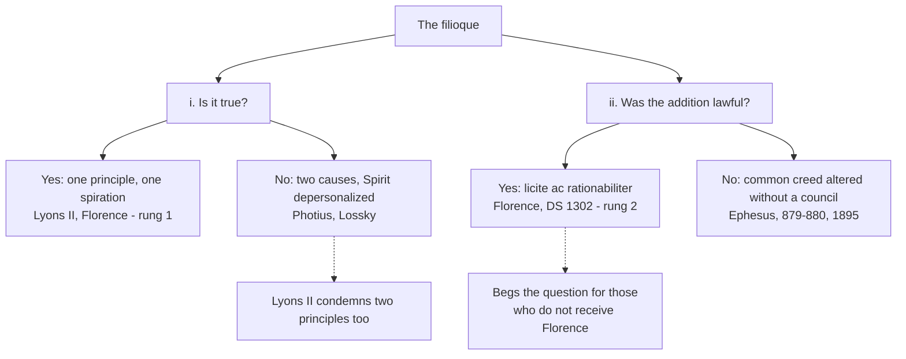

# Apologetics II · Lesson 5.1: The filioque: two questions, kept apart

> ⏱ ~15 min · Module 5: Against the Orthodox case · Builds on: [4.4](04-04-the-visible-church-and-what-replaced-the-papacy.md), [`trinity-and-god` 5.1](../../trinity-and-god/lessons/05-01-the-latin-doctrine.md), [`trinity-and-god` 5.2](../../trinity-and-god/lessons/05-02-the-greek-doctrine-and-the-addition.md), [`trinity-and-god` 5.3](../../trinity-and-god/lessons/05-03-the-clarifications.md) · Unlocks: [5.2](05-02-papal-primacy-as-the-east-reads-it.md)

## Why this matters

Ask an Orthodox priest what divides his Church from Rome and the filioque will usually be named. Ask what is wrong with it and you hear two complaints: the clause is false, and the West had no right to add it to the common creed. Apologists habitually answer one and think they have answered both. This lesson keeps them apart, and finds Florence leaving a Catholic less room on the second than many assume.

## The idea

The [filioque](../reference.md#filioque) raises two questions that can come apart. (i) Is it **true** that the Spirit proceeds from the Father and the Son? (ii) Was it **lawful** to insert that into a creed the ecumenical councils had received?

A miniature case: of two cities sharing a treaty, one starts printing it with a true clause added. The other can grant every word and still protest that the text belonged to both. Truth is settled by what is so; [lawfulness](../reference.md#lawfulness-of-the-addition) by who may alter a shared text.

*True and lawful* is the Catholic position since Florence defined both. *True, but not to be inserted* was Leo III's stance in 810. *False and unlawful*: Photius and most Orthodox writers. No one holds *false but lawful*.

[`trinity-and-god` 5.1–5.3](../../trinity-and-god/lessons/05-03-the-clarifications.md) taught both doctrines, the history and the 1995 clarification; this lesson argues them and adds lawfulness, on which Florence turns out to have spoken.

## Source

Florence, *Laetentur caeli* (6 July 1439), DS 1302 (Latin as Denzinger prints it; the lesson's translation):

> *Diffinimus insuper, explicationem verborum illorum 'Filioque' veritatis declarandae gratia, et imminente tunc necessitate, licite ac rationabiliter Symbolo fuisse appositam.*
>
> "We define, moreover, that the explanation of those words 'Filioque' was lawfully and reasonably added to the Creed, for the sake of declaring the truth and because of a necessity pressing at that time."

*Diffinimus* is the verb the decree used a sentence earlier for the doctrine itself (DS 1300): this is a definition. *Explicationem* calls the clause an explanation, not a new article: Florence's answer to "a different faith" is in its noun. *Tunc*, "then", ties the necessity to the time of insertion. The sentence is silent on who inserted the clause, whether a council was needed, and whether Greeks must recite it.

## The other side

**On (i), the doctrine.** **Photius**, patriarch of Constantinople and an Orthodox saint, made the classic case in the [*Mystagogy of the Holy Spirit*](../reference.md#mystagogy-of-the-holy-spirit) (about 886), starting from John 15:26: the Spirit proceeds from the Father. Paraphrased: what two persons share in God is common to all three, so a Spirit proceeding from Father and Son proceeds from himself (ch. 6); by parity Father and Spirit would beget the Son, every property becomes common, and the persons collapse into one, a revived Sabellianism (ch. 9). To cause is the Father's own property: hand it to the Son, and either the Son usurps the Father's place or the Father was incomplete. Two causes destroy the [monarchy of the Father](../reference.md#monarchy-of-the-father) and bring back polytheism (ch. 11). Weight: a saint's treatise, not a conciliar act.

**Vladimir Lossky** (1903–1958) pressed the modern form in *The Mystical Theology of the Eastern Church* (1944; English 1957) and "The Procession of the Holy Spirit in Orthodox Trinitarian Doctrine" (English in *In the Image and Likeness of God*, 1974), where he calls the procession "the sole dogmatic grounds" of the separation. Paraphrased: Latin theology starts from the one essence and distinguishes the persons only as relations within it. Making Father and Son one principle means the Spirit comes from what they have in common, so nature is put before person, and the Spirit is depersonalized and subordinated to the Son. The Church follows: a Spirit subordinated to the Son yields a Church conceived as Christ's institution, with authority centralized in his vicar. Lossky and Stăniloae made even papal primacy depend on the procession; Florovsky and Zizioulas did not (Coman, *Logos*, 2017). Weight: theologians' books.

**On (ii), the lawfulness**, a case independent of the first. The decree of Ephesus carried as [canon 7](../reference.md#ephesus-canon-7) (Percival) forbids composing "a different (*heteran*) Faith as a rival" to Nicaea's, which Orthodox writers read as fencing the common creed against any unilateral change. The clause appears in Spain around Toledo III (589), was defended under the Carolingians at Friuli (796) and Aachen (809), and reached a papal Mass only in 1014. Rome itself refused it: in 810 Leo III approved the doctrine and declined to insert it, and the *Liber Pontificalis* reports silver shields bearing the creed in Greek and Latin. The [council of 879–880](../reference.md#council-of-879-880), with Roman legates present, reaffirmed the creed without the clause. The Ecumenical Patriarchate's synodal encyclical of 1895 calls it an "utterly lawless addition" (Metallinos's translation, 1896).

Why this is about authority: the creed belongs to the whole Church in council, so altering it alone claims over the whole an authority no single see holds. The addition and the papal claims are one complaint. Weight: Ephesus binds both churches; some Orthodox count 879–880 ecumenical, others do not; the 1895 encyclical speaks for one synod.

## The argument

**P1.** The two questions are independent. *In words:* truth does not license an insertion; an unlawful insertion does not falsify a clause.

**P2.** [Lyons II](../reference.md#lyons-ii)'s constitution *Fideli ac devota* (1274; not Michael VIII's profession) defines procession "as from one principle … by a single spiration", and condemns those who say the Spirit proceeds from two principles. *In words:* the West condemns the two causes Photius attacks.

**P3.** The [Council of Florence](../reference.md#council-of-florence) teaches that the Son has from the Father that the Spirit proceeds from him, since the Father gave him everything except being Father (DS 1301). *Cantate Domino* (1442) calls the Father alone "principle without principle". *In words:* the Son's share is the Father's gift, so the monarchy stands.

**P4.** The one principle is Father and Son, not the essence: the [1995 clarification](../reference.md#clarification-1995), reading Lyons II through Lateran IV, says so. *In words:* Lossky's "nature before person" targets a reading the Catholic texts exclude.

**P5.** Maximus the Confessor, writing from Rome in the seventh century ([*Letter to Marinus*](../reference.md#letter-to-marinus), PG 91:136, cited by the 1995 text), reported that the Romans do not make the Son the Spirit's *aitia* but say the Spirit comes forth through him. *In words:* a Greek Father found the Latin sense orthodox.

**P6.** Ephesus forbids a *different* faith. The creed of 381 had itself enlarged Nicaea's, and Cyril, who presided at Ephesus, wrote that one who makes plain his faith "innovates in nothing" (to Acacius, in Percival's excursus). *In words:* explaining is not replacing.

**P7.** Florence defined the addition lawful (DS 1302), on two grounds: declaring the truth, and necessity at the time.

**∴ C.** A Catholic holds (i) and (ii) as defined, and owes the Orthodox two arguments: that the Latin doctrine is not the two-cause doctrine (P2–P5, strong), and that Florence's grounds meet Ephesus (P6–P7, weaker).

**Mark the levels.** On [the ladder](../../fundamental-theology/lessons/04-04-the-ladder-of-doctrinal-authority.md) ([levels of authority](../reference.md#levels-of-authority)): procession from Father and Son as one principle by one spiration, **rung 1** (Lyons II's constitution; Florence, DS 1300). The monarchy in its Latin wording, **rung 1** (*Firmiter*, 1215: the Father "from no one"; *Cantate Domino*); the 1995 phrase "sole Trinitarian cause (*aitia*)", no rung. Florence's gloss of "through the Son": inside the definition for the doctrine, but as a claim about what the Greek Fathers meant, a reading, not defined. The lawfulness of the addition (DS 1302), **rung 2**: a defined judgment on an ecclesiastical act connected with the faith. Some theologians class it as disciplinary; the floor is still **at least rung 3**, so it is not freely disputed. The Latin relational argument, **rung 4**. The 1995 clarification defines nothing (no rung; rung 3 at most); the 2003 North American statement has no level. Reciting the creed without the clause is discipline, and the Ephesian decree conciliar law: no doctrinal rung.

**Concession.** The manner of the addition is genuinely hard to defend. Spanish bishops apparently thought the words original; the Frankish court pressed them as a test of Byzantine orthodoxy; Rome refused them for two centuries, its legates reaffirming the unaltered creed in 879–880; they entered Rome's liturgy in 1014 with no council of East and West; and the East did not receive the councils that defined them. The 1995 clarification concedes the monarchy of the Father: the Father is the sole Trinitarian cause of Son and Spirit and the sole origin of the Spirit's [*ekporeusis*](../reference.md#ekporeusis-and-processio), and the filioque must not be presented so that it appears to contradict that.

**The crux.** Since Florence defined the addition lawful, a Catholic may concede the manner and say the necessity was *tunc*, so nothing binds Greeks to recite the clause now; he may not call the addition unlawful. The crux: is an explanatory clause, added against a heresy, a "different faith" when one part of the Church adds it without a council of the whole? Citing DS 1302 begs the question, since the Orthodox do not [receive](../reference.md#reception) Florence. What could move it: the decree's occasion (a Nestorian creed, not an addition) and Cyril's gloss; and an agreed account of who may explain the common creed, the primacy question of [5.2](05-02-papal-primacy-as-the-east-reads-it.md) and [5.3](05-03-vatican-i-read-by-orthodox-theologians.md).

## The two questions

Strong on the left branch; on the right, the reply leans on primacy.

## Worked examples

**Example 1 (clean): Photius's dilemma.** Run chs. 6 and 9 against the definition. Their premise, that whatever two persons share is common to all three, is false: active spiration belongs to *two* persons, neither to the nature nor to one. Aquinas calls it a relation that is not a property, "because it does not belong to only one person" (ST I q.30 a.2 ad 1, Dominican Fathers' translation). Paternity and being from no one, which the Son lacks, make the Father this person, and the Son holds spiration from him (DS 1301): nothing is usurped or blended. The cost: the definitions exclude two principles, but *why* spiration can be shared is school theology, rung 4.

**Example 2 (strain): "Which Rome do we believe?"** Fr Gleb Seliverstov, a Russian Orthodox priest (invented), tells his catechism class: "Rome's 1995 text says the Father is the sole cause; Florence says the Son is a cause too." He has read correctly: DS 1301 makes the Son, "according to the Greeks", *causa* of the Spirit's subsistence, as the Father is. The harmonization: Florence's *causa* names the Son within the one principle, holding it from the Father; 1995's sole *aitia* names the Father as principle without principle; both exclude a second, independent cause. That reads the Latin coherently; it does not settle what the Greek Fathers meant by "through the Son": the temporal sending for Photius, an eternal manifestation for Blachernae (1285). Florence's reading of them is not defined; there the argument stops, at a historian's question.

## Watch out

- **You might think the Orthodox doubt that the Son is fully God.** They confess him consubstantial; their objection is that the Father alone is cause. The clause first served in Spain *against* Arians.
- **You might think "the Orthodox position" is Lossky's.** Photius denies the Son any role in the Spirit's eternal being; Gregory of Cyprus and Palamas allow an eternal manifestation through him; Florovsky and Zizioulas do not make it the root of the ecclesial divide.
- **You might think a Catholic may call the addition unlawful, since Rome recites the creed without it in Greek.** Florence defined lawfulness (rung 2, at least rung 3); the Greek recitation is discipline. Concede the manner.
- **You might think Florence defined what the Greek Fathers meant, or that the Son is a cause in no sense.** The first overstates a reading; the second contradicts DS 1301's *causa*.

## One-liner

> Truth and lawfulness are two questions: the definitions escape the two-cause charge, and Florence forbids a Catholic to call the addition unlawful while leaving him to show that its grounds answer Ephesus.

## Problems

**P1 (🟢) *(Diagnose · Exegetical.)*** An invented parish tract, written for this problem; no real person or parish wrote it:

> "Why do the Orthodox reject the Filioque? Because, like the Arians, they will not grant that the Son is fully God; if he were, the Spirit would come from him too. The clause has stood in the Creed since Nicaea, as any missal shows. And the matter was closed at Florence, where the Greeks themselves signed; an Orthodox priest who still refuses is simply defying an ecumenical council."

Name three errors. For each, say what is wrong and what an accurate account puts in its place, **two sentences per error at most**.

**P2 (🟡) *(Apologetic: (a) Exegetical, graded first · (b) reply.)*** Later in the same invented catechism talk, Fr Gleb Seliverstov says: "Photius answered the Latins once for all. They give the Spirit two causes."

(a) State Photius's case in the *Mystagogy* as he makes it, not as a slogan: his starting text, his argument from what two persons share, and his charge about two causes. **Three sentences at most.**

(b) Reply, opening with a **named concession**. **120 words or fewer.** A reply that concludes Photius's argument succeeds passes if it is a good reply.

**P3 (🔴, optional) *(Find the crux · Exegetical.)*** Two invented Catholic writers. A: "The filioque is true, but the West had no right to put it into a creed that belonged to the whole Church, and Catholics should say so." B: "No Catholic may say that: Florence defined the addition lawful" (DS 1302, this lesson's Source).

(a) Name the single premise on which A and B actually disagree.

(b) Say what would move each of them, and what A can still say without contradicting Florence. **100 words or fewer for both parts.**

Solutions

**P1** *(Diagnose · Exegetical)*

**Accept:** any three of the four errors below, each with its correction.

**Must hit, strict:**

- **The caricature.** The Orthodox confess the Son consubstantial with the Father, with Nicaea and 381. Their objection is the monarchy of the Father: the Father alone is cause of the Spirit's existence, and the clause, read in Greek, gives the Spirit two causes. Credit for noting that the clause first served in Spain against Arians.
- **The history.** The clause is in neither the creed of Nicaea (325) nor that of Constantinople (381). It appears in Spain around 589 and entered Rome's liturgy in 1014; Leo XIV's *In Unitate Fidei* (2025, n. 10) itself notes it is not in the text of Constantinople.
- **The appeal to Florence begs the question.** The Orthodox do not receive Florence as ecumenical, and its union was rejected in the East, so citing its authority assumes the point in dispute. Whether reception enters what makes a council binding is [5.3](05-03-vatican-i-read-by-orthodox-theologians.md)'s question.
- **The two questions merged, and a weight overstated.** "Defying a council" runs the doctrinal and the canonical complaints together. Florence's decree defines without an anathema (the condemnation is Lyons II's), and the Church does not charge those born into separated communities with the sin of separation (*Unitatis Redintegratio* 3).

**Wrong turns:** correcting the tract by saying the Orthodox object only on canonical grounds (they object on both). Saying "the Orthodox deny the Spirit is God." Saying Florence did not define the procession. Treating "the Greeks signed" as settling reception.

**Model answer:** First, the Orthodox confess the Son fully God; they object that the Father alone is the Spirit's cause, and the clause first served against Arians, not for them. Second, the words are in neither Nicaea's creed nor that of 381: they appear in Spain around 589 and in Rome's liturgy in 1014. Third, the Orthodox do not receive Florence, whose union the East rejected, so invoking it assumes what is disputed and merges the canonical question into the doctrinal one.

---

**P2** *(Apologetic: (a) Exegetical, graded first · (b) reply)*

**Accept:** any reply that opens with a real concession and engages the argument, not the slogan, whatever its verdict.

**Must hit, strict (a), graded first:**

- **The text.** John 15:26: the Spirit proceeds from the Father, with no mention of the Son.
- **The argument from sharing** (chs. 6, 9). What two persons share in God is common to all three, so a Spirit from Father and Son would proceed from himself; and by parity Father and Spirit would beget the Son, until every property is common and the persons collapse into one, a revived Sabellianism. Credit for the related form: to cause is the Father's own property, so a Son who shares it usurps the Father's place or the Father was incomplete.
- **Two causes** (ch. 11). A second cause destroys the monarchy of the Father and brings back polytheism.

**Must hit (b):**

- **A named concession**, flat: a doctrine of two causes would be false and Photius was right to refuse it; or, John 15:26 says nothing of the Son.
- The defined doctrine is one principle by one spiration, with two principles condemned (Lyons II); the Son's share is the Father's gift (DS 1301), so the monarchy stands.
- The premise fails: spiration belongs to two persons, neither to the nature nor to one (ST I q.30 a.2 ad 1), so it is not common to all three and the Spirit does not spirate. Paternity and being from no one, which the Son lacks, stay the Father's, so nothing is usurped.
- The cost: that reply rests on school theology (rung 4), not on the definition.

**Wrong turns:** giving Photius the Blachernae–Palamite "eternal manifestation", which he does not hold. Stating (a) as "Photius said the Latins deny the Spirit's divinity." Folding the lawfulness complaint into (a). Replying that the Son is no cause in any sense, which DS 1301 contradicts. Claiming Lyons II's condemnation *refutes* Photius: it shows the Latin doctrine is not what he attacked.

**Model answer (a):** John 15:26 says the Spirit proceeds from the Father. Whatever two persons share in God is common to all three, so a Spirit from Father and Son would proceed from himself, and by parity Father and Spirit would beget the Son, until the persons collapse into one, a revived Sabellianism. Two causes destroy the monarchy of the Father and bring back polytheism.

**Model answer (b), one of several:** Concession: two causes in God would be false, and Photius was right to refuse them. So does Rome: Lyons II condemns anyone who says the Spirit proceeds from two principles, and Florence says the Son has from the Father that the Spirit proceeds from him, so the Son usurps nothing. The argument's premise also fails. Spiration belongs to Father and Son together, not to the nature, so it is not the Spirit's; what makes the Father Father, paternity and being from no one, stays his. Nothing becomes common to all three. I grant that this step is school theology, not dogma.

---

**P3** *(Find the crux · Exegetical)*

**Must hit, strict (a):** not whether the doctrine is true (both grant it) but **whether DS 1302's *diffinimus* binds assent to the lawfulness**: as a defined judgment on an ecclesiastical act connected with the faith (rung 2), or as a disciplinary or historical judgment that binds no assent.

**Must hit, strict (b):**

- What would move A: the act's form (the same *diffinimus* as the doctrinal definition at DS 1300) and its ground ("for the sake of declaring the truth" ties the lawfulness to the faith). What would move B: a showing that the act's object is disciplinary, with can. 749 §3's rule to default down where the mode of an act is not manifest.
- Even on A's reading the floor is at least rung 3, religious submission, so "Catholics should say so" fails either way.
- What A can say: the manner was irregular; Rome itself refused for two centuries; the necessity was *tunc*, so no one is bound to recite the clause now, and Rome refuses it in the Greek creed (1995).

**Wrong turns:** naming the truth of the doctrine as the crux. "Florence was a failed reunion council, so its definitions lapsed": on the Catholic account the failed union does not unmake a definition. Calling the lawfulness "freely disputed" when a magisterial act has spoken. Putting DS 1302 at rung 1 because it says "we define", when its object is not a revealed truth.

**Model answer, one of several:** (a) They agree the doctrine is true. They split on whether Florence's "we define" makes the lawfulness something a Catholic must hold, a judgment connected with the faith, or only a disciplinary verdict. (b) A should be moved by the form of the act: the verb of DS 1300, and a ground tied to declaring the truth. B would be moved only by showing the object disciplinary, where can. 749 §3 defaults down. Even then rung 3 remains, so A may not teach "unlawful". He may say the manner was irregular and the necessity past, so no one need recite the clause now.

## Flashback

**From Lesson [4.3](04-03-apostolic-succession-and-the-validity-of-orders.md) (Apostolic succession and the validity of orders):** *(Apologetic: (a) Exegetical, graded first · (b) reply.)* Invented, for this problem: a Catholic speaker says Lutherans, like the Reformed, call ordination "no sacrament". A Lutheran pastor reads him Apology XIII.9, 11 (*Concordia Triglotta*, 1921):

> They are accordingly called priests, not in order to make any sacrifices for the people ...; but they are called to teach the Gospel and administer the Sacraments to the people. ... But if ordination be understood as applying to the ministry of the Word, we are not unwilling to call ordination a sacrament.

(a) With Apology XIV and the *Treatise* §65, state the Lutheran doctrine: what ministers are for, in what sense ordination is a sacrament, the bishops' grades, and who may ordain. **Three sentences.**

(b) Reply, opening with a **named concession**, and locate the dispute as 4.3 would. **100 words or fewer.** A reply concluding that the Lutheran position stands passes if it is a good reply.

Solution

**Accept:** any reply with a real concession that keeps Lutheran and Reformed apart and finds the dispute in what ordination confers, whatever its verdict.

**Must hit, strict (a), graded first:**

- Ministers teach the Gospel and administer the sacraments, offering no sacrifices for the people; so understood, ordination may be called a sacrament (XIII.9, 11).
- The Apology's "greatest wish" was to keep the bishops' grades, though "made by human authority", had the bishops tolerated its doctrine (XIV).
- Bishop and pastor are one grade by divine right, so a pastor's ordination in his own church "is valid by divine law" (*Treatise* §65).

**Must hit (b):**

- **A named concession**, flat: the speaker blurred two confessions. The Second Helvetic (XIX), not the Apology, calls ordination no sacrament.
- **Still 4.3's P1.** Trent's priesthood has "power of consecrating and offering" (XXIII can. 1, Waterworth; **rung 1**); the Lutheran minister administers the sacraments but offers no sacrifice for the people (XIII.9). One word, two things ([6.5](06-05-the-sacrifice-of-the-mass.md)).
- **The line.** §65 makes succession good order; Catholics hold that bishops succeed the apostles by divine institution (**at least rung 3**).

**Wrong turns:** stating (a) as "Lutherans deny that ordination is a sacrament" (the speaker's Reformed blur) or "abolished bishops". Answering with *Apostolicae Curae*, which judges Canterbury's rite, not Wittenberg's doctrine. Treating the Book of Concord as a magisterium.

**Model answer (a):** Ministers are called to teach the Gospel and administer the sacraments, not to sacrifice for the people, and so understood ordination is a sacrament. The Lutherans wished to keep the bishops' grades, of human authority, had the bishops tolerated their doctrine. Bishop and pastor being one grade by divine right, a pastor's ordination in his own church is valid by divine law.

**Model answer (b), one of several:** Concession: the speaker was wrong; the Apology will call ordination a sacrament. But the shared word hides 4.3's P1. Trent defines a priesthood with power to consecrate and offer (rung 1), and the Apology's ministers are priests "not in order to make any sacrifices". And §65 makes succession mere good order, where Catholics hold it of divine institution and the public test of where the apostles' doctrine is kept.

## Connections

- **Backward:** [`trinity-and-god` 5.1](../../trinity-and-god/lessons/05-01-the-latin-doctrine.md) owns the Latin doctrine and the relational argument, [5.2](../../trinity-and-god/lessons/05-02-the-greek-doctrine-and-the-addition.md) the Greek doctrine, the two verbs and the Ephesian decree read closely, and [5.3](../../trinity-and-god/lessons/05-03-the-clarifications.md) the 1995 clarification. The events, from Leo III's shields to Florence's rejection, are [`church-history` 4.2](../../church-history/lessons/04-02-east-and-west-the-long-estrangement.md). [4.4](04-04-the-visible-church-and-what-replaced-the-papacy.md) closed the Protestant alternatives; the East keeps bishops and sacraments and disputes something else.
- **Forward:** the lawfulness crux is an authority question, so [5.2](05-02-papal-primacy-as-the-east-reads-it.md) takes primacy in the East's own categories and [5.3](05-03-vatican-i-read-by-orthodox-theologians.md) the objection from reception. Boss 5 asks for Lossky's charge and the lawfulness case stated in full ([syllabus](../syllabus.md)).
- **Sideways:** Maximus and the Damascene as authors are [`patristics` 5.4](../../patristics/lessons/05-04-maximus-and-john-of-damascus.md), and the Cappadocian monarchy is [`patristics` 3.3](../../patristics/lessons/03-03-the-two-gregories.md). The Ephesian decree's occasion is [`christology` 2.2](../../christology/lessons/02-02-nestorius-cyril-and-ephesus.md). Example 1's reply, refusing a disjunction the objection takes for granted, is the move of [`apologetics-foundations` 7.2](../../apologetics-foundations/lessons/07-02-tawhid-and-the-trinity.md), and Lossky's charge returns in [5.4](05-04-essence-and-energies.md), where he makes the energies the key to the whole difference.
