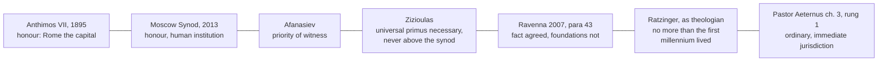

# Apologetics II · Lesson 5.2: Papal primacy as the East reads it

> ⏱ ~15 min · Module 5: Against the Orthodox case · Builds on: [4.2](04-02-what-the-patristic-record-proves.md), [5.1](05-01-the-filioque-two-questions-kept-apart.md), [`ecclesiology-and-mariology` 3.2](../../ecclesiology-and-mariology/lessons/03-02-the-local-and-the-universal-church.md), [`church-history` 2.2](../../church-history/lessons/02-02-ephesus-chalcedon-and-leos-rome.md) · Unlocks: [5.3](05-03-vatican-i-read-by-orthodox-theologians.md)

## Why this matters

The usual Catholic case on the papacy, Matthew 16 and a list of Fathers deferring to Rome, rarely reaches an Orthodox opponent. An Orthodox theologian can grant that Peter was first, that Rome was first and heard appeals, and still say no. The dispute is not about whether there is a first. It is about what a church is, so this lesson argues inside the Orthodox categories.

## The idea

Think of a symphony and its performances. Each good performance is the whole symphony, not a fraction of it. Other orchestras may defer to the oldest one on tempo, yet no one says it owns their performances.

That is the picture called [eucharistic ecclesiology](../reference.md#eucharistic-ecclesiology). Each local church, gathered at one altar around its bishop, is the whole Church in that place, not a branch. The churches are one because each is the same Church, and they keep an order, a [*taxis*](../reference.md#taxis), with a first among them. A power held by one church over the others is then a category error: a church with power over the Church.

[`ecclesiology-and-mariology` 3.2](../../ecclesiology-and-mariology/lessons/03-02-the-local-and-the-universal-church.md) stated Afanasiev and Zizioulas, and its [4.1](../../ecclesiology-and-mariology/lessons/04-01-the-petrine-texts.md) and [4.5](../../ecclesiology-and-mariology/lessons/04-05-vatican-ii-primacy-collegiality-synodality.md) the Orthodox reading of the Petrine texts, Ravenna and Moscow's reply. This lesson argues with them.

## Source

The [Patriarchal and Synodical Encyclical](../reference.md#patriarchal-encyclical-of-1895) of Anthimos VII of Constantinople and his synod (August 1895), §§XIV–XV, answering Leo XIII's *Praeclara gratulationis* (1894). Translated by Eustathius Metallinos (Manchester, 1896) with the synod's approval:

> But, having recourse to the fathers and the Oecumenical Councils of the Church of the first nine centuries, we are fully persuaded that the Bishop of Rome was never considered as the supreme authority and infallible head of the Church, and that every bishop is head and president of his own particular Church, subject only to the synodical ordinances and decisions of the Church universal as being alone infallible [...]. The divine Fathers, honouring the Bishop of Rome only as the bishop of the capital city of the empire, gave him the honorary prerogative of presidency, considering him simply as the bishop first in order, that is, first among equals [...]

Read its shape. No bishop heads the whole Church, and each heads his own *under* the universal Church's synodical decisions. Rome's first place is an honour resting on the capital, canon 28's ground ([`church-history` 2.2](../../church-history/lessons/02-02-ephesus-chalcedon-and-leos-rome.md)). It is a synodal letter of one autocephalous church: polemical, widely cited, not a pan-Orthodox act.

## The other side

None of these voices is a magisterium, since Orthodoxy has no body that defines the Western way. Each text carries its own weight.

**The categories.** For Nicholas Afanasiev ("The Church Which Presides in Love", in *The Primacy of Peter*, English 1963), each eucharistic assembly is the whole Church and no church has power over another. Rome's was a priority of witness, not of jurisdiction. John Zizioulas corrects him: the one Eucharist under the one bishop makes a church, and the churches are one by identity, which councils show (*Eucharist, Bishop, Church*; *Being as Communion*). Both are theologians' books.

**[Taxis](../reference.md#taxis), [pentarchy](../reference.md#pentarchy), [conciliarity](../reference.md#conciliarity).** By the seventh century five sees stood in a fixed order: Rome, Constantinople, Alexandria, Antioch, Jerusalem ([Chieti](../reference.md#chieti-and-alexandria), 2016, §15). Constantinople I (381), canon 3, gives Constantinople "the prerogative of honour after the Bishop of Rome; because Constantinople is New Rome" (Percival). [Canon 28 of Chalcedon](../reference.md#canon-28-of-chalcedon) grounds both sees' privileges in their being imperial cities. Authority works in synod: a region's bishops do nothing weighty without their first, nor he without them ([Apostolic Canon 34](../reference.md#apostolic-canon-34)). Stated honestly, emperors convened and enforced the ancient councils, and Rome never convened or personally presided over one (Ravenna §42). That weakens any claim that conciliar authority flowed from Rome, but is no Orthodox trump: neither side now derives it from an emperor.

**What primacy meant.** On John Meyendorff's account (his essay in *The Primacy of Peter*), Byzantine writers placed Peter's succession in every bishop who keeps Peter's confession, and Rome's first place rested on the canons and the city. Appeals to Rome under Sardica (343 or 344) show communion, not jurisdiction: appeals also went to Constantinople (Chalcedon, canon 9), and Chieti says Rome "did not exercise canonical authority over the churches of the East" (§19). Dvornik, a Catholic historian, read them as a real final court ([`church-history` 4.2](../../church-history/lessons/04-02-east-and-west-the-long-estrangement.md)). Kallistos Ware (*The Orthodox Church*, 1963, revised 1993) grants Rome a primacy and refuses it a supremacy.

**Not only honour.** Orthodox writers do say ["primacy of honour"](../reference.md#primacy-of-honour). The Moscow Synod's 2013 *Position*, one church's act, calls the first millennium's universal primacy one of honour and of human institution ([`ecclesiology-and-mariology` 4.5](../../ecclesiology-and-mariology/lessons/04-05-vatican-ii-primacy-collegiality-synodality.md)). Zizioulas calls the phrase misleading, since primacy carries real duties, and he calls a universal primus "an ecclesiological necessity in a unified Church", always as primus of a synod ("Primacy in the Church: An Orthodox Approach", 1998). The joint Alexandria text (2023, §5.1) says that for the Orthodox, primacy is "not merely honorific".

**The break was Frankish.** John Romanides (*Franks, Romans, Feudalism, and Doctrine*, 1981) denies an East–West schism in the usual sense. There was one Orthodox Roman nation, East and West, and "Greek" was the Franks' label for its eastern half. The Franks, Germanic conquerors of the West Romans, built a feudal Church, pressed the filioque against Leo III (Aachen, 809) and branded the East Romans heretics. German emperors then installed non-Roman popes, from 983 and again after Sutri (1046). The schism, he writes, "was not between East and West Romans": it was Charlemagne's schism imported into Old Rome ([Romanides's thesis](../reference.md#romanides-thesis)). Among Orthodox historians it is a minority thesis.

## The argument

**P1.** Catholic teaching accepts the eucharistic premise. The Church of Christ is "truly present in all legitimate local congregations of the faithful" (*Lumen Gentium* 26), and each Eastern church's Eucharist builds up "the Church of God" (*Unitatis Redintegratio* 15). *In words:* the branch-office picture is not Catholic doctrine either.

**P2.** Eucharistic ecclesiology needs a test of which altars are the one Church, and the test is communion among the churches. Zizioulas says so against Afanasiev's extreme axiom. *In words:* a full circle does not certify itself.

**P3.** Communion has a first at every level, the universal included. Both sides accept the fact of primacy at the universal level (Ravenna §43), and Zizioulas calls a universal primus necessary. *In words:* the Orthodox grant a universal first.

**P4.** A first who serves communion must be able to act for it between councils, when it is threatened. The first millennium's appeals were such acts, and the Roman see "by common consent acted as guide" when East and West disagreed (UR 14). *In words:* a presidency that can never act is no ministry of communion.

**P5.** A ministry whose object is each church's communion with all the rest reaches into every church. It does so as a service interior to each, not as one church over another (*Communionis Notio* 13). *In words:* the first's power is in every church because communion is.

**∴ C.** A universal primacy with real power is no category error in eucharistic ecclesiology. The categories exclude a primacy that makes the local church a branch, and Catholic doctrine excludes it too: bishops are not "vicars of the Roman Pontiffs" (LG 27). Whether "ordinary and immediate" fits P5 is [5.3](05-03-vatican-i-read-by-orthodox-theologians.md)'s question. [*Ut Unum Sint*](../reference.md#ut-unum-sint) 95 asks other Christians to help find a way of exercising the primacy that renounces nothing essential.

**Mark the levels.** ([the ladder](../../fundamental-theology/lessons/04-04-the-ladder-of-doctrinal-authority.md); [levels of authority](../reference.md#levels-of-authority).) [Universal, ordinary and immediate jurisdiction](../reference.md#universal-ordinary-jurisdiction) is **rung 1** (*[Pastor Aeternus](../reference.md#pastor-aeternus)* ch. 3 and its canon). LG 23 and 26 (the whole Church at each altar; the one Church "in and from" the particular churches) are **at least rung 3**, and UR 14–16 is **rung 3**. *Communionis Notio*'s priority of the universal Church is **rung 3, light grade**, and the priority question is **freely disputed**. *Ut Unum Sint* is **rung 3** for its doctrine, and its invitation is a request. Ratzinger's sentence that on primacy Rome need not require of the East more than the first millennium "formulated and lived" (*Theologische Prinzipienlehre*, 1982, quoted in *[The Bishop of Rome](../reference.md#bishop-of-rome-2024)* §91) is a theologian's, with **no magisterial level**. [Ravenna](../reference.md#ravenna-document) (by its preface no official declaration of teaching), Chieti and Alexandria have **no magisterial level**, and *The Bishop of Rome* (2024) is **below the seam**. None binds an Orthodox church either.

**Concession.** Universal ordinary jurisdiction has cost the local church something real. Vatican II admits that the Eastern churches' right to govern themselves was "not always indeed carried out in practice" (UR 16). John Paul II grants that "what should have been a service sometimes manifested itself in a very different light" (UUS 95). The Orthodox fear of absorption describes a history, not a phantom.

**The crux.** Both sides grant a universal first and the whole Church at each altar. They divide on one premise: *the communion of the churches is itself one Church whose first holds, by Christ's institution, a power reaching into every church.* The Catholic affirms it. The Orthodox answers that the communion is a relation among churches, each whole without it, whose first presides without power inside the others. What would move the Orthodox: showing that their universal instance, the council, cannot act once communion breaks (Ravenna §39: no council "in the strict sense" since the break). What would move the Catholic: showing that the first millennium's recourse to Rome never reached inside another church, which would leave P4 without P5.

## The map of positions

Left to right runs from a presidency inside a communion to a power reaching into every church. The crux sits between Zizioulas and *Pastor Aeternus*.

## Worked examples

**Example 1 (clean): the 1895 encyclical.** Run P2–P4 on the Source. It makes each bishop "subject only to the synodical ordinances and decisions of the Church universal", and its §XVI calls the ecumenical council the "supreme tribunal in the universal Church". So it already has a universal instance that binds every church (P2), and it gives Rome first place in that order (P3). The dispute is not *whether* universal authority reaches into each church. It is *who* holds it and how it acts between councils (P4–P5). "The council alone" then meets Ravenna §39: no council in the strict sense since the break.

**Example 2 (strain): an Eastern Catholic eparchy.** Vatican II declares that the Eastern churches have "a full right" and duty to rule themselves (*Orientalium Ecclesiarum* 5; UR 16). A Melkite eparchy is the whole Church at its altar, governed by its own bishop under its own church's law, in communion with Rome. The Orthodox reply: under *Pastor Aeternus* ch. 3 the pope may still act there immediately, so the right is held at his pleasure. The texts affirm both and limit the power only by its purpose, building up communion. The argument shows the two can coexist. It does not decide how a reunited Church would balance them, which Ravenna §45 postponed and [5.3](05-03-vatican-i-read-by-orthodox-theologians.md) takes up.

## Watch out

- **You might think the Orthodox reject any primacy for Rome, so that "schismatics who reject Peter" states their view.** But in Ravenna §41 both sides agree that Rome was first in the *taxis*, and the 1895 encyclical grants it presidency. They refuse a power inside other churches, and the slogan is a caricature.
- **You might think "primacy of honour" is the whole Orthodox account, or that Orthodoxy has dropped it.** Moscow (2013) still uses the phrase, while Zizioulas and the Alexandria text deny that primacy is merely honorific. It is an inadequate summary, not an abandoned one.
- **Weight, both ways.** The 1895 encyclical and the Moscow *Position* are acts of one church's synod, and Romanides's thesis is a minority one. None of them is "the Orthodox position". Ravenna settled nothing (§45 postponed the question), and UR 16's "solemnly declares" is rung-3 teaching, not a definition.

## One-liner

> The Orthodox grant Rome a first place and deny it a power inside other churches; the Catholic case must show, in their eucharistic terms, that the ministry of communion is such a power.

## Problems

**P1 (🟢) *(Diagnose · Exegetical.)*** An invented video script by Josias Grellner, an ex-evangelical convert to Orthodoxy (invented, written for this problem):

> "Why I didn't become Catholic. Rome wants a monarchy; Orthodoxy is a federation. Each national church is sovereign, our patriarchs are like presidents of member states, and we cooperate when we choose to. The Orthodox have never given the pope any primacy at all: he was one of five equal patriarchs. When we say 'primacy of honour' we mean a better chair at the banquet, nothing more. And Rome now admits it. In the Ravenna document the Vatican signed that the bishop of Rome had no canonical authority over the East."

Name **three** errors. For each, say what an accurate Orthodox account or the actual text puts in its place. **Two sentences per error.**

**P2 (🟡) *(Apologetic: (a) Exegetical, graded first · (b) reply.)*** At an invented ecumenical evening, Fr Jijo Kalarickal, a Syro-Malabar Catholic priest (invented), argues for primacy. An Orthodox questioner answers: "Read Romanides. The papacy you defend isn't Roman, it's Frankish."

(a) State Romanides's thesis as he states it: who the Romans and the Franks are, what the Franks did with the filioque and the papacy, and what the schism therefore was. **Three sentences.**

(b) Reply, opening with a **named concession**, and place the thesis fairly. **150 words or fewer.** A reply concluding that the thesis is right passes if it is a good reply.

**P3 (🔴) *(Exegetical (a) · Evaluative (b).)*** Later the same evening, Fr Jijo quotes Ratzinger: Rome need not require more of the East than was "formulated and lived" in the first millennium.

(a) In one line, give the weight of Ratzinger's sentence and of *Pastor Aeternus* ch. 3.

(b) Any verdict, **150 words or fewer**: does what the first millennium "lived", as UR 14 and Chieti §19 describe it, carry universal ordinary and immediate jurisdiction, or only a first who acts for communion (this lesson's P4)? Say what a Catholic who holds both Ratzinger's sentence and *Pastor Aeternus* must then claim.

Solutions

**P1** *(Diagnose · Exegetical)*

**Accept:** any three of the four errors below, each with its correction.

**Must hit, strict:**

- **"A federation of sovereign national churches."** That is a Western, juridical category. In eucharistic ecclesiology each local church is the whole Church, and the churches are one by identity, not by agreement among parts (Afanasiev; Zizioulas, who says the extreme local axiom destroys canonical unity). Even the 1895 encyclical puts every bishop under the synodical decisions of the Church universal, so communion is not a choice.
- **"Never any primacy."** Rome stood first in the *taxis* of five sees (Chieti §15; Ravenna §41). The 1895 encyclical grants Rome an "honorary prerogative of presidency", and the Moscow Synod (2013) grants a universal primacy of honour.
- **"Primacy of honour = a better chair."** Zizioulas calls the phrase misleading, because primacy carries real duties, and he calls a universal primus a necessity in a unified Church. The joint Alexandria text (2023, §5.1) says that for the Orthodox primacy is "not merely honorific".
- **"In Ravenna the Vatican signed."** Ravenna §41 records agreement that Rome was first and *disagreement* on its prerogatives, and §43 records agreement on the fact of universal primacy. The sentence the script garbles is Chieti §19 (2016), and it says Rome "did not exercise" canonical authority over the East, not that it had none. Neither text is "the Vatican" speaking: both are joint commission texts with no magisterial level, and Ravenna disclaims official status.

**Wrong turns:** correcting the script with Catholic claims (for example "the Orthodox really accept papal jurisdiction") instead of Orthodox ones. Saying Orthodoxy never uses "primacy of honour", which overcorrects. Treating the Moscow *Position* as "the Orthodox view" without saying whose act it is.

**Model answer:** First, Orthodoxy is not a federation. Each eucharistic church is the whole Church, and the churches are one by identity and bound by the synodical decisions of the Church universal, as even the 1895 encyclical says. Second, Rome was first in the *taxis* (Chieti §15; Ravenna §41). The 1895 encyclical and the Moscow Synod both grant it a primacy of honour. Third, Ravenna records *disagreement* about Rome's prerogatives, and the "canonical authority" line is Chieti §19, which says only that Rome did not *exercise* it there. Both are commission texts with no magisterial weight, not the Vatican's signature.

---

**P2** *(Apologetic: (a) Exegetical, graded first · (b) reply)*

**Accept:** any reply that opens with a real concession, keeps the thesis in Romanides's own terms, and tests it against the record, whatever its verdict.

**Must hit, strict (a), graded first:**

- **The Romans** were one Orthodox nation, East and West. "Greek" was a Frankish label for the East Romans.
- **The Franks**, Germanic conquerors of the West Romans, built a feudal Church. They pressed the filioque against Leo III's refusal (Aachen, 809) and branded the East Romans heretics. German emperors then put non-Roman popes in Rome, from 983 and again after Sutri (1046).
- **So the schism** was not between East and West Romans but between Franks and Romans: Charlemagne's schism imported into Old Rome.

**Must hit (b):**

- **Named concession:** the filioque's insertion was a Frankish project that Rome long resisted (Leo III's refusal; [5.1](05-01-the-filioque-two-questions-kept-apart.md); [`church-history` 4.2](../../church-history/lessons/04-02-east-and-west-the-long-estrangement.md)), and Leo IX, whose legates excommunicated Cerularius in 1054, was a German appointee of Henry III ([`church-history` 4.1](../../church-history/lessons/04-01-the-reform-papacy-and-the-investiture-contest.md)).
- **Placing:** it is a minority thesis among Orthodox historians, and the estrangement is usually told as a long process with many causes (`church-history` 4.2).
- **Test it on primacy:** on Romanides's own dating the popes before 983 were Roman. Yet the primacy dispute is older. Leo I refused Chalcedon's canon 28 in 452, and Nicholas I contested Photius's appointment from 863. The papal claim that divides the churches cannot be a Frankish import, and if the Roman see of the first millennium was Orthodox, its claims belong to the inheritance Romanides defends.

**Wrong turns:** stating (a) as "Romanides says the Latins are heretics" or "the Orthodox blame Western racism", which is caricature and fails the problem. Presenting the thesis as the Orthodox position. Dismissing it as nationalism without testing it on the record. Treating 1054 as Rome excommunicating the Eastern Church.

**Model answer (a):** For Romanides there was one Orthodox Roman nation, East and West, and "Greek" was the Franks' label for its eastern half. The Franks, Germanic conquerors of the West Romans, built a feudal Church, pressed the filioque against Leo III, and branded the East Romans heretics. Then German emperors put non-Roman popes in Rome from 983 and after 1046, so the schism was not East against West but Charlemagne's schism imported into Old Rome.

**Model answer (b), one of several:** Concession: the filioque was a Frankish project Rome resisted for two centuries, and the pope of 1054, Leo IX, was a German emperor's appointee. Romanides is right about both. But his thesis is a minority one among Orthodox historians, and it fails on the question at issue. By his own dating the popes before 983 were Roman, and the primacy dispute was already old by then. Leo I refused canon 28 in 452, and Nicholas I contested Photius from 863. So the claim that divides us is not a Frankish import. If the first-millennium Roman see was Orthodox, its claims are part of the inheritance Romanides defends, and the argument has to be about what they meant.

---

**P3** *(Exegetical (a) · Evaluative (b))*

**Must hit, strict (a):** Ratzinger's sentence is a theologian's (*Theologische Prinzipienlehre*, 1982), with **no magisterial level**, and its quotation in *The Bishop of Rome* §91, a study document below the seam, does not raise it. *Pastor Aeternus* ch. 3's universal, ordinary and immediate jurisdiction is **rung 1**.

**Must hit, any verdict (b):**

- State what was lived. Rome was first in the *taxis*, appeals were made to it, and for centuries it "by common consent acted as guide" in East–West disagreements (UR 14). Chieti §19 adds that it did not exercise canonical authority over the East.
- Separate a first who acts for communion (P4) from jurisdiction reaching into every church (P5), and say which one the record supports.
- Note that the record is read through ecclesiology: Ravenna §41 says the prerogatives were "understood in different ways in the first millennium".
- Say what the Catholic must claim. *Pastor Aeternus* is rung 1 and cannot be traded. Holding Ratzinger's sentence therefore means either that the jurisdiction was lived in seed and developed (development, [4.2](04-02-what-the-patristic-record-proves.md) and [6.6](06-06-development-or-corruption.md)), or that less is *required of the East* in its exercise.
- Concede the strongest point against your verdict.

**Wrong turns:** treating Ratzinger's sentence or Chieti as magisterial. "The record proves jurisdiction" with no development step, or "the record disproves it" with the appeals ignored. Resolving the tension by calling *Pastor Aeternus* ch. 3 negotiable, which understates rung 1.

**Model answer, one of several:** (a) Ratzinger: a theologian's sentence, no magisterial level. *Pastor Aeternus* ch. 3: rung 1. (b) The first millennium lived more than honour and less than ordinary, immediate jurisdiction. Rome was first, heard appeals and "by common consent" guided disputes (UR 14), which supports P4. Chieti §19's report that it did not exercise canonical authority in the East tells against P5 as practice, though Ravenna §41 warns that the evidence was read differently even then. So the record carries a first who acts for communion. Jurisdiction in every church needs a development argument on top of it. A Catholic who holds both texts must say that the defined power was present in seed and need not be exercised in the East as in the Latin Church. The strongest objection is that "in seed" can be claimed for anything.

## Flashback

**From Lesson [4.4](04-04-the-visible-church-and-what-replaced-the-papacy.md) (The visible Church, and what replaced the papacy):** *(Diagnose · Exegetical.)* An invented "Elder's corner" column in a Presbyterian congregation's newsletter (written for this problem; no real church or author):

> "Rome says we replaced the pope with chaos. We replaced him with nothing, and gladly: our Confession lets synods advise, but their decisions bind no one. The true Church is the invisible company of the elect, and the visible congregation is a useful human arrangement. Rome even condemned our doctrine in advance, when the Council of Constance condemned the teaching that the Church is the elect, so in Rome's eyes every Presbyterian is a heretic."

Name **three** errors. For each, give the correction and the text or level that supports it. **Two sentences per error.**

Solution

**Must hit, strict:**

- **"Synods advise; nothing replaced the pope."** [Westminster](../reference.md#westminster-confession) XXXI.3 has synods "ministerially" determine controversies of faith, their decrees received "for the power whereby they are made", and XXX gives church officers the keys up to excommunication. The column states its own confession below strength: authority came back, and what Westminster disclaims is finality (XXXI.4: synods "may err").
- **"A useful human arrangement."** XXV.2 calls the visible catholic Church Christ's kingdom, "out of which there is no ordinary possibility of salvation", and XXV.3 gives it the ministry and ordinances. Demoting the [visible Church](../reference.md#visible-and-invisible-church) is the caricature 4.4 warns Catholics against, here made from inside.
- **Constance.** It censured Hus's articles, the Church as "the totality of the predestined" among them, by a global censure: the contradictory is **at least rung 3, no precise note**, so "heretic" overstates. Whether Westminster XXV.1 falls under it is **rung 5**: no act applies it, and Westminster, unlike Hus, counts reprobate professors in the visible Church.

**Wrong turns:** correcting the first error by making Westminster's synods unerring; calling the Confession a magisterium, when it is the Presbyterian subordinate standard; correcting the third by giving Constance's censure no weight (understates) or by saying it condemns Westminster (overstates); answering with a denomination count.

**Model answer:** First, Westminster XXXI.3 lets synods determine controversies of faith, with decrees binding "for the power whereby they are made", and XXX gives the keys up to excommunication: authority came back, though fallible (XXXI.4). Second, XXV.2 puts "no ordinary possibility of salvation" outside the visible Church, and XXV.3 gives it Christ's ministry and ordinances, so it is no human convenience. Third, Constance's global censure of Hus makes its contradictory at least rung 3 with no precise note, not a charge of heresy. Whether Westminster falls under it is rung 5, since Westminster, unlike Hus, counts reprobate professors in the visible Church.

## Connections

- **Backward:** [`ecclesiology-and-mariology` 3.2](../../ecclesiology-and-mariology/lessons/03-02-the-local-and-the-universal-church.md) stated Afanasiev, Zizioulas and the priority dispute, and its [4.1](../../ecclesiology-and-mariology/lessons/04-01-the-petrine-texts.md) stated the Orthodox reading of the Petrine texts that this lesson argues. [4.5](../../ecclesiology-and-mariology/lessons/04-05-vatican-ii-primacy-collegiality-synodality.md) read Ravenna and the Moscow *Position* and set their crux. [`church-history` 2.2](../../church-history/lessons/02-02-ephesus-chalcedon-and-leos-rome.md) and [4.2](../../church-history/lessons/04-02-east-and-west-the-long-estrangement.md) are the record of canon 28, Photius and Florence. Ignatius's "presides in love" is [`patristics` 1.3](../../patristics/lessons/01-03-ignatius-of-antioch.md). [4.2](04-02-what-the-patristic-record-proves.md) weighed the patristic evidence this lesson reads in Eastern categories.
- **Forward:** [5.3](05-03-vatican-i-read-by-orthodox-theologians.md) asks whether *Pastor Aeternus*'s "ordinary and immediate" fits P5, with LG 27 and the German bishops of 1875. The module's Boss 5(d) offers a reply on primacy that opens with this lesson's concession ([syllabus](../syllabus.md)). [6.6](06-06-development-or-corruption.md) tests the development step that P3 needs.
- **Sideways:** Ravenna §5 grounds the *taxis* of churches in the *taxis* of the divine persons: an order that implies no inequality of nature. Zizioulas's communion ecclesiology rests on the same Trinitarian ontology, built on the monarchy of the Father ([`trinity-and-god` 6.4](../../trinity-and-god/lessons/06-04-social-trinitarianism-and-its-critics.md)), so the dispute over a universal first echoes the dispute over the Father as sole cause in [5.1](05-01-the-filioque-two-questions-kept-apart.md).
