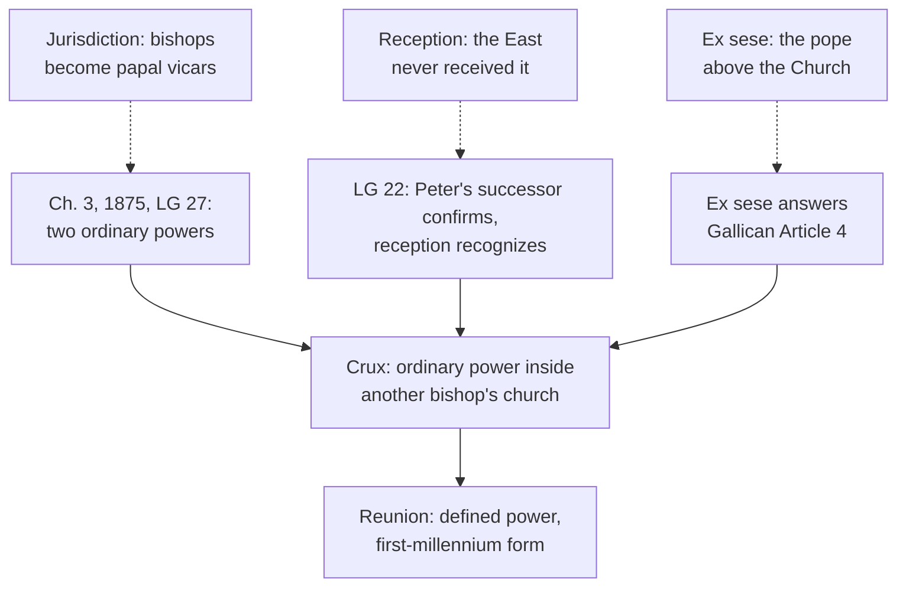

# Apologetics II · Lesson 5.3: Vatican I read by Orthodox theologians

> ⏱ ~15 min · Module 5: Against the Orthodox case · Builds on: [5.2](05-02-papal-primacy-as-the-east-reads-it.md), [`ecclesiology-and-mariology` 4.3](../../ecclesiology-and-mariology/lessons/04-03-vatican-i-and-pastor-aeternus.md), [`ecclesiology-and-mariology` 4.5](../../ecclesiology-and-mariology/lessons/04-05-vatican-ii-primacy-collegiality-synodality.md), [`church-history` 8.2](../../church-history/lessons/08-02-pius-ix-vatican-i-and-the-fall-of-rome.md) · Unlocks: [5.4](05-04-essence-and-energies.md), [7.1](07-01-the-inquisition-and-the-galileo-affair.md)

## Why this matters

Ask a Catholic apologist what the Orthodox object to in 1870 and he will defend infallibility: four conditions, two uncontested uses, Honorius explained. Read Schmemann, Zizioulas or the joint commission's Alexandria text and the objection is elsewhere: a bishop of Rome with ordinary and immediate power inside every other bishop's church. This lesson states it where it bites and answers without emptying the definition.

## The idea

Picture sister households, each running its own home, the eldest presiding when they meet. Now a rule gives the eldest authority in every kitchen, by her own right, without asking leave. Nobody need think her infallible to object: what has changed is whose house each kitchen is.

That is the Orthodox objection to [*Pastor Aeternus*](../reference.md#pastor-aeternus). [Infallibility](../reference.md#infallibility) (ch. 4) is used rarely and under conditions; [universal ordinary jurisdiction](../reference.md#universal-ordinary-jurisdiction) (ch. 3) reaches every diocese every day. In a [eucharistic ecclesiology](../reference.md#eucharistic-ecclesiology) ([5.2](05-02-papal-primacy-as-the-east-reads-it.md)), each bishop's church is the whole Church in its place, so a power that enters it from outside by divine right makes it a branch. Two objections ride along: the East never received the council, and "of themselves, and not from the consent of the Church" seems to cut the pope off from the body. [`ecclesiology-and-mariology` 4.3](../../ecclesiology-and-mariology/lessons/04-03-vatican-i-and-pastor-aeternus.md) read the constitution line by line; this lesson argues.

## Source

The [Patriarchal and Synodical Encyclical](../reference.md#patriarchal-encyclical-of-1895) of Anthimos VII of Constantinople (August 1895), answering Leo XIII, §XVI, in Eustathius Metallinos's translation (Manchester, 1896), published with the patriarch's blessing:

> Each particular self-governing Church, both in the East and West, was totally independent and self-administered in the times of the seven Oecumenical Councils. And just as the bishops of the self-governing Churches of the East, so also those of Africa, Spain, Gaul, Germany, and Britain managed the affairs of their own Churches, each by their local synods, the Bishop of Rome having no right to interfere, and he himself also was equally subject and obedient to the decrees of synods. But on important questions which needed the sanction of the universal Church an appeal was made to an Oecumenical Council, which alone was and is the supreme tribunal in the universal Church.

Each of its three claims contradicts a sentence of ch. 3. Yet §XVIII attacks infallibility too, citing Honorius and others: "jurisdiction, not infallibility" is the modern theologians' emphasis, not every Orthodox text's.

## The other side

**Jurisdiction.** Alexander Schmemann's essay in *The Primacy of Peter* (ed. Meyendorff, 1963) argues that Orthodoxy should affirm a universal primacy, but not primacy turned into power *over* the Church. John Zizioulas (*Being as Communion*, 1985) gives the reason. Each church gathered round its bishop at the Eucharist is the catholic Church, not a fraction, so no other bishop can hold ordinary power inside it without making it one. Kallistos Ware (*The Orthodox Church*) would honour the bishop of Rome as first among equals, not as a bishop with jurisdiction over all. The joint commission's Alexandria text (7 June 2023, §3.10) records the Orthodox judgment that Vatican I's ecclesiology "obscures the catholicity of each local Church". On this reading, "ordinary and immediate" makes every bishop the pope's vicar in fact, whatever the text says.

**Reception.** On Georges Florovsky's account ("The Authority of the Ancient Councils and the Tradition of the Fathers", 1967; ch. 6 of *Bible, Church, Tradition*, 1972), no formal mark makes a council ecumenical: not who summoned it, who came, or who confirmed it. Its authority is the truth it witnesses to, recognized afterward. Ephesus (449) was summoned as a general council and is remembered as the Robber Synod; Nicaea II denied Hieria (754) the name it claimed ([`church-history` 4.2](../../church-history/lessons/04-02-east-and-west-the-long-estrangement.md)). The Encyclical of the Eastern Patriarchs (1848, §17) gives the root: the guardian of the faith is the whole body of the Church, the people itself. [Reception](../reference.md#reception) is not a plebiscite or a juridical ratification but recognition, often visible only later. For 1870: the Orthodox declined the 1868 invitation, the minority left rather than vote ([`church-history` 8.2](../../church-history/lessons/08-02-pius-ix-vatican-i-and-the-fall-of-rome.md)), and the East has not received the decrees, so the council cannot bind the Church catholic.

**"Of themselves."** Alexandria §3.10: infallibility belongs to the Church as a whole, expressed by councils the people of God receives. A definition irreformable without the Church's consent looks like one man's faith set over the Church's.

**Weight.** The 1848 and 1895 encyclicals are synodal letters of particular churches, weighty but not conciliar definitions; Orthodoxy has no magisterium to define this, and Alexandria binds no church.

**The Protestant objection differs.** Article XXI of the [Thirty-Nine Articles](../reference.md#thirty-nine-articles) (an Anglican formulary) says general councils may err, and sometimes have erred, even in things pertaining to God. [Westminster](../reference.md#westminster-confession) XXXI.4 (the Presbyterian subordinate standard) makes councils a help, not the rule of faith; I.10 makes the Spirit speaking in Scripture the supreme judge. For them 1870 is a fallible body claiming Scripture's place; for the Orthodox the Church *is* infallible, in the council it receives.

## The argument

**P1.** Ch. 3's canon defines a jurisdiction "ordinary and immediate, both over each and all the churches", condemning "the office merely of inspection or direction" (Schaff). *In words:* the pope can really act in any church.

**P2.** The same chapter calls the bishops' power "ordinary and immediate" too, each governing "his own flock, as true pastors", and says the primacy protects it. LG 27: bishops are not vicars of the Roman pontiffs. *In words:* two ordinary powers over one flock, the second not on loan from the first.

**P3.** The [German bishops' declaration](../reference.md#german-bishops-1875) (January–February 1875) quoted Bismarck's circular: the bishops were now "nothing but his instruments, officials without any responsibility of their own" (DS 3112). It refused that reading. The episcopate rests on the same divine institution as the papacy, with rights the pope has "neither the right nor the power to change" (DS 3115), and the pope is "not bishop of Cologne or of Breslau" (DS 3113; lesson's translations of DS's Latin version). Pius IX approved it (*Mirabilis illa constantia*, March 1875, DS 3117). *In words:* the Orthodox reading was proposed in 1872 and refused, with papal approval.

**P4.** *[Ex sese](../reference.md#ex-sese-non-ex-consensu)* excludes Gallican Article 4's juridical ratification ([`ecclesiology-and-mariology` 4.3](../../ecclesiology-and-mariology/lessons/04-03-vatican-i-and-pastor-aeternus.md)), not the Church's faith; Alexandria §3.7, a joint text, agrees. Newman's postscript to the *Letter to the Duke of Norfolk* (1875): "Nor have I spoken of a subsequent reception by the Church as entering into the necessary conditions of a de fide decision." Reception "brought home to us as authentic" what was settled. *In words:* reception recognizes a definition; it does not make one ([`fundamental-theology` 5.3](../../fundamental-theology/lessons/05-03-the-sensus-fidei.md)).

**P5.** [*Ut Unum Sint*](../reference.md#ut-unum-sint) 95 (1995) seeks a way of exercising the primacy that renounces nothing essential yet is open to a new situation, recalling that for a millennium the Roman See moderated "by common consent" (UR 14). *In words:* the power is fixed; its form is not.

**∴ C.** Read by its text and its approved reading, Vatican I makes no bishop a papal vicar. It claims a real power to act in any church, which the Catholic must defend as such, arguing that its exercise can take a first-millennium form.

This is not [minimalism](../reference.md#minimalist-temptation). The same bishops wrote that papal power is in force "not only in certain exceptional cases but holds and binds at every time and in every place" (DS 3113), and Pius IX rejected the press's claim that they had approved a "softened" (*emollitam*) doctrine (DS 3117). Newman's "wise and gentle minimism" (§9) limits what one imposes as *de fide*. Nor is [the ladder](../../fundamental-theology/lessons/04-04-the-ladder-of-doctrinal-authority.md) a device for retreat: it fixes ch. 3 at rung 1.

**Mark the levels** ([the ladder](../../fundamental-theology/lessons/04-04-the-ladder-of-doctrinal-authority.md); [levels of authority](../reference.md#levels-of-authority)). Ch. 3's canon, ch. 4's definition with *ex sese*, and LG 22's restatement of the primacy: **rung 1**. Ch. 3's protection of the bishops: **at least rung 3** (LG 27). The 1875 declaration: **rung 3** by papal approval, unable to narrow or widen the definition. LG 22 on the college, including its rule that no council is [ecumenical](../reference.md#ecumenical-council) unless Peter's successor confirms or at least accepts it: **rung 3 at its heaviest**; cann. 338 §1 and 341 §1: **law, no rung**. Vatican I's legitimacy as an ecumenical council: **rung 2**, under the CDF 1998 commentary's class "legitimacy of … the celebration of an ecumenical council" (§11). *Ut Unum Sint*: **rung 3**; its invitation is a request. Newman, Alexandria and [*The Bishop of Rome*](../reference.md#bishop-of-rome-2024) (2024): **no magisterial level**; Orthodox and Protestant texts have no Catholic level.

**Concession.** The Orthodox objection is usually about jurisdiction, not infallibility, and Catholic apologists who answer only the infallibility question have not heard it. Universal ordinary jurisdiction has cost the local church something real ([5.2](05-02-papal-primacy-as-the-east-reads-it.md)). No earthly tribunal enforces the 1875 protection for a single bishop ([`ecclesiology-and-mariology` 4.3](../../ecclesiology-and-mariology/lessons/04-03-vatican-i-and-pastor-aeternus.md), Ex 2).

**The crux.** Can one bishop hold, by divine right, ordinary power inside another bishop's church without making it less than the whole Church in its place? The Catholic says yes: the universal power exists to strengthen the local. The Orthodox say a power that can enter a church without its synod's consent is exactly what makes it a part. What would move it is [4.2](04-02-what-the-patristic-record-proves.md)'s record: first-millennium cases of Rome acting inside another church and being received as acting by right.

**What reunion would require.** Of the Orthodox: accepting that the universal primate holds his office by Christ's institution, with a power that reaches into their churches by right, not merely a presidency of honour. Of the Catholic: giving that power a form the East recognizes from its first millennium, synodal self-government untouched and the pope's Latin patriarchal role distinguished from his ministry of unity (proposed in *The Bishop of Rome* §179), while saying plainly that the definition is not negotiable, so every guarantee about exercise is law a later pope could change.

## The argument map

All three answers lead back to the first objection, where the dispute lives.

## Worked examples

**Example 1 (clean): "Vatican I made every bishop the pope's vicar."** Run three texts: ch. 3 (bishops are true pastors with ordinary power), 1875 (the vicar reading refused, DS 3112, 3115, 3117) and LG 27 (not vicars of the Roman pontiffs). As a reading of the texts it fails. What survives is the crux's structural claim: two ordinary powers over one flock cannot coexist without one absorbing the other.

**Example 2 (strain): "consent" in two texts.** UR 14, quoted in *Ut Unum Sint* 95, says Rome moderated "by common consent"; ch. 4 makes definitions irreformable "not from the consent of the Church". One describes how a role was exercised, the other a definition's force: no contradiction. Yet the first-millennium model ran on consent, and the defined primacy does not. The truth of chs. 3–4 is not negotiable; Florence's union already asked the Greeks to sign a primacy definition. Must the East also adopt the Latin formulas, or could it be received on what both lived in the first millennium ([5.2](05-02-papal-primacy-as-the-east-reads-it.md))? UR 18 gives the rule, "to impose no burden beyond what is essential", without saying which formulas are essential; Catholic theologians dispute that (**rung 5**). The argument stops there.

## Watch out

- **You might think the Orthodox reject Vatican I for making the pope "like God".** That caricature misses ch. 3, where the strongest Orthodox voices aim. Do not overcorrect: the 1895 encyclical and Alexandria §3.10 object to infallibility too.
- **You might think the 1875 declaration defined that bishops are not papal delegates, or reduced ch. 3 to honour.** It is rung 3, cannot narrow the definition, and affirms papal power "at every time and in every place".
- **You might think the Orthodox and Protestant objections are one.** Westminster XXXI.4 and Article XXI say councils may err; the Orthodox say a received council cannot.

## One-liner

> The Orthodox object less to a pope who cannot err than to a bishop who can act in every church; the Catholic must defend that power as real and show, from 1870's texts, that it never replaces the bishop in his own.

## Problems

**P1 (🟢) *(Close reading · Exegetical.)*** Use the Source (the 1895 encyclical, §XVI) and these words of *Pastor Aeternus* ch. 3 (Schaff): (i) the Roman Church "possesses a superiority of ordinary power over all other churches"; (ii) "in all causes, the decision of which belongs to the Church, recourse may be had to his tribunal"; (iii) it condemns those who hold it lawful "to appeal from the judgments of the Roman Pontiffs to an oecumenical Council"; (iv) the bishops "feed and govern, each his own flock, as true pastors".

(a) State §XVI's three claims, quoting the words that carry each.

(b) Pair each claim with the clause of ch. 3 it contradicts, and name the one thing §XVI asserts that ch. 3's own text also affirms.

(c) Say what weight §XVI has inside Orthodoxy, and why it should not be quoted alone as "the Orthodox position".

**Two sentences per part.**

**P2 (🟡) *(Apologetic: (a) Exegetical, graded first · (b) reply.)*** In the *Letter to the Duke of Norfolk* (§8), Newman reprints a letter he wrote on 24 July 1870, after reading the definition:

> And further, if the definition is consistently received by the whole body of the faithful, as valid, or as the expression of a truth, then too it will claim our assent by the force of the great dictum, 'Securus judicat orbis terrarum.'

He adds: "This indeed is a broad principle by which all acts of the rulers of the Church are ratified." Suppose an Orthodox theologian (invented for this problem) turns these sentences against 1870.

(a) State the objection as this lesson's Orthodox sources would make it from Newman's words: what reception is and is not, and what follows for 1870.

(b) Reply, opening with a **named concession**.

**150 words or fewer in total.** A reply that concludes the objection succeeds passes if it is a good reply.

**P3 (🔴, optional) *(Diagnose · Exegetical.)*** An invented forum thread, written for this problem. Ilinca Corbeanu, a Romanian Orthodox laywoman posting as `athonite_lamp`, writes:

> "Vatican I made the pope a fourth person of the Trinity: a man who cannot err, like God. That is the whole quarrel. Jurisdiction is canon-law trivia; we could live with a pope who appoints a few bishops. And our councils, unlike his, are infallible the moment they meet."

A Catholic user, `quod_semper`, replies:

> "Relax. Since 1875 'ordinary and immediate' is a courtesy title: the German bishops showed it means a primacy of honour, and Pius IX agreed. In practice the pope never acts inside a diocese anyway."

Find **four** errors, at least one in each post. For each, give the correction and the text that fixes it, with its level where a Catholic level is involved. **150 words or fewer.**

Solutions

**P1** *(Close reading · Exegetical)*

**Must hit, strict:**

- (a) **Self-government:** each church "totally independent and self-administered", managing its affairs "by their local synods". **No Roman right:** "the Bishop of Rome having no right to interfere", himself "subject and obedient to the decrees of synods". **The council supreme:** an appeal to an ecumenical council, "which alone was and is the supreme tribunal".
- (b) Self-government contradicts (i), a superiority of *ordinary* power over all other churches. No right to interfere contradicts (ii), recourse to Rome "in all causes". The council as sole supreme tribunal contradicts (iii), the condemnation of appeal to a council. What ch. 3 also affirms: bishops govern their own flocks as true pastors (iv), which matches §XVI's bishops who "managed the affairs of their own Churches".
- (c) It is a synodal encyclical of the Church of Constantinople and an official answer, weighty but not the act of an ecumenical council, and Orthodoxy has no magisterium to make it binding on all. It also argues a historical thesis that [4.2](04-02-what-the-patristic-record-proves.md)'s record contests, and it attacks infallibility as well (§XVIII). So pair it with the modern theologians (Schmemann, Zizioulas) and say whose text it is.

**Wrong turns:** treating §XVI as a statement about infallibility, when it does not mention it. Saying ch. 3 denies the bishops any power of their own. Calling the encyclical "the Orthodox dogma", or dismissing it as one patriarch's opinion, when his synod issued it. Replying to §XVI, which the problem does not ask for.

**Model answer:** (a) Each church was "totally independent and self-administered", run "by their local synods". The bishop of Rome had "no right to interfere" and was himself subject to synods. The ecumenical council "alone was and is the supreme tribunal". (b) Self-government denies (i), Rome's superiority of ordinary power over all churches. "No right to interfere" denies (ii), recourse to Rome in all causes, and the council as supreme tribunal denies (iii). Ch. 3 itself affirms that bishops govern their own flocks as true pastors (iv). (c) It is a synodal letter of the Ecumenical Patriarchate, an official and weighty answer but not an ecumenical council's act, in a communion with no magisterium to bind all. Its historical claims are contested, and the modern theologians state the case differently, so cite it as Constantinople's 1895 reply.

---

**P2** *(Apologetic: (a) Exegetical, graded first · (b) reply)*

**Accept:** any reply that opens with a real concession, uses what Newman himself said reception does, and faces the question of whose *orbis* judges, whatever its verdict.

**Must hit, strict (a), graded first:**

- **Reception** is the Church recognizing in a council's decisions its own faith, over time. It is not a vote and not a juridical act, and no formal mark (who summoned, who attended, who confirmed) settles it: Ephesus 449, Hieria 754, Florence.
- **The ad hominem:** Newman himself made the whole world's judgment the principle by which the rulers' acts are "ratified".
- **For 1870:** the Eastern churches did not attend and have not received the decrees, so by Newman's own principle the definition lacks what would make it the Church's judgment, and it does not bind the Church catholic.

**Must hit (b):**

- **A named concession:** Newman did write that, and non-reception is a real datum. Florence's failure in the East shows that a decree the body does not live is not operative in it ([`fundamental-theology` 5.3](../../fundamental-theology/lessons/05-03-the-sensus-fidei.md)).
- **Newman's own gloss:** his postscript says reception is not among the "necessary conditions of a de fide decision", and that "ratified" meant "brought home to us as authentic". On the Catholic account a council is ecumenical by the successor of Peter's confirmation (LG 22), and reception recognizes it.
- **The honest limit:** the reply works only if the *orbis* is the Church in communion with Rome. That is the point in dispute, so reception alone cannot settle 1870 for either side.

**Wrong turns:** stating (a) as "the Orthodox think a majority vote decides doctrine", which is the caricature and fails the problem. Making the Orthodox deny that the Church is infallible. In (b), claiming the Eastern churches have tacitly received 1870, or citing Newman's letter without his postscript.

**Model answer (a):** Reception is the Church recognizing, over time, its own faith in a council's decisions. It is neither a vote nor a juridical ratification, and convocation or confirmation cannot replace it, as Ephesus 449 shows. Newman himself called the whole world's judgment the principle by which the rulers' acts are ratified. The Eastern churches never received 1870, so by his principle it lacks ratification and binds no one beyond the West.

**Model answer (b), one of several:** Concession: Newman wrote it, and non-reception is a real datum, as Florence's failure shows. But his postscript explains that reception is not among the "necessary conditions of a de fide decision". "Ratified" meant "brought home to us as authentic". For Catholics a council is ecumenical when Peter's successor confirms it, and reception recognizes that. The objection's force depends on whose world judges. Newman meant the Church in communion with Rome, and the Orthodox deny that this is the whole Church. So the argument from reception restates the dispute; it does not decide it.

---

**P3** *(Diagnose · Exegetical)*

**Accept:** any four of the six below, with at least one from each post.

**Must hit, strict:**

1. **"A fourth person … cannot err, like God."** Caricature. Ch. 4 defines infallibility (rung 1) only for acts meeting four conditions, as assistance in guarding the deposit, not new revelation.
2. **"Jurisdiction is trivia."** This gives away the strongest Orthodox argument. Schmemann, Zizioulas, the 1895 encyclical §XVI and Alexandria §3.10 put the weight on ch. 3's ecclesiology, which Alexandria says "obscures the catholicity of each local Church".
3. **"Infallible the moment they meet."** Her own tradition denies it. Ephesus 449 met as a general council and was rejected; on Florovsky's account a council's authority is recognized afterward (reception).
4. **"A courtesy title … primacy of honour."** Ch. 3's canon (rung 1) condemns "merely of inspection or direction", and ch. 1's canon condemns a Petrine primacy "of honor only". The 1875 declaration (rung 3) says the power binds "at every time and in every place" (DS 3113).
5. **"Pius IX agreed."** He approved the declaration and rejected the claim that it taught a "softened" doctrine (DS 3117).
6. **"Never acts inside a diocese."** False in fact and in law: in 1801 Pius VII removed the French bishops who would not resign, and can. 377 §1 has the pope freely appointing bishops.

**Wrong turns:** correcting (1) by saying infallibility is no Orthodox concern at all, when the 1895 encyclical attacks it. Correcting (4) by making the pope bishop of every diocese, which DS 3113 denies ("not bishop of Cologne"). Treating the 1875 declaration as defined.

**Model answer:** Ilinca caricatures ch. 4. It defines infallibility (rung 1) under four conditions, as assistance in guarding the deposit, and makes no one divine. She also gives away her best argument: Schmemann, Zizioulas and Alexandria §3.10 object above all to ch. 3's jurisdiction. And her own tradition denies that councils are infallible on meeting, since Ephesus 449 was rejected; reception decides. `quod_semper` empties ch. 3. Its canon (rung 1) condemns reducing the primacy to inspection or direction. The 1875 bishops (rung 3) said papal power binds at every time and place, and Pius IX rejected the charge that they had softened it. Popes do act in dioceses: 1801, and the appointment of bishops (can. 377 §1).

## Flashback

**From Lesson [5.1](05-01-the-filioque-two-questions-kept-apart.md) (The filioque: two questions, kept apart):** *(Exegetical.)* Assign the weight. Four comments under an invented online lecture on the creed, written for this problem:

> (1) "Procession from the Father and the Son is a Latin school opinion. Since the 1995 clarification, Catholics may take it or leave it."
>
> (2) "Florence defined what the Greek Fathers meant by 'through the Son'."
>
> (3) "Photius is a saint, so the *Mystagogy* is Orthodox dogma, and refuting it refutes Orthodoxy."
>
> (4) "The Ephesian decree is an Eastern canon that never bound the West."

For each, give the real weight (a rung, or the text's standing in its own tradition) and the act or text that fixes it, and say whether the comment overstates or understates. **One or two sentences each.**

Solution

**Must hit, strict:**

- **(1) Understates.** **Rung 1**: Lyons II's constitution *Fideli ac devota* (1274) and Florence (DS 1300) define procession from Father and Son as one principle by one spiration. The 1995 clarification defines nothing (no rung; rung 3 at most) and cannot lower a definition; the school's part is the relational argument, **rung 4**.
- **(2) Overstates.** The gloss is inside the definition for the doctrine, but as a claim about what the Greek Fathers meant it is a reading, not defined, and a historian's question.
- **(3) Overstates.** A saint's treatise, not a conciliar act, and Gregory of Cyprus and Palamas allow an eternal manifestation through the Son that Photius denied. Answering him shows the Latin doctrine is not the two-cause doctrine he attacked; it refutes no church.
- **(4) Understates.** Ephesus is an ecumenical council both churches receive, so the decree carried as canon 7 (Percival) binds both, as conciliar law with **no doctrinal rung**. The quarrel is over what "a different (*heteran*) Faith" covers.

**Wrong turns:** citing Michael VIII's profession for (1): it defines nothing of itself. Correcting (2) by saying Florence defined nothing about the procession. Dismissing Photius as a mere polemicist, or the decree as discipline and so irrelevant: each swaps one misweighting for another. Answering (4) with DS 1302, which assumes what the Orthodox dispute.

**Model answer:** (1) Understates: rung 1 (Lyons II's constitution; Florence, DS 1300), which the 1995 text, defining nothing, cannot lower; only the relational argument is a school's (rung 4). (2) Overstates: the doctrine is defined, but Florence's account of the Greek Fathers is a reading. (3) Overstates: a saint's treatise, not a conciliar act, and other Orthodox writers allow what Photius denied. (4) Understates: an ecumenical council's decree binds both churches, as conciliar law with no doctrinal rung; the dispute is over what it forbids.

## Connections

- **Backward:** [5.2](05-02-papal-primacy-as-the-east-reads-it.md) set out the eucharistic ecclesiology this objection stands on, conceded what jurisdiction has cost, and left this lesson its question: whether "ordinary and immediate" fits a primacy interior to each church. [`ecclesiology-and-mariology` 4.3](../../ecclesiology-and-mariology/lessons/04-03-vatican-i-and-pastor-aeternus.md) read *Pastor Aeternus* and the 1875 declaration, and [4.5](../../ecclesiology-and-mariology/lessons/04-05-vatican-ii-primacy-collegiality-synodality.md) set primacy inside the college. [3.2](../../ecclesiology-and-mariology/lessons/03-02-the-local-and-the-universal-church.md) there gave Afanasiev, Zizioulas and the priority debate. The Catholic account of reception is [`fundamental-theology` 5.3](../../fundamental-theology/lessons/05-03-the-sensus-fidei.md), and the votes and the minority's letter are [`church-history` 8.2](../../church-history/lessons/08-02-pius-ix-vatican-i-and-the-fall-of-rome.md).
- **Forward:** [5.4](05-04-essence-and-energies.md) is a second case where a Latin definition meets an Orthodox reading, and there no condemnation exists. [7.1](07-01-the-inquisition-and-the-galileo-affair.md) uses ch. 4's conditions against the argument from institutional error, and Boss 7 reads Westminster XXXI.4 and Article XXI closely. The module's Boss problem ([syllabus](../syllabus.md)) grades the Orthodox theology of reception against the Catholic account of ecumenicity.
- **Sideways:** Tocqueville's line between governmental and administrative centralization ([`history-of-political-thought` 6.3](../../history-of-political-thought/lessons/06-03-tocqueville-tyranny-of-the-majority-and-soft-despotism.md)) maps onto the crux. Ch. 3 claims a supreme power over the whole, and the Orthodox fear is that it becomes Rome running local business. The 1875 bishops answered, in effect, that supreme power need not administer. The analogy stops at the source of the power: Tocqueville's is a nation's choice, and ch. 3's is claimed by divine right.
