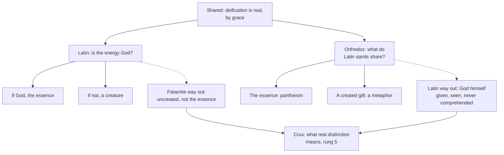

# Apologetics II · Lesson 5.4: Essence and energies

> ⏱ ~15 min · Module 5: Against the Orthodox case · Builds on: [5.1](05-01-the-filioque-two-questions-kept-apart.md), [`trinity-and-god` 1.3](../../trinity-and-god/lessons/01-03-simplicity-as-doctrine.md), [`creation-grace-last-things` 4.3](../../creation-grace-last-things/lessons/04-03-sanctifying-grace-the-indwelling-and-divinization.md) · Unlocks: [5.5](05-05-marriage-divorce-and-the-state-of-the-dead.md), [6.6](06-06-development-or-corruption.md)

## Why this matters

Beneath the filioque and the papacy, Lossky and many Orthodox theologians after him put one question: does God give the saints himself, or a created gift? Catholic apologists have often answered with a condemnation that does not exist. This lesson states the [distinction](../reference.md#essence-and-energies) as its defenders do, presses the Latin objection, and ends with a question both sides must answer.

## The idea

Think of the sun. No one can stand inside it, yet its own light reaches you. Palamas's defenders say God is like that. His **essence**, what he is in himself, is beyond every creature's knowing and sharing, for ever. His **energies**, his life, light and grace going out to us, are God himself, uncreated, and the saints truly share them. So [deification](../reference.md#deification) is real participation in God, and no one becomes God by essence.

Latin theology objects. Lateran IV defined God's essence "altogether simple" ([divine simplicity](../reference.md#divine-simplicity), taught in [`trinity-and-god` 1.3](../../trinity-and-god/lessons/01-03-simplicity-as-doctrine.md), not retaught here). If the energies are God, how do they differ from the essence? If they differ, how are they not creatures? The Orthodox reply in kind: if the essence cannot be shared, Latin saints receive only a created gift, and "deification" is a metaphor.

Created and uncreated grace, and their levels, are [`creation-grace-last-things` 4.3](../../creation-grace-last-things/lessons/04-03-sanctifying-grace-the-indwelling-and-divinization.md)'s; this lesson argues from them.

## Source

Basil of Caesarea, Letter 234 §1, to Amphilochius, tr. Blomfield Jackson (NPNF 2nd series, vol. 8, 1895). His questioners, Eunomians, claimed to know God's essence (§3):

> But God, he says, is simple, and whatever attribute of Him you have reckoned as knowable is of His essence. … If they say that essence is something distinct, let them not put us in the wrong on the score of simplicity. For they confess themselves that there is a distinction between the essence and each one of the attributes enumerated. The operations are various, and the essence simple, but we say that we know our God from His operations, but do not undertake to approach near to His essence. His operations come down to us, but His essence remains beyond our reach.

Here the *opponent* argues from simplicity; Basil keeps simplicity and refuses the inference. He asserts a distinction between the essence and the "operations" (*energeiai*) that "come down to us", but not what kind. A Thomist reads one simple God known through many effects, a Palamite the uncreated energies.

## The other side

**The controversy.** Gregory Palamas (c. 1296–1359), an Athonite monk and from 1347 archbishop of Thessalonica, defended the [hesychasts](../reference.md#hesychast-controversy), monks who held that their prayer of stillness could end in seeing the light of the Transfiguration. Barlaam, a learned Calabrian Greek monk, crossed him in 1337 over whether anything about God can be demonstrated, then attacked the monks: God is known through creatures and by negation, and any light seen is created. [Palamas](../reference.md#gregory-palamas) answered in the *Triads* and the *One Hundred and Fifty Chapters*.

**The doctrine, as its defenders state it** (paraphrased). God's essence is beyond participation, now and in the age to come; a creature sharing it would be God by nature. Yet the saints truly share God himself in his uncreated energies: his glory, life and grace, the light of Tabor. The energies are not parts, accidents or a second God. God is whole in each, and Palamas can call them "divinity". The distinction is not made by our minds, yet divides nothing.

**Its weight in Orthodoxy.** Councils at Constantinople in 1341 condemned Barlaam and then Gregory Akindynos. After a reversal in 1344, councils of February 1347 and of 1351 vindicated Palamas; the 1351 council issued its Tome that August, and its anathemas entered the *Synodikon of Orthodoxy*. A synod of 1368 canonized him, and he is kept on the Second Sunday of Lent. These were local councils whose teaching binds across Orthodoxy by [reception](../reference.md#reception), not by a magisterium's definition.

**The modern statements.** On Lossky's account in *The Mystical Theology of the Eastern Church* (1944; English 1957), chapter 4, "Uncreated Energies", the distinction grounds real union with an inaccessible God; deny it, and nothing divides the procession of the persons from the making of creatures, and pantheism follows. He makes it a key to the East–West divide. Meyendorff's *A Study of Gregory Palamas* (1959; English 1964) makes Palamas heir of the Cappadocians and Maximus, in a quarrel begun inside Byzantium over whether the saints' experience of God is knowledge of him. David Bradshaw's *Aristotle East and West* (2004) argues that the West came to identify God wholly with his being and act, so the Latin objection presupposes a metaphysics the East never shared.

**The counter-charge,** from Orthodox theologians after Lossky: Latin simplicity makes everything in God the essence, which no creature shares, so the Latin saint receives only created grace, and "deification" is a figure for likeness.

## The argument

The Latin objection first. Florence, after *Firmiter*, states a rule: in God "all things are one where no opposition of relation intervenes" (*omniaque sunt unum, ubi non obviat relationis oppositio*, *Cantate Domino*, 4 February 1442, DS 1330). Essence and energies are not opposed as begetter and begotten. So the energies are either God, and then the essence, or other than it, and then creatures.

**P1.** The datum is shared: "partakers of the divine nature" (2 Peter 1:4, Douay-Rheims; Greek *theias koinōnoi physeōs*, "sharers of divine nature"), which CCC 460 sets beside Irenaeus, Athanasius and Aquinas. *In words:* both churches confess a real share in God's life, by grace, never by nature (*Dei Filius*, can. 3 on God the Creator).

**P2.** In Catholic doctrine the term of that share is uncreated. The Persons dwell in the just (John 14:23). The Spirit gives himself, the supreme Gift, not only his gifts (*Divinum Illud Munus* §9, 1897, paraphrased). The blessed see the essence, "no creature mediating as the object seen" ([*Benedictus Deus*](../reference.md#benedictus-deus), 1336, lesson's translation). *In words:* the Latin saint is united to God himself.

**P3.** [Created grace](../reference.md#created-and-uncreated-grace) is the other end of the union: the change in the creature, which truly inheres (Trent VI, can. 11) and which the schools call a quality. *In words:* the gift makes the creature able to receive God; it does not stand in for him.

**P4.** The Latin acts define the essence *simplex omnino* (*Firmiter*) and all in God one where relation does not oppose (*Cantate Domino*). Neither names Palamas, and both speak a vocabulary that grades distinctions: real, formal, of reason. *In words:* the Church defined that God has no composition, not how a Greek distinction maps onto Latin grades.

**P5.** Palamas's defenders deny every mark of composition: no parts, accidents, second God or separability, and God whole in each energy.

**∴ C.** The metaphor charge misses Catholic doctrine (P1–P3). The simplicity charge is a live question no act has answered (P4–P5): a Catholic may press it, not announce the Church's answer.

**Mark the levels.** On [the ladder](../../fundamental-theology/lessons/04-04-the-ladder-of-doctrinal-authority.md) ([levels of authority](../reference.md#levels-of-authority)): *simplex omnino* is **rung 1** (*Firmiter*, 1215; *Dei Filius* ch. 1 repeats it), and so is the rule of relation (*Cantate Domino*). `trinity-and-god` 1.3's three denials are its reading of what *omnino* excludes. Whether the Palamite distinction falls under these acts is **rung 5**: no act applies them to Palamas, and can. 749 §3 forbids inferring a condemnation. Real participation, never one substance with God, and the indwelling: **rung 1**. Grace a "quality": **rung 4**. The order of uncreated and created grace: **rung 5**. Florence's "clearly behold God himself … as he is": **rung 1**; the word *essence* rests on *Benedictus Deus*, **rung 1 if *ex cathedra*, at least rung 3 regardless** ([`creation-grace-last-things` 6.2](../../creation-grace-last-things/lessons/06-02-heaven-and-the-beatific-vision.md)). The distinction itself, and every theologian named: **no magisterial level**. Palamas in Byzantine Catholic calendars: **liturgical law, no rung**.

**Concession.** No magisterial Catholic act condemns Palamas or the distinction. Denzinger, through 1957, never names Palamas, the hesychasts or the energies, and no later act does. Catholic assessments range widely. Adrian Fortescue's 1910 *Catholic Encyclopedia* article called the distinction "fundamentally opposed to the whole conception of God in the Western Scholastic system"; Martin Jugie argued against it at length in the *Dictionnaire de théologie catholique*. Jürgen Kuhlmann (1984) judged the quarrel over the vision a misunderstanding born of the ambiguous word "essence", and Aidan Nichols's *Light from the East* (1995) reads Palamas with sympathy. Several Byzantine-rite Catholic churches keep his commemoration on the Second Sunday of the Great Fast, among them the Melkite Church and the Byzantine Catholic Metropolitan Church of Pittsburgh. Both sides hold deification real.

**The crux.** One side must deny this premise: *whatever in God is uncreated and is God is the essence.* Thomists affirm it: their [real distinction](../reference.md#real-distinction) holds between one *res* and another, and only the relations escape Florence's rule. Palamites deny it. Their "real" means "not made by our minds", distinguishing God in himself from God giving himself, without division. If that "real" is the scholastic one, *Firmiter* and Florence bite; if it lies nearer Scotus's formal distinction, they do not, as the Church applies them. What would move it: the *Triads* and the Tome showing the energies other than the essence as thing from thing, or a Latin argument that any non-relational distinction in the thing breaks *omnino*.

## The two dilemmas

Each side's way out is what the other's dilemma says cannot exist; both meet at one word.

## Worked examples

**Example 1 (clean): "Rome defined against Palamas."** Find the act. *Benedictus Deus* (29 January 1336) defines that the purified see the divine essence (*divinam essentiam*) by intuitive, face-to-face vision. It predates the first Barlaam–Palamas letters (1337) and answers John XXII's question of *when* the vision begins. Florence (6 July 1439) says they "clearly behold God himself, three and one, as he is" (lesson's translation of *intueri clare ipsum Deum trinum et unum, sicuti est*): no "essence". Neither names Palamas or the energies: no condemnation. A tension remains. The Catholic holds the essence seen, never comprehended (God incomprehensible, **rung 1**; said of the blessed, **rung 4**); the Palamite holds it never seen. Whether the two "essences" are one notion is the crux again.

**Example 2 (strain): the Scotist precedent.** [`trinity-and-god` 1.3](../../trinity-and-god/lessons/01-03-simplicity-as-doctrine.md) permits Scotus's [formal distinction](../reference.md#formal-distinction): wisdom and goodness are distinct formalities on the side of the thing in an indivisible God, and Thomist and Scotist both "affirm *Firmiter*". They are not opposed by relation, yet no act reads Florence's rule against Scotism. So the acts, as the Church applies them, do not exclude every distinction in God that is neither relational nor ours. The energies differ from the essence as formalities do not: creatures share them, never the essence. Thomists deny that shareability can differ without a scholastic real distinction, Palamites affirm it, and the precedent cannot settle which. Here the argument stops determining an answer.

## Watch out

- **You might think Palamas makes the energies a second God, a go-between, or a part of God.** His defenders deny all three. His phrase "lower divinity", which opponents heard as polytheism, is their best text, not his thesis; a reply aimed at ditheism hits no one.
- **You might think the Latins teach that grace is a thing God gives instead of himself.** The Persons dwell in the just (**rung 1**) and the Spirit gives himself (**rung 3**); "quality" is school vocabulary (**rung 4**).
- **You might think that since *Firmiter* and Florence are rung 1, Palamism is heresy.** Their application to a distinction they never name is **rung 5**, and can. 749 §3 forbids promoting it. *Firmiter* predates Palamas's birth by about eighty years.
- **You might think the 1351 Tome is Orthodoxy's papal definition, or a mere local synod's opinion.** It is a local council's act that binds by reception.

## One-liner

> Palamas says God gives himself in uncreated energies distinct from his unknowable essence; no Catholic act condemns it, both sides hold deification real, and the quarrel turns on what "real distinction" means in Greek and in Latin.

## Problems

**P1 (🟢) *(Diagnose · Exegetical.)*** Two invented texts, written for this problem; no real person, parish or website wrote them.

> (i) From a blog post by Achilleas Pappadimas, a Greek Orthodox theology student: "(1) For Latins, grace is a created thing God hands over instead of himself, so their saints are joined to a creature. (2) That is why no Catholic is allowed to honour St Gregory Palamas."
>
> (ii) From an unsigned FAQ on an invented Catholic apologetics site: "(3) Lateran IV condemned Palamism when it defined God altogether simple. (4) Since simplicity is *de fide*, the essence–energies distinction is formally heretical."

For each numbered sentence, name the error and give the correction, with the text or act that supplies it. **Two sentences per item.**

**P2 (🟡) *(Apologetic: (a) Exegetical, graded first · (b) reply.)*** At an invented Orthodox–Catholic study day, an Orthodox speaker says: "Your simplicity makes everything in God his essence, and your saints never share the essence. So what they get is created grace, and deification, for you, is a figure of speech."

(a) State this charge as Orthodox theologians after Lossky press it, including the dilemma it rests on.

(b) Reply, opening with a **named concession**, from `creation-grace-last-things` 4.3's distinction between uncreated and created grace and the levels it assigns. A reply that concludes the charge succeeds passes if it is a good reply. **150 words or fewer in total.**

**P3 (🔴, optional) *(Find the crux · Evaluative.)*** A Thomist says: "Is the energy God? If so, it is the essence, for in God all is one where no opposition of relation intervenes. If not, it is a creature." A Palamite answers: "Your dilemma assumes what it has to prove."

(a) Name the premise the Palamite denies, and say what would move each side on it. *(Exegetical, strict.)* **Two sentences.**

(b) Is the distinction, as its defenders state it, compatible with simplicity as *Firmiter* and Florence define it? Any verdict. Say what "real" must mean for your verdict to hold, and deal with the Scotist precedent. *(Evaluative.)* **120 words or fewer.**

Solutions

**P1** *(Diagnose · Exegetical)*

**Must hit, strict:**

- **(1) Caricature of Catholic doctrine.** The term of Catholic grace is uncreated: the Persons dwell in the just (John 14:23, **rung 1**), and the Spirit gives himself, not only his gifts (*Divinum Illud Munus* §9, **rung 3**). The created gift is the change in the creature that receives him (Trent VI can. 11), and calling it a "quality" is school vocabulary (**rung 4**; `creation-grace-last-things` 4.3).
- **(2) False as fact.** No Catholic act condemns Palamas, and several Byzantine-rite Catholic churches keep his commemoration on the Second Sunday of the Great Fast, among them the Melkite Church and the Byzantine Catholic Metropolitan Church of Pittsburgh. That observance is liturgical law inside the Catholic communion, not a doctrinal ruling.
- **(3) Anachronism.** *Firmiter* (1215) was written about eighty years before Palamas was born (c. 1296), and it names no distinction of essence and energies. It defines that the essence is *simplex omnino* (**rung 1**), and no act applies that to Palamas.
- **(4) Level error.** The definition is **rung 1**, but whether the Palamite distinction falls under it is **rung 5**: no act says so, and can. 749 §3 forbids inferring a definition or a condemnation. "Formally heretical" is a censure no competent act has passed, and Denzinger never names Palamas.

**Wrong turns:** correcting (1) by denying that Catholics hold any created grace, which overcorrects (inherence is **rung 1**). Correcting (2) by saying "all Byzantine Catholic churches" keep the feast, since practice is not uniform. Correcting (4) by calling Palamism "condemned at Florence", or answering that the distinction is "Catholic teaching", which overstates in the other direction.

**Model answer:** (1) Catholic doctrine makes God himself the term of grace: the Persons dwell in the just (rung 1), and the Spirit gives himself (DIM §9, rung 3). "Created grace" names the change in us, a school's "quality" (rung 4), not a substitute for God. (2) No Catholic act condemns Palamas. The Melkite Church and the Byzantine Catholic Metropolia of Pittsburgh keep his Sunday in Lent. (3) Lateran IV met in 1215, about eighty years before Palamas was born, and names no such distinction. It defines simplicity (rung 1) and nothing about him. (4) The definition is rung 1, but its application to Palamas is rung 5: no act makes it, and can. 749 §3 forbids presuming one. "Formally heretical" is a censure no one with authority has passed.

---

**P2** *(Apologetic: (a) Exegetical, graded first · (b) reply)*

**Accept:** any reply that opens with a real concession, separates the doctrine from school vocabulary, and marks levels correctly, whatever its verdict.

**Must hit, strict (a), graded first:**

- **The premise:** in Latin theology everything in God is identical with the essence (simplicity read without an essence–energies distinction), and the essence cannot be shared by any creature.
- **The dilemma:** so what a saint receives is either the essence, which is pantheism, or something created, a quality of the soul.
- **The conclusion:** the Latins choose created grace, so union with God is union with a created effect, and "deification" becomes a metaphor for moral likeness. Only an uncreated energy, distinct from the essence, gives real participation in God.

**Must hit (b):**

- A **named concession**, stated flatly. For example: Latin manual theology often spoke of created grace as if it were the basis of God's self-gift, which Rahner, a Catholic, charged in 1939.
- **The term is uncreated:** the Persons themselves dwell in the just (**rung 1**), and the Spirit gives himself (**rung 3**). In glory the blessed see the essence with no creature as the object seen (*Benedictus Deus*), never comprehending it (**rung 4**, applying the **rung-1** incomprehensibility).
- **The created gift** is the creature's side of the union, inhering (**rung 1**) and called a "quality" by the schools (**rung 4**). So the dilemma's second horn describes the school's word, not the doctrine.
- **An honest limit:** this answers the metaphor charge, not the simplicity question, which stays **rung 5**.

**Wrong turns:** stating (a) as "the Orthodox think Latins don't believe in deification", which drops the dilemma and fails (a). Replying that grace is "only created" or that Rahner's order is defined. Claiming the Church has condemned the essence–energies distinction. Replying from Aquinas alone with no levels.

**Model answer (a):** If everything in God is his essence and the essence is unshareable, a Latin saint receives either the essence, which is pantheism, or a created quality. The Latins choose the second, so deification is only a figure for likeness; real participation needs uncreated energies distinct from the essence.

**Model answer (b), one of several:** Concession: our manuals often put created grace first and God's self-gift second, as Rahner, a Catholic, complained in 1939. But the doctrine's term is God himself. The Persons dwell in the just (rung 1), and the Spirit gives himself (rung 3). In glory the blessed see God's essence, with no creature as the thing seen, without comprehending it. "Created grace" is the change in us that receives him; "quality" is school language (rung 4). That answers the metaphor charge. Whether simplicity excludes your energies is another question, and it is still open (rung 5).

---

**P3** *(Find the crux · Evaluative)*

**Must hit, strict (a):**

- The denied premise: **whatever in God is uncreated and is God is identical with the essence.** Equivalently, the only distinctions in God that are not made by our minds are the relational ones.
- **What would move it:** for the Palamite, a showing from the Triads or the 1351 Tome that the energies are "other" than the essence as one *res* from another. For the Thomist, a showing that a non-relational distinction on the side of the thing (Scotus's formal distinction is the test case) does not compromise *simplex omnino*.

**Must hit, any verdict (b):**

- Separate the acts (**rung 1**: *simplex omnino*; all one where no opposition of relation intervenes) from their application to Palamas (**rung 5**).
- Say what "real" means on your verdict. "Thing from thing" makes compatibility fail; "not made by our minds, without division" leaves it open.
- Use the Scotist precedent and its limit. Scotism is tolerated beside Florence's rule, but the energies differ from the essence in shareability, which formalities do not.
- State the cost of the verdict for one side.

**Wrong turns:** answering "no, because the Church condemned it" (it did not) or "yes, because the Church approved it" (no act did; a liturgical feast is not a doctrinal approval). Naming "whether deification is real" as the crux, which both affirm. Treating Bradshaw's or Lossky's thesis as Orthodox dogma.

**Model answer (a):** The Palamite denies that whatever in God is uncreated and divine must be identical with the essence. He would be moved by texts showing the energies "other" than the essence as thing from thing, and the Thomist by an argument that a non-relational distinction on the side of the thing leaves *omnino* intact.

**Model answer (b), one of several:** Compatible, on one reading. If "real" means only "not made by our minds, without division", the Latin acts as the Church applies them already tolerate such a distinction: Scotus's formalities are not opposed by relation, and no act censures them. The difficulty is shareability. If creatures share the energies and never the essence, one is had without the other, and that looks like the scholastic real distinction Florence excludes. My verdict holds only if a Palamite can say the saints share God whole in the energies, so that nothing in God is had apart from anything else. The cost: the "never the essence" must be read as never *comprehended*, which Palamites may refuse.

## Flashback

**From Lesson [5.2](05-02-papal-primacy-as-the-east-reads-it.md) (Papal primacy as the East reads it):** *(Exegetical.)* Diagnose. Four sentences from a Catholic adult-education talk on Orthodoxy, invented, written for this problem:

> (1) "The Orthodox say each local church around its bishop is the whole Church. Catholic doctrine rejects that: a diocese is a branch of the universal Church, run from Rome."
>
> (2) "Still, the Orthodox grant that Rome stood first in the order of the five great sees."
>
> (3) "And Rome convened and presided over the great councils, which shows its jurisdiction from the start."
>
> (4) "Only nostalgics still say 'primacy of honour': the 2023 Alexandria text, which binds both churches, has dropped it."

One sentence is right. Say which, and on what text; for each of the other three, give the correction and the text that supplies it. **Two sentences per item.**

Solution

**Must hit, strict:**

- **(1) Wrong.** The Church of Christ is "truly present in all legitimate local congregations of the faithful" (LG 26, **at least rung 3**), and the Eastern Eucharist builds up the Church of God (UR 15, **rung 3**). Bishops are not "vicars of the Roman Pontiffs" (LG 27): the branch office is not Catholic doctrine either.
- **(2) Right.** Ravenna §41 records agreement that Rome held first place in the *taxis*, Chieti §15 lists the five sees with Rome first, and the 1895 encyclical grants Rome an "honorary prerogative of presidency". The dispute is over that first's prerogatives.
- **(3) Wrong.** Emperors convened and enforced the ancient councils; Rome never convened or personally presided over one (Ravenna §42). That weakens any claim that conciliar authority flowed from Rome, though neither side now derives it from an emperor.
- **(4) Wrong twice.** The Moscow Synod's 2013 *Position*, one church's act, still calls the universal primacy of the first millennium one of honour; Alexandria §5.1 says only that for the Orthodox primacy is "not merely honorific". Alexandria is a joint commission text with no magisterial level and binds no church.

**Wrong turns:** "correcting" (2) into "the Orthodox grant Rome no primacy", the caricature 5.2 warns against. Reading "not merely honorific" as a concession of jurisdiction, or saying Orthodoxy never uses "primacy of honour". Grading the speaker gently because he argues the Catholic side.

**Model answer:** (1) Wrong: LG 26 holds the Church of Christ truly present in every legitimate local congregation, and LG 27 denies that bishops are papal vicars. (2) Right: Ravenna §41 and Chieti §15 put Rome first in the *taxis*, and the 1895 encyclical grants it presidency. (3) Wrong: emperors convened the councils, and Rome never convened or chaired one (Ravenna §42). (4) Wrong: Moscow (2013) still says "of honour", Alexandria §5.1 says "not merely honorific", and a joint commission text binds no church.

## Connections

- **Backward:** simplicity as doctrine, the three denials and the Scotist precedent are [`trinity-and-god` 1.3](../../trinity-and-god/lessons/01-03-simplicity-as-doctrine.md); its derivation is [`thomistic-synthesis` 3.4](../../thomistic-synthesis/lessons/03-04-divine-simplicity-and-the-attributes.md). Created and uncreated grace, divinization and their levels are [`creation-grace-last-things` 4.3](../../creation-grace-last-things/lessons/04-03-sanctifying-grace-the-indwelling-and-divinization.md), and *Benedictus Deus* and Florence on the vision are its [6.2](../../creation-grace-last-things/lessons/06-02-heaven-and-the-beatific-vision.md). Palamas already appeared in [5.1](05-01-the-filioque-two-questions-kept-apart.md) on the eternal shining-forth through the Son.
- **Forward:** [5.5](05-05-marriage-divorce-and-the-state-of-the-dead.md) meets Mark of Ephesus at Ferrara and a question where Orthodoxy has no definition at all. [6.6](06-06-development-or-corruption.md) takes up the Orthodox claim that the faith is received, not developed, which is how Meyendorff presents Palamas: heir, not innovator. Boss 5 asks for this lesson's material at length ([syllabus](../syllabus.md)).
- **Sideways:** Basil is [`patristics` 3.2](../../patristics/lessons/03-02-basil-the-great.md), and Maximus on deification by grace is [`patristics` 5.4](../../patristics/lessons/05-04-maximus-and-john-of-damascus.md). Scotus next door to the formal distinction is [`ancient-medieval-philosophy` 8.2](../../ancient-medieval-philosophy/lessons/08-02-scotus-the-univocity-of-being.md). The philosophical objections to simplicity, which this course does not argue, are [`philosophy-of-religion` 1.4](../../philosophy-of-religion/lessons/01-04-eternity-immutability-and-simplicity.md).
