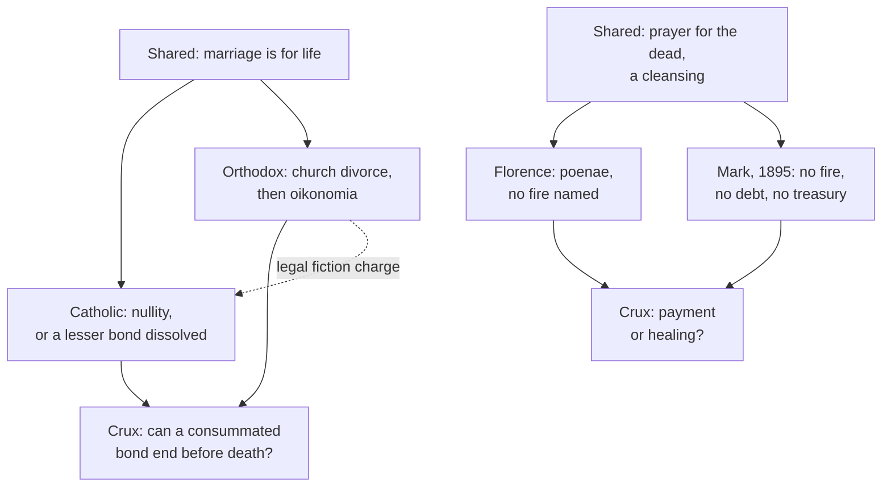

# Apologetics II · Lesson 5.5: Marriage, divorce, and the state of the dead

> ⏱ ~15 min · Module 5: Against the Orthodox case · Builds on: [5.4](05-04-essence-and-energies.md), [`sacraments-and-liturgy` 5.3](../../sacraments-and-liturgy/lessons/05-03-matrimony-sacrament-contract-indissolubility.md), [`sacraments-and-liturgy` 5.4](../../sacraments-and-liturgy/lessons/05-04-nullity-dissolution-and-the-pastoral-debates.md), [`creation-grace-last-things` 6.3](../../creation-grace-last-things/lessons/06-03-purgatory.md) · Unlocks: [6.3](06-03-penance-purgatory-and-indulgences.md)

## Why this matters

An Orthodox priest may crown a divorced woman's second marriage; a Catholic tribunal may declare a twenty-year marriage null. Each suspects the other of softening Christ's word. Catholic tracts say "the Orthodox deny purgatory", though every Orthodox liturgy prays for the dead. Both read the same Gospel and Fathers; the Catholic case must win on the record or concede.

## The idea

Both disputes have one shape: **agreement on the practice, disagreement on what it means.**

Both churches hold marriage to be for life, and both let some whose marriages have collapsed marry again in church. Rome finds that no bond ever arose, or dissolves a bond that is not both sacramental and consummated ([nullity and dissolution](../reference.md#nullity-and-dissolution)). The Orthodox grant a church divorce and bless a second marriage by [*oikonomia*](../reference.md#oikonomia), "stewardship" (lesson's gloss): a rule applied with mercy for a soul's salvation, as against *akribeia*, "exactness". The question is whether a valid, consummated Christian marriage can end before death.

Both churches pray for the dead and expect some cleansing after death, which the West calls [purgatory](../reference.md#purgatory). The East refuses a purgatorial fire, a debt of punishment paid after death, and a [treasury](../reference.md#treasury-of-the-church) of merits drawn on by [indulgences](../reference.md#indulgences). The question is whether the cleansing is a payment or a healing.

`sacraments-and-liturgy` [5.3](../../sacraments-and-liturgy/lessons/05-03-matrimony-sacrament-contract-indissolubility.md)–[5.4](../../sacraments-and-liturgy/lessons/05-04-nullity-dissolution-and-the-pastoral-debates.md) and `creation-grace-last-things` [6.3](../../creation-grace-last-things/lessons/06-03-purgatory.md) taught the doctrines and stated the Orthodox practice; this lesson argues them.

## Source

The [Council of Florence](../reference.md#council-of-florence), *Laetentur caeli* (6 July 1439), on the dead (DS 1304–1305), lesson's translation of the Latin. Brackets give the governing verb, and the wording of Michael VIII's profession at [Lyons II](../reference.md#lyons-ii) (1274; DS 856) on the key phrase:

> Likewise [we define] that if the truly penitent die in the love of God before they have made satisfaction by worthy fruits of penance for what they have done and failed to do, their souls are purged after death by purgatorial pains [Lyons: "purgatorial or cleansing (*catharteriis*) pains, as Brother John explained to us"]; and that, for their relief from such pains, the suffrages of the living faithful avail them …; and that the souls … which have been purged … are received at once (*mox*) into heaven.

Two words carry the Latin framework: *satisfecerint*, and *poenis*, "penalties", which the official Greek of this formula at Ferrara rendered *kathartikais timōriais*, "cleansing punishments" (Petit, *Patrologia Orientalis* 15, doc. I). Nothing names fire, place, duration or treasury.

## The other side

**Marriage.** `sacraments-and-liturgy` 5.4 stated the practice from Crete (2016) and the Orthodox Church in America: marriage lifelong, divorce opposed, a second and even a third marriage permitted by economy with a penitential rite, once the first is "completely dissolved or annulled" (Crete II.2). The fullest official list of grounds is the Moscow Patriarchate's [*Basis of the Social Concept*](../reference.md#basis-of-the-social-concept) (Bishops' Council, 2000), X.3. It grounds indissolubility in Matthew 19:6 and 9 and calls divorce a sin; adultery, the ground the Lord named, breaks the bond of marital fidelity. Byzantine law's many grounds, it says, drew no objection from the Church, and the Russian Council of 1918 added apostasy, desertion, insanity and more. "The Church does not at all approve of a second marriage", yet after a church divorce the innocent spouse may remarry, the guilty one after penance. John Meyendorff's *Marriage: An Orthodox Perspective* (1970; 3rd ed. 1984) gives the theology: a mystery of the Kingdom, not a contract, met by condescension, not a second norm.

On the record, Origen (c. 246–248) reports that "some even of the rulers of the church have permitted a woman to marry, even when her husband was living", against Scripture yet "not indeed altogether without reason" (*Commentary on Matthew* XIV.23, tr. John Patrick, ANF 9). Basil: "The sentence of the Lord … applies, according to the argument, to men and women alike. Custom, however, does not so obtain." His deserted husband who remarries is "pardonable" (Letter 188, can. 9, c. 374, tr. Blomfield Jackson, NPNF2 8). Jerome grants that "the laws of Cæsar are different … from the laws of Christ" and calls Fabiola's second marriage a fault made in good faith (Letter 77.3, 399, tr. W. H. Fremantle, NPNF2 6).

**The [legal-fiction objection](../reference.md#legal-fiction-objection)**, the one to answer, as an Orthodox canonist presses it: Catholic tribunals reach the Orthodox result, a second church wedding, while declaring that years of common life rested on no marriage. The defect is placed at the wedding but read back from the breakdown, under grounds as wide as incapacity (can. 1095), and Rome dissolves some real bonds itself. The Orthodox practice is the honest one: a real marriage died, is mourned with penance, and a second is blessed as condescension.

**The dead.** At Ferrara on 5 June 1438 Cardinal Cesarini gave the Greeks the formula Florence would define, arguing for a set place and a purgatorial fire. The Greeks, the Latins' paper records, called it "not a dogma of the Eastern Church" (Petit, doc. I; lesson's translations throughout). [Mark of Ephesus](../reference.md#mark-of-ephesus), in his orations and his joint reply with Bessarion (Greek, with Petit's Latin; see the [Ferrara purgatory debate](../reference.md#ferrara-purgatory-debate)), argued:

- prayers, liturgies and alms help the departed;
- souls that die in faith but stained are cleansed in proportion to their faults, not by fire or in a place but by fear, by a conscience that "gnaws the mind more sharply than any fire", by the loss of God's glory, "as in custody" (doc. II §1);
- no doctor taught a temporary fire, and it invites Origen's error that punishment ends (doc. III §4);
- penances are medicine for the living, and spare them chastisement hereafter; for the dying, God forgives "both guilt and punishment" (doc. VI, q. 14).

The [1895 encyclical](../reference.md#patriarchal-encyclical-of-1895) of Anthimos VII and his synod (tr. E. Metallinos, 1896), §XII, prays "for the forgiveness and rest" of the dead and rejects "innovations concerning purgatorial fire, a superabundance of the virtues of the saints, and the distribution of them", and a full reward before the resurrection. **Orthodoxy has defined nothing about the [state of the dead](../reference.md#state-of-the-dead).** Mark wrote as a theologian; the encyclical is one patriarchate's letter. Mogila's *Confession* (1643), which refuses all cleansing punishment, is one of the [seventeenth-century confessions](../reference.md#orthodox-confessions-of-the-seventeenth-century) that modern Orthodox theologians hold of limited authority and partly Latinized.

## The argument

**P1.** Mark 10:11–12, Luke 16:18 and "the Lord's" command in 1 Corinthians 7:10–11 forbid remarriage after separation. *In words:* three witnesses of four carry no exception.

**P2.** Matthew 19:9's "except it be for fornication" (DR) has several readings, none defined, and Trent XXIV can. 7 forbids saying the Church errs in holding the bond intact after adultery. *In words:* *porneia* is open; a licence is not.

**P3.** Nullity finds that no bond arose (CCC 1629), against a presumption of validity (can. 1060); dissolution reaches only bonds not both sacramental and consummated (cann. 1141–1143). *In words:* no power is claimed over the bond Christ called indissoluble.

**P4.** *Oikonomia* requires the first marriage "dissolved or annulled" (Crete II.2); Moscow grants "a church divorce". *In words:* it ends, or declares ended, a real bond while both spouses live.

**∴ C1.** Where the practices truly differ, a valid marriage broken afterwards, Rome keeps the unqualified saying and the East does not.

**P5.** Both churches pray for the dead, and Mark admits a cleansing after death. Florence defines purgation "by purgatorial pains", helped by suffrages, naming no fire, place or treasury; Trent VI can. 30 adds a "debt of temporal punishment to be discharged … in the next in Purgatory" (Waterworth). *In words:* a remainder and its cleansing are defined; the furniture is not.

**P6.** The Church reads that debt as following "from the very nature of sin", not as "vengeance inflicted by God from without" (CCC 1472), and defines no mechanism ([`theology-of-debt` 3.4](../../theology-of-debt/lessons/03-04-aquinas-satisfaction-and-the-debt-of-punishment.md)). *In words:* a wound to heal, not only a bill.

**∴ C2.** Fire, place and treasury are not in the definition. What stands is whether something owed for forgiven sin is purged after death, and Florence's authority to say so.

**Mark the levels.** On [the ladder](../../fundamental-theology/lessons/04-04-the-ladder-of-doctrinal-authority.md) ([levels of authority](../reference.md#levels-of-authority)): no human power can dissolve a ratified, consummated marriage, **at least rung 2** (John Paul II to the Roman Rota, 2000, §8). Trent XXIV can. 7: **rung 1 as worded**, whether it defined [indissolubility](../reference.md#indissolubility) as revealed being disputed; can. 5: **rung 1**. The meaning of *porneia*: **rung 5** inside can. 7's fence ([exception clause](../reference.md#exception-clause)); nullity's grounds and procedure: **law, no rung**. Florence's clause and Trent VI can. 30: **rung 1**; fire, place, duration, mechanism: **rung 5**; Lyons II's profession defines nothing of itself. The treasury: **rung 3**, not defined; the power to grant indulgences: **rung 1** (Trent XXV). Orthodox texts: **no Catholic level**; within Orthodoxy the Moscow text binds one Church, and Crete 2016 met without four churches.

**Concession.** The patristic and Byzantine record on remarriage is genuinely mixed: Origen's bishops permitted it, Basil kept a custom he admitted was uneven, Jerome pleaded good faith for a remarried matron, and Justinian legislated grounds of divorce (Novel 117, 542). The Catholic definitions of purgatory never mention fire, and the Latins who argued for one at Ferrara left it out of the decree.

**The crux.** *Marriage:* can a consummated sacramental bond cease before death? Catholics deny it; *oikonomia* must affirm it, since it blesses no second marriage over a bond in force, and calling the act "recognizing a death" leaves the premise standing. What would move it: whether Matthew's clause governs Mark, Luke and Paul or is governed by them. *The dead:* must Trent's remaining debt be a penalty paid to justice, or can it be CCC 1472's unhealthy attachment? If the latter, Mark's fear and conscience describe much the same purgation, and the dispute shrinks to Florence's authority and the treasury.

## The map of positions

The shared ground is wider than the polemic admits.

## Worked examples

**Example 1 (clean): the marriage that was real.** Invented. Irina and Stefan married validly in church; fifteen years later Stefan leaves for another woman. Under the Moscow text Irina, the innocent party, may divorce in church and remarry. For Rome the marriage was valid, sacramental and consummated: separation is lawful (Trent XXIV can. 8), remarriage while Stefan lives is not (can. 1141). It isolates the real difference, after the wedding, without settling it: one side cites Mark and Luke, the other Matthew.

**Example 2 (strain): the marriage declared null.** Invented. Konrad and Beatrix were married twenty-two years and have four children. A tribunal finds that Konrad lacked the discretion of judgment consent requires (can. 1095, 2°), and both remarry in church. The Orthodox charge lands: *oikonomia*'s result, described as if two decades held no marriage. Rome replies: the finding concerns consent, validity was presumed until proved otherwise (can. 1060), and a putative marriage's children are legitimate (cann. 1061 §3, 1137). Here the argument stops. Doctrine forbids dissolving a valid consummated bond; it cannot say whether this finding is true, and a court that read defects back from breakdowns would turn a true distinction into a fiction.

## Watch out

- **You might think "the Orthodox deny purgatory" is fair shorthand.** A blur: they pray for the dead, Mark allowed a cleansing, and nothing is defined; they refuse the fire, a debt paid after death and the treasury. Mogila's *Confession* is not their magisterium.
- **You might think Trent anathematized the Orthodox practice.** Can. 7 strikes whoever says the Church *errs*, worded at Venice's request to spare the Greeks ([`sacraments-and-liturgy` 5.3](../../sacraments-and-liturgy/lessons/05-03-matrimony-sacrament-contract-indissolubility.md)). The opposite slip, "so remarriage after adultery stayed open", understates: at least rung 2.
- **You might think Waterworth's Trent lets the Church "dissolve" marriages by impediments.** His "dissolve" (cans. 3–4) renders *dirimere*, "make void"; cans. 5 and 7 keep *dissolvi* for the bond.

## One-liner

> Both churches let some broken marriages end in a new church wedding and pray their dead through a cleansing; the disputes are whether a consummated sacramental bond can die before its spouses do, and whether the cleansing is payment or healing.

## Problems

**P1 (🟢) *(Exegetical · Diagnose.)*** An invented column from a Catholic parish newsletter, written for this problem:

> "Our Orthodox brethren are close to us, but two things divide us. They deny purgatory: their Church officially teaches, in the Confession of Peter Mogila, that there is no purification after death, which is why they do not pray for the dead. And they allow divorce: Trent anathematized the Greek practice, but the Orthodox simply ignore Christ's words. We, by contrast, have never dissolved a marriage, and the Council of Florence defined the fire of purgatory to settle the matter with them."

Find **four** errors. For each, give the correction, and name the act and level wherever a level is involved. **150 words or fewer.**

**P2 (🟡) *(Apologetic: (a) Exegetical, graded first · (b) reply.)*** From an inquirers'-class handout by Fr Antoun Jabbour, an invented Antiochian Orthodox priest at the invented Holy Prophet Elias Mission, Selsworth:

> "Rome forbids divorce on paper and sells it in practice. Pay the tribunal, find a psychologist, and your twenty-year marriage 'never existed'. We are honest: when a marriage dies, we say so, we repent, and the Church in her mercy may bless a second marriage."

(a) State the objection as an Orthodox canonist would sign it, at its strongest. Keep what he would keep, drop what he would not, and name what you dropped. **Three sentences.**

(b) Reply, opening with a **named concession**. **120 words or fewer.** A reply that concludes the objection succeeds passes if it is a good reply.

**P3 (🔴) *(Exegetical · Close reading.)*** Use the Source passage. In their joint reply at Ferrara (doc. III §§4–5, paraphrased), the Greeks split the question in three: (1) whether God remits venial sins after death; (2) whether he does so through some punishment, such as prison or darkness, or simply through his mercy and the Church's prayers; (3) whether it happens necessarily by fire, a bodily fire. They granted (1), deferred (2) and refused (3).

(a) For each of the three questions, say whether Florence's clause answers it, and quote the words that do.

(b) Which word of the clause would a Greek who held Mark's view of penance (doc. VI, q. 14) find hardest to sign, and why?

(c) What does the record allow you to say about what the Greek signatories understood themselves to be accepting, and what does it not?

**Two sentences per part.**

Solutions

**P1** *(Exegetical · Diagnose)*

**Accept:** any four of the six below, each corrected.

**Must hit, strict:**

- **"Officially teaches, in Mogila's Confession."** Orthodoxy has no dogmatic definition on the state of the dead. Mogila's *Orthodox Confession* (1643) is a seventeenth-century confession that modern Orthodox theologians hold of limited authority and partly Latinized; it carries no Catholic level and is not "the Orthodox position".
- **"No purification after death; they do not pray for the dead."** Orthodox liturgy prays for the departed (the 1895 encyclical, §XII), and Mark of Ephesus allowed a cleansing in proportion to faults. What the East refuses is a purgatorial fire, a debt paid off after death and the treasury.
- **"Trent anathematized the Greek practice."** XXIV can. 7 strikes whoever says the Church errs in teaching that adultery leaves the bond intact, worded at Venice's request to spare the Greeks: **rung 1 as worded**.
- **"Simply ignore Christ's words."** They read Matthew 19:9's exception as naming adultery, and the Moscow *Basis* (X.3) grounds indissolubility in Matthew 19:6 and 9; *oikonomia* is presented as condescension, not denial.
- **"Never dissolved a marriage."** The Church dissolves non-consummated and non-sacramental bonds (cann. 1142–1143; the privilege of the faith); only a ratified and consummated bond is beyond any power (**at least rung 2**).
- **"Florence defined the fire."** It defines purgation "by purgatorial pains" (**rung 1**) and names no fire; fire is **rung 5**.

**Wrong turns:** correcting the first error by calling Orthodoxy's position "undefined, so anything goes", when Mark and the 1895 encyclical state a clear one; correcting the third by saying can. 7 left remarriage open (understatement); calling Catholic dissolutions "annulments"; citing Lyons II as the defining act.

**Model answer:** Mogila's *Confession* is a seventeenth-century text of limited authority, and Orthodoxy has defined nothing on the state of the dead. The Orthodox pray for the dead at every liturgy, and Mark of Ephesus allowed a cleansing after death; they refuse the fire, a debt paid after death and the treasury. Trent XXIV can. 7 (rung 1 as worded) condemns saying the Church errs, a wording chosen to spare the Greeks. The Church does dissolve non-consummated and non-sacramental bonds (cann. 1142–1143); only a ratified, consummated one is beyond any power (at least rung 2). Florence defines "purgatorial pains" (rung 1) and names no fire (rung 5).

---

**P2** *(Apologetic: (a) Exegetical, graded first · (b) reply)*

**Accept:** any reply that opens with a real concession, keeps nullity and dissolution apart, and engages the outcome-based charge, whatever its verdict.

**Must hit, strict (a), graded first:**

- **Keep:** Catholic nullity reaches the Orthodox result, a second church wedding, while declaring that the first union was never a marriage; the defect is placed at consent but in practice is often inferred from later breakdown, under grounds (incapacity, can. 1095) broad enough to fit many failed marriages; Rome also dissolves real bonds below the line it draws.
- **Keep:** the Orthodox counter-claim, that the honest description is a real marriage that has died, mourned with penance, with a second union blessed by condescension, and that Orthodoxy still holds marriage lifelong in intent.
- **Drop and name:** "sells it" (a charge of simony; a fee is not a price for a verdict, and the objection does not need it); "find a psychologist" as if any testimony sufficed (the presumption of validity, can. 1060, stands until proved otherwise). A canonist argues from elastic grounds and outcomes, not from bribery.

**Must hit (b):**

- **A named concession**, for example: the Orthodox description is truthful about the years lived; or a tribunal can read a defect back from a breakdown, and *Mitis Iudex* itself admits its briefer process could endanger indissolubility ([`sacraments-and-liturgy` 5.4](../../sacraments-and-liturgy/lessons/05-04-nullity-dissolution-and-the-pastoral-debates.md)).
- Separate doctrine from practice: nullity is a finding of fact under a presumption of validity, and the putative marriage honours the years and the children (cann. 1061 §3, 1137). Bad findings argue for reformed tribunals, not for a power to dissolve.
- Turn to the crux: *oikonomia* still requires the first bond "dissolved or annulled" (Crete II.2), a real bond ended while both live, which is what Mark 10:11–12 and Luke 16:18 forbid; Catholic dissolutions stop below the ratified and consummated bond.

**Wrong turns:** stating (a) as "the Orthodox think marriage is a contract that can be broken" or "they allow divorce on demand" (caricature of their side: it fails the problem); stating it with the simony charge intact; replying that the Church never dissolves marriages; saying Trent anathematized the Orthodox; treating the Moscow *Basis* as binding all Orthodoxy.

**Model answer (a):** Catholic tribunals reach the result Orthodoxy reaches, a second church marriage, but by declaring that a union of many years and children was never a marriage, a defect placed on the wedding day and in practice read back from the breakdown under grounds as wide as incapacity, while Rome also dissolves some real bonds itself. The Orthodox Church holds marriage lifelong and calls divorce a sin, but says plainly that a real marriage has died, mourns it with penance, and blesses a second union as condescension. Dropped: "sells it" and "find a psychologist", charges of bribery and of sham evidence that a canonist does not need and would not sign.

**Model answer (b), one of several:** Concession: the Orthodox account is truthful about the years lived, and a tribunal can read a defect back from a breakdown; *Mitis Iudex* itself admits its fast process carries that risk. But nullity is a finding of fact under a presumption of validity, and the putative marriage honours the years and the children. Where a finding is false, the remedy is better tribunals, not a power to end a real bond. And that is the real difference: Orthodoxy requires the first bond "dissolved or annulled", so it ends a real, consummated marriage while both spouses live. Mark and Luke forbid exactly that, and Catholic dissolutions stop short of it.

---

**P3** *(Exegetical · Close reading)*

**Must hit, strict (a):**

- **(1) Answered, and widened:** "their souls are purged after death", for the truly penitent dying "in the love of God", with satisfaction unfinished "for what they have done and failed to do", which is not confined to lighter sins.
- **(2) Answered in one direction:** "by purgatorial pains" (*poenis*), "for their relief from such pains": some penalty, not mercy and prayers alone, though its kind (prison, darkness, sorrow) is left open.
- **(3) Not answered:** no word names fire or a place, so the Greeks' refusal stands untouched by the definition (fire: rung 5).

**Must hit, strict (b):**

- ***satisfecerint***, "before they have made satisfaction": it presupposes a satisfaction still owed at death. Mark says the Church remits the penances of the dying and God forgives "both guilt and punishment". Credit *poenis* as a second answer, since the Greek version rendered it "punishments".

**Must hit, strict (c):**

- **Can say:** the Greeks signed a text without the fire and place they had refused at Ferrara, whose *poenae* could bear Mark's custody, fear and conscience.
- **Cannot say:** what each signatory privately meant, nor that Orthodoxy received it: Mark refused to sign, signers withdrew at home, and signature is not reception ([`church-history` 4.2](../../church-history/lessons/04-02-east-and-west-the-long-estrangement.md)).

**Wrong turns:** saying the clause answers (3) by silence in the Latins' favour; saying it leaves (2) wholly open, which ignores *poenis*; picking *mox* in (b) (that touches the 1895 objection to a full reward before the resurrection, not penance); claiming the Greeks "accepted purgatory" or "were tricked", both of which outrun the record.

**Model answer:** (a) Question (1) is answered and widened: "their souls are purged after death" for penitents who die before making satisfaction "for what they have done and failed to do", not only for lighter sins. Question (2) is answered in one direction, "by purgatorial pains" from which suffrages bring "relief", so by some penalty and not by mercy alone, its kind unstated; question (3) is not answered, since no word names fire or a place. (b) *Satisfecerint*: the clause assumes a satisfaction still owed at death, while Mark held that the Church remits the dying their penances and God forgives guilt and punishment alike. *Poenis*, which the Greek rendered "punishments", is the runner-up. (c) The record shows the Greeks signed a text without the fire and place they had refused, whose "pains" could bear Mark's custody, fear and conscience. It cannot show what each signatory privately meant, and Mark's refusal and the signers' withdrawal show the union was not received.

## Flashback

**From Lesson [5.3](05-03-vatican-i-read-by-orthodox-theologians.md) (Vatican I read by Orthodox theologians):** *(Exegetical, strict · assign the weight.)* An invented study-day handout, written for this problem, assigns these weights. Mark each right, overstated or understated, and give the correct [weight](../reference.md#levels-of-authority) with the act or text that fixes it, weighing non-Catholic texts inside their own traditions. **One or two sentences per item.**

> (1) *Pastor Aeternus* ch. 3's universal ordinary jurisdiction: rung 3, since only ch. 4 was defined.
>
> (2) The German bishops' 1875 declaration, approved by Pius IX: rung 1.
>
> (3) Ch. 3's protection of each bishop's own ordinary power (LG 27): at least rung 3.
>
> (4) Alexandria (2023) §3.10: rung 3, since a commission with Catholic members adopted its judgment that Vatican I "obscures the catholicity of each local Church".
>
> (5) The 1895 Patriarchal Encyclical: one patriarch's private letter.
>
> (6) Article XXI of the Thirty-Nine Articles: binding on every Anglican.

Solution

**Accept:** any accurate wording. Item (3) is right and must not be corrected.

**Must hit, strict:**

- **(1) Understated.** Ch. 3's canon defines a power "ordinary and immediate, both over each and all the churches" (Schaff): **rung 1**.
- **(2) Overstated.** **Rung 3**, by Pius IX's approval (*Mirabilis illa constantia*, March 1875). It refused the reading that made bishops papal officials, but it defines nothing and can neither narrow nor widen ch. 3.
- **(3) Right.** The protection stands in the chapter, not the canon, and LG 27 says bishops are not vicars of the Roman pontiffs.
- **(4) Overstated and misread.** §3.10 says what that ecclesiology is "for the Orthodox"; it concedes nothing for Rome. A joint commission's text has **no magisterial level** and binds no church.
- **(5) Understated.** Anthimos VII issued it with his synod as Constantinople's official answer to Leo XIII: weighty, though not a conciliar definition.
- **(6) Overstated.** The Articles are Anglican formularies whose subscription and authority vary across the Communion. Credit for noting that the American revision omits Article XXI.

**Wrong turns:** correcting (3), up to rung 1 (the canon does not define the protection) or down to courtesy. Overshooting the other way: (2) as "no level at all", (5) as "Orthodoxy's dogmatic answer to Vatican I". Giving (5) or (6) a Catholic rung. Fixing only one of (4)'s two faults.

**Model answer:** (1) Understated: rung 1, by ch. 3's canon. (2) Overstated: rung 3 by papal approval; it cannot narrow the definition. (3) Right. (4) Overstated and misread: §3.10 records the Orthodox judgment, and a joint commission's text has no magisterial level. (5) Understated: Constantinople's synodal answer, weighty but not a definition. (6) Overstated: an Anglican formulary of varying authority.

## Connections

- **Backward:** [`sacraments-and-liturgy` 5.3](../../sacraments-and-liturgy/lessons/05-03-matrimony-sacrament-contract-indissolubility.md) close-read Trent XXIV can. 7 and gave the exception clause's three readings; [5.4](../../sacraments-and-liturgy/lessons/05-04-nullity-dissolution-and-the-pastoral-debates.md) gave nullity, the privileges and the Orthodox practice in its own words. [`creation-grace-last-things` 6.3](../../creation-grace-last-things/lessons/06-03-purgatory.md) fixed purgatory's levels, and its [6.2](../../creation-grace-last-things/lessons/06-02-heaven-and-the-beatific-vision.md) the vision "at once" that the 1895 encyclical rejects. [`church-history` 4.2](../../church-history/lessons/04-02-east-and-west-the-long-estrangement.md) is the record of Florence's reception.
- **Forward:** [6.3](06-03-penance-purgatory-and-indulgences.md) argues purgatory, satisfaction and indulgences against the Lutheran and Reformed objections, where the question of a debt remaining after forgiveness returns in its Reformation form.
- **Sideways:** [5.4](05-04-essence-and-energies.md) asked whether the energies dispute survives translation; this lesson asks the same of *poenae*, which the Greek made "punishments" and Mark made fear and conscience. The Reformed take a third route: the [Westminster Confession](../reference.md#westminster-confession), the subordinate standard of Presbyterian churches, lets the innocent party "sue out a divorce" for adultery and remarry "as if the offending party were dead" (XXIV.5), and admits "such willful desertion as can no way be remedied by the Church or civil magistrate" (XXIV.6), the ground Trent XXIV can. 5 had condemned in 1563. Westminster's "as if … dead" and the Orthodox talk of a marriage's death are one idea in two idioms. Henry VIII shows the Catholic alternative: he sought nullity, not divorce ([`church-history` 6.3](../../church-history/lessons/06-03-the-english-reformations.md)).
