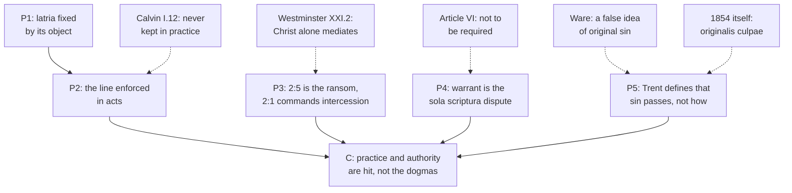

# Apologetics II · Lesson 6.1: Mary

> ⏱ ~15 min · Module 6: The contested distinctives · Builds on: [`ecclesiology-and-mariology` 6.3](../../ecclesiology-and-mariology/lessons/06-03-the-immaculate-conception.md), [6.4](../../ecclesiology-and-mariology/lessons/06-04-the-assumption.md), [6.5](../../ecclesiology-and-mariology/lessons/06-05-mary-in-the-economy-in-the-church-and-in-devotion.md), [`creation-grace-last-things` 3.3](../../creation-grace-last-things/lessons/03-03-trent-session-v-the-definition.md) · Unlocks: [6.2](06-02-the-saints-the-images-the-relics.md), [6.6](06-06-development-or-corruption.md)

## Why this matters

"Catholics worship Mary" is the first objection many Protestants raise; the Orthodox do not make it. The East honours Mary as lavishly as the West and still refuses the dogma of 1854. The reply that answers one objection misses the other, so this lesson states both from their texts, answers each, and finds where the Orthodox objection bites.

## The idea

An exemption presupposes a rule. Tell a friend her house is exempt from the flood levy and she will ask what flood levy. That is the Orthodox objection: the West wrote original sin in Augustine's terms, as inherited guilt, then had to exempt Mary from it; the East never wrote that rule and needs no exemption. The Reformation objection is different in kind: nobody had authority to grant the exemption, and the honour paid to Mary takes what is Christ's.

[`ecclesiology-and-mariology` 6.1](../../ecclesiology-and-mariology/lessons/06-01-theotokos-and-mary-in-scripture-and-the-fathers.md)–[6.5](../../ecclesiology-and-mariology/lessons/06-05-mary-in-the-economy-in-the-church-and-in-devotion.md) taught the four [Marian dogmas](../reference.md#marian-dogmas), *Theotokos*, perpetual virginity, the [Immaculate Conception](../reference.md#immaculate-conception) (1854) and the Assumption (1950), and stated the other traditions without reply; this lesson argues. The Orthodox share the first two, as in substance do the Lutheran confessions and the Second Helvetic. The objections live in the last two, and in devotion.

## The other side

**The Reformation objections**, each from its own text:

1. *No warrant.* The Anglican [Thirty-Nine Articles](../reference.md#thirty-nine-articles) name Mary only as the Virgin of whose substance Christ took flesh (Article II). Article VI decides the case: what Scripture neither contains nor proves "is not to be required of any man, that it should be believed as an article of the faith" (Schaff's 1571 English, spelling modernized). Beside 1854's "to be firmly and constantly believed by all the faithful", the clash is over whether the Church may *require* Mary's sinlessness, not whether anyone may think it. Article XV: Christ alone is without sin, "all we the rest ... yet offend in many things". The Reformed [Westminster Confession](../reference.md#westminster-confession) I.6 forbids additions by "traditions of men". Article XXII condemns "the Romish doctrine concerning ... invocation of saints" and names no Marian doctrine.
2. *A rival mediation.* Westminster XXI.2 gives religious worship to God alone, "not to angels, saints, or any other creature", and "nor in the mediation of any other but of Christ alone". The [Belgic Confession](../reference.md#belgic-confession) (1561), Article XXVI: no creature loves us more than Christ or has more power, so seeking another intercessor is distrust.
3. *Devotion that works as worship.* Calvin, *Institutes* I.12.2–3, a theologian's book, calls the distinction of *latria* and *dulia* an evasion: the question concerns "not the word, but the thing", and people never keep the line. The Lutheran [Apology](../reference.md#apology-of-the-augsburg-confession) XXI.27–28 is subtler. "Granting that the blessed Mary prays for the Church", she neither conquers death nor gives life; she is "most worthy of the most ample honors"; yet "in public opinion the blessed Virgin has succeeded altogether to the place of Christ".

**The fact, not a bludgeon.** The [Smalcald Articles](../reference.md#smalcald-articles) I.4 (1537) confess Christ born of "the pure, holy" Virgin in Luther's German; the Latin text adds *semper virgine*, which the Triglot's English brackets "[and always]". The [Formula of Concord](../reference.md#formula-of-concord), Epitome VIII: she "truly is the mother of God". Luther's Magnificat (1521) closes by asking Christ for its right understanding through her intercession (*Fürbitte*). Zwingli's 1522 sermon is titled for "the ever-pure virgin Mary" (*ewig rainen magt*, lesson's translation). The [Second Helvetic Confession](../reference.md#second-helvetic-confession) (Bullinger, 1566), XI.4, has Christ born *ex Maria semper virgine*, "of Mary ever virgin" (lesson's translation). No Reformation confession holds the Immaculate Conception, the Assumption or the invocation of Mary; the Smalcald Articles (II.2) reject invoking saints outright.

**The Orthodox objection: different, and sharper.** The Orthodox confess the *Theotokos* and the ever-virgin, call Mary All-Holy, keep the Dormition as her death and bodily glorification ([`ecclesiology-and-mariology` 6.4](../../ecclesiology-and-mariology/lessons/06-04-the-assumption.md)) and the feast of Anne's conception of her ([6.3](../../ecclesiology-and-mariology/lessons/06-03-the-immaculate-conception.md)). On Kallistos Ware's account (*The Orthodox Church*, rev. ed. 1993), all Orthodox hold her free from actual sin, but since 1854 most have rejected the Immaculate Conception for three reasons. It is unnecessary. As Rome defines it, it implies a false understanding of original sin as inherited guilt. And it seems to set Mary apart from Adam's other descendants and the righteous of the Old Testament. Ware calls the question theological opinion: an Orthodox who held the doctrine could not be called a heretic. Behind the second reason stands Romans 5:12, whose *eph' hō* Orthodox writers will not read as the Vulgate's "in whom" ([`patristics` 4.5](../../patristics/lessons/04-05-augustine-against-the-pelagians.md); [`new-testament` 5.3](../../new-testament/lessons/05-03-romans-5-11-adam-spirit-israel.md)): what passes from Adam is death and corruption, not guilt, which is [ancestral sin](../reference.md#ancestral-sin).

The [1895 encyclical](../reference.md#patriarchal-encyclical-of-1895) of Patriarch Anthimos VII and his synod, answering Leo XIII, argues differently (§XIII, Metallinos's translation, 1896). Christ's incarnation "is alone pure and immaculate"; 1854 laid down "a novel dogma", "unknown to the ancient Church" and opposed "even by the more distinguished among the papal theologians". Its grounds are novelty and Christ's unique purity, not anthropology.

**Weight.** The Book of Concord is the Lutheran *norma normata*, Westminster the Presbyterian subordinate standard, the Belgic and Second Helvetic Reformed confessions, the Articles Anglican formularies of varying subscription; Calvin and Ware wrote theologians' books. Orthodoxy has **no defined position** here: the 1895 letter is a weighty synodical witness of one patriarchate, not a definition binding every Orthodox church.

## The argument

**P1.** *Latria* is fixed by its object, not its intensity: it acknowledges God as Creator and last end, which no creature shares (Augustine, *City of God* X.1; ST II-II q.103 a.3 ad 1, q.85 a.2). [*Hyperdulia*](../reference.md#latria-dulia-hyperdulia) is the highest honour given a creature for gifts received (q.103 a.4 ad 2). *In words:* the line falls between Creator and creature, not between more and less.

**P2.** The line is drawn in acts. The sacrifice is offered "unto God alone", never to a saint (Trent XXII ch. 3, Waterworth); Nicaea II reserves *latreia* to God; and in 2025 the Dicastery judged "Co-redemptrix" always inappropriate ([`ecclesiology-and-mariology` 6.5](../../ecclesiology-and-mariology/lessons/06-05-mary-in-the-economy-in-the-church-and-in-devotion.md)). *In words:* a label forbids nothing; this distinction forbids sacrifice to Mary and titles that rival her Son.

**P3.** The [one mediator](../reference.md#one-mediator) of 1 Timothy 2:5 is the one who "gave himself a redemption for all" (2:6, DR; *antilytron*, a ransom), and the same paragraph commands "supplications, prayers, intercessions" for all (2:1). Trent names Christ "the one mediator" (V can. 3); Lumen Gentium 60 makes all Mary's saving influence depend entirely on his merits. *In words:* asking a prayer is not offering a second ransom, and the Apology grants that Mary prays.

**P4.** The warrant for 1854 and 1950 is Scripture read in Tradition by the Church, the authority Article VI denies. *In words:* on warrant, Mary is a test case of [*sola scriptura*](../reference.md#sola-scriptura). "You invented a doctrine in 1950" mistakes the definition for the belief, which the Dormition liturgy carried for centuries; whether that is [development](../reference.md#development-of-doctrine) is [6.6](06-06-development-or-corruption.md)'s question.

**P5.** Trent defines that Adam lost holiness and justice for all, and that "sin, which is the death of the soul", not death only, passes to each as his own (V cans. 1–3). It does not define how: Augustine's concupiscence is a school's theory ([`creation-grace-last-things` 3.3](../../creation-grace-last-things/lessons/03-03-trent-session-v-the-definition.md)). *Ineffabilis Deus* defines Mary preserved from it, from the first instant, "in view of the merits of Christ Jesus" ([*praeredemptio*](../reference.md#praeredemptio)); the doctrine prevailed against Bernard's premise that the parents' concupiscence passes on sin ([`ecclesiology-and-mariology` 6.3](../../ecclesiology-and-mariology/lessons/06-03-the-immaculate-conception.md)). *In words:* the dogma needs a lack Mary was spared, not Augustine's account of how the lack is handed on.

**∴ C.** The Reformation objections reach Catholic practice (conceded below) and the authority to define (Module 2), not the dogmas' content. The Orthodox objection reaches 1854 only if nothing inherited from Adam is a lack of grace, and then its quarrel is with Trent V can. 2, not with Mary.

**Mark the levels** ([the ladder](../../fundamental-theology/lessons/04-04-the-ladder-of-doctrinal-authority.md); [levels of authority](../reference.md#levels-of-authority)). The four dogmas are **rung 1**: the Immaculate Conception, every clause including the merits clause (*ex cathedra*, 1854); the Assumption (1950), though not whether Mary died; *Theotokos* (Ephesus); perpetual virginity (ordinary universal magisterium). Christ the one Mediator (Trent V can. 3) and *latreia* for God alone (Nicaea II) are **rung 1**. Trent XXII ch. 3's "unto God alone", a chapter clause no canon repeats, is **at least rung 3**, as is Lumen Gentium 60–62 on Mary's subordinate mediation. "Co-redemptrix" is **not defined**; *Mater Populi Fidelis* (4 November 2025) judging its use is **rung 3**. *Dulia* and *hyperdulia* are school words, **no rung**. On original sin: sin, not death only, passes to all, **rung 1** (V can. 2); privation as its essence **rung 4**; the mode of transmission **rung 5**. Other traditions' texts have **no Catholic level**.

**Concession.** Marian devotion has repeatedly gone past what the doctrine licenses. Newman granted that the cultus had in times and places fallen into abuse, even superstition (*Letter to Pusey*, dated 7 December 1865, published 1866, §5, as [`ecclesiology-and-mariology` 6.5](../../ecclesiology-and-mariology/lessons/06-05-mary-in-the-economy-in-the-church-and-in-devotion.md) and its Boss 6(c) read it). Devotion has called it safer to seek Mary than her Son, the Apology's complaint exactly. To the Orthodox: the debate behind 1854 was fought inside Augustine's doctrine of original sin, and the East had no part in the definition.

**The crux.** For the Orthodox: does the Immaculate Conception depend on the Augustinian account of original guilt? If 1854's "original sin" names guilt for Adam's act, the East is right: the dogma answers a question it never asked. If it names the absence, from the first instant, of the holiness Adam lost, the question makes sense in Eastern terms, and the dispute shrinks to 1895's: handed down, or invented? What would move it: whether Orthodox theology holds that every child is born without the communion with God Adam lost, and whether 1854's word *culpa* can be read without inherited guilt (Example 2).

## The argument map

Both Orthodox arrows land on P5, which is where the dispute lives.

## Worked examples

**Example 1 (clean): the Apology's own test.** Apology XXI.27 asks of Mary: does she receive souls in death, conquer death, give life? Lumen Gentium 60 makes all her saving influence depend entirely on Christ's merits, and 1854 makes even her preservation his work. So the Apology's test, answered from Catholic doctrine, returns the Lutheran answer. What is left is whether one may *ask* the prayer the Apology grants she offers: [invocation](../reference.md#invocation-of-saints), which [6.2](06-02-the-saints-the-images-the-relics.md) argues. Mary as refuge from a stern judge is conceded, not defended.

**Example 2 (strain): one Latin word.** An Orthodox reader points to the definition's Latin: Mary preserved *ab omni originalis culpae labe*, from every stain of original *culpa*, a word that usually means fault; Schaff renders it "sin". The Catholic reply reads *culpa* through Trent and the Catechism: a sin "contracted" and not "committed", with no personal fault (CCC 404–405). That shows the dogma *can* be stated without Augustinian guilt. But no act fixes that reading of 1854's word; privation as the sin's essence is only rung 4. Here the argument stops: no text shows what the definers meant.

## Watch out

- **You might think the Orthodox reject the Immaculate Conception because they think Mary sinned.** They call her All-Holy and, on Ware's account, all hold her free from actual sin. That caricature fails this lesson's problems.
- **You might think "the Reformers abolished Mary", or that Luther was a Marian Catholic whom Protestants abandoned.** The confessions keep the mother of God and, in the Smalcald Latin and the Second Helvetic, the ever-virgin; none keeps the later dogmas or invoking her. Lutherans are bound by their confessions, not by Luther's sermons.
- **Levels, both ways.** "The Orthodox Church condemned the dogma in 1895" overstates: a synodical letter, and Ware calls the question opinion. "*Hyperdulia* is dogma" overstates too: it is a school word; what is rung 1 is *latreia* for God alone.

## One-liner

> The Reformation objections hit Catholic devotion, which is conceded, and Catholic authority, which is Module 2; the Orthodox objection hits 1854 only if original sin means inherited guilt.

## Problems

**P1 (🟢) *(Exegetical · close reading.)*** Calvin, *Institutes* I.12.2–3 (Beveridge, 1845; the Greek words transliterated):

> The distinction of what is called dulia and latria was invented for the very purpose of permitting divine honours to be paid to angels and dead men with apparent impunity. For it is plain that the worship which Papists pay to saints differs in no respect from the worship of God [...] But since the question relates not to the word, but the thing, how can they be allowed to sport at will with a matter of the highest moment? [...] *Douleia* unquestionably means service, and *latreia* worship. But no man doubts that to serve is something higher than to worship. [...] men never distinguish so accurately between the worship of God and the creatures as not to transfer promiscuously to the creature that which belongs only to God.

(a) The passage makes three different arguments against the distinction. Name each, with the words that carry it. **One sentence each.**

(b) Which of the three does Aquinas's definition of *latria* by its object (ST II-II q.103 a.3 ad 1) answer, and which does it leave standing? **Two sentences.**

**P2 (🟡) *(Exegetical · diagnose.)*** A podcast exchange, invented for this problem; the host and the caller are not real people:

> **Pastor Olumide Akinwale (Pentecostal host):** "The Reformers threw all the Mary business out on day one, Luther and Calvin alike. Even the Church of England's Article 22 calls praying to Mary a fond thing vainly invented."
>
> **Catholic caller:** "With respect, Pastor, Luther was a Marian Catholic. The Lutheran confessions even teach the Immaculate Conception. Protestants today have simply abandoned their own founder."

Find **four** errors, two from each speaker. For each, give the correction and the text that shows it. **150 words or fewer.**

**P3 (🔴) *(Apologetic: (a) Exegetical, graded first · (b) reply.)*** An Orthodox friend says: "We honour the Theotokos as All-Holy. We just don't need your 1854 dogma."

(a) State the Orthodox objection as Kallistos Ware reports it: what all Orthodox affirm about Mary, his three reasons, and the weight he gives the question. Then state the different ground the 1895 encyclical gives. **Four sentences at most.**

(b) Reply in **120 words or fewer**, opening with a **named concession**, and say where your reply stops. A reply that concludes the objection succeeds passes if it is a good reply.

Solutions

**P1** *(Exegetical · close reading)*

**Must hit, strict:**

- (a) **Invention, a cover story:** "invented for the very purpose of permitting divine honours ... with apparent impunity", backed by the claim that the practice "differs in no respect" and the question is "not ... the word, but the thing". **Lexical:** "*Douleia* unquestionably means service, and *latreia* worship", and "to serve is something higher", so the distinction gives the creature the greater term. **Practical:** "men never distinguish so accurately ... as not to transfer promiscuously", so even a sound line is not kept.
- (b) Definition by object answers the **lexical** argument: *latria* is due to God for what no creature shares, the power to create (q.103 a.3 ad 1), so the dictionary rank of *douleia* decides nothing. It leaves the **practical** argument standing. A true distinction can still be blurred in practice, and that is met only by practice and its policing (Trent XXII ch. 3; *Mater Populi Fidelis*), and in part conceded.

**Accept:** treating "not the word, but the thing" as part of the practical argument instead of the first.

**Wrong turns:** citing Calvin as "the Reformed confession" (Westminster XXI.2 is the confession; the *Institutes* is a theologian's book). Saying Calvin misunderstood the distinction: he states it accurately and attacks its use. Claiming the definition answers all three. Calling *hyperdulia* defined.

**Model answer:** (a) The distinction was "invented" as cover for "divine honours" paid to creatures, since the practice is the same "thing". The words themselves betray it: *douleia* is "service", "higher" than *latreia*, so the greater goes to the saints. And people "never distinguish so accurately" as to keep the line in practice. (b) Aquinas's definition answers the lexical argument: *latria* is owed to God as Creator, which no creature is, whatever the words mean in a dictionary. It leaves the practical argument standing, which only enforced practice can meet, and which the Catholic case partly concedes.

---

**P2** *(Exegetical · diagnose)*

**Accept:** any four errors among those below, at least two from each speaker, each corrected from a text.

**Must hit, strict:**

- **Host, "threw it all out":** the Smalcald Articles I.4 confess "the pure, holy" Virgin, and their Latin adds *semper virgine*. The Formula (Epitome VIII) says she "truly is the mother of God", and Luther's Magnificat (1521) asks for understanding through her intercession. On the Reformed side, the Second Helvetic XI.4 has *ex Maria semper virgine*, and Calvin refused Helvidius's inference. "Calvin alike" is wrong too.
- **Host, "Article 22 on praying to Mary":** Article XXII names no Marian doctrine. It condemns "the Romish doctrine concerning ... invocation of saints", alongside purgatory, pardons, images and relics.
- **Caller, "the confessions teach the Immaculate Conception":** none does. They say pure, holy, (in Latin) ever-virgin, mother of God. The Smalcald Articles II.2 reject invoking saints, and the Apology XXI.28 attacks putting Mary in Christ's place.
- **Caller, "abandoned their founder":** "Protestants" is no bloc. Luther founded no Reformed, Anglican or Pentecostal church. Lutherans are bound by the Book of Concord as *norma normata* under Scripture, not by Luther's private opinions. And using the Reformers' Marian views as a weapon is the misuse this lesson warns against.

**Wrong turns:** correcting the host by saying the Reformers held all four dogmas. Calling Article XXII a Lutheran text, or misquoting it as naming Mary. Answering the caller with "Luther hated Mary" (the opposite overstatement).

**Model answer:** Host: the Reformers kept much. The Smalcald Articles (I.4) confess "the pure, holy" Virgin, *semper virgine* in Latin; the Formula calls her mother of God; the Second Helvetic (XI.4) has *ex Maria semper virgine*. Article XXII names no Marian doctrine: it condemns "the Romish doctrine concerning ... invocation of saints" among four other things. Caller: no Lutheran confession teaches the Immaculate Conception, and the Smalcald Articles (II.2) reject invoking saints. Nor did Protestants "abandon their founder". Luther founded no Reformed or Anglican church, and Lutherans are bound by their confessions, not by Luther's opinions.

---

**P3** *(Apologetic: (a) Exegetical, graded first · (b) reply)*

**Accept:** any reply that opens with a named concession, separates what Trent defines about original sin from Augustine's account of its transmission, and says where the argument stops, whatever its verdict.

**Must hit, strict (a), graded first:**

- **Affirmed:** Mary All-Holy, *Theotokos*, ever-virgin; all Orthodox hold her free from actual sin.
- **Ware's three reasons:** the dogma is unnecessary; as Rome defines it, it implies a false understanding of original sin as inherited guilt; it seems to set Mary apart from Adam's other descendants and the Old Testament righteous.
- **Weight:** most Orthodox have rejected it since 1854, but Orthodoxy has no defined position. Ware calls it theological opinion; an Orthodox who held it could not be called a heretic.
- **1895:** novelty ("unknown to the ancient Church", opposed by Latin theologians themselves) and Christ's incarnation "alone pure and immaculate". This is a different ground from the framing.

**Must hit (b):**

- **A named concession,** flat: the debate behind 1854 was fought inside Augustine's doctrine, the East had no part in the definition, and Latin doctors (Bernard, Aquinas) denied the doctrine.
- **The distinction:** Trent V defines that sin, not only death, passes to each (**rung 1**). How it passes is **rung 5**, and the privation account is **rung 4**. The dogma needs a lack of grace Mary was spared, not inherited guilt for Adam's act.
- **On being set apart:** preserved "in view of the merits of Christ", she is redeemed, so she differs in the mode of redemption, not in her need of it.
- **Where it stops:** 1854's own word *culpa*; and if the Orthodox deny any inherited lack of grace, the quarrel is with Trent V can. 2. The novelty charge goes to [6.6](06-06-development-or-corruption.md).

**Wrong turns:** stating (a) as "the Orthodox think Mary sinned", a caricature that fails the problem. "The Orthodox deny original sin" overstates: the objection is to guilt. Stating the position from the seventeenth-century confessions. Calling 1895 a definition or saying Orthodoxy condemned the dogma as heresy. Claiming Trent defined the privation account, or that the Catechism fixes how *culpa* is read. Saying Mary needed no Saviour.

**Model answer (a):** The Orthodox call Mary All-Holy, *Theotokos* and ever-virgin, and all hold her free from actual sin. Since 1854 most reject the Immaculate Conception as unnecessary, as implying the false idea of original sin as inherited guilt, and as setting Mary apart from Adam's other descendants and the righteous of the Old Testament. Ware calls the question theological opinion, not dogma: an Orthodox who held it would be no heretic. The 1895 encyclical argues instead from novelty, a dogma "unknown to the ancient Church", and from Christ's incarnation as "alone pure and immaculate".

**Model answer (b), one of several:** Concession: the dogma was argued out in Augustine's terms, Latin doctors denied it, and the East was not consulted. But Trent defines only *that* Adam's holiness was lost for us and that sin, not only death, passes to each (rung 1). How it passes, Augustine's concupiscence, is rung 5. So the dogma needs a lack Mary was spared, not a guilt for Adam's act. And preserved "in view of the merits of Christ", she is redeemed like us, by another mode. My reply stops at the definition's word *culpa*: no act fixes that it means privation and not guilt. Whether the doctrine was handed down at all is a separate question.

## Flashback

**From Lesson [5.4](05-04-essence-and-energies.md) (Essence and energies):** *(Exegetical, strict · assign the weight.)* An invented study sheet, written for this problem, assigns these weights. Say whether each is right, overstated or understated, and give the correct weight with the act or text that fixes it. Weigh Orthodox texts inside Orthodoxy, not on the Catholic [ladder](../reference.md#levels-of-authority). **One or two sentences per item.**

> (1) [Divine simplicity](../reference.md#divine-simplicity) is a Thomist thesis a Catholic may doubt: rung 4.
>
> (2) The created gift precedes God's self-gift in the order of grace: rung 3, since the manuals agree.
>
> (3) The Tome of 1351 is Orthodoxy's *ex cathedra* definition.
>
> (4) The same Tome is one synod's opinion, which an Orthodox may set aside.
>
> (5) Several Byzantine-rite Catholic churches keep Palamas's commemoration, so Rome approves the distinction: at least rung 3.

Solution

**Must hit, strict:**

- **(1) Understated.** *Simplex omnino* is **rung 1**: Lateran IV, *Firmiter* (1215), repeated in *Dei Filius* ch. 1. Only the Thomist reading of what *omnino* excludes is a school's, and no act applies the definition to Palamas.
- **(2) Overstated, and malformed.** Manuals are theologians, below the seam: their agreement never makes rung 3. No act settles the order of [created and uncreated grace](../reference.md#created-and-uncreated-grace), so the question is **rung 5**, the Thomist answer at most the schools' common account (**rung 4**); Rahner, a Catholic, put God's self-gift first in 1939.
- **(3) Overstated: wrong category.** Orthodoxy has no magisterium whose definitions bind of themselves. The Tome is a local council's act that binds across Orthodoxy by [reception](../reference.md#reception).
- **(4) Understated.** It was received: its anathemas entered the *Synodikon of Orthodoxy*, and a synod of 1368 canonized Palamas.
- **(5) Overstated.** The commemoration is **liturgical law, no rung**; the distinction has **no magisterial level**. No act approves it, and none condemns it.

**Wrong turns:** giving the Tome a Catholic rung, or writing "no magisterial level" and stopping, which weighs it on the wrong ladder. Lifting the Thomist reading to rung 1 in (1). Correcting (5) by saying Rome condemned Palamas, the opposite overstatement.

**Model answer:** (1) Understated: *simplex omnino* is rung 1 (*Firmiter*; *Dei Filius* ch. 1); only the Thomist account of what it excludes is a school's. (2) Overstated and malformed: manuals sit below the seam, and no act settles the order, so it is freely disputed, rung 5 (Rahner, a Catholic, dissented). (3) Overstated: Orthodoxy has no *ex cathedra*; the Tome is a local council's act binding by reception. (4) Understated: it was received into the *Synodikon*, and Palamas was canonized in 1368. (5) Overstated: a calendar is liturgical law, and no act approves or condemns the distinction.

## Connections

- **Backward:** the dogmas, their acts and Lumen Gentium ch. 8 are [`ecclesiology-and-mariology` 6.1](../../ecclesiology-and-mariology/lessons/06-01-theotokos-and-mary-in-scripture-and-the-fathers.md)–[6.5](../../ecclesiology-and-mariology/lessons/06-05-mary-in-the-economy-in-the-church-and-in-devotion.md), and the Reformers' Mary on Matthew 1:25 is its [6.2](../../ecclesiology-and-mariology/lessons/06-02-ever-virgin.md). Trent V and its levels are [`creation-grace-last-things` 3.3](../../creation-grace-last-things/lessons/03-03-trent-session-v-the-definition.md); Romans 5:12 is [`patristics` 4.5](../../patristics/lessons/04-05-augustine-against-the-pelagians.md) and [`new-testament` 5.3](../../new-testament/lessons/05-03-romans-5-11-adam-spirit-israel.md). The warrant dispute is [2.1](02-01-sola-scriptura-at-its-best.md) and [2.3](02-03-tradition-and-what-sufficiency-means.md).
- **Forward:** [6.2](06-02-the-saints-the-images-the-relics.md) argues the invocation of saints against Calvin III.20, Article XXII and Augsburg XXI, which this lesson only touched. [6.6](06-06-development-or-corruption.md) takes the 1895 novelty charge and "invented in 1950" as questions of development. Boss 6 sets the module's synthesis ([syllabus](../syllabus.md)).
- **Sideways:** [5.4](05-04-essence-and-energies.md) has the same shape. There the East objects to what it reads as a Latin category in the doctrine of grace, here to inherited guilt, and in both the crux is whether the Catholic doctrine needs the category or only the content. The 2025 judgment on "Co-redemptrix" ([`ecclesiology-and-mariology` 6.5](../../ecclesiology-and-mariology/lessons/06-05-mary-in-the-economy-in-the-church-and-in-devotion.md)) is the Church policing the line P2 relies on.
