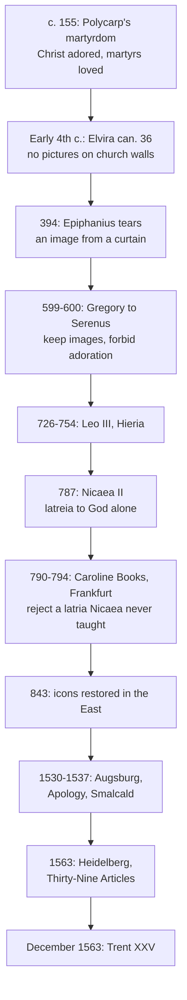

# Apologetics II · Lesson 6.2: The saints, the images, the relics

> ⏱ ~15 min · Module 6: The contested distinctives · Builds on: [6.1](06-01-mary.md), [`ecclesiology-and-mariology` 6.5](../../ecclesiology-and-mariology/lessons/06-05-mary-in-the-economy-in-the-church-and-in-devotion.md), [`patristics` 5.4](../../patristics/lessons/05-04-maximus-and-john-of-damascus.md), [`creation-grace-last-things` 6.2](../../creation-grace-last-things/lessons/06-02-heaven-and-the-beatific-vision.md), [`sacraments-and-liturgy` 7.3](../../sacraments-and-liturgy/lessons/07-03-sacramentals-and-popular-devotion.md) · Unlocks: [6.3](06-03-penance-purgatory-and-indulgences.md)

## Why this matters

The Heidelberg Catechism lists "invocation of saints" beside idolatry and sorcery, under the first commandment (Q.94). To a Reformed Christian, a candle before St Anthony's statue is the first table of the law broken. Here Catholicism looks most like a different religion. Here too the Orthodox stand wholly with Rome, and a Western synod once stood against both.

## The idea

Every Christian asks friends to pray for them, and nobody calls that worship. The Catholic claim is that asking St Paul to pray for you is the same act, made of a fellow member of Christ's body who is alive in God. The Reformed reply: to call on someone unseen, in prayer, for help, is prayer, and prayer belongs to God alone. Images run the same way. Kissing a photograph of your mother is not loving paper; the honour goes through to her. The Reformed answer: God, unlike your mother, has said how he is to be approached, and pictures were not on the list. So the question is whether an act aimed at a creature becomes a different kind of act when done in prayer, toward someone unseen.

The doctrine is taught elsewhere, [*latria*, *dulia* and *hyperdulia*](../reference.md#latria-dulia-hyperdulia) in [`ecclesiology-and-mariology` 6.5](../../ecclesiology-and-mariology/lessons/06-05-mary-in-the-economy-in-the-church-and-in-devotion.md), John of Damascus in [`patristics` 5.4](../../patristics/lessons/05-04-maximus-and-john-of-damascus.md), the [communion of saints](../reference.md#communion-of-saints) in [`creation-grace-last-things` 6.2](../../creation-grace-last-things/lessons/06-02-heaven-and-the-beatific-vision.md), relics in [`sacraments-and-liturgy` 7.3](../../sacraments-and-liturgy/lessons/07-03-sacramentals-and-popular-devotion.md); this lesson argues it.

## The other side

**Reformed.** Calvin's case against the [invocation of saints](../reference.md#invocation-of-saints) is *Institutes* III.20.19–27 (Beveridge). He grants that the living rightly pray for one another (III.20.19). Of the departed interceding there is "not a word on the subject in Scripture" (III.20.21). The friend analogy fails: the living pray for each other "by the command of the Lord, and not without a promise", while God has not revealed that the dead hear us (III.20.24). He even grants that the saints pray for us in general; "far less are they, therefore, to be invoked by us" (III.20.24). Invocation is the principal part of worship, so it is "manifest sacrilege to offer prayer to others" (III.20.27); and practice adopts saints "just as if they had been tutelar deities" (III.20.22).

[Westminster](../reference.md#westminster-confession) XXI.2 gives religious worship to God alone, "not to angels, saints, or any other creature"; XXI.3 calls prayer "one special part of religious worship". [Heidelberg](../reference.md#heidelberg-catechism) Q.95 defines idolatry as having, instead of the true God "or along with the same", something else to trust in.

On images, Calvin's strongest move is I.12.2–3: the question is the thing, not the word. Satan asked Christ only for *proskynēsis* (Matthew 4:10), the angel refused John's (Revelation 19:10; 22:9), and religious honour to a creature, unlike civil honour, profanes God's. Heidelberg reads [the second commandment](../reference.md#second-commandment), numbered separately (Q.92–93), as a [rule of worship](../reference.md#regulative-principle): God is to be worshipped in no "other way than he has commanded in his Word" (Q.96); creatures may be pictured, but not to worship them or serve God by them (Q.97). And:

> But may not pictures be tolerated in churches as books for the laity? No; for we should not be wiser than God, who will not have his people taught by dumb idols, but by the lively preaching of his Word. (Q.98, Schaff vol. 3)

That refuses Gregory the Great's defence (to Serenus, *Register* XI.13). Calvin adds the record: Elvira's canon 36, Epiphanius tearing an image from a church curtain in 394 (Jerome, Letter 51.9), and five hundred years of churches "completely free from visible representations" (I.11.13).

*Weight:* Heidelberg (1563) and Westminster are Reformed confessional standards; the *Institutes* is a theologian's book.

**Anglican.** [Article XXII](../reference.md#thirty-nine-articles) calls "the Romish Doctrine" of worshipping images and relics and invoking saints "a fond thing, vainly invented, and grounded upon no warranty of Scripture, but rather repugnant to the Word of God" (Schaff vol. 3). The Articles are Anglican formularies whose authority varies across the Communion.

**Lutheran, and different.** [Augsburg](../reference.md#augsburg-confession) XXI keeps the saints' memory for imitation, but "the Scripture teaches not the invocation of saints, or to ask help of saints". The [Apology](../reference.md#apology-of-the-augsburg-confession) XXI.8–10 grants more: angels pray for us, and the saints in heaven pray "for the Church in general". It denies only that invoking them follows, since "neither a command, nor a promise, nor an example" exists in Scripture, and prayer without faith is not prayer. Luther's [Smalcald Articles](../reference.md#smalcald-articles) (1537) call invocation an abuse of Antichrist and state the crux themselves:

> For as a Christian and saint upon earth you can pray for me … But for this reason I am not obliged to adore and invoke you (II.ii, Triglot)

The Lutheran confessions condemn no image as such, and Luther's catechisms number the commandments as Augustine did. All three belong to the [Book of Concord](../reference.md#book-of-concord), a *norma normata*, not a magisterium.

## The argument

**P1.** Asking another Christian's prayer is good, and every side grants it (Calvin III.20.19; Smalcald II.ii). *In words:* intercession among Christ's members does not rival Christ's.

**P2.** The saints are alive in God, who "is not the God of the dead, but of the living" (Luke 20:38, DR). Jerome: if apostles and martyrs pray for others in the body, "how much more must they do so when once they have won their crowns" (*Against Vigilantius* 6, NPNF). *In words:* death expels no one from Christ's body.

**P3.** An act of religion is fixed by what is asked, and of whom as source: "To Him alone do we offer religious worship when praying, from Whom we seek to obtain what we pray for" (Aquinas, ST II-II q.83 a.4 ad 1). So God is asked "to have mercy on us", the saints "to pray for us". That they hear needs only that God make it known (ad 2); *how* is not taught. *In words:* invoking a saint is asking a friend's prayer, the friend being in heaven.

**P4.** Honour to an image is relative. [Nicaea II](../reference.md#nicaea-ii)'s *horos* (787) gives images "honourable reverence", not the *latreian* "which pertains alone to the divine nature", for the honour "passes on to that which the image represents" (Percival). The commandment forbids images made to be adored as gods, since God commanded cherubim (Exodus 25:18) and the brazen serpent (Numbers 21:8–9); and the Incarnation gave God a face ([`patristics` 5.4](../../patristics/lessons/05-04-maximus-and-john-of-damascus.md)). *In words:* the [veneration of images](../reference.md#veneration-of-images) honours the person, never the paint.

**P5.** [Relics](../reference.md#relics) are honoured because those bodies were "the living members of Christ, and the temple of the Holy Ghost" and will be raised ([Trent XXV](../reference.md#trent-session-xxv)). Smyrna gathered Polycarp's bones as a treasure, while it was Christ "we adore" and the martyrs "we worthily love" (*Martyrdom of Polycarp* 17–18, ANF). *In words:* the oldest practice already drew Nicaea's line.

**P6.** On images the Catholic is not alone. The Orthodox receive Nicaea II, number the image clause separately as the Reformed do, and still defend icons (Philaret's nineteenth-century *Longer Catechism*, Q.516–521, Schaff vol. 2). *In words:* the charge falls on the seventh council, which the Reformed may say erred (Westminster XXXI.4), losing the story of a papal corruption.

**∴ C.** Invocation and veneration, rightly done, give no creature *latreia*; they are the communion of saints in act.

**Mark the levels** ([the ladder](../../fundamental-theology/lessons/04-04-the-ladder-of-doctrinal-authority.md); [levels of authority](../reference.md#levels-of-authority)). Veneration of images: **rung 1** (Nicaea II "define[s]", with penalties and anathemas; Trent XXV restates it "as … has been defined" and closes its images section with an anathema, DS 1824). *Latreia* for God alone: **rung 1**. That the saints pray for us and invoking them is "good and useful": **at least rung 3**. The decree has no canons, deniers "think impiously", and whether the closing anathema reaches invocation and relics is not manifest (can. 749 §3), though the manuals mark invocation *de fide*; Trent XXII can. 5 (**rung 1** as worded) presupposes it. Relics: **at least rung 3**, likewise. The communion of saints: **rung 1** (the Creed), naming the communion, not this mode. How the saints hear: **rung 5**. *Dulia* and "relative *latria*": school words, **no rung**. Trent's reform orders: **discipline**. Frankfurt (794), never received: **no magisterial level**.

**Concession.** Relic traffic, mechanical devotion, and images treated as if power lived in them were real and profitable, and Trent's own decree legislates against them: "every superstition shall be removed, all filthy lucre be abolished"; no unusual image and no new relic without the bishop's approval (DS 1825). Calvin's saints parcelled out by trade described real practice, and Vatican II still asked that "abuses, excesses or defects" be corrected (LG 51).

**The crux.** Whether invoking a saint is an act of religion of a different kind from asking a friend's prayer, or the same kind toward a friend in heaven. The Reformed must hold that it differs: a request made in prayer to the unseen is prayer (Westminster XXI.3), and religious honour to a creature is worship (Calvin I.12.3). The Catholic must hold that what is asked, and from whom the good is expected, fixes the kind (P3). The Catholic would be moved by evidence that the practice rests trust in the saint as source (Trent's own "aid, (and) help"; patrons for every need). The Reformed would be moved by showing that "worship only as commanded" (Q.96) does not decide the case, which returns the dispute to [*sola scriptura*](../reference.md#sola-scriptura).

## The timeline

The West's record runs both ways: Gregory and the Franks kept images but refused them *adoratio*, one Latin word for *latreia* and *proskynēsis*.

## Worked examples

**Example 1 (clean): a saint's feast.** A Reformed visitor at Mass on a saint's day asks to whom the sacrifice went. Trent XXII ch. 3: not to the saints "but unto God alone, who crowned them"; the priest "implores their patronage, that they may vouchsafe to intercede for us" (Waterworth). Sacrifice, the paradigm act of *latreia*, goes to God; the saint receives a request for prayer. The charge that the Mass is offered to the saint misses; whether the request is itself worship is the crux.

**Example 2 (strain): Thomas and the image of Christ.** Aquinas holds that Christ's image receives *latria*, since the movement toward an image as image "is one and the same as that which is towards the thing" (ST III q.25 a.3). Nicaea II denied images *latreia*: a Doctor seems to give what the council withheld, and Calvin's complaint that the distinction is merely verbal (I.12.2) gains force. The reply: the council denies *latreia* to the image as a thing, Thomas gives none to the thing, and both end the honour in the person. Where the argument stops: Nicaea fixes that honour passes and *latreia* is God's; what to call the act passing through Christ's image is a rung-5 school question. And Thomas defends a worship Scripture nowhere prescribes from unwritten tradition and the legend that Luke painted an image of Christ kept at Rome (ad 4).

## Watch out

- **You might think "Protestants" reject the saints as a bloc,** but the Apology grants that the saints pray for the Church, and Heidelberg Q.97 allows pictures of creatures. The mirror caricature, "Catholics deleted the second commandment", fails: the Roman Catechism prints the whole image clause under the first, on Augustine's division.
- **You might think Trent's decree has no anathema, so invocation is optional,** but its images section ends with one (DS 1824), and XXII can. 5 presupposes invocation. Saying Trent *defined* invocation overstates: the anathema's reach is not manifest.
- **You might think Article XXII condemns Trent's decree.** Convocation agreed it in 1562 by the English reckoning; Trent's Session XXV met in December 1563.

## One-liner

> The Reformed say a request made in prayer to the unseen is worship; the Catholic says an act is known by what it asks and of whom, so invoking a saint is asking a friend's prayer, and that premise is the dispute.

## Problems

**P1 (🟢) *(Close reading · Exegetical.)*** An invented homily for the Sunday of Orthodoxy, written for this problem: Fr Spyridon Mavrakis tells his congregation, "The Reformers' whole case against the holy icons was built on a Frankish mistranslation. Read the acts of the Seventh Council and it falls." Three public-domain texts:

> (i) Constantine, bishop of Constantia in Cyprus, Nicaea II, session 3 (Percival, NPNF2 vol. 14): "receiving and saluting with honour the holy and venerable images. But the worship of adoration I reserve alone to the supersubstantial and life-giving Trinity."
>
> (ii) The Council of Frankfurt (794), canon 2 (Percival): the Greek synod had ruled "that all should be judged as worthy of anathema who did not pay to the images of the Saints service and adoration as to the Divine Trinity."
>
> (iii) Calvin, *Institutes* I.11.16 (Beveridge): the bishop of Constantia "professes to embrace images with reverence, and declares that he will pay them the respect which is due to the ever blessed Trinity."

(a) What does Constantine give the images, what does he withhold, and which words decide it?

(b) What do (ii) and (iii) report, and how did that reading arise?

(c) Is Fr Spyridon right? Say what the comparison shows and what it does not.

Two sentences per part.

**P2 (🟡) *(Apologetic: (a) Exegetical, graded first · (b) reply.)*** (a) State the Reformed objection to images in churches as the Heidelberg Catechism states it in Q.96–98, including its answer to the "books for the laity" defence and the principle behind that answer.

(b) Reply, opening with a **named concession**.

**150 words or fewer in total.** A reply that concludes the Catechism's objection succeeds passes if it is a good reply.

**P3 (🔴, optional) *(Find the crux · Exegetical.)*** Set Apology XXI.8–10, as this lesson quotes and summarizes it, beside Trent XXV's sentence on invocation (the saints "offer up their own prayers to God for men"; "it is good and useful suppliantly to invoke them"; taught "agreeably to the usage of the Catholic and Apostolic Church, received from the primitive times"). The Apology also calls invocation "a new custom in the Church" (XXI.13, Triglot).

(a) Name two things both texts affirm.

(b) Name the single premise on which they divide, and say why it is not this lesson's Reformed crux.

(c) Say what evidence or argument would move each side.

**120 words or fewer.**

Solutions

**P1** *(Close reading · Exegetical)*

**Must hit, strict:**

- (a) Constantine gives the images "saluting with honour" and reserves "the worship of adoration" to the Trinity "alone". "But" and "alone" decide it: he denies the images exactly what (ii) and (iii) say he gave them.
- (b) Both turn his reservation into an equation, images honoured as the Trinity is; Frankfurt also puts the synod at Constantinople. The reading came through the Latin version of the acts, which rendered both *latreia* and *proskynēsis* by *adoratio*. Credit for naming the Caroline Books (III.17), which put the equation in Constantine's mouth, as the channel Frankfurt and later Calvin followed.
- (c) Partly right: Frankfurt's canon and Calvin's charge in I.11.16 rest on the misreading. Wrong as stated: Heidelberg Q.96–98 argues from the rule of worship and Calvin I.12.2–3 from the claim that any religious honour to a creature is worship, and neither depends on what Constantine said.

**Wrong turns:** agreeing with Fr Spyridon outright (an overstatement that flatters the Catholic side too). Calling Frankfurt a rejection of images as such: canon 2 rejects "service and adoration as to the Divine Trinity", which Nicaea never taught. Saying Calvin invented the misreading. Treating Frankfurt as a magisterial act.

**Model answer:** (a) Honourable salutation for the images, "the worship of adoration" for the Trinity "alone"; the "But" divides the two. (b) Frankfurt and Calvin make him give images the Trinity's honour, a reading that came from a Latin version translating both Greek words as *adoratio* and from the Caroline Books. (c) It shows that Frankfurt's canon and Calvin's I.11.16 attack a sentence Nicaea never spoke. It does not touch Heidelberg's rule of worship or Calvin's I.12 argument that any religious honour to a creature is worship, which is where the Reformed case stands.

---

**P2** *(Apologetic: (a) Exegetical, graded first · (b) reply)*

**Accept:** any reply that opens with a named concession and engages Q.96's rule of worship, whatever its verdict.

**Must hit, strict (a), graded first:**

- Q.96: God may not be imaged at all, nor worshipped "in any other way than he has commanded in his Word": a rule of worship, not only a ban on idols.
- Q.97: creatures may be pictured, but not kept to worship them or to serve God by them.
- Q.98: not even as books for the laity, because God wills his people taught "not by dumb idols, but by the lively preaching of his Word". The teaching use fails because it adds a means God did not appoint.
- Weight: a Reformed confessional standard (1563), on the Reformed numbering in which this is the second commandment.

**Must hit (b):**

- A named concession, stated flatly: images were treated as if power lived in them, and Trent ordered "every superstition" removed; or preaching is the appointed means and no picture replaces it.
- Engage the premise, not only the idolatry charge: God commanded images in the place of worship (Exodus 25:18), so "only as commanded" does not yield "no images"; or say that the rule itself is the *sola scriptura* question.
- Say what the reply does not show.

**Wrong turns:** stating (a) as "the Reformed think Catholics worship wood" or "Heidelberg forbids all art" (Q.97 allows pictures of creatures); fails (a). Answering with Gregory's "books for the unlettered", which Q.98 has already refused. Leaning on the brazen serpent alone: Hezekiah broke it because incense was burned to it (4 Kings 18:4, DR; 2 Kings 18:4), which is the Reformed point too. Answering only with *latria*/*dulia*, which leaves the rule of worship untouched.

**Model answer (a):** Heidelberg reads the second commandment as forbidding any image of God and any worship God has not commanded in his Word. Creatures may be pictured, but not to be worshipped or used to serve God. Even as the laity's books, pictures are refused, because God appointed the preaching of his Word to teach his people, and we may not be wiser than he.

**Model answer (b), one of several:** Concession: images have been treated as if power lived in them, and Trent itself ordered every superstition removed. But the rule proves less than Q.98 needs. The God who forbade idols commanded cherubim over the ark, where Israel worshipped, so his commanding the means of worship did not exclude images from it. And the Incarnation gave the invisible God a face. This does not show that images are necessary, only that "not commanded" is not "forbidden"; that difference is the *sola scriptura* dispute.

---

**P3** *(Find the crux · Exegetical)*

**Must hit, strict:**

- (a) Any two: the saints in heaven pray for the Church (the Apology, "in general"; Trent, "for men"); the saints are to be honoured; Christ is the one Mediator.
- (b) Whether a practice of prayer may be undertaken in faith without a scriptural command, promise or example. The Apology says no; Trent rests the practice on the Church's usage "from the primitive times", the Fathers' consent and councils. It is not the Reformed crux, because the Apology does not argue that invoking a saint is worship in kind; it argues that it is uncertain and unnecessary.
- (c) Lutheran: evidence that invocation is early and universal, against the Apology's "new custom". Catholic: evidence that it is late and local, or an argument for the Apology's rule of faith, which is Module 2's question.

**Wrong turns:** "they divide on whether the saints pray" (both grant it). "The Apology calls invocation idolatry" (the Smalcald Articles say that of the whole cult; read the text set). Naming the act-kind crux. Treating the Apology as a Lutheran magisterium.

**Model answer:** (a) Both say the saints in heaven pray for the Church and deserve honour. (b) They divide on whether prayer needs a word of command, promise or example to be made in faith: the Apology says yes, Trent warrants invocation by the Church's usage since the earliest times. That is a dispute about warrant, not about whether invoking is worship, so it is not the Reformed crux. (c) Early evidence of invocation would move the Lutheran; showing the practice late, or proving the Apology's rule, would move the Catholic.

## Flashback

**From Lesson [5.5](05-05-marriage-divorce-and-the-state-of-the-dead.md) (Marriage, divorce, and the state of the dead):** *(Apologetic: (a) Exegetical, graded first · (b) reply.)* Invented, written for this problem: on All Souls' Day a catechist tells a mixed Catholic and Orthodox class that Masses for the dead help them "discharge the debt of punishment they still owe". Teodora, an Orthodox student, answers that her Church prays for the dead too, "but not to settle an account", and cites [Mark of Ephesus](../reference.md#mark-of-ephesus) at Ferrara.

(a) State Mark's position: what he grants the departed, how they are cleansed, what he refuses and why, and its weight. **Three sentences.**

(b) Reply, opening with a **named concession**, and say where the dispute then rests. **120 words or fewer.** A reply concluding that Mark was right passes if it is a good reply.

Solution

**Accept:** any verdict, if the reply opens with a real concession, keeps what Florence defined apart from what it left open, and meets Mark's refusal of punishment owed after forgiveness.

**Must hit, strict (a), graded first:**

- **Granted:** prayers, liturgies and alms help the departed, and souls dying in faith but stained are cleansed in proportion to their faults.
- **How:** by fear, by a conscience that "gnaws the mind more sharply than any fire", and by the loss of God's glory, "as in custody"; not by fire or in a place.
- **Refused:** a purgatorial fire, which no doctor taught and which invites Origen's error; and punishment owed by the forgiven, since for the dying God forgives "both guilt and punishment".
- **Weight:** a theologian's argument. Orthodoxy has defined nothing on the [state of the dead](../reference.md#state-of-the-dead).

**Must hit (b):**

- **A named concession,** flat: Florence names no fire, place or duration, and the Latins who argued for fire at Ferrara left it out. Or: Mark's cleansing is real, so "the Orthodox deny purgatory" is false.
- **What is defined (rung 1):** the penitent who die before making satisfaction are purged after death "by purgatorial pains" that suffrages relieve; Trent VI can. 30 adds a debt of temporal punishment discharged in purgatory. Fire and mechanism are **rung 5**.
- **Where it rests:** if Trent's "debt" follows "from the very nature of sin" (CCC 1472), Mark's purgation is close kin. What remains is whether anything owed survives forgiveness (credit for naming *satisfecerint*), and Florence's authority.

**Wrong turns:** "the Orthodox deny any cleansing after death" or "do not pray for the dead": the caricature fails (a). Stating Orthodoxy from Mogila's *Confession*, or Mark's view as Orthodox dogma. In (b), defending the fire, or saying the Greeks received purgatory at Florence.

**Model answer (a):** Mark grants that prayers, liturgies and alms help the departed, and that souls dying in faith but stained are cleansed in proportion to their faults, by fear, by a conscience sharper than fire and by the loss of God's glory, as in custody, not by fire or in a place. He refuses a purgatorial fire, which invites Origen's error, and punishment owed after forgiveness, since for the dying God forgives guilt and punishment alike. He wrote as a theologian, and Orthodoxy has defined nothing here.

**Model answer (b), one of several:** Concession: Florence names no fire, place or duration; the Latins who argued for fire left it out. It defines (rung 1) that the penitent who die before making satisfaction are purged "by purgatorial pains" our prayers relieve. "Debt" is Trent's word, but the Church reads it as following "from the very nature of sin", not as vengeance from without. Read so, Mark's fear and conscience describe much the same purgation. What remains is whether anything owed survives forgiveness, which Florence asserts and Mark denies, and Florence's authority to settle it.

## Connections

- **Backward:** [6.1](06-01-mary.md) argued *hyperdulia* for Mary; this lesson argues *dulia* for the other saints. The categories are [`ecclesiology-and-mariology` 6.5](../../ecclesiology-and-mariology/lessons/06-05-mary-in-the-economy-in-the-church-and-in-devotion.md)'s, John of Damascus's argument is [`patristics` 5.4](../../patristics/lessons/05-04-maximus-and-john-of-damascus.md)'s, the communion of saints is [`creation-grace-last-things` 6.2](../../creation-grace-last-things/lessons/06-02-heaven-and-the-beatific-vision.md)'s, and superstition is [`sacraments-and-liturgy` 7.3](../../sacraments-and-liturgy/lessons/07-03-sacramentals-and-popular-devotion.md)'s. The rule of worship is [2.3](02-03-tradition-and-what-sufficiency-means.md)'s sufficiency question in liturgical form.
- **Forward:** [6.3](06-03-penance-purgatory-and-indulgences.md) takes Article XXII's other half, purgatory and pardons. [6.6](06-06-development-or-corruption.md) asks whether a practice attested as late as invocation is development or corruption. The module's Boss problem offers a defence of invocation against Calvin III.20 or Article XXII ([syllabus](../syllabus.md)).
- **Sideways:** the iconoclast crisis as event is [`church-history` 3.3](../../church-history/lessons/03-03-popes-franks-and-emperors.md) and [4.2](../../church-history/lessons/04-02-east-and-west-the-long-estrangement.md), where it pushed Rome toward the Franks who then rejected Nicaea II. Heidelberg Q.95's "along with the same" is close kin to the Muslim charge of *shirk*, association of a creature with God, argued in [`apologetics-foundations` 7.2](../../apologetics-foundations/lessons/07-02-tawhid-and-the-trinity.md): both test whether a religious act toward something other than God can stop short of worship.
