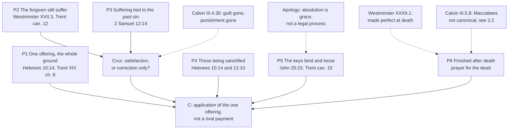

# Apologetics II · Lesson 6.3: Penance, purgatory, and indulgences

> ⏱ ~15 min · Module 6: The contested distinctives · Builds on: [6.2](06-02-the-saints-the-images-the-relics.md), [`theology-of-debt` 3.4](../../theology-of-debt/lessons/03-04-aquinas-satisfaction-and-the-debt-of-punishment.md), [3.5](../../theology-of-debt/lessons/03-05-the-christian-jubilee-and-the-treasury.md), [3.6](../../theology-of-debt/lessons/03-06-luther-trent-and-the-reform-of-indulgences.md), [`creation-grace-last-things` 6.3](../../creation-grace-last-things/lessons/06-03-purgatory.md), [`sacraments-and-liturgy` 4.1](../../sacraments-and-liturgy/lessons/04-01-penance-the-sacrament-and-its-history.md), [4.2](../../sacraments-and-liturgy/lessons/04-02-indulgences-as-a-practice.md), [2.2](02-02-the-canon-question.md) · Unlocks: [6.4](06-04-the-real-presence.md)

## Why this matters

Luther's theses of 1517 were a disputation "concerning penitence and indulgences", and the first says Christ meant "the whole life of believers" to be penitence (tr. Grignon, in Wace and Buchheim, *First Principles*, 1883). The Reformation began as a quarrel about this system, beside a real scandal: indulgences were being sold. This lesson concedes that, then defends what the trade grew on.

## The idea

A wife forgives her husband after years of drinking, and they are reconciled at once. His liver, his habits and his children's trust are not mended that day. What follows is real, and his acts caused it. Is it a debt still owed, a father's correction, or the cost of getting well?

That question is the whole dispute. Every piece of the Catholic system hangs on one distinction from [`theology-of-debt` 3.4](../../theology-of-debt/lessons/03-04-aquinas-satisfaction-and-the-debt-of-punishment.md): forgiveness removes the [guilt and the eternal punishment](../reference.md#guilt-and-punishment), but a temporal punishment can remain. [Satisfaction](../reference.md#satisfaction) is the penitent's share in discharging it, made in Christ. [Indulgences](../reference.md#indulgences) remit it from the [treasury](../reference.md#treasury-of-the-church) ([3.5](../../theology-of-debt/lessons/03-05-the-christian-jubilee-and-the-treasury.md), [3.6](../../theology-of-debt/lessons/03-06-luther-trent-and-the-reform-of-indulgences.md)). [Purgatory](../reference.md#purgatory) completes it after death ([`creation-grace-last-things` 6.3](../../creation-grace-last-things/lessons/06-03-purgatory.md)). [Private confession](../reference.md#private-confession) is where guilt is absolved and satisfaction imposed ([`sacraments-and-liturgy` 4.1](../../sacraments-and-liturgy/lessons/04-01-penance-the-sacrament-and-its-history.md), [4.2](../../sacraments-and-liturgy/lessons/04-02-indulgences-as-a-practice.md)). Those courses taught the doctrines and stated the objections without replying. This lesson argues.

Even Luther in 1517 held that the penalty "continues ... till our entrance into the kingdom of heaven" (Thesis 4); the later confessions deny that it pays anything.

## The other side

**Lutheran.** Luther's attack on the treasury (Theses 56–62) is worked in [`theology-of-debt`](../../theology-of-debt/syllabus.md) Boss 3, and the Apology on satisfactions in [3.6](../../theology-of-debt/lessons/03-06-luther-trent-and-the-reform-of-indulgences.md); neither is repeated here. What Catholic apologists routinely miss is that the [Lutheran confessions](../reference.md#book-of-concord) **kept private confession**. [Augsburg](../reference.md#augsburg-confession) XI (1530) says private absolution "ought to be retained in the churches", and XXV that confession "is not abolished among us". The [Smalcald Articles](../reference.md#smalcald-articles) (III.8) call absolution "ordained by Christ", and the [Apology](../reference.md#apology-of-the-augsburg-confession) (XIII) counts "Absolution, which is the Sacrament of Repentance" a true sacrament. They reject two narrower things. One is that the [enumeration of sins](../reference.md#enumeration-of-sins) is required by divine law: Augsburg XI calls it impossible, citing Psalm 19:12. The other is that absolution is a trial: its ministry "is favor or grace, it is not a legal process" (Apology, "Of Confession and Satisfaction", *Triglot Concordia*, 1921). **Weight:** the Book of Concord, the Lutheran confessional standard to which pastors subscribe, a norm under Scripture.

**Anglican.** Article XXII of the [Thirty-Nine Articles](../reference.md#thirty-nine-articles) calls "the Romish Doctrine concerning Purgatory, Pardons" (Latin *de Indulgentijs*) a thing "vainly invented, and grounded upon no warranty of Scripture" (Schaff; the English of 1571, modern spelling). Article XXV says penance is not to be counted among the "Sacraments of the Gospel". Yet the [Ordinal](../reference.md#edwardine-ordinal) of 1550, like that of 1662, ordains each priest with John 20:23: "whose synnes thou doest forgeve, they are forgeven". **Weight:** formularies whose authority and subscription vary across the Communion.

**Reformed.** The strongest objection is the [argument from Hebrews](../reference.md#once-for-all): "by one oblation he hath perfected for ever them that are sanctified" (Hebrews 10:14, Douay-Rheims). [Westminster](../reference.md#westminster-confession) XI.3, citing 10:10 and 10:14 among its proofs, says Christ "did fully discharge the debt" of the justified and made "a proper, real, and full satisfaction to his Father's justice". [Calvin](../reference.md#calvin-institutes) concludes: "if we are freed from guilt by Christ, the punishment consequent upon guilt must cease with it" (*Institutes* III.4.30, Beveridge). Purgatory falls with satisfaction, being only "the satisfaction for sin paid after death by the souls of the dead" (III.5.6). The righteous are "made perfect in holiness" at death, and Scripture knows no third place (Westminster XXXII.1).

Two features make this the strong form. The Reformed do not say the forgiven suffer nothing: they "bring temporal judgments upon themselves" (Westminster XVII.3, citing 1 Corinthians 11:32). Calvin calls this "not properly punishment or vengeance, but correction and admonition", a father's act and not a judge's (III.4.31). And on 2 Maccabees Calvin declines to reply, "lest I should seem to include that work among the canonical books" (III.5.8). **Weight:** Westminster is the subordinate standard of Presbyterian churches; the *Institutes* is a theologian's book.

## The argument

**P1.** Christ's one offering is the whole ground of forgiveness. Our satisfaction is not "so our own, as not to be through Jesus Christ", in whom "we satisfy" (Trent XIV, 1551, ch. 8, Waterworth). *In words:* on the price, Trent and Hebrews 10:14 agree.

**P2.** The forgiven still suffer because of their sins. Westminster XVII.3 and Calvin III.4.31 grant it; Trent's canon 12 asserts it against the claim that God "always" remits the whole punishment with the guilt. *In words:* the dispute is not whether anything follows forgiveness.

**P3.** Scripture's paradigm case ties that suffering to the past sin: "Nevertheless, because thou hast given occasion to the enemies of the Lord to blaspheme" (2 Samuel 12:14 [DR 2 Kings 12:14]; worked in [`theology-of-debt` 3.4](../../theology-of-debt/lessons/03-04-aquinas-satisfaction-and-the-debt-of-punishment.md)). *In words:* it follows "because of" the sin, not only "in order to" amend.

**P4.** Hebrews joins a finished offering to an unfinished sanctification. "Them that are sanctified" renders *tous hagiazomenous* (τοὺς ἁγιαζομένους), a present participle: "those being sanctified" (this lesson's rendering). The same letter has the Father scourging every son he receives, "that we might receive his sanctification" (12:6, 10). *In words:* 10:14 completes the cause, not the effect in each member.

**P5.** Christ gave power to retain sins as well as to forgive them (John 20:23, read in [`sacraments-and-liturgy` 4.1](../../sacraments-and-liturgy/lessons/04-01-penance-the-sacrament-and-its-history.md)). So the [keys](../reference.md#power-of-the-keys) bind as well as loose (Trent XIV can. 15), and an indulgence looses what the Church can bind. *In words:* both sides grant that the keys bind and loose (the Smalcald Articles III.7 says so); the dispute is whether binding includes imposing satisfactions on the forgiven.

**P6.** What is unfinished at death in one who dies in grace is finished after death, as the Church's prayer for the dead presupposes; Calvin concedes "thirteen hundred years" of it (III.5.10). Second Maccabees 12:46 ("a holy and wholesome thought to pray for the dead, that they may be loosed from sins", DR) is Scripture only for a reader who receives the [deuterocanon](../reference.md#deuterocanon), so this premise runs through [2.2](02-02-the-canon-question.md); for anyone else it attests Jewish practice ([`old-testament` 6.2](../../old-testament/lessons/06-02-tobit-judith-baruch-and-the-maccabees.md)). Augustine reads the fire of 1 Corinthians 3:15 chiefly as tribulation; of a cleansing fire after death he says, "this I do not contradict, because possibly it is true" (*City of God* XXI.26, tr. Dods). *In words:* the practice is ancient, and the texts fit purgatory without proving it.

**∴ C.** Satisfaction, indulgences and purgatory apply the one offering to members still being sanctified; they are not a rival payment. *In words:* Hebrews proves the price complete, not the patient well.

**Mark the levels.** On [the ladder](../../fundamental-theology/lessons/04-04-the-ladder-of-doctrinal-authority.md) ([levels of authority](../reference.md#levels-of-authority)): **Rung 1:** temporal punishment can remain after forgiveness (Trent VI can. 30, 1547; XIV cans. 12, 15); satisfaction is made to God through Christ's merits (XIV can. 13) and is a worship, not a human tradition (can. 14); John 20:22–23 speaks of forgiving and retaining in penance (can. 3); confession is of divine right and integral (cans. 6–7); absolution is a judicial act (can. 9); indulgences' power and usefulness (XXV, 4 December 1563); purgatory and the help of suffrages (Florence, 1439; VI can. 30; XXII can. 3), never Trent XXV, which restates without a canon. **At least rung 3:** chapter 8's vengeance clause, which no canon repeats. **Rung 3, never defined:** the treasury. **Rung 5:** fire, place, duration, and how payment and purification fit. **Discipline, no rung:** the abolition of gain and of the collectors, and every indulgence norm. **No magisterial level:** Augustine and Calvin as authors. The Catechism locates claims; it fixes no level.

**Concession.** The sale of indulgences was real, and the abuse was systemic. Trent's own decree calls the "evil gains" connected with indulgences "a most prolific cause of abuses" and abolishes them. Session XXI (ch. 9, 1562) had already abolished the professional collectors, and in 1567 Pius V revoked every grant of indulgences involving fees or other financial transactions (as the *Catholic Encyclopedia*, 1910, reports it). Trent condemned the trade and kept the doctrine, and the whole defence depends on that [distinction](../reference.md#disciplinary-and-doctrinal) holding. The 1517 campaign as a grievance is [7.2](07-02-the-reformations-grievances.md)'s.

**The crux.** Both sides grant that the forgiven suffer for their sins. They divide on [what that suffering is](../reference.md#chastisement-and-satisfaction): satisfaction owed to justice, "not only ... a medicine of infirmity, but also for the avenging and punishing of past sins" (Trent XIV ch. 8), or correction only (Calvin III.4.31). Calvin ties purgatory to the first (III.5.6), so the system turns here. The texts pull both ways: 2 Samuel 12:14 names the past sin as cause, Hebrews 12:10 names holiness as goal. What would move a Reformed reader is a showing that correction aimed at holiness can still be owed to justice, as the Catechism attempts: temporal punishment follows "from the very nature of sin", not as "vengeance inflicted by God from without" (CCC 1472). A Catholic should notice how little his side has fixed: canon 13 defines that satisfaction is made; the vengeance clause is a chapter's.

## The argument map

Every objection lands on the crux, P5 or P6; none touches P1.

## Worked examples

**Example 1 (clean): "Trent anathematized us for keeping confession."** So says `ninety_five_nails`, an invented Lutheran forum user. No canon condemns keeping private absolution. Canon 4 condemns saying penance has "two parts only", the terrors of conscience and faith "generated by the gospel, or by the absolution": that is Augsburg XII nearly word for word ("terrors smiting the conscience"; faith "born of the Gospel, or of absolution"). Canon 7 meets Augsburg XI on enumeration, and canon 9 meets the Apology's "not a legal process". So the anathemas fall on a Lutheran account of what confession is, never on keeping it. The disagreement is real, exact and narrow; P5 argues the Catholic side of canon 9.

**Example 2 (strain): "The trade was the doctrine's natural fruit."** This is the Lutheran reply [3.6](../../theology-of-debt/lessons/03-06-luther-trent-and-the-reform-of-indulgences.md) leaves standing. The Catholic answer is a separability test: remove the money and see whether the doctrine regrows the abuse. Trent removed it, and indulgences have run without fees for four centuries since. The reply still bites. The counting of "days" and "years" outlived the money until Paul VI dropped it in 1967, and a Lutheran can say the arithmetic, not the cash, was the fruit: a debt measured in time invites a price. The defined texts contain no arithmetic; Trent simply left it in place. Whether a doctrine that invites quantification is thereby corrupted is a question about tendency, for Newman's notes ([6.6](06-06-development-or-corruption.md)); the canons cannot settle it.

## Watch out

- **You might think the Protestants abolished confession.** Lutherans kept private absolution, and the Apology calls it a sacrament. The Anglican Ordinal gives every priest John 20:23. Calvin urges the troubled to "a private confession to his own pastor" (*Institutes* III.4.12). The phrase blurs three traditions into one error.
- **You might think the Reformed deny that God punishes forgiven sinners at all.** Westminster XVII.3 says they bring "temporal judgments upon themselves". What the Reformed deny is that these satisfy.
- **You might think Article XXII forbids prayer for the dead.** It names purgatory and pardons. The text that rules out prayer "for the dead" is Westminster XXI.4, which is Reformed, not Anglican.
- **Levels, both ways.** "Trent defined satisfaction as vengeance" overstates (chapter 8: at least rung 3). "Temporal punishment is a scholastic theory" understates (VI can. 30: rung 1). "Article XXII is Anglican dogma" overstates a formulary of varying authority.

## One-liner

> Christ paid everything and the forgiven still suffer; the Reformation turns on whether that suffering is satisfaction or only correction, and Trent kept the doctrine while abolishing the trade.

## Problems

**P1 (🟢) *(Exegetical, strict · close reading.)*** Three Lutheran texts, all from the *Concordia Triglotta* (1921), with the Triglot's brackets:

> **Augsburg Confession XI:** Of Confession they teach that Private Absolution ought to be retained in the churches, although in confession an enumeration of all sins is not necessary. For it is impossible, according to the Psalm: Who can understand his errors? Ps. 19, 12.
>
> **Smalcald Articles III.8:** Since Absolution or the Power of the Keys is also an aid and consolation against sin and a bad conscience, ordained by Christ [Himself] in the Gospel, Confession or Absolution ought by no means to be abolished in the Church … But the enumeration of sins ought to be free to every one, as to what he wishes to enumerate or not to enumerate.
>
> **Small Catechism V:** Before God we should plead guilty of all sins, even of those which we do not know, as we do in the Lord's Prayer. But before the confessor we should confess those sins alone which we know and feel in our hearts.

(a) What do these texts keep, and on what ground? Name the words.

(b) What do they deny or leave free, and is the ground the same in Augsburg XI and Smalcald III.8?

(c) Which sentence comes closest to Catholic practice, and which phrase marks the distance from Trent XIV can. 7 that remains?

**Two sentences per part.**

**P2 (🟡) *(Apologetic: (a) Exegetical, graded first · (b) reply.)*** Leave purgatory aside: the module's Boss 6(d) takes it. The target is Trent XIV, cans. 12–13. God does not always remit the whole punishment together with the guilt. Satisfaction for temporal punishment is made to God through Christ's merits, by penances and by sufferings patiently borne.

(a) State the Reformed objection to these canons from Westminster XI.3 (with its proof texts) and Calvin, *Institutes* III.4.30–31, in words a Reformed theologian would sign. Include what the Reformed hold the forgiven still suffer, and what they call it. **Three sentences.**

(b) Reply, opening with a **named concession**, and name the premise on which the dispute turns. **120 words or fewer.** A reply that concludes the objection succeeds passes if it is a good reply.

**P3 (🔴) *(Exegetical · diagnose.)*** A confirmation-class handout by Chinwendu Ikwuemesi, a catechist. The handout and its author are invented for this problem.

> 1. Jesus gave the apostles power to forgive and to retain sins (John 20:23), and Trent defined that the verse speaks of the sacrament of penance.
>
> 2. Luther abolished confession, and Lutherans have had no absolution since.
>
> 3. The Church of England went further: its ministers are never given any words of forgiveness at all.
>
> 4. Protestants teach that once God forgives you, nothing painful ever follows from your sins; that is why they reject purgatory.
>
> 5. Purgatory is plain in 1 Corinthians 3:15, and every Father read the verse that way.

Four sentences are wrong and one is right. Say which one is right and why, and correct the other four, each from a text in this lesson. **150 words or fewer.**

Solutions

**P1** *(Exegetical, strict · close reading)*

**Must hit, strict:**

- (a) **Kept:** private absolution (Augsburg XI, "ought to be retained"), confession or absolution "by no means to be abolished" (Smalcald), and confession to a confessor (Small Catechism). **Ground:** absolution is "ordained by Christ [Himself] in the Gospel", an aid and consolation, and it is the power of the keys. The claim is divine institution of *absolution*, not a pious custom.
- (b) **Denied:** that enumerating all sins is necessary. **Grounds differ.** Augsburg XI argues from *impossibility* ("Who can understand his errors?"). Smalcald III.8 makes enumeration a matter of *freedom* ("free to every one").
- (c) The **Small Catechism** comes closest: before the confessor, the sins "which we know and feel in our hearts", with the unknown sins left to God. The distance is Smalcald's **"free to every one"**. Can. 7 makes the confession of every remembered mortal sin necessary **of divine right**, while the Lutheran texts make it counsel, not precept.

**Wrong turns:** saying the Lutherans abolished confession, or kept it only as a human custom without absolution. Reading Augsburg XI as rejecting confession itself, when what it rejects is the enumeration of *all* sins. Missing that the Small Catechism and Smalcald III.8 differ in emphasis. Treating any of the three as a magisterial act: they are confessional texts of the Book of Concord.

**Model answer:** (a) All three keep confession with private absolution. Smalcald gives the ground: absolution is the power of the keys, "ordained by Christ [Himself] in the Gospel". (b) They deny that enumerating every sin is necessary. Augsburg XI argues that it is impossible (Psalm 19:12), while Smalcald III.8 argues that it should be "free to every one", which is a different ground. (c) The Small Catechism is closest: confess to the confessor the sins "which we know and feel" and leave the unknown ones to God, as Trent ch. 5 also does, citing the same psalm ("from my secret sins cleanse me"). The remaining distance is "free to every one": can. 7 makes confessing each remembered mortal sin a matter of divine right.

---

**P2** *(Apologetic: (a) Exegetical, graded first · (b) reply)*

**Accept:** any reply that opens with a real concession, locates the dispute at satisfaction against correction, and argues from the texts, whatever its verdict.

**Must hit, strict (a), graded first:**

- Christ "fully discharge[d] the debt" of the justified and made "full satisfaction" (Westminster XI.3, proofs including Hebrews 10:10, 14), so no satisfaction is left for the penitent. Credit, not required: Westminster XV.3, repentance is not "any satisfaction for sin".
- Calvin: punishment ceases with guilt (III.4.30).
- **What remains:** the forgiven *do* suffer for their sins, as "temporal judgments" (XVII.3) or fatherly **chastisement**. This is **correction, not punishment or vengeance** (III.4.31).

**Must hit (b):**

- **A named concession,** e.g. that Christ's one offering is the whole ground of forgiveness and nothing is added to it (Trent XIV ch. 8; CCC 1460). Or that the Reformed rightly see that what follows forgiveness can heal.
- **The crux:** whether the suffering of the forgiven is satisfaction owed to justice or correction only.
- At least one textual move: 2 Samuel 12:14 ("because thou hast given occasion"); Hebrews 10:14's present participle (*hagiazomenous*, those being sanctified) beside 12:10; Trent's "in whom we satisfy".

**Wrong turns:** stating (a) as "Calvinists say forgiven sinners suffer nothing" or "Protestants deny God disciplines his children". That is the caricature, and it fails the problem. Stating (a) from the Lutheran Apology instead of the Reformed texts named. Answering with Aquinas's "application" alone, which [`theology-of-debt` 3.4](../../theology-of-debt/lessons/03-04-aquinas-satisfaction-and-the-debt-of-punishment.md) already gives, without meeting the chastisement reading. Drifting into purgatory or the Mass. Claiming Trent defined satisfaction as vengeance.

**Model answer (a):** Christ by his death fully discharged the debt of all the justified and made full satisfaction to the Father's justice (Westminster XI.3, citing Hebrews 10:10, 14). So once guilt is forgiven, the punishment due to it ceases with it (Calvin III.4.30). Believers who sin still suffer temporal judgments and God's displeasure (Westminster XVII.3), but this is a father's correction for their amendment, not punishment or satisfaction (Calvin III.4.31).

**Model answer (b), one of several:** Concession: the price is wholly Christ's, and Trent says so; we satisfy only "in" him. The objection is right that nothing is added to Hebrews 10:14. But both sides agree the forgiven suffer for their sins. The question is whether that suffering looks back to the sin or only forward to amendment. Nathan's "because thou hast given occasion" looks back. And 10:14 perfects "those being sanctified", so a work still under way in the member is not a second price. The premise is this: correction ordered to holiness can also be owed to justice.

---

**P3** *(Exegetical · diagnose)*

**Must hit, strict:**

- **Sentence 1 is right.** Trent XIV can. 3 defines that John 20:22–23 speaks of forgiving and retaining sins in the sacrament of penance (rung 1).
- **2:** Lutherans kept private absolution (Augsburg XI, XXV; Smalcald III.8), and the Apology (XIII) counts it a sacrament. They denied that enumeration is required by divine law.
- **3:** the Ordinal (1550, 1662) ordains priests with John 20:23's words of forgiving and retaining.
- **4:** the Reformed hold that the forgiven bring "temporal judgments" on themselves (Westminster XVII.3) and are chastised (Calvin III.4.31). They deny that this is *satisfaction*, which is why Calvin rejects purgatory (III.5.6). "Protestants" also blurs traditions.
- **5:** Augustine reads the fire chiefly as tribulation and calls a cleansing after death only "possibly" true (*City of God* XXI.26). The verse is consistent with purgatory but does not prove it. Credit, not required: Calvin says "most of the Fathers" read the fire as tribulation (III.5.9).

**Wrong turns:** "correcting" sentence 1. Correcting sentence 4 by saying the Reformed believe in purgatory. Correcting sentence 3 with an argument about whether Anglican orders are valid, which is a different question ([4.3](04-03-apostolic-succession-and-the-validity-of-orders.md)).

**Model answer:** Sentence 1 is right: Trent XIV can. 3 defines that sense of John 20:23. Sentence 2: Augsburg XI and Smalcald III.8 keep private absolution, and Apology XIII calls it a sacrament. Lutherans rejected only enumeration by divine law. Sentence 3: the Anglican Ordinal ordains each priest with "whose sins thou dost forgive, they are forgiven". Sentence 4: Westminster XVII.3 says the forgiven bring temporal judgments on themselves, and Calvin calls them fatherly correction. What the Reformed deny is that this is satisfaction, and that denial is why they reject purgatory. Sentence 5: Augustine read the fire mainly as tribulation and allowed a cleansing after death only as "possibly true"; the verse fits purgatory without proving it.

## Flashback

**From Lesson [6.1](06-01-mary.md) (Mary):** *(Apologetic: (a) Exegetical, graded first · (b) reply.)* At an invented ecumenical evening (written for this problem; no one in it is real), an Anglican priest says: "I have no quarrel with a Catholic who believes Mary was conceived without sin. My quarrel is with 1854."

(a) State the objection as the [Thirty-Nine Articles](../reference.md#thirty-nine-articles) ground it: what Article VI forbids, what it leaves free, and how it meets the definition's own words. Mark the Articles' weight. **Three sentences.**

(b) Reply, opening with a **named concession**. Say where the dispute actually lies and where your reply must stop. **100 words or fewer.** A reply that concludes the objection succeeds passes if it is a good reply.

Solution

**Accept:** any verdict, if the reply opens with a real concession, puts the dispute in the authority to require, and says where it stops.

**Must hit, strict (a), graded first:**

- **Article VI:** what Scripture neither contains nor proves "is not to be required of any man, that it should be believed as an article of the faith" (Schaff, the English of 1571, modern spelling). It forbids *requiring* the belief, not *holding* it.
- **Against 1854:** the doctrine is "revealed by God" and so "to be firmly and constantly believed by all the faithful" (Schaff vol. 2). The clash is over the Church's power to require.
- **Weight:** Anglican formularies whose subscription and authority vary across the Communion.

**Must hit (b):**

- **A named concession,** flat: 1854 requires exactly what Article VI forbids requiring; or Bernard and Aquinas denied the doctrine.
- **Where it lies:** the warrant for 1854 is Scripture read in Tradition by the Church, the authority Article VI denies. On warrant the dogma is a test case of [*sola scriptura*](../reference.md#sola-scriptura): the objection reaches the authority to define, not the dogma's content.
- **Where it stops:** Marian texts cannot settle it. It rests on Module 2 ([2.3](02-03-tradition-and-what-sufficiency-means.md)), and whether the belief was handed down is [6.6](06-06-development-or-corruption.md)'s question.

**Wrong turns:** "Anglicans forbid believing it", which misses "required". Grounding the objection in Article XXII, which names no Marian doctrine. "The Protestant position", or Westminster for an Anglican. Replying with *praeredemptio*, which meets a content objection the priest did not make.

**Model answer (a):** Article VI holds that what Scripture neither contains nor proves "is not to be required of any man" as an article of the faith: it forbids requiring such a belief, not holding it, so a Catholic may think Mary immaculate. But 1854 declares the doctrine revealed and "to be firmly and constantly believed by all the faithful". The Articles, Anglican formularies of varying authority, deny the Church that power.

**Model answer (b), one of several:** Concession: 1854 does require what Article VI forbids requiring, and Bernard and Aquinas denied the doctrine; the clash is real. But it is not about Mary. The Catholic warrant is Scripture read in Tradition by a Church that may define, which Article VI denies. So the objection reaches the authority to define, not the dogma's content, and my reply stands or falls with the case against *sola scriptura*. Whether the belief was handed down or invented is a question about development.

## Connections

- **Backward:** the guilt/punishment distinction, the treasury and Trent on indulgences are [`theology-of-debt` 3.4](../../theology-of-debt/lessons/03-04-aquinas-satisfaction-and-the-debt-of-punishment.md)–[3.6](../../theology-of-debt/lessons/03-06-luther-trent-and-the-reform-of-indulgences.md), whose Boss 3 runs Luther's Theses 56–62. The sacrament and its practice are [`sacraments-and-liturgy` 4.1](../../sacraments-and-liturgy/lessons/04-01-penance-the-sacrament-and-its-history.md)–[4.2](../../sacraments-and-liturgy/lessons/04-02-indulgences-as-a-practice.md). Purgatory as doctrine is [`creation-grace-last-things` 6.3](../../creation-grace-last-things/lessons/06-03-purgatory.md). The canon loop is [2.2](02-02-the-canon-question.md) and [`old-testament` 6.2](../../old-testament/lessons/06-02-tobit-judith-baruch-and-the-maccabees.md).
- **Forward:** [6.4](06-04-the-real-presence.md) turns to the Supper. [6.5](06-05-the-sacrifice-of-the-mass.md) owns Hebrews 10 against the Mass and the Mass offered for the dead (Trent XXII). [6.6](06-06-development-or-corruption.md) runs Newman's notes on the strain in Example 2. The module's Boss 6(d) offers purgatory against Article XXII and the argument from Hebrews ([syllabus](../syllabus.md)). The Orthodox objections to a satisfaction framework and a purgatorial fire are [5.5](05-05-marriage-divorce-and-the-state-of-the-dead.md)'s, and the 1517 campaign as a grievance is [7.2](07-02-the-reformations-grievances.md)'s.
- **Sideways:** the crux here, satisfaction against correction, is the old question about the purpose of punishment. [`moral-theology` 5.4](../../moral-theology/lessons/05-04-the-death-penalty-and-ccc-2267.md) asks it of the state: does punishment redress a disorder or only reform the offender? Calvin's claim that Christ bore "the penalty and punishment which was due to our sins" (III.4.30) is the penal-substitution logic that [`christology` 5.4](../../christology/lessons/05-04-penal-substitution-and-the-catholic-assessment.md) assesses. This course does not reopen the atonement.
