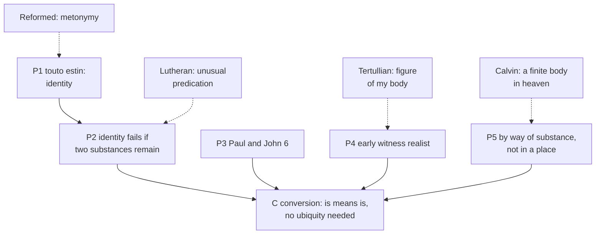

# Apologetics II · Lesson 6.4: The real presence

> ⏱ ~15 min · Module 6: The contested distinctives · Builds on: [6.3](06-03-penance-purgatory-and-indulgences.md), [`sacraments-and-liturgy` 3.2](../../sacraments-and-liturgy/lessons/03-02-the-controversies-that-forced-precision.md), [`sacraments-and-liturgy` 3.3](../../sacraments-and-liturgy/lessons/03-03-real-presence-and-transubstantiation.md) · Unlocks: [6.5](06-05-the-sacrifice-of-the-mass.md)

## Why this matters

Of the twenty-one errors the Formula of Concord rejects on the Supper, only three are Rome's; it writes against the "Sacramentarians", Zwinglian and Reformed. Calvin found the Roman doctrine "more tolerable, or at least more modest" than Lutheran ubiquity (*Institutes* IV.17.30). Three Protestant doctrines of the [real presence](../reference.md#real-presence) fight one another as hard as Trent; answering "Protestants" answers none.

## The idea

Take the sentence Jesus spoke over bread: "This is my body." There are four ways to make it true.

1. It **signifies** my body, as a ring signifies a marriage (Zwingli).
2. It is a sign that **gives** what it names, as a deed handed over conveys the land (Calvin). The Spirit joins the believer to Christ's body in heaven.
3. The bread stays bread, and the body is **truly there with it**, given to every mouth (Luther).
4. What was bread **has become** the body; only its appearances remain (Trent).

Zwingli and Calvin read "is" as a figure; Calvin, Luther and Trent agree the body is really given. [`sacraments-and-liturgy` 3.2](../../sacraments-and-liturgy/lessons/03-02-the-controversies-that-forced-precision.md) tabled the Protestant positions and [3.3](../../sacraments-and-liturgy/lessons/03-03-real-presence-and-transubstantiation.md) taught Session XIII. This lesson argues, from texts they did not read.

## The other side

All three reject [transubstantiation](../reference.md#transubstantiation).

**Lutheran.** The [Augsburg Confession](../reference.md#augsburg-confession) (1530), art. X: the body and blood *vere adsint et distribuantur vescentibus*, are truly present and distributed to those who eat (the German adds "under the form of bread and wine"), and contrary teachers are rejected. Melanchthon's 1540 *Variata* ("with the bread and wine are truly offered") dropped the rejection, and Calvin signed it (Schaff's note, *Creeds* vol. 3). The [Formula of Concord](../reference.md#formula-of-concord) (1577), art. VII, makes the doctrine exact (Epitome: Schaff's English; SD: Triglot):

- **The [sacramental union](../reference.md#sacramental-union).** By it the bread and wine "are truly the body and blood of Christ" (Epitome VII, affirmative II). "Under the bread, with the bread, in the bread" rejects transubstantiation and marks the union of the bread's *unchanged* substance with the body (SD VII.35). The words are an "unusual" predication, not "a figurative" one, modelled on "the Word was made flesh" (SD VII.36–38).
- **Oral eating:** "not only spiritually through faith, but also by the mouth", yet "not Capernaitically" (affirmative VI).
- **The [*manducatio indignorum*](../reference.md#manducatio-indignorum):** the unworthy and unbelieving receive the true body, to judgment (affirmative VII).

For the ascended body, Luther gives four reasons (SD VII.93–97): Christ is God and man in one person; God's right hand is everywhere; God's word does not lie; God knows "many modes of being in any place". Of his three [modes](../reference.md#modes-of-presence) (SD VII.98–101), the second takes up no room: by it Christ left the sealed tomb, and by it he is in the bread. Article VIII adds the [communication of idioms](../reference.md#communication-of-idioms): "not only as God, but also as man", Christ is "present to all creatures" (Epitome VIII, affirmative XI), though not "locally spread out" (negative X). "[Ubiquity](../reference.md#ubiquity)" is the opponents' word (Calvin, IV.17.16, 30). The [Book of Concord](../reference.md#book-of-concord) is a *norma normata* pastors subscribe, not a magisterium.

**Reformed.** Calvin ([*Institutes*](../reference.md#calvin-institutes) IV.17, Beveridge) teaches a "true and substantial communication" of the body and blood by the Spirit (IV.17.19). His objection is Christological and, he insists, exegetical: the risen body is declared "not by Aristotle, but by the Holy Spirit, to be finite, and to be contained in heaven until the last day" (IV.17.26). "The question here is not, What could God do? but, What has he been pleased to do?" (IV.17.24). Hence IV.17.19's two restrictions: nothing derogatory to his heavenly glory, such as binding him to earthly elements; nothing inconsistent with his human nature, such as a body in many places at once.

The [Heidelberg Catechism](../reference.md#heidelberg-catechism) (1563, Schaff's English): by his human nature Christ "is now not upon earth" (Q.47), yet by the Holy Ghost, "although he is in heaven, and we on the earth", we are flesh of his flesh (Q.76). The bread is called the body "agreeably to the nature and usage of sacraments" (Q.78). The [Westminster Confession](../reference.md#westminster-confession) (1646), XXIX.7: worthy receivers feed on Christ "really and indeed, yet not carnally and corporally, but spiritually", the body being not "in, with, or under the bread" but present to faith: a [spiritual presence](../reference.md#spiritual-presence). The Consensus Tigurinus (Zurich and Geneva, 1549) takes the words "figuratively", by [metonymy](../reference.md#sacramental-metonymy) (art. 22). Heidelberg and Westminster are subordinate standards; Calvin is a theologian.

**Anglican, Reformed in character.** [Article XXVIII](../reference.md#thirty-nine-articles) (1571 English in Schaff, spelling modernized):

> The body of Christ is given, taken, and eaten in the Supper only after an heavenly and spiritual manner: And the mean whereby the body of Christ is received and eaten in the Supper, is faith.

It calls transubstantiation "repugnant to the plain words of Scripture". Article XXIX, first printed in 1571, denies that the wicked eat Christ's body. The Articles' authority and subscription vary across the Anglican Communion.

**Zwinglian.** Zwingli read "is" as "signifies" (*est = significat*), arguing from John 6:63, "the flesh profiteth nothing" (DR 6:64), in the *Commentary on True and False Religion* (1525). At Marburg (1529) he and Luther agreed on everything but part of the fifteenth article: "whether the real body and blood of Christ are corporally present in the bread and wine" (Schaff, *History* VII §108). In 1531 he confessed the body eaten "not in a gross and carnal manner, but in a sacramental and spiritual manner" by the believing heart (§111). That is [memorialism](../reference.md#memorialism) as its author held it, not a bare symbol of an absent Christ. Calvin faulted Zwingli for not adding that "the reality is conjoined" with the signs (*Short Treatise on the Lord's Supper*, 1541, §58).

## The argument

**P1. The words of institution predicate identity.** *Touto estin to sōma mou* (Matt 26:26; Mark 14:22; Luke 22:19); in Paul, *touto mou estin to sōma* (1 Cor 11:24). *In words:* over what he held, Jesus said "is", not "signifies" or "here is".

**P2. A sentence of identity is false of two substances that both remain.** With the bread remaining, Aquinas argues, "Rather should one say in that case: 'Here is My body'" (ST III q.75 a.2, English Dominican translation). *In words:* union makes "is" mean "is with"; metonymy makes it "is called".

**P3. The New Testament speaks of the body itself as given.** The unworthy eater is "guilty of the body and of the blood of the Lord" (1 Cor 11:27), and John 6:54–58 switches to *trōgō*, a blunt verb for chewing ([`new-testament` 2.5](../../new-testament/lessons/02-05-the-theology-of-john.md)). *In words:* the offence and the eating are aimed at the body, not at a reminder.

**P4. The earliest witness is realist and theory-free.** Ignatius calls the Eucharist "the flesh of our Saviour" (*Smyrnaeans* 7), and Justin says it is received "not as common bread" (*1 Apology* 66; [`patristics` 1.3](../../patristics/lessons/01-03-ignatius-of-antioch.md), [1.4](../../patristics/lessons/01-04-justin-martyr.md)). At Corbie in the 830s and 840s, [Paschasius and Ratramnus](../reference.md#paschasius-and-ratramnus) both said "truly" and "figure"; they divided over *veritas*, and the West took Paschasius's side. *In words:* the witness excludes an absent body more clearly than it chooses among the other readings.

**P5. The body is present [by way of substance](../reference.md#presence-by-way-of-substance), not in a place.** Christ always sits at the Father's right hand "according to the natural mode of existing", yet is present on many altars "sacramentally ... in his own substance, by a manner of existing, which, though we can scarcely express it in words", faith holds possible (Trent XIII ch. 1, Waterworth). Aquinas: "not in this sacrament as in a place, but after the manner of substance" (ST III q.76 a.5). *In words:* the body is not moved, multiplied in space or stretched, so no ubiquity is needed.

**∴ C.** Conversion reads the words as identity, fits the realist witness, and meets the Reformed objection without Lutheran Christology. *In words:* "is" means *is*, and the ascended body stays one.

**Mark the levels.** ([the ladder](../../fundamental-theology/lessons/04-04-the-ladder-of-doctrinal-authority.md); [levels of authority](../reference.md#levels-of-authority).) The presence, the conversion of the whole substance (the species only remaining), and its name: **rung 1** (Trent XIII cans. 1–2), for the change and the term, **not** for Aristotle. Canon 8, against eating "spiritually only": **rung 1** as worded. Chapter 1's contrast of modes, which no canon repeats: **at least rung 3**. The eucharistic reading of John 6: **not defined** (Trent XXI ch. 1). Aquinas and the Fathers: **no magisterial level**; whether Aquinas's account is required: **rung 5**. The Formula's "unchanged substance" matches what canon 2's first clause condemns ("remains conjointly with"), though applying it to the Formula is **rung 5**; whether Calvin's "true and substantial communication" is canon 8's "spiritually only" is **rung 5**, since no act names him. The confessions have no Catholic level.

**Concession.** The definition is not committed to Aristotle. Trent says "species", never names Aristotle, and whether "substance" in canon 2 must be read in the *Categories*' sense is disputed among Catholics (rung 5; [`sacraments-and-liturgy` 3.3](../../sacraments-and-liturgy/lessons/03-03-real-presence-and-transubstantiation.md)). Catholic apologists who make the doctrine sound Aristotelian concede ground the Church has not conceded. And the Reformed confess a real feeding on Christ's own body, so the quarrel with them is over where and how it is given, not whether.

**The crux.** Can "this is my body" be true of bread without a change in what the bread is? The Lutheran says yes: an unusual predication, true by the sacramental union as "the Word was made flesh" is true by the personal union (SD VII.36–38). The Catholic says no (P2). What would move it: whether the Christological analogy carries. In Christ one person bears what is said of both natures ([`christology` 3.2](../../christology/lessons/03-02-the-communication-of-idioms.md)); the Formula calls the Supper's union "not a personal union" (SD VII.38), so it owes an account of what single thing "this" names. Against the Reformed the crux is different: whether a body can be present in its substance without being in a place (P5).

## The argument map

Dashed edges are each tradition's objection; the Lutheran edge into P2 is the crux.

## Worked examples

**Example 1 (clean): "Paul still calls it bread."** The Smalcald Articles (III.6, Triglot) say bread "is, and remains": Paul writes "the bread which we break" (1 Cor 10:16) and "let him so eat of that bread" (11:28). Run P2: does the name show the substance? Scripture names a thing by what it was and still looks like: the steward "had tasted the water made wine" (John 2:9, DR). And Paul's "bread" stands one verse from "guilty of the body" (11:27). His vocabulary is not a theory; it proves neither remanence nor conversion.

**Example 2 (strain): "The Fathers you cite are ours."** The Formula says Justin, Augustine, Gelasius and others used the Incarnation as their simile: two natures unchanged, so two substances present together (SD VII.37). Chemnitz's *Examen* cites Gelasius: the bread's substance or nature does not cease to be. Ambrose uses the same Incarnation for a real change under an unchanged appearance (*On the Mysteries* 9.52–53; [`patristics` 4.1](../../patristics/lessons/04-01-ambrose-of-milan.md)). Here P4 stops: it excludes an absent body, not remaining bread, and the Fathers' "nature" is not the thirteenth century's "substance". The Catholic must rest on P2 and on the Church's reading ("ever been a firm belief", XIII ch. 4), which a Lutheran does not grant, so the dispute becomes Module 2's: authority.

## Watch out

- **You might think "Reformed" means Zwingli's bare memorial,** but Calvin, Heidelberg Q.76 and Westminster XXIX.7 teach a real feeding on Christ's body by the Spirit. Calvin shares Zwingli's figurative "is" (Consensus art. 22), not an empty sign.
- **You might think Lutherans teach "consubstantiation", a body spread everywhere,** but the word is not the Formula's, which rejects local extension (Epitome VIII, negative X). "In, with and under" is later shorthand; the English trio is Westminster's, in a denial (XXIX.7).
- **You might think Aquinas's "after the manner of substance" is Trent's answer to Calvin,** but Trent says only that the manner can scarcely be expressed (ch. 1, at least rung 3). Aquinas has no magisterial level; resting on him overstates.

## One-liner

> Zwingli's "is" signifies, Calvin's gives by a sign, Luther's joins to unchanged bread, Trent's converts: the Catholic case is a claim about that word, not about Aristotle.

## Problems

**P1 (🟢) *(Diagnose · Exegetical.)*** An **invented** OCIA talk, written for this problem. Deacon Arturo Zamarripa of Our Lady of Aparecida, Fernhollow (neither is real), tells the catechumens:

> "Calvin was a memorialist. He even admitted that 'This is my body' is a figure of speech, exactly like Zwingli. Lutherans believe in consubstantiation: Christ's body is spread out everywhere like the air, so of course it is in the bread too, though for them an unbeliever at the rail gets nothing but bread. And the Anglicans are all bound by Article XXVIII, which is pure Zwingli."

Find four errors. Correct each in one or two sentences, naming the text that corrects it. **120 words or fewer.**

**P2 (🟡) *(Apologetic: (a) Exegetical, graded first · (b) reply.)*** A Reformed seminarian tells a Catholic friend that the doctrine of Trent cannot be true of a human body.

(a) State the objection as the Heidelberg Catechism (Q.47, Q.76) and Calvin (*Institutes* IV.17.24, 26) state it. Do not use IV.17.19. **Three sentences at most.**

(b) Reply, opening with a **named concession**, and mark the level of every Catholic text you use. **120 words or fewer.** A reply that concludes the objection succeeds passes if it is a good reply.

**P3 (🔴) *(Close reading · Exegetical.)*** Tertullian, *Against Marcion* IV.40, tr. Peter Holmes (*Ante-Nicene Fathers*, vol. 3):

> Then, having taken the bread and given it to His disciples, He made it His own body, by saying, "This is my body," that is, the figure of my body. A figure, however, there could not have been, unless there were first a veritable body. An empty thing, or phantom, is incapable of a figure. If, however, (as Marcion might say,) He pretended the bread was His body, because He lacked the truth of bodily substance, it follows that He must have given bread for us. … He did not understand how ancient was this figure of the body of Christ, who said Himself by Jeremiah: "… Let us cast the tree upon His bread," which means, of course, the cross upon His body.

(a) Oecolampadius glossed the words of institution as Tertullian does here, "the figure of my body", taking the sense to be Zwingli's *est = significat*; Catholic readers cite the passage for realism. Quote the words each reading rests on, and say whom Tertullian is refuting and with what premise.

(b) From the last sentence, say what "figure" means in this chapter, and what the passage can and cannot prove about the sixteenth-century dispute.

**120 words or fewer in all.**

Solutions

**P1** *(Diagnose · Exegetical)*

**Accept:** any four of the five corrections below.

**Must hit, strict:**

1. **"Calvin was a memorialist … like Zwingli."** The premise is true: the Consensus Tigurinus (art. 22) takes the words "figuratively", by metonymy. The conclusion is false. Calvin teaches a "true and substantial communication" of the body (IV.17.19), Heidelberg Q.79 a partaking of his "true body and blood, through the working of the Holy Ghost", and Calvin faulted Zwingli for not adding that "the reality is conjoined" with the signs (*Short Treatise* §58).
2. **"Consubstantiation."** Not the Formula's word. It teaches a sacramental union of the unchanged bread with the body (Epitome VII, affirmative II; SD VII.35–38).
3. **"Spread out everywhere."** The Formula rejects a human nature "locally spread out into all places" (Epitome VIII, negative X). It grounds the presence in the words of institution and the sacramental union, and Luther's "spiritual mode" takes up no room (SD VII.100).
4. **"An unbeliever gets nothing but bread."** Reversed. The Formula teaches that the unworthy and unbelieving receive the true body, to judgment (Epitome VII, affirmative VII). It is Westminster XXIX.8 and Article XXIX that deny the wicked receive the thing signified.
5. **Article XXVIII "binding" and "pure Zwingli."** The body is "given, taken, and eaten" after a heavenly and spiritual manner, with faith as the means: Reformed in character, not a bare sign. The Articles' authority and subscription vary across the Anglican Communion.

**Wrong turns:** correcting (1) by making Calvin Lutheran, with the body received by the mouth. Correcting it by calling Zwingli a believer in "no presence", which his 1531 *Exposition* contradicts. Treating the Formula as a Lutheran magisterium. Saying Lutherans hold transubstantiation.

**Model answer:** (1) Calvin does read "is" figuratively (Consensus art. 22), but he teaches a "true and substantial communication" of the body by the Spirit (IV.17.19) and faulted Zwingli for omitting it. (2) "Consubstantiation" is not the Formula's word, and the Formula rejects a body "locally spread out" (Epitome VIII, negative X); it teaches a sacramental union with unchanged bread (SD VII.35–38). (3) Reversed: Lutherans hold that the unworthy receive the true body, to judgment (Epitome VII, affirmative VII); Westminster XXIX.8 and Article XXIX deny it. (4) Article XXVIII has the body eaten spiritually by faith, which is Reformed, not Zwinglian, and the Articles' authority varies across Anglicanism.

---

**P2** *(Apologetic: (a) Exegetical, graded first · (b) reply)*

**Accept:** any reply that opens with a named concession and distinguishes the natural mode from the sacramental, whatever its verdict.

**Must hit, strict (a), graded first:**

- Christ's risen body is a true human body: finite, ascended, and "contained in heaven until the last day", which Scripture teaches, "not ... Aristotle" (IV.17.26). By his human nature he "is now not upon earth", though by his Godhead, majesty, grace and Spirit he is never absent (Q.47).
- Believers are nonetheless truly united to that body by the Holy Spirit, "although he is in heaven, and we on the earth" (Q.76). The objection denies a presence in the bread, not communion with the body.
- The question is what God has willed, not what he could do (IV.17.24). A body in many places at once would be flesh and not flesh.

**Must hit (b):**

- **A named concession:** the body is finite and sits at the Father's right hand in its natural mode. Trent says so itself (XIII ch. 1), and the objection is exegetical, not a rationalist's.
- **The distinction:** Trent separates that natural mode from a sacramental presence "in his own substance" (ch. 1, **at least rung 3**). Aquinas's account, not in a place but after the manner of substance (q.76 a.5), has **no magisterial level**. On it the body is neither moved nor multiplied in space.
- **The defined floor:** the presence and the conversion are **rung 1** (cans. 1–2), whatever account of them one gives.
- **The honest cost:** Trent says the manner "can scarcely" be expressed. The Reformed answer that a substance with no place is not a body. The Catholic claims non-contradiction, not proof.

**Wrong turns:** stating (a) as "Calvin denies any real presence", or as Zwingli's memorial; either fails the problem. Answering with omnipotence alone, which IV.17.24 has already met. Saying Christ leaves heaven at the consecration. Calling Aquinas's account defined.

**Model answer (a):** Christ's risen body is a true and finite human body, which Scripture, not Aristotle, says is contained in heaven until the last day, so by his human nature he is not on earth. Believers are truly united to that body by the Holy Spirit, though he is in heaven and they on earth. The question is not what God could do but what he has willed, and a body in many places at once is not a body.

**Model answer (b), one of several:** Concession: the body is finite and is at the Father's right hand in its natural mode. Trent says so (XIII ch. 1), and your objection rests on Scripture, not philosophy. But Trent distinguishes that mode from a sacramental presence "in his own substance" (ch. 1, at least rung 3). The body is not moved down, stretched, or placed on many altars as bodies are in places. On Aquinas's account it is present after the manner of substance, not as in a place (no magisterial level). What is defined is only the presence and the conversion (rung 1). Trent calls the manner scarcely expressible, so I claim no contradiction, not a picture.

---

**P3** *(Close reading · Exegetical)*

**Must hit, strict (a):**

- **The figurative reading** rests on "that is, the figure of my body" (*id est figura corporis mei*). **The realist reading** rests on "He made it His own body" (*corpus suum illum fecit*). Both phrases are in one sentence.
- **The target** is Marcion's docetism: a phantom Christ with no true flesh. **The premise** is "A figure, however, there could not have been, unless there were first a veritable body." The figure proves the body real.

**Must hit, strict (b):**

- **"Figure" in this chapter** is the prophetic type. Jeremiah's "bread" already figured Christ's body, "the cross upon His body", so the Supper's bread is that ancient figure, now made his body by his word. It is not a modern "mere symbol".
- **What it can and cannot prove.** It cannot prove memorialism: the argument's whole aim is realism about Christ's flesh, and it says he "made" the bread his body. It cannot prove conversion either: it calls the bread a figure and says nothing of what becomes of it. It shows that an early third-century Latin writer could say "made it his body" and "figure" in one breath with no sense of conflict. Reading either sixteenth-century position into it is [anachronism](../reference.md#anachronism).

**Wrong turns:** quoting only one of the two phrases. Taking *figura* as a modern "mere sign" without looking at the Jeremiah sentence. Reading "made it His own body" as transubstantiation. Missing the anti-docetic aim. Giving Tertullian a magisterial level.

**Model answer:** (a) The figurative reading rests on "that is, the figure of my body"; the realist on "He made it His own body", in the same sentence. Tertullian is refuting Marcion's phantom Christ, on the premise that a figure requires "first a veritable body". (b) "Figure" is the prophetic type: Jeremiah's "bread" already meant Christ's body, so the bread is that ancient figure, now made his body. The passage cannot prove memorialism, since its point is the reality of Christ's flesh. It cannot prove conversion, since it says nothing of what becomes of the bread. It shows only that "figure" and "made his body" stood together without strain, which forbids reading either side back into it.

## Flashback

**From Lesson [6.2](06-02-the-saints-the-images-the-relics.md) (The saints, the images, the relics):** *(Assign the weight · Exegetical, strict.)* An invented study-group worksheet, written for this problem, makes six claims:

> (1) "Trent defined the invocation of saints; denying it is heresy."
>
> (2) "Venerating images is a tolerated custom; a Catholic may judge it unlawful."
>
> (3) "Catholics must hold that the saints see our prayers in the vision of God."
>
> (4) "Trent only regulated relics; honouring them is discipline."
>
> (5) "Calvin's *Institutes* and Heidelberg Q.98 bind the Reformed as Nicaea II binds Catholics."
>
> (6) "The Apology's grant that the saints pray for the Church is Melanchthon's private opinion."

For each, name the act or text, give its real weight (a rung, or its standing in its own tradition), and say whether the claim overstates or understates. **One sentence each.**

Solution

**Accept:** any wording that names the right act and weight; the over/under verdict is graded strictly.

**Must hit, strict:**

- **(1) Overstates.** **At least rung 3**: Trent XXV's decree has no canon, deniers "think impiously", and whether its closing anathema reaches invocation is not manifest (can. 749 §3); XXII can. 5 (**rung 1** as worded) presupposes it.
- **(2) Understates.** **Rung 1**: [Nicaea II](../reference.md#nicaea-ii)'s *horos* (787) defines the [veneration of images](../reference.md#veneration-of-images) with anathemas; Trent XXV restates it "as ... has been defined".
- **(3) Overstates.** That the saints pray and may be invoked is taught; how they know our prayers is **rung 5**.
- **(4) Understates.** Honour to [relics](../reference.md#relics) is **at least rung 3** (Trent XXV: deniers "are wholly to be condemned"); only the reform orders, such as no new relic without the bishop's approval, are **discipline**.
- **(5) Overstates.** The *Institutes* is a theologian's book; Heidelberg (1563) is a Reformed confessional standard under Scripture, and the Reformed make no council the rule of faith (Westminster XXXI.4).
- **(6) Understates.** The Apology is in the [Book of Concord](../reference.md#book-of-concord), which Lutheran pastors subscribe: a *norma normata*, not a magisterium.

**Wrong turns:** grading (1) and (3) leniently because they flatter the Catholic side. Raising (4) to rung 1 on the images anathema, whose reach is not manifest. Correcting (6) by making the Book of Concord a magisterium. Putting any Protestant text on the Catholic ladder.

**Model answer:** (1) Overstates: Trent XXV, no canon, "think impiously": at least rung 3. (2) Understates: rung 1, Nicaea II's *horos*, restated by Trent. (3) Overstates: how the saints hear is rung 5. (4) Understates: relics at least rung 3; only Trent's reform orders are discipline. (5) Overstates: Calvin's book has no confessional standing; Heidelberg is a Reformed standard under Scripture. (6) Understates: the Apology is in the subscribed Book of Concord, a *norma normata*.

## Connections

- **Backward:** the three positions and their table are [`sacraments-and-liturgy` 3.2](../../sacraments-and-liturgy/lessons/03-02-the-controversies-that-forced-precision.md), Trent's Session XIII and Aquinas's account are [3.3](../../sacraments-and-liturgy/lessons/03-03-real-presence-and-transubstantiation.md), and the institution texts are [3.1](../../sacraments-and-liturgy/lessons/03-01-the-institution-and-the-earliest-witness.md). Ignatius, Justin and Ambrose are read in [`patristics` 1.3](../../patristics/lessons/01-03-ignatius-of-antioch.md), [1.4](../../patristics/lessons/01-04-justin-martyr.md) and [4.1](../../patristics/lessons/04-01-ambrose-of-milan.md). That the right hand is not a place is [`christology` 6.2](../../christology/lessons/06-02-resurrection-and-ascension-as-doctrine.md).
- **Forward:** [6.5](06-05-the-sacrifice-of-the-mass.md) takes the objection the Formula lists next to transubstantiation, the sacrifice of the Mass (Epitome VII, negative II). Module 6's boss problem ([syllabus](../syllabus.md)) sets Calvin's two restrictions against Luther's four reasons. Communion under one kind, which the Smalcald Articles (III.6) and the Formula (negative III) attack, is [7.2](07-02-the-reformations-grievances.md)'s.
- **Sideways:** the Formula rejects the claim that the words of institution are obscure and must be explained from other passages (Epitome VII, negative IV). That is an intra-Protestant perspicuity dispute, the question [2.4](02-04-perspicuity-tested.md) tests. The crux is a crux of definition, one word read three ways, the kind [`philosophical-method` 4.3](../../philosophical-method/lessons/04-03-finding-the-crux.md) teaches you to find. What "substance" means outside the definition is [`metaphysics` 2.1](../../metaphysics/lessons/02-01-substance-and-accident.md)'s.
