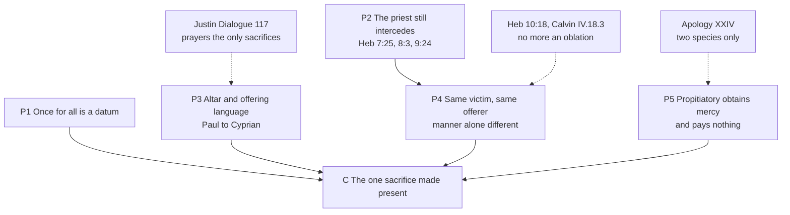

# Apologetics II · Lesson 6.5: The sacrifice of the Mass

> ⏱ ~15 min · Module 6: The contested distinctives · Builds on: [6.4](06-04-the-real-presence.md), [`sacraments-and-liturgy` 3.4](../../sacraments-and-liturgy/lessons/03-04-the-sacrifice-of-the-mass.md), [4.3](04-03-apostolic-succession-and-the-validity-of-orders.md), [1.3](01-03-arguing-from-history-without-abusing-it.md) · Unlocks: [6.6](06-06-development-or-corruption.md)

## Why this matters

Luther's Smalcald Articles (1537) say of the Mass that "nothing is to be surrendered or conceded" (II.2, Triglot), and every Reformation confession agreed. Hebrews says Christ offered himself once for all, and the Church offers the Mass every day. This is the strongest objection: a text both sides receive, read plainly. Calling it a misunderstanding is the standard failure.

## The idea

A ransom is paid once, in full; the prisoners are freed one by one. In one picture a herald carries the release out: everything moves from the king toward the prisoners. In the other, the one who paid stands before the king pleading the payment for each prisoner, his friends pleading beside him. Something moves toward the king, and nothing is paid again. The Reformers held the first picture of the Supper and called the second a second payment; Trent holds the second, and denies that pleading is paying.

Augustine gives the questions to ask of any [sacrifice](../reference.md#sacrifice-of-the-mass): "to whom it is offered, by whom it is offered, what is offered, for whom it is offered" (*De Trinitate* IV.14.19, NPNF). [`sacraments-and-liturgy` 3.4](../../sacraments-and-liturgy/lessons/03-04-the-sacrifice-of-the-mass.md) taught the doctrine. This lesson argues it.

## Source

Article XXXI of the [Thirty-Nine Articles](../reference.md#thirty-nine-articles), in the English of 1571 as Schaff prints it (*Creeds of Christendom* III; the Latin is of 1563):

> Of the one oblation of Christe finished vppon the Crosse. The offering of Christe once made, is the perfect redemption, propiciation, and satisfaction for all the sinnes of the whole worlde, both originall and actuall, and there is none other satisfaction for sinne, but that alone. Wherefore the sacrifices of Masses, in the which it was commonly said that the Priestes did offer Christe for the quicke and the dead, to haue remission of payne or gylt, were blasphemous fables, and daungerous deceits.

"Wherefore" makes the condemnation an inference from the first sentence. Its object is plural (*missarum sacrificia*), qualified by a past-tense report (*quibus vulgo dicebatur*) and a purpose (*in remissionem poenae aut culpae*). On the plain reading, any Mass offered to remit punishment or guilt is a second satisfaction. On [Newman's](../reference.md#tract-90) (Tract 90 §9, 1841, written as an Anglican), the Articles target "actual existing errors" in Rome, "whether taken into its system or not". "Commonly said" is "a strictly historical mode of speaking". The fable is a sacrifice for sin other than Christ's death; the deceit, the trade in Masses.

Trent offers the Mass for the living's "sins, punishments, satisfactions" (XXII ch. 2, Waterworth; canon 3 has "pains"; the Latin is *poenis* in both). Whether that falls under the Article's "payne" on each reading is Boss 6's question. The Articles are an Anglican formulary, binding variously across the Communion.

## The other side

Four traditions make one considered rejection, not a misunderstanding.

**Hebrews** (quotations DR) is the text all four rest on. Christ entered the sanctuary *ephapax*, once for all (9:12; 7:27; 10:10). He appeared *hapax*, once (9:26, 28). He did not "offer himself often", "for then he ought to have suffered often" (9:25–26). "By one oblation he hath perfected for ever" (10:14). "There is no more an oblation for sin" (*ouketi prosphora peri hamartias*, 10:18). A repeated offering, by Hebrews' own test, never finished its work (10:1–2).

**Lutheran.** The [Augsburg Confession](../reference.md#augsburg-confession) XXIV (1530) denies abolishing the Mass, which is "retained among us, and celebrated with the highest reverence" (Triglot; Schaff numbers it "Art. III"). It rejects the opinion that the Mass is an oblation removing daily sins *ex opere operato* for living and dead (Heb 10:10, 14). The [Apology](../reference.md#apology-of-the-augsburg-confession) XXIV (1531) gives the theory. A sacrament is God's work presenting something to us; a sacrifice, our work rendered to God. Sacrifice has [two species](../reference.md#two-species-of-sacrifice) only: the propitiatory, "a work which makes satisfaction for guilt and punishment", and the eucharistic, rendered "by those who have been reconciled". "The death of Christ alone is truly a propitiatory sacrifice." The [Smalcald Articles](../reference.md#smalcald-articles) II.2 (Luther) call the Mass "the greatest and most horrible abomination", because a work of men meant to reconcile men to God "directly conflicts with the chief article". All three stand in the [Book of Concord](../reference.md#book-of-concord), which Lutheran pastors subscribe to as *norma normata* under Scripture.

**Reformed.** The [Westminster Confession](../reference.md#westminster-confession) XXIX.2 (1646):

> In this sacrament Christ is not offered up to his Father, nor any real sacrifice made at all for remission of sins of the quick or dead, but only a commemoration of that one offering up of himself, by himself, upon the cross, once for all, and a spiritual oblation of all possible praise unto God for the same …

So "the Popish sacrifice of the mass" is "most abominably injurious to Christ's one only sacrifice"; XXIX.4 rejects private masses. Westminster is the Presbyterian subordinate standard. [Calvin](../reference.md#calvin-institutes) (*Institutes* IV.18, a theologian's book) meets both Catholic escapes in advance. To "not repetition, but application" (IV.18.3), he answers that the benefit was to be "communicated to us" by preaching and the Supper. To "bloodless", he answers that "it depends not on the will of man to change the nature of sacrifice" (IV.18.5). His summary: "As widely as giving differs from receiving, does sacrifice differ from the sacrament" (IV.18.7).

## The argument

**P1.** Trent's chapter 1 begins from Christ "about to offer Himself once on the altar of the cross". *In words:* no Catholic argument may make the cross incomplete.

**P2.** Hebrews' priest is "always living to make intercession" (7:25), appears "now in the presence of God for us" (9:24), and must "have some thing to offer" (8:3, DR). *In words:* Hebrews forbids a second sacrifice, not a present priestly act. Reformed exegetes read 8:3 of the cross; this premise is argued, not given.

**P3.** Paul sets "the table of the Lord" beside Israel's altar and pagan altars (1 Cor 10:16–21); Hebrews 13:10 says "We have an altar". The *Didache* (14) calls the Lord's-day breaking of bread a sacrifice, citing Malachi 1:11. Justin applies Malachi to "the bread of the Eucharist, and also the cup" (*Dialogue* 41). Irenaeus calls it "the new oblation of the new covenant" (*Against Heresies* IV.17.5). Cyprian: "the Lord's passion is the sacrifice which we offer" (Ep. 63.17 Hartel; ANF Ep. 62). *In words:* the Church offered the Eucharist early, everywhere, undisputed.

By [1.3](01-03-arguing-from-history-without-abusing-it.md)'s rules this attests an offering, in Cyprian of the passion, not Trent's propitiatory doctrine in Trent's terms ([anachronism](../reference.md#anachronism)). Justin also calls prayers and thanksgivings "the only perfect and well-pleasing sacrifices" (*Dialogue* 117). The *Didache* argument needs chapter 14 alone ([`patristics` 1.2](../../patristics/lessons/01-02-first-clement-and-the-didache.md) leaves chapters 9–10 open). Calvin grants the language and calls it a drift (IV.18.11).

**P4.** Trent answers Augustine: the same victim, offered to God by "the same now offering by the ministry of priests, who then offered Himself on the cross", "the manner alone of offering being different". Its fruits are those "of that bloody one" (ch. 2). In chapter 1 the one sacrifice is *repraesentaretur*: [made present](../reference.md#re-presentation), remembered and applied. *In words:* the Mass is neither another sacrifice nor a [repetition](../reference.md#once-for-all).

**P5.** "[Propitiatory](../reference.md#propitiatory)" names what the offering obtains. Through it "we obtain mercy" if we come "contrite and penitent" (ch. 2), and God provides the propitiation ([`christology` 5.1](../../christology/lessons/05-01-the-paschal-mystery-and-the-threefold-office.md)). *In words:* the Mass pleads the cross for this sinner now and adds nothing to it. That condition meets the Apology's charge that the Mass merits for others [*ex opere operato*](../reference.md#ex-opere-operato), without faith.

**∴ C.** The Mass is a true and propitiatory sacrifice that is neither a second sacrifice nor a repetition. "Once" excludes another offering, not the one offering made present.

**Mark the levels.** ([the ladder](../../fundamental-theology/lessons/04-04-the-ladder-of-doctrinal-authority.md); [levels of authority](../reference.md#levels-of-authority).) **Rung 1**, as worded: Trent XXII's canons 1–4 (a true and proper sacrifice; "Do this" made priests to offer; propitiatory for the living and the dead, "for sins, pains, satisfactions"; nothing taken from the cross) and canon 8 (private Masses not unlawful). **At least rung 3, not open to denial:** the once-for-all premise and the identity formula (chs. 1–2), and chapter 1's readings of Malachi and 1 Corinthians 10. **Law, no rung:** the reform decree and the stipend canons. **Rung 5:** every account of the *how*: de la Taille's *Mysterium Fidei* (1921), Vonier's *A Key to the Doctrine of the Eucharist*, Casel. CCC 1366–1367 locate, not fix. The Fathers and Tract 90: **no magisterial level**.

**Concession.** Masses were multiplied and sold. Augsburg XXIV complained that "Masses have been basely profaned and applied to purposes of lucre". The Reformers attacked that trade before Trent's decree, passed with the doctrine, prohibited "all manner of conditions and bargains for recompenses" and banished "a fixed number of certain masses" as superstition. Trent reformed the [traffic](../reference.md#private-masses-and-stipends) and kept the private Mass (can. 8). "Propitiatory" needs explaining, not asserting. The same decree calls the victim "daily immolated on the altar by priests", words that, unexplained, say what Hebrews 10:11 denies.

**The crux.** Is a re-presentation a distinct offering? Count a sacrifice by its acts of offering, and every Mass is a new oblation that 10:18 excludes: the one sacrifice "is no more to be repeated" (Calvin IV.18.3). Count it by its victim, its principal offerer and the self-offering Hebrews says continues before God, and the Mass is that one offering made present. Both agree the cross is complete and must reach us, and divide over whether it reaches us by offering as well as by gift. What would move it: does "Do this for the commemoration of me" set a memorial before God or a reminder before us, and is the heavenly intercession (8:3) itself an offering?

## The argument map

The crux is the dashed edge into P4.

## Worked examples

**Example 1 (clean): "sacrificed afresh".** Invented, written for this lesson: the Revd Jolyon Ashburner, an evangelical Anglican vicar, gives his Lent group a handout on Article XXXI: "Rome teaches that at every Mass Christ is sacrificed afresh, his work topped up because Calvary was not enough. Hebrews 10:14: one offering perfected for ever." The second clause is a caricature: Trent draws every fruit from "that bloody one" (ch. 2) and condemns saying the Mass takes anything from the cross (can. 4, rung 1). Strip it, and Westminster's objection remains: no offering "at all" now, which 10:14 serves only if the Mass is a second oblation. That is the crux.

**Example 2 (strain): "standeth daily".** The priest of Hebrews 10:11 "standeth daily ... often offering the same sacrifices" (DR). So does a Catholic priest, and Trent's decree says "daily immolated". P4 answers "many sacrifices": the Levitical victims were many and never took away sins; the Mass's one victim did. It does not answer "many offerings": today's act is numerically not yesterday's, and whether it is a new sacrifice is the crux. Trent fixed the answer (can. 4) without explaining it; every explanation is rung 5 ([`sacraments-and-liturgy` 3.4](../../sacraments-and-liturgy/lessons/03-04-the-sacrifice-of-the-mass.md) P3). Here the argument stops: it proves no contradiction, and cannot show that Hebrews had the Mass in view.

## Watch out

- **You might think the Reformers objected because they thought Catholics believe Christ dies again,** but Calvin records the Catholic denial (IV.18.5). The objection is that a present offering for sins is a second oblation. Nor blur the traditions: Augsburg XXIV kept the Mass; the Apology and Westminster both allow a sacrifice of praise, never an offering of Christ.
- **You might think Trent defined *how* the Mass is the same sacrifice,** but the identity formula is chapter teaching (at least rung 3), and every account of the *how* is rung 5. The mirror error, "the how is open, so the sacrifice is opinion", understates canons 1–4 (rung 1).
- **You might think Tract 90 is the Anglican reading, or that Justin teaches Trent,** but Tract 90 is one theologian's argument, not a formulary, and Justin attests an offering, not a propitiatory doctrine (development or corruption is [6.6](06-06-development-or-corruption.md)'s question).

## One-liner

> Hebrews forbids a second sacrifice, and Trent agrees; the whole dispute is whether making the one sacrifice present is offering a second.

## Problems

**P1 (🟢)** *(Exegetical; close reading.)* Hebrews 10:10–12, 14, 18 (Douay–Rheims, Challoner):

> In the which will, we are sanctified by the oblation of the body of Jesus Christ once. And every priest indeed standeth daily ministering and often offering the same sacrifices which can never take away sins. But this man, offering one sacrifice for sins, for ever sitteth on the right hand of God, [...] For by one oblation he hath perfected for ever them that are sanctified. [...] Now, where there is a remission of these, there is no more an oblation for sin.

The Greek behind three phrases: "once" (10:10) is *ephapax*; "daily ... often ... the same sacrifices" (10:11) is *kath' hēmeran ... pollakis ... tas autas thysias*; "no more an oblation for sin" (10:18) is *ouketi prosphora peri hamartias*. The posture of 10:11–12 and the attachment of *eis to diēnekes* are not asked.

(a) What does the passage infer from each of the three phrases?

(b) Trent says the Mass is offered "for the sins ... of the faithful who are living" (XXII ch. 2). Does 10:18, as worded, exclude that? Give the reading on which it does and the reading on which it does not, and name the word each reading leans on.

**Two sentences per part.**

**P2 (🟡)** *(Apologetic: (a) Exegetical, graded first · (b) reply.)*

(a) State the Apology of the Augsburg Confession's distinction (art. XXIV) as the Apology states it: the genus it divides sacrament from sacrifice within; the two species of sacrifice and what each is; who can offer each; and where it puts the Lord's Supper. **Three sentences.**

(b) Reply as a Catholic, opening with a **named concession**. **120 words or fewer.** A reply that concludes the Apology's objection succeeds passes if it is a good reply.

**P3 (🔴)** *(Exegetical; find the crux.)* Three texts:

> Calvin, *Institutes* IV.18.11 (Beveridge): "those ancient writers have wrested this commemoration to a different purpose than was accordant to the divine institution (the Supper somehow seemed to them to present the appearance of a repeated, or at least renewed, immolation)".
>
> Irenaeus, *Against Heresies* IV.17.5 (ANF): "the new oblation of the new covenant; which the Church receiving from the apostles, offers to God".
>
> Cyprian, Ep. 63.17 (Hartel; ANF Ep. 62, Wallis): "the Lord's passion is the sacrifice which we offer".

Calvin and a Catholic apologist agree about what these Fathers said. Name two things they agree on. Then name the single premise on which they divide. It is not whether the Fathers called the Eucharist a sacrifice, nor whether Christ's death is the one sacrifice. Say what evidence or argument would move each side, and what [1.3](01-03-arguing-from-history-without-abusing-it.md)'s rules forbid the Catholic to claim from these texts. **150 words or fewer.**

Solutions

**P1** *(Exegetical, strict)*

**Accept:** any rendering of *ephapax* that says "once, and never again" (not just "one time"); in (b), either reading stated well, so long as both are given with their words.

**Must hit, strict:**

- (a) *Ephapax* (10:10): the offering was made once and never needs repeating, so our being sanctified rests on that single act. *Kath' hēmeran ... pollakis ... tas autas thysias* (10:11): repetition shows inefficacy, since sacrifices that had to be offered every day, often, and the same, never removed sin (compare 10:1–2). *Ouketi prosphora peri hamartias* (10:18): once remission has been given, no further offering for sin remains.
- (b) **It excludes the Mass:** the reading leans on *ouketi*, "no more", and *peri hamartias*, "for sin". After remission, no offering for sin of any kind remains, and Trent describes the Mass as offered "for the sins" of the living.
- (b) **It does not exclude the Mass:** the reading leans on "these" (*toutōn*, the sins God "will remember no more", 10:17) and on *prosphora* as a further sin-offering. Where remission has been won, no new offering is needed to win it. That leaves untouched the one offering through which remission is applied, whose fruits are "of that bloody one" (ch. 2).

**Wrong turns:** answering with the posture contrast or the attachment of *eis to diēnekes*, which the problem excludes and which [`new-testament` 6.4](../../new-testament/lessons/06-04-peter-jude-and-the-letters-of-john.md)'s Flashback already reads. Saying 10:18 forbids every sacrifice: it names an offering "for sin", and 13:15 commands a "sacrifice of praise". Saying grammar alone settles (b): the word each reading leans on is in the text, and the choice between them is the crux of this lesson. Treating Trent's reading of Hebrews as a defined exegesis.

**Model answer:**

(a) From *ephapax* the passage infers that the sanctifying offering was made once, never to be repeated. From the daily, frequent, identical sacrifices it infers that repetition proves they never took sin away. From *ouketi prosphora peri hamartias* it infers that, once remission is given, no further offering for sin remains.

(b) Read with weight on *ouketi* and *peri hamartias*, 10:18 rules out any offering "for sin" after remission, and the Mass is offered "for the sins" of the living. Read with weight on "these" (the forgiven sins of 10:17) and *prosphora* as a new sin-offering, it rules out an offering that would win a remission not yet given. That leaves room for one offering whose already-won fruits are applied.

---

**P2** *(Apologetic: (a) Exegetical, graded first · (b) reply)*

**Accept:** in (a), "ceremony" or "sacred work" for the genus, and "praise" or "thanksgiving" for the eucharistic species. In (b), any verdict, if the concession is named and the reply engages the dichotomy rather than the caricature.

**Must hit, strict (a), graded first:**

- **The genus and the split:** within one genus, a ceremony or sacred work, a **sacrament** is a work in which God presents to us what the promise offers. A **sacrifice** is a work we render to God to honour him.
- **Two species and no more.** The **propitiatory** sacrifice makes satisfaction for guilt and punishment, reconciles God and merits remission for others. Only **Christ's death** is truly propitiatory, and the Levitical sin-offerings were so called as types. The **eucharistic** sacrifice merits neither remission nor reconciliation. It is rendered **by the already reconciled**, in thanks.
- **The Supper:** as a sacrament it is God's gift to us. As a sacrifice it can belong only to the eucharistic species, with prayer, thanksgiving, preaching and the saints' afflictions. It is not a propitiation applied to others *ex opere operato*.
- **Weight:** a Lutheran confession in the Book of Concord, *norma normata*.

**Must hit (b):**

- **A named concession,** stated flatly. For example, Christ's death alone is the propitiatory sacrifice in the sense of the price paid, and Trent says so (ch. 1; ch. 2's fruits "of that bloody one"). Or: late-medieval practice blurred the two species, as Trent's own reform decree shows.
- **Locate the gap.** The dichotomy covers the Mass only if every propitiatory act is a *new* satisfaction. Trent's propitiatory Mass is the one satisfaction made present and pleaded, offered principally by Christ, so it falls in neither species as the Apology defines them. The reply therefore lands on the crux of re-presentation.
- **The *ex opere operato* charge:** ch. 2 conditions mercy on drawing near "contrite and penitent".

**Wrong turns:** stating (a) as "Lutherans say the Mass is no sacrifice at all", or "they abolished the Mass". That is the caricature, and it fails the problem, since the Apology allows a eucharistic sacrifice and Augsburg XXIV keeps the Mass. Attributing Westminster's denial of any real sacrifice for remission of sins to the Apology, or forgetting that Westminster too allows a sacrifice of praise. Calling the Apology "Protestant teaching" or a magisterium. In (b), treating Melanchthon as confused, or saying Trent *defined* the identity formula.

**Model answer (a):** Within one genus, a sacred work, the Apology divides a sacrament, in which God presents to us what his promise offers, from a sacrifice, which we render to God to honour him. Sacrifice has two species only: the propitiatory, which satisfies for guilt and punishment and reconciles God, and of which Christ's death alone is truly an instance; and the eucharistic, which merits nothing but is offered by the already reconciled in thanks. The Supper, so far as it is a sacrifice, belongs to the second kind, with prayer, thanksgiving and preaching, and is not a propitiation applied to others *ex opere operato*.

**Model answer (b), one of several:** Concession: Christ's death alone is the propitiatory sacrifice that paid for sin, and Trent says the same. It draws every fruit of the Mass from "that bloody one". The Apology's dichotomy, though, assumes that any propitiatory offering now would be a second satisfaction. Trent claims a third thing: the one satisfaction made present and offered principally by Christ, the same priest. That is neither a new propitiation nor merely the thanks of the reconciled. Whether such a re-presentation is a distinct offering is the real question, and the Apology's classification decides it without arguing it. As for *ex opere operato*, Trent grants mercy only to those who draw near contrite.

---

**P3** *(Exegetical, strict; find the crux)*

**Accept:** the premise phrased as authority ("the early Church's reading of the Supper is a reliable witness to what Christ instituted") or as method ("Scripture alone judges the Fathers' sacrificial reading"), if it is the point the two sides deny and affirm.

**Must hit, strict:**

- **Two agreements.** (1) The Fathers called the Eucharist an offering made by the Church, Irenaeus says throughout the world, and by Cyprian's time they identified what is offered with the passion. Calvin concedes they saw "a repeated, or at least renewed, immolation". (2) They did not mean to take anything from the one sacrifice. Calvin says he "cannot charge them with any impiety".
- **The crux:** whether the early Church's sacrificial reading of the Supper is a witness to what the institution means, or a departure from it that Scripture alone must judge. Calvin denies the first, since they "wrested" the commemoration "to a different purpose". The Catholic affirms it. This is Module 2's question about the rule of interpretation, returning.
- **What moves each side.** Calvin admits only Scripture, so he would be moved by finding the sacrificial sense in the apostolic texts themselves (Heb 13:10; 1 Cor 10:18–21; "Do this" as a memorial before God). The Catholic would be moved by evidence that the language entered late, through a Levitical analogy absent from the earliest layer. *Didache* 14 and Justin cut against that.
- **The 1.3 limits.** The texts attest an offering. They do not state Trent's propitiatory doctrine, so reading it in is anachronism. Second-century silence on propitiation neither denies it nor attests it.

**Wrong turns:** naming as the crux whether the Fathers called it a sacrifice, which both sides grant. Making Calvin say the Fathers were impious. Claiming a "unanimous consent of the Fathers" for Trent's doctrine (manufactured consensus), or citing Justin's *Dialogue* 117 as proof that the early Church held a bare memorial.

**Model answer:** Both grant that the Fathers called the Eucharist an offering the Church makes, and by Cyprian an offering of the passion itself. Both grant that the Fathers did not mean to diminish the cross. Calvin says he cannot charge them with impiety. They divide over one premise: whether the early Church's sacrificial reading of the Supper witnesses to what Christ instituted, or departs from it and stands under Scripture's judgment. Calvin, who admits only Scripture, would move if the sacrificial sense were shown in the apostolic texts themselves (Heb 13:10; 1 Cor 10:18–21). The Catholic would move if the language were shown to enter late through Levitical analogy, and *Didache* 14 resists that. By 1.3, these texts attest an offering, not Trent's propitiatory doctrine, and their silence on propitiation proves nothing either way.

## Flashback

**From Lesson [6.3](06-03-penance-purgatory-and-indulgences.md) (Penance, purgatory, and indulgences):** *(Apologetic: (a) Exegetical, graded first · (b) reply.)* The [Apology](../reference.md#apology-of-the-augsburg-confession), "Of Confession and Satisfaction" (tr. Bente and Dau, *Triglot Concordia*, 1921; the bracket renders the German), answering the objection that a judge must first investigate the case:

> ... because the ministry of absolution is favor or grace, it is not a legal process, or law. [For God is the Judge, who has committed to the apostles, not the office of judges, but the administration of grace ...] Therefore ministers in the Church have the command to remit sin; they have not the command to investigate secret sins. And indeed, they absolve from those that we do not remember ...

(a) State the Book of Concord's position: what it keeps, what it denies, and this passage's ground, which is neither Augsburg XI's nor Smalcald III.8's. **Three sentences.**

(b) Reply for Trent XIV can. 9 (absolution is a judicial act), opening with a **named concession**; name the premise in dispute. **100 words or fewer.** A reply concluding that the Apology succeeds passes if it is a good reply.

Solution

**Accept:** any verdict, if the concession is real and the reply meets this argument.

**Must hit, strict (a), graded first:**

- **Kept:** [private absolution](../reference.md#private-confession), the word of God the keys pronounce (Augsburg XI; Smalcald III.8, "ordained by Christ"); Apology XIII calls it a sacrament.
- **Denied:** enumeration of sins by divine right; absolution as a judicial process.
- **Ground:** grace, not law. Ministers remit without investigating, and they absolve forgotten sins. (Augsburg XI argued from impossibility, Smalcald III.8 from freedom.)

**Must hit (b):**

- **A named concession:** absolution is grace, "the dispensation of another's bounty" (Trent XIV ch. 6); or forgotten sins are absolved, as Trent holds (ch. 5).
- **The [keys](../reference.md#power-of-the-keys) retain as well as forgive** (John 20:23; can. 3, rung 1; 6.3's P5). Choosing is judging, and judging, like imposing satisfaction (can. 15), needs knowledge of the case.
- **Forgotten sins** rule out an inquest, not a judgment: can. 7 asks only for the mortal sins remembered.
- **The crux:** is retaining a verdict on the case, or a refusal to the impenitent that needs no list?

**Wrong turns:** "Lutherans abolished confession": the caricature, and it fails the problem. A "bare announcement": the Apology calls absolution the word of God that "the power of the keys pronounces". "Lutherans deny that the keys bind": Smalcald III.7 gives them "for binding and loosing sin". Treating the Apology as a magisterium.

**Model answer (a):** The Book of Concord keeps private absolution, "ordained by Christ" (Smalcald III.8), as a sacrament. It denies that enumerating sins is necessary by divine right, and that absolution is a judicial process. Here the ground is grace, not law: ministers remit without investigating, and they absolve sins we have forgotten.

**Model answer (b), one of several:** Concession: absolution is grace, "the dispensation of another's bounty", as Trent says, and forgotten sins are absolved. But Christ gave power to retain as well as to forgive, so the minister must choose, and Trent argues that no priest can judge "without knowledge of the cause", nor fairly impose satisfaction. Forgotten sins rule out an inquest, not a judgment. The premise in dispute: is retaining a verdict on the case, or only a refusal to the impenitent?

## Connections

- **Backward:** the doctrine, its levels and the four accounts of the *how* are [`sacraments-and-liturgy` 3.4](../../sacraments-and-liturgy/lessons/03-04-the-sacrifice-of-the-mass.md). The earliest witness and its two anachronisms are [`sacraments-and-liturgy` 3.1](../../sacraments-and-liturgy/lessons/03-01-the-institution-and-the-earliest-witness.md), and the Lutheran *ex opere operato* objection is [`sacraments-and-liturgy` 1.3](../../sacraments-and-liturgy/lessons/01-03-ex-opere-operato-character-and-fruitfulness.md). Which way propitiation points is [`christology` 5.1](../../christology/lessons/05-01-the-paschal-mystery-and-the-threefold-office.md). *Ephapax* and the high priest of Hebrews are [`new-testament` 6.2](../../new-testament/lessons/06-02-hebrews.md). The rules for reading the Fathers are [1.3](01-03-arguing-from-history-without-abusing-it.md), and the presence the sacrifice presupposes is [6.4](06-04-the-real-presence.md).
- **Forward:** [6.6](06-06-development-or-corruption.md) asks whether the road from Justin's thanksgiving to Trent's propitiatory sacrifice is development or corruption. Boss 6 ([syllabus](../syllabus.md)) close-reads Article XXXI beside Trent and Tract 90, and offers the Mass as one option of its (d).
- **Sideways:** Trent's "sins, punishments, satisfactions" is the ledger of [`theology-of-debt` 3.4](../../theology-of-debt/lessons/03-04-aquinas-satisfaction-and-the-debt-of-punishment.md) ([guilt and punishment](../reference.md#guilt-and-punishment)), and the Mass for the dead is the chief suffrage of [`creation-grace-last-things` 6.3](../../creation-grace-last-things/lessons/06-03-purgatory.md) and of [6.3](06-03-penance-purgatory-and-indulgences.md). *Apostolicae Curae* (1896) judged the Anglican form by the priesthood's power "of consecrating and of offering the true Body and Blood of the Lord". It also cited canon 3's "bare commemoration", which is why [4.3](04-03-apostolic-succession-and-the-validity-of-orders.md) cannot be argued apart from this lesson.
