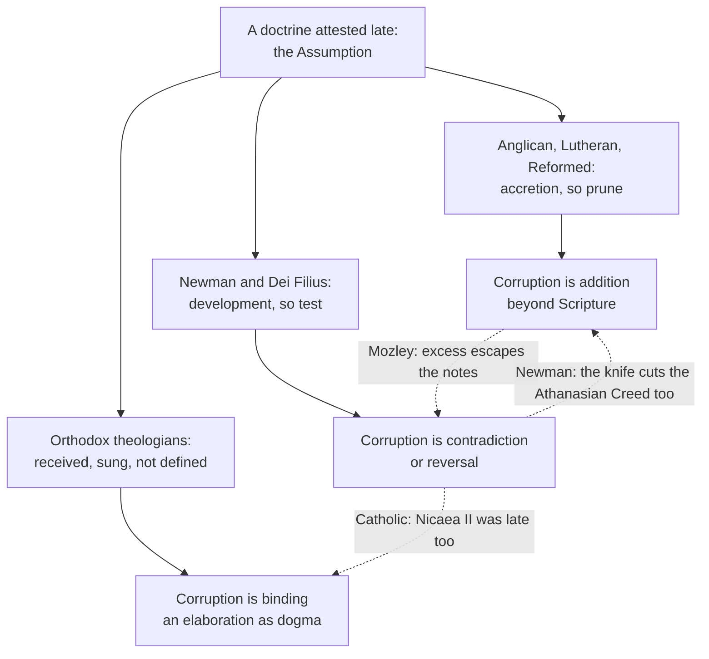

# Apologetics II · Lesson 6.6: Development, or corruption?

> ⏱ ~15 min · Module 6: The contested distinctives · Builds on: [`fundamental-theology` 5.1](../../fundamental-theology/lessons/05-01-vincent-of-lerins.md), [`fundamental-theology` 5.2](../../fundamental-theology/lessons/05-02-newmans-theory-of-development.md), [1.3](01-03-arguing-from-history-without-abusing-it.md), [4.2](04-02-what-the-patristic-record-proves.md), [6.1](06-01-mary.md)–[6.5](06-05-the-sacrifice-of-the-mass.md) · Unlocks: [7.1](07-01-the-inquisition-and-the-galileo-affair.md)

## Why this matters

Five lessons have ended in the same place. Each distinctive is attested later and less clearly than a Catholic would like, and each time the Catholic answer has been "development". If that word can absorb any evidence, the whole module rests on an alibi, and an Oxford Anglican said exactly that in 1847. This lesson tests the word where it is weakest, which is part of the [burden](../reference.md#burden-of-the-catholic-claim) the larger claim carries.

## The idea

[`fundamental-theology` 5.1](../../fundamental-theology/lessons/05-01-vincent-of-lerins.md) taught [Vincent's canon](../reference.md#vincentian-canon) and his chapter on growth; [5.2](../../fundamental-theology/lessons/05-02-newmans-theory-of-development.md) taught [Newman's seven notes](../reference.md#newman-notes) as marks to be weighed. This lesson re-teaches neither. It asks whether they can ever say no.

A smoke alarm that has never sounded proves nothing until someone holds a match under it. A theory of [development](../reference.md#development-of-doctrine) that every later doctrine passes is that alarm, so the question is whether there is a match.

Newman framed the choice (*Essay on the Development of Christian Doctrine*, 1878 edition, Introduction §§7–8). Beside his own and a liberal one he dismisses stands the Anglican divines' hypothesis: keep what has primitive sanction and cut the rest away, with Vincent's "always, everywhere, by all" as the knife. His objection is that the knife "strikes at Rome through England": narrowed to exclude the Creed of Pius IV, it excludes the Athanasian Creed too. That parity (the Trinity was also formulated late) carries every Catholic defence in this module, and it is the premise the other side attacks.

## The other side

**Anglican: J. B. Mozley.** A Tractarian who stayed in the Church of England when Newman left, Mozley died in 1878 as Regius Professor of Divinity at Oxford. His review of the *Essay* (*Christian Remembrancer*, January 1847) was reprinted as *The Theory of Development* (1878; pages below). At full strength:

1. He grants explanation: "All allow that Christian fundamental truth has been explained" (p. 147). Care for the dead, honour to Mary and the Eucharistic change are Christian things (pp. 30–31).
2. His charge is **excess**, "the faults of an adding, not a diminishing system" (p. 30).
3. The notes cannot see excess. Corruption is defined as loss of type, so exaggeration "has no head for it to come under" (p. 34), and Rome's doctrines are "secure by the definition" (p. 36).
4. Logical sequence decides nothing, since every sect says "be logical": "to make logic infallible, we must have an infallible logician" (p. 43). The keystone is papal infallibility (p. 83), and on that footing "whatever is is right" (p. 118). This is the [Mozley objection](../reference.md#mozley-objection).
5. The Nicene parallel fails. Nicaea explained what was held from the start, and "implicit knowledge in multitudes of cases is no knowledge at all" (p. 204).

His book is a theologian's. The formulary beneath it is [Article VI](../reference.md#thirty-nine-articles): what is "not read therein, nor may be proved thereby" may not be required as an article of faith. ARCIC I (*Authority in the Church II*, 1981, §30) reports many Anglicans judging the Marian definitions insufficiently grounded in Scripture.

**Lutheran and Reformed: *ad fontes*.** The [Augsburg Confession](../reference.md#augsburg-confession) claims its doctrine varies neither from Scripture nor from the Church Catholic, and disputes only "certain Abuses, which have crept into the Church without rightful authority" (Triglot, after Article XXI). [Westminster](../reference.md#westminster-confession) I.6 allows what "by good and necessary consequence may be deduced from Scripture" and forbids additions "by new revelations of the Spirit, or traditions of men". Deduce, never add: [*ad fontes*](../reference.md#ad-fontes), back to the sources, is the remedy for accretion.

**Orthodox: received, not developed.** The 1895 encyclical of Patriarch Anthimos VII and his synod (§XX, Metallinos's translation, 1896) finds in the sources "the old and divinely-transmitted doctrines" and none of the West's later innovations. It is a synodical letter of one patriarchate, not a definition. Theologians question the category itself. For Vladimir Lossky ("Tradition and Traditions", 1952), Tradition is the life of the Holy Spirit in the Church, and definitions put into words what the Church already knows. Andrew Louth (foreword to John Behr, *The Way to Nicaea*, 2001) calls development of doctrine "a fruit of Romanticism" that Newman popularized: theology grows, the apostolic confession does not. So the West has [mistaken elaboration for growth](../reference.md#received-not-developed) and made it binding. The Orthodox sing the Dormition and define nothing ([`ecclesiology-and-mariology` 6.4](../../ecclesiology-and-mariology/lessons/06-04-the-assumption.md)). Nor are they one bloc: Daniel Lattier (*Pro Ecclesia*, 2011) argues that Florovsky and Stăniloae sit closer to development than is supposed.

## The argument

**P1.** Every party accepts some later formulation: Mozley explanation, Westminster "good and necessary consequence", the Orthodox Nicaea II and the fourteenth-century councils on Palamas. *In words:* the dispute is which later statements are the same faith, not whether any are.

**P2.** Newman names his own refutation. A teaching that does but "contradict and reverse" what went before is "certainly corrupt" (ch. 5 §6). And "the one essential question is whether the recognized organ of teaching, the Church herself, acting through Pope or Council as the oracle of heaven, has ever contradicted her own enunciations"; if so, his hypothesis "is at once shattered" (ch. 3 §2 ¶12). *In words:* the alarm has a match.

**P3.** The Church binds herself to the same falsifier. *Dei Filius* ch. 4 (1870), sealed by can. IV.3, allows growth only "in one and the same doctrine, one and the same sense, one and the same judgment" (Schaff). *In words:* a later dogma in a new sense would refute the claim by the Church's own rule.

**P4.** Excess is real, and the Church judges it in devotion and practice. Lumen Gentium 67 warns preachers against "gross exaggerations" about Mary; Newman conceded devotional excess to Pusey ([`ecclesiology-and-mariology`](../../ecclesiology-and-mariology/syllabus.md) Boss 6(c)); Trent abolished the alms-questors despite customs "even though immemorial" (XXI, reform ch. 9). *In words:* age has not saved a practice from being judged a corruption.

**P5.** The [argument from silence](../reference.md#argument-from-silence) proves less than either side wants ([1.3](01-03-arguing-from-history-without-abusing-it.md)). Newman explains early silence by occasion: a doctrine is stated when it is contested (ch. 3 §2; ch. 4 §3). He calls his early testimonies *ex abundante*, more than he needs. *In words:* silence hands the question to the other evidence.

**∴ C.** Development is not unfalsifiable in principle. Its falsifiers are narrow (contradiction and reversal in doctrine), and excess is assigned to devotion.

**Mark the levels.** Rungs follow [the ladder](../../fundamental-theology/lessons/04-04-the-ladder-of-doctrinal-authority.md) ([levels of authority](../reference.md#levels-of-authority)). No dogma may receive a new sense: **rung 1** ([*Dei Filius*](../reference.md#dei-filius) ch. 4 with can. IV.3). The understanding of what was handed on grows: Dei Verbum 8, **at least rung 3**. *Mysterium Ecclesiae* (1973): **rung 3**. Newman's notes and Vincent's threefold canon: **no magisterial level**. The Assumption: **rung 1** (*Munificentissimus Deus* 44, 1950); the bull's arguments are theology. Whether it, or Marian development generally, satisfies the notes: **rung 5**. Lumen Gentium 67 is an exhortation and defines nothing. Augsburg is a Lutheran confession (*norma normata*), Westminster a Presbyterian subordinate standard, Article VI an Anglican formulary; ARCIC has no Catholic level.

**Concession.** Mozley's objection has force. A theory under which every later doctrine passes the notes would be unfalsifiable, and Newman's notes have sometimes been used that way. His answer to excess, that truth cannot be excessive (ch. 5 §6), is a denial, not a test.

**The crux.** Can any possible evidence count, on Newman's account, as corruption in a defined doctrine? He says yes: contradiction in sense between enunciations. But he waves off Fathers against Fathers and asks the critic for "positive and distinct evidence", and every candidate (Honorius, usury, Florence's census of the damned) gets reread until it is not one, so the match never lights. What would move the Catholic: rereadings that follow no rule but the desired result. What would move the critic: the "same sense" rule applied where it cost the Church something, as when 1950 declined to define Mary's death though most of the tradition held it.

## The map of positions

The three sides disagree less about the evidence than about what corruption is.

## Worked examples

**Example 1 (clean): "To be deep in history is to cease to be a Protestant."** The sentence is genuine ([deep in history](../reference.md#deep-in-history); Introduction §5). It closes a paragraph on English neglect of church history, and its claim, one sentence earlier, is that "the Christianity of history is not Protestantism": antiquity does not countenance the Protestant doctrines of faith, sacraments, ministry and the visible Church (§6). If that holds, it refutes one use of history, the claim that the Reformation restored the primitive Church. It does not deliver Rome. Newman says so himself: history shows "apparent inconsistencies and alterations" (§7), and Vincent's rule strikes Rome too (§8). Mozley adds that depth in history could as easily land a man in the East, whose creed is "the creed of St. Basil and St. Chrysostom" (p. 137). And Harnack, as deep as anyone, read the same centuries as overgrowth ([`church-history` 8.3](../../church-history/lessons/08-03-leo-xiii-and-the-modernist-crisis.md)). Verdict: it follows as a negative; getting from it to Rome needs development, the thing in dispute.

**Example 2 (strain): the honest test, run on the Assumption.** It is the module's thinnest-attested distinctive, and it is rung 1. Offerings for the dead are attested by about 211 ([`creation-grace-last-things` 6.3](../../creation-grace-last-things/lessons/06-03-purgatory.md)); indulgences grow from the martyrs' intercession for the lapsed ([`theology-of-debt` 3.2](../../theology-of-debt/lessons/03-02-the-fathers-alms-satisfaction-and-ransom.md)), and their latest element, the treasury, is only rung 3. For the Assumption there is nothing before the 370s, and then Epiphanius says no one knows her end ([`ecclesiology-and-mariology` 6.4](../../ecclesiology-and-mariology/lessons/06-04-the-assumption.md)). [6.1](06-01-mary.md) answers the objections to the dogma; here are the notes.

- *Type:* her privileges are her Son's gifts, the second-century New Eve joined to the new Adam; she is taken up, not rising by her own power. Satisfied.
- *Principles:* the Church's prayer witnesses her faith; the feast, East and West by the seventh century, came before the arguments. Satisfied, on a principle Article VI disputes.
- *Assimilation:* the belief travelled in the *Transitus* narratives, one listed among apocrypha by the Gelasian Decree; the bull keeps the belief and drops the stories. Digestion, or the residue of a censured source? Contested.
- *Logical sequence:* the bull argues from fittingness, not entailment, and the belief did not arrive that way, since Aquinas held it while denying the Immaculate Conception. Weak.
- *Anticipation:* weakest. Not silence but recorded ignorance, from the first writer who asked and had occasion to know. The New Eve anticipates her association with Christ, not her end.
- *Conservative action:* it secures the resurrection of the body and denies nothing earlier, though a critic can press Paul's order in 1 Corinthians 15:23. Strong.
- *Chronic vigour:* fourteen centuries of the feast. Strong.

Where it stops: the notes clear the Assumption of contradiction and reversal, but they cannot turn Epiphanius's ignorance into apostolic memory. The bull claims no memory; it rests the revealed status on the bishops' agreement of 1946 (§12). That is the Church's judgment, Mozley's keystone, and no note settles it.

## Watch out

- **Caricature:** you might think Protestants reject all development and should reject Nicaea, but Mozley grants explanation and Westminster I.6 grants "good and necessary consequence". The objection is to addition and excess.
- **Blur:** you might think the Orthodox stopped in 787 or deny the Assumption, but they received the Palamite councils and sing the Dormition. They object to "development" as a category and to defining the Dormition, and even there they are not unanimous.
- **Levels:** you might think the notes or Vincent's canon bind Catholics, but neither has a level; *Dei Filius* ch. 4's limit does. Calling the Assumption a pious opinion because the notes cannot prove it understates a rung-1 dogma. Mozley is not "the Anglican position"; Article VI is.

## One-liner

> Development can refuse contradiction and reversal but has no test for excess; the notes clear the Assumption of corruption, and only the Church's judgment, the point in dispute, calls it revealed.

## Problems

**P1 (🟢) *(Close reading · Exegetical.)*** Vincent of Lérins, *Commonitorium* ch. 23 [§59] (NPNF2-11, C. A. Heurtley's translation, public domain):

> But the Church of Christ, the careful and watchful guardian of the doctrines deposited in her charge, never changes anything in them, never diminishes, never adds, does not cut off what is necessary, does not add what is superfluous [...] but while dealing faithfully and judiciously with ancient doctrine, keeps this one object carefully in view,--if there be anything which antiquity has left shapeless and rudimentary, to fashion and polish it, if anything already reduced to shape and developed, to consolidate and strengthen it, if any already ratified and defined, to keep and guard it. [...] she has thenceforward consigned to posterity in writing what she had received from those of olden times only by tradition, comprising a great amount of matter in a few words, and often, for the better understanding, designating an old article of the faith by the characteristic of a new name.

(a) Name the words Mozley would cite for "explanation, not growth", the words the 1895 encyclical's reading of the sources would cite, and the words that give Newman his best foothold. **One line each.**

(b) "Shapeless and rudimentary" renders *informata et incohata*. R. S. Moxon's 1915 edition glosses *informata* as "rough-hewn", existing "merely in outline and only just begun", and notes the word never seems to mean "shapeless". Which reading of development does each rendering favour, and why does the choice matter for the Assumption? **Two sentences.**

**P2 (🟡) *(Apologetic: (a) Exegetical, graded first · (b) reply.)*** (a) State Mozley's objection to Newman's notes as Mozley states it: what kind of corruption he charges Rome with, why he says the notes cannot detect it, and what he concludes Newman's argument really rests on. Name his tradition precisely and the weight of his book. **Three or four sentences.**

(b) Reply in **150 words or fewer**, opening with a **named concession**. A reply that concludes Mozley's objection succeeds passes if it is a good reply.

**P3 (🔴, optional) *(Diagnose · Exegetical.)*** An invented homily, written for this problem, preached by Fr Chukwuemeka Anyanwu at a parish mission on "why Catholics believe what the Bible does not mention":

> "Newman proved it: whatever the Church has believed for centuries must be a true development, because God would never let a corruption last that long. That is why the Orthodox, who froze the faith in the eighth century, never accepted the Assumption. Even our separated Anglican brethren admit, in Newman's famous words, that to be deep in history is to cease to be a Protestant. And once the Church defines a doctrine, how it was handed down no longer matters: the definition is what makes it revealed."

Find **four** errors. For each, give the correction and say whether it is a **caricature**, an **overstatement**, a **misattribution**, or **bad theology of definition**. **150 words or fewer.**

Solutions

**P1** *(Close reading · Exegetical)*

**Must hit, strict:**

- (a) **Mozley:** "never changes anything in them, never diminishes, never adds", and the conciliar work described as putting received matter into "a few words" and "a new name" for "an old article of the faith": explanation of what was already held. **The 1895 reading of the sources:** "what she had received from those of olden times only by tradition", where councils write down what was received and add nothing. **Newman:** "if there be anything which antiquity has left shapeless and rudimentary, to fashion and polish it", which concedes that some of the deposit came down unfinished and was finished later.
- (b) "Shapeless" favours a strong development reading: what antiquity left had no definite form, so the later form is more than explanation, which is Newman's ground and Mozley's fear. "Rough-hewn", "in outline" favours explanation: the shape was there and was only polished. That matters for the Assumption, whose early record has no outline at all, only Epiphanius's confession that no one knows, so even "shapeless" needs something there to be shaped.

**Wrong turns:** treating the passage as forbidding growth because of "never adds" (the same sentence commissions polishing). Treating "new name" as license for new doctrine; it names an old article. Claiming Vincent's chapter is binding as worded; only the growth clause reaches *Dei Filius* ch. 4. Taking Heurtley's "shapeless" as settled without weighing the Latin, or using Moxon to make Vincent an opponent of growth.

**Model answer:** (a) Mozley: "never adds", "a new name" for "an old article": explanation only. The 1895 reading: councils write down "what she had received ... only by tradition". Newman: what antiquity "left shapeless and rudimentary" is to be fashioned, so something came down unfinished. (b) "Shapeless" grants the later Church real formative work and so favours Newman; Moxon's "rough-hewn, in outline" grants only finishing and so favours Mozley. For the Assumption the gloss bites, because there is no early outline of Mary's end to finish, and the case must rest on the outline of her association with Christ.

---

**P2** *(Apologetic: (a) Exegetical, graded first · (b) reply)*

**Accept:** any reply that opens with the named concession and engages excess as Mozley defines it, whatever its verdict.

**Must hit, strict (a), graded first:**

- **Tradition and weight:** an **Anglican** (Tractarian, Regius Professor at Oxford), writing a theologian's review (1847; reprinted 1878). It has no confessional standing; Article VI is the formulary.
- **The charge:** corruption by **excess**, an adding not a diminishing system, true Christian ideas (care for the dead, honour to Mary, the Eucharistic change) pushed past their measure. He grants explanatory development.
- **Why the notes miss it:** Newman defines corruption as loss of type and dissolution, so an exaggeration that keeps the type and stays vigorous has no head to come under; the doctrines are "secure by the definition".
- **What the argument rests on:** logical sequence needs an infallible logician, so the keystone is papal infallibility, and on that hypothesis what is established becomes its own proof.

**Must hit (b):**

- A **named concession**: a theory every later doctrine passes is unfalsifiable, and the notes have been used that way.
- Engage **excess**, not only contradiction. The best available move is that the Church places excess in devotion and practice and judges it there (LG 67; Trent XXI reform ch. 9), while in doctrine the test is contradiction or reversal.
- Name what this costs: excess in *doctrine* still has no test, so the answer is partly a denial (ch. 5 §6) and partly an appeal to the Church's judgment, Mozley's keystone.

**Wrong turns:** stating (a) as "Mozley rejects all development" or "Protestants say the Church corrupted everything", caricatures that fail the problem. Calling Mozley Lutheran, Reformed or "Protestant" without qualification. Treating his book as an Anglican confession. Answering only that Newman names falsifiers, which meets a charge Mozley did not make.

**Model answer (a):** Mozley, a Tractarian Anglican writing a theologian's review, grants that doctrine has been explained but charges Rome with corruption by excess: an adding system that pushes true ideas, such as honour to Mary and care for the dead, beyond their measure. Newman defines corruption as loss of type and dissolution, so an exaggeration that keeps its type has no head to come under, and the Roman doctrines are secure by definition. Logical sequence cannot help, since every sect is logical, so the argument rests on papal infallibility, where whatever is established is right.

**Model answer (b), one of several:** Concession: a theory every later doctrine passes would be unfalsifiable, and Catholics have used Newman's notes that way. But excess is a category the Church uses on herself. Lumen Gentium 67 forbids exaggeration about Mary, and Trent abolished the questors despite immemorial custom. Practices and devotions can be pruned, and have been. In doctrine the test is narrower: contradiction or reversal of what was taught. The cost should be said plainly. If Rome's doctrines themselves are excessive, as Mozley thinks the Marian dogmas are, no note will catch it, and the Catholic is left appealing to the Church's judgment, which is Mozley's keystone. The reply relocates the dispute; it does not dissolve it.

---

**P3** *(Diagnose · Exegetical)*

**Must hit, strict:** any four.

- **"Whatever the Church believed for centuries must be a development":** **overstatement** (the universal solvent). Newman calls the notes "of varying cogency", and makes reversal "certainly corrupt" (ch. 5 §6). Trent abolished the questors despite immemorial custom.
- **"The Orthodox froze the faith in the eighth century and never accepted the Assumption":** **caricature**, twice. They received the fourteenth-century councils, and they sing the Dormition as a bodily glorification; what they reject is defining it.
- **"Anglicans admit … deep in history":** **misattribution**. It is Newman's own verdict against Protestantism (*Essay*, Introduction §5), published after his reception, and at most it proves a negative.
- **"The definition makes it revealed":** **bad theology of definition**. A definition declares what the Church judges to be in the deposit and adds nothing to it ([`fundamental-theology` 1.3](../../fundamental-theology/lessons/01-03-supernatural-revelation.md)). How the doctrine was handed down is part of what is claimed.

**Wrong turns:** correcting the Assumption's level downward ("it is only a pious belief"). Throwing out chronic vigour altogether: it is one of the seven notes, and the error is treating it as proof. Calling the third error a "caricature of Anglicans": the sentence is real, but it is Newman's.

**Model answer:** (1) Overstatement: Newman's notes are "of varying cogency", reversal is "certainly corrupt", and Trent abolished immemorial abuses. (2) Caricature: the Orthodox received the Palamite councils and sing Mary's bodily glorification; they object to its definition. (3) Misattribution: the line is Newman's, in the *Essay*, against Protestantism, and it proves only a negative. (4) Bad theology of definition: a definition declares what is already revealed and does not make it so, so the line of transmission is part of the claim.

## Flashback

**From Lesson [6.4](06-04-the-real-presence.md) (The real presence):** *(Apologetic: (a) Exegetical, graded first · (b) reply.)* At an invented Lutheran–Catholic study evening, written for this problem (no one in it is real), a Lutheran pastor says: "We take 'This is my body' more literally than you do. Your bread must stop being bread; ours stays bread and is still his body."

(a) State the doctrine he relies on as the Formula of Concord, Article VII, states it: what the union is, how the words are taken and on what model, who receives the body and how, and the text's weight. **Three sentences at most.**

(b) Reply, opening with a **named concession**, and mark the level of every Catholic text you use. **120 words or fewer.** A reply that concludes the pastor is right passes if it is a good reply.

Solution

**Accept:** any reply that opens with a named concession and engages the Formula's Incarnation model, whatever its verdict.

**Must hit, strict (a), graded first:**

- A [sacramental union](../reference.md#sacramental-union) of the bread's *unchanged* substance with the true body, so the bread and wine are "truly the body and blood of Christ" (Epitome VII, affirmative II); "under the bread, with the bread, in the bread" rejects transubstantiation (SD VII.35).
- The words taken as they "literally sound" (affirmative II): "unusual", not "figurative", on the model of "the Word was made flesh", though the union is "not a personal union" (SD VII.36–38).
- Eaten by the mouth, "not Capernaitically", and by the unworthy too, to judgment (affirmatives VI–VII). Weight: a confession in the [Book of Concord](../reference.md#book-of-concord), a *norma normata*, not a magisterium.

**Must hit (b):**

- A **named concession**, flat: the Formula is as realist about the body as Trent, or Trent's definition owes it no Aristotle.
- **The crux:** with two substances remaining, "is" becomes "is with" (Aquinas, **no magisterial level**); the Incarnation analogy needs one subject, which "not a personal union" withholds.
- **Level and limit:** the conversion and its name, **rung 1** (Trent XIII cans. 1–2), not Aristotle; the reply shows a plainer reading, not a proof.

**Wrong turns:** stating (a) as "consubstantiation", a body "locally spread out", a figure, or bare bread for unbelievers; any of these fails the problem. Answering with ubiquity, which is Calvin's question, or with canon 2's anathema, which a Lutheran need not accept.

**Model answer (a):** A sacramental union joins the bread's unchanged substance to Christ's true body, so the bread is truly his body; "under, with, in the bread" excludes transubstantiation. The words stand as they literally sound, an unusual, not figurative, expression modelled on "the Word was made flesh", though the union is not personal. Every communicant, worthy or not, receives the body by the mouth; the Formula is a Lutheran *norma normata*, not a magisterium.

**Model answer (b), one of several:** Concession: your confession is as realist about the body as Trent, and Trent's definition (rung 1, XIII cans. 1–2, for the change and its name) owes you no Aristotle. But "is", said of two substances that both remain, becomes "is with" (Aquinas's argument, no magisterial level). Your model is the Incarnation, where one person is God and man; the Formula itself calls this union "not a personal union", so what single thing does "this" name? That makes conversion the plainer reading of the words, not a proven one. You may plead mystery, and then we are arguing about authority.

## Connections

- **Backward:** Vincent and Newman are [`fundamental-theology` 5.1](../../fundamental-theology/lessons/05-01-vincent-of-lerins.md) and [5.2](../../fundamental-theology/lessons/05-02-newmans-theory-of-development.md). This lesson argues the question 5.2 left open (whether "deep in history" follows) and the objection [`fundamental-theology` 1.3](../../fundamental-theology/lessons/01-03-supernatural-revelation.md) sent here ("you invented a new doctrine in 1950"). The Assumption's record is [`ecclesiology-and-mariology` 6.4](../../ecclesiology-and-mariology/lessons/06-04-the-assumption.md), and its defence against objections is [6.1](06-01-mary.md). The two-sided silence rule, and whether Newman's use of *securus judicat orbis terrarum* is legitimate, are argued in [1.3](01-03-arguing-from-history-without-abusing-it.md).
- **Forward:** Boss 6(c) reconstructs Newman's own argument from silence (*Essay* ch. 4 §3) and tests its Trinity analogy ([syllabus](../syllabus.md)). Module 7 turns P4's line between doctrine and practice into the disciplinary/doctrinal distinction, and [7.2](07-02-the-reformations-grievances.md) asks whether it is too convenient.
- **Sideways:** [`church-history` 8.3](../../church-history/lessons/08-03-leo-xiii-and-the-modernist-crisis.md) has the modernist version of this fight, Loisy's growth against Harnack's kernel. [`trinity-and-god` 5.2](../../trinity-and-god/lessons/05-02-the-greek-doctrine-and-the-addition.md) reads Ephesus's ban on another creed as not forbidding all development, the Orthodox side of P1. "Can the alarm go off?" is Popper's falsifiability question borrowed loosely ([`philosophy-of-science`](../../philosophy-of-science/syllabus.md)); theology is not an experimental science, but a theory that no finding could count against explains nothing in either.
