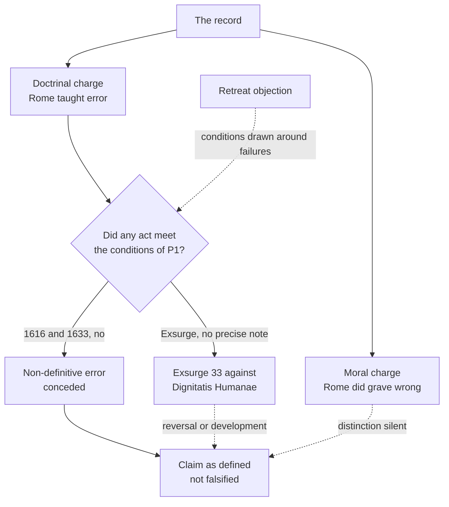

# Apologetics II · Lesson 7.1: The Inquisition and the Galileo affair

> ⏱ ~15 min · Module 7: The hard history · Builds on: [`church-history` 5.3](../../church-history/lessons/05-03-heresy-inquisition-and-the-jews.md), [`church-history` 6.5](../../church-history/lessons/06-05-the-spanish-and-roman-inquisitions.md), [`church-history` 7.3](../../church-history/lessons/07-03-the-galileo-affair.md), [`ecclesiology-and-mariology` 4.3](../../ecclesiology-and-mariology/lessons/04-03-vatican-i-and-pastor-aeternus.md), [`ecclesiology-and-mariology` 4.4](../../ecclesiology-and-mariology/lessons/04-04-infallibility-in-exercise-and-the-ordinary-universal-magisterium.md), [`ecclesiology-and-mariology` 5.4](../../ecclesiology-and-mariology/lessons/05-04-a-church-of-sinners.md) · Unlocks: [7.2](07-02-the-reformations-grievances.md), [7.3](07-03-the-abuse-crisis-and-the-argument-from-scandal.md)

## Why this matters

"A Church that burned dissenters and condemned Galileo cannot be the Church Christ keeps from error." It reasons from what the Church did to what she cannot be. Module 7 turns [1.3](01-03-arguing-from-history-without-abusing-it.md)'s rule on Catholics: record unsoftened, concession, answer. The answer is a distinction; it must prove no escape hatch, and admit what it does not answer.

## The idea

A publisher that guarantees its dictionary's definitions is not refuted by a wrong date in a usage note, only by a wrong definition. And if its editors had rival lexicographers jailed, no point about definitions answers that. Two charges: **doctrinal** (the Church taught error) and **moral** (she did grave wrong). The Catholic distinction answers only the first.

**The record, taken whole from `church-history`.** Papal [inquisitors](../reference.md#inquisition) worked under commissions from the 1230s, and Innocent IV's *Ad extirpanda* (15 May 1252) let lay officials torture suspects. The inquisitors' registers show execution as the exception (Bernard Gui relaxed at most 45 of some 636 convicted to the stake) and record the prosecutors' own categories ([5.3](../../church-history/lessons/05-03-heresy-inquisition-and-the-jews.md)). The [Spanish Inquisition](../reference.md#spanish-inquisition) was a crown tribunal with papal sanction (Sixtus IV, 1 November 1478). Historians estimate its executions from under 3,000 (Kamen; Monter) to about 12,000 (Del Col), most before 1530. The Roman Inquisition (1542) sent Bruno to the stake in 1600, among some 1,250 death sentences (Del Col's estimate) ([6.5](../../church-history/lessons/06-05-the-spanish-and-roman-inquisitions.md)). The [Black Legend](../reference.md#black-legend) fails both ways: "millions" has no documentary basis (Lea rejected Llorente's 31,912 in 1907), and neither has the "White Legend" (Keen's term, [7.1](../../church-history/lessons/07-01-conquest-and-conscience-in-the-americas.md)) of a fair court that hardly killed. Relaxation to the secular arm excused no one.

The [Galileo affair](../reference.md#galileo-affair) ([7.3](../../church-history/lessons/07-03-the-galileo-affair.md)): Holy Office consultors called the sun's immobility "formally heretical" in unpublished advice (24 February 1616). On 5 March the **Congregation of the Index**, Paul V approving, declared the doctrine "false and altogether opposed to Holy Scripture" and suspended Copernicus "until they be corrected". On 22 June 1633 the **Holy Office** found Galileo "vehemently suspected of heresy". The bans lapsed between 1758 and 1835 (Gebler, trans. Sturge, 1879).

[`apologetics-foundations` 4.1](../../apologetics-foundations/lessons/04-01-the-conflict-thesis-tested-in-both-directions.md) ran the secular conflict thesis on Galileo, and `church-history`'s Bellarmine exercise is its Boss 7; neither is re-run. [`ecclesiology-and-mariology` 4.3–4.4](../../ecclesiology-and-mariology/lessons/04-04-infallibility-in-exercise-and-the-ordinary-universal-magisterium.md) and [5.4](../../ecclesiology-and-mariology/lessons/05-04-a-church-of-sinners.md) taught infallibility's conditions and indefectibility; this lesson argues them against an intra-Christian opponent.

## The other side

**Anglican and Reformed confessions: councils and churches err.** [Article XXI](../reference.md#thirty-nine-articles) (the English of 1571, in Schaff) says general councils, being assemblies of men not all governed by the Spirit, "may erre, and sometyme haue erred, euen in thinges parteynyng vnto God". What they ordain as necessary to salvation has no authority unless shown taken from Scripture. The American revision of 1801 omits the article. The [Westminster Confession](../reference.md#westminster-confession) (1646) XXXI.4 (XXXI.3 in the American numbering) says all synods since the apostles "may err, and many have erred", so they are a help in faith and practice, never its rule. XXV.5 says the purest churches are subject "both to mixture and error", and some have become "synagogues of Satan". It adds: "Nevertheless, there shall be always a Church on earth to worship God according to his will." Article XXI is an Anglican formulary whose authority varies across the Communion; Westminster is the subordinate standard of Presbyterian churches, under Scripture.

**Calvin.** The [*Institutes*](../reference.md#calvin-institutes) is a theologian's book, not a confession. Calvin does not deny the Church a guarantee; he relocates it (IV.8.13, Beveridge, 1845):

> If we grant the first point--viz. that the Church cannot err in things necessary to salvation--our meaning is, that she cannot err, because she has altogether discarded her own wisdom, and submits to the teaching of the Holy Spirit through the word of God.

Rome, he says, places that authority "without the word of God"; "we annex it to the word". And Rome maintains its doctrine of unerring councils "first, in writing, and then, by fire and sword" (IV.8.10).

**The Orthodox form.** Patriarch Anthimos VII and his Synod answered Leo XIII's apostolic letter *Praeclara Gratulationis* (20 June 1894) in a [synodical encyclical of August 1895](../reference.md#patriarchal-encyclical-of-1895). In Metallinos's translation (1896, §XVIII):

> The orthodox Eastern and catholic Church of Christ, with the exception of the Son and Word of God, who was ineffably made man, knows no one that was infallible upon earth.

It cites Liberius, Zosimus, Vigilius and Honorius. Yet the same text calls the Orthodox churches "the pillar and ground of the truth" and says they "remain, and will always remain, faithful" to the ancient constitution of the Church (§XIX). Its weight: the Ecumenical Patriarchate's official synodal statement, not a definition binding all Orthodoxy, which has no Western-style magisterium.

**The [argument from institutional error](../reference.md#argument-from-institutional-error) at full strength.** Rome claims the Spirit keeps her from error in faith and morals. Yet in 1616 a Roman congregation, with papal approval, censured a truth as contrary to Scripture, and in 1633 a Roman court called it "declared and defined to be contrary to Holy Scripture". A pope licensed torture, and another condemned the denial that heretics may be burned. These were the Church teaching, not private sins, so the claim is false. Then the second-order charge, sent here by [`fundamental-theology` 4.4](../../fundamental-theology/lessons/04-04-the-ladder-of-doctrinal-authority.md): whenever the Church errs, the act turns out not to have met the conditions. The ladder is a device for retreating, and a claim no record can falsify claims nothing.

## The argument

**P1.** [Infallibility](../reference.md#infallibility) attaches to a kind of act. [*Pastor Aeternus*](../reference.md#pastor-aeternus) ch. 4 (18 July 1870) defines it for the pope "when he speaks ex cathedra", defining "a doctrine regarding faith or morals to be held by the universal Church" (Schaff); councils and the ordinary universal magisterium share it. Can. 749 §3: nothing counts as defined unless manifestly so. *In words:* the guarantee covers definitions, not every Roman act.

**P2.** [Indefectibility](../reference.md#indefectibility) promises that the Church lasts, holding faith and sacraments, and that the whole body cannot err in believing (*in credendo*, [`fundamental-theology` 5.3](../../fundamental-theology/lessons/05-03-the-sensus-fidei.md)). It promises no one impeccability ([`ecclesiology-and-mariology` 5.4](../../ecclesiology-and-mariology/lessons/05-04-a-church-of-sinners.md)). *In words:* the Church will not lose the faith; her officers can still act wrongly.

**P3.** No Galileo act was a definition. The consultors advised. The [1616 Index decree](../reference.md#index-decree-of-1616) joined a doctrinal censure, non-definitive and so reformable by its kind, to book bans, which were discipline. The 1633 sentence was a court's judgment, and calling a decree "defined" does not make it one. *In words:* a real doctrinal error, by a non-definitive act.

**P4.** Coercion of heretics was law (*Ad extirpanda*), theology (Aquinas, ST II-II q.11 a.3, English Dominican translation: convicted heretics may be "put to death") and once a papal censure ([*Exsurge Domine*](../reference.md#exsurge-domine), Example 2). No act defined it, and *Dignitatis Humanae* (7 December 1965) teaches the contrary principle. *In words:* taught with authority, never defined.

**∴ C.** The record convicts the Church's tribunals of doctrinal error and grave wrong, but it falsifies no definition, and the Church never ceased to hold the faith. *In words:* the distinction answers "your dogma is false"; it does not answer "your Church did evil", and never could.

**Mark the levels.** ([the ladder](../../fundamental-theology/lessons/04-04-the-ladder-of-doctrinal-authority.md); [levels of authority](../reference.md#levels-of-authority).) Papal infallibility under ch. 4's conditions: **rung 1**. Indefectibility: **at least rung 3**, silent on conduct. The consultors' "formally heretical": **no level**. The 1616 decree: **not a definition**; its censure was a congregation's non-definitive judgment with ordinary papal approval, **rung 3 at its lightest while in force**, withdrawn 1758–1835; its book bans **discipline, no rung**. The 1633 sentence: **judicial act, no rung**. John Paul II's 1992 address: **the lightest grade of rung 3** for any principle it restates, **no rung** for its historical verdicts. *Ad extirpanda*: **law, no rung**. The contradictory of *Exsurge* prop. 33: **at least rung 3 as a 1520 act, no precise note**. *Dignitatis Humanae*: **rung 3**, defining nothing (some read its core as definitive). Whether it developed or reversed 1520: **rung 5**. Aquinas: **no magisterial level**. The other side's texts: **no Catholic level**.

**Concession.** The Galileo condemnation was an error really made, by the Church's own tribunal, with papal involvement. The inquisitions killed people for heresy, and the Church gave the practice her doctrinal approval. John Paul II called the Church's children to repent of the "acquiescence" given to "intolerance and even the use of violence in the service of truth" (*Tertio Millennio Adveniente* 35, 1994); the record warrants a stronger word. The distinction touches none of this.

**The crux.** Can "the Church" of the promise err in a judgment of this kind without the promise failing? The Catholic denies that a congregation's censure or an *in globo* condemnation is the Church teaching in the promise's sense; the [retreat objection](../reference.md#retreat-objection) denies that the conditions were fixed independently of the failures. Two things would move it: a Catholic naming in advance what would falsify the claim (a definition meeting ch. 4's conditions, shown false), and evidence of how 1616 and 1520 were received. The 1633 court's word "defined" is the critic's best evidence.

## The argument map

The distinction works on one branch: the moral charge passes through it untouched.

## Worked examples

**Example 1 (clean): "Rome defined that the earth stands still."** `kirk_and_kettle`, in an invented Reformed forum post: "Rome solemnly defined geocentrism in 1616, John Paul II admitted in 1992 it was false, so papal infallibility refuted itself." Find the act: the Index decree, a congregation's, with Paul V's approval. No pope spoke ex cathedra: the act was a congregation's censure joined to book bans, with Copernicus suspended "until they be corrected", which is not a definition's form. The 1992 address blames "the majority of theologians" (§9) and recalls that the 1633 sentence "was not irreformable"; it never says a definition erred. So the charge fails at P3. What survives is the concession: a Roman congregation, with a pope's approval, censured a truth as contrary to Scripture and bound consciences for two centuries.

**Example 2 (strain): *Exsurge Domine* 33 and *Dignitatis Humanae*.** Leo X (15 June 1520) condemned 41 of Luther's propositions, the 33rd being *Haereticos comburi est contra voluntatem Spiritus*, "that heretics be burned is against the will of the Spirit" (DS 1483; lesson's translation). The condemnation was [*in globo*](../reference.md#in-globo-censure): "respectively" heretical, scandalous, false, offensive or misleading (DS 1492), assigning no note to any one proposition. [*Dignitatis Humanae*](../reference.md#dignitatis-humanae) 2 grounds immunity from coercion in the person's dignity, "known through the revealed word of God and by reason itself"; §12 admits conduct "hardly in accord with the spirit of the Gospel" and holds that the teaching that no one may be coerced into faith "has always stood firm". The Catholic reply: the censure was no definition, and the constant teaching concerned forcing faith on the unbaptized, whereas heretics were punished as baptized subjects. The second move strains, because the council's ground, every person's dignity, covers the baptized dissenter too. [Development](../reference.md#development-of-doctrine) or reversal is rung 5 ([6.6](06-06-development-or-corruption.md) supplies the tests). Here the distinction stops: it shows that no definition was reversed, not that no pope taught, at rung 3, a moral proposition the Church now rejects, one owed religious submission in 1520. This is where "your own documents contradict each other" ([`fundamental-theology` 4.5](../../fundamental-theology/lessons/04-05-reading-a-documents-weight.md)) lands hardest.

## Watch out

- **You might think the Reformed or Orthodox case says a Church that errs is no Church,** but Westminster XXV.5, Calvin and Anthimos each keep a guarantee and relocate it. Answering a version that abolishes it is caricature.
- **You might think the 1616 decree was "only disciplinary",** but it censured a doctrine as contrary to Scripture ([disciplinary and doctrinal](../reference.md#disciplinary-and-doctrinal)); relabelling it dodges the charge the honest answer concedes. Nor did a court writing "defined" in 1633 make it a definition.
- **You might think *Exsurge* defined that heretics may be burned, or that *Dignitatis Humanae* defined religious liberty.** Neither defined anything: the first is at least rung 3 with no precise note, the second rung 3.

## One-liner

> The record convicts the Church's tribunals of doctrinal error and grave wrong; the line between a definition and everything else answers only the first charge, and an honest Catholic says so before drawing it.

## Problems

**P1 (🟢) *(Exegetical, strict: assign the weight.)*** Place each on the ladder, or give its weight inside its own tradition, naming the act. One line per item.

(a) "Burning heretics is not against the will of the Spirit", as Leo X's *Exsurge Domine* (1520) taught it by condemning Luther's proposition 33.

(b) The 1633 sentence's statement that Copernicanism had been "declared and defined to be contrary to Holy Scripture".

(c) Innocent IV's *Ad extirpanda* (1252), permitting torture of suspected heretics.

(d) The 1895 Constantinople encyclical's statement that the Orthodox Church "knows no one that was infallible upon earth" except Christ.

**P2 (🟡) *(Apologetic: (a) Exegetical, graded first · (b) reply.)*** Calvin, *Institutes* IV.8.10 and IV.8.13 (Beveridge), as given in The other side.

(a) State Calvin's position: the guarantee he grants the Church, its condition, what he says Rome does instead, and how he says Rome enforces it. Say what kind of text the *Institutes* is in the Reformed tradition. Three sentences.

(b) Reply, opening with a **named concession**. 150 words or fewer. A reply concluding that Calvin's charge succeeds passes if it is a good reply.

**P3 (🔴, optional) *(Exegetical: diagnose.)*** Invented, written for this problem: Francisca Yiu's notes for her parish study group in Hong Kong.

> 1. The Spanish Inquisition executed only a few thousand people, and the state did the executing, not the Church.
>
> 2. The 1616 decree against Copernicus was purely disciplinary, so Galileo raises no doctrinal question.
>
> 3. The Church never taught that heretics should be killed; that was medieval politics.
>
> 4. None of these acts was infallible, so the Church has nothing to apologize for.

(a) For each line, say what is right in it, if anything, and what is wrong, citing the record or the level. One sentence per line.

(b) In one sentence, name the single move that does the most damage across the notes.

Solutions

**P1** *(Exegetical, strict)*

**Must hit, strict:**

- (a) The act is a papal bull's *in globo* censure (DS 1492), with no note assigned to proposition 33. Its contradictory is **at least rung 3 as a 1520 act, no precise note**. It is not a definition and not heresy to deny, and its standing beside *Dignitatis Humanae* is rung 5.
- (b) The sentence is a **judicial act of the Holy Office, no rung**. The decree it describes, the Index decree of 1616, was not a definition: its censure was a congregation's non-definitive judgment, rung 3 at its lightest while in force, later withdrawn.
- (c) A papal bull, but **law, no doctrinal rung**: it authorized a procedure, it did not teach a proposition.
- (d) A **patriarchal and synodical encyclical** of the Ecumenical Patriarchate (Anthimos VII and his Synod, August 1895): an official statement of that see's position, not a definition binding all Orthodox churches. It has **no Catholic level**.

**Wrong turns:** (a) "heresy to deny" or "defined", which overstates; "a polemical list with no weight", which understates, because a papal censure is a teaching act. (b) "Rung 1 because the court says defined": courts do not define (can. 749 §3). (c) "A papal bull, so doctrine." (d) "The Orthodox Church's dogmatic definition", or "one bishop's opinion": the Synod signed it.

**Model answer:** (a) At least rung 3, no precise note: Leo X's *in globo* censure, not a definition. (b) No rung: a judicial sentence; the 1616 decree it calls "defined" was a non-definitive congregational censure, rung 3 at lightest while in force. (c) Law, no rung. (d) The Constantinople Synod's official encyclical, authoritative for that see's position in 1895, binding no other church by definition; no Catholic level.

---

**P2** *(Apologetic: (a) Exegetical, graded first · (b) reply)*

**Accept:** any reply that names a real concession, uses the definition/non-definition distinction accurately, and says where it stops, whatever its verdict on Calvin's charge.

**Must hit, strict (a), graded first:**

- Calvin **grants** that the Church cannot err in things necessary to salvation.
- The **condition**: because, and so far as, she discards her own wisdom and submits to the Spirit teaching through the word; her authority is annexed to the word and never separated from it.
- Rome, he says, places the Church's authority **without the word**, claims that councils cannot err, and so demands assent to whatever they determine; it enforces this "first, in writing, and then, by fire and sword" (IV.8.10).
- **Weight:** a theologian's book, not a Reformed confession; Westminster XXXI.4 is the confessional form.

**Must hit (b):**

- **Named concession:** the "fire and sword" charge is true of the record (`church-history` 5.3, 6.5), with doctrinal approval (*Exsurge* 33), and in 1616 Rome bound consciences to a misreading of Scripture.
- The Catholic claim also restricts the guarantee: to definitions under ch. 4's conditions and to the whole body's faith (P1–P2). The maximal claim Calvin attacks, that whatever Rome determines is an oracle, is not what 1870 defined.
- Press his criterion: "annexed to the word" needs a judge of when the Church has kept to the word, and the 1616 judges believed they were keeping to it.
- Say the limit: none of this answers the moral charge.

**Wrong turns:** stating (a) as "Calvin says the Church has no guarantee" or as "Protestants believe", which is caricature or blur and fails the problem. Treating the *Institutes* as a confession, or quoting Article XXI as Calvin's. In (b): Servetus as a score (that counter-question belongs to [7.2](07-02-the-reformations-grievances.md), and never exculpates); "the state did the burning".

**Model answer (a):** Calvin grants that the Church cannot err in things necessary to salvation, but only because, and so far as, she renounces her own wisdom and submits to the Spirit speaking through the word, to which her authority is annexed. Rome, he says, puts that authority outside the word, claims councils cannot err, and so demands assent to whatever they decide, enforcing it "by fire and sword". The *Institutes* is a theologian's book; the Reformed confessional form is Westminster XXXI.4.

**Model answer (b), one of several:** Concession: Calvin's "fire and sword" is history, not slander. Church tribunals killed for heresy, a pope condemned the denial that heretics may be burned, and in 1616 Rome bound consciences to a misreading of Scripture. But the Catholic claim is narrower than the one he attacks. It covers definitions made under stated conditions and the whole Church's faith, not every Roman decree, and no definition is shown false here. His own criterion also needs a judge: the 1616 censors thought they were keeping to the word. The reply stops there. It answers the doctrinal charge and leaves the moral one standing.

---

**P3** *(Exegetical: diagnose)*

**Must hit, strict (a):**

- **Line 1.** Right that the estimates are in the thousands (from under 3,000 to about 12,000, given as a range). Wrong in "only", and wrong that the state alone acted: the tribunal was a crown court with papal sanction, staffed by churchmen who condemned and relaxed knowing the outcome.
- **Line 2.** Wrong: the decree declared a doctrine "false and altogether opposed to Holy Scripture", a doctrinal censure (rung 3 at its lightest, non-definitive), with book bans as its disciplinary part.
- **Line 3.** Wrong as stated: Leo X's *Exsurge* condemned the denial that heretics may be burned (at least rung 3), and Aquinas taught it. What is true is narrower: it was never defined.
- **Line 4.** The premise is right: none was a definition. The inference fails twice. The distinction answers the doctrinal charge only, and the Church herself has repented of the record (*Tertio Millennio Adveniente* 35; the Day of Pardon, 12 March 2000).

**Must hit, strict (b):** using a doctrinal distinction (definition versus everything else) to shrink the doctrinal charge and then to dismiss the moral one.

**Wrong turns:** calling line 4's premise false, since it is true; replacing her "few thousand" with a single number; treating the notes as a Protestant caricature, when they are our side's error.

**Model answer:** (a) 1: the thousands are right, but "only" minimizes, and a crown tribunal with papal sanction, staffed by churchmen who condemned and relaxed, does not leave the Church outside. 2: the decree censured a doctrine as contrary to Scripture, so it is a non-definitive doctrinal error, not mere discipline. 3: *Exsurge* condemned the denial of burning heretics, so it was taught, though never defined. 4: true that nothing was infallible, false that nothing needs apology, because that distinction answers only the doctrinal charge. (b) She uses the definition line as a universal solvent, first to shrink the doctrinal charge and then to erase the moral one.

## Flashback

**From Lesson [6.5](06-05-the-sacrifice-of-the-mass.md) (The sacrifice of the Mass):** *(Exegetical, strict · close reading.)* Justin Martyr, *Dialogue with Trypho* 117 (ANF 1, tr. Dods and Reith), answering the claim that the sacrifices Malachi says are offered "in every place" are the prayers of Jews of the dispersion:

> God, anticipating all the sacrifices which we offer through this name, and which Jesus the Christ enjoined us to offer, i.e., in the Eucharist of the bread and the cup, [...] bears witness that they are well-pleasing to Him. [...] Now, that prayers and giving of thanks, when offered by worthy men, are the only perfect and well-pleasing sacrifices to God, I also admit. For such alone Christians have undertaken to offer, and in the remembrance effected by their solid and liquid food, whereby the suffering of the Son of God which He endured is brought to mind ...

(a) What does "only" exclude, given the claim Justin answers, and where does he say Christians offer these sacrifices?

(b) By [1.3](01-03-arguing-from-history-without-abusing-it.md)'s rules, what does the chapter attest about the Eucharist as sacrifice, and what does it not? Could the Apology's account (XXIV) take it as it stands?

**Two sentences per part.**

Solution

**Must hit, strict:**

- (a) **"Only"** ranks prayer and thanksgiving above the Jerusalem sacrifices God rejects, ground Justin shares with his opponents ("I also admit"), and "such alone" says Christians offer nothing else. It is not set against the Eucharist: Christians offer it "in the Eucharist of the bread and the cup", which Christ "enjoined", where the passion is remembered.
- (b) **Attests** an offering, which is all 6.5's P3 needs: the Eucharist as a sacrifice Christ commanded, offered to God as thanksgiving. **Not** that it is [propitiatory](../reference.md#propitiatory), that Christ is what is offered, or that it avails for others: reading Trent in is [anachronism](../reference.md#anachronism). Credit for noting that 117 alone leaves open whether the bread and cup or the thanksgiving over them is offered (*Dialogue* 41 names "the bread of the Eucharist, and also the cup").
- (b) **The Apology can take it:** thanksgiving by the worthy is its [eucharistic species](../reference.md#two-species-of-sacrifice). Credit: on Malachi 1:11 the Apology itself lets the pure offering embrace the ceremony ("we readily concede it"), provided not the ceremony alone and not *ex opere operato*.

**Wrong turns:** reading "only" against the Eucharist, so that Justin holds a bare memorial (the proof-text use 6.5 flags); reading the first sentence as Trent's sacrifice, or generalizing it into a consensus of "the Fathers"; saying the Apology must reject Justin.

**Model answer:**

(a) "Only" ranks prayer and thanksgiving above the Jerusalem sacrifices God rejects, ground Justin shares with his opponents, and says Christians offer nothing else. But they offer it "in the Eucharist of the bread and the cup", which Christ enjoined, so prayer and Eucharist are one offering, not rivals.

(b) The chapter attests that the Eucharist was already a sacrifice Christ commanded, offered to God as thanksgiving, but says nothing of propitiation, of Christ offered, or of benefit to others, so reading Trent into it is anachronism. The Apology can take it as it stands, since thanksgiving by the worthy is its eucharistic species.

## Connections

- **Backward:** the record is [`church-history` 5.3](../../church-history/lessons/05-03-heresy-inquisition-and-the-jews.md), [6.5](../../church-history/lessons/06-05-the-spanish-and-roman-inquisitions.md), [7.1](../../church-history/lessons/07-01-conquest-and-conscience-in-the-americas.md) and [7.3](../../church-history/lessons/07-03-the-galileo-affair.md). Infallibility's conditions are [`ecclesiology-and-mariology` 4.3](../../ecclesiology-and-mariology/lessons/04-03-vatican-i-and-pastor-aeternus.md) and [4.4](../../ecclesiology-and-mariology/lessons/04-04-infallibility-in-exercise-and-the-ordinary-universal-magisterium.md), whose Honorius case is the papal form of this argument. Indefectibility is its [5.4](../../ecclesiology-and-mariology/lessons/05-04-a-church-of-sinners.md). The ladder and genres are [`fundamental-theology` 4.4](../../fundamental-theology/lessons/04-04-the-ladder-of-doctrinal-authority.md) and [4.5](../../fundamental-theology/lessons/04-05-reading-a-documents-weight.md). Augustine's coercion letters and Aquinas II-II q.10 a.8 are [`patristics` 4.4](../../patristics/lessons/04-04-augustine-against-the-donatists.md).
- **Forward:** [7.2](07-02-the-reformations-grievances.md) presses the disciplinary/doctrinal line as "too convenient". [7.3](07-03-the-abuse-crisis-and-the-argument-from-scandal.md) meets a charge with no doctrinal side to retreat to. The module's Boss ([syllabus](../syllabus.md)) close-reads Article XXI and Westminster XXV.5 and XXXI.4, and reconstructs the argument from crimes to falsity.
- **Sideways:** [`apologetics-foundations` 4.1](../../apologetics-foundations/lessons/04-01-the-conflict-thesis-tested-in-both-directions.md) runs the secular version against Galileo and concedes that nothing prevents a repetition. The retreat objection is the charge [`philosophy-of-science`](../../philosophy-of-science/syllabus.md) studies under Popper and Lakatos, ad hoc protection of a theory's core, turned on a doctrine; the Catholic answer has to meet it the way a theory does, by showing its conditions were not adjusted after each failure and by naming what would refute it. *Dignitatis Humanae* as doctrine belongs to [`catholic-social-teaching`](../../catholic-social-teaching/syllabus.md).
