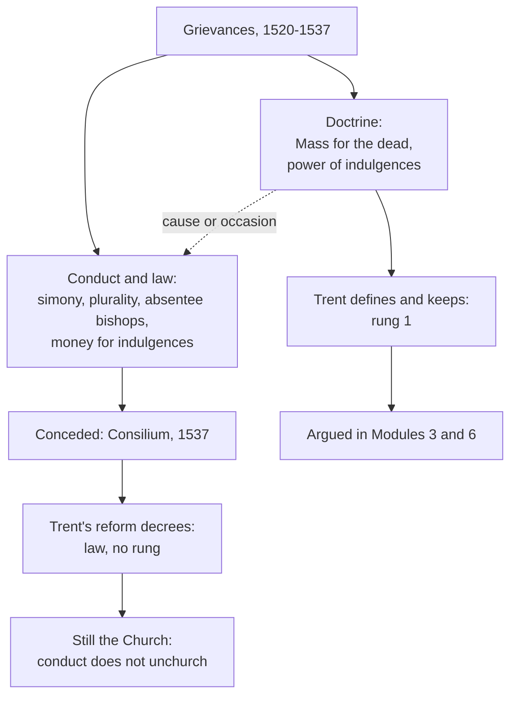

# Apologetics II · Lesson 7.2: The Reformation's grievances

> ⏱ ~15 min · Module 7: The hard history · Builds on: [7.1](07-01-the-inquisition-and-the-galileo-affair.md), [`church-history` 6.1](../../church-history/lessons/06-01-the-late-medieval-church-and-luthers-protest.md), [`church-history` 6.4](../../church-history/lessons/06-04-trent-and-catholic-reform.md), [`ecclesiology-and-mariology` 2.2](../../ecclesiology-and-mariology/lessons/02-02-holy.md), [`theology-of-debt` 3.6](../../theology-of-debt/lessons/03-06-luther-trent-and-the-reform-of-indulgences.md) · Unlocks: [7.3](07-03-the-abuse-crisis-and-the-argument-from-scandal.md)

## Why this matters

In 1537 nine churchmen chosen by the pope told him, in confidence, that the Church was sick, and sickest in his own court; the reformers had said as much since 1520. So the Catholic apologist cannot start by defending the sixteenth-century Church's conduct. The question is what follows from conceding it.

## The idea

Picture a hospital whose surgeons take bribes and hand their posts to their nephews: a scandal, but still a hospital if its medicine works, unless the medicine makes the bribes possible. Two questions, then: were the grievances true, and did they reach the medicine?

The reformers' [grievances](../reference.md#reformation-grievances) were of both kinds. Some concerned conduct and law: simony, [pluralism and *commendam*](../reference.md#pluralism-and-commendam), absentee bishops, sees handed on like estates, untrained priests, the Renaissance papacy, the money behind the St Peter's indulgence. Others concerned doctrine: the Mass for the living and the dead, the power to grant indulgences. The Catholic reply rests on the [disciplinary/doctrinal distinction](../reference.md#disciplinary-and-doctrinal): the first kind can be wholly true, and conceded, without touching the second. Its weakness is as simple: if the doctrine bred the abuse, the two kinds are one.

The record is [`church-history` 6.1](../../church-history/lessons/06-01-the-late-medieval-church-and-luthers-protest.md)–[6.4](../../church-history/lessons/06-04-trent-and-catholic-reform.md), which also grades the decay debate (A. G. Dickens, *The English Reformation*, 1964, against Eamon Duffy, *The Stripping of the Altars*, 1992). This lesson needs only its settled part: real abuses beside a thriving lay piety. Whether a corrupt Church is still the Church is the [Donatist](../reference.md#donatism) question that [`ecclesiology-and-mariology` 2.2](../../ecclesiology-and-mariology/lessons/02-02-holy.md) answered from Augustine.

## Source

The [*Consilium de emendanda ecclesia*](../reference.md#consilium-de-emendanda-ecclesia), abuse 5, in the lesson's translation of the Latin in B. J. Kidd, *Documents Illustrative of the Continental Reformation* (Oxford, 1911), No. 126, pp. 311–312:

> By law benefices cannot be left by will, since they belong not to the testator but to the Church, and must be kept common to all good men, no one's private possession. Human, but not Christian, ingenuity has found many ways to mock this law. Bishoprics are resigned with a right of return; they add a reservation of the revenues, of the right to confer benefices, and of the administration, and so make one man a bishop with none of a bishop's rights, and another with all of them who is no bishop. … What, pray, is this but appointing oneself an heir to the benefice? … Nothing has kindled more hatred against the clergy, whence so many seditions have arisen and others threaten, than this diverting of the Church's revenues from common to private use. Once all men hoped; now, driven to despair, they sharpen their tongues against this see.

**Who wrote it.** A commission of nine named by Paul III: four signed as cardinals (Contarini, its chair; Carafa, later Paul IV; Sadoleto; Pole), five as prelates (Fregoso, Aleandro, Giberti, Cortese, Badia). Sworn to secrecy, they reported in 1537; the text leaked, was printed in 1538, and Luther issued it in German that year with a preface and mocking notes. **Its shape.** A preface traces the abuses to curial flattery about papal power over benefices and forbids gain from the keys; twenty-six numbered abuses and remedies follow. The first ellipsis drops a sentence tying abuse 5 to that preface, which [Boss 7(c)](../syllabus.md) reads.

## The other side

**The grievances.** Luther's *Address to the Christian Nobility* (1520; Buchheim's translation, 1883) charges Rome's money: annates kept as a tax, the *commendam* that handed a rich convent to a cardinal to drain, and "incompatible" benefices held together. Its sharpest line: "I complain that they do not observe their own fabricated canon law." Calvin's *Institutes* (1559; Beveridge) adds the bishops: "youths who are thrice abbots, twice bishops, once archbishops" (IV.5.7), who treat their churches "merely in the light of farms" (IV.5.11). The [Augsburg Confession](../reference.md#augsburg-confession) (1530) gives the Lutheran estates' list in Part II, articles XXII–XXVIII: both kinds, the marriage of priests, the Mass, confession, meats, monastic vows and the power of bishops.

**Augsburg's own line.** Part II opens: "our churches dissent in no article of the faith from the Church Catholic, but only omit some abuses which are new, and which have been erroneously accepted by the corruption of the times" (Triglot, 1921). Augsburg files private Masses under abuses; Trent files the propitiatory sacrifice under doctrine. The quarrel is where the line runs.

**The objection: the distinction is too convenient.** *First, the abuses grew from doctrine.* Augsburg XXIV traces Masses said "only for fees or stipends" to "the opinion which infinitely increased Private Masses", that the Mass was instituted as an offering for daily sins; from it came the belief that the Mass "takes away the sins of the living and the dead by the outward act". The [Smalcald Articles](../reference.md#smalcald-articles) (Luther, 1537), II.2, call the Mass "this dragon's tail" that "has begotten" purgatory's trade, pilgrimages, relics, and indulgences "granted (but only for money)", all against "the chief article". *Second,* abolishing the money while defining the doctrine treats the symptom and protects the cause. *Third,* the line is drawn after the event by the party it protects: what embarrasses becomes "discipline", and what is kept becomes "doctrine". Calvin says they "cloak these abominations with the name of church, that they may exempt them from all blame" (IV.5.7).

**What it does not say.** None of these texts argues that bad clergy unchurched Rome. Augsburg VIII condemns the Donatists. Calvin denies that "errors of conduct" take away the name of Church; that name is lost only when the sum of doctrine is "inverted" (IV.1.13; IV.2.1). The Anglican Article XXVI grants that the evil sometimes "have chief authority". Their case is doctrinal; the grievances are its symptoms.

**Weight.** Augsburg and the Smalcald Articles stand in the [Book of Concord](../reference.md#book-of-concord), the Lutheran standard pastors subscribe, a *norma normata* under Scripture. The *Address* is a pamphlet; the *Institutes* a theologian's book (Westminster XXVII.3 gives the Reformed confessional form of the anti-Donatist point); the Thirty-Nine Articles Anglican formularies of varying authority.

## The argument

**P1.** Most disciplinary grievances were true, by Catholic testimony. The commission conceded simony, pluralism, *commendam*, absentee bishops, untrained ordinands and gain from the keys. Trent described discipline as "exceedingly relaxed" and spoke of "the depraved manners of the clergy and Christian people" (Session VI, reform decree, ch. 1, 1547; Waterworth). *In words:* on the facts, the reformers win.

**P2.** Trent answered with law: residence (VI ref. ch. 1); no plural sees "by title, or in commendam" (VII ref. ch. 2) or plural benefices (XXIV ref. ch. 17); seminaries (XXIII ref. ch. 18); no alms-collectors and no "evil gains" from indulgences (XXI ref. ch. 9; XXV). *In words:* changeable rules, changed.

**P3.** The doctrines under attack were defined separately and kept: the Mass propitiatory for the living and the dead (XXII can. 3), the power to grant indulgences (XXV), and no divine precept of both kinds (XXI can. 1). *In words:* Trent itself sorted law from doctrine.

**P4.** Conduct does not unchurch. A minister in mortal sin still confers the sacrament (VII can. 12), and the Church is holy from Christ's gifts ([`ecclesiology-and-mariology` 2.2](../../ecclesiology-and-mariology/lessons/02-02-holy.md); the [mixed body](../reference.md#corpus-permixtum)). The confessions quoted above agree. *In words:* every party rejected the Donatist inference.

**∴ C.** The justified grievances justified reform, not separation. Whether Rome had ceased to be the Church turns on the doctrinal charges (Modules 3 and 6), including the charge that doctrine bred the abuse ([6.3](06-03-penance-purgatory-and-indulgences.md), [6.5](06-05-the-sacrifice-of-the-mass.md)).

*The counter-question*, asked without triumphalism, applies the same test to the new settlements. In electoral Brandenburg "the Sees were appropriated by Hohenzollern princes" (Kidd, 1911, p. 307), the commission's "common to private use" over again; Zurich drowned Felix Manz, and Geneva burned Servetus ([`church-history` 6.2](../../church-history/lessons/06-02-reformations-beyond-wittenberg.md)). This tests only a claim to be purer and never exculpates Rome; [7.3](07-03-the-abuse-crisis-and-the-argument-from-scandal.md) refuses the comparative move outright.

**Mark the levels.** ([The ladder](../../fundamental-theology/lessons/04-04-the-ladder-of-doctrinal-authority.md); [levels of authority](../reference.md#levels-of-authority).) The Church is holy: **rung 1** (the Creed; LG 39). A minister in mortal sin still confers the sacrament: **rung 1** (Trent VII can. 12). The power to grant [indulgences](../reference.md#indulgences), and their usefulness: **rung 1** (XXV); the [treasury](../reference.md#treasury-of-the-church): **rung 3**, never defined. The Mass as propitiatory: **rung 1** (XXII can. 3). No divine precept of both kinds: **rung 1** (XXI can. 1); withholding the cup: **law, no rung**, kept by Trent and relaxed by *Sacrosanctum Concilium* 55 (1963) ([`sacraments-and-liturgy` 3.5](../../sacraments-and-liturgy/lessons/03-05-communion-reservation-adoration.md)). Every reform decree in P2: **law / discipline, no rung**. The *Consilium*: **no magisterial level**, evidence not teaching. [Indefectibility](../reference.md#indefectibility): **at least rung 3**, and it promises nothing about conduct.

**Concession.** Most of the disciplinary grievances were justified. The pope's own commission said the Church's diseases afflicted "especially this Roman curia"; Trent legislated against nearly every item, a concession in the form of law. The abuse reached papal acts: the St Peter's campaign ran on a papal grant ([`church-history` 6.1](../../church-history/lessons/06-01-the-late-medieval-church-and-luthers-protest.md)). Reform came late and under pressure. The honest Catholic argument is not that the Church was healthy. It is that a corrupt Church can still be the Church.

**The crux.** Was the doctrine of indulgences a cause of the abuse, or only its occasion? The Lutheran must hold that a remission granted for a work, where alms count as a work, breeds a market; the Catholic, with Trent, that the market came from the money, "a most prolific cause of abuses" (XXV), and the doctrine can stand without it. What would move it: whether the abuse returns once the money is gone, or the doctrine's own form keeps inviting it back.

## The sorting

The dashed edge is the crux: if it marks a cause, the two kinds are one.

## Worked examples

**Example 1 (clean): the *commendam*.** In 1520 Luther complains that convents go to cardinals in *commendam*. In 1537 the commission (abuse 8) objects to cardinals given several bishoprics "conferred or commended", though a bishop must live with his sheep. In 1547 Trent forbids anyone, "by whatsoever dignity" distinguished, to hold several cathedral churches "by title, or in commendam" (VII ref. ch. 2). P1 and P2 hold, and P3 has nothing to sort. All three also say it broke the Church's own canons (Luther's "canon law", Calvin's "many councils", Trent's "institutes of the sacred canons"): the law was right and the prelates broke it. Nothing follows against the Church.

**Example 2 (strain): the St Peter's indulgence.** [6.3](06-03-penance-purgatory-and-indulgences.md) has already run the separability test. Indulgences have run without fees for four centuries, though the days and years survived until 1967. So the doctrine does not *entail* the trade. What does the distinction do with the rest? Two facts press it. The 1517 campaign rested on a papal grant ([`church-history` 6.1](../../church-history/lessons/06-01-the-late-medieval-church-and-luthers-protest.md)), and Trent XXI ref. ch. 9 records that Lateran, Lyons and Vienne had legislated against the alms-collectors in vain, "no longer any hope left of their amendment". The distinction absorbs both: a grant and a failed law are acts of governance, sorted by level and not thereby acquitted. What it cannot decide is whether a measured remission, with alms counted as the work, made the trade *likely*. That is a judgment of tendency, and the distinction stops there. It tells you what Rome could change; it cannot certify that what Rome kept invited nothing.

## Watch out

- **You might think the reformers argued that Rome's corruption unchurched it**, but their confessions reject that Donatist inference (Augsburg VIII). "Bad popes don't falsify doctrine" answers an argument no confession makes.
- **You might think the *Consilium* is papal teaching, or "the cardinals' verdict"**, but it is a confidential report by nine signatories, four of them cardinals, with no magisterial level.
- **You might think "discipline" means "minor" or "not the pope's fault"**, but reform decrees bind as law, and the 1517 campaign ran on a papal grant. Calling the treasury defined overstates the other way: it is rung 3.

## One-liner

> The reformers' complaints about conduct were mostly true and Trent conceded them in law; they show a corrupt Church, which every confession agreed can still be the Church, so the quarrel moves to whether doctrine bred the corruption.

## Problems

**P1 (🟢) *(Exegetical: close reading.)*** Read the Source passage (abuse 5).

(a) In your own words, what practice does the passage describe, and what principle of law does it say the practice evades? Quote the two phrases that show the commission treating a see as private property. Two sentences.

(b) The passage makes a causal claim. State it exactly. Then say whether it supports the reformers' grievance, the Catholic distinction, or Augsburg XXIV's claim that a doctrine bred the abuses, and which words decide. Three sentences.

**P2 (🟡) *(Apologetic: (a) Exegetical, graded first · (b) reply.)*** A Lutheran pastor says: "Your line between discipline and doctrine is too convenient. You abolish the money and define the doctrine that produced it."

(a) State the objection as the Lutheran confessions make it, from Augsburg XXIV and the Smalcald Articles II.2. Say what each text claims produced the abuses, why reforming the money therefore leaves the cause in place, and the weight of these texts in their own tradition. Three or four sentences.

(b) Reply, opening with a **named concession**. 150 words or fewer. A reply that concludes the objection succeeds passes if it is a good reply.

**P3 (🔴, optional) *(Exegetical: diagnose.)*** An invented campus-debate rebuttal by Rhett Pruett, a Baptist layman, written for this problem:

> "Even Rome admits it. In 1537 the pope's cardinals reported that the Church was diseased, and the pope agreed by publishing their report. Trent itself wrote of 'the depraved manners of the clergy.' Catholics now say that was only 'discipline' — a distinction Rome invented at Trent to save face. Luther and Calvin left for one reason: the clergy were corrupt, and a corrupt church is no church."

Name what is accurate, then diagnose three errors, each with the evidence that corrects it. 150 words or fewer.

Solutions

**P1** *(Exegetical, strict)*

**Must hit, strict:**

- (a) The practice is resigning a see or benefice with a right of return and keeping back its revenues, the right to appoint to benefices and its administration. The resigner keeps the substance while someone else holds the title, so in effect he chooses his own successor. The principle evaded is that benefices cannot be left by will, because they belong to the Church and must stay common. The deciding phrases are "appointing oneself an heir to the benefice" and "diverting of the Church's revenues from common to private use".
- (b) The causal claim is that this diversion, more than anything else, kindled hatred against the clergy, from which seditions have arisen and more threaten, so that people "sharpen their tongues against this see". It supports the reformers' grievance as fact. It also supports the distinction, because the abuse is an evasion of the Church's own law ("ways to mock this law", "human, but not Christian, ingenuity"). It does not touch Augsburg XXIV's claim, because its causal chain runs from practice to revolt, not from doctrine to practice.

**Wrong turns:** reading "seditions" as a concession that the reformers' doctrine was right. Calling the passage papal teaching, or the work of "the cardinals" (nine signed, four of them as cardinals). Reading the causal claim as running from doctrine to abuse.

**Model answer:** (a) Bishops resign their sees with a right of return while keeping the revenues, the patronage and the administration, so the see passes like an inheritance. The law that a benefice belongs to the Church and cannot be bequeathed is mocked: "appointing oneself an heir to the benefice", "from common to private use". (b) The commission says this diversion of revenues, above all else, bred the hatred of the clergy behind the seditions. That confirms the grievance and fits the distinction, since the abuse evades the Church's own law. It says nothing about Augsburg's claim, because its causation runs from practice to revolt, not from doctrine to practice.

---

**P2** *(Apologetic: (a) Exegetical, graded first · (b) reply)*

**Accept:** any reply that opens with a real concession, keeps the cause/occasion question distinct from the question of truth, and engages the evidence on causation, whatever its verdict.

**Must hit, strict (a), graded first:**

- **Augsburg XXIV:** private Masses said "only for fees or stipends" were "infinitely increased" by an opinion, that the Mass was instituted as an offering for daily sins, and from it came the belief that the Mass takes away the sins of the living and the dead "by the outward act". The doctrine is the source of the traffic.
- **Smalcald II.2:** the Mass "has begotten" a brood that includes purgatory's trade, pilgrimages, fraternities, relics, and indulgences granted for money. All of it conflicts with the chief article, justification, so the root is doctrinal.
- **So:** abolishing the money while defining the doctrine treats the symptom and protects the cause, and drawing the line oneself, after the fact, is self-serving.
- **Weight:** both texts are in the Book of Concord, the Lutheran confessional standard subscribed under Scripture (a *norma normata*). It is not a magisterium.

**Must hit (b):**

- **A named concession:** for example, that the grievances were true, that the abuse reached papal acts, that three councils failed to curb the collectors, or that Augsburg itself draws a doctrine/abuse line.
- **Separate entailment from causation:** the doctrine has been held without sale since Trent, so it does not entail the trade. Whether it made the trade likely is a historical judgment.
- **Engage the evidence on causation:** Trent names "evil gains" as the cause; against that stand Trent XXI ch. 9's record of failed remedies and the arithmetic dropped in 1967.

**Wrong turns:** stating (a) as "Lutherans say bad clergy unchurched Rome" (the caricature: Augsburg VIII condemns the Donatists). Attributing the Smalcald Articles to Melanchthon or to Calvin. Calling the Book of Concord a magisterium. In (b), answering that "the doctrine is defined, so it cannot be the cause", which assumes what is in dispute.

**Model answer (a):** Augsburg XXIV says private Masses, said for fees, were multiplied without limit by the opinion that the Mass is an offering for daily sins, whence the belief that it removes the sins of the living and the dead by the outward act. The Smalcald Articles say the Mass "has begotten" purgatory's trade, pilgrimages, relics and indulgences sold for money, all against justification by faith. If the doctrine is the root, then abolishing the money while defining the doctrine protects the cause, and a line drawn by the defendant after the verdict proves nothing. Both texts carry confessional weight in the Book of Concord, under Scripture.

**Model answer (b), one of several:** Concession: the trade was real, it ran on papal grants, and three councils (Lateran, Lyons, Vienne) failed to curb the collectors, so "a few bad preachers" is false. Still, causation is two claims. Entailment fails: since Trent the doctrine of indulgences has been held for four centuries without sale, and the Mass without fixed bargains. The weaker claim survives: the doctrine's shape, a measurable remission with alms counted as the work, may have made the market likely. If so, the distinction holds for truth but not for innocence. Rome would owe a confession that its doctrine was taught in a form that invited abuse, and that is a charge about catechesis and law, not a proof that the doctrine is false. Whether it is false is the argument of 6.3 and 6.5.

---

**P3** *(Exegetical, strict)*

**Must hit, strict:**

- **Accurate:** the commission did call the Church sick, especially the Curia, and Trent's Session VI reform decree does speak of "the depraved manners of the clergy and Christian people".
- **Error 1, authorship and publication:** the report came from a commission of nine, four of whom signed as cardinals. It was confidential and sworn to secrecy, it leaked, and it was printed in 1538. The pope did not publish it, and Luther issued it in German with mocking notes. It has no magisterial level.
- **Error 2, "invented at Trent":** Augsburg (1530) already separates "articles of the faith" from "abuses". The commission's preface affirms the keys while forbidding gain from them, and the line goes back to Augustine against the Donatists.
- **Error 3, why Luther and Calvin left:** both rejected that inference. Augsburg VIII condemns the Donatists, and Calvin says errors of conduct do not unchurch a body (IV.1.13). Their case was doctrinal (IV.2.1).

**Wrong turns:** denying the corruption, or calling the Trent quotation fabricated. Answering error 3 with "bad clergy don't make doctrine false", which is true but leaves the misattribution standing. Asserting a Baptist doctrine of the church without a source.

**Model answer:** Accurate: the commission did diagnose a sick Church with its worst disease in the Curia, and Trent did write of the clergy's "depraved manners". Errors. (1) The authors were nine, four of them cardinals, reporting in secret; the report leaked and was printed in 1538, and Luther published it in German with mocking notes. It carries no magisterial weight. (2) The distinction predates Trent. Augsburg itself (1530) claims to dissent in "no article of the faith", only on "abuses". (3) Luther's and Calvin's confessions deny that corrupt clergy unchurch a body: Augsburg VIII condemns the Donatists, and Calvin IV.1.13 forbids leaving a church over conduct. They left over doctrine.

## Flashback

**From Lesson [6.6](06-06-development-or-corruption.md) (Development, or corruption?):** *(Exegetical, strict · find the crux.)* Two public-domain texts from Schaff's *Creeds of Christendom*:

> (i) The [Westminster Confession](../reference.md#westminster-confession) I.6 (vol. 3): the whole counsel of God "is either expressly set down in Scripture, or by good and necessary consequence may be deduced from Scripture: unto which nothing at any time is to be added, whether by new revelations of the Spirit, or traditions of men."
>
> (ii) [*Dei Filius*](../reference.md#dei-filius) ch. 4 (1870; vol. 2): "that meaning of the sacred dogmas is perpetually to be retained which our holy mother the Church has once declared"; understanding grows, "but simply in its own proper kind, that is to say, in one and the same doctrine, one and the same sense, one and the same judgment."

(a) Name two things both texts affirm.

(b) Name the single premise on which they divide, with the Assumption as the test case.

(c) Say what would move each side.

**100 words or fewer.**

Solution

**Accept:** any wording that puts the division in what measures "the same", citing the texts' own words.

**Must hit, strict:**

- **(a)** Later formulation can be legitimate ("good and necessary consequence"; understanding grows), and no new content may enter ("nothing ... is to be added"; "the same doctrine, ... the same sense").
- **(b)** The premise: a later doctrine is the same faith only if it follows from Scripture by good and necessary consequence. Westminster affirms it (deduce, never add); *Dei Filius* denies it, making the measure the sense the Church "has once declared". The Assumption (**rung 1**, 1950), argued from fittingness rather than entailment and resting on the bishops' agreement of 1946, is an addition by (i)'s test and can be the same doctrine by (ii)'s.
- **(c)** The Reformed: an argument that deduction also needs a judge, since "good and necessary" consequences are themselves disputed; Mozley's point that logic needs a logician cuts here too. The Catholic: a showing that "the same sense" has no check beyond the Church's say. His reply is the check can. IV.3 seals: a sense other than the one the Church "has understood and understands" would refute the claim.

**Wrong turns:** "Westminster rejects development", the caricature (I.6 grants consequence). Calling Westminster "the Protestant position" or a magisterium; it is the Presbyterian subordinate standard. A crux both texts settle alike (may doctrine develop? may revelation be added to?), or Mozley's excess, which neither addresses. "Whether Scripture contains the doctrine at all": a Catholic who holds material sufficiency says it does, implicitly, and still denies the premise.

**Model answer:** (a) Both allow later formulation, by deduction or by growing understanding, and both forbid new content. (b) They divide on whether a later doctrine is the same faith only if it follows from Scripture by necessary consequence: Westminster says yes, *Dei Filius* measures by the sense the Church has declared. The Assumption, argued from fittingness and resting on the Church's judgment, fails the first test and can pass the second. (c) The Reformed would be moved if deduction itself needs a judge; the Catholic, if "the same sense" had no check but the Church's say, so that no contradiction could ever count.

## Connections

- **Backward:** [7.1](07-01-the-inquisition-and-the-galileo-affair.md) separated the doctrinal charge from the moral one for institutional error; this lesson runs the same separation on the reformers' grievances, and meets the [retreat objection](../reference.md#retreat-objection) again as "too convenient". The record is [`church-history` 6.1](../../church-history/lessons/06-01-the-late-medieval-church-and-luthers-protest.md), [6.2](../../church-history/lessons/06-02-reformations-beyond-wittenberg.md), [6.3](../../church-history/lessons/06-03-the-english-reformations.md) and [6.4](../../church-history/lessons/06-04-trent-and-catholic-reform.md). Holiness and the mixed body are [`ecclesiology-and-mariology` 2.2](../../ecclesiology-and-mariology/lessons/02-02-holy.md), and the levels of the indulgence teaching are [`theology-of-debt` 3.6](../../theology-of-debt/lessons/03-06-luther-trent-and-the-reform-of-indulgences.md).
- **Forward:** [7.3](07-03-the-abuse-crisis-and-the-argument-from-scandal.md) puts the same resources (the mixed body, indefectibility without impeccability) to the hardest test, where no reform decree answers the charge. [Boss 7(c)](../syllabus.md) close-reads the *Consilium*'s preface and its indulgence clause.
- **Sideways:** Augustine's case against the Donatists, the root of P4, is [`patristics` 4.4](../../patristics/lessons/04-04-augustine-against-the-donatists.md). Albrecht's Fugger loan, which tied the 1517 campaign to a banker's books, sits in the history of lending in [`history-of-debt` 2.4](../../history-of-debt/lessons/02-04-lending-to-kings.md). The doctrine-versus-abuse question returns in this course for the Mass ([6.5](06-05-the-sacrifice-of-the-mass.md)) and for indulgences ([6.3](06-03-penance-purgatory-and-indulgences.md)).
