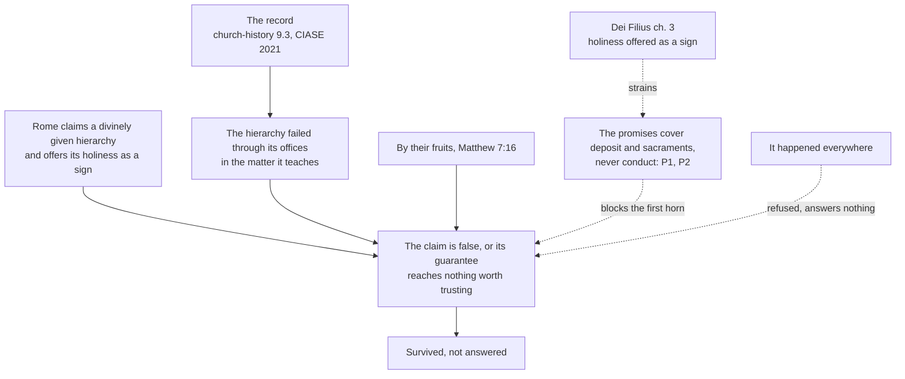

# Apologetics II · Lesson 7.3: The abuse crisis, and the argument from scandal

> ⏱ ~15 min · Module 7: The hard history · Builds on: [7.1](07-01-the-inquisition-and-the-galileo-affair.md), [7.2](07-02-the-reformations-grievances.md), [`church-history` 9.3](../../church-history/lessons/09-03-after-the-council.md), [`ecclesiology-and-mariology` 5.4](../../ecclesiology-and-mariology/lessons/05-04-a-church-of-sinners.md) · Unlocks: Boss problem 7, the capstone ([syllabus](../syllabus.md))

## Why this matters

Every other lesson here argued about texts; this one argues about what bishops did. For decades, in many countries, bishops who knew that priests had abused children moved them, settled quietly and kept the police out, and the facts came out through journalists, grand juries and commissions, not the Church's own processes ([`church-history` 9.3](../../church-history/lessons/09-03-after-the-council.md)). For many it is the first and last argument against the Catholic claim, and the syllabus says in advance that the Catholic case does not win it.

## The idea

Picture a hospital whose royal charter says its medicines are genuine and that it will last as long as the kingdom. For years its governors hid surgeons who harmed children, while it advertised its care as proof of the charter. The cover-up does not show the medicines fake. It shows the governors untrustworthy, and it ruins the advertisement. The [argument from scandal](../reference.md#argument-from-scandal) works on all three levels at once, and an honest reply must say which it can defend.

The record of the [abuse crisis](../reference.md#abuse-crisis) is [`church-history` 9.3](../../church-history/lessons/09-03-after-the-council.md)'s, taken as given. Add one official report. France's independent commission (CIASE), set up at the French bishops' and religious conferences' request, reported on 5 October 2021. It estimated that some 216,000 people living in France (95 percent interval 165,000–270,000) had been sexually abused as minors by clergy and religious since 1950, put the abusers at no fewer than 2,900–3,200 (about 3 percent of clergy and religious), and found that for a very long time the Church's first reaction was to protect itself.

[`ecclesiology-and-mariology` 5.4](../../ecclesiology-and-mariology/lessons/05-04-a-church-of-sinners.md) has set out the four answers the tradition owns, from [indefectibility](../reference.md#indefectibility) to the [*corpus permixtum*](../reference.md#corpus-permixtum), and marked where each stops. This lesson takes them as given and argues from them.

## The other side

**What the argument is not.** It is not [Donatism](../reference.md#donatism), and stating it that way fails it. The [Augsburg Confession](../reference.md#augsburg-confession) VIII (1530; Triglot) allows the use of sacraments administered by evil men and condemns the Donatists. [Article XXVI](../reference.md#article-xxvi) of the [Thirty-Nine Articles](../reference.md#thirty-nine-articles) opens (the English of 1571 in Schaff, spelling modernized):

> Although in the visible Church the evil be ever mingled with the good, and sometime the evil have chief authority in the ministration of the word and Sacraments…

[Calvin](../reference.md#calvin-institutes) calls the offence at a church's poor fruit "well founded" and still refuses to conclude that no church exists there (*Institutes* IV.1.13, Beveridge).

**What it is.** The Reformed form starts from the [marks of the Church](../reference.md#marks-of-the-church). The [Belgic Confession](../reference.md#belgic-confession) art. 29 (1561; revised at Dort, 1619; Schaff's English) adds to pure preaching and pure sacraments a third mark: "if church discipline is exercised in punishing of sin". [Westminster](../reference.md#westminster-confession) XXX.3 makes censures necessary "for vindicating the honor of Christ". Article XXVI closes with the duty the bishops failed ([discipline as a mark](../reference.md#discipline-as-a-mark)):

> Nevertheless, it appertaineth to the discipline of the Church, that inquiry be made of evil ministers, and that they be accused by those that have knowledge of their offences: and finally, being found guilty by just judgment, be deposed.

Aimed at Rome, it runs in four steps. (1) Rome claims more than any Reformation church: bishops who succeed the apostles and teach faith and morals with Christ's authority (*Lumen Gentium* 25, paraphrased), and a Church whose "eminent holiness" is "a great and perpetual motive of credibility" (*Dei Filius* ch. 3, Schaff). (2) The crisis was that hierarchy's failure, through its offices, in the moral matter it teaches most confidently, across countries and decades, corrected chiefly from outside: a failed mark, not a few bad ministers. (3) "By their fruits you shall know them" (Matthew 7:16, Douay–Rheims). (4) So either the claim to a divinely guided teaching office is false, or its guarantee never reaches the office's conduct, and then it gives no reason to prefer Rome to a church that confesses it can err (Article XXI; Westminster XXV.5). Its claim to teaching authority is discredited by its exercise of authority.

The argument needs no clean Reformed record: its premise is Rome's claim, which the Reformed never made. **Weight:** Belgic, a doctrinal standard of the continental Reformed churches; Westminster, the Presbyterian subordinate standard; the Articles, Anglican formularies whose subscription varies; Augsburg, a Lutheran confession, *norma normata* under scripture; the *Institutes*, a theologian's book. The four steps are this lesson's reconstruction from their clauses, no confession's article.

## The argument

**First, the answer refused.** The [comparative move](../reference.md#comparative-move), "it happened everywhere", is the single worst answer available, and this course refuses it outright. True, abuse is documented in families, schools, sports and other churches. As a comparison of rates it is unestablished almost everywhere ([`church-history` 9.3](../../church-history/lessons/09-03-after-the-council.md): no comparable data). Where a general-population survey did compare settings, in France, more adults had been abused as children by people connected with the Church (1.16 percent; 0.82 by clergy and religious) than in any setting outside family and friends (state schools 0.34, sports clubs 0.28). Grant the move anyway: it is irrelevant, since the argument's premise is Rome's claim, which no club made. And it is a moral failure, ranking the institution before the children, the ordering the CIASE condemned. Francis's closing address to the February 2019 meeting cited worldwide data, then said the evil is "in no way less monstrous" inside the Church.

**P1.** As defined, the Church claims that Christ gave her the deposit of faith, the sacraments and the apostolic ministry, that she will last to the end holding them, and that under stated conditions her definitions cannot err (*Pastor Aeternus* chs. 2 and 4; [7.1](07-01-the-inquisition-and-the-galileo-affair.md)). *In words:* the promises attach to what she is given and hands on.

**P2.** No act claims that anyone in her cannot sin. Trent defines that no justified person avoids all sin through life without a special privilege (Session VI, can. 23, Waterworth), and that a minister in mortal sin still confers the sacrament (Session VII, can. 12). *In words:* every party here holds that wicked men can hold office in a true church.

**P3.** The holiness *Dei Filius* offers as a sign is the Church's, given by Christ and read off her whole history through her members' failures ([`fundamental-theology` 2.2](../../fundamental-theology/lessons/02-02-credibility-and-the-preambles-of-faith.md), Ex 2). *In words:* the sign was never "our bishops are good men".

**P4.** The record shows grave sin committed through the offices for decades, but no definition made in error and no sacrament voided; the teaching the bishops broke was the Church's own. *In words:* the failure lies outside what P1 promises.

**∴ C.** The argument from scandal does not refute the Catholic claim as defined. It refutes any version that promised good governance, and it counts as real evidence against one motive of credibility the Church herself offered.

**Mark the levels.** ([the ladder](../../fundamental-theology/lessons/04-04-the-ladder-of-doctrinal-authority.md); [levels of authority](../reference.md#levels-of-authority).) The Church's holiness: **rung 1** (the Creed). Indefectibility in E&M 5.4's sense: **at least rung 3**, presupposed by rung-1 acts, defined as a thesis by none. Trent VI can. 23 and VII can. 12: **rung 1** as worded. [Infallibility](../reference.md#infallibility) under its conditions: **rung 1** (*Pastor Aeternus* ch. 4). *Dei Filius* ch. 3 on the Church as a [motive of credibility](../reference.md#motive-of-credibility) stands in a chapter no canon repeats: **at least rung 3**; its canon 3 (revelation can be made credible by outward signs) is **rung 1**. The *Letter to the People of God* (20 August 2018) carries what it restates; its judgment on [clericalism](../reference.md#clericalism) is pastoral, and it does not call clericalism the root: clericalism splits the ecclesial body in a way that "supports and helps to perpetuate many of the evils". The structures are acts, not arguments: the Pontifical Commission for the Protection of Minors (2014), the February 2019 meeting, and three acts of **law, no doctrinal rung**, [*Vos estis lux mundi*](../reference.md#vos-estis-lux-mundi) (7 May 2019; definitive 25 March 2023), obliging clerics and religious to report abuse and cover-up; a rescript of 6 December 2019 lifting the pontifical secret from these cases; the revised Book VI (*Pascite gregem Dei*, 2021), placing the offence among offences against human life, dignity and freedom (can. 1398).

**Concession.** On this question the Catholic case does not win. For decades the Church's bishops failed the standard of discipline that Article XXVI and the Belgic Confession state, and outsiders brought the facts out. The sign Vatican I offered has been visibly damaged by the Church's own governors. The argument from scandal is not answered; it is survived. If the Church's claim is true, it is true of a Church that did this.

**The crux.** Is the Church's claim about her holiness of conduct, or about the deposit and sacraments she is given, and can that distinction survive this case? The Catholic holds that the promises never covered governance (P1–P2). The critic presses *Dei Filius* ch. 3: a Church that offered her holiness as a sign cannot retreat to the deposit when the sign fails. The Catholic would be moved by evidence that the failure reached what the promises cover, such as a definition bent to shield the institution. The critic would be moved by a showing that the sign was always the whole across centuries, which one era can weaken but not falsify.

## The argument map

The distinction blocks the inference to falsity; nothing on the map repairs the damage to the sign.

## Worked examples

**Example 1 (clean): the sacraments.** Invented: a Lutheran friend learns that the priest who baptized her Catholic cousin was later convicted of abusing a child, and asks whether the baptism was real. The argument from scandal says: wicked minister, so no sacrament. The distinction answers completely: Trent VII can. 12 (rung 1) holds the sacrament conferred, and her own Augsburg VIII agrees. It is no evasion here: the question concerns what Christ gives, which every party agrees the minister's sin cannot take away. Nothing about the crime is excused; she asked a different question.

**Example 2 (strain): trusting the teacher.** Invented: an inquirer who has read the Pennsylvania grand jury report says, "I'm not asking whether your sacraments work. Why should I take your bishops' word on marriage when they hid this?" The first move holds: the motive of faith is God's authority revealing, not the bishops' credibility ([`fundamental-theology` 2.2](../../fundamental-theology/lessons/02-02-credibility-and-the-preambles-of-faith.md)), and the teaching they broke was the Church's own. But he is not yet a believer. He is weighing motives of credibility, and the Church told him her holiness was one. His trust is reasonably lowered, and nothing in P1–P4 raises it. The distinction shows his reason is not a refutation; it cannot show it is not a reason. Here the Catholic argument stops determining an answer: the damage weighs as much as the weight he gave the sign.

## Watch out

- **You might think the argument from scandal is Donatism with a Protestant accent,** but Augsburg VIII condemns the Donatists and Calvin refuses to unchurch a church for its fruits (IV.1.13). Its targets are discipline (Belgic 29) and the size of Rome's claim.
- **You might think "it happened everywhere" is at least true,** but as a comparison of rates it is unestablished almost everywhere, and where France measured it the Church came out highest outside family and friends. A true comparison would still be irrelevant.
- **You might think indefectibility promises good governance, or is "only an opinion",** but it is at least rung 3 and silent on conduct. *Vos estis* is law, an act judged by what changes, not an argument for holiness.
- **You might think Francis called clericalism "the root" of abuse,** but the Letter says the split it causes "supports and helps to perpetuate" the evils.

## One-liner

> The argument from scandal cannot show the Church's deposit or sacraments false; it does show her governors failed and the sign she offered obscured, so the Catholic claim survives it without answering it.

## Problems

**P1 (🟢) *(Exegetical, strict.)*** Three claims are often run together under "the Church cannot fail":

(i) The Church will last to the end, holding the faith and the sacraments ([`ecclesiology-and-mariology` 5.4](../../ecclesiology-and-mariology/lessons/05-04-a-church-of-sinners.md)).

(ii) The whole body of the faithful cannot err in matters of belief (*Lumen Gentium* 12; [`fundamental-theology` 5.3](../../fundamental-theology/lessons/05-03-the-sensus-fidei.md)).

(iii) The Church, by her eminent holiness, is a motive of credibility (*Dei Filius* ch. 3).

For each, say what it claims, name one historical finding that would count against it, and say whether the abuse record is such a finding. Give the level for (i) and (ii). **Two or three sentences per item.**

**P2 (🟡) *(Diagnose · Exegetical.)*** A statement on the website of St Martin de Porres parish, Kelderby (invented, written for this problem; parish and town are fictional):

> "We share the grief of all who were harmed. But fairness requires context. Abuse happened everywhere, in families, schools, sports clubs and other churches, and studies show priests offended no more often than other men. The media singled out the Catholic Church because her moral teaching is unpopular. And since *Vos estis lux mundi* the Church has become the safest place in the world for a child, which shows that the Spirit never stopped guiding her."

Name **three** moves the statement makes. For each, say what is true in it, if anything, and why it fails as an answer to the argument from scandal. **150 words or fewer.**

**P3 (🔴, optional) *(Apologetic: (a) Exegetical, graded first · (b) reply.)*** (a) State the argument from scandal as a Reformed critic would make it from the Belgic Confession art. 29 and Westminster XXX.3, including what it does **not** claim. **Three or four sentences.**

(b) Reply, opening with a **named concession** and refusing the comparative move. **120 words or fewer.** A reply that concludes the objection succeeds passes if it is a good reply.

Solutions

**P1** *(Exegetical, strict)*

**Must hit, strict:**

- **(i)** The Church lasts until Christ returns, keeping the faith and the sacraments. **At least rung 3**: presupposed by rung-1 acts (the Creed; *Pastor Aeternus* ch. 2), defined as a thesis by none. Against it would count the Church's disappearance, or the loss of the faith or of valid sacraments everywhere. The abuse record is **not** such a finding: creed and sacraments were kept throughout.
- **(ii)** Indefectibility *in credendo*: when the whole people, bishops to laity, agrees in a matter of faith and morals, it cannot be wrong. **At least rung 3**: *Lumen Gentium* 12 restates it and defines nothing. Against it would count a universal agreement in a matter of belief that the Church later had to reverse. The record is **not** one: concealment was a practice of governors, never a belief proposed to and held by the whole Church, whose law and moral teaching condemned the crime.
- **(iii)** Not indefectibility at all: the Church's visible holiness, read across her history, is a public sign that makes her divine mission credible. Against it counts evidence that her holiness is not visible, and the record **is** such evidence. It weakens the sign without by itself falsifying the claim, since the sign is read off the whole history.

**Wrong turns:** **rung 1** for (i) or (ii), which cites a definition no act makes; reading (ii) as the bishops' infallibility *in docendo*, when it belongs to the whole body (credit noting, with `fundamental-theology` 5.3, that the property belongs to the whole body and to no single rank); saying the record falsifies (i); saying the record has no bearing on (iii), which is the evasion this lesson exists to prevent; calling (iii) a form of indefectibility.

**Model answer:** (i) The Church will last to the end with faith and sacraments; at least rung 3, presupposed by rung-1 acts but never defined as a thesis. Only her disappearance, or a universal loss of faith or sacraments, would count against it, and the record shows neither. (ii) The whole people cannot err when it agrees in a matter of faith; at least rung 3 (LG 12 restates it). A universal consensus of belief later reversed would count against it; concealment was the practice of governors, not a belief of the whole Church. (iii) This is a sign, not a guarantee: visible holiness makes the Church's mission credible. Evidence of visible unholiness counts against it, and the record is such evidence. It weakens the sign without refuting the claim.

---

**P2** *(Diagnose · Exegetical)*

**Accept:** any three of the four below.

**Must hit, strict:**

- **The comparative move** ("happened everywhere", "no more often than other men"). True: abuse is documented in families, schools, sports and other churches. But "no more often" is a comparison of rates no study establishes for most countries (no comparable data, `church-history` 9.3). Where France measured it (CIASE 2021), the Church's prevalence was the highest of any setting outside family and friends. And it is irrelevant, because the argument is about Rome's claim, and morally it ranks the institution before the victims. Credit noting that the CIASE's "just under 4 percent of all child sexual abuse in France" is a *share*, not a rate, and answers nothing either.
- **The motive of the messenger** ("the media singled out"). This is the genetic fallacy: a reporter's motive does not touch the facts. The record rests on grand juries, statutory commissions and studies the Church itself commissioned (John Jay by the US bishops; the CIASE at the request of the French bishops' and religious conferences).
- **A structure used as an argument** ("since *Vos estis* … shows that the Spirit never stopped guiding her"). *Vos estis* is law, no doctrinal rung: an act judged by what changes. "Safest place in the world" is another unestablished comparison, and the CIASE judged the measures taken since 2000 often late and unequally applied. Using a reform as evidence of the holiness the record called in question turns an act into an apologetic, and indefectibility never promised governance anyway.
- **The concession with a "but"** ("We share the grief … But fairness requires context"). The grief is acknowledged in order to be qualified, the reverse of a flat concession.

**Wrong turns:** "correcting" the statement by asserting that the Church's rates were *higher* everywhere, which is the comparative move run backwards and just as unestablished outside France; treating *Vos estis* as doctrine; calling the parish's grief insincere, which no text supports.

**Model answer:** First, the comparative move. Abuse is documented in families, schools and other churches, but "no more often than other men" is a comparison no study establishes for most countries. In France, where a general survey did measure it, the Church came out highest outside family and friends. In any case it is irrelevant, since the argument targets Rome's claim, and it puts the institution before the victims. Second, the media's motive. That is a genetic fallacy: the record comes from grand juries and from commissions the Church itself requested. Third, *Vos estis* as proof of guidance. It is law, an act to be judged by results; "safest place" is another unestablished comparison, and a reform is not evidence of the holiness the record called in question.

---

**P3** *(Apologetic: (a) Exegetical, graded first · (b) reply)*

**Accept:** any reply that opens with a real concession, refuses the comparative move with a reason, and separates what the promises cover from conduct, whatever its verdict.

**Must hit, strict (a), graded first:**

- **Not Donatism.** The Reformed critic does not argue that wicked ministers unchurch a church. Belgic 29 itself says hypocrites are mixed with the good in the Church, and Calvin refuses to deny a church its title for poor fruit (IV.1.13).
- **The marks.** Belgic 29 makes discipline "exercised in punishing of sin" a mark of the true Church. Westminster XXX.3 makes censures necessary for vindicating Christ's honour and the gospel's profession.
- **Aimed at Rome's larger claim.** Rome claims bishops who succeed the apostles and teach morals with Christ's authority, and a holiness offered as a sign of divine mission. Its hierarchy failed the mark through its offices for decades. So its claim is false, or guarantees nothing a Christian needs, and gives no reason to prefer it to a church that confesses it can err.
- **Weight.** Belgic and Westminster are confessional standards of Reformed churches, not a magisterium; the argument is built from their clauses and is no article of either.

**Must hit (b):**

- **A named concession:** this was a failure of discipline, the very mark the critic's confession names, carried out through the offices Rome calls divinely instituted, and the Church did offer her holiness as a sign.
- **The comparative move refused, with a reason:** unestablished as a comparison and beside his point, which is Rome's claim.
- **The distinction:** the promises as defined concern the deposit and the sacraments, not governors' conduct. Trent VI can. 23 (rung 1) denies anyone's lifelong sinlessness, and the record shows no definition or sacrament touched. Give a level.
- **The residue:** the sign is damaged, and the claim survives without being answered.

**Wrong turns:** stating (a) as "a church with wicked priests is no church", the caricature, which fails the problem; making (a) depend on Reformed churches having cleaner records, which it does not need; calling the Belgic Confession Lutheran, or treating Calvin's *Institutes* as the Reformed confession; in (b), any form of "others did it too"; "the gates of hell" offered as the whole answer; *Vos estis* offered as proof of holiness; claiming the objection is refuted.

**Model answer (a):** The Reformed critic does not say wicked ministers unchurch a church; Belgic 29 grants that hypocrites are mixed in it, and Calvin refuses that inference. He argues from the marks: Belgic 29 makes discipline in punishing sin a mark of the true Church, and Westminster XXX.3 makes censures necessary for Christ's honour. Rome claims more than any Reformed church, namely bishops teaching morals with Christ's authority and a holiness offered as a sign of her mission, and her hierarchy failed that mark through its offices for decades. So her claim is false, or its guarantee is worth nothing to a Christian, and it gives no reason to prefer her to a church that confesses it can err.

**Model answer (b), one of several:** Concession: this was a failure of the very mark your confession names, carried out through offices Rome calls divine, and the Church did offer her holiness as a sign. I will not answer that others did it too; that is unestablished, and it is beside your point, which is Rome's claim. My reply is narrower. What Rome claims as defined concerns the deposit and the sacraments, not governors' conduct: Trent VI can. 23 (rung 1) denies anyone a sinless life, and the record shows no definition or sacrament touched. So the argument does not show the claim false. It does show the sign damaged, and I concede that. The claim survives, unanswered on this point.

## Flashback

**From Lesson [7.1](07-01-the-inquisition-and-the-galileo-affair.md) (The Inquisition and the Galileo affair):** *(Apologetic: (a) Exegetical, graded first · (b) reply.)* At an invented ecumenical study evening (nobody here is real), a Catholic speaker says the Spirit keeps the Church from error. An Orthodox listener answers from the Ecumenical Patriarchate's [encyclical of August 1895](../reference.md#patriarchal-encyclical-of-1895), its reply to Leo XIII.

(a) State the encyclical's position as it gives it (§§XVIII–XIX): what it says of infallibility, whom it cites, what it still affirms of the Orthodox churches, and the text's weight. **Two or three sentences.**

(b) Reply, opening with a **named concession**, and say what a Catholic must name in advance if the answer is not to be a [retreat](../reference.md#retreat-objection). **120 words or fewer.** A reply concluding that the encyclical's argument succeeds passes if it is a good reply.

Solution

**Accept:** any reply that keeps a real concession and names what would refute its claim, whatever its verdict.

**Must hit, strict (a), graded first:**

- **The claim.** Apart from Christ, the Orthodox Church "knows no one that was infallible upon earth" (§XVIII, Metallinos, 1896). It cites popes it says erred (Liberius, Zosimus, Vigilius, Honorius); Honorius, condemned by an ecumenical council, is enough.
- **The guarantee kept.** The Orthodox churches are "the pillar and ground of the truth" and "remain, and will always remain, faithful" (§XIX). The guarantee is relocated, not abolished.
- **Weight.** The Ecumenical Patriarchate's official synodal statement (Anthimos VII and his Synod): no definition binding all Orthodoxy, and no Catholic level.

**Must hit (b):**

- **A named concession,** flat: popes have erred, and an ecumenical council anathematized Honorius, a pope confirming it.
- **The distinction.** [Infallibility](../reference.md#infallibility) attaches to a definition under [*Pastor Aeternus*](../reference.md#pastor-aeternus) ch. 4's conditions (**rung 1**), not to a person, and none of the cited cases is shown to be one (Honorius: [`ecclesiology-and-mariology` 4.4](../../ecclesiology-and-mariology/lessons/04-04-infallibility-in-exercise-and-the-ordinary-universal-magisterium.md)).
- **Where the dispute sits.** Both keep a guarantee; they differ on whether a defining act of the Roman see can carry it.
- **No retreat.** Name now what would refute the claim: a definition meeting ch. 4's conditions, shown false.

**Wrong turns:** "the Orthodox say the Church can err", the caricature that fails the problem; the encyclical as "the Orthodox position" or "one bishop's opinion". In (b): denying Honorius's condemnation; "Vatican I defined that popes do not err"; the inquisitions' moral record, which this charge does not concern.

**Model answer (a):** Apart from Christ, the encyclical says, the Orthodox Church knows no one infallible on earth, and it cites erring popes, Honorius among them. Yet it calls the Orthodox churches "the pillar and ground of the truth", faithful always. It is the Ecumenical Patriarchate's official synodal statement, binding no other church by definition.

**Model answer (b), one of several:** Concession: popes have erred, and an ecumenical council condemned Honorius with Rome's assent. Catholic doctrine claims not that a pope cannot err but that a definition under *Pastor Aeternus* ch. 4's conditions cannot, and none of these cases is shown to be one. The encyclical keeps a guarantee too, so we disagree about where it sits, not whether there is one. And I name what would refute my claim: a definition meeting those conditions, shown false.

## Connections

- **Backward:** the record is [`church-history` 9.3](../../church-history/lessons/09-03-after-the-council.md)'s, and the four answers with their limits are [`ecclesiology-and-mariology` 5.4](../../ecclesiology-and-mariology/lessons/05-04-a-church-of-sinners.md)'s; this lesson keeps that lesson's forward promise to argue the case from scandal on them. Augustine's mixed body is [`ecclesiology-and-mariology` 2.2](../../ecclesiology-and-mariology/lessons/02-02-holy.md) and his answer to the Donatists [`patristics` 4.4](../../patristics/lessons/04-04-augustine-against-the-donatists.md). The Church as a motive of credibility is [`fundamental-theology` 2.2](../../fundamental-theology/lessons/02-02-credibility-and-the-preambles-of-faith.md), which left arguing it against objectors to this course. Indefectibility against infallibility is [7.1](07-01-the-inquisition-and-the-galileo-affair.md); a corrupt Church that is still the Church is [7.2](07-02-the-reformations-grievances.md).
- **Forward:** Boss problem 7(d), the capstone ([syllabus](../syllabus.md)), asks whether the whole case survives this module and fails any answer that does not engage the abuse crisis on its own terms. The validity of a sinful minister's sacraments, used in Example 1, is [`sacraments-and-liturgy` 1.3](../../sacraments-and-liturgy/lessons/01-03-ex-opere-operato-character-and-fruitfulness.md).
- **Sideways:** "discredited by its exercise of authority" is a defeater for a testifier, in [`epistemology` 4.4](../../epistemology/lessons/04-04-testimony.md)'s terms; the Catholic reply that faith rests on God's authority rather than the bishops' is the reductionist–anti-reductionist dispute moved into theology. Whether a bishop's signed transfer was the Church's act is the authorization question of [`philosophy-of-debt` 6.3](../../philosophy-of-debt/lessons/06-03-whose-debt-is-it.md). Concealment as cooperation in another's sin is [`moral-theology` 3.5](../../moral-theology/lessons/03-05-social-sin-and-cooperation-in-the-sins-of-others.md).

## Closing the course

The course began on shared ground: the Creed, scripture, baptism and the moral law are common to every party here, and the argument was always about authority and interpretation ([1.1](01-01-shared-ground-and-where-the-argument-is.md)). It argued that *sola scriptura* cannot fix its own canon or settle its own reading without an authority it denies, conceding that material sufficiency is a legitimate Catholic option and that the canon was not defined under anathema before 1546. On justification it set Trent against the confessions clause by clause and found the crux in whether justifying righteousness can be both imputed and infused, conceding that the Reformation protected something late-medieval preaching obscured. It argued for a Petrine office from texts and history that do not by themselves reach it, conceding forgeries and a pope condemned by a council. It met the Orthodox on the filioque, primacy and the energies, conceding the manner of the addition and the absence of any condemnation of Palamas. It defended the distinctives each against the confession that attacks it, conceding each one's historical abuses first, and found development of doctrine underneath all of them. Module 7 conceded that the Church's tribunals condemned Galileo and sent heretics to their deaths, that most of the Reformers' disciplinary grievances were just, and that her bishops concealed the abuse of children. What the case still claims is narrow, that Christ's promises to his Church concern the deposit and the sacraments and have not failed; what it has conceded is nearly everything else, and an honest reader may judge that the concessions outweigh the claim.
