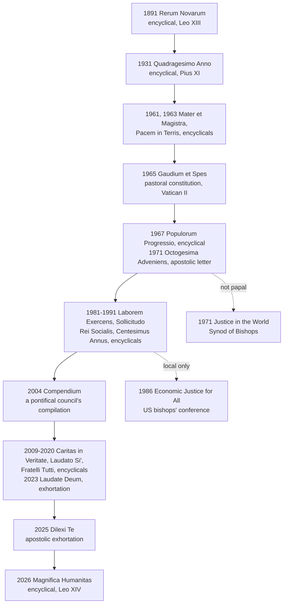

# Catholic Social Teaching · Lesson 1.1: The social doctrine: sources, genre and claim

> ⏱ ~15 min · Module 1: What the Church's social doctrine is · Builds on: [`moral-theology` 1.1](../../moral-theology/lessons/01-01-what-moral-theology-is.md), [`fundamental-theology` 4.5](../../fundamental-theology/lessons/04-05-reading-a-documents-weight.md) · Unlocks: [1.2](01-02-permanent-principles-and-contingent-applications.md)

## Why this matters

On 10 May 2025, Leo XIV told the cardinals why he chose his name. Leo XIII's *Rerum Novarum* had met the social question of the first industrial revolution, and the Church now offers her social teaching in answer to another one, and to artificial intelligence (paraphrased). Documents like his first encyclical, *Magnifica Humanitas* (2026), meet two stock reactions: "the pope has endorsed our economics" and "that's just the Vatican's politics." Both skip the prior questions. What is this body of teaching, what does it claim to know, and what does it say it does not know?

## The idea

Think of a building code. It binds every building: walls must bear their load, every floor needs an exit. It does not design your house. An inspector who draws floor plans has left his job. An architect who calls the code "the inspector's opinion" builds a fire trap.

The [Church's social doctrine](../reference.md#social-doctrine-of-the-church) describes itself in just these terms. It is moral teaching about life in society, binding in every economy and regime. It claims [competence in the moral order](../reference.md#competence-in-the-moral-order): what any arrangement owes the persons inside it. It [disclaims](../reference.md#the-doctrines-disclaimers) a blueprint: no technical solutions, no model, no "third way", no party. And it names the architects: lay Catholics, legislators and local communities.

The corpus is also a shelf of documents of different kinds. [`fundamental-theology` 4.5](../../fundamental-theology/lessons/04-05-reading-a-documents-weight.md) taught you to weigh a genre, and [`moral-theology` 1.1](../../moral-theology/lessons/01-01-what-moral-theology-is.md) taught what makes moral theology *theology*. This lesson uses both and re-teaches neither.

## Source

*Rerum Novarum* 16 (Leo XIII, 1891), in *The Great Encyclical Letters of Pope Leo XIII* (Benziger, New York, 1903), cited by the Vatican numbering. Leo turns from the socialist remedy to his own:

> We approach the subject with confidence, and in the exercise of the rights which manifestly appertain to us, for no practical solution of this question will be found apart from the intervention of Religion and of the Church. … Doubtless this most serious question demands the attention and the efforts of others besides ourselves—to wit, of the rulers of States, of employers of labor, of the wealthy, aye, of the working classes themselves, for whom We are pleading.

**"Rights which manifestly appertain to us"** claims competence: the pope speaks by right, not by invitation. **"Apart from"** makes the Church *necessary* to a solution, never *sufficient*. **"Others besides ourselves"** hands real work to rulers, employers and workers. Competence, a limit and a division of labour: the corpus's self-account is here in seed. [2.1](02-01-rerum-novarum.md) reads the passage inside the encyclical's argument.

## The teaching

**T1. What the corpus is.** It is the body of papal, conciliar and curial teaching on social questions, from [*Rerum Novarum*](../reference.md#rerum-novarum) (1891) to [*Magnifica Humanitas*](../reference.md#magnifica-humanitas) (MH, 2026). Its development began when the Gospel met industrial society (CCC 2421); its older roots are [1.4](01-04-before-1891-the-roots-and-the-social-question.md)'s. ["The social encyclicals"](../reference.md#the-social-encyclicals) is a scholars' convention, not a promulgated list. The documents themselves keep *Rerum Novarum*'s anniversaries: at 40 (*Quadragesimo Anno*, QA 15), 70 (*Mater et Magistra* 7), 80 (*Octogesima Adveniens*, OA 1), 90 (*Laborem Exercens*), 100 (*Centesimus Annus* 2) and 135 (MH 3). MH 29 credits Pius XII (1950) with the title "Social Doctrine of the Church", though Pius XI's Latin already has *doctrina socialis christiana* (QA 87). *In words:* the corpus is defined by subject and issuer, not by a canon.

**T2. What kind of knowledge it is.** It is not an ideology, and not a "third way" between liberal capitalism and Marxist collectivism. It is a category of its own, belonging to theology and particularly to moral theology, since it aims to guide conduct (*Sollicitudo Rei Socialis* 41, 1987; *Compendium* 72–73). MH 27 adds that it is not a handbook of norms awaiting application but shared discernment where the Gospel meets history's questions. *In words:* it is moral theology about social life, worked out alongside events.

**T3. Why the Church speaks.** Teaching it is part of her [evangelizing mission](../reference.md#social-doctrine-and-evangelization), because it draws out the Gospel's consequences for life in society (CA 5). CA 54 calls it an instrument of evangelization, and *Caritas in Veritate* 15 an essential element of it. *In words:* this is preaching, not a sideline in economics.

**T4. What it claims competence over.** The Church claims the freedom to teach her social doctrine and to pass moral judgment on public matters when persons' fundamental rights or the salvation of souls require it (*Gaudium et Spes* 76; CCC 2420). Its ground is her charge to interpret the whole moral law, natural law included (*Humanae Vitae* 4), which [`moral-theology` 1.3](../../moral-theology/lessons/01-03-natural-law-in-light-of-revelation.md) argues and levels. *In words:* the Church judges what arrangements do to persons, not how to run them.

**T5. What it disclaims.** It has no technical solutions to offer and does not claim to interfere in the politics of states (SRS 41; CiV 9). It has no models to present, since workable ones arise in history from those who face the problems (CA 43). It is bound to no political, economic or social system (GS 42, 76). It must not take on the political battle for a just society or replace the State (*Deus Caritas Est* 28), and it does not presume to settle scientific questions (*Laudato Si'* 188). *In words:* it says what any answer must respect, and declines to write the answer.

**T6. Who does the rest.** Secular duties belong properly, though not exclusively, to the laity. They should not imagine that their pastors have a concrete solution to every problem, or that this is their mission (GS 43). The direct duty to order society justly is the [lay faithful's](../reference.md#the-lay-mission-in-temporal-affairs) (DCE 29; CCC 2442). *In words:* bishops teach the principles, and lay Catholics build with them. The laity's state inside the Church is [`ecclesiology-and-mariology` 3.3](../../ecclesiology-and-mariology/lessons/03-03-the-laity-charisms-and-the-sensus-fidei.md)'s.

**T7. The [*Compendium of the Social Doctrine of the Church*](../reference.md#compendium-of-the-social-doctrine).** The Pontifical Council for Justice and Peace prepared it (Presentation dated 2 April 2004). **Part One** lays the foundations: God's plan, the Church's mission, the person and human rights, the principles (§§20–208). **Part Two** covers seven fields: family, work, economic life, the political community, the international community, the environment, peace (§§209–520). **Part Three** treats ecclesial action and the lay faithful (§§521–574), and a Conclusion looks to a civilization of love. It warns that it cites documents of differing authority, and it leaves local applications to bishops' conferences (§8). *In words:* it is a map of the corpus, not another layer of it.

**Mark the levels.** ([the ladder](../../fundamental-theology/lessons/04-04-the-ladder-of-doctrinal-authority.md); [levels of authority](../reference.md#levels-of-authority).)

- **T1** is description and convention: **no magisterial level**. MH 29's dating of the name is history, not faith or morals, so it stands on the evidence.
- **T2–T6: rung 3**, authentic ordinary magisterium, in encyclicals and a pastoral constitution (GS 43 sits in its doctrinal first part). The disclaimers recur from 1965 to 2015, across a council and three popes, and frequency raises the grade within rung 3 (*Lumen Gentium* 25). None is a definition. T4's competence over the natural law is **at least rung 3**, as `moral-theology` 1.3 fixes it.
- **T7:** the *Compendium* has **no magisterial level of its own**. It is a pontifical council's compilation without a papal approval formula, so each sentence keeps its source's weight, as [`theology-of-debt`'s card](../../theology-of-debt/reference.md) already has it.
- The 10 May 2025 address is **rung 3 at its lightest grade**, at most.

**Principle or application.** The corpus's self-descriptions (T2–T6), the disclaimers included, are **permanent principles about the corpus itself**, owed religious submission of mind and will. A document's reading of its own moment is different. MH 4's judgment that digitalization, AI and robotics are today's [*res novae*](../reference.md#res-novae) rests on [empirical premises](../reference.md#empirical-premise) and [prudential judgment](../reference.md#prudential-judgment). What each kind asks of you is [1.2](01-02-permanent-principles-and-contingent-applications.md)'s subject. Both [symmetrical errors](../reference.md#the-two-symmetrical-errors) threaten here. *Inflation* reads the disclaimers out and calls one document's analysis "the Catholic model". *Demotion* files the corpus under "politics". Leo XIV answered the second on 17 May 2025: "doctrine" here means a disciplined body of knowledge, not an opinion (paraphrased).

**Where it stops.** The self-account says what *kind* of thing the corpus is; sorting its sentences is 1.2's work. Models come from those who face the problems (CA 43). Local applications fall to bishops' conferences (*Compendium* 8), and the measure itself to the laity and those responsible for the common good (GS 43; DCE 29). And competence is not omnicompetence. GS 76 claims moral judgment *when rights or souls require it*, and LS 188 declines to settle science or replace politics.

## The timeline

Solid arrows trace the papal and conciliar spine; the dashed branches join the conversation without its weight.

## Worked examples

**Example 1 (clean): three documents, placed.**

- ***Octogesima Adveniens*** **(14 May 1971)** is an **apostolic letter** of Paul VI to Cardinal Maurice Roy, often miscalled an encyclical. It is the pope's act, rung 3 at most; read the operative sentence.
- **The *Compendium* (2004)** is a **compilation** by a pontifical council, with no level of its own. Follow its footnote to the source.
- ***Laudate Deum*** **(4 October 2023)** is an **apostolic exhortation** of Francis (so MH note 220). It is the pope's act, rung 3 in what it teaches, and much of it is application ([6.1](06-01-integral-ecology-laudato-si.md)).

Genre narrowed each search; the issuer fixed whose act it was.

**Example 2 (strain): the bishops and the interview.** The *Fernley Courier* (the whole case is invented) headlines "Pope contradicts bishops on pensions". The country's bishops' conference has judged, in a pastoral letter, that a bill raising the pension age to 68 is unjust to manual workers, whose working lives are shorter and harder. Suppose a pope, asked a week later in a newspaper interview about pensions in general, says that systems sometimes need reform so the young are not left paying for promises that cannot be kept.

- **The letter**, if adopted as *Apostolos Suos* 22 (1998) requires, teaches authentically in its territory, never as the universal magisterium ([`fundamental-theology` 4.5](../../fundamental-theology/lessons/04-05-reading-a-documents-weight.md)). The principles it restates, what justice owes an old worker and solidarity between generations, keep their universal weight. Its verdict on the bill is an application.
- **The interview** is not a teaching act of the kind the ladder grades, and it judged no bill.
- **The strain.** The texts do not clash in principle: both appeal to justice between generations. Neither can say whether 68 is right, which turns on empirical premises such as life expectancy by occupation and fiscal projections. By the corpus's own account the decision is the legislators' and citizens', chiefly lay Catholics. They must weigh the bishops' judgment seriously (1.2 says how) and may not cite the interview as a ruling. The headline inverted the weights.

## Watch out

- **You might think "no model" means the Church has nothing to say about economics.** That demotes a principle. The disclaimers sit beside a claimed competence (GS 76) and are rung-3 teaching themselves: the Church disclaims the blueprint, not the judgment. The mirror error, "the Church's model is X", contradicts CA 43 and SRS 41.
- **You might think every "social encyclical" is an encyclical.** OA is an apostolic letter and *Laudate Deum* an exhortation. *Justice in the World* (1971) is a synod's text published with a conditional papal approval, not a papal document at all.
- **You might think "the *Compendium* says so" fixes a level.** That overstates: its own §8 warns that it cites texts of differing authority.
- **You might think MH 29 makes "social doctrine" a 1950 coinage.** It dates the *title*; QA 87's Latin already has the words, and a historical aside carries no rung.

## One-liner

> The Church's social doctrine is moral theology about life in society: it judges what every arrangement owes to persons, refuses to draw the arrangement, and hands the drawing to those who must live in it.

## Problems

**P1 (🟢)** *(Exegetical)* Sort and weigh. For each document give its genre, issuer and year, say **whose act** it is, and give its default weight in a phrase. **One line each.**

1. *Quadragesimo Anno*
2. *Justice in the World*
3. *Libertatis Conscientia*
4. The *Compendium of the Social Doctrine of the Church*
5. *Dilexi Te*
6. *Economic Justice for All*

**P2 (🟡)** *(Exegetical)* Diagnose. An op-ed in the *Fernley Courier* by Edwyn Treadgold, **invented, written for this problem**; no real person said it:

> "Catholic social teaching is a third way between capitalism and socialism, and it comes with its own economic model: guild mutualism, in which every industry is run by a compulsory guild that sets its wages and prices. The encyclicals supply the blueprint and the bishops supply the technical solutions, so a Catholic legislator's only task is to enact them. Since the Church's teaching is a system of its own, no Catholic may back a party that has not adopted it."

Name **each** of the corpus's self-disclaimers the op-ed contradicts, with document and section, and say what the corpus says instead. **120 words or fewer.**

**P3 (🔴)** *(Exegetical)* Reconstruct. A column in the same paper by Rowena Pennick, **invented, written for this problem**; no real person said it:

> "Social doctrine is not doctrine at all. Doctrine concerns faith and morals, while wages, markets and borders are politics, where a pope knows no more than any columnist. Even the Vatican's own *Compendium* admits it is only a summary. So Catholics may ignore all of it."

(a) Reconstruct the column as P1, P2, … ∴ C. Mark each false premise and correct it from the corpus's self-description and from genre.

(b) Three sentences the column would file under "politics". For each, say whether it is a **principle**, an **application** or an **empirical premise**, give its level, and say what it asks of a Catholic.

(i) Teaching and spreading the social doctrine belongs to the Church's evangelizing mission (CA 5, paraphrased).

(ii) The main drivers of innovation are now private, often transnational, actors whose resources surpass those of many governments (MH 5, paraphrased).

(iii) Societies should develop measures of progress complementary to GDP (MH 159, paraphrased).

**150 words or fewer for (a) and (b) together.**

Solutions

**P1** *(Exegetical)*

**Must hit, strict:**

1. Encyclical, Pius XI, 15 May 1931 (*Rerum Novarum*'s 40th anniversary, QA 15). The **pope's** act: rung 3 by default.
2. Synodal document of the Synod of Bishops' second general assembly, 1971. The **synod's** act, not the pope's. A rescript of 30 November 1971 ordered it published, accepted its conclusions that agree with the norms in force, and reserved its proposals to the pope. **No magisterial level of its own**; at most rung 3 at the lightest grade for what it restates.
3. Doctrinal instruction of the Congregation for the Doctrine of the Faith, 22 March 1986. John Paul II approved it in an audience and ordered it published (ordinary approval), so it stays the **CDF's** act: rung 3 at a light grade, plus the weight of what it restates.
4. Compilation, Pontifical Council for Justice and Peace, 2004. A curial body's act with **no magisterial level of its own**: each sentence keeps its source's weight.
5. Apostolic exhortation, signed 4 October 2025. Begun by Francis but **Leo XIV's** act: he makes it his own and issues it (*Dilexi Te* 3). Rung 3 in what it teaches, mostly restating.
6. Pastoral letter of the US bishops' conference, 1986. The **conference's** act: authentic teaching for its territory, never universal magisterium. How its own judgments weigh is 1.2's question.

**Wrong turns:** calling (2) "Paul VI's document" or (3) "the pope's instruction". Giving (4) a rung. Making (5) Francis's. Treating (6) as binding the universal Church, or as weightless.

**Model answer:** as above, one line each.

---

**P2** *(Exegetical)*

**Must hit, strict:**

- **"Third way"** contradicts SRS 41: the social doctrine is not a third way between liberal capitalism and Marxist collectivism but a category of its own, belonging to moral theology.
- **"Its own economic model", "blueprint"** contradict CA 43 (the Church has no models to present; they arise in history from those who face the problems) and GS 42 and 76 (bound to no economic or political system).
- **"The bishops supply the technical solutions"** contradicts SRS 41 and CiV 9 (no technical solutions to offer), and GS 43 (pastors do not have a concrete answer to every problem, nor is that their mission).
- **"A legislator's only task is to enact"** contradicts GS 43 and DCE 29: shaping a just order is the laity's own task, done with their own competence.
- **"No Catholic may back a party"** contradicts GS 76: the Church is bound to no political system and is identified with no political community.

**Wrong turns:** "correcting" the op-ed by saying the Church has nothing to say about economics, which demotes what T4 and T5 teach. Calling the disclaimers mere modesty. Missing the bishops sentence, which contradicts two texts at once.

**Model answer:** The op-ed contradicts five disclaimers. SRS 41 denies that the social doctrine is a third way between liberal capitalism and Marxist collectivism; it is a category of its own, within moral theology. CA 43 says the Church has no models to present, and GS 42 and 76 bind her to no system or party. SRS 41 and CiV 9 deny that she has technical solutions, and GS 43 says pastors lack ready solutions to every problem and that providing them is not their mission. Finally, GS 43 and DCE 29 give the concrete ordering of society to the laity's own competence, so a legislator does more than enact. What the corpus offers instead is moral principles and judgment.

---

**P3** *(Exegetical)*

**Must hit, strict (a):**

- A faithful reconstruction. **P1** The Church's doctrine concerns faith and morals. **P2** Wages, markets and borders are politics, not morals. **P3** On politics a pope has no special competence. **P4** The *Compendium* is only a summary. **∴ C** Catholics may ignore all of social doctrine.
- **P2 is false.** The social doctrine belongs to moral theology (SRS 41), and the Church claims moral judgment on public matters when persons' rights or souls are at stake (GS 76; CCC 2420).
- **P3 is half-true.** The corpus itself disclaims technical competence (CiV 9), but not moral competence (T4).
- **P4 misreads genre.** A compilation carries the weight of what it summarizes, which is encyclicals and a council (*Compendium* 8), not nothing.

**Must hit, strict (b):**

- (i) **Principle**, rung 3 (an encyclical, restated in CA 54 and CiV 15): owed religious submission.
- (ii) **Empirical premise**, no rung: it stands or falls with the evidence.
- (iii) **Application**, in a rung-3 document: owed serious, respectful consideration; one may weigh it and disagree without dissenting.

**Wrong turns:** accepting P3 whole or denying it whole. Giving (ii) or (iii) the encyclical's rung (inflation). Concluding from (ii) and (iii) that "all of it" may be ignored (demotion).

**Model answer:** (a) P1 doctrine concerns faith and morals; P2 wages and markets are politics, not morals; P3 a pope has no expertise there; P4 the *Compendium* is a mere summary; ∴ ignore it all. P2 is false: social doctrine is moral theology (SRS 41), and GS 76 claims moral judgment when rights or souls require it. P3 confuses technical expertise, which the corpus disclaims (CiV 9), with moral competence, which it claims. P4 misreads genre: a summary carries its sources' weight. (b) (i) is a principle, rung 3, owed religious submission; (ii) is an empirical premise with no rung, settled by evidence; (iii) is an application, owed serious consideration, open to reasoned disagreement.

## Connections

- **Backward:** [`moral-theology` 1.1](../../moral-theology/lessons/01-01-what-moral-theology-is.md) says what makes moral theology theology, and SRS 41 places the social doctrine inside it. [`moral-theology` 1.3](../../moral-theology/lessons/01-03-natural-law-in-light-of-revelation.md) grounds the Church's competence over the natural law. [`fundamental-theology` 4.4](../../fundamental-theology/lessons/04-04-the-ladder-of-doctrinal-authority.md) and [4.5](../../fundamental-theology/lessons/04-05-reading-a-documents-weight.md) supply the ladder and the genres. [`church-history` 8.3](../../church-history/lessons/08-03-leo-xiii-and-the-modernist-crisis.md) tells *Rerum Novarum*'s story as an event.
- **Forward:** [1.2](01-02-permanent-principles-and-contingent-applications.md) sorts principle from application and gives the assent each asks, including GS 43 on Catholics who disagree. [1.3](01-03-see-judge-act.md) shows how the documents read their times. [1.4](01-04-before-1891-the-roots-and-the-social-question.md) gives the roots before 1891. [2.1](02-01-rerum-novarum.md) reads §16 inside the encyclical, and [4.5](04-05-the-new-things-of-our-time-magnifica-humanitas.md) reads *Magnifica Humanitas*.
- **Sideways:** [`ecclesiology-and-mariology` 3.3](../../ecclesiology-and-mariology/lessons/03-03-the-laity-charisms-and-the-sensus-fidei.md) owns the laity's state inside the Church and cedes their temporal mission here. [`trinity-and-god` 6.4](../../trinity-and-god/lessons/06-04-social-trinitarianism-and-its-critics.md) notes that no council inferred a politics from the Trinity: the social doctrine argues on its own grounds. [`theology-of-debt` 6.1](../../theology-of-debt/lessons/06-01-usury-and-finance-in-modern-teaching.md) is a worked model of reading modern documents' weight, and agrees that the *Compendium* weighs what its sources weigh. [`political-philosophy` 4.3](../../political-philosophy/lessons/04-03-perfectionism-and-the-common-good.md) and [6.4](../../political-philosophy/lessons/06-04-welfare-property-and-subsidiarity.md) present this tradition as one position among the secular theories and cite this course for what it teaches.
