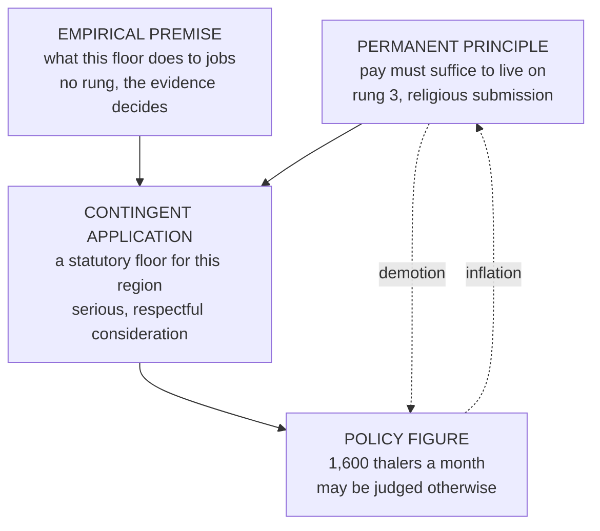

# Catholic Social Teaching · Lesson 1.2: Permanent principles and contingent applications

> ⏱ ~15 min · Module 1: What the Church's social doctrine is · Builds on: [1.1](01-01-the-social-doctrine-sources-genre-and-claim.md), [`fundamental-theology` 4.4](../../fundamental-theology/lessons/04-04-the-ladder-of-doctrinal-authority.md) · Unlocks: [1.3](01-03-see-judge-act.md)

## Why this matters

A parish bulletin quotes an encyclical to prove that Catholics must back a tax reform. A week later a column quotes its disclaimers to prove that nothing in it binds. Both misread real sentences, in opposite directions, and the documents drew the line between them themselves. Here is that line, and the question to put to every sentence from now on: **is this the principle or its application, and at what level?**

## The idea

Think of medicine. One rule binds every physician: heal, never harm. The dose depends on what the drug does in bodies like this patient's, a question for the evidence, and on a judgment made at the bedside. A doctor who prescribes another dose has not rejected medicine. One who calls healing "one view of medicine" has. A pharmacist selling one dose as "what medicine says" overclaims.

Social doctrine has the same three layers ([principle and application](../reference.md#principle-and-application)):

- A **permanent principle** holds whatever the facts: a worker's pay must be enough to live on.
- An **[empirical premise](../reference.md#empirical-premise)** says how the world is: what a wage floor does to jobs in one region.
- A **contingent application** joins the two in a [prudential judgment](../reference.md#prudential-judgment) about here and now: this floor, this bill.

The [two symmetrical errors](../reference.md#the-two-symmetrical-errors) mirror each other: **inflation** makes an application a principle ("the Church teaches this figure"), and **demotion** makes a principle a preference ("the living wage is one opinion"). [`fundamental-theology` 4.4](../../fundamental-theology/lessons/04-04-the-ladder-of-doctrinal-authority.md) graded teaching acts; this lesson adds the second axis and the assent each kind of claim asks.

## Source

*Rerum Novarum* 45 (Leo XIII, 1891), in *The Great Encyclical Letters of Pope Leo XIII* (Benziger, New York, 1903), cited by the Vatican numbering. Leo has just ruled that natural justice, not free agreement, sets a wage's floor: pay must support a frugal and well-behaved worker. Then he turns:

> In these and similar questions, however—such as, for example, the hours of labor in different trades, the sanitary precautions to be observed in factories and workshops, etc.—in order to supersede undue interference on the part of the State, especially as circumstances, times, and localities differ so widely, it is advisable that recourse be had to societies or boards such as We shall mention presently, or to some other mode of safeguarding the interests of the wage-earners; the State being appealed to, should circumstances require, for its sanction and protection.

The shape is *principle, then "however"*. The principle carries no number, and the particulars go elsewhere because **"circumstances, times, and localities differ so widely."** **"Advisable"** is the verb of counsel, not doctrine, and even the remedy has an alternative built in ("or ... some other mode"). The principle binds everywhere; the settlement is local. [2.1](02-01-rerum-novarum.md) reads it in context.

## The teaching

**T1. Principles and analysis differ.** *Centesimus Annus* 3 (1991) says Leo XIII's principles belong to the Church's doctrinal patrimony and engage her teaching authority, while the encyclical's analysis of recent events passes no definitive judgment, since that does not fall per se within the Magisterium's domain. The first note of *Gaudium et Spes* says its second part mixes elements of permanent value with transitory ones. *In words:* not every sentence weighs the same, and the documents say so.

**T2. Weight follows distance from circumstance.** The [*Compendium*](../reference.md#compendium-of-the-social-doctrine) (80): social doctrine, as moral teaching, shares that teaching's authority, and each teaching's weight and the assent it asks depend on its nature, its independence from contingent and variable elements, and how often it is invoked. *In words:* the less a claim leans on the facts of the day, the more it binds.

**T3. Applications can be corrected, but loyalty is the rule.** *Donum Veritatis* 24 (CDF, 1990): some interventions mix solid principles with contingent and conjectural elements, and often only time sorts the necessary from the contingent. A loyal willingness to submit remains the rule. Prudential documents may have deficiencies, but the Magisterium is not habitually mistaken in its prudential judgments. *In words:* expect refinement; start from trust.

**T4. Applications are argued, and no one may brand his own as the Church's.** *Gaudium et Spes* 43: the faithful may disagree "with equal sincerity" on a concrete solution, and no one may appropriate the Church's authority for his own opinion. *Octogesima Adveniens* 4 (1971): one universally valid message is neither the pope's ambition nor his mission; local communities discern. *Evangelii Gaudium* 182 (2013) adds the other edge: teachings on contingent situations are open to discussion, yet the Church must be concrete, or the principles stay generalities. *In words:* principles bind, applications are argued, and refusing to apply is its own failure.

**T5. Conferences mark their own levels.** *The Challenge of Peace* (US bishops, 3 May 1983) §§9–10 sorts its statements into universally binding principles (non-combatant immunity, proportionality), restated papal and conciliar teaching, and applications that people of good will may read differently ("no first use"), which are "not binding in conscience" but owed "serious attention and consideration". *Economic Justice for All* (1986) §§134–135: a prudential judgment is only as sound as its principles **and** its information. Under *Apostolos Suos* (1998; §22 and norms art. 1), a conference's doctrinal declaration is authentic teaching in its territory only if unanimous, or two-thirds with Rome's *recognitio*; never universal. *In words:* a [conference](../reference.md#bishops-conference-teaching) can restate a principle at its own weight, but cannot make its policy everyone's.

**T6. Fixed truths, discerned applications.** *Magnifica Humanitas* (Leo XIV, 2026) says social doctrine holds a "core set of unchanging truths" and names [five principles](../reference.md#the-five-principles) to be held together: the common good, the universal destination of goods, subsidiarity, solidarity and social justice (§46). It also calls the doctrine "not a handbook" of principles to be applied, but shared discernment (§27). *In words:* the principles stand, and applying them is discernment, not deduction. The encyclical holds both sentences and does not weigh them for a hard case.

**Mark the levels.** ([The ladder](../../fundamental-theology/lessons/04-04-the-ladder-of-doctrinal-authority.md); [levels of authority](../reference.md#levels-of-authority).)

- **T1:** an encyclical (1 May 1991) and a pastoral constitution's own note (7 December 1965): **rung 3**.
- **T2:** the *Compendium* (Pontifical Council for Justice and Peace, 2004) has **no magisterial level of its own**; its rule applies LG 25's three signs ([`fundamental-theology` 4.3](../../fundamental-theology/lessons/04-03-religious-submission.md)): **rung 3**.
- **T3:** a CDF doctrinal instruction approved in ordinary form (24 May 1990): **rung 3 at a light grade**, plus LG 25's weight.
- **T4:** GS 43 (doctrinal first part), OA 4 (apostolic letter, 14 May 1971), EG 182 (apostolic exhortation, 24 November 2013): **rung 3**, the conciliar text heaviest.
- **T5:** the 1983 and 1986 letters are **particular** teaching from before 1998. Restated universal principles keep their weight; the applications, by the letters' own words, bind no one's assent. *Apostolos Suos* (apostolic letter *motu proprio*, 21 May 1998): its account **rung 3**, its norms **law**.
- **T6:** an encyclical (signed 15 May 2026): **rung 3**. How §27 and §46 weigh in a hard case is **freely disputed (rung 5)**.

Nothing here is defined.

**Principle or application.** T1–T6 are themselves principles, about the corpus. Across other sentences the sort yields three kinds, with [three assents](../reference.md#the-three-assents). A document's rung belongs to the document. **Religious submission of mind and will** attaches to its **permanent principles**, graded by genre, frequency and manner (LG 25); a few restate truths taught at a higher level, such as that innocent life may never be directly taken ([`moral-theology` 5.1](../../moral-theology/lessons/05-01-the-inviolability-of-innocent-life.md)). Its **contingent applications** (figures, institutions, policies, readings of present conditions) ask **serious, respectful consideration**. After it, a Catholic may judge an application differently without dissenting. He may not deny the principle, treat the application as weightless, or claim the Church's authority for his own. Conscience judges acts, not doctrines ([`moral-theology` 2.5](../../moral-theology/lessons/02-05-the-primacy-of-conscience-rightly-understood.md)), so voting otherwise after weighing is the practical judgment GS 43 gives him. **Empirical premises** answer to the evidence (*Laudato Si'* 188; EJA 134). Here **inflation** cites "no first use" as Catholic teaching, and **demotion** reads OA 4 or MH 27, which disclaim a blueprint, as disclaiming principles.

**Where it stops.** Few sentences come marked (CA 3; CoP §§9–10). For the rest, ask the [standing question](../reference.md#the-standing-question), sharpened by *Compendium* 80: **would the sentence still hold if the facts it mentions changed?** If yes, it is a principle; if not, an application or a premise. Time does some of the sorting (DV 24): [4.3](04-03-socialism-and-liberal-capitalism-each-judged.md) shows a 1937 directive later returned to prudence. Past the principle, the verdict belongs to lay Catholics, legislators and all responsible for the common good (GS 43). The [disclaimers](../reference.md#the-doctrines-disclaimers) are teaching too: no technical solutions, no model (CA 43), no political system (GS 76), no monopoly on reading social reality (EG 184).

## The ladder of claims

Only the top box carries a rung; solid arrows pass down its direction, not its weight, and the dashed arrows are the two errors.

## Worked examples

**Example 1 (clean): a statement on Sunday trading.** The Republic of Velmar's senate is debating all-day Sunday opening for large stores; Velmar's bishops issue a statement (invented, like everything here):

1. *"Every worker has a right to regular weekly rest, including at least Sunday."* **Principle**, restating *Laborem Exercens* 19 (1981): **rung 3** by the encyclical's act, religious submission. The conference adds and subtracts no weight.
2. *"Since trading hours were freed in 2019, two in five retail staff work most Sundays."* **Empirical premise**: no rung; the statistics decide.
3. *"We urge the senate to keep stores above 400 square metres closed until 1 p.m."* **Application**: a threshold, an hour and an instrument. Serious consideration; a senator who prefers a guaranteed rest day for each worker does not dissent.
4. *"Catholics of good will may weigh this measure differently; we ask that it be weighed."* The conference **marks its own level**, as *The Challenge of Peace* did.

Even passed unanimously, sentence 3 would not be doctrine: *Apostolos Suos* 22 concerns doctrinal declarations.

**Example 2 (strain): Velmar's tax bill.** The government proposes one 22 percent rate above a generous allowance, replacing five bands. One Catholic senator says *Magnifica Humanitas* condemns the bill; another, that the encyclicals say nothing about tax.

- **The principles (rung 3, religious submission).** Tax burdens should match capacity to pay (*Mater et Magistra* 132, 1961). Tax systems should lighten the burden on the weakest and ask more of those with more (MH 162, 2026). And the State would be "unjust and cruel" if "under the name of taxation" it took from an owner "more than is fitting" (*Rerum Novarum* 47, Benziger 1903). The second senator demotes all three.
- **The strain.** Two limits, one guarding the weak and one the owner, pull in opposite directions, and neither says where they meet. Above the allowance, one rate takes a rising share as income rises, so it asks more of those with more. Whether it relieves the weakest more than five bands turns on where the allowance sits, what other taxes the poor pay, and who finally bears each tax: the economists' question of incidence ([`public-economics` 2.1](../../public-economics/lessons/02-01-partial-equilibrium-incidence.md)). No document turns proportion to capacity into a schedule, so the first senator inflates.
- **Who judges.** Legislators, on the evidence, and none may claim the Church's authority for his schedule (GS 43).

## Watch out

- **You might think "prudential" means "optional."** It is demotion by a side door: CoP §10 and EJA §135 ask serious consideration, and DV 24 makes loyalty the rule. You may end by disagreeing; you may not skip the weighing.
- **You might read GS 43 as a licence for any disagreement.** Its freedom covers concrete solutions, not principles, and the same paragraph binds the person quoting it: no one may claim the Church's authority for his opinion.
- **You might think a conference letter binds every Catholic, or no one.** It teaches authentically in its territory, never universally (*Apostolos Suos* 22), and cannot move a universal level, as the Winnipeg Statement in [`moral-theology` 6.3](../../moral-theology/lessons/06-03-humanae-vitae-its-authority.md) shows.

## One-liner

> The principle binds, the application asks to be weighed, the empirical premise answers to the evidence, and most mistakes in this corpus move a claim from one box into another.

## Problems

**P1 (🟢)** *(Exegetical)* Sort and weigh. For each claim, say whether it is a **principle**, an **application** or an **empirical premise**, or has **no magisterial level** at all. Give its level and the assent it asks. Some claims carry their own verdict on a level: correct any that is wrong. **One line each.**

1. *Gaudium et Spes* 43 says Catholics may disagree "with equal sincerity" about a concrete solution; since a council said it, it is defined dogma that Catholics may disagree about any social question.
2. *Magnifica Humanitas* 46 calls social doctrine a "core set of unchanging truths", but that is a flourish: §27 says it is not a handbook, so nothing in it is fixed.
3. Public authorities assessing taxes must take account of farmers' peculiar difficulties, since farmers wait longer for their returns and run greater risks (*Mater et Magistra* 133, 1961, paraphrased).
4. Urbanization is a major phenomenon in industrialized and developing countries alike, and the inordinate growth of cities accompanies industrial expansion (*Octogesima Adveniens* 8–9, 1971, paraphrased).
5. A best-selling book by an invented Catholic economist says that Catholic teaching requires a universal basic income.
6. A doctrinal declaration of Velmar's bishops' conference (invented), approved unanimously, restates that political authority must be directed toward the common good (*Gaudium et Spes* 74).

**P2 (🟡)** *(Exegetical)* Find the crux. An invented debate in the senate of the Republic of Velmar, written for this problem and not the words of any real person. Both speakers are Catholics, and both cite *Rerum Novarum* 45.

> **Senator Rhoda Marwood:** "Leo XIII teaches that pay must be enough to support a frugal and well-behaved worker. A frugal single life in Velmar costs 1,600 thalers a month, so the national wage floor must be 1,600."
>
> **Senator Piers Corrigan:** "I accept that teaching without reserve. But in the northern valleys half of all jobs pay under 1,500. A floor of 1,600 there will close the small farms and workshops that hire the least skilled, and leave them with no wage at all. I propose 1,350, with a family allowance paid from taxes, which brings more households to a living income."

(a) Name the claim they agree on, with its level and the assent it asks. **One sentence.**

(b) Name the single premise one of them must deny, and say whether it is a principle, an application or an empirical premise. **One sentence.**

(c) Say what kind of evidence would settle it and who is competent to weigh it, and whether either senator dissents from *Rerum Novarum*. **Two sentences.**

**P3 (🔴)** *(Exegetical)* Diagnose. Two invented texts about the Velmar bishops' statement in Example 1, written for this problem and not the words of any real person.

> **(A) A homily on the Sunday before the senate vote:** "The bishops have spoken: large stores must stay shut until one o'clock. This is not politics but the Third Commandment, so the 1 p.m. rule is divine law. A Catholic senator who votes for longer hours is a dissenter, and every Catholic who shops on a Sunday morning defies the Magisterium."
>
> **(B) A column by Wendel Quarmby in the invented *Calloway Review*:** "*Donum Veritatis* admits that the Magisterium's prudential judgments can be mistaken, *Gaudium et Spes* 43 lets Catholics disagree, and Leo XIV says social doctrine is not a handbook. So all of it is prudential, including the 'right to weekly rest'. My chain's staff can work seven days a week if the numbers say so."

Name **two** errors in each text. For each, say whether it inflates an application, demotes a principle or misreads a document, and give the correct claim with its document and level. Credit anything (B) gets right. **150 words or fewer.**

Solutions

**P1** *(Exegetical)*

**Must hit, strict:**

- 1: **Principle** (about how applications are held), **rung 3** (GS 43, conciliar teaching in the constitution's doctrinal first part), owed religious submission. **Overstated twice**: nothing in it is defined (the Council defined no new dogma, and can. 749 §3 forbids presuming a definition), and its freedom covers concrete solutions, not principles.
- 2: **Principle** about the corpus, **rung 3** (an encyclical), owed religious submission. **Understated**: §27 rules out applying principles like a handbook, not having principles, and §46 stands in the same encyclical.
- 3: **Application** inside a rung-3 encyclical. It runs MM 132's principle (burdens proportioned to capacity) through an empirical premise about 1961 farm incomes. It asks serious, respectful consideration and has no rung of its own.
- 4: **Empirical premise**, a description of 1971. It has no doctrinal rung and stands or falls with the evidence.
- 5: **No magisterial level.** A book is no teaching act, and it presents an application as teaching. Weigh its argument; it binds no one.
- 6: **Principle** (GS 74, rung 3), restated by a conference. The declaration is particular authentic magisterium for Velmar (*Apostolos Suos* 22), to which Velmar's faithful adhere with religious respect. It adds no universal weight; elsewhere the principle binds by GS 74's own act.

**Wrong turns:** calling 3 a principle because it sits in an encyclical beside one. Giving 6 a universal level, or calling it optional because it is "only a conference". Calling 2 rung 5 because the weighting of §27 against §46 is disputed: what is disputed is how they bear on a hard case, not whether §46 teaches.

**Model answer:** 1 principle, rung 3, submission; "defined" and "any social question" both overstate. 2 principle, rung 3, submission; the "flourish" reading understates, since §27 forbids mechanical application, not principles. 3 application of MM 132 to 1961 farming; consideration. 4 empirical premise; no rung; evidence. 5 no magisterial level; an application dressed as teaching. 6 principle (GS 74, rung 3); particular authentic magisterium in Velmar, owed religious respect there; no universal weight added.

---

**P2** *(Exegetical)*

**Must hit, strict:**

- (a) Both hold that pay must suffice to support a frugal and well-behaved worker (RN 45; for the family, LE 19): a **principle**, **rung 3**, owed religious submission.
- (b) The crux is whether a 1,600-thaler floor would cost the least skilled in the northern valleys enough jobs to leave them worse off than 1,350 plus the allowance. Marwood must deny it. It is an **empirical premise**, with no doctrinal rung. Both figures, and the choice between a higher floor and an allowance, are **applications**; LE 19 itself names family allowances as one route to a family's just remuneration.
- (c) The evidence is what earlier floors did to jobs and hours in comparable low-wage regions, read against the northern wage distribution. Weighing it belongs to legislators, with economists' help (GS 43; EJA 134). Neither senator dissents, and neither may claim the Church's authority for his figure.

**Wrong turns:** putting the crux in the principle ("Corrigan does not really accept a living wage"). Calling either figure Catholic teaching. Treating the employment question as one an encyclical could settle. Answering with the words of RN 45 that make the wage a matter of justice: true, but not the crux.

**Model answer:** (a) Both hold that pay must suffice to support a frugal and well-behaved worker (RN 45), a rung-3 principle owed religious submission. (b) The disputed premise is that a 1,600 floor would not destroy enough northern jobs to leave the least skilled worse off than Corrigan's plan; Marwood must hold it and Corrigan denies it, and it is empirical. (c) Evidence on how earlier floors affected jobs in comparable low-wage regions settles it, and legislators weigh it with economists. Neither dissents, since both keep the principle and dispute only facts and means, and neither may claim the Church's authority for his figure.

---

**P3** *(Exegetical)*

**Must hit, strict (any two per text):**

- (A) **Inflates an application.** The 1 p.m. rule is the conference's application, which its own statement marks as open to weighing. It takes none of the weight of the commandment, or of LE 19's right to rest (rung 3), that it serves, so "divine law" mislevels a civil closing hour.
- (A) **Claims the Church's authority for an application.** A senator who weighs the measure and votes otherwise does not dissent (GS 43, rung 3).
- (A) **Invents an obligation.** The bishops urged the senate; no magisterial act forbids a Sunday-morning purchase. CCC 2187 asks Christians to avoid *unnecessary* demands on others' Sunday, a principle whose application to one purchase is the shopper's prudence.
- (B) **Misreads DV 24.** It concerns prudential interventions, keeps loyal willingness as the rule, and denies that the Magisterium is habitually mistaken. It does not turn principles into prudence.
- (B) **Misreads GS 43 and MH 27.** GS 43 frees concrete solutions, not principles. MH 27 describes how principles are applied, and §46 of the same encyclical calls them unchanging.
- (B) **Demotes a principle.** The right to regular weekly rest, including at least Sunday, is LE 19's, rung 3, owed religious submission. Numbers bear on how it is secured, not on whether.
- **Credit (B):** prudential judgments can be mistaken, and a Catholic may reject the 1 p.m. rule after weighing it.

**Wrong turns:** correcting the homily by arguing that longer Sunday hours are good policy, which answers a prudential question the problem did not ask. Correcting the column by saying everything in the encyclicals binds alike, which is inflation in reverse. Calling the column heretical: denying a rung-3 principle is not heresy ([`fundamental-theology` 4.4](../../fundamental-theology/lessons/04-04-the-ladder-of-doctrinal-authority.md)).

**Model answer:** (A) inflates. The 1 p.m. rule is the bishops' own application, which they said may be weighed differently. It takes none of the weight of the commandment or of LE 19 (rung 3) that it serves, so it is not divine law. A senator who weighs it and votes otherwise does not dissent, since GS 43 forbids claiming the Church's authority for one's own opinion. (B) demotes. DV 24 allows that prudential documents can err, but it keeps loyal willingness as the rule and makes no principle prudential. GS 43 frees concrete solutions only, and MH 46 calls the principles unchanging. The right to weekly rest is LE 19's, rung 3, owed religious submission; numbers bear on how it is secured, not on whether. (B) is right that a Catholic may reject the 1 p.m. rule after weighing it.

## Connections

- **Backward:** [1.1](01-01-the-social-doctrine-sources-genre-and-claim.md) placed the documents and listed their disclaimers; this lesson sorts their sentences. [`fundamental-theology` 4.4](../../fundamental-theology/lessons/04-04-the-ladder-of-doctrinal-authority.md) supplies the rungs, [4.3](../../fundamental-theology/lessons/04-03-religious-submission.md) religious submission and *Donum Veritatis*, and [4.5](../../fundamental-theology/lessons/04-05-reading-a-documents-weight.md) the weight of a conference's teaching.
- **Forward:** [1.3](01-03-see-judge-act.md) shows where empirical premises enter a judgment and what they make revisable. Every later lesson marks principle and application. The hardest seams are the 1937 directive in [4.3](04-03-socialism-and-liberal-capitalism-each-judged.md), the judgments on deterrence in [5.4](05-04-deterrence-and-the-challenge-to-just-war.md) and the science under [6.1](06-01-integral-ecology-laudato-si.md).
- **Sideways:** [`thomistic-synthesis` 6.5](../../thomistic-synthesis/lessons/06-05-what-the-church-has-said-about-thomism.md) makes the same move on another subject: a law binds practice, a definition binds assent. Aquinas's distinction between laws derived from natural law by conclusion and by determination ([`history-of-political-thought` 2.3](../../history-of-political-thought/lessons/02-03-aquinas-on-law.md)) is a cousin: a determination picks one reasonable option among many, as an application does. [`moral-theology` 6.3](../../moral-theology/lessons/06-03-humanae-vitae-its-authority.md) runs a level question with no social content, *Humanae Vitae*. Empirical premises go to the disciplines that own them: tax incidence to [`public-economics` 2.1](../../public-economics/lessons/02-01-partial-equilibrium-incidence.md), and the weighing of evidence to [`philosophical-method` 2.4](../../philosophical-method/lessons/02-04-weighing-evidence-in-odds-form.md).
