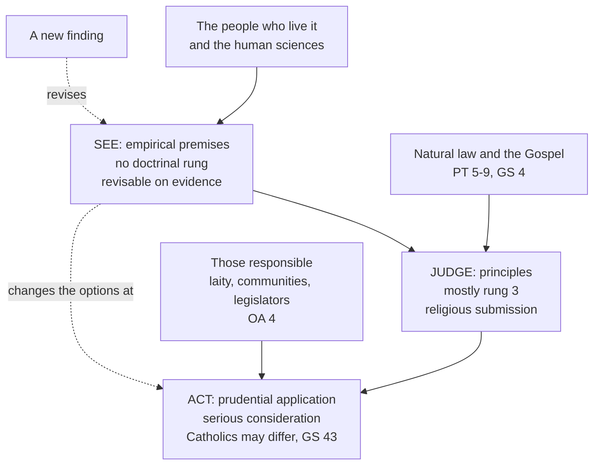

# Catholic Social Teaching · Lesson 1.3: See, judge, act

> ⏱ ~15 min · Module 1: What the Church's social doctrine is · Builds on: [1.2](01-02-permanent-principles-and-contingent-applications.md), [`ethics` 4.4](../../ethics/lessons/04-04-natural-law-aquinas.md) · Unlocks: [1.4](01-04-before-1891-the-roots-and-the-social-question.md)

## Why this matters

In 2026 *Magnifica Humanitas* called the social doctrine a "shared discernment", not a rulebook to be applied (§27). Read carelessly, that can be heard two ways. Either the teaching now follows the data, or sociology has been let into doctrine. Both readings misread a method the Church has commended since 1961, and this lesson shows where each goes wrong.

## The idea

A good doctor examines the patient, diagnoses by what medicine knows, and prescribes for this patient today. A new test result can change the prescription, but it does not change physiology. And the patient knows things about his own symptoms that no textbook does.

The Church's name for that procedure is **[see, judge, act](../reference.md#see-judge-act)**. **See**: establish the facts, from the people who live them and from the sciences. **Judge**: measure them against moral principles. **Act**: decide what can and should be done here. Each kind of claim from [1.2](01-02-permanent-principles-and-contingent-applications.md) enters at one stage: [empirical premises](../reference.md#empirical-premise) at SEE, principles at JUDGE, [prudential applications](../reference.md#prudential-judgment) at ACT. The method is 1.2's sorting, run forward in time. Natural law as a theory is [`ethics` 4.4–4.5](../../ethics/lessons/04-05-the-new-natural-law-theory.md)'s; here it is only the language JUDGE claims to share with everyone.

## The teaching

**T1. The origin.** Joseph Cardijn (1882–1967), a Belgian priest, built the Jeunesse Ouvrière Chrétienne (JOC, the Young Christian Workers). It took that name in 1924, was blessed by Pius XI in 1925, and was a specialized movement of Catholic Action, whose interwar fate belongs to [`church-history` 9.1](../../church-history/lessons/09-01-the-church-and-the-totalitarian-states.md) ([Cardijn and the JOC](../reference.md#cardijn-and-the-joc)). Its groups of young workers looked at their own workplaces, judged what they found by the Gospel, and chose one action they could take. Paul VI made Cardijn a cardinal in 1965. *In words:* the method began with workers examining their own conditions.

**T2. The adoption.** *[Mater et Magistra](../reference.md#mater-et-magistra)* (John XXIII, 1961) 236 names three stages that should normally be followed in turning social principles into practice. Take stock of the actual situation, assess it by those principles, and settle what the circumstances allow and require. It sums them up as "look, judge, act". §229 gives the reason. Theory passes into practice with difficulty, partly because what justice requires in a given case can be hard to pin down. The encyclical names no one; tracing the formula to Cardijn is the historians' work. *In words:* a pope adopted a movement's method as the normal way principles meet cases.

**T3. The signs of the times.** *Gaudium et Spes* 4 (1965): the Church has always been bound to examine the [signs of the times](../reference.md#signs-of-the-times) and read them by the Gospel's light. §44 gives the whole People of God, pastors and theologians above all, the task of listening to the age's many voices, sorting them, and weighing them against God's word. *Magnifica Humanitas* 22 adds that this listening is spiritual discernment, not mere sociology, and that it unfolds revealed truth without changing it. *In words:* SEE is already a theological act. Facts are read, not obeyed.

**T4. The sciences.** *Gaudium et Spes* 36: created things have their own laws, which each science uncovers by its own methods (the [rightful autonomy of earthly affairs](../reference.md#rightful-autonomy-of-earthly-affairs)). *Centesimus Annus* 59 (1991): the social teaching talks with the human disciplines and takes in what they contribute (the *Compendium* gathers such texts at 76–78). *Centesimus Annus* 3 draws the line. Leo XIII's principles belong to the doctrinal patrimony and engage the teaching authority. The encyclical's reading of recent events claims no definitive force, because such analysis lies outside the Magisterium's proper field. *Magnifica Humanitas* 23, citing *Laudato Si'* 61: on many concrete questions the Church gives no definitive opinion. *Libertatis Nuntius* (1984, VII 3–5) adds that a borrowed method of analysis must be critically tested first ([3.6](03-06-the-preferential-option-for-the-poor.md)). *In words:* the Church takes her facts from the sciences, tests the tools, and claims no authority over the facts.

**T5. The common language.** *[Pacem in Terris](../reference.md#pacem-in-terris)* (1963) was addressed to all men of good will as well as to the Church, the first encyclical so addressed, as the *Compendium* (95) and *Magnifica Humanitas* 33 both say. It argues from an order the Creator wrote into human nature, from which rights and duties flow (§§5–6, 9). *Caritas in Veritate* 59 (2009) calls the natural law a firm footing for dialogue across cultures, religions and politics. Leo XIV told parliamentarians in June 2025 that it is the compass for lawmaking ([natural law as common language](../reference.md#natural-law-as-common-language)). *In words:* the JUDGE step claims principles that any reasonable person can, in principle, see.

**T6. Who acts.** *[Octogesima Adveniens](../reference.md#octogesima-adveniens)* 4 (1971): a single universal solution is neither the pope's aim nor his mission. Christian communities must analyse their own situation in the Gospel's light, draw from the social teaching principles for reflecting, criteria for judging and guidance for acting, and discern the options. *Magnifica Humanitas* 26 restates it. *Mater et Magistra* 238 had already allowed that sincere Catholics differ on application. *In words:* the ACT step is local and plural.

**T7. The objection, and the reply.** The [instability objection](../reference.md#the-instability-objection) says that a method starting from shifting facts makes the teaching unstable. Marie-Dominique Chenu, OP, pressed the opposite worry in *La "doctrine sociale" de l'Église comme idéologie* (1979). On his account, "social doctrine" as a timeless system deduced and applied from above had worked as an ideology, and he welcomed the inductive turn of *Octogesima Adveniens*. The documents answer both. *Sollicitudo Rei Socialis* 3 (1987): the teaching is constant in its basic principles and criteria, and "ever new" in adapting them to changed conditions. *Caritas in Veritate* 12: there are not two social doctrines, one before the Council and one after. Leo XIV (17 May 2025): the social doctrine claims no "monopoly on truth" in analysis or solutions. "Doctrine" here means a disciplined body of knowledge that helps form prudential judgments. *Magnifica Humanitas* 27–28: a shared discernment around an unchanging core. *In words:* the principles are stable and the judgments revisable. Whether that fully answers the objection is Boss 1(d)'s question.

**Mark the levels.** (Rungs from [the ladder](../../fundamental-theology/lessons/04-04-the-ladder-of-doctrinal-authority.md); see [levels of authority](../reference.md#levels-of-authority); genres per [`fundamental-theology` 4.5](../../fundamental-theology/lessons/04-05-reading-a-documents-weight.md).)

- **The method itself** (MM 236, an encyclical) is **a method commended, with no doctrinal rung**. A procedure contains nothing to assent to, and its outputs take their level from their content. Cardijn's authorship is history, with **no level**.
- **The duty to read the signs of the times by the Gospel** (GS 4, 44; a conciliar pastoral constitution, 1965, defining nothing) is **rung 3**.
- **That applications rest on empirical premises from the sciences, and are revisable with them** (CA 3; GS 36; LS 61, 188), is a **rung-3** principle *about* applications.
- **That the social principles rest on a natural law knowable by all** (encyclicals: PT 5–9; CiV 59) is **rung 3**. The natural law's existence and knowability is at least rung 3, fixed in [`moral-theology` 1.3](../../moral-theology/lessons/01-03-natural-law-in-light-of-revelation.md).
- **Local discernment of options** (OA 4, Paul VI's apostolic letter of 1971) is **rung 3**. So are **MH 22–28**'s statements about what the social doctrine is (an encyclical, 2026), which mostly restate. Leo XIV's **addresses** of 2025 are **rung 3 at the lightest grade**, at most.
- **Chenu's thesis** is a theologian's: **no magisterial level**. Whether the reply in T7 settles the objection is **rung 5**.

**Principle or application.** **Empirical premises** enter at SEE: injury rates, earnings, the effect of a by-law. They carry no doctrinal rung and stand or fall on evidence. **Principles** do the judging. Most are rung 3 and owed religious submission, and some restate higher teaching (that theft is wrong). **Applications** come out at ACT. Where a magisterial document proposes them, they are owed serious, respectful consideration, and a Catholic who weighs one and judges otherwise does not dissent ([the three assents](../reference.md#the-three-assents)). Both [symmetrical errors](../reference.md#the-two-symmetrical-errors) threaten here. Inflation treats a SEE claim, or one community's ACT, as doctrine because it sits in a Church document. Demotion reads "shared discernment" as if the JUDGE step itself awaited the next study.

**Where it stops.** The method gives SEE to the sciences and to the people who live the situation. The Church claims no power to settle scientific disputes or to stand in for politics (LS 188). It gives ACT to the laity and to those who govern, who may disagree with equal sincerity (GS 43; [1.2](01-02-permanent-principles-and-contingent-applications.md)). JUDGE is the step the Magisterium claims, and even there it offers [no technical solutions](../reference.md#the-doctrines-disclaimers) and no model (MH 24). The method guarantees a disciplined answer, not a single one.

## The map

Evidence enters at SEE and can change the ACT; it reaches JUDGE only as data to be judged, never as a vote on the principle.

## Worked examples

**Example 1 (clean): Coldbrook's riders.** In the invented town of Coldbrook, eight delivery riders meet with a chaplain, as a JOC group would.

- **See.** For a month they log their hours. Counting unpaid waiting time and bike costs, their earnings fall below the town's legal minimum hourly wage. Three were injured, with no cover. The app sets the rate per drop, and no one can negotiate it. Every item is an empirical premise.
- **Judge.** Work is for the person, not the person for work (*Laborem Exercens* 6). Free agreement does not by itself make a wage just (*Rerum Novarum* 45). Workers may associate (*Rerum Novarum* 51). These are rung-3 principles, taught in [4.1](04-01-work-and-the-worker-laborem-exercens.md), [4.2](04-02-the-just-wage.md) and [2.1](02-01-rerum-novarum.md). If the facts hold, the arrangement fails them.
- **Act.** The riders form an association, ask the platforms to bargain, and write to the council. These are applications: revisable, and open to sincere disagreement.

**Example 2 (strain): the evidence is contested.** Coldbrook's council considers an invented by-law requiring platforms to pay a guaranteed hourly minimum for logged-in time. Two credible studies of cities that tried it disagree. In one, riders' hourly earnings rose and their numbers barely fell. In the other, platforms cut logged-in hours, and many riders' weekly pay dropped.

The method puts the dispute at SEE. Was demand rising anyway in the first city? Did the second count only riders who stayed? That is [`social-theory` 1.4](../../social-theory/lessons/01-04-testing-a-social-explanation.md)'s testing and [`philosophical-method` 2.4](../../philosophical-method/lessons/02-04-weighing-evidence-in-odds-form.md)'s weighing. JUDGE does not move: whichever study is right, a wage is owed in justice. ACT depends on the answer. If the first study holds, the by-law serves the principle; if the second does, the same principle may favour another instrument. **Where it stops:** no bishop or parish group can settle which study is right by appeal to doctrine (CA 3; LS 188). The council, the citizens and the riders judge the rest, and Catholics among them may differ. The method forbids two moves: "the evidence is contested, so pay is whatever the app says" (demotion), and "the Church requires this by-law" (inflation).

## Watch out

- **You might think see-judge-act means the teaching follows the data.** The data enter at SEE and are judged by principles. New evidence can revise an application. It cannot revise that work is for the person.
- **You might think a fact stated in an encyclical becomes doctrine.** *Centesimus Annus* 3 denies definitive force to its own reading of events. An empirical diagnosis in a rung-3 document carries no doctrinal rung; the principle beside it does.
- **"*Mater et Magistra* made the method binding" overstates.** It names stages "normally" followed: a method commended, with no rung.
- **You might think MM teaches that every application is free.** Read §239, right after the section allowing for disagreement. Where the Hierarchy has decided a point, Catholics must follow its directives, for the Church may judge how principles are carried out. Such a directive binds conduct as discipline, not assent to its truth (law binds practice: [`thomistic-synthesis` 6.5](../../thomistic-synthesis/lessons/06-05-what-the-church-has-said-about-thomism.md)). And GS 43 forbids anyone to pass off his own application as one.

## One-liner

> See-judge-act lets the facts change what Catholics do without letting them vote on what Catholics hold: the sciences supply the seeing, the principles do the judging, and prudence does the acting, each at its own weight.

## Problems

**P1 (🟢)** *(Exegetical)* After a cold snap, Coldbrook's riders' group (invented) notes six statements:

1. Rider injuries in Coldbrook doubled in January, while the platforms' speed bonus was running.
2. The speed bonus, not the ice alone, caused the rise in injuries.
3. Work is for the person, not the person for work (*Laborem Exercens* 6, paraphrased).
4. Workers have a right to working conditions that do not harm their physical health (*Laborem Exercens* 19, paraphrased).
5. The group should ask the platforms to suspend the speed bonus on ice-warning days.
6. Coldbrook's council should cap app speed incentives by by-law.

For each: label it SEE, JUDGE or ACT; say whether it is an empirical premise, a principle or an application; and say whether new evidence could revise it. For each principle, give its level and the assent owed; for each application, what it asks of a Catholic. **One line each.**

**P2 (🟡)** *(Exegetical)* Two texts, **invented** for this problem and not the words of any real person.

(a) A memo from the Garrow Institute: "See-judge-act means the Church's teaching follows the data. *Mater et Magistra* made the method binding on every Catholic, and since data change, any part of the social doctrine, the just wage included, can change when the evidence does."

(b) A blog post by Aldous Pellow: "The method smuggles sociology into doctrine. Since Vatican II invented see-judge-act, whatever a Church document says about the economy has become dogma, and Catholics must believe whatever the Pope's experts believe."

Name two errors in each text and correct each from the documents. Say which of the two symmetrical errors each text commits. **150 words or fewer in all.**

**P3 (🔴)** *(Exegetical (a) · Exegetical (b))* Coldbrook's riders' association (invented) concludes: "Coldbrook should require every delivery platform to fund accident cover for its riders through a small levy on each delivery, because an injured rider now loses weeks of income and has no cover."

(a) List three empirical premises the conclusion needs. **One line each.**

(b) Name one new finding that would change the ACT step without touching the JUDGE step, and say why it changes one and not the other. **Two sentences.**

Solutions

**P1** *(Exegetical)*

**Must hit, strict:**

1. SEE; empirical premise; revisable (a better count, a different month).
2. SEE; empirical premise, a causal one; revisable, and the weakest item, since ice is a common cause of both the bonus season and the injuries.
3. JUDGE; principle; **rung 3** (an encyclical; restated in CCC 2428), owed religious submission; no evidence revises it.
4. JUDGE; principle; **rung 3**, owed religious submission; no evidence revises it, though evidence decides which conditions breach it.
5. ACT; application, the group's own proposal, with no magisterial level; revisable (if item 2 fails, the request loses its ground); weigh it on the evidence, and a Catholic may disagree without dissenting.
6. ACT; application, a policy instrument, with no magisterial level; revisable; room for sincere disagreement (GS 43).

**Wrong turns:** labelling 2 JUDGE because it assigns blame. Labelling 4 ACT because it sounds concrete; it states a right, not a measure. Giving 5 or 6 "rung 3" because they apply an encyclical; the rung attaches to the principle. Saying 3 could be revised if riders prefer the bonus.

**Model answer:** 1 SEE, empirical, revisable. 2 SEE, empirical (causal), revisable; the ice may explain both. 3 JUDGE, principle, rung 3, religious submission, not revisable by evidence. 4 JUDGE, principle, rung 3, religious submission, not revisable by evidence. 5 ACT, application, no magisterial level, revisable; a Catholic may disagree. 6 ACT, application, no magisterial level, revisable; Catholics may disagree.

---

**P2** *(Exegetical)*

**Must hit, strict:**

- (a) **Demotion.** Data enter at SEE and revise applications, not principles: SRS 3 (constant in its basic principles and criteria, "ever new" in adapting them); MH 22 (listening unfolds revealed truth without changing it). The just wage as a principle is rung 3; only a figure is revisable.
- (a) **Level overstated.** MM 236 commends stages "normally" followed. A method has no doctrinal rung.
- (b) **Inflation.** Sociology enters as empirical premises with no doctrinal rung (CA 3: analysis of events is not a definitive judgment; LS 188). The Church takes in what the sciences contribute (CA 59) and tests their tools (LN VII 4). It does not make them dogma, and no assent of faith is owed to experts.
- (b) **History wrong.** The method came from Cardijn's JOC (1920s) and entered magisterial teaching in MM 236 (1961), four years before the Council spoke of reading the signs of the times (GS 4).

**Wrong turns:** answering (a) by saying nothing in the social doctrine can change, which denies that applications are revisable. Answering (b) by conceding that the sciences are irrelevant to the teaching.

**Model answer:** The memo demotes. Evidence revises applications, not principles. SRS 3 calls the teaching constant in its principles and new only in adapting to conditions, so the just wage stays rung 3 while a figure can move. And MM 236 commends a method "normally" followed; a method has no rung. The blog inflates. Sociology enters at SEE as empirical premise, which CA 3 says the Magisterium does not judge definitively; the Church takes in and tests what the sciences offer (CA 59; LN VII 4) and makes none of it dogma. And Vatican II did not invent the method: it came from Cardijn's JOC and entered teaching in MM 236 (1961).

---

**P3** *(Exegetical (a) · Exegetical (b))*

**Must hit, strict (a):** three of these, each a claim about how things are:

- riders are injured at work at a meaningful rate;
- an injured rider now has no cover, public or private, and loses weeks of income;
- a small per-delivery levy can fund adequate cover;
- the platforms can bear the levy without leaving Coldbrook or cutting riders' pay by the same amount.

**Must hit, strict (b):** the finding is empirical and falsifies one premise from (a), for instance that platforms elsewhere passed such a levy straight into lower per-drop pay. It changes ACT because the levy no longer serves the riders, so another means must be found. It leaves JUDGE untouched because the principle (*Laborem Exercens* 19 lists insurance against accidents at work among workers' rights; rung 3) still holds and still demands some provision.

**Wrong turns:** offering a value claim as a "finding" ("riders accept the risk"). Saying the finding shows riders have no claim to cover, which moves the JUDGE step. Listing the principle itself as a premise in (a).

**Model answer:** (a) Riders are injured at a meaningful rate; an injured rider now has no cover and loses weeks of income; the platforms can absorb a small levy without leaving or cutting pay to match. (b) Suppose a study shows that platforms elsewhere passed such a levy straight into lower per-drop pay: then the levy no longer achieves its end, and the association should seek another means. The finding touches only a premise about effects; the right to provision against accidents at work (*Laborem Exercens* 19) stands, and it is what makes the search for another means obligatory.

## Flashback

**From Lesson [1.1](01-01-the-social-doctrine-sources-genre-and-claim.md) (The social doctrine: sources, genre and claim):** *(Exegetical (a) · Exegetical (b).)* A case **invented, written for this problem**. Before a budget vote, the *Fernley Courier* asks for "the Church's answer" to three questions:

1. May the town close its only winter night shelter if the people sleeping there have nowhere else to go?
2. Should the shelter be funded by a hotel-bed levy or from the general budget?
3. Is artificial intelligence this decade's defining social question?

(a) Does the corpus claim [competence](../reference.md#competence-in-the-moral-order) to answer each, disclaim it, or offer only a judgment about the times? Cite the text. **One line each.**

(b) *Magnifica Humanitas* 4 (2026): as Leo XIII read the "new things" of his time, we must read ours, above all digitalization, AI and robotics, now rapidly transforming the world (paraphrased). Principle, application or empirical premise, at what level, and what does it ask of a Catholic who thinks war more pressing? **Two sentences.**

Solution

**Must hit, strict (a):**

- 1 **Claimed:** it concerns what an arrangement does to persons whose fundamental rights are at stake, where the Church claims to pass moral judgment (GS 76; CCC 2420). The verdict stops at "they may not be left with nowhere to go"; the facts and the remedy are the council's.
- 2 **Disclaimed:** a choice of instrument. The corpus offers no technical solutions (CiV 9) and no model (CA 43); legislators and citizens decide (GS 43).
- 3 **A judgment about the times:** MH 4 offers one without settling it.

**Must hit, strict (b):**

- **Not a principle:** an [empirical premise](../reference.md#empirical-premise) (these technologies are transforming the world) joined to a [prudential judgment](../reference.md#prudential-judgment) (they are the trend to read first). The principle beside them is the duty to read each age by the Gospel.
- The encyclical is **rung 3**, but religious submission attaches to its principles; this reading asks **serious, respectful consideration**. A Catholic who weighs it and still ranks war first **does not dissent**.

**Wrong turns:** for 1, "the Church has no view on budgets", as if disclaiming technique disclaimed moral judgment (demotion). For 2, "Catholic teaching favours the levy" (inflation). In (b), giving the reading the encyclical's rung, or calling the encyclical "just the Pope's opinion".

**Model answer (a):** 1 Claimed (GS 76): people may not be left with nowhere to go, though the facts and the remedy are the council's. 2 Disclaimed: a choice of instrument (CiV 9; CA 43). 3 A judgment about the times, which MH 4 offers without settling.

**Model answer (b):** An empirical premise joined to a prudential judgment in a rung-3 encyclical, owed serious, respectful consideration, not the submission its principles ask. A Catholic who weighs it and still thinks war more pressing dissents from nothing.

## Connections

- **Backward:** [1.2](01-02-permanent-principles-and-contingent-applications.md) supplies the three kinds of claim and the assent each asks; this lesson puts them in time order. [1.1](01-01-the-social-doctrine-sources-genre-and-claim.md) supplies the disclaimers that make the ACT step plural. [`ethics` 4.4](../../ethics/lessons/04-04-natural-law-aquinas.md) gives the Thomist root of the whole arrangement: practical reason fails more often the further it descends into detail (ST I-II q.94 a.4).
- **Forward:** [1.4](01-04-before-1891-the-roots-and-the-social-question.md) shows the first social Catholics doing the seeing before the method had a name. [2.3](02-03-mater-et-magistra-and-pacem-in-terris.md) and [2.4](02-04-gaudium-et-spes-to-justice-in-the-world.md) read *Mater et Magistra*, *Pacem in Terris*, *Gaudium et Spes* and *Octogesima Adveniens* as documents. [3.6](03-06-the-preferential-option-for-the-poor.md) takes up *Libertatis Nuntius* on borrowed analysis. [4.5](04-05-the-new-things-of-our-time-magnifica-humanitas.md) reads *Magnifica Humanitas* whole. [6.1](06-01-integral-ecology-laudato-si.md) runs the method where the empirical premises are climate science. Boss 1(d) asks whether this method makes the teaching more revisable than the rest of moral theology.
- **Sideways:** weighing contested studies is [`philosophical-method` 2.4](../../philosophical-method/lessons/02-04-weighing-evidence-in-odds-form.md), and testing a causal claim is [`social-theory` 1.4](../../social-theory/lessons/01-04-testing-a-social-explanation.md). Catholic Action as an event is [`church-history` 9.1](../../church-history/lessons/09-01-the-church-and-the-totalitarian-states.md). The Church's competence over the natural law is [`moral-theology` 1.3](../../moral-theology/lessons/01-03-natural-law-in-light-of-revelation.md). The claim that natural law is a common language is the Catholic rival to Rawls's public reason in [`political-philosophy` 4.2](../../political-philosophy/lessons/04-02-public-reason-and-religious-argument.md), and 5.2 meets that rival directly.
