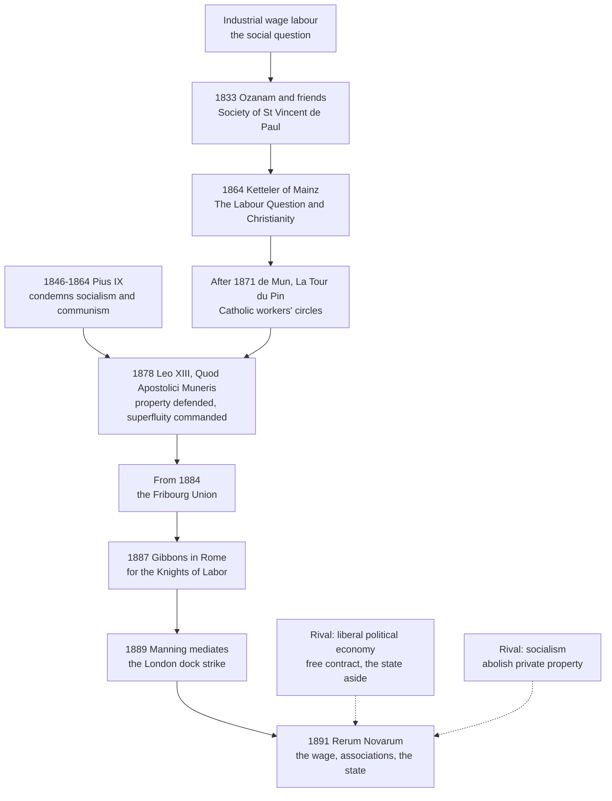

# Catholic Social Teaching · Lesson 1.4: Before 1891: the roots and the social question

> ⏱ ~15 min · Module 1: What the Church's social doctrine is · Builds on: [1.3](01-03-see-judge-act.md), [`history-of-political-thought` 2.4](../../history-of-political-thought/lessons/02-04-aquinas-on-kingship-tyranny-and-property.md), [`patristics` 3.6](../../patristics/lessons/03-06-john-chrysostom.md) · Unlocks: [2.1](02-01-rerum-novarum.md)

## Why this matters

Parish study groups tell two stories about *Rerum Novarum*: Catholic social teaching was invented in 1891 to answer Marx, or Leo XIII only repeated Aquinas. They are wrong in opposite directions. Benedict XVI conceded that the Church's leadership was slow to see that a just society needed a new approach, and he named Bishop Ketteler of Mainz as a pioneer (*Deus Caritas Est* 27, 2005, paraphrased). This lesson asks what the tradition already had, and what was new in 1891.

## The idea

Think of an old map carried into new country. The earth's goods exist for everyone's use. Owning is lawful, but the owner holds the use in common. The rich owe the poor out of their surplus, and the labourer's hire is owed to him because he lives by it. But the map was drawn for landholders, tenants and alms.

Industrial wage labour was new country. A spinner owned nothing but her strength, sold it weekly to the man who owned the machines, and had no plot to fall back on. Fitting the principles to that world was [the social question](../reference.md#the-social-question). Two answers were offered. [Liberal political economy](../reference.md#liberal-political-economy) said a wage is a price, just when freely agreed, and the state should stand aside. Socialism said abolish private ownership. [`history-of-political-thought` 2.4](../../history-of-political-thought/lessons/02-04-aquinas-on-kingship-tyranny-and-property.md) already paraphrases Aquinas on property; this lesson reads his wording closely and puts it to work.

## Source

Aquinas, *Summa Theologiae* II-II q.66 a.2, body of the article (English Dominican Province translation, Benziger, 1947 printing):

> Two things are competent to man in respect of exterior things. One is the power to procure and dispense them, and in this regard it is lawful for man to possess property. Moreover this is necessary to human life for three reasons. First because every man is more careful to procure what is for himself alone than that which is common to many or to all … Secondly, because human affairs are conducted in more orderly fashion if each man is charged with taking care of some particular thing himself … Thirdly, because a more peaceful state is ensured to man if each one is contented with his own. … The second thing that is competent to man … is their use. In this respect man ought to possess external things, not as his own, but as common, so that, to wit, he is ready to communicate them to others in their need.

Two relations to the same goods ([procuring, dispensing and use](../reference.md#procuring-dispensing-and-use)) get two verdicts: getting and managing are "lawful", even "necessary to human life"; use gets an "ought" pointing the other way, warranted by 1 Timothy 6:18. The reply to the first objection calls ownership "not contrary to the natural law, but an addition thereto devised by human reason" (ad 1).

## The teaching

**T1. Scripture.** The hireling is paid the same day, "because he is poor, and with it maintaineth his life" (Deut 24:15, Douay–Rheims); the labourers' hire "which by fraud has been kept back by you, crieth" (Jas 5:4). The land is the Lord's (Lev 25:23) and the poor brother is owed an open hand (Deut 15:11), both read in [`theology-of-debt` 1.2–1.3](../../theology-of-debt/lessons/01-03-the-jubilee-the-land-is-mine.md). Woe to those who "join house to house" (Isa 5:8). Jerusalem's church held "all things ... common" (Acts 4:32), but freely (Acts 5:4). *In words:* the poor have a claim, the wage is owed, ownership answers to God.

**T2. The Fathers.** On Ahab's seizure of Naboth's vineyard, Ambrose tells the rich (*De Nabuthe* 12.53, lesson's translation from Migne, PL 14):

> You are not giving the poor man what is yours; you are returning what is his. … The earth belongs to all, not to the rich. … So you pay a debt; you do not bestow what is not owed.

The Latin decides it: *Debitum igitur reddis, non largiris indebitum* — a debt, not a gift. Paul VI quotes it to show property is not an absolute right (*Populorum Progressio* 23, 1967, paraphrased). Chrysostom is [`patristics` 3.6](../../patristics/lessons/03-06-john-chrysostom.md)'s; Gregory the Great is read in [3.5](03-05-the-universal-destination-of-goods-and-private-property.md). *In words:* [the Fathers on wealth](../reference.md#the-fathers-on-wealth) say the surplus of the rich is, in a real sense, the poor's.

**T3. Aquinas.** Ownership is lawful as to procuring and dispensing; use stays common (the Source). The first possessor sins only "if he excludes others indiscriminately from using it" (ad 2). Almsgiving is "an act of charity through the medium of mercy" (q.32 a.1), commanded from one's surplus and toward extreme need (q.32 a.5). In urgent need with no other remedy, taking is not theft ([extreme necessity](../reference.md#extreme-necessity), q.66 a.7, its conditions assumed from `history-of-political-thought` 2.4). *Gaudium et Spes* 69 restates both articles, with notes citing them (paraphrased). The just price and usury are [`theology-of-debt` 4.3](../../theology-of-debt/lessons/04-03-aquinas-on-usury-ii-ii-q78.md)'s. *In words:* own it, manage it, share its use; giving is a precept, and only the extreme case lets the needy take.

**T4. The movement** ([social Catholicism](../reference.md#social-catholicism)). Frédéric Ozanam and fellow students found the Society of St Vincent de Paul (Paris, 1833). Ketteler, bishop of Mainz, writes *Die Arbeiterfrage und das Christentum* (1864), taking up Lassalle's critique of the wage system and proposing workers' cooperatives funded by Christian capital. After the Commune of 1871, Albert de Mun and René de La Tour du Pin build Catholic workers' circles; La Tour du Pin wants guilds restored. From 1884 the Fribourg Union, gathered by Bishop Gaspard Mermillod, does work that became one source among several for RN. Cardinals Gibbons (1887, against condemning the Knights of Labor) and Manning (mediating the 1889 London dock strike) carry it into the English-speaking world. *In words:* the movement argued for decades before a pope spoke.

**T5. The papal answer before 1891.** Pius IX listed socialism and communism among errors condemned since 1846 (Syllabus, 1864, §IV). Leo XIII's *Quod Apostolici Muneris* (1878) says "the Socialists wrongly assume the right of property to be of mere human invention", holds the right "derived from nature", and puts the rich "under strict command to give of their superfluity to the poor" (Benziger, 1903). *In words:* property defended, charity commanded.

**T6. What was new.** Not the principles. In [*Rerum Novarum*](../reference.md#rerum-novarum) a pope applied them systematically to wage labour: free agreement does not settle a wage's justice; workers may associate; the state must protect them; property and alms stay ([2.1](02-01-rerum-novarum.md)). *In words:* the novelty was the application.

**Mark the levels.** On [the ladder](../../fundamental-theology/lessons/04-04-the-ladder-of-doctrinal-authority.md) ([levels of authority](../reference.md#levels-of-authority)), that scripture is God's word is **rung 1**; a given exegesis: **no level**. The same-day wage and the Jubilee were judicial precepts of Israel, no longer binding as such ([`old-testament` 2.6](../../old-testament/lessons/02-06-covenant-and-law.md)); the principle they carry, that withholding a [just wage](../reference.md#just-wage) can be grave injustice, is **at least rung 3** (*Laborem Exercens* 19; CCC 2434 locates it, citing Deut 24:14–15 and Jas 5:4). A Father's sermon: **no magisterial level**, though weighty witness; the principle PP 23 draws from Ambrose is **rung 3** by the encyclical's act (restated in CA 30). Aquinas's articles: **no magisterial level** as his, common teaching (**rung 4**), and **rung 3** where RN 22 and GS 69 restate them. *Quod Apostolici Muneris*: an encyclical, **rung 3** for its principles. The social Catholics: **no magisterial level**. Last, Aquinas's "addition thereto devised by human reason" against Leo's "derived from nature": Aquinas's cross-reference, q.57 a.3, calls ownership natural "in respect of natural reason which dictates it". Reconciling them that way is the theologians' work (**rung 4**), not a magisterial ruling; [3.5](03-05-the-universal-destination-of-goods-and-private-property.md) does it.

**Principle or application.** **Permanent principles:** goods destined for all ([universal destination of goods](../reference.md#universal-destination-of-goods), levelled in `theology-of-debt` 1.3); [private property](../reference.md#private-property) lawful, its use common; alms owed from surplus; the wage owed to the one who lives by it — religious submission where an act teaches them. **Applications of their time:** the Jubilee, the same-day wage, Jerusalem's community of goods, Ketteler's cooperatives, the guilds, and Leo's 1878 judgment that charity and patience were the best means (1891 enlarged the means without withdrawing them). Papal applications ask serious consideration; private ones, the weight of their arguments ([principle and application](../reference.md#principle-and-application)). **[Empirical premises](../reference.md#empirical-premise):** Aquinas's three reasons; the liberal claim that free wages rise; the socialist claim that they sink to subsistence — evidence decides. [Both errors](../reference.md#the-two-symmetrical-errors) threaten: inflating Acts 4 or the guilds into doctrine; demoting the Fathers to exaggeration, or alms to optional generosity, though q.32 a.5 makes them a precept.

**Where it stops.** The principles say what owning is *for*, not which land law, wage or institution to have. Ad 1 hands the division of goods to human reason and positive law, law that fills in what justice leaves open ([`history-of-political-thought` 2.3](../../history-of-political-thought/lessons/02-03-aquinas-on-law.md)). Factory acts, poor relief, guilds or unions were [prudential judgment](../reference.md#prudential-judgment), and social Catholics legitimately disagreed over them. Beneath that restraint lie Augustine's two cities, the root of the Church's distance from every political power ([`history-of-political-thought` 2.2](../../history-of-political-thought/lessons/02-02-augustine-the-two-cities.md)); the corpus later disclaims any model ([the doctrine's disclaimers](../reference.md#the-doctrines-disclaimers)).

## The timeline

The movement ran ahead of Rome for half a century; in 1891 a pope took up its question and answered both rivals.

## Worked examples

**Example 1 (clean): the meadow at Kilnmoor.** An invented mill town, 1884. Jonas Whitcombe owns the mill and a twelve-acre meadow he never uses. The mill is on short time, and families ask to dig potato plots there.

- **Permits:** keeping and managing the meadow as his own.
- **Requires:** holding its use "as common". It is surplus and the need is real, so giving from it is a precept (q.32 a.5), not mere kindness.
- **Forbids:** fencing it only to keep the poor off ground he never uses — excluding "indiscriminately" (ad 2).
- **Leaves to him:** the means (free plots, a nominal rent, potatoes). Dispensing is his office.
- **Does not license** digging without leave: a.2 grounds *his* duty, not their taking. Only a.7's extreme case does that.

**Example 2 (strain): the land pamphlet.** In 1886 the invented Kilnmoor Land Reform League prints: "Ambrose said the earth belongs to all, not to the rich. Private ownership of land is against God's law; Parliament should abolish it."

- **Abolition fails at the principle.** a.2 calls possession lawful and necessary and reads the Fathers as speaking of use (ad 2–3); its *sed contra* calls the contrary view "erroneous".
- **The League's fallback** (taxing idle land, capping estates, securing tenancies) lands in ad 1's territory. The tradition supplies the purpose (lawful ownership, common use) and the limits (no abolition, no indiscriminate exclusion), not a tax rate. Legislators answerable for the common good decide, and Catholics could argue either side.
- **The strain reaches the foundation.** If division is a human addition, how is the right "derived from nature" (1878)? Only the theologians' reconciliation (rung 4) answers, and it settles no tax.

## Watch out

- **You might think social teaching began in 1891.** That understates: the principles are scriptural, patristic and Thomist. **Or that RN only repeated Aquinas.** That overstates: Aquinas calls ownership "an addition ... devised by human reason"; RN 6 says "by nature". Never write "Aquinas taught a natural right to private property".
- **You might think Acts 4 binds Christians to common ownership.** That inflates one community's free practice into a principle (Acts 5:4). The opposite error, "Ambrose was preaching, so it binds no one", demotes: the sermon has no rung, but the principle PP 23 takes from it is rung 3.
- **You might think the social Catholics' guilds were Church teaching.** No magisterial level; even *Quadragesimo Anno*'s later vocational orders are an application ([2.2](02-02-quadragesimo-anno-and-the-interwar-proposals.md)).

## One-liner

> Before 1891 the Church already taught that ownership is lawful, its use common, and the poor and the labourer owed; 1891 added a pope applying those principles to the wage, the union and the state.

## Problems

**P1 (🟢)** *(Exegetical)* Close reading of the Source (q.66 a.2). **One or two sentences each.**

(a) The verdict on use is followed by a clause beginning "so that, to wit". What does that clause make "as common" mean, and what reading of "common" does it rule out?

(b) "Common" also appears in the first of the three reasons. What does it mean there, and why would reading the use clause's "common" in that sense make the article contradict itself?

(c) A reader objects: "Monasteries thrive without private property, so Aquinas's three reasons are false." Answer from the passage's own words, and say what kind of claim the three reasons are.

**P2 (🟡)** *(Exegetical)* Sort and weigh. For each pre-1891 claim, say whether it states a **principle**, an **application** (including an institution or proposal of its own time) or an **empirical premise**, and give its standing on the ladder, or "no magisterial level". Where a reader's gloss is attached, say whether the gloss overstates or understates, and why. **One line each.**

1. Deut 24:15: "thou shalt pay him the price of his labour the same day, before the going down of the sun". Gloss: "So God's law binds Catholic employers to pay by the day."

2. Acts 4:32: "all things were common unto them".

3. Ambrose, *De Nabuthe* 12.53: "you pay a debt; you do not bestow what is not owed" (lesson's translation). Gloss: "A preacher's flourish; it carries no weight in Catholic teaching."

4. Aquinas, q.66 a.2: "quarrels arise more frequently where there is no division of the things possessed".

5. Ketteler (1864): workers should form productive associations funded by Christian capitalists.

6. Leo XIII, *Quod Apostolici Muneris* (1878): the rich are "under strict command to give of their superfluity to the poor".

**P3 (🔴)** *(Exegetical)* Find the crux. Two **invented** texts, written for this problem and not the words of any real person:

> Letter to the *Kilnmoor Gazette*, 1886, from Edwin Merriman, lecturer in political economy: "A wage is the price of labour, and like every price it is just when freely agreed. Our spinners bargained and accepted, and no man suffers injustice willingly. If a family cannot live on what the market pays, that is a call on the charity of the rich, which I honour; it is not a debt the mill owes. Scripture forbids withholding the hire agreed, not agreeing a low one."

> Pamphlet of the Kilnmoor Catholic Working Men's Guild, 1887: "A man who must take the mill's terms or watch his children go hungry has agreed to nothing freely. The labourer lives by his hire, and what is kept back from him is a debt, not an alms. A wage on which a sober worker cannot keep his family is unjust, whatever he signed."

(a) Name the crux: the single premise one side must deny.

(b) Is the crux a principle, an application or an empirical premise? Name one empirical premise beneath the dispute, and the evidence that would settle it.

(c) Name one source from before 1891, taught in this lesson, that each writer could cite, and say what that source cannot settle.

**150 words or fewer in all.**

Solutions

**P1** *(Exegetical)*

**Must hit, strict:**

- (a) The clause makes "as common" mean **available to others in their need**: the owner is "ready to communicate them to others in their need", echoing 1 Tim 6:18, "to communicate to others". It rules out reading "common" as **common ownership**, since the same article has just called private possession lawful. Nor does it give others a right to help themselves: it describes the owner's readiness and duty.
- (b) In the first reason, "common to many or to all" means **held jointly, everyone's charge**, set against "what is for himself alone", the thing a man is "more careful to procure". If the use clause meant that, Aquinas would be requiring the very arrangement whose neglect his first verdict was built to avoid. The article uses the word in two senses: common in ownership, rejected as the general rule, and common in use, required.
- (c) The reasons are comparatives about how people usually behave: "more careful", "more orderly", "more peaceful", quarrels "more frequently". They are **empirical premises about human affairs at large**. A tendency is not refuted by a special community that counters its causes by vow, rule and assigned charges. And the reasons make private possession lawful and necessary to human life generally; they do not oblige each person to own.

**Wrong turns:** reading "as common" as "the poor may take" (a.2 grounds the owner's duty; [`history-of-political-thought` 2.4](../../history-of-political-thought/lessons/02-04-aquinas-on-kingship-tyranny-and-property.md) makes the same point). Treating the three reasons as revealed or as precepts of natural law. Conceding the objection, as though one counterexample refuted a comparative generalization.

**Model answer:** (a) "As common" means ready to share with others in their need, which is 1 Timothy's "communicate". It cannot mean jointly owned, because the article has just made private possession lawful. (b) In the first reason, "common" means held by many, the opposite of "for himself alone", and so cared for less. Reading the use clause that way would require the arrangement the first verdict rejects, so the word has two senses. (c) The reasons are comparatives ("more careful", "more orderly", "more peaceful") about how people usually behave: empirical premises about societies at large. A monastery bound by vows and a rule is a special case, and the reasons never oblige each person to own.

---

**P2** *(Exegetical)*

**Must hit, strict:**

1. **Application:** a judicial precept of Israel, the same-day rule, an institution of its time. It carries a **principle**: the hire is owed, promptly, to one who lives by it, and withholding a just wage can be a grave injustice. That principle is at least rung 3 (*Laborem Exercens* 19; CCC 2434 locates it, citing Deut 24:14–15). That the text is God's word is rung 1. **The gloss overstates:** judicial precepts no longer bind as such ([`old-testament` 2.6](../../old-testament/lessons/02-06-covenant-and-law.md)); the principle binds, and the daily schedule does not.

2. **Application:** one community's practice, freely chosen (Acts 5:4). The text is God's word (rung 1), but it does not teach that owning is unlawful for Christians, a view a.2's *sed contra* calls erroneous. The principle it carries is readiness to share, which is a.2's common use.

3. **Principle:** what the rich hold beyond their need is owed to the poor, so property is not absolute. As a sermon it has **no magisterial level**, but the principle is **rung 3** through PP 23, an encyclical that quotes this passage (restated in CA 30). **The gloss understates.**

4. **Empirical premise:** an observation about how people behave, and "more frequently" marks it as a tendency. As Aquinas's sentence it has **no magisterial level**. It stands or falls on evidence, and the lawfulness of ownership does not rest on it alone.

5. **Application:** a proposal of means. **No magisterial level**: it is a bishop's social analysis, part of the movement's history. A Catholic may judge it unworkable without dissenting from anything.

6. **Principle**, **rung 3**: an encyclical restating constant teaching (q.32 a.5).

**Wrong turns:** calling (4) a principle of natural law. Calling (2) a principle of common ownership. Calling (5) Catholic teaching. Giving (3) rung 3 *because Ambrose said it*, when the rung comes from the later act. Calling (6) defined.

**Model answer:** as above, one line each.

---

**P3** *(Exegetical)*

**Must hit, strict:**

- (a) **The crux:** whether an agreement made under the pressure of need, with no alternative but hunger, is free in the sense that makes a price just. Equivalently: is a wage's justice measured by the agreement alone, or also by a standard the agreement cannot waive, the worker's living? Merriman must affirm the first, and the Guild denies it. Both writers already accept that charity is owed and that agreed wages must be paid, so neither of those is the crux.
- (b) The crux is a **principle**, about what justice in exchange requires, not a matter of fact. Beneath it lies an **empirical premise**: whether Kilnmoor's spinners actually had alternatives (other work, savings, relief), and whether the wage covers a family's needs. Local wages, prices, household budgets and the state of the labour market would settle it.
- (c) **Merriman** can cite q.32 a.1 and a.5: alms are charity's act, owed from surplus, so a family's shortfall looks like a call on charity. That cannot settle whether the shortfall is a matter for alms at all; it assumes the answer. (His maxim that no one suffers injustice willingly is Aristotle's, which Aquinas cites in q.66 a.4. Accept it; it too leaves open whether consent forced by need is willing.) **The Guild** can cite Deut 24:15 ("with it maintaineth his life"), Jas 5:4, Ambrose's "you pay a debt", or Ketteler. Deuteronomy and James can be read as forbidding the withholding of an *agreed* hire, and Ambrose speaks of the surplus of the rich, not of wages.

**Wrong turns:** making the crux "whether the rich must help the poor", which both writers affirm. Treating the dispute as purely empirical. Claiming Aquinas settled it. Citing *Rerum Novarum*, which comes after 1891.

**Model answer:** (a) The crux is whether an agreement forced by need makes a wage just. Merriman must hold that consent settles justice, and the Guild denies it. (b) This is a principle about justice in exchange. Beneath it is an empirical premise, whether the spinners had any real alternative, which wage, price and labour-market evidence would settle. (c) Merriman can cite q.32 (alms are charity's act, owed from surplus), but that assumes the shortfall is a matter for alms, which is the question. The Guild can cite Deut 24:15 ("with it maintaineth his life") or Ambrose's "debt", but Deuteronomy may forbid only withholding the agreed hire, and Ambrose speaks of surplus, not wages. The pre-1891 sources arm both sides and decide neither. Later teaching took a side: agreement alone does not justify a wage (CCC 2434, rung 3; [2.1](02-01-rerum-novarum.md)).

## Flashback

**From Lesson [1.2](01-02-permanent-principles-and-contingent-applications.md) (Permanent principles and contingent applications):** *(Exegetical, close reading.)* *Rerum Novarum* 42 (Leo XIII, 1891), in *The Great Encyclical Letters of Pope Leo XIII* (Benziger, New York, 1903), cited by the Vatican numbering. Leo has just called labour that wears out the body "neither just nor human".

> Daily labor, therefore, should be so regulated as not to be protracted over longer hours than strength admits. How many and how long the intervals of rest should be must depend on the nature of the work, on circumstances of time and place, and on the health and strength of the workmen. Those who work in mines and quarries, and extract coal, stone, and metals from the bowels of the earth, should have shorter hours in proportion as their labor is more severe and trying to health.

(a) Which words state what holds whatever the facts, and which hand the measure to circumstance? Give that principle's level and the assent it asks. **Two sentences.**

(b) Suppose automation has made the work in one mine no more severe or trying to health than a clerk's. Split the miners' sentence into a principle and an empirical premise, and say what changes for that mine and what does not. Then name the error in concluding that Leo's teaching on hours binds no one. **Three sentences.**

Solution

**Must hit, strict (a):**

- **Whatever the facts:** "not to be protracted over longer hours than strength admits", a limit with no number. **Principle, rung 3** (an encyclical; restated in *Gaudium et Spes* 67, paraphrased), owed **religious submission of mind and will**.
- **Handed to circumstance:** "must depend on the nature of the work, on circumstances of time and place, and on the health and strength of the workmen". The figure is an **application**, so Leo names none; RN 45 advises taking "the hours of labor in different trades" to boards.

**Must hit, strict (b):**

- **Principle:** the more severe the work, the shorter the hours; later in §42, "as a general principle", rest "proportionate to the wear and tear of his strength". Rung 3.
- **Empirical premise:** that mining is more severe and trying to health, true in 1891. No rung.
- **That mine:** the premise fails, so the extra reduction lapses ("in proportion as" builds the fact into the rule); the limit set by strength still binds.
- **The error:** demotion. A changed premise changes the application, not the principle ([the standing question](../reference.md#the-standing-question)).

**Wrong turns:** making miners' shorter hours rung-3 teaching whatever the facts (inflation). Reading "must depend on … circumstances" as leaving hours to free contract: the same section says every agreement implies "proper rest for soul and body". Crediting Leo with an eight-hour day.

**Model answer:** (a) "Not to be protracted over longer hours than strength admits" holds whatever the facts; "must depend on the nature of the work, on circumstances of time and place" hands the figure to circumstance. The limit is a rung-3 principle owed religious submission, and the hours an application. (b) The principle is proportion, and the premise is that mining is severe. That mine loses the special reduction but keeps the general limit, and concluding that Leo's teaching on hours binds no one demotes a principle because one application changed.

## Connections

- **Backward:** [1.2](01-02-permanent-principles-and-contingent-applications.md) supplies the distinction this lesson runs on the tradition: old principles, applications of their time. [1.3](01-03-see-judge-act.md)'s method fits the social Catholics, who looked at the factory before they judged it. [`history-of-political-thought` 2.2–2.4](../../history-of-political-thought/lessons/02-04-aquinas-on-kingship-tyranny-and-property.md) gives Augustine's two cities, Aquinas on law, and his property articles as political thought. [`theology-of-debt` 1.2–1.3](../../theology-of-debt/lessons/01-03-the-jubilee-the-land-is-mine.md) owns Deuteronomy 15 and the Jubilee.
- **Forward:** [2.1](02-01-rerum-novarum.md) reads the encyclical the movement prepared. [2.2](02-02-quadragesimo-anno-and-the-interwar-proposals.md) takes La Tour du Pin's guilds into *Quadragesimo Anno*'s vocational orders. [3.5](03-05-the-universal-destination-of-goods-and-private-property.md) orders the universal destination and private property and works the natural-right reconciliation. [4.2](04-02-the-just-wage.md) answers P3's question at full strength.
- **Sideways:** [`patristics` 3.6](../../patristics/lessons/03-06-john-chrysostom.md) has Chrysostom on wealth, at no level. The starving man of a.7 appears in [`moral-theology` 2.3](../../moral-theology/lessons/02-03-intention-and-circumstances.md) and [4.4](../../moral-theology/lessons/04-04-veritatis-splendor.md). The just price and usury are [`theology-of-debt` 4.3](../../theology-of-debt/lessons/04-03-aquinas-on-usury-ii-ii-q78.md)'s. The secular diagnosis of labour as a commodity is [`social-theory` 5.3](../../social-theory/lessons/05-03-polanyis-great-transformation.md), and Marx is [`history-of-political-thought` 6.5](../../history-of-political-thought/lessons/06-05-marx-from-hegel-to-historical-materialism.md). P3's consent question asked secularly, whether a desperate agreement can be valid and still exploitative, is [`philosophy-of-debt` 3.1](../../philosophy-of-debt/lessons/03-01-what-exploitation-is.md). Leo XIII as an event is [`church-history` 8.3](../../church-history/lessons/08-03-leo-xiii-and-the-modernist-crisis.md).
