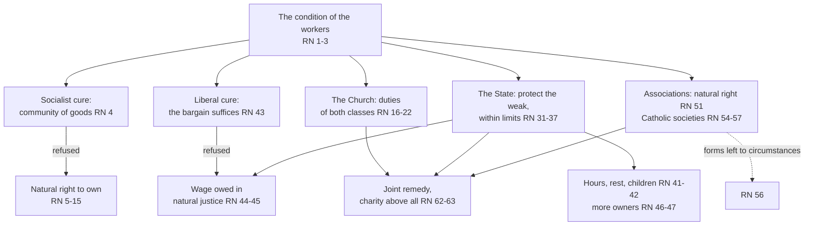

# Catholic Social Teaching · Lesson 2.1: *Rerum Novarum* (1891)

> ⏱ ~15 min · Module 2: The tradition takes shape, 1891–1971 · Builds on: [1.4](01-04-before-1891-the-roots-and-the-social-question.md), [`church-history` 8.3](../../church-history/lessons/08-03-leo-xiii-and-the-modernist-crisis.md) · Unlocks: [2.2](02-02-quadragesimo-anno-and-the-interwar-proposals.md), [3.5](03-05-the-universal-destination-of-goods-and-private-property.md), [4.2](04-02-the-just-wage.md)

## Why this matters

Every side quotes it. A business columnist cites its defence of property against socialism; a union organizer cites its wage passage and its defence of unions. Both read the same encyclical of 15 May 1891, and each stopped halfway. This lesson reads the whole of [*Rerum Novarum*](../reference.md#rerum-novarum): what it defends, against whom, why, and what Leo XIII himself left to "circumstances of fact and of time" (§56).

## The idea

In 1891 two cures were on offer for [the social question](../reference.md#the-social-question) ([1.4](01-04-before-1891-the-roots-and-the-social-question.md)). The liberal said a freely agreed wage is just and the state should keep out. The socialist said: abolish private property and let the state or the municipality own. Leo refuses both, like a doctor rejecting both amputation and doing nothing. Against the socialist: owning is why a man works, and a right he has by nature. Against the liberal: the bargain is not the whole of justice, and the state must protect the weak. Instead he sets three agents to work: the Church, teaching each class its duties; the state, protecting rights without swallowing the family; and the workers' own associations. [`church-history` 8.3](../../church-history/lessons/08-03-leo-xiii-and-the-modernist-crisis.md) tells the encyclical as an event; this lesson reads the text.

## Source

*Rerum Novarum* §§51–52 (vatican.va numbering), from *The Great Encyclical Letters of Pope Leo XIII* (Benziger, New York, 1903; translator not named; public domain). Leo has just distinguished private societies from civil society:

> Private societies, then, although they exist within the State, and are severally part of the State, cannot nevertheless be absolutely, and as such, prohibited by the State. For to enter into a "society" of this kind is the natural right of man; and the State is bound to protect natural rights, not to destroy them; and if it forbid its citizens to form associations, it contradicts the very principle of its own existence; for both they and it exist in virtue of the like principle, namely, the natural tendency of man to dwell in society. There are occasions, doubtless, when it is fitting that the law should intervene to prevent association; as when men join together for purposes which are evidently bad, unlawful, or dangerous to the State. […] every precaution should be taken not to violate the rights of individuals and not to impose unreasonable regulations under pretence of public benefit.

Four moves: a concession (these societies are part of the State), a denial (no ban "absolutely, and as such"), a ground (a natural right), and a limit (evil aims may be stopped, with safeguards). The deciding word is **natural**: a right the state did not grant is not one it may withdraw. P1 asks how Leo argues this.

## The teaching

In the encyclical's order (1903 English; vatican.va sections):

- **T1. The condition (§§1–3).** With the guilds gone and nothing in their place, workers stand isolated before employers and unchecked competition, under "a yoke little better than that of slavery itself" (§3). The same section's "rapacious usury" is read in [`theology-of-debt` 6.1](../../theology-of-debt/lessons/06-01-usury-and-finance-in-modern-teaching.md). *In words:* the misery is unjust, and the remedy cannot wait.
- **T2. The socialist remedy refused (§§4–15).** Community of goods would hurt the worker first, since he works in order to own (§§4–5). It is also unjust, because "every man has by nature the right to possess property as his own" (§6). That right is grounded in reason and foresight (§§6–7), in labour (§§9–10) and in the father's duty to his family (§§12–13). So community of goods "must be utterly rejected" (§15). *In words:* abolition wrongs the people it means to rescue.
- **T3. The Church and the two classes (§§16–30).** "No practical solution of this question will be found apart from the intervention of Religion and of the Church" (§16). The notion that "class is naturally hostile to class" is false (§19). Workers owe faithful work and no violence; employers must not treat men "like chattels to make money by", and owe a fair wage (§20). The rich may possess but not use as they please; from their surplus, alms are a duty "not of justice (save in extreme cases), but of Christian charity" (§22, quoting Aquinas). *In words:* the conflict is moral, and the Church binds both sides.
- **T4. The state (§§31–47).** "The State" means no particular form of government but "the State as rightly apprehended" (§32). It serves the [common good](../reference.md#common-good) with distributive justice to every class (§33), must not absorb individual or family (§35), and must step in when a class suffers harm that can be met no other way, but "the law must not undertake more, nor proceed further, than is required for the remedy of the evil or the removal of the mischief" (§36). The poor have a special claim on it (§37). Hours, Sunday rest and child labour follow (§§41–42). Free consent does not settle a wage: beneath it lies "a dictate of natural justice more imperious and ancient than any bargain between man and man", that "remuneration ought to be sufficient to support a frugal and well-behaved wage-earner" (§45). The law should "induce as many as possible of the humbler class to become owners" (§46), without taxing property away (§47). *In words:* the state protects the weak and widens ownership, and stops where the remedy stops.
- **T5. Associations (§§48–61).** Workers' unions are the chief means (§49). Forming them is a natural right the state may not abolish, though it may stop evidently evil ones (§§51–52), and it should watch over them without intruding (§55). Where existing societies are hostile to religion, Catholics should found their own, with religion first among their aims (§§54, 57). *In words:* workers combine by right, and the Catholic form answers the conditions Leo saw.
- **T6. A joint remedy (§§62–63).** Rulers, employers, workers and above all the Church must act, with charity "the mistress and the queen of virtues" (§63). *In words:* no agent solves it alone.

**Mark the levels.** The act is an **encyclical** of Leo XIII (15 May 1891) to the world's bishops, so its teaching is **authentic ordinary magisterium, rung 3**, by genre ([`fundamental-theology` 4.5](../../fundamental-theology/lessons/04-05-reading-a-documents-weight.md); [the ladder](../../fundamental-theology/lessons/04-04-the-ladder-of-doctrinal-authority.md); [levels of authority](../reference.md#levels-of-authority)). Nothing in it is defined. At **rung 3**: the natural right of [private property](../reference.md#private-property) and the rejection of community of goods (§§4–6, 15, 22; [critique of socialism](../reference.md#critique-of-socialism)), restated in *Centesimus Annus* 30 (1991), repetition adding weight within the rung (LG 25); likewise the [just wage](../reference.md#just-wage) floor (§45), the state's duty to the weak and its limit (§§32–37), [widening ownership](../reference.md#widening-ownership) as a direction for law (§46), and the right of association (§51; [unions and the strike](../reference.md#unions-and-the-strike)). That workers may not be treated as chattels or defrauded of wages (§20, quoting Jas 5:4) is **at least rung 3**: it restates the moral law the whole tradition teaches (CCC 2414 and 2434 locate it).

**Principle or application.** The **permanent principles** ([principle and application](../reference.md#principle-and-application)) are the rights to own, to associate and to a wage owed in justice, the state's protective duty and its limit, the worker's dignity, and classes ordered to cooperation. They ask religious submission ([the three assents](../reference.md#the-three-assents)). The **contingent applications** are Catholic societies as the preferred form (§54: "Under these circumstances"), boards for wages and hours (§45), land as the model of a worker's property (§47), and the occupational line §42 draws for women. They ask serious, respectful consideration (*Donum Veritatis* 24; GS 43). A Catholic who weighs one and judges otherwise does not dissent, but he may not treat it as weightless or claim the Church's authority for his alternative. The **empirical premises** are the vanished guilds (§3), the causes of strikes (§39), and the forecast that socialism would make "the sources of wealth" run dry (§15). They stand on evidence ([empirical premise](../reference.md#empirical-premise)), even though *Centesimus Annus* 12 judged the prognosis accurate. Leo marks the line himself: "a general and lasting law" for associations (§57), their organization left to circumstances (§56). [The two symmetrical errors](../reference.md#the-two-symmetrical-errors) threaten both ways: one makes 1891's confessional unions doctrine, the other files the right of association under nineteenth-century opinion. *Magnifica Humanitas* 30 (2026) sorts it the same way: the conditions have largely changed; the primacy of labour and the bond between Gospel and justice endure.

**Where it stops.** Leo gives no figures. Hours and rests depend on the kind of work, on "circumstances of time and place" and on the workers' strength (§42). Wages and hours go to boards because circumstances, times and localities differ (§45). A union's organization follows national character and experience (§56). State intervention is measured by the remedy (§36), a judgment for the legislator's prudence. No form of government is endorsed (§32). These are [the doctrine's disclaimers](../reference.md#the-doctrines-disclaimers), part of the teaching.

## The argument map

Two cures refused, three agents at work, and the details handed to circumstances.

## Worked examples

**Example 1 (clean): the Pellbridge by-law (invented).** In 1893 the weavers at Thornley's mill form the Pellbridge Weavers' Society, with a sick fund, and ask for a shorter Saturday shift. The town council passes a by-law forbidding "all combinations of workmen". A ban on association *as such* is what §51 forbids. The council may act against a particular society only if its aims are "evidently bad, unlawful, or dangerous" (§52), and these are not. The shorter shift fits §42's principle of rest proportioned to strength; its length is for agreement or a board (§45). Verdict: the ban is forbidden; the hours are left to prudence.

**Example 2 (strain): Harrop's union (invented).** Edwin Harrop, a Catholic weaver, belongs to the same Society: Anglicans, Methodists and unbelievers under a secularist secretary, with no stance on religion and nothing unlawful. Father Quilliam reads §§54–57 and tells Harrop to leave and found a Catholic society. Here principle and application pull apart. The **principle** gives Harrop a natural right to associate and puts his soul above his wages (§57). The **application** is conditional. §54 urges Catholic societies where others are run "on principles ill-according with Christianity" and force men "either to join them or to starve". §49 praises unions "of workmen alone, or of workmen and employers together" without asking about creed. RN addresses hostile societies and Catholic ones, not a neutral mixed union. In 1931 *Quadragesimo Anno* 35 allowed Catholics, where purely Catholic unions were impossible, to join others that respect justice and leave conscience free, with the bishops' approval and religious associations alongside. Whether this Society endangers Harrop's faith is a question of fact for him and his pastors; no principle settles it.

## Watch out

- **You might think an encyclical this foundational is infallible, or, being from 1891, merely Leo's opinion.** It is rung 3 by genre, restated by *Quadragesimo Anno*, *Laborem Exercens* and *Centesimus Annus* (heavy within the rung), and it defines nothing.
- **You might think "Leo told Catholics to form Catholic unions" is doctrine, or, since that is application, that the right to unionize is too.** The first inflates §54's conditional advice. The second demotes §51's natural right.
- **You might think RN's property argument is Locke's, or Aquinas's.** Its labour argument (§§9–10) resembles Locke's labour-mixing ([`history-of-political-thought` 4.1](../../history-of-political-thought/lessons/04-01-locke-against-filmer-and-property.md)), but it is "further proof" after reason and foresight, beside the family argument, and use stays common (§22). For Aquinas the division of possessions is a human addition to natural law ([`history-of-political-thought` 2.4](../../history-of-political-thought/lessons/02-04-aquinas-on-kingship-tyranny-and-property.md)); RN says "by nature". Their reconciliation is the theologians' (rung 4), in [3.5](03-05-the-universal-destination-of-goods-and-private-property.md).
- **You might think §19 condemns every strike.** *Centesimus Annus* 14 reads RN as condemning class struggle as a method, not every social conflict, and RN treats strikes as symptoms whose causes the law should remove (§39).

## One-liner

> *Rerum Novarum* refuses to abolish property or to trust the bargain, sets the Church, a limited state and the workers' associations to work, binds at rung 3 in its principles, and leaves figures and forms to circumstances.

## Problems

**P1 (🟢)** *(Exegetical)* Close reading of the Source (§§51–52, Benziger 1903).

(a) Which words concede that private societies belong to the State, and why does the concession not weaken Leo's conclusion? **Two sentences.**

(b) State in one sentence the premise that "they and it" share, and say in one sentence whether that premise makes the right of association granted by the State or prior to it.

(c) List the three marks that let public authority stop an association, and the two safeguards Leo attaches, quoting the words. **One line each.**

**P2 (🟡)** *(Exegetical)* Sort and weigh. For each claim from *Rerum Novarum* (Benziger 1903, vatican.va numbering), say whether it is a **permanent principle**, a **contingent application**, an **empirical claim of 1891**, or a **principle carrying an application** that must be split. Give the level and the assent asked. **One line each.**

1. The notion that "class is naturally hostile to class" is false; capital and labour need each other (§19).
2. "It is shameful and inhuman to treat men like chattels to make money by" (§20).
3. Workers strike "frequently because the hours of labor are too long, or the work too hard, or because they consider their wages insufficient" (§39).
4. "A workman ought to have leisure and rest proportionate to the wear and tear of his strength" (§42).
5. "A woman is by nature fitted for home work", and women "are not suited for certain occupations" (§42).
6. Questions of wages and hours are best referred to "societies or boards", with the State appealed to "should circumstances require" (§45).
7. "No one would exchange his country for a foreign land" if his own gave him "the means of living a decent and happy life" (§47).
8. The State would be "unjust and cruel" if, "under the name of taxation", it took from the private owner "more than is fitting" (§47).

**P3 (🔴)** *(Exegetical)* Two **invented** op-eds, written for this problem and not the words of any real person.

> *The Harcastle Review:* "*Rerum Novarum* is the charter of the free economy. Leo XIII declared private ownership sacred and inviolable, condemned socialism, and left the wage to the employer and the employee: the state may never touch it. Since an encyclical of this rank is infallible, Catholics must oppose every minimum-wage law."

> *The Tolland Clarion:* "Read *Rerum Novarum* and you will find socialism's case made by a pope. Leo attacks the employers' greed, summons the state to the workers' side and blesses the unions: the Church has backed the workers' state ever since. His musings about 'natural rights' were the prejudices of an aristocratic pope, and bind nobody."

Name **two** errors in each. For each, cite the sections it misreads and, where a level is at issue, give the correct level. **150 words or fewer.**

Solutions

**P1** *(Exegetical)*

**Must hit, strict:**

- (a) The concession is "although they exist within the State, and are severally part of the State". It does not weaken the conclusion, because the denial is of prohibition "absolutely, and as such". Being part of the State makes associations subject to its regulation, not to its abolition, and the ground given ("the natural right of man") does not come from the State at all.
- (b) The shared premise is "the natural tendency of man to dwell in society", from which both the State and the private societies exist. It makes the right **prior** to the State: the State does not grant it, so a State that abolished it would attack the principle of its own existence.
- (c) The marks are purposes "evidently bad, unlawful, or dangerous to the State". The safeguards are "not to violate the rights of individuals" and "not to impose unreasonable regulations under pretence of public benefit".

**Wrong turns:** reading "part of the State" as conceding that the State may license or withhold associations at will. Missing "evidently", which puts the burden on the authority. Answering with the level of the right, which the question does not ask.

**Model answer:** (a) "Although they exist within the State, and are severally part of the State" concedes membership. It costs Leo nothing, because what he denies is prohibition "absolutely, and as such", and the right rests on nature, not on a grant from the State. (b) Both the State and the societies exist "in virtue of the like principle", man's natural tendency to dwell in society. So the right is prior to the State, and a total ban would turn the State against its own foundation. (c) Marks: purposes "evidently bad", "unlawful", or "dangerous to the State". Safeguards: do not "violate the rights of individuals", and do not "impose unreasonable regulations under pretence of public benefit".

---

**P2** *(Exegetical)*

**Must hit, strict:**

1. **Principle, rung 3** (encyclical): religious submission. It rejects class struggle as the law of social life. *Centesimus Annus* 14 adds that it does not condemn every social conflict. Calling it "a pious hope" understates it.
2. **Principle, at least rung 3**: it restates moral teaching on the dignity of persons that Scripture and the whole tradition carry (CCC 2414 locates it). Nothing in RN proposes it as defined, so default down: religious submission at least.
3. **Empirical claim of 1891**: no rung, and it stands or falls on evidence. The principle beside it (the law should remove the causes of conflict in good time, §39) is a separate claim.
4. **Principle, rung 3**: religious submission. Leo introduces it "as a general principle"; any schedule it implies is application, since §42 leaves rest periods to the kind of work, time and place.
5. **Split.** The principle (work fitted to the worker's strength, age and sex, and protective of family life and motherhood) is rung 3, and *Laborem Exercens* 19 restates it. RN's judgment of where that principle puts women (home work; some occupations unsuitable) is an application of 1891. LE 19 does not repeat it: it asks that women not be discriminated against or excluded from jobs they are capable of, while valuing the mother's work at home (CCC 2433 locates the non-discrimination rule). "By nature" in the sentence does not make the application a principle.
6. **Application** (a proposed means): the document is rung 3, but this part asks serious, respectful consideration, not submission. RN gives it as "advisable" because circumstances differ.
7. **Empirical claim of 1891**, a prediction: no rung. It is not a teaching about migration.
8. **Split.** That the State may regulate the use of property but may not tax it away is a principle at rung 3. Where "more than is fitting" begins is application.

**Wrong turns:** grading 5 as principle because of "by nature" (overstatement), or dismissing all of §42 as 1891 prejudice and dropping the principle (understatement). Calling 6 binding because it appears in an encyclical. Treating 7 as Church teaching that emigration is a failure. Giving 8 one level without splitting it.

**Model answer:** 1 principle, rung 3, submission (not every conflict condemned, CA 14). 2 principle, at least rung 3, submission. 3 empirical claim, no rung, evidence. 4 principle, rung 3, submission; schedules are application. 5 split: principle rung 3 (LE 19); where 1891 placed women, application, not repeated by LE 19. 6 application, serious consideration. 7 empirical prediction, no rung. 8 split: limit on taxation principle, rung 3; the line application.

---

**P3** *(Exegetical)*

**Must hit, strict (two per op-ed):**

- *Review*: "the state may never touch" the wage misreads §§43–45 (free consent is not enough) and §§36, 42 (the state steps in for hours and children, within limits).
- *Review*: "sacred and inviolable" is §46's phrase, but the op-ed drops §22 (use is common; alms) and §47 (the State may regulate use for the public good).
- *Review*: "infallible" overstates. It is rung 3, nothing defined.
- *Review*: "must oppose every minimum-wage law" inflates §45's preference for boards (an application, with the State as backstop "should circumstances require") into a prohibition RN does not teach.
- *Clarion*: socialism's case misreads §§4–6 and 15 (community of goods "utterly rejected").
- *Clarion*: "attacks the employers' greed" drops §20's duties binding workers and §19 (classes not hostile). "The workers' state" ignores §32 (no form of government).
- *Clarion*: "bind nobody" demotes a rung-3 principle (§§6, 15; restated in CA 30).

**Wrong turns:** correcting the *Review* by saying RN requires a statutory minimum wage, which inflates in the other direction. Denying that RN criticizes employers or summons the state: it does both (§§20, 36–37), and the *Clarion*'s error is the inference to socialism. Correcting the *Clarion* by calling the natural right of property defined.

**Model answer:** The *Review* misreads §§43–45: free consent does not settle the wage, and §§36 and 42 let the state protect hours and children within limits. Its "infallible" overstates: the encyclical is rung 3. The *Clarion* misreads §§4–6 and 15, which reject community of goods outright. Its dismissal of "natural rights" demotes a rung-3 principle that *Centesimus Annus* 30 restates.

## Flashback

**From Lesson [1.3](01-03-see-judge-act.md) (See, judge, act):** *(Exegetical (a) · Evaluative (b).)* A case invented for this problem. At the Tessford cannery an app posts each day's shifts at eight the evening before. In the parish workers' group, Lowri says: "Work is for the person, not the person for work. Overnight rosters treat us as stock, so we must back the union's demand for rosters fixed two weeks ahead." Cormac replies: "Work is for the person, which is why I oppose it. Fixed rosters will make the cannery hire fewer seasonal hands, and fewer of us will have work."

(a) They seem to disagree about what the dignity of work requires. Name the claim they really divide over, classify it (principle, application or empirical premise) with its level, and say who is competent to settle it. **Two sentences.**

(b) Should the group back the demand? **80 words or fewer.** Any verdict passes if it rests on a named empirical premise and claims no Church authority.

Solution

**Must hit, strict (a):**

- Both affirm that work is for the person (*Laborem Exercens* 6), a **rung-3** principle owed religious submission. They do not divide at JUDGE.
- They divide over a forecast, that fixed rosters would cut seasonal hiring: a SEE claim, an **empirical premise** with **no doctrinal rung**.
- Evidence settles it (the cannery's figures, comparable firms, the workers' experience), not a bishop citing a document (CA 3; LS 188). The demand is an **application**, a union's proposal with no magisterial level.

**Must hit, any verdict (b):**

- Rests the verdict on a named empirical premise and says what evidence would change it.
- Keeps the principle fixed whichever way the evidence falls.
- Claims no Church authority, and grants that a Catholic with the other verdict dissents from nothing (GS 43).

**Wrong turns:** saying one of them denies the dignity of work, which moves a SEE dispute to JUDGE. "The Church requires fixed rosters" (inflation). "Nobody knows the effect, so the principle says nothing and the app decides" (demotion). Treating "fewer of us will have work" as a principle because it is about jobs.

**Model answer (a):** Lowri and Cormac share the rung-3 principle that work is for the person (LE 6) and divide only over whether fixed rosters would cut seasonal hiring. That empirical premise has no doctrinal rung, and the cannery's figures and the workers' experience settle it, not doctrine (CA 3; LS 188).

**Model answer (b), one of several:** Back it, with a review after one season. Overnight rosters cost something certain now: no one can plan childcare or a second job. The hiring loss is a forecast. If seasonal hiring falls sharply, ask for one week's notice instead; the means changes, the principle stays. A member who weighs the forecast more heavily dissents from nothing, and neither side may call its plan the Church's (GS 43).

## Connections

- **Backward:** [1.4](01-04-before-1891-the-roots-and-the-social-question.md) set out the two rival answers Leo faced and the social Catholics who prepared the ground. [`church-history` 8.3](../../church-history/lessons/08-03-leo-xiii-and-the-modernist-crisis.md) gives the date, Leo's diplomacy and *Aeterni Patris*. [`church-history` 9.2](../../church-history/lessons/09-02-the-second-vatican-council.md) warns against reading RN as evidence of theological liberalism, and Leo's brakes elsewhere bear that out. §2 names Leo's earlier letters on "Political Power", "Human Liberty" and "The Christian Constitution of the State" (*Diuturnum*, 1881; *Libertas*, 1888; *Immortale Dei*, 1885), which [5.1](05-01-the-political-community-and-the-limits-of-the-state.md) and [5.2](05-02-religious-liberty-dignitatis-humanae.md) read.
- **Forward:** [2.2](02-02-quadragesimo-anno-and-the-interwar-proposals.md) is written for the fortieth anniversary and calls RN the "Magna Charta" of Christian social action (QA 39). [3.5](03-05-the-universal-destination-of-goods-and-private-property.md) orders RN's natural right to the [universal destination of goods](../reference.md#universal-destination-of-goods). [4.2](04-02-the-just-wage.md) builds the just wage from §45. [3.3](03-03-subsidiarity.md) names what §35 anticipates: the state must not absorb the individual or the family ([subsidiarity](../reference.md#subsidiarity)). [4.1](04-01-work-and-the-worker-laborem-exercens.md) takes unions and the strike into *Laborem Exercens* 20. [4.3](04-03-socialism-and-liberal-capitalism-each-judged.md) judges both rival systems. Boss 2 close-reads the property and wage passages and steelmans the 1890s socialist.
- **Sideways:** RN appeared in the same year that Engels published Marx's critique of the Gotha Programme ([`history-of-political-thought` 6.6](../../history-of-political-thought/lessons/06-06-marx-the-state-revolution-and-after.md)), and it answers socialism on property, class and the state. [`theology-of-debt` 6.1](../../theology-of-debt/lessons/06-01-usury-and-finance-in-modern-teaching.md) reads §3 on usury and §20 on profiting from another's need. [`philosophy-of-economics` 5.4](../../philosophy-of-economics/lessons/05-04-markets-and-desert.md) sets §45's floor beside marginal-productivity desert as one position. §47's limit on taxation has a family resemblance to Nozick's case against redistributive taxation ([`political-philosophy` 2.4](../../political-philosophy/lessons/02-04-nozick-entitlement-and-the-challenge-to-patterns.md)), but it is not the same claim: Leo lets the state control the use of property for the public good (§47) and holds that a freely agreed wage can be unjust (§45), and Nozick denies both.
