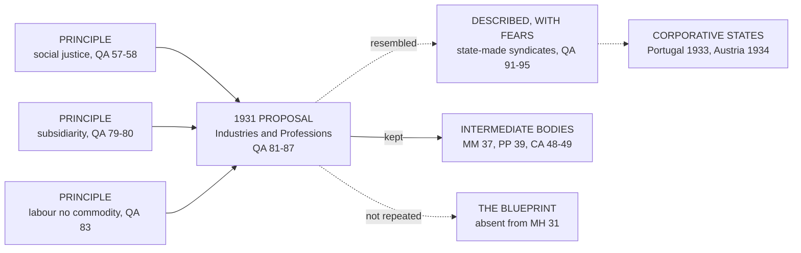

# Catholic Social Teaching · Lesson 2.2: *Quadragesimo Anno* and the interwar proposals

> ⏱ ~15 min · Module 2: The tradition takes shape, 1891–1971 · Builds on: [2.1](02-01-rerum-novarum.md), [`church-history` 9.1](../../church-history/lessons/09-01-the-church-and-the-totalitarian-states.md) · Unlocks: [3.3](03-03-subsidiarity.md), [4.2](04-02-the-just-wage.md)

## Why this matters

On 1 May 1934 Austria adopted a constitution that refounded it as a corporative state, and its makers claimed a papal encyclical as their warrant; Portugal's constitution of 1933 drew on the same text. That encyclical, Pius XI's *Quadragesimo Anno* (15 May 1931), is also where, Leo XIV writes, Pius XI formulated [subsidiarity](../reference.md#subsidiarity) systematically (*Magnifica Humanitas* 31, 2026). Such a text must be read sentence by sentence.

## The idea

A town engineer in 1931 writes: "People must be able to cross the river safely, so we should build an iron footbridge here." The first half will still be true in 2031; the second fits 1931's steel and budget. If the bridge rusts, the duty does not.

[*Quadragesimo Anno*](../reference.md#quadragesimo-anno) (QA, "in the fortieth year") marked [*Rerum Novarum*](../reference.md#rerum-novarum)'s fortieth anniversary in the depths of the Depression. Pius XI meant to defend and develop Leo XIII's teaching and to judge both the economy and socialism (QA 15). [2.1](02-01-rerum-novarum.md) taught *Rerum Novarum*; this lesson uses it.

QA's principles rode on a 1931 proposal: rebuild society through self-governing bodies organized by industry and profession, the *ordines*, which the Vatican English calls "Industries and Professions". That proposal looked like the corporatism of the interwar dictatorships. QA is the corpus's clearest case of a permanent principle carried by a contingent proposal. The skill is telling the cargo from the cart.

## The teaching

QA is paraphrased throughout, by vatican.va section numbers.

**T1. Ownership has two sides** (QA 45–46). Nature gives the right of ownership so that persons can provide for themselves and their families, *and* so that goods meant for all actually serve all (45). Deny the social side and you drift into individualism; deny the individual side, toward collectivism (46). *In words:* [private property](../reference.md#private-property) is a right with a purpose built in.

**T2. Right and use differ** (QA 47–49). [Commutative justice](../reference.md#commutative-justice) protects what is owned; using it well falls under other virtues, and abuse or non-use does not forfeit the right (47). Public authority may define owners' duties for the common good, but cannot abolish the natural right to own and bequeath (49). *In words:* the state may shape property, never abolish it.

**T3. Social justice** (QA 57–58, 71, 74, 88, 110). Distribution must be brought back to the norms of the common good, that is, [social justice](../reference.md#social-justice), which forbids either class to shut the other out (57–58). Pius XI had paired "legal or social" justice when commending Aquinas (*Studiorum Ducem*, 1923, Latin), and later defined it as asking of each what the common good requires (*Divini Redemptoris* 51, 1937). [Social charity](../reference.md#social-charity) is the soul of that order (QA 88). *Magnifica Humanitas* 46 and 77 now list social justice among five principles. *In words:* justice judges how a whole economy shares its fruits.

**T4. The wage** (QA 64–75). The wage contract is not unjust in itself (64), though partnership elements are advisable in present conditions (65). A just wage has several measures (66): the worker's and his family's support (71), the condition of the business (72), and the economic common good, above all employment (74). [4.2](04-02-the-just-wage.md) teaches the [just wage](../reference.md#just-wage). *In words:* a fair wage answers to family, firm and economy at once.

**T5. Subsidiarity** (QA 78–80). Individualism had wrecked the associations, leaving only the individual and an overloaded state (78). Hence a principle QA calls fixed and unchangeable: it is unjust to hand to a higher association what lesser ones can do, because social activity exists to help the members of the social body, never to absorb them (79); QA 80 names it "subsidiary function". [3.3](03-03-subsidiarity.md) teaches it. *In words:* the bigger body serves the smaller.

**T6. The proposal** (QA 81–87). The labour market lines society up in two camps, yet labour is no mere commodity (83). The cure is to rebuild [vocational orders](../reference.md#vocational-orders): self-governing bodies joining employers and workers of one industry or profession by social function (81–85). Their form is as free as the form of government (86); free associations should prepare the way (87). *In words:* replace class war with cooperation by trade.

**T7. The system QA described** (QA 91–96). Without naming Italy, QA describes one state-constituted syndicate per calling, with monopoly, compulsory dues and binding agreements; corporations as organs of the state; strikes banned (92–94). It grants the advantages (peaceful cooperation, socialist organizations repressed), then reports fears that the state is substituting itself for free activity and serving political ends (95). *In words:* QA credited the Fascist labour regime and warned against it in one paragraph.

**T8. Unbridled competition** (QA 88, 105–109). Free competition is useful within limits but cannot direct economic life (88). By 1931 an "economic dictatorship" of trustees controlling credit had replaced it, and abroad ran an "internationalism of finance" (105–109). Credit itself is [`theology-of-debt` 6.1](../../theology-of-debt/lessons/06-01-usury-and-finance-in-modern-teaching.md)'s. *In words:* a market left to itself abolishes itself.

**T9. Socialism** (QA 111–121). Communism seeks class war and the end of private ownership by any means (112). Moderate socialism's just demands, even reserving dangerously powerful kinds of property to the state, are not peculiar to socialism (113–115). But socialism that stays socialism conceives society as existing for material advantage alone, and cannot be reconciled with the Church's teaching (117–119); no one can be at once a good Catholic and a genuine socialist (120). [4.3](04-03-socialism-and-liberal-capitalism-each-judged.md) develops this [critique of socialism](../reference.md#critique-of-socialism). *In words:* the objection is to socialism's picture of society.

Pius XII's Pentecost radio message *La Solennità* (1 June 1941) put first every person's natural right to use the earth's goods, to which private property stays subordinate (the [universal destination of goods](../reference.md#universal-destination-of-goods)), and gave the organizing of work first to employers and workers. After the war the bodies survived and the blueprint did not: *Mater et Magistra* 37 (1961) recalled QA's vocational bodies as independent of the state, *Populorum Progressio* 39 (1967) permitted varied professional organizations and unions that respect religion, freedom and dignity, and said variety may even help preserve freedom, and *Magnifica Humanitas* 31 summarizes QA without the vocational order.

**Mark the levels.** QA is Pius XI's encyclical of 15 May 1931: authentic ordinary magisterium, **rung 3** by genre ([the ladder](../../fundamental-theology/lessons/04-04-the-ladder-of-doctrinal-authority.md); [levels of authority](../reference.md#levels-of-authority); genres per [`fundamental-theology` 4.5](../../fundamental-theology/lessons/04-05-reading-a-documents-weight.md)). T1, T2, T4 and T8's principle are **rung 3**; that the state cannot abolish what nature confers restates *Rerum Novarum* 6 and 47. T3's duties are **rung 3**; "social justice" is vocabulary with no rung of its own. T5 is **rung 3**, `fundamental-theology` 4.4's own example of that rung; QA's calling it unchangeable raises the grade, not the rung. T9 is **rung 3 at a heavy grade**: QA 121 invokes the pope's solemn authority (LG 25's manner of speaking), but no defining formula, so no definition (can. 749 §3). The 1941 message, an address, is **rung 3 at its lightest** at most. T6's design and T7's assessment carry no rung of their own.

**Principle or application.** [Principles](../reference.md#principle-and-application): ownership's two sides; right versus use; regulation without abolition; distribution by the common good; the wage's several measures; subsidiarity; that class war is not society's order; that competition cannot govern itself; socialism's incompatible idea of society. They are owed **religious submission of mind and will** (LG 25). Applications: the Industries and Professions as a program; partnership elements, which 65 ties to present conditions; the verdict on the Italian system (95). They are owed **serious, respectful consideration**: having weighed them, a Catholic may judge otherwise without dissenting, but may not wave them away unweighed or claim the Church's authority for his own design (GS 43; *Donum Veritatis* 24; [the three assents](../reference.md#the-three-assents)). [Empirical premises](../reference.md#empirical-premise): that wages pushed beyond measure cause unemployment (74); that power had passed to trustees (105); that competition had destroyed itself (109). Evidence decides them. The [two symmetrical errors](../reference.md#the-two-symmetrical-errors): "QA requires a corporative constitution" mistakes the cart for the cargo; "QA is a corporatist period piece" dumps the cargo with the cart.

**Where it stops.** QA disclaims competence in technique and claims it wherever the moral law is touched (41), the [disclaimer](../reference.md#the-doctrines-disclaimers) the later corpus repeats. It leaves the vocational bodies' form free (86), and in 1937 Pius XI wanted it adapted to place and circumstance (*Divini Redemptoris* 54). Whether class conflict is best overcome by sectoral bargaining, works councils, co-ownership or cooperatives is [prudence](../reference.md#prudential-judgment): the parties' first (Pius XII, 1941), then the legislator's.

The hard edge: the proposal resembled [interwar corporatism](../reference.md#interwar-corporatism) and was used by it, and QA 95 counts the repression of socialist organizations among the Italian system's advantages. Catholic theologians answer in three moves. They read QA against itself: free, self-governing associations (83, 87) against state-made monopolies (92), with QA 95's fears as subsidiarity's own objections. They file the design as application, as the later documents treat it. And they concede that judging a dictatorship's labour regime is prudential, where *Donum Veritatis* 24 allows magisterial interventions may not be free of every deficiency. The politics of 1931 (*Non abbiamo bisogno*, 29 June; the 2 September settlement) are [`church-history` 9.1](../../church-history/lessons/09-01-the-church-and-the-totalitarian-states.md)'s.

## The cart and the cargo

The principles outlived their vehicle.

## Worked examples

**Example 1 (clean): three property bills.** The parliament of Kestrova (invented) debates three bills: (i) landlords must keep rented flats heated and dry; (ii) the power grid passes into public ownership, with compensation; (iii) inheritance is abolished.

- (i) **Permitted.** QA 49 lets public authority define owners' duties for the common good; whether these standards are right is prudence.
- (ii) **Permitted in principle.** QA 114 accepts that some property carries power too dangerous for private hands. Whether a grid is such property is the legislator's call, resting on empirical premises.
- (iii) **Forbidden.** QA 49 puts owning and bequeathing beyond the state's power to abolish; no prudential weighing rescues the bill.

A deputy who says QA forbids (ii) inflates; one who calls QA 49 an old opinion demotes.

**Example 2 (strain): the sector councils.** A Kestrovan bill creates one council per industry, half employers' and half workers' delegates, with compulsory membership and dues, sector-wide binding agreements, and strikes banned in favour of state arbitration. Deputy Ash cites QA 81–87 for it; Deputy Brook cites QA 95 against.

- **Favoured:** cooperation organized around social function (81–84); sector-wide bargaining serves it.
- **Collision:** the monopoly, compulsory dues and strike ban are exactly what QA 95 feared, and they press against QA 87's freedom of association and against subsidiarity, since a state-made council is the higher body absorbing the lower. *Laborem Exercens* 20 (1981) adds that the strike is legitimate in proper conditions, a rung-3 principle a blanket ban strains.
- **Where it stops:** whether sectoral beats firm-level bargaining for wages and jobs is empirical; extending agreements and designing arbitration are prudential, and QA 86 leaves the form free.

Ash inflates an application into a mandate. Brook rightly applies QA's own fears, but would err if he concluded QA's aim binds no one. Several designs are legitimate; the legislators, not the moralist, choose.

## Watch out

- **You might think QA requires a corporative constitution,** since QA 82 says the state must re-establish the Industries and Professions. But that "must" carries principles through a proposal whose form QA 86 leaves free; later popes kept the bodies, not the blueprint (*Mater et Magistra* 37).
- **You might think the proposal's fate sinks the encyclical.** But subsidiarity, ownership's two sides and social justice are rung-3 principles restated ever since (*Centesimus Annus* 48; *Magnifica Humanitas* 31, 46).
- **You might think QA endorsed Fascism.** That drops QA 95's fears. Do not overcorrect: QA does not condemn the system either.
- **You might think QA defined that no socialist can be Catholic.** That overstates: rung 3 at a heavy grade, no defining formula, judging socialism as doctrine, historical fact or movement, if it stays truly socialism (117). Whether a given party is socialism in that sense is an application (*Pacem in Terris* 159–160; *Octogesima Adveniens* 31). "1931 politics" understates it.

## One-liner

> *Quadragesimo Anno* gave the corpus subsidiarity, social justice and ownership's social side as permanent principles, carried in a 1931 proposal that binds no one and survives only as a commitment to intermediate bodies.

## Problems

**P1 (🟢)** *(Exegetical)* Sort and weigh. Each claim is QA, paraphrased for this problem. Say whether it is a principle, an application or an empirical premise; give the level where one applies, and the assent it asks. The level of subsidiarity is fixed in `fundamental-theology` and is not asked here. **One line each.**

1. Ownership has an individual and a social side; deny either and you drift toward individualism or collectivism (45–46).
2. Abusing property or leaving it unused does not destroy the right to it (47).
3. In present conditions the wage contract should, where possible, take on elements of partnership (65).
4. Pushing wages too low or too high causes unemployment (74).
5. The state's social policy must re-establish the Industries and Professions (82).
6. Free competition, useful within limits, cannot direct economic life (88).
7. Economic power is now concentrated in a few trustees who control credit (105–106).
8. Social justice forbids one class to exclude the other from the benefits of production (57).

**P2 (🟡)** *(Exegetical)* Find the crux. Two **invented** texts, written for this problem and not the words of any real person:

> Lionel Mallory, on his blog *The Guildhall Letter*: "Catholics are bound to work for a corporative constitution. QA 82 says the state *must* re-establish the Industries and Professions, and QA 95 praises the system that did it."

> Dr Margery Hesketh, a historian: "QA blessed Fascism. It praised the regime's corporations, and its 'subsidiarity' was the regime's ideology in Latin dress."

Name one thing each gets wrong about QA 91–96, and the single claim about principle and application that both mishandle. **120 words or fewer.**

**P3 (🔴)** *(Exegetical)* Paraphrase reading. Two paraphrases of QA 113–120, written for this problem:

> (A) QA grants that moderate socialism has softened class struggle and its attack on property, and that some of its demands, even reserving certain powerful kinds of property to the state, are just and not peculiar to socialism. But socialism that stays socialism rests on an idea of society, organized for material advantage alone, that cannot be reconciled with Catholic teaching.
>
> (B) QA condemns moderate socialism because it still aims to abolish private property; where a socialist party drops that aim, a Catholic is free to join it.

(a) Which paraphrase is faithful, and which words in the other change QA's claim?

(b) What does QA 114–115 concede to moderate socialism, and why does the concession not reach the verdict of QA 117? Cite the sections that give QA's ground.

**150 words or fewer in all.**

Solutions

**P1** *(Exegetical)*

**Must hit, strict:**

1. **Principle**, rung 3; religious submission (the twofold character of ownership).
2. **Principle**, rung 3; religious submission (right distinct from use).
3. **Application.** The text ties it to present conditions, marking its own contingency. It is owed serious, respectful consideration; the principle beneath it (the social character of work) is rung 3.
4. **Empirical premise.** No doctrinal rung; it stands or falls with economics. The principle it serves (wages must serve employment and the common good, 74) is rung 3.
5. **Application**: an institutional proposal carrying principles (overcoming class conflict; subsidiarity). The document is rung 3, but the proposal binds no one's assent; serious consideration.
6. **Principle**, rung 3; religious submission.
7. **Empirical premise**, a diagnosis of 1931, with no rung. The principle it serves (concentrated power must answer to justice and public authority, 110) is rung 3.
8. **Principle**, rung 3. "Social justice" as a word has no rung of its own; the duty it names does.

**Wrong turns:** writing "rung 3" for 3 or 5 without saying that assent attaches to the principle, not the proposal (overstatement). Calling 6 "the pope's economics" (understatement). Treating 7 as a timeless principle. Calling 1 "defined".

**Model answer:** as above, one line each.

---

**P2** *(Exegetical)*

**Must hit, strict:**

- **Mallory:** QA 95 does not simply praise. It grants advantages, then records fears that the state is substituting itself for free activity and serving political ends. QA 86 leaves the form free, so 82's "must" carries principles, not a constitution.
- **Hesketh:** QA 91–95 describes the system without blessing it, and QA 95's fears are subsidiarity's objections (79–80), so subsidiarity was the measure *against* the regime, not its ideology. A good answer adds that QA did credit real advantages.
- **The crux:** both assume that QA's teaching *is* its 1931 corporative design (and its comment on the Italian system), so that the principles stand or fall with it. Mallory inflates the application into doctrine; Hesketh convicts the principles by the application. Correct: the design is an application (serious consideration); the principles are rung 3 and independent of it.

**Wrong turns:** denying that QA credited the system at all. Making the crux "whether corporatism works", which is an empirical question, not the shared mistake. Mapping either writer onto a present-day party.

**Model answer:** Mallory misreads QA 95, which grants the system's advantages but records grave fears (the state replacing free activity, political ends), and ignores QA 86, which leaves the form free. Hesketh misses that those fears are subsidiarity's own objections, so the principle judged the regime rather than dressing it; QA credits advantages without blessing the whole. Both treat the 1931 corporative design as the content of QA's teaching. It is an application, owed serious consideration and binding no one's assent; subsidiarity and social justice are rung-3 principles that stand without it.

---

**P3** *(Exegetical)*

**Must hit, strict (a):** **(A)** is faithful. In (B), "because it still aims to abolish private property" changes the ground: QA 117 says that even a socialism that has given way on class struggle and property cannot be reconciled with Catholic teaching. "Free to join" turns a judgment on whatever remains truly socialism into a permission about parties, which this text does not give.

**Must hit, strict (b):** the **concession**: a class struggle purged of hatred can become honest discussion of differences, the attack on property can narrow to the usurped power ownership exercises over society, and reserving certain dangerously powerful kinds of property to the state is a just demand (114). Such demands are consistent with Christian truth and **not peculiar to socialism**, so pursuing them gives no reason to become a socialist (115). It does not reach the verdict because the verdict rests on something else: socialism's **concept of society**, human association instituted for material advantage alone, production demanding the surrender of higher goods including liberty, and no true social authority descending from God (118–119). QA 120 grants that socialism, like every error, contains some truth.

**Wrong turns:** calling (B) faithful because QA 113 says moderate socialism approaches Christian truth, which drops 117. Reading 114's state ownership as QA endorsing nationalization in general (it speaks only of some kinds of property). "Only communism is condemned." Treating the concession as a step toward Christian socialism, which QA 120 calls a contradiction.

**Model answer:** (A) is faithful. (B)'s "because it still aims to abolish private property" misplaces the ground, since QA 117 holds that even a socialism that has yielded on property and class struggle remains irreconcilable; and "free to join" converts a judgment on whatever remains truly socialism into a permission QA never gives. QA 114–115 concedes a great deal: class struggle without hatred, an attack on property narrowed to its usurped power over society, even some powerful property reserved to the state. But these demands are not peculiar to socialism, so they give no reason to become a socialist. The verdict rests elsewhere, on socialism's concept of society as existing for material advantage alone, sacrificing higher goods and liberty to production and lacking authority from God (118–119); hence QA 120.

## Flashback

**From Lesson [1.4](01-04-before-1891-the-roots-and-the-social-question.md) (Before 1891: the roots and the social question):** *(Exegetical (a) · Exegetical (b).)* Diagnose. A parish study handout, **invented, written for this problem**; no real person or body wrote it:

> "Before 1891 the Church had charity, not social teaching: alms were a generous counsel for the rich, never a duty. Then Leo XIII, answering Marx, created the social principles from nothing. And since the Fribourg Union's work fed into *Rerum Novarum*, every proposal the Union made became Catholic doctrine in 1891."

(a) Name four errors (they point in both directions) and correct each from the sources taught in 1.4. **100 words or fewer.**

(b) The handout cites *Deus Caritas Est* 27 (2005): the Church's leadership was slow to see that a just society needed a new approach (paraphrased). Principle, application or empirical premise? At what level, and does it support the handout? **Two sentences.**

Solution

**Must hit, strict (a):**

- **"Never a duty"** demotes: giving from surplus is a precept (ST II-II q.32 a.5), and for Ambrose it repays a debt (*De Nabuthe* 12.53).
- **"From nothing"** understates: the owed hire (Deut 24:15), Ambrose, q.66 a.2's lawful ownership with common use, and the 1878 encyclical (*Quod Apostolici Muneris*) all precede 1891. What was new was a pope applying them systematically to wage labour.
- **"Answering Marx"** drops a rival: *Rerum Novarum* answered [liberal political economy](../reference.md#liberal-political-economy) too, after decades of social Catholic work (Ozanam's society, 1833; Ketteler, 1864).
- **"Every proposal became doctrine"** inflates: the Fribourg Union, one source among several, has **no magisterial level**, and its proposals stayed applications.

**Must hit, strict (b):**

- An **empirical (historical) claim**, neither principle nor application: it sits in a rung-3 encyclical but has **no doctrinal rung of its own**, and the evidence decides it.
- It does **not** support the handout: it concedes a slow *new approach* to applying old principles, not their absence, and the same section names Ketteler a pioneer.

**Wrong turns:** correcting "from nothing" with "Leo only repeated Aquinas", which overstates the other way. Giving DCE 27's admission rung 3 because an encyclical makes it.

**Model answer (a):** The handout demotes alms, a precept for Aquinas and a debt for Ambrose. It understates the roots, which 1891 applied to wage labour rather than invented. It drops liberal political economy, the other rival. And it inflates: the Fribourg Union has no magisterial level, and its proposals remained applications.

**Model answer (b):** A historical, empirical claim with no doctrinal rung of its own, though a rung-3 encyclical makes it. It concedes a slow new approach, not missing principles, and names Ketteler a pioneer, so it refutes "from nothing".

## Connections

- **Backward:** [2.1](02-01-rerum-novarum.md) supplies the property, wage and association teaching QA defends, including *Rerum Novarum* 49's praise of the old guilds adapted to a new age, which the vocational orders develop; [1.4](01-04-before-1891-the-roots-and-the-social-question.md) set the social question QA takes up forty years on; [`fundamental-theology` 4.4](../../fundamental-theology/lessons/04-04-the-ladder-of-doctrinal-authority.md) fixes subsidiarity at rung 3.
- **Forward:** [3.3](03-03-subsidiarity.md) teaches subsidiarity in both halves; [4.2](04-02-the-just-wage.md) works the three wage measures; [4.3](04-03-socialism-and-liberal-capitalism-each-judged.md) carries the socialism judgment to *Centesimus Annus*; [2.3](02-03-mater-et-magistra-and-pacem-in-terris.md) shows *Mater et Magistra* rereading QA; [6.3](06-03-distributism-and-the-alternative-proposals.md) asks what QA's call for workers to acquire property (59–63) does for distributism.
- **Sideways:** [`church-history` 9.1](../../church-history/lessons/09-01-the-church-and-the-totalitarian-states.md) keeps the 1931 clash with Fascism and the corporative states as events. Durkheim's occupational groups against anomie ([`social-theory` 3.1](../../social-theory/lessons/03-01-the-division-of-labor-and-social-solidarity.md)) are a secular neighbour of QA's Industries and Professions, a sociological remedy rather than a moral principle; postwar corporatism as peak-association bargaining ([`political-institutions` 6.4](../../political-institutions/lessons/06-04-majoritarian-and-consensus-democracy.md)) is a third thing again. [`theology-of-debt` 6.1](../../theology-of-debt/lessons/06-01-usury-and-finance-in-modern-teaching.md) owns credit and finance, where QA 106's control of credit belongs.
