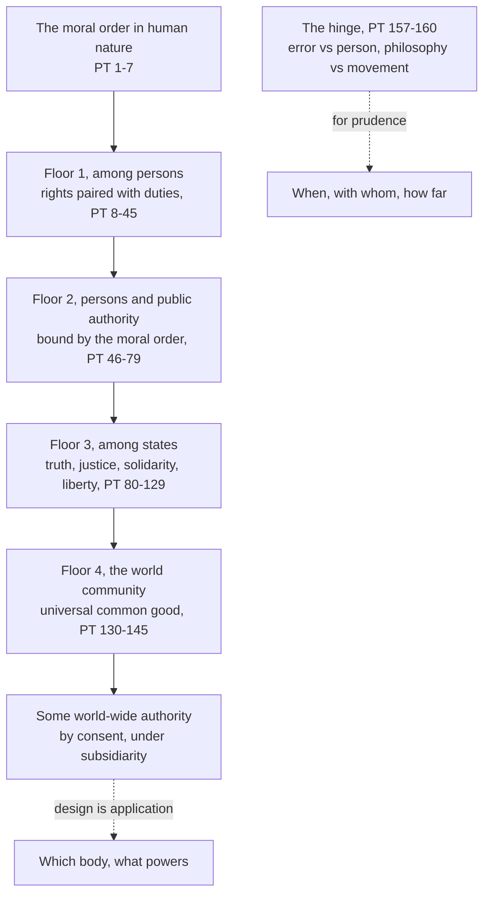

# Catholic Social Teaching · Lesson 2.3: John XXIII: *Mater et Magistra* and *Pacem in Terris*

> ⏱ ~15 min · Module 2: The tradition takes shape, 1891–1971 · Builds on: [2.2](02-02-quadragesimo-anno-and-the-interwar-proposals.md) · Unlocks: [2.4](02-04-gaudium-et-spes-to-justice-in-the-world.md), [3.1](03-01-human-dignity.md), [5.5](05-05-migration.md), [6.2](06-02-integral-human-development-and-the-international-order.md)

## Why this matters

Someone posts *Pacem in Terris* 137, where the moral order demands a public authority of world-wide reach, and calls it the Church's blueprint for world government. Someone else replies that its list of rights is United Nations liberalism with a halo. Both skip the sentences that condition what they quote. John XXIII carried the social teaching to the farm, the poor nation and the world, put it into the language of rights, and drew the distinction that let Catholics work beside people whose philosophy they reject.

## The idea

By 1961 Leo XIII's factory question had gone global: life was thick with organizations and state programmes, farming lagged behind the city, and whole nations were poor beside rich ones. *[Mater et Magistra](../reference.md#mater-et-magistra)* (15 May 1961) ran the old principles over those facts. *[Pacem in Terris](../reference.md#pacem-in-terris)* (11 April 1963), published less than two months before his death, drew the moral order as a building with four floors: persons, persons under authority, states, and the world community. On every floor, rights and duties come in pairs rooted in human nature.

Then the hinge. You may reject a false philosophy and still work with the people and movements it inspired, because a person who errs is still a person, and a movement changes with circumstances while its founding formula does not. Whether, when and how far is left to prudence. John XXIII and the Council as events are [`church-history` 9.2](../../church-history/lessons/09-02-the-second-vatican-council.md)'s.

**The philosophical neighbour.** [Jacques Maritain](../reference.md#maritain) (the man: [`thomistic-synthesis` 6.3](../../thomistic-synthesis/lessons/06-03-strict-observance-and-existential-thomism.md)) worked this ground as a philosopher. *Man and the State* (1951) makes the person the end of political life, the state an instrument of the body politic rather than its sovereign, and natural law the ground of rights. From UNESCO's 1947 inquiry into rights, whose symposium he introduced, he took the lesson that opposed philosophies can agree on a practical list of rights without agreeing why. *Pacem in Terris* addresses the same mixed audience but names its grounds, God and the natural law: a neighbour, not a source it cites. Maritain returns in [6.4](06-04-three-readings-catholic-liberal-integralist-progressive.md).

## The teaching

**T1. [Socialization](../reference.md#socialization)** (MM 59–67). Ties and associations multiply (the Italian text's *socializzazione*; the Latin's *socialium rationum incrementa*, the growth of social relationships, as the Vatican English has it), and state intervention grows with them (59–60). This widens access to health care, education, housing and work (61), but narrows freedom and initiative (62). Free people made it, so it can and must be steered (63–64): by authorities with a sound view of the common good and by really autonomous intermediate bodies (65–66). MM 53 makes [subsidiarity](../reference.md#subsidiarity), quoted from *Quadragesimo Anno*, the rule of state action. *In words:* organized society is neither good nor bad; the test is whether persons stay its authors.

**T2. The agenda widens** (MM 123–177). Farming has become a depressed occupation (124–125). The gap between rich and developing nations is probably the hardest problem of the day, and [solidarity](../reference.md#solidarity) forbids indifference to it (157). Destroying food others need is an outrage (161); aid must build capacity (163), respect each nation's character (169–170), and never be a disguised colonialism (171–173). *In words:* Leo XIII's question about classes is now asked about regions and nations.

**T3. The method** (MM 236, 238). Review the situation, judge it by principles, decide what can and should be done: *aspicere, iudicare, agere*. Sincere Catholics may differ over applications (238). *In words:* facts, principles, action ([see-judge-act](../reference.md#see-judge-act); [1.3](01-03-see-judge-act.md)).

**T4. [Rights paired with duties](../reference.md#rights-and-duties)** (PT 9, 11–30). Every human being is a person, with intelligence and free will, and so has universal, inviolable rights and duties flowing from his nature (9). The catalogue runs from life and the means of a decent life (11), through good name, truth, education, worship by the right dictates of conscience and a state in life (12–17), to work, a just wage, property with its social obligation, association, emigration when there are just reasons, public life and legal protection (18–27). The right to life carries the duty to preserve it (29), and one person's right is everyone else's duty to respect it (30). *In words:* a right is also a task.

**T5. [The four orders](../reference.md#the-four-orders-of-pacem-in-terris)** (PT Parts I–IV): among persons (8–45); between persons and [public authority](../reference.md#political-authority) (46–79), which comes from God, binds in conscience only within the moral order (51) and fits any genuinely democratic form (52); among states, subjects of rights and duties under the same natural law (80–129); and in the world community (130–145). *In words:* one moral law at four scales.

**T6. The [universal common good](../reference.md#universal-common-good)** (PT 132–145). The human family is one, so it has a common good (132). States acting by treaty are now unequal to it (134–135). Authority exists for the common good and must be effective, so the moral order demands some [public authority with world-wide reach](../reference.md#international-authority) (136–137): set up by the consent of all nations, never by force, impartial (138), aimed at personal rights (139), and bound by subsidiarity, creating conditions for states rather than absorbing their functions (140–141). The 1948 Universal Declaration is a step forward, though some reservations about it were just (143–144). *In words:* a world problem needs an authority equal to it, built by consent, serving the nations.

**T7. The hinge** ([error and the person who errs](../reference.md#error-and-the-person-who-errs); PT 157–160). PT is addressed also to all men of good will, the first encyclical whose address names them (*Compendium* 84 n. 132 and 95; *Magnifica Humanitas* 33). Its principles rise from natural rights, so applying them means cooperating with non-Catholics of natural integrity (157). One may distinguish error from the person who errs, who keeps his dignity (158), and a false philosophy from the undertakings it inspired: the formula is fixed, the undertakings change and may hold good elements (159). Whether the moment for cooperation has come, and its manner and degree, are for prudence, chiefly of those who lead in the field, under natural law, the social teaching and the directives of Church authority, which may judge practical applications (160). *In words:* reject the error, respect the person, decide case by case about the movement.

**Mark the levels.** Both are encyclicals: their principles are **rung 3**, owed religious submission ([the ladder](../../fundamental-theology/lessons/04-04-the-ladder-of-doctrinal-authority.md); [levels of authority](../reference.md#levels-of-authority)). **Rung 3**: rights paired with duties (PT 28–30); authority from God (PT 46, restating Romans 13:1); unjust laws do not bind (PT 51, citing Acts 5:29); the right to emigrate (PT 25; taught in [5.5](05-05-migration.md)); the distinctions of PT 158–159; the universal common good and the need for an authority adequate to it on PT 138–141's conditions, restated in *Caritas in Veritate* 67 (2009) and *Fratelli Tutti* 172–173 (2020). Dignity's level is fixed in [`creation-grace-last-things` 2.1](../../creation-grace-last-things/lessons/02-01-the-image-of-god.md), subsidiarity's in `fundamental-theology` 4.4. See-judge-act is a method, **no doctrinal rung**. Maritain: **no magisterial level**.

**Principle or application.** [Principles](../reference.md#principle-and-application) ask religious submission; **applications** ask [serious, respectful consideration](../reference.md#the-three-assents). MM's farm programme (tax relief, bearable credit, insurance, price protection, 131–137) is application by its own words: directives to be applied as circumstances allow or demand (126), for a farm structure no one can fix in advance (142). So is any design for a world authority, PT 145's hope for the UN, and each decision to work with a movement. **[Empirical premises](../reference.md#empirical-premise)** stand or fall with evidence: associations multiplying (MM 59), why people leave the land (MM 124), states unequal to world problems (PT 134–135). The [two symmetrical errors](../reference.md#the-two-symmetrical-errors): "PT requires this world body" inflates; "PT's rights are John XXIII's opinion" demotes.

**Where it stops.** PT 160 permits cooperation in a particular good in principle and leaves when, with whom and how far to [prudence](../reference.md#prudential-judgment), first the lay leaders'. Bishops may issue a [practical directive](../reference.md#practical-directive), which MM 239 says Catholics must obey; it binds in conduct, within the authority's competence, but does not become a timeless truth. Pius XI's 1937 ban on all collaboration with communism (*Divini Redemptoris* 58) was such a directive; PT 160 hands the question back to prudence. No principle here names the body, its powers or the treaty: that is [6.2](06-02-integral-human-development-and-the-international-order.md)'s, and the doctrine [proposes no model](../reference.md#the-doctrines-disclaimers).

## The four orders

One natural law at widening scales; the dashed arrows mark where doctrine hands over to prudence.

## Worked examples

**Example 1 (clean): the laid-off machinist.** A machinist loses her job when her plant closes. PT 11 gives her a right to be looked after in unemployment that is enforced, not chosen; the qualifier is the text's own.

- **Her duty** (PT 29's pattern; PT 20, quoting Pius XII, calls work a duty nature imposes): to seek suitable work. Claiming support while refusing it builds with one hand and tears down with the other (30).
- **Others' duty** (30): to respect her claim.
- **The public authority's duty** (60, 64): insurance against such misfortune, and opportunities for work.
- **Application:** the benefit's size and length, the job-search rules. The right and duties are rung 3; the scheme is the legislator's prudence.

**Example 2 (strain): the Red Furrow in Doravia (invented).** In the invented country of Doravia, the Red Furrow movement was founded on a materialist charter: religion an illusion, history class war. Sixty years on it runs village clinics, and asks the Doravian Catholic Farmers' Union to join a clinics campaign.

- **Decided.** The charter stays rejected: PT 159 says the formula does not change, and *Quadragesimo Anno* 120's [judgment on socialism as a doctrine](../reference.md#critique-of-socialism) stands. The Furrow's members keep their dignity (158); clinics may be a good right reason approves (159). Cooperating for it is not forbidden.
- **Forbidden.** Compromising faith or morals (PT 157, quoting MM 239): signing the charter to join, or lending the Union's name to its atheism, adheres to the error.
- **Where it stops.** Will the Furrow use the campaign to recruit? Is this the moment? A joint petition, shared rallies, a shared electoral list? PT 160 gives these to prudence, first to the Union's leaders, within any directive of the Doravian bishops. Equally faithful members can answer differently.

The line between cooperating in a good and lending prestige to an error is drawn by judgment, not deduction.

## Watch out

- **You might think PT asks for a world superstate**, but it requires the nations' consent and forbids imposing the authority by force (138), and subsidiarity forbids it to absorb the states' functions (140–141). A design treated as doctrine is inflation; the principle dismissed as a period piece is demotion.
- **You might think PT's rights are borrowed secular liberalism**, but it grounds them in a nature God made and in natural law (9, 28, 38), pairs them with duties (28–30), records just reservations about the Declaration (144), and repeatedly cites Pius XII's 1942 Christmas message, six years before it. "The Pope's opinion" also understates rung 3.
- **You might think PT 159–160 softened the judgment on communism**, but the philosophy, PT says, does not change, and *Divini Redemptoris* 58's judgment that communism is intrinsically wrong stands (rung 3). Only the 1937 directive lapsed. The opposite misreading, that cooperation is now a duty, drops PT 160's question whether its time has come.

## One-liner

> John XXIII spoke rights paired with duties to all people of good will, carried the teaching to the farm, the poor nation and the world, and taught Catholics to reject an error without rejecting the person, leaving cooperation to prudence.

## Problems

**P1 (🟢)** *(Exegetical)* Sort and weigh. Six claims, paraphrased for this problem. For each, say whether it is a principle, an application, an empirical premise, or none of these. Give its level (or "no rung") and the assent it asks. **One line each.**

1. In the same person, the right to life carries the duty to preserve one's life (PT 29).
2. Laws enacted against the moral order have no binding force in conscience (PT 51).
3. Look, judge, act are the stages normally followed in putting social principles into practice (MM 236).
4. One cause of the drift from the land is that farming has become a depressed, low-productivity occupation (MM 124).
5. Farmers need credit at rates they can bear, and two insurance schemes, one for their produce and one for their families (MM 134–135).
6. Whoever wants to save Christian civilization must refuse to collaborate with communism in any undertaking at all (Pius XI, *Divini Redemptoris* 58, 1937).

**P2 (🟡)** *(Exegetical)* Close reading: a paraphrase reading. Below is a paraphrase of PT 158–160 written for this problem, not the encyclical's words.

> (i) We may always tell apart an error and the person who holds it, even in religion and morals; the person in error keeps his dignity and may yet come to the truth.
>
> (ii) Since truth and error have equal rights, a Catholic should treat the error with the same respect he owes the person.
>
> (iii) A false philosophy about the nature, origin and end of man can be told apart from the economic, social, cultural and political undertakings that grew out of it.
>
> (iv) Because those undertakings change with conditions, the philosophy behind them changes too and can no longer simply be called false.
>
> (v) Such undertakings may contain good elements that agree with right reason, so practical meetings once thought useless may now bear fruit.
>
> (vi) Whether the time for cooperation has come, and in what manner and degree, is for prudence to decide, chiefly by Catholics who lead in those fields, acting by natural law, the social teaching and the directives of Church authority.

(a) Two sentences say what PT does not say. Name them and state what PT actually says. **One sentence each.**

(b) Sentence (vi) ends with the directives of Church authority. Say why a bishops' directive about one movement in one year does not become a principle, and what a Catholic owes it. **Two sentences.**

**P3 (🔴)** *(Exegetical)* Diagnose. Two invented texts, written for this problem and not the words of any real person:

> ***Common Roof*** (newsletter of an invented world-federalist society): "*Pacem in Terris* 137 settles it. The moral order requires a world government able to override national governments whenever the universal common good demands it. Catholics who oppose a world parliament with its own police and taxes are dissenting from an encyclical."

> ***Ironside Notes*** (an invented blog): "*Pacem in Terris* swapped the Church's language for the United Nations'. Its catalogue of rights is secular liberalism, individual entitlements cut loose from duty and from God, and the Declaration it praised proves it. It is John XXIII's opinion, and Catholics may ignore it."

Name **two** errors in each text. Correct each from PT's own sections, and give the right level wherever a level is at issue. Do not judge whether any particular institution would be wise. **150 words or fewer.**

Solutions

**P1** *(Exegetical)*

**Must hit, strict:**

1. **Principle**, **rung 3**, owed religious submission. It is PT 28–30's pairing of rights and duties.
2. **Principle**, **rung 3**, restating Acts 5:29, which PT 51 cites. Owed religious submission.
3. **None of the three.** It is a method commended, with **no doctrinal rung**. What it produces is principle or application by its content ([1.3](01-03-see-judge-act.md)).
4. **Empirical premise**, **no rung**. It stands or falls with the evidence, and MM offers it as one contributory cause among several.
5. **Application** in a rung-3 encyclical, owed **serious, respectful consideration**. MM 126 offers its farm directives to be applied as circumstances allow, and MM 142 says the structure of farm life cannot be fixed in advance.
6. **Application**: a **practical directive of 1937** inside a rung-3 encyclical. It bound as a directive then, and PT 160 now assigns cooperation to prudence. The same section's judgment that communism is intrinsically wrong is the principle (rung 3), and it stands.

**Wrong turns:** calling item 3 doctrine, or calling it "an application". Calling item 5 binding Catholic farm policy. Calling item 2 "a 1963 opinion". In item 6, either treating the directive as a permanent principle, or treating its lapse as a withdrawal of the judgment on communism.

**Model answer:** (1) Principle, rung 3, religious submission. (2) Principle, rung 3, restating Acts 5:29; religious submission. (3) A method, no rung; its outputs take their own status. (4) Empirical premise, no rung; revisable on evidence. (5) Application, serious consideration; MM itself conditions it on circumstances (126, 142). (6) A 1937 practical directive (application), later handed to prudence by PT 160; the judgment "intrinsically wrong" in the same section is a rung-3 principle and stands.

---

**P2** *(Exegetical)*

**Must hit, strict (a):**

- **(ii)** is unfaithful. PT 158 separates the error from the person precisely so that the error can be rejected while the person keeps his dignity. It says nothing about error having rights or being owed respect.
- **(iv)** is unfaithful. PT 159 says the philosophical formula does **not** change once set down. Only the undertakings change with conditions.

**Must hit, strict (b):**

- PT 160 itself puts the timing, manner and degree of cooperation under prudence, so a decision about one movement in one year is an **application**. A directive judging it binds as a **directive**, in conduct and within its competence (MM 239), and it can lapse when conditions change, as *Divini Redemptoris* 58's ban did.
- A Catholic owes it **obedience in conduct and serious consideration**. He may not treat it as weightless, and he may not treat it as a truth binding for all times.

**Wrong turns:** flagging (vi) as unfaithful because it "puts laypeople above bishops" (PT 160 gives the decision chiefly to those in the field, within the directives of Church authority). Saying the Church has no say over application at all, which drops PT 160's last sentence. Saying a directive is owed religious submission as doctrine.

**Model answer:** (a) Sentence (ii) is wrong: PT 158 distinguishes the error from the person so that the person keeps his dignity while the error is still rejected, and it grants error no rights. Sentence (iv) is wrong: PT 159 says the philosophy's formula does not change once set down; only the movements change. (b) PT 160 makes whether, when and how far to cooperate a matter of prudence, so a directive about one movement judges an application and binds as a directive for its time, as *Divini Redemptoris* 58's ban once did. A Catholic owes it obedience in conduct and serious consideration, not the assent owed to a permanent principle.

---

**P3** *(Exegetical)*

**Must hit, strict (any two per text):**

- ***Common Roof*:**
  - **"Override national governments whenever"** contradicts PT 140–141. Subsidiarity binds the world authority: it may not limit the states' sphere or take over their functions, and it exists to create conditions in which they can do their work.
  - **Imposition** is excluded. PT 138 requires the consent of all nations and forbids imposing the authority by force.
  - **"Dissenting from an encyclical."** PT names no parliament, police or tax. What it teaches (rung 3) is the need for some adequate authority on these conditions. The newsletter's design is its own judgment, and claiming the encyclical's authority for it is the inflation error.
- ***Ironside Notes*:**
  - **"Cut loose from duty and from God."** PT grounds rights in a nature God made and in the natural law (9, 28, 38), and it pairs each right with duties (28–30).
  - **"The Declaration proves it."** PT 144 praises the Declaration only as a step, with justified reservations. PT's catalogue draws on Pius XII's 1942 Christmas message and restates *Rerum Novarum*'s rights of property and association (21, 23).
  - **"John XXIII's opinion."** An encyclical's principles are **rung 3**, owed religious submission. This is the demotion error.

**Wrong turns:** "correcting" *Common Roof* by denying that PT says the moral order demands some world-wide authority (137 says it). "Correcting" *Ironside* by claiming PT adopted the Declaration wholesale. Arguing whether a world parliament would be wise, which is outside the problem.

**Model answer:** *Common Roof* misreads PT 137. PT 138 requires the consent of all nations and forbids imposing the authority by force. PT 140–141 binds it by subsidiarity: it may not absorb or override the states' functions. PT names no parliament, police or tax, so opposing one design is not dissent; only the need for some adequate authority on these conditions is taught (rung 3). *Ironside* is wrong that PT's rights float free of God and duty: they rest on a nature God made and on the natural law (9, 28, 38), and each carries duties (28–30). PT praises the Declaration only as a step, with justified reservations (144). An encyclical's principles are rung 3, not opinion.

## Flashback

**From Lesson [2.1](02-01-rerum-novarum.md) (*Rerum Novarum*):** *(Exegetical (a) · Exegetical (b).)* A case invented for this problem. The Sallowmere Bakers' Union is rewriting its rules. One member says: "*Rerum Novarum* praises the old guilds, so we must take the guild form: master bakers who employ others sit beside journeymen, and officers serve for life." Another replies: "Leo's rules for associations were advice to Catholic clubs in 1891. They bind no union now."

(a) Classify each as a principle, an application, or a choice with no magisterial level, giving the level or assent: §57's "general and lasting law" (Benziger 1903), that an association be organized to help each member better his condition in body, soul and property; §58's proposal of a members' committee to settle disputes between master and workman; a life term for officers. **One line each.**

(b) Name the error in each member's claim and the sections it misreads. **Two sentences.**

Solution

**Must hit, strict (a):**

- §57's law: **principle, rung 3** (an encyclical), owed religious submission. Leo presents it as the part that lasts.
- §58's committee: a **contingent application**, a proposed institution, owed serious, respectful consideration. A union that weighs it and settles disputes another way dissents from nothing.
- The life term: the members' own choice, **no magisterial level**. §56 gives an association the right to adopt the rules that best serve its aims; §57 is the test they must pass.

**Must hit, strict (b):**

- The first member **inflates**. §49 praises the guilds as history but says unions must suit the present age, and commends associations of workmen alone or of workmen and employers together; §56 fixes no form, leaving organization to national character, experience and "circumstances of fact and of time".
- The second **demotes**. The call for Catholic societies was conditional (§54, "Under these circumstances"), but §57 states its law as general and lasting, binding a union of any form.

**Wrong turns:** calling §58's committee binding because it sits in an encyclical. Saying RN forbids life terms: no section rules on terms, though members may judge that they fail §57's test. Reading "soul" in §57 as requiring a Catholic society, which runs §57 together with §54's conditional advice (2.1's Example 2).

**Model answer (a):** §57's law: principle, rung 3, religious submission. §58's committee: application, serious, respectful consideration. The life term: the union's own choice, no magisterial level, judged by §57's test (§56).

**Model answer (b):** The first member turns history into a rule: §49 asks unions to suit the present age and praises both workers-only and mixed associations, and §56 leaves the form to circumstances. The second mistakes §54's conditional advice for the whole teaching and drops §57's general and lasting law.

## Connections

- **Backward:** [2.2](02-02-quadragesimo-anno-and-the-interwar-proposals.md) gave subsidiarity, which MM 53 quotes, and *Quadragesimo Anno*'s judgment on socialism, which PT 159 leaves standing. [2.1](02-01-rerum-novarum.md) gave the rights of property and association that PT's catalogue restates (21, 23). [1.3](01-03-see-judge-act.md) owns the method MM 236 adopts. [1.2](01-02-permanent-principles-and-contingent-applications.md) owns the principle/application split this lesson runs.
- **Forward:** [2.4](02-04-gaudium-et-spes-to-justice-in-the-world.md) takes up dialogue with all people of good will. [3.1](03-01-human-dignity.md) treats dignity as the ground of rights (PT 9), and [3.2](03-02-the-common-good.md) treats the common good and the universal common good. [5.3](05-03-war-and-peace.md) reads PT 127 on war in the atomic age, and [5.4](05-04-deterrence-and-the-challenge-to-just-war.md) PT 112–113 on the arms race. [5.5](05-05-migration.md) teaches PT 25 and 106 on emigration and immigration. [6.2](06-02-integral-human-development-and-the-international-order.md) owns the world-authority question and its later restatements. [6.4](06-04-three-readings-catholic-liberal-integralist-progressive.md) gives Maritain's Catholic liberal reading at full strength.
- **Sideways:** [`political-philosophy` 6.2](../../political-philosophy/lessons/06-02-immigration-may-a-state-exclude.md) states PT's right to emigrate when there are just reasons as one position among the secular arguments. PT 51 quotes Aquinas on unjust law, read as political thought in [`history-of-political-thought` 2.3](../../history-of-political-thought/lessons/02-03-aquinas-on-law.md), with natural-law theory in [`ethics` 4.4](../../ethics/lessons/04-04-natural-law-aquinas.md). MM 62's fear that organized life stifles initiative is the moral cousin of Weber's "iron cage" ([`social-theory` 4.4](../../social-theory/lessons/04-04-bureaucracy-rationalization-and-disenchantment.md)). MM 63's insistence that free people make that order, and can steer it, is the difference.
