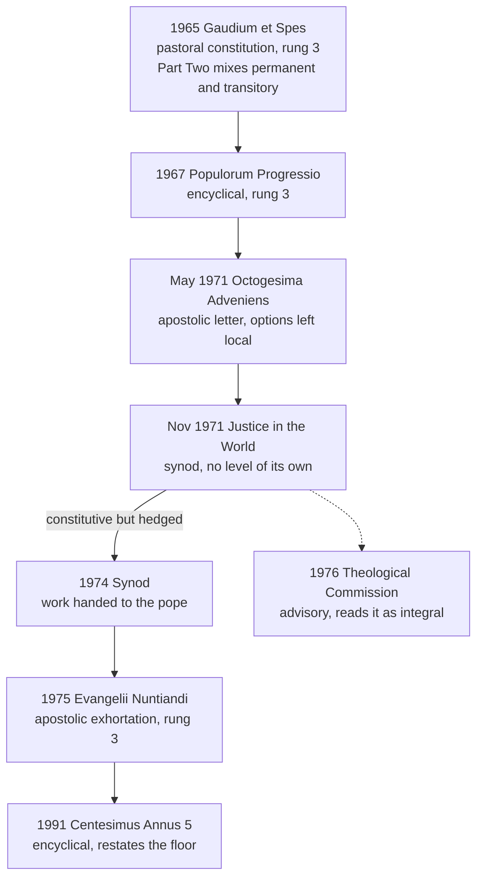

# Catholic Social Teaching · Lesson 2.4: The Council and after: *Gaudium et Spes* to *Justice in the World*

> ⏱ ~15 min · Module 2: The tradition takes shape, 1891–1971 · Builds on: [2.3](02-03-mater-et-magistra-and-pacem-in-terris.md), [`fundamental-theology` 4.5](../../fundamental-theology/lessons/04-05-reading-a-documents-weight.md) · Unlocks: [3.1](03-01-human-dignity.md), [3.2](03-02-the-common-good.md), [5.1](05-01-the-political-community-and-the-limits-of-the-state.md), [6.2](06-02-integral-human-development-and-the-international-order.md)

## Why this matters

Two posters hang on a university chaplaincy's noticeboard. One reads "Vatican II: justice is constitutive of the Gospel." The other reads "Vatican II: the Church's mission is religious, not political." Neither sentence is in the Council's texts. The first borrows from a 1971 synod document and the second from *Gaudium et Spes* 42. The decade 1965–1975 produced the corpus's most-quoted lines, and the same documents carry its most careful labels of weight.

## The idea

Imagine hospital rules with a note attached: "Part One states what we hold about patients. Part Two applies it to this year's wards, and some of it will not outlast the year." The Council attached exactly such a note to its pastoral constitution. [`fundamental-theology` 4.5](../../fundamental-theology/lessons/04-05-reading-a-documents-weight.md) taught that genre, and this lesson uses it.

Four voices of different weight follow. *Populorum Progressio* (1967) carries the social question to the whole world as development. *Octogesima Adveniens* (1971) hands the reading of each country to the Christians who live there. The 1971 Synod of Bishops calls action for justice a "constitutive dimension" of preaching the Gospel, but a synod only counsels. *Evangelii Nuntiandi* (1975) then settles what Paul VI chose to settle. In this decade, genre and hedges are part of the content. The events themselves belong to [`church-history` 9.2](../../church-history/lessons/09-02-the-second-vatican-council.md) and [9.3](../../church-history/lessons/09-03-after-the-council.md).

## The teaching

All texts paraphrased; section numbers checked against the Vatican texts.

**T1. [*Gaudium et Spes*](../reference.md#gaudium-et-spes)** (Vatican II, pastoral constitution, 7 December 1965), note 1 on the title. It is "pastoral" because it rests on doctrinal principles while setting out the Church's relation to the world. Part One gives her teaching on the person, the world and human relations. Part Two treats urgent questions in that light, so its matter mixes elements of permanent and of only transitory value. It is read by the general norms of interpretation, with changeable circumstances in mind, especially in Part Two. *In words:* the Council tells you to sort its own sentences.

**T2. GS 25.** Every social institution has the human person as its starting point, its subject and its goal. The [common good](../reference.md#common-good) (GS 26) belongs to [3.2](03-02-the-common-good.md), and the political community (GS 73–76) to [5.1](05-01-the-political-community-and-the-limits-of-the-state.md). *In words:* institutions exist for persons.

**T3. GS 36, 42–43.** Created things and societies have their own laws and values. That [rightful autonomy](../reference.md#rightful-autonomy-of-earthly-affairs) is a just demand, but autonomy as independence from the Creator is false (36). Christ gave the Church no proper political, economic or social mission. Her purpose is religious, yet that mission yields a task, light and strength for building the human community (42). The split between professed faith and daily life ranks among the graver errors of the age. Temporal tasks are the laity's proper, though not exclusive, field; they may honestly disagree about concrete solutions and may not claim the Church's authority for theirs (43). *In words:* no program, but no faith without consequences.

**T4. [*Populorum Progressio*](../reference.md#populorum-progressio)** (Paul VI, encyclical, 26 March 1967). Authentic development is [integral](../reference.md#integral-human-development): the development of each person and of the whole person, not growth alone (14; again 42). Gross disparity breeds discord, and the heading over 76–87 calls development "the new name for peace" (§87 says it outright). Its international program belongs to [6.2](06-02-integral-human-development-and-the-international-order.md), and property and expropriation (23–24) to [3.5](03-05-the-universal-destination-of-goods-and-private-property.md). *In words:* peace will not last while peoples are kept from developing.

**T5. [*Octogesima Adveniens*](../reference.md#octogesima-adveniens)** (Paul VI, apostolic letter to Cardinal Maurice Roy, president of the Pontifical Commission Justice and Peace, 14 May 1971). No single solution is valid everywhere: Christian communities, with their bishops, analyse their own country, draw principles from the social teaching and discern options (4). A Christian cannot coherently adhere to the Marxist ideology, nor to a liberal ideology that frees individual liberty from every limit (26, 35). Socialist and Marxist currents call for distinguishing aspiration, movement and ideology without forgetting their link (31–34). OA 30 quotes *Pacem in Terris* 159's distinction ([2.3](02-03-mater-et-magistra-and-pacem-in-terris.md)). One faith can lead to different commitments (50). *In words:* the principles are universal and the options local.

**T6. [*Justice in the World*](../reference.md#justice-in-the-world)** (Synod of Bishops, second ordinary general assembly; published by papal rescript, 30 November 1971). Its introduction says that action for justice and participation in transforming the world fully "appear to us" as a [constitutive dimension](../reference.md#constitutive-dimension) (*ratio constitutiva*) of preaching the Gospel. It glosses this as the Church's mission to redeem the human race and free it from every oppressive situation (Latin unnumbered; English editions number it §6). It disclaims deep analysis of the world. *In words:* working for justice belongs to preaching the Gospel, the bishops say, hedging.

The word passed without debate in 1971 (Charles Murphy, *Theological Studies* 44, 1983). At the 1974 Synod, Bishop Ramón Torrella, who had chaired the 1971 drafting group, said it meant "integral part", not "essential". Juan Alfaro SJ, the 1971 synod's theologian, called that equation an error: justice is essential, though not the only dimension. The International Theological Commission (1976) read it as an integral part, not an essential one.

**T7. [*Evangelii Nuntiandi*](../reference.md#evangelii-nuntiandi)** (Paul VI, apostolic exhortation, 8 December 1975), written after the 1974 Synod handed its work to him (2). The proclamation of salvation in Jesus Christ is the foundation, centre and summit of evangelization (27). Evangelization would not be complete without an explicit message about rights and duties, social and international life, justice, development and liberation (29). Links of anthropology, theology and charity join it to human advancement (31). The Church will not confine her mission to the religious field, yet affirms the primacy of her spiritual vocation and will not let programs of human liberation stand in for proclaiming the kingdom (34). She links liberation and salvation but never identifies them (35). EN never uses the word "constitutive". *In words:* the social message is inside the Gospel, but it is neither the Gospel's centre nor its substitute.

**Mark the levels.** ([the ladder](../../fundamental-theology/lessons/04-04-the-ladder-of-doctrinal-authority.md); [levels of authority](../reference.md#levels-of-authority))

- **GS.** No new dogma, so its principles (25, 36, 42–43) are **rung 3**, conciliar grade; its time-bound elements are applications.
- **PP 14 and development as peace** are **rung 3** (encyclical), repeated since, and frequency raises the grade (LG 25). [*Magnifica Humanitas*](../reference.md#magnifica-humanitas) 34–36 (2026) reads GS, PP and OA as one line.
- **OA**, an apostolic letter to a cardinal, sits in the rung-3 range; the verb decides. Its refusal of both ideologies is **rung 3**, restating Pius XI ([2.2](02-02-quadragesimo-anno-and-the-interwar-proposals.md)). Its 1971 verdicts on socialist currents are applications.
- **JW has no magisterial level of its own.** A synod counsels ([`ecclesiology-and-mariology` 4.5](../../ecclesiology-and-mariology/lessons/04-05-vatican-ii-primacy-collegiality-synodality.md)). The rescript (AAS 63, 897) ordered publication, approved only the conclusions that agree with the norms in force, and reserved to the pope which proposals would become directives. That is a generic, conditional approval: at most **rung 3, lightest grade**, for what JW restates. What "constitutive" means is **rung 5**. Torrella, Alfaro and the advisory Commission carry **no magisterial level**.
- **EN 27–35** is **rung 3** (apostolic exhortation). The ordering in 27 rests on the revealed truth that salvation is offered in Christ (**rung 1**). **The floor:** that evangelization includes the social message is rung 3 papal teaching. *Centesimus Annus* 5 (1991) repeats it: social doctrine belongs essentially to the Christian message, and the new evangelization must include it.

**Principle or application.** [Principles](../reference.md#principle-and-application) are owed religious submission: GS 25, 36 and 42–43; PP 14; OA's two refusals; EN's ordering. [Applications](../reference.md#prudential-judgment) are owed serious, respectful consideration ([the three assents](../reference.md#the-three-assents)). A Catholic who weighs one and judges otherwise does not dissent, but may not wave it away unweighed. Examples: Part Two's time-bound judgments, PP's international program, OA's verdicts on currents, a parish's choice of justice project. [Empirical premises](../reference.md#empirical-premise) stand on evidence: PP 76's claim that disparity endangers peace, and PP 31's remark that, as everyone knows, uprisings breed new injustice. [The two errors](../reference.md#the-two-symmetrical-errors): inflation makes "constitutive" a definition that political action is the Gospel's essence; demotion files GS under "merely pastoral" and JW under "not magisterium", and so loses the floor that EN and CA teach.

**Where it stops.** The decade's own [disclaimer](../reference.md#the-doctrines-disclaimers) is OA 4: the pope disclaims both the aim and the mandate to offer one solution valid everywhere. GS 42 offers no program; JW leaves analysis to others. Which development policy, which movement a Christian joins (OA 50), and whether a regime is the tyranny PP 31 excepts are for the prudence of the laity and of those responsible for the common good. On "constitutive", no act has ruled.

## The timeline

The most-quoted sentence sits in the one document here with no magisterial level of its own.

## Worked examples

**Example 1 (clean): three GS sentences weighed by the Council's own note.**

- **GS 25 (Part One):** institutions start from, rest on and exist for persons. Principle, rung 3; nothing in it depends on 1965.
- **GS 68 (Part Two):** an enterprise joins persons together, so the participation of all in its running and profits is to be promoted, by means still to be worked out. A *permanent* element in Part Two; the sentence itself leaves the means to application.
- **GS 70 (Part Two):** weak economies are to be guarded against unjust losses when the value of money changes. The principle is permanent: monetary decisions owe care to the poor. The particular worry belongs to the 1960s world of fixed currency parities: a time-bound application on an empirical setting that has changed.

The note sorts *elements*, not *parts*. "Part One binds and Part Two doesn't" misreads it.

**Example 2 (strain): St Brendan's chaplaincy, Elmsworth University (invented).** Fr Lucian Penhale wants to replace the Thursday Mass with a campaign meeting. "Justice is constitutive," he says, "and students who won't fight the new accommodation fees are failing the Gospel." The lay chaplain, Wenna Ashdown, replies: "'Constitutive' is a synod's word. We do sacraments, and justice is for the students' union."

- **Against Ashdown, at rung 3:** evangelization is incomplete without the social message (EN 29, 31). The Church will not confine her mission to the religious field (34; CA 5). The floor would bind even without JW.
- **Against Penhale, at rung 3:** the proclamation of salvation is the centre (EN 27), and the sacraments complete evangelization (28). Liberation never stands in for proclaiming the kingdom and is never identified with salvation (34–35). His fees campaign is a prudential option that other Catholics may honestly reject (GS 43; OA 50).
- **Where it stops:** EN fixes the order, not the hours, the budget or the cause, which are the chaplaincy's to discern with its bishop (OA 4). Between the extremes, "integral" versus "essential" stays at rung 5.

## Watch out

- **You might think "pastoral" means "not binding",** but that demotes principles: the note says the constitution *rests on* doctrine. GS 25 and 36 are rung 3, and Part Two holds what is commonly called the Council's only formal condemnation (GS 80, [5.3](05-03-war-and-peace.md)).
- **You might think the "constitutive" sentence is papal teaching or a definition,** but it is a synod's hedged sentence under a conditional approval. Paul VI, Murphy reports, later praised JW but never cited it. Yet the floor is rung 3 (EN 29; CA 5).
- **You might think PP 31 opens a door to revolution,** but the exception sits inside a warning. It covers only manifest, long-standing tyranny gravely damaging fundamental rights and the common good (restated in *Libertatis Conscientia* 79, 1986; five conditions in CCC 2243). The principle is rung 3; whether a regime qualifies is prudential.
- **You might think OA 4 lets local churches make their own principles,** but communities draw principles *from* the social teaching; only the analysis and the options are local.

## One-liner

> From 1965 to 1975 the Church put the social message inside the Gospel and marked every sentence's weight: read GS by its note, "constitutive" by its hedge and genre, and EN for what was settled.

## Problems

**P1 (🟢)** *(Exegetical)* Sort and weigh. For each claim (paraphrased for the problem), say whether it is a principle, an application or an empirical premise, or split it if it fuses two. Then give its level and the assent it asks. **One line each.**

1. *Octogesima Adveniens* 26: no Christian can consistently embrace the Marxist ideology, or a liberal ideology that glorifies individual freedom by freeing it from all limits.
2. *Octogesima Adveniens* 44: multinational enterprises can concentrate their resources and pursue strategies largely beyond the control of national governments, opening the way to a new form of economic domination.
3. *Gaudium et Spes* 65: economic development must not be left to the judgment of a few holders of excessive economic power, nor to the political community alone, and as many people as possible should share in directing it.
4. *Justice in the World*, introduction: the bishops perceive grave injustices forming a network of domination and oppression across the world, though they say a deep analysis of the world's condition is not their task.
5. *Compendium of the Social Doctrine of the Church* 66 (2004): the social doctrine belongs integrally to the Church's ministry of evangelization.
6. International Theological Commission (1976): the 1971 synod's "constitutive" should be read as "integral part", not "essential part".

**P2 (🟡)** *(Exegetical)* Find the crux. As this lesson reports from Murphy (1983), Bishop Torrella read the 1971 synod's "constitutive" as "integral part", and Juan Alfaro read it as "essential, though not the only dimension".

(a) Name the single premise that one side affirms and the other must deny. **One sentence.**

(b) Using *Evangelii Nuntiandi* 27, 29 and 31 as paraphrased in this lesson, name the words that favour each reading, and say which reading EN's wording fits better. **80 words or fewer.**

(c) Does EN settle the dispute? Give the level of the answer, and say what kind of act would move it. **One line.**

**P3 (🔴)** *(Exegetical)* Diagnose. Two **invented** texts, written for this problem; neither contains the words of any real person.

> **Flyer, Catholic Society, Wrenhurst Polytechnic:** "Vatican II defined that political action is the essence of the Gospel; the Council called it 'constitutive'. So this term the Society replaces its Wednesday Mass with campaign training. Any Catholic who won't join our campaign against the city's new tram fares has left the Gospel behind."

> **Column, *The Linnet* (a Catholic weekly):** "*Justice in the World* was drafted by a committee and never signed by any pope. It is not magisterium, so Catholics may ignore everything it says about justice. The Council itself said the Church has no political mission."

Name **three** errors in the flyer and **two** in the column. Correct each with the document, the section and, where a level is at issue, the level. **150 words or fewer.**

Solutions

**P1** *(Exegetical)*

**Must hit, strict:**

1. **Principle**, about ideologies as systems and not about any person or party. **Rung 3** (an apostolic letter restating Pius XI's condemnations; later popes repeat it). It asks religious submission.
2. **Empirical premise**: a 1971 reading of how firms behave, carrying an **application** (a warning about a present danger). The principle behind it is that concentrated economic power must serve the common good. OA 44 itself recalls Pius XI here, and that principle is rung 3. The reading asks serious consideration and stands or falls with the evidence.
3. **Split.** The **principle** is that development must stay under human direction, neither captured by a few nor absorbed by the state, with wide participation: **rung 3**, conciliar, owed religious submission. "As many as possible" and the means of sharing are **application**, read (by GS's own note) with changing circumstances in mind.
4. **Empirical premise**, a perception of conditions that the synod itself says it has not analysed in depth. It comes from a document with **no magisterial level** of its own. It asks to be weighed as the bishops' witness, and it is revisable on evidence.
5. **Principle.** The *Compendium* is a locator with no level of its own, and the claim carries the weight of the acts it compiles: EN 29 and 31 (rung 3) and CA 5 (encyclical). So **rung 3**, owed religious submission.
6. A theological reading with **no magisterial level**, since the Commission is advisory. The question itself is **rung 5** (freely disputed). It asks the respect due a serious theological judgment, nothing more.

**Wrong turns:** calling 1 "only a letter to one cardinal" (understatement), or reading it as condemning every voter for a socialist or liberal party (OA 31 separates ideology from movements). Calling 2 Church teaching that multinationals dominate (inflation). Writing "the *Compendium* says so" as a level in 5, or dismissing it as "just a compilation". Writing "the Vatican settled it" for 6.

**Model answer:** as above, one line each.

---

**P2** *(Exegetical)*

**Must hit, strict (a):** the crux is whether a true proclamation of the Gospel could take place without action for justice. Torrella affirms it: an integral part accompanies preaching but is not of its essence. Alfaro denies it: justice is essential, though not the only dimension. Also accept the deeper form of the same crux: whether the "justice" meant is the natural virtue, an ethical consequence of faith, or God's own justice demanding a response, which is inseparable from love of neighbour (Murphy's diagnosis).

**Must hit, strict (b):** for "integral", EN 27's making the proclamation of salvation the foundation, centre and summit, and EN 29's "not be complete": without the social message evangelization is *incomplete*, not absent. For "essential", EN 31's link of charity, since the new commandment cannot be preached without promoting human advancement. EN's ranking language fits "integral" better, which is why the Commission read it so in 1976. Credit the further point that EN 29 speaks of a *message*, while JW spoke of *action*.

**Must hit, strict (c):** no. EN never uses "constitutive" and never construes JW, so the question stays **rung 5**. A magisterial act that deliberately adopts one reading would move it, since a papal judgment on a disputed question takes it off rung 5. An advisory commission or a bishop's intervention cannot.

**Wrong turns:** treating the dispute as "optional versus required", when both readings deny that justice is optional. Citing the Commission or Torrella as settling it. Claiming EN defined "integral".

**Model answer:** (a) Could the Gospel be truly preached without action for justice? Torrella says yes in strict terms, Alfaro says no. (b) EN 27 makes the proclamation of salvation the foundation, centre and summit, and EN 29 says evangelization without the social message "would not be complete", not that it would be no evangelization: both fit "integral". EN 31's charity link is the best text for "essential". On balance EN's wording fits "integral", but it speaks of a message, not of action. (c) Not settled. It is rung 5 until a magisterial act construes the 1971 sentence.

---

**P3** *(Exegetical)*

**Must hit, strict (flyer, three of these):**

- **"Vatican II … 'constitutive'".** The word is the 1971 Synod's (JW), not the Council's.
- **"Defined … the essence".** JW has **no magisterial level** of its own, and its sentence is hedged ("appear to us"). What "constitutive" means is **rung 5**, and even the "essential" reading denies that justice is the Gospel's only dimension. EN 27, 34 and 35 (**rung 3**) make the proclamation of salvation the centre and refuse to identify liberation with it.
- **Replacing Mass.** EN 28 says the sacraments complete evangelization, and EN 34 lets nothing stand in for proclaiming the kingdom (rung 3).
- **"Left the Gospel".** A fare campaign is a prudential option. GS 43 lets the faithful honestly disagree and forbids claiming the Church's authority for one's own option (OA 50: one faith, different commitments).

**Must hit, strict (column, two of these):**

- **Level, half right.** JW has no level of its own, but it was published by papal decision under a conditional approval of the conclusions that agree with the norms in force (rescript, 30 November 1971).
- **"Ignore everything".** The core claim is taught elsewhere at **rung 3**: evangelization is incomplete without the social message (EN 29, 31, 34; CA 5). GS 43 ranks the split between faith and life among the graver errors of the age.
- **"No political mission".** This lifts GS 42's first sentence and drops the next, which says the religious mission yields a task, light and strength for building the human community.

**Wrong turns:** fixing only the flyer, since the course grades both directions. "Correcting" the column by calling JW papal teaching. Correcting the flyer by saying justice work is optional.

**Model answer:** The flyer gives the Council a synod's word. JW has no level of its own, its sentence is hedged, and EN 27, 34 and 35 (rung 3) make the proclamation of salvation the centre and never identify liberation with it. Cancelling Mass contradicts EN 28 and 34, and a fare campaign is a prudential option on which Catholics may honestly differ (GS 43). The column is right that JW has no level of its own. But the pope published it with a conditional approval, and its core is papal teaching at rung 3 (EN 29, 31; CA 5). And GS 42 goes on to say the religious mission yields a task, light and strength for the human community.

## Flashback

**From Lesson [2.2](02-02-quadragesimo-anno-and-the-interwar-proposals.md) (*Quadragesimo Anno* and the interwar proposals):** *(Exegetical, paraphrase reading.)* A study-guide summary of *Quadragesimo Anno* (QA), invented for this problem:

> "QA 57–58: the wealthy break social justice by taking everything and leaving the worker nothing. As St Paul says, whoever will not work shall not eat, so labour is the only just title to an income, and goods must be shared equally. QA 88: free competition must be abolished in favour of social charity."

(a) Name three places where the summary changes QA, and what QA says instead. **One line each.**

(b) QA 58: distribution must be brought back to the norms of the common good, since in 1931 the gulf between a few very rich and the propertyless many gravely disorders it. Split this into principle and non-principle, with each one's level and assent. **Two sentences.**

Solution

**Must hit, strict (a)** (any three):

- **One class.** QA 57's law of [social justice](../reference.md#social-justice) binds both classes: the propertyless break it as surely as the rich when they claim the whole product and would abolish every income not earned by labour.
- **St Paul.** QA 57 rejects that appeal: Paul rebukes those who can work and will not, and does not make labour the sole title to an income.
- **"Equally."** QA 58 gives each his own share by the norms of the common good; the rule is that no class shuts the other out (57), not equality.
- **"Abolished."** QA 88 calls free competition useful within limits; it only cannot *direct* economic life, which social justice and [social charity](../reference.md#social-charity) must do together.

**Must hit, strict (b):** the **principle**, that distribution must answer to the common good with no class shut out, is **rung 3** (encyclical, 1931), owed religious submission; the name "social justice" has no rung of its own. The 1931 gulf is an **empirical premise** with no rung; the verdict that it disorders distribution is an **application**, owed serious, respectful consideration. Accept "empirical premise" for the whole second half if the principle is kept apart.

**Wrong turns:** fixing "equally" but keeping the one-class reading. Overcorrecting into "QA trusts competition to govern itself". In (b), giving the 1931 diagnosis rung 3 because an encyclical states it, or calling the principle Depression economics.

**Model answer:** (a) QA 57 binds both classes, the propertyless as much as the rich; it rejects the appeal to St Paul, who rebukes the idle without making labour the only title to income; and QA 88 keeps competition within limits, denying only that it can direct the economy. (b) Distribution answering to the common good is a rung-3 principle owed religious submission; the 1931 gulf is an empirical premise, and the verdict on it an application owed serious, respectful consideration.

## Connections

- **Backward:** [2.3](02-03-mater-et-magistra-and-pacem-in-terris.md) gave *Pacem in Terris* 159's distinction between an ideology and the movements it inspires, which OA 30 quotes and OA 31–34 sharpens. [2.2](02-02-quadragesimo-anno-and-the-interwar-proposals.md) is the condemnation of concentrated economic power that OA 44 recalls. [`fundamental-theology` 4.5](../../fundamental-theology/lessons/04-05-reading-a-documents-weight.md) fixes what a pastoral constitution is. The Council and the post-conciliar decades as events are [`church-history` 9.2](../../church-history/lessons/09-02-the-second-vatican-council.md) and [9.3](../../church-history/lessons/09-03-after-the-council.md).
- **Forward:** [3.1](03-01-human-dignity.md) builds [human dignity](../reference.md#human-dignity) on GS 25, and [3.2](03-02-the-common-good.md) reads GS 26. [5.1](05-01-the-political-community-and-the-limits-of-the-state.md) uses GS 36's two senses of autonomy as the course's answer on secularism, and reads GS 73–76. [6.2](06-02-integral-human-development-and-the-international-order.md) takes PP's international order. [3.6](03-06-the-preferential-option-for-the-poor.md) meets the 1984 CDF instruction (*Libertatis Nuntius*), whose V.5 traces EN to the work of the 1971 and 1974 synods. [4.3](04-03-socialism-and-liberal-capitalism-each-judged.md) takes up OA's two refusals.
- **Sideways:** [`creation-grace-last-things` 7.2](../../creation-grace-last-things/lessons/07-02-the-parousia-the-last-judgment-and-the-new-creation.md) reads GS 39 on earthly progress and the kingdom, the eschatology beneath EN 35's "never identifies". [`ecclesiology-and-mariology` 4.5](../../ecclesiology-and-mariology/lessons/04-05-vatican-ii-primacy-collegiality-synodality.md) explains why a synod counsels and does not decide. [`political-philosophy` 6.1](../../political-philosophy/lessons/06-01-global-justice-cosmopolitans-and-statists.md) states PP as one position on global justice. [`history-of-political-thought` 6.6](../../history-of-political-thought/lessons/06-06-marx-the-state-revolution-and-after.md) gives Marx's own theory, whose "levels" OA 33–34 refuses to separate from the ideology.
