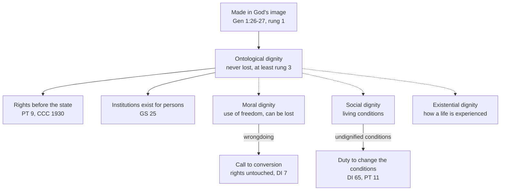

# Catholic Social Teaching · Lesson 3.1: Human dignity

> ⏱ ~15 min · Module 3: The principles · Builds on: [2.3](02-03-mater-et-magistra-and-pacem-in-terris.md), [2.4](02-04-gaudium-et-spes-to-justice-in-the-world.md), [`creation-grace-last-things` 2.1](../../creation-grace-last-things/lessons/02-01-the-image-of-god.md), [`phenomenology-and-personalism` 5.2](../../phenomenology-and-personalism/lessons/05-02-the-personalistic-norm.md) · Unlocks: [3.2](03-02-the-common-good.md), [5.2](05-02-religious-liberty-dignitatis-humanae.md)

## Why this matters

In the invented Republic of Sorvia, one deputy calls a tent camp under a motorway bridge an affront to human dignity and moves to clear it by Friday; another calls the clearance the same affront and moves to stop it. Both may be half right, because the Church's own documents use the word in four senses, and only one is a verdict on what a person is worth. This lesson states what [human dignity](../reference.md#human-dignity) is in this tradition and what it does in the social order.

## The idea

Dignity here is the worth a human being has because of what she is, not because of what she does, owns, achieves or is granted. The ground is theological: every human being is made in God's image, willed and loved by God. [`creation-grace-last-things` 2.1](../../creation-grace-last-things/lessons/02-01-the-image-of-god.md) teaches the image and the [four senses of dignity](../reference.md#four-senses-of-dignity); [`phenomenology-and-personalism` 5.2](../../phenomenology-and-personalism/lessons/05-02-the-personalistic-norm.md) reaches the same floor from philosophy, that a person may never be merely used. This lesson assumes both.

If an army stables horses in a cathedral, no one concludes the building has become a barn; they conclude the army has done wrong and the horses must go. The four senses sort the same way (*Dignitas Infinita* 7–8): **ontological** dignity is what the person is, never lost; **moral** dignity is how she uses her freedom, and can in fact be lost; **social** dignity is the quality of her living conditions; **existential** dignity is how she experiences her life. Call a slum undignified and you have judged the stable, not the cathedral.

In the social order dignity does three jobs. It fixes the **end** of every institution: the person. It grounds **rights** that come before the state. And it lets you **condemn conditions** without demoting the people in them. Secular rivals ground dignity in rational capacity (Kant, [`ethics` 2.3](../../ethics/lessons/02-03-humanity-autonomy-and-the-lie.md)), in interests counted equally ([`ethics` 1.1](../../ethics/lessons/01-01-classical-utilitarianism.md)), or in a public standing a society assures (Waldron, [`political-philosophy` 3.4](../../political-philosophy/lessons/03-04-free-speech.md)); they are argued there.

## Source

*Rerum Novarum* 40 (Leo XIII, 1891), in *The Great Encyclical Letters of Pope Leo XIII* (Benziger, New York, 1903; translator unnamed), numbered as on vatican.va, on what the state must protect in the worker:

> It is the soul which is made after the image and likeness of God … In this respect all men are equal; there is no difference between rich and poor, master and servant, ruler and ruled, for the same is Lord over all. No man may with impunity outrage that human dignity which God Himself treats with reverence, nor stand in the way of that higher life which is the preparation for the eternal life of heaven. Nay, more: no man has in this matter power over himself. To consent to any treatment which is calculated to defeat the end and purpose of his being is beyond his right; he cannot give up his soul to servitude; for it is not man's own rights which are here in question, but the rights of God, the most sacred and inviolable of rights.

Read the shape. **"Which God Himself treats with reverence"** puts the source of dignity outside every human grant: an employer cannot confer it, so cannot withdraw it. **"In this respect all men are equal"** is an equality of what persons are, beside every inequality of station. **"No man has in this matter power over himself"** is the hinge: the worker cannot sign it away, because the right is God's before it is his. So a freely accepted contract does not cure such treatment, and §41 turns at once to Sunday rest.

## The teaching

**T1. Made in the image.** Every human being is made in God's image (Gen 1:26–27; *Gaudium et Spes* 12), and the person, though body and soul, is one (GS 14). *In words:* dignity rests on what every human being is.

**T2. Received, not conferred.** Every person has a dignity that is intrinsic, prior to any recognition, not earned and never lost, whatever their condition, capacity or conduct ([*Dignitas Infinita*](../reference.md#dignitas-infinita) 1, 7, 15, 22; [*Magnifica Humanitas*](../reference.md#magnifica-humanitas) 50, 52–53). *In words:* nobody gave it, so nobody can take it back.

**T3. The person is the end of institutions.** Every social institution starts from the person, has the person as its subject and exists for the person; the social order serves persons, as the sabbath was made for man (GS 25–26; CCC 1881 locates it). *In words:* institutions are judged by what they do to persons ([person as end of institutions](../reference.md#person-as-end-of-institutions)).

**T4. Rights come from dignity, before the state.** Each human being is a person, with intelligence and free will, and so has rights and duties flowing directly from his nature, universal, inviolable and inalienable (*Pacem in Terris* 9). Authority's chief task is to recognize and protect them; a government that refuses fails in its duty, and its decrees lack binding force (PT 60–61; CCC 1930 locates it). MH 54–55 calls rights an expression of dignity itself, not something added from outside. *In words:* the state recognizes [rights](../reference.md#rights-grounded-on-dignity); it does not issue them.

**T5. Keep the senses apart.** Ontological dignity cannot be lost; moral dignity can be lost in fact (DI 7); MH 52 says the other three can be enhanced or diminished. Calling a condition undignified judges the condition, not the person enduring it (DI 8). *In words:* condemn the stable, never the cathedral.

**T6. The catalogue.** DI 33–62 names grave violations, among them extreme poverty, war, trafficking, abortion, surrogacy, euthanasia and digital violence; §34 adds GS 27's list and the death penalty, which is [`moral-theology` 5.4](../../moral-theology/lessons/05-04-the-death-penalty-and-ccc-2267.md)'s. *In words:* the declaration names violations without arguing each, and so does this lesson.

**Mark the levels.** ([the ladder](../../fundamental-theology/lessons/04-04-the-ladder-of-doctrinal-authority.md); [levels of authority](../reference.md#levels-of-authority)). T1 is **rung 1**: Scripture asserts it, and the ordinary universal magisterium has always proposed it as revealed (`creation-grace-last-things` 2.1). T2 is **at least rung 3**, in 2.1's words: a rung-3 act has spoken, and none proposes it as revealed or definitive. That act was a declaration of the Dicastery for the Doctrine of the Faith dated 2 April 2024, approved by Francis in ordinary form, so it stays the Dicastery's act. Leo XIV's encyclical *Magnifica Humanitas* (signed 15 May 2026) restates the four senses and quotes DI 1 (§§52–53). That raises the **grade**, not the rung: the genre is heavier and repetition is one of LG 25's signs, but nothing was made definitive. T3 (a pastoral constitution's doctrinal part), T4 (an encyclical, 1963, restated in GS 26 and MH 54–55) and RN 40 are **rung 3**. The four senses (T5) are an **analytic tool**; assent goes to what they serve. The catalogue (T6) is a rung-3 act whose items **keep the weight of what each restates**: that direct killing of the innocent is always gravely wrong is **rung 1** (*Evangelium Vitae* 57; [`moral-theology` 5.1](../../moral-theology/lessons/05-01-the-inviolability-of-innocent-life.md)), while its readings of present trends are applications. The personalistic norm is philosophy: **no magisterial level**.

**Principle or application.** T1–T5 are permanent [principles](../reference.md#principle-and-application), owed religious submission of mind and will. DI's reading of the present (§37: new forms of poverty that old measures miss) mixes an [empirical premise](../reference.md#empirical-premise) with a [prudential judgment](../reference.md#prudential-judgment), owed serious, respectful consideration (*Donum Veritatis* 24; GS 43) and revisable on evidence. Every policy that claims to honour dignity is an application. Both [symmetrical errors](../reference.md#the-two-symmetrical-errors) feed on this word. **Inflation:** "dignity requires this housing programme", as if the principle chose the instrument. **Demotion:** "dignity is a slogan each side fills as it likes". DI 25 answers the second: dignity rests on human nature, not on preference or social recognition, and licenses no arbitrary multiplication of rights.

**Where it stops.** The principle forbids treating anyone as a mere means, or measuring a claim to care by usefulness. It requires that institutions be judged by what they do to persons, and that rights be recognized in the non-citizen too (PT 25: citizenship does not remove membership in the human family). It does not say which programme, how much, by when or at what level: that is for legislators and citizens weighing evidence, with the [common good](../reference.md#common-good) and subsidiarity in play ([3.2](03-02-the-common-good.md), [3.3](03-03-subsidiarity.md)). The corpus says so itself: [no technical solutions, no models](../reference.md#the-doctrines-disclaimers) (*Sollicitudo Rei Socialis* 41; *Centesimus Annus* 43). MH 58 draws the limit both ways: programmes for a people are worthless unless persons flourish, and praising private enterprise is not enough while many lack decent work.

## The map

Rights hang from ontological dignity alone; the dashed senses rise and fall without touching what a person is worth.

## Worked examples

**Example 1 (clean): the productive-years score.** Invented: Sorvia's health ministry drafts a rule allocating scarce rehabilitation places by expected years of paid work after treatment. A retired bus driver and a man with a lifelong intellectual disability score near zero.

- *Forbids:* making the claim to care hang on output. MH 51 names this ideology, that a person must earn his worth with the efficient valued more, and answers that a person's value does not depend on what he produces. Under T3 the clinic exists for its patients; under the score, patients exist for the economy.
- *Permits:* rationing by clinical criteria, such as likely benefit and urgency, which ranks needs, not persons.
- *Stops:* how many places to fund, and which clinical criteria are sound, are application and medicine. Verdict: the score must go; a triage rule may replace it.

**Example 2 (strain): the camp under the bridge.** Invented: in Varnholm, Sorvia's capital, eighty people live in tents under a motorway bridge. A council motion calls the camp undignified and orders it cleared within a week; there are thirty shelter beds, and some residents refuse shelters that separate couples.

Run the senses. The camp is a failure of **social** dignity, and DI 8 says this judges the conditions, not the residents. A councillor who says they chose this life has slid into a verdict on **moral** dignity, which even if true would touch no one's ontological dignity or rights (DI 7). Residents who refuse shelters speak of **existential** dignity: what they can bear. So the principle *requires* the council to treat the condition as its own problem (DI 65 charges states with securing the conditions for dignity; PT 11 names shelter among the means of a human life). It *forbids* treating the residents as the nuisance: a clearance that moves eighty people to the next bridge handles persons as objects (T3). It *permits* protecting the park and the road for others ([3.2](03-02-the-common-good.md)).

Here it stops. Fifty more beds or housing first? A week or three months? These are prudential choices resting on empirical premises (what moves people off the street, at what cost), and they belong to the council, with the residents heard. Catholics voting for the slower plan and the faster may both honour dignity; neither may claim the Church's authority for a timetable (GS 43).

## Watch out

- **You might think dignity either picks the policy or picks nothing.** "Dignity requires housing first" inflates an application: a Catholic who weighs the instrument differently dissents from nothing. "Dignity is an empty word" demotes a rung-3 principle with fixed content, intrinsic and prior to recognition (DI 15, 25), which rules some proposals out on any evidence (Example 1).
- **You might think *Magnifica Humanitas* made indelible dignity definitive, or that a dicastery's declaration is only an opinion.** The first overstates: the encyclical raises the grade within rung 3, not the rung. The second understates: an approved declaration is a rung-3 act.
- **You might think undignified conditions mean undignified people, or lost moral dignity lost rights.** DI 8 says the first judges conditions; DI 7 says ontological dignity is never lost, which is why it calls the wrongdoer to conversion.

## One-liner

> Every human being has a worth no one granted and no one can revoke, so institutions are measured by what they do to persons and rights come before the state; the word condemns conditions, not people, and picks no programme.

## Problems

**P1 (🟢)** *(Exegetical)* **Diagnose.** Six sentences from an invented committee hearing in Sorvia's parliament on the worker dormitories at the Ardmoss Foods meat plant, written for this problem and not the words of any real person:

1. "Sixteen men to a room with one tap: those are undignified conditions."
2. "The night manager who falsified the inspection records behaved without dignity."
3. "One worker told us that after two years there he no longer feels his life is worth much."
4. "The cleaners have exactly the same worth as the directors who employ them."
5. "Men who accept these terms have forfeited any claim to better treatment. They signed."
6. "Human dignity obliges this committee to set the limit at four men per room."

For each, name the sense of dignity in play (ontological, moral, social, existential) and say whether it judges a person or a condition. Two of the six misuse the word: say which, and what the error is. **One line each.**

**P2 (🟡)** *(Exegetical (a) · Exegetical (b))* **Find the crux.** A case written for the problem. Lisbet Halvik was born in Sorvia to parents whose citizenship lapsed when their state dissolved, and she holds no citizenship anywhere. A public clinic refuses her non-emergency treatment, and the civil registry refuses to record her marriage. In debate, Deputy A says: "Rights are what a political community grants its members. Ms Halvik has whatever our statutes give non-citizens, and nothing more." Deputy B replies: "She has rights because she is a person. Our statutes either recognize them or violate them."

(a) Name the single premise on which the deputies divide, say which deputy denies it, and give the act and level that teach it.

(b) Is that premise a principle, an application or an empirical premise? Name one question about Ms Halvik's case that it does **not** settle, and who settles it.

**Two sentences per part.**

**P3 (🔴)** *(Exegetical)* **Sort and weigh.** For each claim, say whether it is a principle, an application, an empirical premise, or a mix to be split; give its level (or "no magisterial level") and the assent it asks. Items 2–5 are invented, written for this problem. **One or two sentences each.**

1. Every social institution exists for the person, who is its starting point and its subject (GS 25, paraphrased).
2. From a party leaflet: "Human dignity requires Sorvia to guarantee every adult an income of at least 60 percent of the median."
3. From a parish study guide: "Because *Dignitas Infinita* lists poverty, war, surrogacy and digital violence together as grave violations, every judgment in its §§33–62 binds at one and the same level."
4. From a council report: "Most long-term homelessness in Varnholm follows from housing costs rather than from addiction."
5. From an online forum: "Human-rights language is a secular import that the Church has merely tolerated since 1948."

Solutions

**P1** *(Exegetical)*

**Must hit, strict:**

- (1) **Social**; judges a condition (DI 8). A correct use.
- (2) **Moral**; judges a person's conduct (DI 7). A correct use; his ontological dignity is untouched.
- (3) **Existential**; how the worker experiences his own life (DI 8). A correct use: it reports a perception, which is evidence that the conditions are wrong, not that his worth fell.
- (4) **Ontological**; equal worth whatever the station (DI 1; RN 40, "in this respect all men are equal"). A correct use.
- (5) **Misuse.** It treats consent as forfeiting what ontological dignity grounds, which cannot be lost (DI 15) or signed away (RN 40: "no man has in this matter power over himself"). The dormitories remain a question of social dignity whatever was signed.
- (6) **Misuse.** Social dignity is in play (GS 27 condemns subhuman living conditions and disgraceful working conditions), but "four per room" is an application: dignity fixes the floor, not the figure.

**Wrong turns:** calling (3) moral because the worker "gave up"; accepting (5) as a fair point about moral dignity, when consent is real but cannot reach what is inalienable; calling (6) correct because the conditions are bad, when the error is the figure, not the concern; missing that (5) and (6) err in opposite directions, the first demoting dignity's claims and the second inflating an application.

**Model answer:** (1) Social; a condition. (2) Moral; a person's conduct. (3) Existential; a person's experience of his life, and evidence against the conditions. (4) Ontological; what every person is, whatever his station. (5) Misuse: dignity cannot be forfeited by signing (RN 40; DI 15), and the dormitories stay a social-dignity question. (6) Misuse: social dignity sets a floor, and the figure is an application that dignity does not fix.

---

**P2** *(Exegetical (a) · Exegetical (b))*

**Must hit, strict (a):**

- The crux: **whether rights are grounded in the person's own nature, before any political community, so that law can recognize or violate them but not confer them.** Deputy A denies it; Deputy B affirms it.
- The act: *Pacem in Terris* 9 (rights and duties flow directly from the nature of a person; universal, inviolable, inalienable), with PT 25 (citizenship of one state does not remove membership in the human family); restated in MH 51 and 54–55, and located in CCC 1930 (rights prior to society; the basis of an authority's legitimacy). **Rung 3**, a principle, owed religious submission.

**Must hit, strict (b):**

- A **principle**: no fact about Sorvia's budget or Ms Halvik's history bears on it.
- It does not settle, for example, which non-emergency treatments Sorvia's health system funds for any resident, or whether and how she should acquire citizenship or a residence status. Those are prudential questions for the legislature, weighing evidence and the common good. (Accept either. A strong answer adds that the marriage is closer to the principle: the right to found a family is among PT's rights of the person, PT 15.)

**Wrong turns:** making the crux whether distributive justice stops at the border, which is the statist–cosmopolitan dispute of [`political-philosophy` 6.1](../../political-philosophy/lessons/06-01-global-justice-cosmopolitans-and-statists.md), whose statists still hold that human rights are owed to everyone; answering (b) with cost, which is an empirical premise about means and not the crux; claiming the principle fixes the whole package of care she must receive.

**Model answer:**

(a) The deputies divide over whether rights are grounded in the person's nature before any community, so that statutes can only recognize or violate them: Deputy A denies it. *Pacem in Terris* 9 teaches it, with PT 25 on membership of the human family, restated in MH 51 and CCC 1930, at rung 3.

(b) It is a principle, so no fact about cost or her history bears on it. It does not settle which non-emergency treatments Sorvia funds for anyone, or whether she should be naturalized; those are prudential questions for the legislature.

---

**P3** *(Exegetical)*

**Must hit, strict:**

1. **Principle, rung 3**: conciliar teaching in the doctrinal part of a pastoral constitution (GS 25; CCC 1881 locates it), owed religious submission. "Only pastoral" would understate: a pastoral constitution carries its principles at their own weight.
2. **Split.** Principle: every person has a right to the means of a life worthy of a person, and to support when deprived of a livelihood through no fault of his own (PT 11; GS 26), **rung 3**, religious submission. Application: the guarantee as instrument and the 60 percent figure, an invented leaflet's proposal with **no magisterial level**. Weigh it; a Catholic may oppose it without dissenting. The leaflet inflates.
3. **Wrong.** The catalogue is a rung-3 act (a DDF declaration with ordinary approval), but each item **keeps the weight of the teaching it restates**: the killing of the innocent restates a rung-1 norm (EV 57), while its readings of present trends are applications. "One level" overstates some items and understates others.
4. **Empirical premise, no magisterial level**; evidence decides it. Its truth changes which programme is wise (an application), not the duty to remedy the condition.
5. **Understated.** That rights rest on dignity and belong to every human being is **rung 3**: an encyclical (PT 9–27, 1963, drawing on Pius XII's 1942 Christmas message), GS 26, MH 54–55 (rights express dignity, not something added from outside) and CCC 1930. Religious submission. "Since 1948" misplaces the ground: the Church praises the Universal Declaration (DI 2; MH 54) but grounds rights in human nature, not in it.

**Wrong turns:** calling 1 "only pastoral"; levelling 2 as a whole, in either direction; letting 3's list stand because all its items are "about dignity"; giving 4 a level because a council or a bishop cited it; answering 5 by denying the history. Leo XIII had sorted the "so-called modern liberties" into good and evil elements, as *Libertas* (1888) recalls of *Immortale Dei* ([5.2](05-02-religious-liberty-dignitatis-humanae.md)). Yet his *Rerum Novarum* already spoke of natural rights to property and association, and the catalogue of rights comes from Pius XII and *Pacem in Terris*.

**Model answer:** (1) Principle, rung 3, religious submission. (2) Split: the right to the means of a worthy life is a rung-3 principle; the guarantee and the figure are an application with no magisterial level, owed weighing, not assent. (3) Wrong: a rung-3 act whose items keep their own weight, from rung 1 (the killing of the innocent) down to applications. (4) Empirical premise, no magisterial level, settled by evidence. (5) Understated: rights grounded in dignity are rung-3 teaching (PT 9; GS 26; MH 54–55), grounded in nature, not borrowed from 1948.

## Flashback

**From Lesson [2.3](02-03-mater-et-magistra-and-pacem-in-terris.md) (John XXIII: *Mater et Magistra* and *Pacem in Terris*):** *(Exegetical (a) · Exegetical (b).)* A paraphrase of *Mater et Magistra* 59–65 on [socialization](../reference.md#socialization), written for this problem and not the encyclical's words.

> (i) Social ties and associations are multiplying in our age, helped along, it seems, by technical progress and rising living standards.
>
> (ii) This growth lets people exercise rights to health care, education, housing and work.
>
> (iii) Since it also narrows freedom and initiative, it must be resisted wherever it appears.
>
> (iv) Since free people made it, they can shape it however they please.
>
> (v) The intermediate bodies that carry it must be true communities, treating members as persons and drawing them into ordering their own lives.

(a) Two sentences misstate MM. Name them and say what MM says. **One sentence each.**

(b) Classify (i) and (v) as principle, application or empirical premise, with level and assent. **One line each.**

Solution

**Must hit, strict (a):**

- **(iii)** misstates MM. MM 61–62 weighs real advantages against real harms, denies that the growth must turn people into automatons, and says it can and ought to be guided to keep the advantages and lessen the harms (64): steered, not resisted.
- **(iv)** overstates. MM 63 calls the growth the work of free people, not of blind natural forces, but adds that they must in a sense obey the laws of economic and social development and cannot wholly escape their surroundings.

**Must hit, strict (b):**

- (i) **Empirical premise**, **no doctrinal rung**: a description of the age, hedged in MM 59's own wording, that stands or falls on evidence. 2.3 counts it among the empirical premises.
- (v) **Principle**, **rung 3** (an encyclical, MM 65), owed religious submission. Which bodies, and how each is organized, are applications.

**Wrong turns:** passing (iv) because MM does call the growth the work of free people; the error is "however they please". Passing (iii) because MM 62 lists real harms. Flagging (i) for its hedge, which is MM's own. Giving (i) a rung because an encyclical states it (inflation), or calling (v) 1961 sociology (demotion).

**Model answer (a):** (iii) is wrong: MM weighs the advantages against the harms, denies that the growth must make people automatons, and says it can and ought to be guided to keep the one and lessen the other (64). (iv) is wrong: free people, not blind forces, made it, but MM 63 adds that they must in a sense obey economic and social laws and cannot wholly escape their surroundings.

**Model answer (b):** (i) Empirical premise, no doctrinal rung; evidence decides it. (v) Principle, rung 3, owed religious submission; the design of any particular body is application.

## Connections

- **Backward:** [2.3](02-03-mater-et-magistra-and-pacem-in-terris.md) laid out *Pacem in Terris*'s rights with their paired duties, and [2.4](02-04-gaudium-et-spes-to-justice-in-the-world.md) the genre of the pastoral constitution whose §§25–27 this lesson uses. [`creation-grace-last-things` 2.1](../../creation-grace-last-things/lessons/02-01-the-image-of-god.md) owns the image of God and *Dignitas Infinita* as theology of the image; [`phenomenology-and-personalism` 5.2](../../phenomenology-and-personalism/lessons/05-02-the-personalistic-norm.md) owns the personalistic norm; [`fundamental-theology` 4.5](../../fundamental-theology/lessons/04-05-reading-a-documents-weight.md) explains why an approved declaration and an encyclical weigh what they weigh.
- **Forward:** [3.2](03-02-the-common-good.md) takes up the common good, which MH 59 calls the social expression of dignity. [4.1](04-01-work-and-the-worker-laborem-exercens.md) puts the person at the centre of work, [5.2](05-02-religious-liberty-dignitatis-humanae.md) grounds religious liberty on dignity, and [5.5](05-05-migration.md) asks what is owed to the refugee.
- **Sideways:** the secular groundings are argued in [`ethics` 2.3](../../ethics/lessons/02-03-humanity-autonomy-and-the-lie.md) (Kant: dignity beyond price), [`ethics` 1.3](../../ethics/lessons/01-03-justice-and-the-separateness-of-persons.md) (the separateness of persons against aggregating interests) and [`political-philosophy` 3.4](../../political-philosophy/lessons/03-04-free-speech.md) (dignity as assured public standing). P2's crux was argued in 1790: Burke's rights as an entailed inheritance ([`history-of-political-thought` 5.3](../../history-of-political-thought/lessons/05-03-burke-prescription-against-abstract-rights.md)) against Wollstonecraft's rights received from God ([5.4](../../history-of-political-thought/lessons/05-04-wollstonecraft-rights-virtue-and-education.md)). The life questions stay with [`moral-theology` 5.1](../../moral-theology/lessons/05-01-the-inviolability-of-innocent-life.md) and the death penalty with its [5.4](../../moral-theology/lessons/05-04-the-death-penalty-and-ccc-2267.md).
