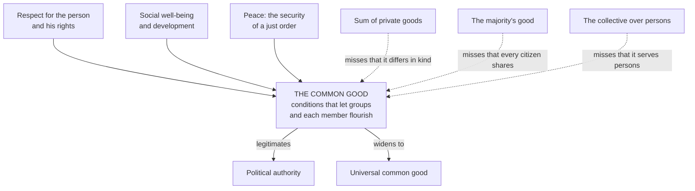

# Catholic Social Teaching · Lesson 3.2: The common good

> ⏱ ~15 min · Module 3: The principles · Builds on: [2.4](02-04-gaudium-et-spes-to-justice-in-the-world.md), [3.1](03-01-human-dignity.md) · Unlocks: [3.3](03-03-subsidiarity.md), [5.1](05-01-the-political-community-and-the-limits-of-the-state.md)

## Why this matters

"For the common good" appears on budget memos, referendum leaflets and court opinions, usually meaning "what my side wants, said solemnly". Some hear collectivism in it, some total welfare, some whatever won the vote. The social doctrine gives the phrase a definition with edges, and *Magnifica Humanitas* (2026) lists it first of its five principles.

## The idea

Think of a fishing town's harbour: the channel, the lighthouse, the mooring rules, the trust that nobody will cut your lines at night. Add up every boat's catch and you still have not described it. The harbour is what lets each boat fish well. Nobody can build it alone, and a harbour that serves the trawlers while the small boats founder is not working.

That is the [common good](../reference.md#common-good). It is not the flourishing of persons, which only they can achieve. It is the **conditions of social life** that let persons and their groups flourish more fully and readily. Three things imitate it: the **sum** of private welfare, the good of **the majority**, and the good of **the collective** set over persons.

[`political-philosophy` 4.3](../../political-philosophy/lessons/04-03-perfectionism-and-the-common-good.md) states this definition as one position, limited by subsidiarity and religious liberty, which are this course's own limits ([3.3](03-03-subsidiarity.md), [5.2](05-02-religious-liberty-dignitatis-humanae.md)). Here: what the Magisterium teaches, and at what weight.

## Source

Aquinas calls justice "general" because it directs all the virtues' acts to the common good ([legal justice](../reference.md#legal-justice), ST II-II q.58 a.5). Then a.6 and a.7 ad 2 (English Dominican Province translation):

> … legal justice is a special virtue in respect of its essence, in so far as it regards the common good as its proper object. And thus it is in the sovereign principally and by way of a mastercraft, while it is secondarily and administratively in his subjects.
>
> The common good of the realm and the particular good of the individual differ not only in respect of the *many* and the *few*, but also under a formal aspect. For the aspect of the *common* good differs from the aspect of the *individual* good, even as the aspect of *whole* differs from that of *part*. Wherefore the Philosopher says (Polit. i, 1) that "they are wrong who maintain that the State and the home and the like differ only as many and few and not specifically."

The deciding words are **"not only in respect of the many and the few, but also under a formal aspect"**. The city's good differs from mine in kind, not size, so adding up private goods never reaches it: the classical root of "not a sum". **"Principally … secondarily"** leaves nobody exempt. And Aquinas limits his part-and-whole frame elsewhere: "Man is not ordained to the body politic, according to all that he is and has" (I-II q.21 a.4 ad 3).

## The teaching

**T1. The definition.** The common good is the sum of the conditions of social life that let groups and their members reach their fulfilment more fully and readily (*Gaudium et Spes* 26, repeated in GS 74). Both footnote *Mater et Magistra* 65 (1961), whose Latin has the formula; CCC 1906 and *Magnifica Humanitas* (MH) 60 restate it. *In words:* it is the conditions for flourishing, not the flourishing itself.

**T2. Three elements** (CCC 1907–1909): respect for the person and his fundamental rights, conscience and religious freedom included; the group's well-being and development, meaning access to food, health, work, education and family; and peace, the security of a just order kept by morally acceptable means. *In words:* rights, provision and a just peace; lack one and it fails.

**T3. Not a sum.** It is not the simple sum of particular goods; it is indivisible and reached only together (*Compendium* 164). MH 60–61 calls the definition a starting point: the common good is more than a list of conditions or a total of interests, a "plus" no adding of individual goods explains. *In words:* totting up everyone's welfare never gets you there.

**T4. Not the majority's good.** Every citizen has a right to share in it, and authority must promote it for all, favouring no individual or category (*Pacem in Terris* 56). PT 56 quotes Leo XIII, here in the 1903 Benziger English: "the civil power must not be subservient to the advantage of any one individual or of some few persons" (*Immortale Dei* 5). GS 73 reproves bending authority to a faction, and *Compendium* 169 asks a democracy's governors to weigh the minority's good. *In words:* a vote shows what most want, not what the common good is.

**T5. Not the collective over persons.** The common good is defined by reference to the person, and the order of things serves the order of persons (GS 26; CCC 1905, 1912). It binds authority to respect inalienable rights (CCC 1907) and covers spiritual goods too (PT 57). *Centesimus Annus* 13 finds socialism's root error here: the person treated as a molecule of the social organism. *In words:* the community exists for persons, though persons flourish only in community.

**T6. Authority answers to it.** The political community exists for the common good, the source of its legitimacy, and authority directs citizens toward it as a moral force, not despotically (GS 74; PT 54; CCC 1902–1903). [5.1](05-01-the-political-community-and-the-limits-of-the-state.md) takes up the limits. *In words:* authority is justified by what it serves.

**T7. All owe it, and it widens.** Everyone must contribute according to role (GS 75; CCC 1913); MH 59 calls this commitment non-negotiable for a Christian. Because the human family is one, there is a [universal common good](../reference.md#universal-common-good) (PT 132; CCC 1911); MH 64 judges any plan to subjugate or eliminate a nation gravely immoral. *In words:* no nation may pursue its good as if the others did not exist.

**A theologians' gloss.** Jacques Maritain's *The Person and the Common Good* (1947; the man is in [`thomistic-synthesis` 6.3](../../thomistic-synthesis/lessons/06-03-strict-observance-and-existential-thomism.md)) reconciles Aquinas's part and whole with T5. On his account man is a part of the city as an *individual*, but a whole as a *person* open to God, so the common good must flow back to persons. Emmanuel Mounier's personalism (the review *Esprit*, 1932) is its French neighbour.

**Mark the levels.** See [the ladder](../../fundamental-theology/lessons/04-04-the-ladder-of-doctrinal-authority.md) and [levels of authority](../reference.md#levels-of-authority).

- **T1–T5 are rung 3, at its heaviest grade.** The act is a run of documents: John XXIII's encyclicals *Mater et Magistra* (15 May 1961) and *Pacem in Terris* (11 April 1963); GS 26 and 74, in Vatican II's pastoral constitution (7 December 1965), whose principles carry their own weight ([`fundamental-theology` 4.5](../../fundamental-theology/lessons/04-05-reading-a-documents-weight.md)); and MH 59–64 (encyclical, Leo XIV, signed 15 May 2026). Repetition over sixty-five years is one of LG 25's marks. The Catechism and the [*Compendium*](../reference.md#compendium-of-the-social-doctrine) locate it; they fix nothing. The *Compendium*'s "not a simple sum" had no level of its own until MH 60–61 taught it.
- **T5's hardest edge is rung 1.** No innocent person may be directly killed for the community's sake (EV 57; [`moral-theology` 5.1](../../moral-theology/lessons/05-01-the-inviolability-of-innocent-life.md)).
- **T6–T7 are rung 3** (GS 74–75; PT 54, 132). That authority is from God restates Romans 13:1. That no form of government is mandated is itself taught (GS 74; *Immortale Dei* 4).
- **Aquinas's whole-and-part metaphysics** is a theologian's account, at most rung 4 (common teaching of the Thomist schools). Maritain and Mounier have **no magisterial level**.

**Principle or application.** T1–T7 are **permanent principles**. Every judgment that a given budget, tax, curfew, school system or international body serves the common good is a **contingent application**. So are MH 64's call for more effective international institutions ([6.2](06-02-integral-human-development-and-the-international-order.md)) and PT 64's list of public services, the duty's 1963 shape; GS 74 calls the concept dynamic. **[Empirical premises](../reference.md#empirical-premise)**: whether a measure delivers what it promises, and GS 26's observation that interdependence grows daily. Principles ask religious submission, applications serious and respectful consideration (GS 43; *Donum Veritatis* 24), premises evidence ([the three assents](../reference.md#the-three-assents)). [Both errors](../reference.md#the-two-symmetrical-errors) are near: inflating ("the common good requires this budget, so Catholics must back it") and demoting ("a slogan, or whatever wins the vote").

**Where it stops.** The principle sets the target, conditions for all and for each. It rejects reasons that aggregate, merely count heads, or sacrifice persons, and it names who answers: authority first, everyone second. It does not rank two genuine conditions, price them or choose instruments. CCC 1906 asks prudence of everyone, most of all of those in authority; GS 74 says citizens may rightly prefer divergent solutions. The [disclaimers](../reference.md#the-doctrines-disclaimers), bound to no political system (GS 76) and offering no technical solutions, are part of the teaching.

## The map

Three elements build it; three neighbours imitate it, each missing one feature; authority answers to it.

## Worked examples

**Example 1 (clean): the Larkhaven surplus.** Invented case. Larkhaven has a one-off surplus of 12 million crowns. (A) Rebate 100 crowns to each of 120,000 residents. (B) Rebuild the collapsed Eastbank bridge, whose loss left 18,000 residents, mostly the city's poorest, a 40-minute detour to the hospital and most jobs. (C) Build an arena that 60 percent favour in a poll.

- Ask what *condition of social life* each secures. (A) secures none; it is a sum. (B) restores access to health care and work and a district's security (elements two and three), which no household can buy alone. (C) *could* serve the common good, since PT 64 counts recreation among public services, but not because 60 percent want it.
- **Verdict:** on these facts, (B). The principle settles the *reasons* more surely than the choice. Give the east bank a free ferry and the ranking returns to the council's prudence.

**Example 2 (strain): the Calanthe referendum.** Invented case. By 71 percent to 29, Calanthe votes to close the state schools teaching in the northern valleys' language, spoken at home by 9 percent of citizens, and to move their pupils to majority-language schools. The campaign promised savings of 30 million crowns a year: "one nation, one tongue".

- **Decided.** The margin settles nothing (T4). PT 95 calls any attempt to check the vitality of ethnic minorities a flagrant injustice, worse if aimed at extinction. PT 96 praises authorities who foster minorities' language and culture. If "one tongue" means extinction, no majority redeems it.
- **Strain.** PT 97 asks minorities, in turn, not to rank their own traits above goods common to all, and to share the life of the people around them. Fluency in the majority language serves the valley children too, and the savings would fund other conditions.
- **Stops.** The principle excludes the aim of extinction and the reason "we outvoted them". It does not choose among minority-language, bilingual or majority schools with protected minority teaching, nor weigh the 30 million crowns. Which teaches children best is **empirical**. Which to adopt belongs to Calanthe's legislators and voters, and Catholics may disagree without dissent.

## Watch out

- **You might think "the Church teaches that the common good requires this budget", but** the means are an application, and GS 43 forbids claiming the Church's authority for one's own solution. The mirror error is as bad: "a pious slogan" demotes a rung-3 principle restated from 1961 to 2026, which MH 59 calls non-negotiable.
- **You might think the definition counts goods because it says "sum", but** it sums *conditions*. Drop that word and you get the utilitarian total it excludes ([`political-philosophy` 2.1](../../political-philosophy/lessons/02-01-utilitarianism-as-a-principle-for-institutions.md)). Nor did Vatican II coin it: GS 26 restates John XXIII, and CCC 1906 is a locator, not the act.
- **You might think Aquinas taught that the person exists for the state, because he calls citizens parts, but** he denies that man is ordained to the body politic in all that he is (I-II q.21 a.4 ad 3), and his frame is a theologian's, not doctrine.

## One-liner

> The common good is the conditions that let all and each flourish: not a total, not a majority's wish, not the state set over persons. It is a rung-3 principle that names the target and leaves the route to prudence.

## Problems

**P1 (🟢)** *(Exegetical)* Close reading of the Source (ST II-II q.58 a.6 and a.7 ad 2).

(a) A Larkhaven budget officer says that if every household is 2 percent better off, "the common good has grown 2 percent". Which words of a.7 ad 2 deny what the officer assumes, and what exactly do they deny?

(b) A resident says, "Legal justice is the council's business, not mine." What does a.6 say?

(c) Does the passage commit Aquinas to the view that the person exists wholly for the city? Name the text that settles it.

**One or two sentences each.**

**P2 (🟡)** *(Exegetical)* Diagnose. An **invented** council newsletter from Larkhaven, written for this problem and not the words of any real person, prints three sentences:

1. "The common good is just the total of every resident's welfare, so Catholic teaching requires us to adopt whichever plan raises total household income most."
2. "The common good is whatever a majority of residents votes for; anyone who says otherwise is pushing a Catholic slogan that binds nobody."
3. "The Church has always taught that the person is a part of the city and exists for it, so when the city's good requires it, residents' rights must yield."

For each sentence, name the near neighbour it collapses the common good into, and give the corrected principle with its document and level. Then name every level error, saying whether it overstates or understates, and mark any application or empirical premise the sentence contains. **130 words or fewer.**

**P3 (🔴)** *(Exegetical (a) · Exegetical (b))* Apply to a hard case. An **invented** case: after three shootings in a month in the Millrace and Eastgate districts of the city of Merrowgate, the council proposes a 90-day curfew from 10 pm to 6 am for everyone under 18 living in those two districts. Work and emergencies are exempt. Most of the victims, and nearly all the young people affected, have done nothing wrong.

(a) Using T2 and T4–T6, say what the common good **requires** of the council here, what it **permits**, and what it **forbids**. One sentence each.

(b) Where does the principle stop giving a verdict, and who is competent to judge the rest? Name one empirical premise. **Two sentences.**

Solutions

**P1** *(Exegetical)*

**Must hit, strict:**

- (a) The words are "differ not only in respect of the *many* and the *few*, but also under a formal aspect … as … *whole* differs from that of *part*". The officer assumes the common good is the private good scaled up, so that adding private gains adds to it. Aquinas denies that the difference is one of quantity. It is one of kind, so no sum of private goods measures the common good.
- (b) Legal justice is in the ruler "principally and by way of a mastercraft" and in subjects "secondarily and administratively". The resident is a subject, so he has the virtue's duty too: he directs his own acts to the common good, chiefly by keeping just law.
- (c) No. The passage is about justice, and its whole-and-part frame is limited by Aquinas himself: man is not ordained to the body politic "according to all that he is and has" (I-II q.21 a.4 ad 3).

**Wrong turns:** reading "formal aspect" as "official" or "legal". Answering (b) with "only rulers are bound", which overlooks "secondarily". Answering (c) "yes, he calls the citizen a part", which skips the limit.

**Model answer:** (a) "Not only in respect of the many and the few, but also under a formal aspect": the city's good differs from a household's in kind, as whole from part, so a 2 percent rise in every private good is not a 2 percent rise in the common good. (b) a.6 puts legal justice in rulers principally and in subjects secondarily, so the resident owes it too, by directing his acts to the common good. (c) No; Aquinas says man is not ordained to the body politic according to all that he is and has (I-II q.21 a.4 ad 3).

---

**P2** *(Exegetical)*

**Must hit, strict:**

- **Sentence 1** collapses into the **sum**. Correction: the common good is the sum of *conditions*, not of goods, and it is not the simple sum of particular goods (GS 26, 74; MH 60–61). Rung 3. Level error: **overstated**, because "Catholic teaching requires this plan" turns an **application** (adopting this plan) into binding principle. Which plan raises income most is an **empirical premise**.
- **Sentence 2** collapses into the **majority's good**. Correction: every citizen shares in the common good, and authority may favour no category (PT 56, quoting *Immortale Dei* 5); those governing must consider the minority's good (*Compendium* 169, a locator). Level error: **understated**, because "a slogan that binds nobody" demotes a rung-3 principle restated from MM to MH, which MH 59 calls non-negotiable.
- **Sentence 3** collapses into the **collective over persons**. Correction: the common good is ordered to persons and must respect inalienable rights (GS 26; CCC 1907, 1912). Rung 3, and its hardest edge, never directly killing the innocent, is rung 1 (EV 57). Level error: **overstated**. "The Church has always taught" promotes a theologian's whole-and-part frame, which no magisterial act teaches, and Aquinas himself limits it (I-II q.21 a.4 ad 3).

**Wrong turns:** fixing sentence 1's definition but missing its level inflation. Calling sentence 2's majority rule "an application" rather than an error about the principle. Answering sentence 3 by rejecting all talk of parts and wholes, which throws out Aquinas's real point (T3).

**Model answer:** (1) Sum. The common good is a set of conditions and not a total of goods (GS 26; MH 60–61, rung 3). "Teaching requires this plan" overstates an application, and the income effect is an empirical premise. (2) Majority. Every citizen shares in the common good and no category may be favoured (PT 56). Calling it a slogan understates a rung-3 principle that MH 59 calls non-negotiable. (3) Collective. Society is ordered to persons, whose rights bind authority (GS 26; CCC 1907, 1912; rung 3, and rung 1 for innocent life). "Always taught" overstates a theologian's frame, which Aquinas limits (I-II q.21 a.4 ad 3).

---

**P3** *(Exegetical (a) · Exegetical (b))*

**Must hit, strict (a):**

- **Requires:** the council must act to restore peace and security for the districts' residents, the young included, because peace is an element of the common good (CCC 1909) and authority exists for it (GS 74). Doing nothing is not neutral.
- **Permits:** a temporary, proportionate limit on liberty, by morally acceptable means, aimed at the good of everyone in the districts, including the young people it restricts.
- **Forbids:** a measure that serves the wider city's comfort at a category's expense (T4: PT 56) or treats the youths as mere parts. Examples are an open-ended curfew, collective punishment, or a burden placed on these districts *because* their residents have little political voice (GS 73). Any curfew must leave the youths' fundamental rights intact (CCC 1907).

**Must hit, strict (b):** the principle does not decide whether a curfew, rather than some other measure, actually reduces shootings. That is an **empirical premise** for evidence on crime. Nor does it fix the hours, the length or the exemptions, which belong to the prudence of those responsible, the council and in law the courts (CCC 1906; GS 74), and on which Catholics may disagree without dissent.

**Wrong turns:** "the common good forbids all curfews", which ignores element three and T6. "The council's decision is the common good", which is the majority or collective error. Treating the curfew's effectiveness as settled by the principle. Saying the youths have no claim because the curfew protects them, which forgets that the common good includes the rights of those it restricts.

**Model answer:** (a) It requires the council to act for the districts' peace and security (CCC 1909), since authority exists for that (GS 74). It permits a temporary, proportionate restriction aimed at the good of everyone there, the young included. It forbids an open-ended or punitive curfew, or one aimed at the districts because their residents lack political voice, since no category may be sacrificed to the rest (PT 56; GS 73; CCC 1907). (b) Whether a curfew reduces shootings is an empirical question for the evidence, and the hours, length and exemptions are the council's prudential judgment, open to Catholic disagreement. The principle fixes the target and the forbidden reasons, not the instrument.

## Flashback

**From Lesson [2.4](02-04-gaudium-et-spes-to-justice-in-the-world.md) (The Council and after: *Gaudium et Spes* to *Justice in the World*):** *(Exegetical, sort and weigh.)* Five remarks from an invented reading group, written for this problem. For each: is the claim it handles a principle, an application or an empirical premise, at what level, and does the remark state it rightly, overstate, understate or drop a condition? **One line each.**

1. "*Gaudium et Spes* 36 grants the sciences their own laws and methods, so an economist's models answer to her discipline alone."
2. "*Populorum Progressio* 14's development of each person and of the whole person is a 1967 hope that binds no one."
3. "PP 76 teaches, as doctrine, that extreme disparity between nations endangers peace."
4. "PP 31 allows armed revolt against any government that violates rights."
5. "*Evangelii Nuntiandi* 35 links liberation and salvation without identifying them: rung 3, owed religious submission."

Solution

**Must hit, strict:**

1. **Principle**, [rightful autonomy](../reference.md#rightful-autonomy-of-earthly-affairs), rung 3 (conciliar), owed religious submission. The remark **drops a condition**: GS 36 wants inquiry carried out in accord with moral norms, and calls autonomy false if it means that created things do not depend on God.
2. **Principle**, rung 3 (encyclical), repeated since, so frequency raises its grade (LG 25). **Understated.**
3. **Empirical premise**, no magisterial level, weighed on evidence. **Overstated.** The principle it serves, development as the new name for peace, is rung 3.
4. **Drops conditions.** PP 31 excepts only manifest, long-standing tyranny gravely damaging fundamental personal rights and the country's common good. That teaching is rung 3; whether a given regime qualifies is a prudential judgment; and the remark beside it, that uprisings as everyone knows breed new injustices, is an empirical premise.
5. **Right as stated:** principle, rung 3 (apostolic exhortation, 1975).

**Wrong turns:** inventing an error in 5. Overcorrecting 1 into "economics answers to theology", when GS 36 deplores Christians who slight the sciences' rightful independence. Giving 3 rung 3 because an encyclical says it. Correcting 4 by making PP 31 forbid every revolt, which deletes the exception. Treating a verdict on any particular regime as doctrine.

**Model answer:** (1) Principle, rung 3; drops GS 36's moral norms and its rejection of autonomy from the Creator. (2) Principle, rung 3, its grade raised by repetition; understated. (3) Empirical premise, no level; overstated, though development as peace is rung 3. (4) Drops PP 31's conditions; the exception is rung-3 teaching, its use on a regime prudential, and the claim about uprisings empirical. (5) Right.

## Connections

- **Backward:** [2.3](02-03-mater-et-magistra-and-pacem-in-terris.md) read PT 132 on the universal common good, reloaded in T7. [2.4](02-04-gaudium-et-spes-to-justice-in-the-world.md) read *Gaudium et Spes* as a pastoral constitution, whose principles carry their own weight. [3.1](03-01-human-dignity.md) gave the dignity whose social expression, MH 59 says, the common good is. [`history-of-political-thought` 2.3](../../history-of-political-thought/lessons/02-03-aquinas-on-law.md) defined law by the common good (q.90). [`moral-theology` 3.3](../../moral-theology/lessons/03-03-the-cardinal-virtues-and-the-gifts.md) gave commutative and distributive justice, and this lesson adds the legal justice that directs every virtue to the common good.
- **Forward:** [3.3](03-03-subsidiarity.md) asks which level of society should serve the common good. [3.4](03-04-solidarity.md) defines [solidarity](../reference.md#solidarity) as a firm commitment to it. [5.1](05-01-the-political-community-and-the-limits-of-the-state.md) develops [political authority](../reference.md#political-authority) and its limits. [6.2](06-02-integral-human-development-and-the-international-order.md) takes the universal common good to the question of an international authority.
- **Sideways:** [`political-philosophy` 4.3](../../political-philosophy/lessons/04-03-perfectionism-and-the-common-good.md) files this definition among the perfectionisms, because it includes moral and spiritual conditions, against the neutrality of its [4.1](../../political-philosophy/lessons/04-01-political-liberalism.md). Its two limits are supplied in 3.3 and 5.2. The sum the definition refuses is [`political-philosophy` 2.1](../../political-philosophy/lessons/02-01-utilitarianism-as-a-principle-for-institutions.md)'s utilitarian principle. [`ethics` 1.3](../../ethics/lessons/01-03-justice-and-the-separateness-of-persons.md)'s separateness of persons is a secular objection to the same aggregation, though it posits no good that is genuinely common. Aristotle's test of correct and deviant regimes is the ancestor of T4 ([`history-of-political-thought` 1.4](../../history-of-political-thought/lessons/01-04-aristotle-constitutions-citizens-and-the-polity.md)). The personalist root is [`phenomenology-and-personalism` 5.2](../../phenomenology-and-personalism/lessons/05-02-the-personalistic-norm.md) (persons stop using one another when they choose a common good together) and 5.5 ([participation](../../phenomenology-and-personalism/lessons/05-05-integration-participation-and-the-bridge.md), choosing the common good as one's own).
