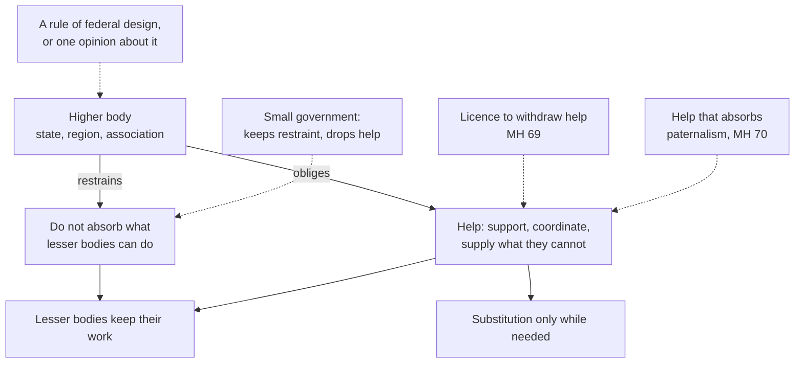

# Catholic Social Teaching · Lesson 3.3: Subsidiarity

> ⏱ ~15 min · Module 3: The principles · Builds on: [2.2](02-02-quadragesimo-anno-and-the-interwar-proposals.md), [3.2](03-02-the-common-good.md), [`public-economics` 8.1](../../public-economics/lessons/08-01-tiebout-voting-with-your-feet.md) · Unlocks: [3.4](03-04-solidarity.md)

## Why this matters

"Subsidiarity" is the one term of Catholic social teaching you will meet in a European treaty, in a think-tank brief for cutting a programme, and in a homily against cutting it. Usually half of it is missing: one side keeps only the half that tells the state to back off, and the other files the whole under "one view of federalism". Here it is whole, at its real weight.

## The idea

A good coach does not play the match for her team; that would take from the players the very thing they are there to do. Nor does she leave them alone with a skill they cannot yet manage. She drills and organizes them, and steps onto the pitch only in an emergency, briefly.

That is [subsidiarity](../reference.md#subsidiarity). Between individual and state stand families, associations, unions, parishes, firms and towns: the [intermediate bodies](../reference.md#intermediate-bodies). The principle governs how every larger body treats smaller ones, and it has **two halves**:

- **Restraint.** A higher body must not take over what a lower one can do.
- **Help.** The higher body exists to help (Latin *subsidium*): to support and coordinate the lower ones, and to supply what they cannot do, while they cannot.

[`political-philosophy` 6.4](../../political-philosophy/lessons/06-04-welfare-property-and-subsidiarity.md) gave this as one theory of provision and first flagged the small-government misreading; [`fundamental-theology` 4.3](../../fundamental-theology/lessons/04-03-religious-submission.md) used it to show how a rung-3 teaching is weighed. This lesson adds Pius XI's wording, the second misuse and the 2026 restatement.

## Source

Forty years before the principle had a name, Leo XIII used both halves for one lesser body, the family. *Rerum Novarum* §14 (Vatican numbering), in *The Great Encyclical Letters of Pope Leo XIII* (Benziger, New York, 1903):

> The contention, then, that the civil government should at its option intrude into and exercise intimate control over the family and the household, is a great and pernicious error. True, if a family finds itself in exceeding distress […], it is right that extreme necessity be met by public aid, since each family is a part of the commonwealth. […] But the rulers of the State must go no further: here nature bids them stop. Paternal authority can be neither abolished nor absorbed by the State.

**"At its option"** names the error. **"Extreme necessity … public aid"** is the help half, with a high bar and a reason: each family is part of the commonwealth. **"Go no further … absorbed"** is the restraint half, resting on nature, not policy. §35 generalizes it to the individual; [*Quadragesimo Anno*](../reference.md#quadragesimo-anno) extends it to every body and keeps the verb "absorb".

## The teaching

**T1. *Quadragesimo Anno* 79** (Pius XI, 1931; paraphrased). Granting that changed conditions now need large associations for many tasks small ones once did, Pius XI calls subsidiarity a most weighty principle of social philosophy, fixed and unchangeable. Taking from individuals what their own initiative can achieve, and giving it to the community, is gravely wrong; just so, handing to a larger, higher body what smaller ones can manage is an injustice and a serious disorder in society. Social activity of its nature exists to help (*subsidium afferre*) society's members, never to destroy or absorb them. *In words:* the larger body exists to help, so taking over what smaller ones can do defeats its purpose.

**T2. QA 80.** Leaving lesser matters to subordinate groups frees the state for what it alone can do: direct, watch, urge and restrain as need requires. QA names it the principle of "subsidiary function". *In words:* restraint frees the state for its own work.

**T3. *Centesimus Annus* 48** (John Paul II, 1991) in the formulation CCC 1883 quotes: a higher community should not interfere in a lower one's internal life and strip it of its functions, but should support it in need and help coordinate its activity with the rest of society, toward the [common good](../reference.md#common-good). Where social sectors are too weak, the State may exercise a [substitute function](../reference.md#substitute-function), as briefly as possible. (The [Social Assistance State](../reference.md#social-assistance-state) is [4.4](04-04-enterprise-consumption-and-the-economy-of-gift.md)'s.) The *Compendium* (186–188) names the positive sense (economic, institutional and juridical help) and the negative (the State refrains from shrinking lesser bodies' space), and limits substitution to what is absolutely necessary, with the common good as criterion. *In words:* do not take over; do help; if you must step in, step out again.

**T4. The ground.** *Caritas in Veritate* 57 (Benedict XVI, 2009): subsidiarity is help to the person through the autonomy of intermediate bodies, given when people cannot act alone and aimed at their emancipation; it treats the person as always able to give. CCC 1884 adds an analogy from providence: God entrusts to each creature what it can do. *In words:* the principle protects people's capacity to act, not a size of government.

**T5. [*Magnifica Humanitas*](../reference.md#magnifica-humanitas) 68–72** (Leo XIV, 2026). Grounded in the same view of the person (68), the principle gives the State no licence to withdraw; it directs how the State acts, so that social actors are neither stifled, replaced nor reduced to mere facilitators (69); it rules out paternalistic management and puts decisions as close to people as possible (70). In the digital sphere the highest level is major economic and technological actors, not the State, and states must secure fair rules (71–72): [4.5](04-05-the-new-things-of-our-time-magnifica-humanitas.md)'s subject. *In words:* the 2026 restatement names both misuses and adds a new higher body.

**Mark the levels.** On [the ladder](../../fundamental-theology/lessons/04-04-the-ladder-of-doctrinal-authority.md) ([levels of authority](../reference.md#levels-of-authority)):

- **The principle, both halves with substitution kept temporary, is rung 3**: authentic ordinary magisterium, owed religious submission of mind and will. `fundamental-theology` 4.4's table makes it that rung's example; 4.3 runs the triad on it. The acts are encyclicals: QA 79–80 (15 May 1931), CA 48 (1 May 1991), CiV 57 (29 June 2009), MH 68–70 (signed 15 May 2026). Nothing defines it.
- **CCC 1883–1885** is a locator, carrying CA 48's weight; the pontifical council's ***Compendium*** has [no magisterial level of its own](../reference.md#compendium-of-the-social-doctrine).
- **MH 71's naming of platforms as the highest level is an application**: a judgment of present conditions on an empirical premise (MH 95), applying a rung-3 principle.
- **Any verdict that a bill or service fits subsidiarity is an application with no rung**, like `fundamental-theology` 4.3's housing bill.

**Principle or application.** The **[permanent principles](../reference.md#principle-and-application)** ask religious submission: the two halves, their ground in the person, and substitution only while it is needed. The **contingent applications** ask [serious, respectful consideration](../reference.md#the-three-assents): which level should run fire services, water or schools; QA's vocational orders ([2.2](02-02-quadragesimo-anno-and-the-interwar-proposals.md)); MH's judgment about platforms. Weighing one and judging otherwise is not dissent. The **[empirical premises](../reference.md#empirical-premise)**, revisable on evidence, include QA 79's observation that some tasks now need large associations and CA 48's claim, offered as how things appear, that needs are best met by those nearest them. The [two symmetrical errors](../reference.md#the-two-symmetrical-errors): "subsidiarity forbids the national fire service" inflates an application; "subsidiarity is one opinion about federalism" demotes a principle.

**Where it stops.** The principle fixes the order of questions: can the lesser body do this; if not, can help make it able; only then substitution, and only while needed. It does not answer them. Whether a body *can* do something is fact: cost, scale, competence, effects across boundaries. How much help, by which instruments, at whose expense, is [prudential judgment](../reference.md#prudential-judgment) for those responsible for the common good at each level (Compendium 188). And the [disclaimers](../reference.md#the-doctrines-disclaimers) hold: the Church is bound to no political or economic system (GS 42, 76), so subsidiarity prescribes no constitution, federal or unitary, and no budget size.

## The two halves

Each misreading attacks one arrow; the principle is both, from the same body.

## Worked examples

**Example 1 (clean): the Greyford brigades.** Invented. Thirty volunteer fire brigades, each run by a local association, cover the Greyford region and meet the national response-time standard. The government proposes one salaried national service instead, for uniform equipment and command.

- **Can the lesser bodies do it?** Yes, by hypothesis, so replacing them for uniformity alone is what QA 79 calls an injustice.
- **What help is owed?** Training standards, equipment grants, a regional dispatch to coordinate the brigades, and what no village can supply: aerial ladders, chemical-spill teams, command of a fire crossing districts.
- **Verdict:** the takeover fails the principle; support and coordination pass it; grant sizes and specialist units stay prudential.

[`public-economics` 8.2](../../public-economics/lessons/08-02-assignment-spillovers-and-grants.md) asks the same question economically. Oates's decentralization theorem says provision tailored to local demand beats a uniform central level unless spillovers or scale economies favour the centre. Both count uniformity as a cost. But Oates measures welfare, subsidiarity the agency of the bodies themselves: an equally efficient national service would still wrong capable brigades. Whether it would drain them of volunteers is an empirical question like [1.2](../../public-economics/lessons/01-02-voluntary-provision-and-crowding-out.md)'s crowding out. Economics supplies premises, never the principle.

**Example 2 (strain): the Stavenby schools.** Invented. A new code requires sprinklers and protected stairways in every school within three years. The diocese of Stavenby runs twelve schools, many serving poor families, and can afford to refit four. Officials float closing the other eight and moving their pupils to state schools, or leaving it as the diocese's problem "by subsidiarity".

- **The code** is the State's watching and restraining (QA 80), not an intrusion.
- **Leaving it** is the withdrawal MH 69 rejects: when a lesser body cannot act alone is when help is owed (CiV 57).
- **Closing the schools** skips help: substitution comes only if help cannot restore capacity, and only while needed (CA 48).

So the principle points to refit grants or loans with a phased deadline, and then stops. How much money, from whom, and how long the phase-in can safely run are engineering and budget facts, weighed prudentially. The hardest edge is strings on the money. Conditions that secure safety belong to the State's guardian role; conditions that remake what the schools are turn help into absorption (MH 69's "mere facilitators"). Where a given condition falls, say admissions rules tied to public funds, the principle does not settle: legislators judge, with the diocese and parents, and the religious-liberty question is [5.2](05-02-religious-liberty-dignitatis-humanae.md)'s.

## Watch out

- **You might think subsidiarity presumes small government**, but it binds both ways, as [`political-philosophy` 6.4](../../political-philosophy/lessons/06-04-welfare-property-and-subsidiarity.md) first flagged. MH 69 denies it ever justifies the State's disengagement. The mirror error, reading help as permission to absorb, is just as wrong (MH 70).
- **You might think it is "one opinion about federalism"**, but that demotes a rung-3 principle, restated from 1931 to 2026, to a preference. Nor is it about federal structure as such: it governs every higher and lower body, from a city and its neighbourhoods to a global authority (CiV 57), so it binds inside a unitary state and picks no constitution.
- **You might think "the Church teaches this bill violates subsidiarity" carries the principle's weight**, but that inflates an application. The verdict on a bill has no rung, and no one may claim the Church's authority for his own solution (GS 43).
- **You might think it is Burke's little platoons, Hegel's corporations, Tocqueville's associations or the EU's treaty rule under a Latin name**, but these are family resemblances. Burke ([`history-of-political-thought` 5.3](../../history-of-political-thought/lessons/05-03-burke-prescription-against-abstract-rights.md)), Hegel ([6.1](../../history-of-political-thought/lessons/06-01-hegel-freedom-realized-in-the-state.md)) and Tocqueville ([6.3](../../history-of-political-thought/lessons/06-03-tocqueville-tyranny-of-the-majority-and-soft-despotism.md); [`social-theory` 6.1](../../social-theory/lessons/06-01-tocqueville-on-associations.md)) describe and prize intermediate bodies: as the seed of public affection, a moment of ethical life, a bulwark against soft despotism. Subsidiarity is a normative rule about what the higher body owes, restraint and help alike, grounded in the person. The [EU's principle](../reference.md#eu-subsidiarity) (TEU art. 5(3)) is a secular borrowing. It lets the Union act outside its exclusive competences only where member states cannot sufficiently achieve an aim and the Union, by scale or effects, can do better: two tiers, no duty of help.

## One-liner

> [Subsidiarity](../reference.md#subsidiarity) tells every larger body two things at once: do not take over what smaller bodies can do, and help them do it, standing in only while they cannot.

## Problems

**P1 (🟢)** *(Exegetical)* Two paraphrases of *Quadragesimo Anno* 79–80, both written for this problem:

> (A) Pius XI laid down that whatever a smaller body is now doing must never be taken over by a larger one. The state's part is to stand back and leave society to itself.

> (B) Pius XI granted that changed conditions mean some tasks once done by small associations now need large ones. Still, he held it an injustice to assign to a higher body what lesser bodies can do, because every social activity exists by its nature to help the members of society, never to destroy or absorb them. Freed of lesser tasks, the state should direct, watch, urge and restrain as need requires.

Which paraphrase is faithful? Name the three things the other gets wrong, and the phrase in the faithful one that carries the "help" half. **One line each.**

**P2 (🟡)** *(Exegetical)* Two **invented** op-ed paragraphs, written for this problem and not the words of any real person:

> (A) *Wexcombe Herald:* "Subsidiarity, the Church's great principle, means the smallest unit governs and the state keeps out. So the Church teaches that the Libraries Consolidation Bill must be defeated. Its grants to volunteer reading rooms are just as un-Catholic, since public money only makes them dependent. A Catholic who votes for any part of it dissents from the Magisterium."

> (B) *Cardale Review:* "Subsidiarity is a 1931 opinion about federalism, the same idea as the EU's treaty rule on competences. Our country is unitary, so it hardly applies here, and Catholics may take it or leave it like any other policy preference."

Name **two errors in each** (four in all). For each, say whether it inflates an application into a principle, demotes a principle to a preference, or misstates what the principle says, and give the correct claim with its level. **Two lines per error.**

**P3 (🔴)** *(Exegetical (a) · Evaluative (b))* An **invented** case. In the Thornbeck uplands, twenty-two village water cooperatives each run their own well and pipes, all drawing on one aquifer. Testing is patchy, two cooperatives had contaminated supplies last summer, and heavy pumping by the larger villages is lowering the water table for the smaller ones. The regional authority proposes to merge all twenty-two into a single Thornbeck Water Utility.

(a) Run subsidiarity on the proposal. Say what it **requires**, what it **permits** and what it **forbids** here. **One line each.**

(b) Where does the principle stop giving a verdict on the merger, and who is competent to judge the rest? Any verdict on the merger itself passes. **100 words or fewer.**

Solutions

**P1** *(Exegetical)*

**Must hit, strict:**

- **(B) is faithful.**
- (A)'s three errors: (1) **"is now doing"**: QA's test is what lesser bodies *can* do, a question of capacity, not of who happens to do it now. (2) **"must never be taken over"**: this drops QA 79's own concession that changed conditions mean many tasks now need large associations. What is fixed is the order of competence, not a ban on any task ever moving up. (3) **"stand back and leave society to itself"**: this drops the help half and QA 80's directing, watching, urging and restraining.
- The help half is carried by **"exists by its nature to help the members of society"** (QA's *subsidium afferre*).

**Wrong turns:** choosing (A) because its "never" sounds like QA's claim that the principle cannot be changed. That firmness belongs to the principle, not to a ban on large associations. Faulting (B) for giving the state a role, when QA 80 gives it that role. Treating "can do" and "are doing" as the same test.

**Model answer:** (B) is faithful. (A) turns "can do" into "is now doing". It drops QA 79's concession that some tasks now need large associations. It deletes help and QA 80's active role by telling the state to stand back. The help half is carried by "exists by its nature to help the members of society".

---

**P2** *(Exegetical)*

**Must hit, strict (any two per op-ed):**

- **(A)(i) Misstates the principle** (the small-government reading). It keeps restraint and drops help. Grants to lesser bodies are the positive sense itself (CA 48: support in case of need; Compendium 186; CiV 57). The principle is rung 3.
- **(A)(ii) Inflates an application.** "The Church teaches the bill must be defeated" turns a verdict on a bill, which has no rung and asks serious consideration, into doctrine. GS 43: no one may claim the Church's authority for his own solution.
- **(A)(iii) Inflates again, with a wrong use of "dissent".** A Catholic who weighs the bill and votes for it denies no principle, so he does not dissent.
- **(B)(i) Demotes a principle.** It is rung 3, authentic ordinary magisterium owed religious submission. `fundamental-theology` 4.4's table names it as that rung's example, and it is restated in CA 48, CiV 57 and MH 68–70.
- **(B)(ii) Misstates the principle** (federal structure as such). It governs every higher and lower body, so it applies inside a unitary state and prescribes no constitutional form.
- **(B)(iii) Misstates its source.** The EU's rule (TEU art. 5(3)) is a secular legal borrowing about Union and member-state competences, with no duty of help and no ground in the person.

**Wrong turns:** "correcting" (A) by saying subsidiarity requires the bill, which inflates in the other direction. "Correcting" (B) by calling subsidiarity defined or infallible, which overstates. Reading (A)'s worry about dependence as simply false: CiV 58 warns that aid can create dependence. That is a reason to design grants well, not a ban on them, and whether these grants would do so is an empirical question.

**Model answer:** (A)(i) misstates the principle by dropping its help half. Grants that support reading rooms are what CA 48 and the *Compendium*'s positive sense ask; the principle is rung 3. (A)(ii) inflates an application: a verdict on a bill has no rung, and GS 43 forbids claiming the Church's authority for one's own solution, so voting for it is not dissent. (B)(i) demotes a principle: subsidiarity is rung 3, owed religious submission, restated from QA 79 to MH 68–70. (B)(ii) misstates it as a rule of federal design. It governs every higher and lower body inside any constitution, and the EU's treaty rule is a secular borrowing of the word.

---

**P3** *(Exegetical (a) · Evaluative (b))*

**Must hit, strict (a):**

- **Requires:** help first. That means testing, technical staff and finance for the cooperatives, and coordination of pumping across the shared aquifer, which no single cooperative can manage (CA 48: help coordinate; QA 79's concession).
- **Permits:** setting and enforcing drinking-water and extraction standards (QA 80: directing, watching, restraining), and stepping in for a cooperative that cannot meet them, only for as long as needed (CA 48; Compendium 188).
- **Forbids:** absorbing cooperatives that can run safe supplies merely for uniformity or tidiness (QA 79), and also leaving failing villages to cope alone (MH 69).

**Must hit, any verdict (b):**

- The principle stops at **facts**: whether support and coordination are enough, or whether the aquifer and economies of scale need a single operator. That is hydrology and cost, an empirical premise (cf. [`public-economics` 8.2](../../public-economics/lessons/08-02-assignment-spillovers-and-grants.md)'s spillovers).
- Then it stops at **weighing**: costs, risks and timing, which is prudential.
- **Who judges:** the regional authority and the cooperatives, informed by engineers. This is the laity's and the legislators' competence, with the common good as the criterion, not the Magisterium's.
- The answer must say the principle still orders the inquiry (help before replacement, replacement only for incapacity) even though it does not decide it.

**Wrong turns:** "subsidiarity forbids the merger", which ignores that a shared aquifer may be beyond any village's capacity. "Subsidiarity is silent because water is technical", which forgets that the order of questions still binds. Using solidarity or the common good as a second principle to outweigh subsidiarity: the question here is where *this* principle stops.

**Model answer (a):** It requires support (testing, staff, finance) and coordination of pumping across the aquifer. It permits standards, enforcement, and temporary takeover of a cooperative that fails. It forbids absorbing capable cooperatives for tidiness, and it forbids abandoning failing ones.

**Model answer (b), one of several:** The principle sets the order: help first, then coordination, and replacement only where cooperatives cannot do the work. It cannot say whether shared testing and an extraction cap would protect the aquifer, or whether one operator is needed. That depends on hydrology, scale economies and cost, which are empirical premises. Weighing those against local control is a prudential judgment for the regional authority and the cooperatives, advised by engineers, with the common good as the criterion. My verdict: fund shared testing, cap extraction, and take over only cooperatives that fail twice.

## Flashback

**From Lesson [3.1](03-01-human-dignity.md) (Human dignity):** *(Exegetical (a) · Evaluative (b) · apply to a hard case.)* Sorvia's invented Relief Reform Bill sets two conditions on support for adults able to work. Clause 2: twenty hours of community work a week. Clause 3: claimants without homes are lodged in relief centres where men, women and children sleep in separate wings, couples and parents included. The preamble gives one reason for both: "Relief must never be easier than the lowest-paid job, or nobody will take that job."

(a) Split the preamble's sentence into principle, application or empirical premise, with levels. Which clause does 3.1's teaching condemn, on which claim, and why does the shared reason not condemn the other? **Four sentences.**

(b) Where does the principle stop giving a verdict on Clause 2, and who judges? Any verdict passes. **100 words or fewer.**

Solution

**Must hit, strict (a):**

- "Relief must never be easier than the lowest-paid job" is a policy maxim, an **application** with **no magisterial level**; "or nobody will take that job" is an [empirical premise](../reference.md#empirical-premise), settled by evidence.
- **Clause 3 is condemned for its reason**: it worsens families' conditions on purpose, children's included, to steer *other* people's choices. That reduces persons to a means (MH 51), against the **rung-3** teaching that institutions exist for persons (GS 25–26) and that undignified conditions are to be remedied, not imposed (DI 8, 65). Separation as such is not the fault: 3.1's camp case filed shelters that split couples under existential dignity.
- **Clause 2 is not condemned**: it asks the claimant's own effort and degrades no one, so it stays an application.

**Must hit, any verdict (b):**

- The principle still forbids work that humiliates or prices a person by his output (MH 51).
- It leaves the hours, who counts as able, carers' exemptions and the truth of the incentive premise to evidence and to Sorvia's legislators; no one may claim the Church's authority for his answer (GS 43).

**Wrong turns:** condemning both clauses for sharing a reason. "Dignity forbids any condition on relief" (inflation). "Dignity is a word each side fills as it likes" (demotion). Giving the incentive premise a rung.

**Model answer (a):** The maxim is an application with no magisterial level, and its second half is an empirical premise. Clause 3 degrades families on purpose to deter others, using them as means (MH 51), against the rung-3 teaching that institutions exist for persons (GS 25–26). The fault is that reason, not separation as such. Clause 2 asks only the claimant's own effort, so the same reason leaves it an application to weigh.

**Model answer (b), one of several:** The principle forbids humiliating work. Whether twenty hours moves people into jobs or only off support is empirical, and the hours, exemptions and cost belong to Sorvia's legislators. My verdict: ten hours, with carers of young children excused.

## Connections

- **Backward:** [2.2](02-02-quadragesimo-anno-and-the-interwar-proposals.md) placed QA 79 in *Quadragesimo Anno*, where a permanent principle travelled with a contingent proposal, the vocational orders. [3.1](03-01-human-dignity.md) supplies the ground, the person as one able to act and give. [3.2](03-02-the-common-good.md) supplies the criterion that governs every substitution. The level comes from [`fundamental-theology` 4.4](../../fundamental-theology/lessons/04-04-the-ladder-of-doctrinal-authority.md) and [4.3](../../fundamental-theology/lessons/04-03-religious-submission.md).
- **Forward:** [3.4](03-04-solidarity.md) pairs subsidiarity with [solidarity](../reference.md#solidarity): each without the other degrades, into privatism or into paternalist welfare (CiV 58; MH 73). [4.4](04-04-enterprise-consumption-and-the-economy-of-gift.md) takes the Social Assistance State. [4.5](04-05-the-new-things-of-our-time-magnifica-humanitas.md) takes platforms as the new higher body. [5.1](05-01-the-political-community-and-the-limits-of-the-state.md) takes the limits of the state. [6.2](06-02-integral-human-development-and-the-international-order.md) takes an international authority organized in a subsidiary, layered way (CiV 57, 67). [6.3](06-03-distributism-and-the-alternative-proposals.md) weighs distributism and the other proposals that claim to embody it.
- **Sideways:** subsidiarity and fiscal federalism are the same question asked morally and economically. See [`public-economics` 8.1](../../public-economics/lessons/08-01-tiebout-voting-with-your-feet.md)–[8.2](../../public-economics/lessons/08-02-assignment-spillovers-and-grants.md) for Tiebout and Oates, and [1.2](../../public-economics/lessons/01-02-voluntary-provision-and-crowding-out.md) for crowding out. [`political-institutions` 5.1](../../political-institutions/lessons/05-01-federal-unitary-devolved.md) covers federal, unitary and devolved states as working institutions. [`political-philosophy` 6.4](../../political-philosophy/lessons/06-04-welfare-property-and-subsidiarity.md) sets the principle beside Rawls, Nozick and basic income. The family resemblances are in [`history-of-political-thought` 5.3, 6.1, 6.3](../../history-of-political-thought/lessons/06-03-tocqueville-tyranny-of-the-majority-and-soft-despotism.md) and [`social-theory` 6.1](../../social-theory/lessons/06-01-tocqueville-on-associations.md). The Church also borrows the principle for her own governance ([`ecclesiology-and-mariology` 4.5](../../ecclesiology-and-mariology/lessons/04-05-vatican-ii-primacy-collegiality-synodality.md); MH 87), a use this course notes but does not judge.
