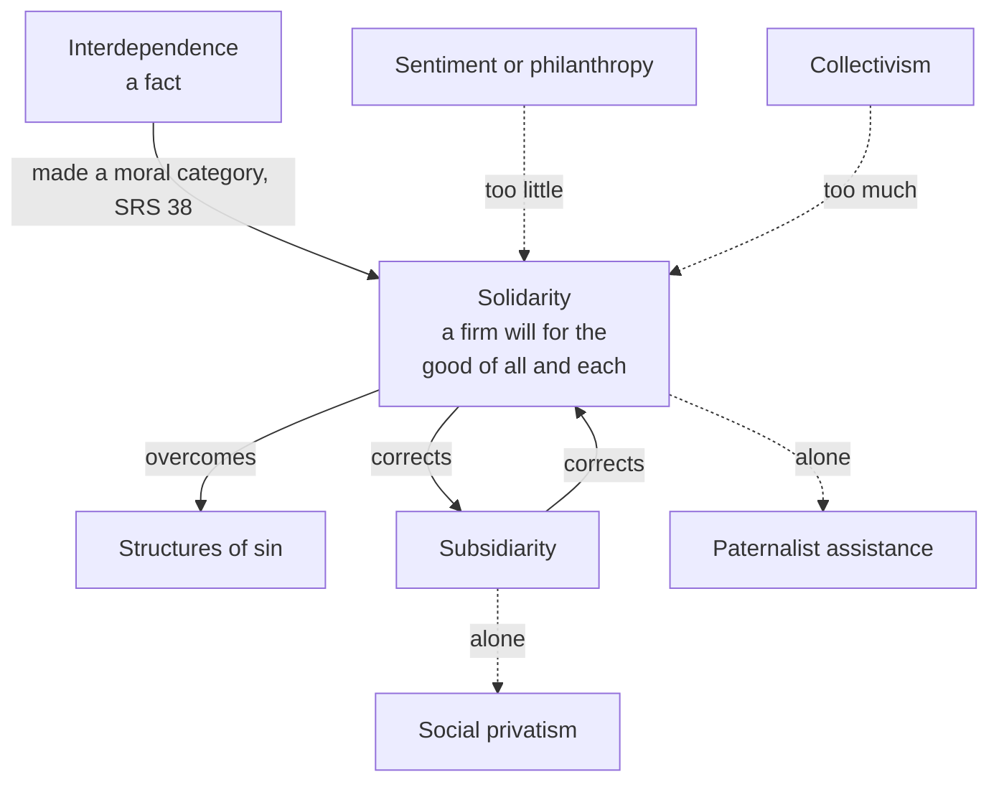

# Catholic Social Teaching · Lesson 3.4: Solidarity

> ⏱ ~15 min · Module 3: The principles · Builds on: [3.2](03-02-the-common-good.md), [3.3](03-03-subsidiarity.md), [`moral-theology` 3.5](../../moral-theology/lessons/03-05-social-sin-and-cooperation-in-the-sins-of-others.md) · Unlocks: [3.5](03-05-the-universal-destination-of-goods-and-private-property.md), [3.6](03-06-the-preferential-option-for-the-poor.md)

## Why this matters

After a disaster, "solidarity" trends as a hashtag. A bank prints it on a billboard, a party puts it in its name, and a strike committee paints it on a banner. A word that can mean anything binds no one. In 1987 John Paul II gave it a definition sharp enough to rule out most of those uses. This lesson teaches the virtue, the older names it inherited, the structures it fights and the partner it needs.

## The idea

Your coffee, your pension and your phone pass through the hands of thousands of people you will never meet. That is **[interdependence](../reference.md#interdependence)**, and it is a fact. A fact obliges nobody: you can depend on people and still exploit them. Durkheim called it "organic solidarity" ([`social-theory` 3.1](../../social-theory/lessons/03-01-the-division-of-labor-and-social-solidarity.md)).

The Church's move is to say that once you *see* the fact, it makes a claim on you. Think of a rope team on a glacier. The rope is the interdependence. Solidarity is each climber's settled decision to climb as a team: to hold when another slips, even when holding costs something. Two climbers get it wrong. One feels sorry for the man who slipped and keeps climbing. The other ties everyone to himself and drags them up his own route. The first is sentiment; the second is collectivism. The word fits: Roman law's obligation *in solidum* made each co-debtor answer for the whole debt.

[`moral-theology` 3.5](../../moral-theology/lessons/03-05-social-sin-and-cooperation-in-the-sins-of-others.md) taught the [structure of sin](../reference.md#structures-of-sin): personal sins hardened into customs and institutions, sin only by analogy. [`phenomenology-and-personalism` 5.5](../../phenomenology-and-personalism/lessons/05-05-integration-participation-and-the-bridge.md) taught Wojtyła's solidarity as an attitude of participation. This lesson asks what the Church teaches with both, and at what weight.

## The teaching

**T1. The thing is older than the definition.** Leo XIII has the Church try "to bind class to class in friendliness and good feeling", so that classes are "united in the bonds of friendship, but also in those of brotherly love" (*Rerum Novarum* 21 and 25, in *The Great Encyclical Letters of Pope Leo XIII*, Benziger, 1903). Pius XI names social justice and [social charity](../reference.md#social-charity) as the directing principles of economic life, with social charity as the soul of the juridical order (*Quadragesimo Anno* 88, paraphrased). *Centesimus Annus* 10 (1991): what we now call the principle of [solidarity](../reference.md#solidarity) is Leo's "friendship", Pius XI's social charity and Paul VI's "civilization of love". *In words:* the principle is old; John Paul II defined it.

**T2. Interdependence becomes a moral category.** *Sollicitudo Rei Socialis* 38 (John Paul II): interdependence, felt as a system shaping every sphere of life, is to be accepted as a moral category. The fitting response, a moral and social attitude that is a virtue, is solidarity. *In words:* seeing that we depend on each other is the start of a duty.

**T3. The definition.** SRS 38, paraphrased: solidarity is no vague compassion, no passing distress at others' troubles. It is a "firm and persevering determination" to devote oneself to the [common good](../reference.md#common-good), the good of everyone and of each person, since each of us answers for all. SRS 39 assigns the duties: the stronger take responsibility for the weaker and share with them; the weaker claim their rights and contribute, neither passive nor destructive; intermediate groups do not press their own interests against others'. *In words:* a lasting act of will, aimed at everyone's good, binding the weak as well as the strong.

**T4. Neither sentiment, philanthropy nor collectivism.** Sentiment fails the definition's first clause. Against philanthropy: no charity can stand in for justice owed and withheld (QA 137, paraphrased). Against collectivism: solidarity is valid only where members recognize one another as persons (SRS 39). *In words:* solidarity includes justice and keeps the person in view.

**T5. Structures of sin.** SRS 36–37 applies the category to development and the economy. Two attitudes typically build such structures: the "all-consuming desire for profit" and the "thirst for power", each pursued "at any price". Only the opposite attitude, solidarity, overcomes them, with the help of grace (SRS 38). *In words:* solidarity works on institutions too, and they are still made of persons' acts.

**T6. A Christian virtue, with a horizon.** SRS 40: solidarity is a Christian virtue, close to charity. In faith it reaches toward gratuity and forgiveness, and toward the communion of the divine Persons as the supreme model of human unity, which must ultimately inspire it. *In words:* charity takes solidarity up; it does not turn it into a constitution.

**T7. The partner.** *Caritas in Veritate* 58 (Benedict XVI, 2009): subsidiarity and solidarity must stay linked, both ways. [Subsidiarity](../reference.md#subsidiarity) without solidarity gives way to "social privatism"; solidarity without subsidiarity gives way to "paternalist social assistance" that demeans those it helps ([the pairing](../reference.md#subsidiarity-and-solidarity)). CA 15 had already paired them: the State supports economic life indirectly, by subsidiarity, and directly, by solidarity, defending the weakest. *In words:* each principle guards against the other's typical failure.

**T8. Successor vocabulary and the 2026 restatement.** *Fratelli Tutti* (2020) speaks of fraternity and "[social friendship](../reference.md#social-friendship)" (FT 99), and of an order whose soul is social charity (FT 180, citing QA). *Magnifica Humanitas* (Leo XIV, 2026) names solidarity one of [five principles](../reference.md#the-five-principles) to be taken together (MH 46). Solidarity is both a principle, the objective order in which each person's good depends on others', and a virtue, SRS 38's determination with attention to those most in need (MH 75). MH 73 restates CiV 58's pairing in its own words (particular interests; welfare that fosters no responsibility), and MH 76 extends solidarity to future generations and to data and platforms ([4.5](04-05-the-new-things-of-our-time-magnifica-humanitas.md)). *In words:* the newest encyclical states the principle–virtue pairing outright.

**Mark the levels.** On [the ladder](../../fundamental-theology/lessons/04-04-the-ladder-of-doctrinal-authority.md) ([levels of authority](../reference.md#levels-of-authority)), T2–T4, T7 and T8 are **rung 3**, authentic ordinary magisterium, owed religious submission. The acts are encyclicals: SRS 38–39 (dated 30 December 1987), CA 10 and 15 (1 May 1991), CiV 58 (29 June 2009), FT (3 October 2020) and MH 73–76 (signed 15 May 2026). Repetition across 39 years raises the grade *within* rung 3 (LG 25); none proposes the definition as definitive, so default down (can. 749 §3). Solidarity rests on the command to love one's neighbour (Mt 22:39), which the Church proposes as revealed (**rung 1**); SRS's social definition does not inherit that rung. T1's texts are encyclicals too (**rung 3**). T5 is **rung 3** as `moral-theology` 3.5 fixed it, applied here and not re-levelled. T6 is **rung 3** that solidarity is a Christian virtue. Wojtyła's attitude is philosophy (**no magisterial level**), and the *Compendium* (192–196) locates the teaching without adding a level.

**Principle or application.** **Permanent [principles](../reference.md#principle-and-application):** interdependence as a moral category; solidarity as a virtue owed by all, to all; SRS 39's three duties; that structures of sin must be overcome; that the two principles correct each other. **Contingent applications:** SRS's judgments on the blocs of 1987, CA 15's list of State measures, CiV 58's counsel on aid, and every aid target, tariff or wage rule offered "in solidarity". **Empirical premises** ([empirical premise](../reference.md#empirical-premise)): that interdependence is growing (SRS 38; MH 74); that aid can breed dependence (CiV 58). The rung belongs to each encyclical; religious submission attaches to its principles; its applications ask [serious, respectful consideration](../reference.md#the-three-assents). A Catholic who weighs an application and judges otherwise dissents from nothing, but he may not deny the principle, treat the application as weightless, or claim the Church's authority for his own. The [two errors](../reference.md#the-two-symmetrical-errors) here: inflating ("solidarity requires this trade deal, so its opponents dissent") and demoting ("solidarity is a feeling, or one party's slogan").

**Where it stops.** Solidarity tells you that you answer for the good of all and each, the stronger first. It does not tell you which instrument serves that good (aid or trade, tax or gift, law or contract), how to weigh the near against the far, or what share each party bears. Those are [prudential judgments](../reference.md#prudential-judgment) for those responsible: owners, workers and their associations, legislators, voters. The Church has no technical solutions and proposes no economic or political system (SRS 41), and social doctrine is not a handbook of norms to be applied (MH 27). Those [disclaimers](../reference.md#the-doctrines-disclaimers) are part of the teaching.

## The map

Solidarity sits between a counterfeit that does too little and one that does too much; either paired principle, left alone, decays.

## Worked examples

**Example 1 (clean): the call-on at Ebbsford.** At the invented port of Ebbsford, a labour agency hires dockers by the shift. The terminal operator awards the agency its contract on the lowest cost per container. The dispatcher keeps an unwritten list of men who reported injuries, and they are not called again. The port's inspector signs safety reports without boarding. So injured men hide injuries, and foremen falsify logs.

- **A structure of sin?** Yes, in SRS 36's sense. It is rooted in personal acts: the dispatcher's list, the managers who know of it and renew the contract, the inspector's signatures. Habit and incentive consolidate it, and it breeds further sins (lying, unsafe work). No single villain built it, but every link is a person.
- **What solidarity asks, of whom (SRS 39).** The stronger: the operator writes safety into its tender, the agency drops the list, the port authority inspects. The weaker: the dockers claim their rights and report, neither submitting nor wrecking the port. The intermediate group: the senior dockers' association stops reserving the safe shifts for its own members. The *Compendium* (193) calls such remedies "structures of solidarity".
- **What it does not imply.** That every silent docker is guilty: guilt is personal, and fear can reduce it (`moral-theology` 3.5). Nor that a guaranteed-shift labour pool is *the* remedy: that is an application.

**Example 2 (strain): Ferrant moves.** Ferrant Components, an invented brake-parts maker and Ebbsford's largest employer, plans to move assembly to a poorer country where wages are a fifth of Ebbsford's and jobs are scarce. Solidarity binds the firm toward both sets of workers: SRS 38's good is that of all *and of each*, and SRS 39 forbids treating any worker as an instrument, exploited cheaply and discarded when no longer useful.

- **Forbids:** moving to escape safety rules; dropping the Ebbsford workers without notice, retraining or fair severance; a town campaign casting the foreign workers as enemies.
- **Requires:** that the firm weigh both communities' good, and that the stronger party carry the cost of the change instead of loading it on the weaker.
- **Permits:** staying at lower profit, or moving justly.
- **Where it stops.** Should jobs go where need is greater? The principle does not rank the near against the far. Is the move needed for the firm to survive at all? That is an empirical premise about costs and markets. Owners, managers and the workers' representatives judge the decision; legislators judge the rules (notice periods, trade terms). A Catholic on either side of it may be practising solidarity.

## Watch out

- **You might think solidarity is a feeling, and so cannot be owed.** But SRS 38 defines it *against* feeling: a determination of the will, a virtue, taught at rung 3. Calling it a sentiment, or "the Pope's word for one side's politics", demotes a principle to a preference.
- **You might think solidarity tells you how to vote.** "Solidarity requires Measure 7" inflates an application into the principle. No one may claim the Church's authority for his own solution (GS 43).
- **You might think SRS 40 makes the Trinity a social blueprint.** It offers the divine communion as the model that must ultimately *inspire* solidarity: a horizon, not a constitution ([`trinity-and-god` 6.4](../../trinity-and-god/lessons/06-04-social-trinitarianism-and-its-critics.md)).
- **You might think "solidarity" means one thing wherever it appears.** Durkheim's is a social fact. Solidarity in Adam and in Christ is theological (Romans 5:12–21; [`creation-grace-last-things` 7.4](../../creation-grace-last-things/lessons/07-04-limbo.md)). Wojtyła's is a philosophical attitude, SRS's a taught virtue. SRS 38 also says "attitude", so the difference lies in genre and claim, not the word.

## One-liner

> Solidarity is neither a feeling about the distant nor everyone's absorption into one body, but a firm, lasting will to answer for the good of all and each: taught at rung 3, applied by prudence, kept honest by subsidiarity.

## Problems

**P1 (🟢)** *(Exegetical)* Diagnose. Four texts, each **invented, written for this problem**. Say whether each uses "solidarity" as vague compassion, as collectivism, as a slogan, or in SRS 38's sense, and name what in SRS 38–39 (paraphrased) decides it. **One line each.**

(a) A shipping line's chairman at its annual meeting: "Our solidarity with the families of the three dockers killed at Ebbsford is total. We were moved to tears." Asked whether the line will change its contract with the hiring agency, he calls that "a commercial matter".

(b) A pamphlet from an invented movement, One Ebbsford: "Solidarity means the Port Council allots every family its trade. Private plans are selfishness."

(c) An invented candidate's mailer: "Solidarity: Catholics vote Yes on Ballot Question 7." It says nothing else about Question 7.

(d) Aurel Ismay, a retired crane driver, has spent two evenings a week for six years helping casual dockers record safety breaches. He presses the port users' forum to fund a training rota, and tells his own old association to stop keeping the safe shifts for senior men.

**P2 (🟡)** *(Exegetical (a) · Exegetical (b))* Apply to a hard case. An **invented** case: the clubs of the Lowen League sign promising boys at fourteen, mostly from poor districts, and house them in academy hostels. About nine in ten are released at sixteen or seventeen. Schooling is optional, and most boys skip it to train. Agents earn a fee on every signing, and clubs earn transfer fees on the few who succeed. The league has twice voted down a rule requiring academies to fund schooling. Coaches who object are told that the academy "is not a school".

(a) Show that this is a structure of sin in SRS 36's sense, naming three persons whose acts sustain it. Say what solidarity asks of the stronger, the weaker and an intermediate group (SRS 39), and what the diagnosis does *not* imply about anyone's guilt. **100 words or fewer.**

(b) For each claim, say whether it is a principle, an application or an empirical premise, give its level, and name the assent it asks. **One line each.**

1. Those who build and keep up unjust customs are responsible for them, and solidarity requires working to overcome such structures.
2. Most released boys leave the academies without qualifications.
3. The league should require every academy to fund schooling to age eighteen.
4. Solidarity is binding teaching, so a Catholic club owner who votes against rule 3 dissents from the Church.
5. Solidarity is a generous feeling, so no one can be obliged to it.

**P3 (🔴)** *(Exegetical)* Paraphrase reading. An **invented** parish study-group handout, written for this problem:

> "*Caritas in Veritate* 58 teaches three things. Subsidiarity and solidarity must be held together. Solidarity is the State's business, and subsidiarity is the business of families and firms. And where the two conflict, subsidiarity wins, because Pius XI formulated it in 1931 and Benedict XVI only restates him."

(a) According to CiV 58, and to *Magnifica Humanitas* 73's restatement, what does each principle produce without the other? **Two lines.**

(b) Which two of the handout's three claims does neither text make? For each, say what in the corpus contradicts it. **Two sentences each.**

(c) Invent one case of each failure in (a), not about childcare, after-school clubs, food, elder care or housing. **One line each.**

Solutions

**P1** *(Exegetical)*

**Must hit, strict:**

- (a) **Vague compassion.** A feeling with no commitment, which SRS 38 excludes by name; refusing even to look at the contract shows the commitment is missing.
- (b) **Collectivism.** The council absorbs persons and their initiative, against SRS 39's condition that members recognize one another as persons. It is also solidarity without subsidiarity (CiV 58).
- (c) **A slogan.** The word carries no content, and the mailer inflates an application (a vote on one question) into the principle, claiming the Church's authority for it (GS 43).
- (d) **The virtue.** It is firm and persevering (six years), aimed at the good of all and each (casual and senior men alike), and it does what SRS 39 asks of the stronger and of intermediate groups.

**Wrong turns:** calling (a) a sin: sympathy is not wrong, it just is not solidarity. Calling (b) "solidarity taken too far": it is the counterfeit, not an excess. Faulting (c) because Question 7 is a bad idea; its fault is the claim to authority, whatever the question. Faulting (d) for confronting his own association, which is exactly SRS 39's demand on intermediate groups.

**Model answer:** (a) Vague compassion: feeling without commitment, which SRS 38 rules out. (b) Collectivism: persons absorbed by the council, against SRS 39's mutual recognition as persons. (c) A slogan that turns an application into the principle and claims the Church's authority for a vote. (d) The virtue: a lasting commitment to the good of all and each, including telling his own group not to press its particular interest.

---

**P2** *(Exegetical (a) · Exegetical (b))*

**Must hit, strict (a):**

- It is a structure of sin as SRS 36 describes one: rooted in personal acts, consolidated by incentive and custom, and the source of further wrongs. Boys are used as instruments and discarded when no longer useful (SRS 39).
- Three persons, for example: agents who sign boys for fees, academy directors who make schooling optional, club owners who vote the rule down (or scouts, league officials).
- SRS 39's three duties. The stronger (clubs, league) take responsibility for the boys' futures and bear the cost. The weaker (boys and families) claim schooling instead of accepting its loss. An intermediate group (the coaches' or agents' association) does not protect its own interest by silence.
- Not implied: that every coach, scout or boy is guilty. Guilt is personal and graded by knowledge and freedom (`moral-theology` 3.5). Nor that academies or football are wrong in themselves.

**Must hit, strict (b):**

1. **Principle**, rung 3 (SRS 36–38), owed religious submission.
2. **Empirical premise**, no magisterial level; it stands or falls on the league's own data.
3. **Application**, owed serious, respectful consideration; a Catholic may weigh it and judge another means better.
4. **Inflation error.** The principle is rung 3; rule 3 is an application, and voting against it after weighing it is not dissent (GS 43). Denying any duty to the released boys would be.
5. **Demotion error.** Solidarity is a virtue, not a feeling (SRS 38), taught at rung 3 and owed.

**Wrong turns:** blaming "the system" without naming persons, the usage `moral-theology` 3.5 shows the Church rejecting. Convicting every coach. Treating rule 3 as the only way to satisfy the principle. Giving "structures of sin" any level but the rung 3 that `moral-theology` 3.5 fixed. Answering 4 as if the owner owes nothing; he still owes a real answer to the boys' good.

**Model answer (a):** The academies are a structure of sin (SRS 36). Agents' fees, directors' optional schooling and owners' votes against the rule are personal acts that harden into a custom of using boys and discarding them (SRS 39). Solidarity asks the clubs and league, the stronger, to carry responsibility for the boys' futures, for instance by funding schooling. It asks the boys and families to claim schooling, and the coaches' association not to protect its jobs by silence. It does not make every coach or scout guilty: guilt is personal and graded by knowledge and freedom.

**Model answer (b):** 1 principle, rung 3, religious submission. 2 empirical premise, no level, settled by evidence. 3 application, serious consideration; disagreement after weighing is not dissent. 4 inflation: rejecting an application is not dissent, though denying any duty would be. 5 demotion: a virtue at rung 3, owed.

---

**P3** *(Exegetical)*

**Must hit, strict (a):** subsidiarity without solidarity gives social privatism (CiV 58), which MH 73 calls the mere protection of particular interests. Solidarity without subsidiarity gives paternalist assistance that demeans those it helps (CiV 58), which MH 73 calls welfare that fosters no responsibility.

**Must hit, strict (b):**

- **The division of labour.** Neither text assigns solidarity to the State and subsidiarity to families and firms. SRS 39 lays solidarity's duties on the stronger, the weaker and intermediate groups alike, and subsidiarity binds the higher body, the State included (3.3). CA 15 says the State acts directly by solidarity and indirectly by subsidiarity, but that describes two ways *the State* acts, not two owners of the principles.
- **The ranking.** CiV 58 binds each principle to the other in both directions and ranks neither. Order of formulation is not order of weight: both are rung 3, and MH 46 asks that the five principles be taken together.

**Must hit, strict (c):** one case of interests protected under the banner of local autonomy; one case of help that removes its recipients' agency. Neither may be a care, food, childcare or housing case.

**Wrong turns:** calling the handout's first claim an error, when it is faithful. Reading CA 15 as confirming the division of labour. Treating "social privatism" as simply the market's fault; it is subsidiarity cut off from solidarity, whoever does it. Saying CiV 58 subordinates subsidiarity to solidarity, which inverts the handout's error.

**Model answer:** (a) Without solidarity, subsidiarity collapses into social privatism, each body guarding its own interests. Without subsidiarity, solidarity becomes paternalist assistance that demeans its recipients and breeds no responsibility (CiV 58; MH 73). (b) First, neither text gives solidarity to the State and subsidiarity to families and firms. SRS 39 places solidarity's duties on everyone, subsidiarity binds the State as the higher body, and CA 15 describes two modes of the State's own action. Second, neither text ranks the principles. CiV 58 binds each to the other both ways, and since both are rung 3, order of formulation confers no priority. (c) Privatism: a lakeside town's residents' association, invoking local self-government, closes its shore path to the neighbouring estate. Paternalism: a city closes its street market and pays the former traders an allowance on condition that they take no paid work.

## Flashback

**From Lesson [3.2](03-02-the-common-good.md) (The common good):** *(Exegetical · sort and weigh.)* Four claims from an invented radio phone-in in Calanthe, written for this problem and not the words of any real person. For each, say whether it states a principle or an application, or misstates the teaching; give its level, or "no magisterial level"; and say whether the caller overstates or understates. **One or two sentences each.**

1. "The common good is our citizens' flourishing, so the government answers for whether each of them lives well."
2. "*Pacem in Terris* 64 lists the public services the common good requires, so that 1963 list binds every state today."
3. "'Not a simple sum' is only the *Compendium*'s phrase, and the *Compendium* has no level, so it binds nobody."
4. "That the common good can never justify directly killing an innocent is one encyclical's view, owed respect but not assent."

Solution

**Must hit, strict:**

1. **Misstates the principle, overstating.** The [common good](../reference.md#common-good) is the sum of the *conditions* of social life that let groups and their members reach fulfilment (GS 26, 74; MM 65; MH 60): **rung 3**, religious submission. Flourishing is persons' own; government answers for the conditions.
2. **An application, overstated.** PT 64's list is the duty's 1963 shape, owed serious and respectful consideration, and GS 74 calls the concept dynamic. The principle beneath it, that authority exists for the common good (GS 74; PT 54), is **rung 3**.
3. **Principle, understated.** True premise, false conclusion: *Magnifica Humanitas* 60–61 (encyclical, 2026) teaches that the common good is no sum of individual goods. **Rung 3.** Find the act, not the book.
4. **Principle, understated twice.** This is the hardest edge of 3.2's teaching that the common good serves persons, and it is **rung 1**: *Evangelium Vitae* 57 confirms the norm as taught infallibly by the ordinary universal magisterium ([`moral-theology` 5.1](../../moral-theology/lessons/05-01-the-inviolability-of-innocent-life.md)), owed faith. And "respect but not assent" is what an application is owed, never a principle.

**Wrong turns:** accepting 1 because CCC 1908 names social well-being, which means *access* to food, health, work and education: a condition. Treating 2 as weightless instead of weighing it. Giving the *Compendium* itself a rung in 3. Stopping 4 at rung 3.

**Model answer:** (1) Misstated, overstating: the common good is the conditions for flourishing, not the flourishing (GS 26; MH 60), rung 3. (2) An application, overstated: PT 64 gives the 1963 shape of a rung-3 duty that GS 74 calls dynamic. (3) Understated: the *Compendium* fixes nothing, but MH 60–61 teaches the claim at rung 3. (4) Understated: rung 1 (EV 57), owed faith, not the respectful consideration owed an application.

## Connections

- **Backward:** [3.2](03-02-the-common-good.md) gives the virtue its object: SRS 38's common good is 3.2's. [3.3](03-03-subsidiarity.md) gives its partner. [2.1](02-01-rerum-novarum.md) and [2.2](02-02-quadragesimo-anno-and-the-interwar-proposals.md) supplied Leo XIII's friendship between classes and Pius XI's social justice and social charity. [`moral-theology` 3.5](../../moral-theology/lessons/03-05-social-sin-and-cooperation-in-the-sins-of-others.md) owns structures of sin as a category, and [`phenomenology-and-personalism` 5.5](../../phenomenology-and-personalism/lessons/05-05-integration-participation-and-the-bridge.md) owns Wojtyła's attitude of solidarity.
- **Forward:** SRS 39 rests solidarity between nations on creation's goods being destined for everyone, which is [3.5](03-05-the-universal-destination-of-goods-and-private-property.md). The Church's place beside the poor (SRS 39) becomes the option for the poor in [3.6](03-06-the-preferential-option-for-the-poor.md). [4.5](04-05-the-new-things-of-our-time-magnifica-humanitas.md) carries MH 76 into data and platforms. [6.1](06-01-integral-ecology-laudato-si.md) takes up solidarity between generations, and [6.2](06-02-integral-human-development-and-the-international-order.md) takes up SRS's international order and CiV 58's counsel on aid.
- **Sideways:** Durkheim's organic solidarity ([`social-theory` 3.1](../../social-theory/lessons/03-01-the-division-of-labor-and-social-solidarity.md)) is the descriptive fact that SRS 38 makes moral. [`political-philosophy` 6.1](../../political-philosophy/lessons/06-01-global-justice-cosmopolitans-and-statists.md) states this tradition's solidarity as one position between cosmopolitans and statists. [`trinity-and-god` 6.4](../../trinity-and-god/lessons/06-04-social-trinitarianism-and-its-critics.md) polices the inference from the Trinity to a society. Solidarity in Adam and in Christ belongs to [`new-testament` 5.3](../../new-testament/lessons/05-03-romans-5-11-adam-spirit-israel.md) and [`creation-grace-last-things` 7.4](../../creation-grace-last-things/lessons/07-04-limbo.md).
