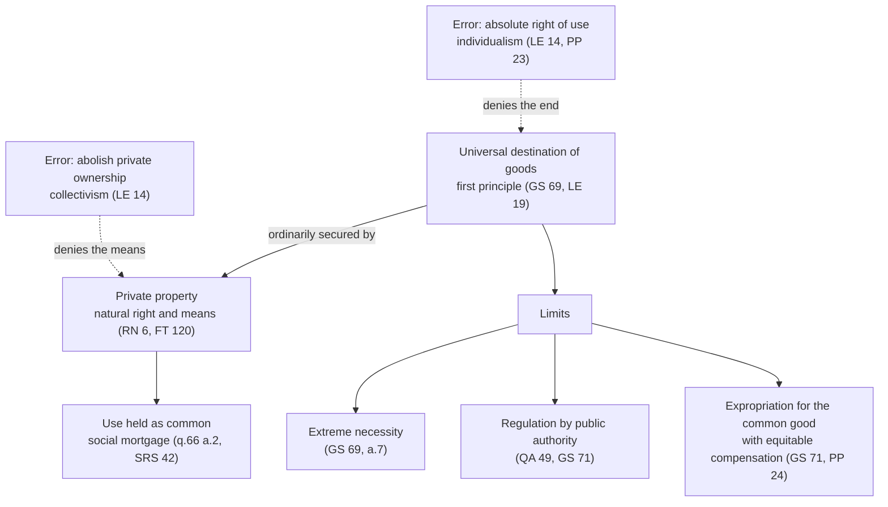

# Catholic Social Teaching · Lesson 3.5: The universal destination of goods and private property

> ⏱ ~15 min · Module 3: The principles · Builds on: [1.4](01-04-before-1891-the-roots-and-the-social-question.md), [2.1](02-01-rerum-novarum.md), [2.2](02-02-quadragesimo-anno-and-the-interwar-proposals.md), [3.4](03-04-solidarity.md) · Unlocks: [4.1](04-01-work-and-the-worker-laborem-exercens.md), [6.1](06-01-integral-ecology-laudato-si.md)

## Why this matters

Two invented leaflets lie on one parish table. One says the Church gives the homeless a right to the empty flats on the high street; the other, that the Church defends private property as a natural right, full stop. Each quotes a real document, and each quotes half of it. The corpus holds both halves in a fixed order, and in May 2026 Leo XIV insisted that the social function of property is doctrine, not "a mere theological opinion" (*Magnifica Humanitas* 66).

## The idea

Picture an orchard planted by a founder whose deed says it exists so that the valley never goes hungry. The deed divides the orchard into plots, one per household, because a tree everyone owns is a tree nobody prunes. You can wreck the plan two ways: abolish the plots, so pruning stops and quarrels start, or treat your plot as if the purpose clause had been torn off.

The Church reads the deed whole. The [universal destination of goods](../reference.md#universal-destination-of-goods) is the purpose clause: God gave the earth to the whole human family, for the use of all. [Private property](../reference.md#private-property) is the plot system, the ordinary and legitimate way that purpose is met. It is a means, not a rival. The hinge is Aquinas's line between *managing* a thing, which may be private, and its *use*, which stays common ([ownership and use](../reference.md#ownership-and-use), ST II-II q.66 a.2). [1.4](01-04-before-1891-the-roots-and-the-social-question.md) read that article, and [`history-of-political-thought` 2.4](../../history-of-political-thought/lessons/02-04-aquinas-on-kingship-tyranny-and-property.md) set out a.7 on extreme necessity. This lesson adds the order the encyclicals built on both.

## The teaching

**T1.** God meant the earth and everything in it for every person and people, so that created goods reach all fairly, under justice and with charity (*Gaudium et Spes* 69; *Centesimus Annus* 31; CCC 2402). *Laborem Exercens* 19 ranks the common use of goods as the first principle of the entire ethical and social order. *Magnifica Humanitas* 65 extends the destination to immaterial and cultural goods. *In words:* every title answers to a purpose set before it.

**T2.** Private ownership is legitimate. *Rerum Novarum* calls it a right every man has "by nature" (RN 6, Benziger 1903 English), and *Centesimus Annus* 30 says the Church has always defended it ([2.1](02-01-rerum-novarum.md) read the argument). RN 8 meets the socialists' appeal to God's gift: He gave the earth to mankind "not in the sense that all without distinction can deal with it as they like". He left the limits of possession "to be fixed by man's own industry, and by the laws of individual races". It secures the autonomy of person and family and extends human freedom (GS 71). *In words:* owning things is good for persons, not a concession to greed.

**T3.** Property is subordinate to the destination, never the reverse. LE 14 ranks the owner's right beneath the right of common use, and the destination "remains primordial" (CCC 2403). Francis calls private property a [secondary natural right](../reference.md#secondary-natural-right), derived from the destination (*Fratelli Tutti* 120). Leo XIV says it is always subordinate (MH 66). *In words:* the plots serve the purpose clause.

**T4.** As to managing, Aquinas's "power to procure and dispense", goods are rightly private. As to use, the owner holds them "not as his own, but as common", ready to share with those in need (ST II-II q.66 a.2, English Dominican Province; quoted in RN 22). GS 69 words it more gently: common as well as his own. *Quadragesimo Anno* 45 names this the [twofold character of ownership](../reference.md#twofold-character-of-ownership), individual and social ([2.2](02-02-quadragesimo-anno-and-the-interwar-proposals.md)). The [social mortgage](../reference.md#social-mortgage) on every private title, from John Paul II's address opening the Puebla conference (28 January 1979, III.4) and restated in *Sollicitudo Rei Socialis* 42, means property has an intrinsically social function grounded in the destination. *In words:* the deed is yours, and the mortgage is on it.

**T5.** The limits follow from the order:

- In [extreme necessity](../reference.md#extreme-necessity) a person may take what he needs from others' riches (GS 69, restating a.7).
- What remains after one's needs and fitting station is owed to the poor (RN 22; QA 50).
- Public authority may regulate the use of property for the common good (QA 49; GS 71; CCC 2406).
- Where the common good requires it, extensive, unused or poorly used estates may be expropriated, with compensation reckoned in equity ([expropriation](../reference.md#expropriation); GS 71; *Populorum Progressio* 24). CA 43 adds that ownership of productive goods left unused, or used for speculation that curbs others' work, has no justification.
- Misuse or non-use does not by itself destroy the right (QA 47).

*In words:* the title is real, so overriding it needs public authority, a common-good reason and fair compensation.

**T6.** The order forbids two things. It forbids abolishing private ownership, since LE 14 sets the Church's teaching radically apart from collectivism ([critique of socialism](../reference.md#critique-of-socialism)). And it forbids an absolute right of use against the needy, since the right was never "absolute and untouchable" (LE 14; PP 23; CA 30). QA 46 calls these errors collectivism and individualism, the "twin rocks of shipwreck". *In words:* abolish the plots and you get collectivism; tear off the purpose clause and you get an owner answerable to no one.

**Mark the levels.** On [the ladder](../../fundamental-theology/lessons/04-04-the-ladder-of-doctrinal-authority.md) and the card's [levels of authority](../reference.md#levels-of-authority):

- **T1 and T3 are rung 3**, authentic ordinary magisterium repeated in the doctrinal part of a pastoral constitution (GS 69, 1965) and five encyclicals (LE, SRS, CA, FT, MH). [`theology-of-debt` 1.3](../../theology-of-debt/lessons/01-03-the-jubilee-the-land-is-mine.md) already levelled CCC 2402–2403; this lesson does not re-level it. Their premise, that God created all things, is defined faith (Lateran IV; Vatican I).
- **T2 is rung 3** (RN 6; CA 30). It guards the Decalogue's ban on theft, whose binding force on Christians Trent defined (Session VI, canon 19).
- **T4–T6 are rung 3.** MH 66 marks its own weight, calling property's social function Church doctrine, not theological opinion: LG 25's "manner of speaking". That excludes rung 5 without making a definition.
- **Below the seam.** Aquinas's articles are theology and common teaching (**rung 4**), except where an act restates them. The Fathers cited in GS 69's note 10, PP 23 and CCC 2446 are witnesses with **no magisterial level**.
- **The two disputes.** Reconciling RN's "by nature" with Aquinas's division "devised by human reason" (q.66 a.2 ad 1), usually through his *ius gentium* (q.57 a.3), is the theologians' work (**rung 4**; see [1.4](01-04-before-1891-the-roots-and-the-social-question.md)). Whether FT 120's "secondary" changes RN or restates the old order is **rung 5**. The floor for every reading is that property is a natural right **and** subordinate.

**Principle or application.** The [principles](../reference.md#principle-and-application) are T1–T6, including the claim that the common good *can* require expropriation with compensation. They are owed religious submission of mind and will. The applications, owed serious and respectful consideration, include GS 71's 1965 call for land reform where great estates lay idle, PP 24's judgment that such estates "sometimes" must go, and every decision about an estate, a vacancy tax or a compensation formula. A Catholic who weighs one and judges otherwise does not dissent, but he may not deny the principle, wave the application away, or claim the Church's authority for his own view ([the three assents](../reference.md#the-three-assents)). The [empirical premises](../reference.md#empirical-premise) stand on evidence: Aquinas's three reasons (people tend their own better, affairs run in better order, quarrels are fewer), RN 8's claim that divided land still feeds all through wages, and any claim that idle land drives up rents. [The two symmetrical errors](../reference.md#the-two-symmetrical-errors) here are "the Church teaches this land tax" and "property's social function is the Pope's opinion". MH 66 rules out the second in so many words.

**Where it stops.** The doctrine fixes the order and the outer limits, not a property regime: GS 69 accepts whatever forms of property peoples' legitimate institutions adopt, and *Compendium* 173 leaves methods and limits to a juridical order. QA 49 assigns owners' detailed duties to those in charge of the state, where natural law is silent. And CA 43 says the Church has no models to present ([the doctrine's disclaimers](../reference.md#the-doctrines-disclaimers)). Legislators and courts judge regulation and expropriation, and each owner judges his own surplus. It is hardest to run on goods that fit property badly: land, water, knowledge (CA 32). Water goes to [6.1](06-01-integral-ecology-laudato-si.md); data, algorithms and patents (MH 67) go to [4.5](04-05-the-new-things-of-our-time-magnifica-humanitas.md).

## The ordering

The end governs the means and its limits, and each error cuts one of the two.

## Worked examples

**Example 1 (clean): the Brightwells' hay.** Invented. In a drought year the Brightwell farm holds more hay than its herd needs, beyond a prudent reserve. Without fodder, their neighbour Tregarth must sell his cattle at a ruinous loss, though nobody in his house goes hungry.

- **Ownership:** the hay is theirs, and they decide how it leaves the barn. Tregarth may not help himself, because no life is at stake and other remedies exist.
- **Use:** the surplus is held "as common".
- **Forbidden:** holding it back to sell at whatever the drought will bear (CCC 2409 condemns forcing up prices by exploiting another's hardship).
- **Required:** making the surplus available.
- **Permitted:** selling it at a fair price, and keeping the prudent reserve (RN 22).

**Example 2 (strain): the Quarran estate.** Invented. Quarran is 9,000 hectares of arable land, unworked for twelve years while its owner waits for a road to raise its price. Two hundred landless families farm rented scraps at its edge. The order settles three things:

- **The owner fails his duty.** CA 43 judges productive goods kept idle for speculation unjustified, and PP 24 describes this very kind of estate.
- **The families may not seize it on their own authority.** Their poverty is real but not extreme necessity, and non-use does not void the title (QA 47).
- **Public authority may act.** It may regulate the land's use, or expropriate it with compensation reckoned in equity (GS 71).

Then the principle stops. Does Quarran impede the general prosperity enough to warrant expropriation rather than an idle-land tax or a compulsory lease? Is equitable compensation the market price, the taxed value, or less for twelve idle years? Will redistribution fail without the means, education and cooperative facilities GS 71 says must come with it? Those questions are prudential and empirical, and belong to legislators, courts and people who know the land. Backing the tax and backing expropriation can both apply the same principle.

## Watch out

- **You might think the destination makes everything everyone's, so the poor may simply take.** It does not put every object at everyone's disposal (*Compendium* 173). Extreme necessity is narrow ([`history-of-political-thought` 2.4](../../history-of-political-thought/lessons/02-04-aquinas-on-kingship-tyranny-and-property.md)), and non-use cancels no title (QA 47).
- **You might file the social function as papal opinion, or your preferred instrument as doctrine.** MH 66 shuts the first door in so many words. PP 24's "sometimes" and GS 71's "according to the different cases" shut the second: no vacancy tax or land reform is taught.
- **You might write "*Rerum Novarum* repeats Aquinas", or "Leo invented a right Aquinas denied".** Aquinas makes division an addition by human reason, and RN says "by nature". Reconciling the two is rung 4. Reading FT 120's "secondary" as a revocable concession overstates it: the floor keeps both halves.
- **You might take the Fathers to teach that property is theft.** Chrysostom's "cold words", *mine and thine*, are one bishop's preaching ([`patristics` 3.6](../../patristics/lessons/03-06-john-chrysostom.md)). The doctrine keeps the Fathers' claim on use and surplus, citing them as witnesses, not rungs, and drops any suggestion that owning is itself unjust: the more balanced position patristics 3.6 promised.

## One-liner

> Goods are made for everyone, and private property is the ordinary way to get them there: deny the property and you get collectivism, deny the destination and you get an owner answerable to no one, and the instrument between the two is left to prudence.

## Problems

**P1 (🟢)** *(Exegetical)* Close reading. Gregory the Great, *Pastoral Rule*, Book III, chapter XXI, "How those are to be admonished who desire not the things of others, but keep their own; and those who give of their own, yet seize on those of others" (NPNF 2nd series, vol. 12, Barmby's translation, in which this chapter is labelled "Admonition 22"):

> Those who neither desire what belongs to others nor bestow what is their own are to be admonished to consider carefully that the earth out of which they are taken is common to all men, and therefore brings forth nourishment for all in common. Vainly, then, do those suppose themselves innocent, who claim to their own private use the common gift of God; those who, in not imparting what they have received, walk in the midst of the slaughter of their neighbours; since they almost daily slay so many persons as there are dying poor whose subsidies they keep close in their own possession. For, when we administer necessaries of any kind to the indigent, we do not bestow our own, but render them what is theirs; we rather pay a debt of justice than accomplish works of mercy.

(a) Whose, according to the passage, are the necessaries given to the indigent, and from what premise does Gregory derive that? Name the words. **Two sentences.**

(b) Gregory's addressees "keep their own", and he calls the goods "their own". Does the passage deny that they own them? Say what, on its words, they are blamed for, and how that fits T4. **Two sentences.**

(c) What level does Gregory's sentence carry, and what changes when CCC 2446 quotes it? Give the citation so that a reader holding Barmby can find it. **Two sentences.**

**P2 (🟡)** *(Exegetical (a) · Evaluative (b))* An invented case. The city of Nerith has a housing shortage: rents are up by a third in four years. Forty central lots, cleared after a fire, have stood empty for a decade. Most belong to three investment funds whose own filings say they are waiting for land values to rise. The council debates.

(a) Sort each claim made in the debate as a principle, an application or an empirical premise, or say that it misstates the teaching. Give the level of each principle, and the correct claim for each misstatement. **One line each.**

1. "The funds' title is real, but it carries a social mortgage."
2. "Holding these lots empty is what is driving rents up."
3. "The city should buy the lots compulsorily at their assessed value."
4. "Ten years of disuse means the funds have forfeited the land, so anyone may build on it."
5. "Every Catholic on this council is bound in conscience to vote for the vacancy tax."
6. "The 'social function of property' is the Pope's opinion; Catholics may take it or leave it."

(b) What does the order taught in this lesson require of the council, what does it forbid, and where does it stop giving a verdict? Any verdict on the instrument passes. **100 words or fewer.**

**P3 (🔴)** *(Apologetic: (a) Exegetical, graded first · (b) reply)* A tax on earnings funds shelter and food for the destitute.

(a) State Robert Nozick's entitlement theory, and his claim about taxing earnings to meet others' needs, as he states them in *Anarchy, State, and Utopia* (1974), chapter 7. Paraphrase; [`political-philosophy` 2.4](../../political-philosophy/lessons/02-04-nozick-entitlement-and-the-challenge-to-patterns.md) has the theory. **100 words or fewer.** This part is graded first and strictly: a wrong statement fails the problem, however good the reply.

(b) Reply from the universal destination of goods. Open with a named concession, something Nozick holds that the Church also teaches. **150 words or fewer.** A reply concluding that Nozick's objection succeeds passes if it is a good reply.

Solutions

**P1** *(Exegetical)*

**Must hit, strict:**

- (a) The necessaries are **the poor's**: "we do not bestow our own, but render them what is theirs". The premise is the opening one: the earth "is common to all men, and therefore brings forth nourishment for all in common". It is restated as "the common gift of God" and "what they have received".
- (b) **No.** He addresses people who "keep their own" and blames them for withholding, "in not imparting what they have received", and for claiming the gift "to their own private use". The target is use, not holding. That fits a.2's split between managing (private) and use (common), though Gregory does not draw a.2's distinction himself.
- (c) **No magisterial level.** It is a Father's pastoral handbook, a witness. CCC 2446 locates the teaching it illustrates, which keeps its own weight, and the quotation does not raise "slay" or "debt of justice" to a rung. Cite *Pastoral Rule* III.21 in Barmby, which Barmby labels Admonition 22; the CCC's "3, 21" is the chapter. GS 69's note 10 cites the same chapter (PL 77, 87).

**Wrong turns:** reading (b) as a denial of ownership, when the phrase "keep their own" concedes it. Giving the CCC's quotation as making the sentence rung 3. Citing "Admonition 21", which is the previous chapter.

**Model answer:** (a) The goods are the poor's ("render them what is theirs"), because the earth "is common to all men" and yields food "for all in common". (b) No: he concedes they keep "their own" and blames them for withholding and for claiming God's common gift for private use. That is a.2's line between holding and use, though he does not state it. (c) No magisterial level: a Father's witness, which the Catechism quotes to illustrate a teaching that carries its own weight. Barmby, *Pastoral Rule* III, chapter XXI ("Admonition 22").

---

**P2** *(Exegetical (a) · Evaluative (b))*

**Must hit, strict (a):**

- 1: **principle, rung 3** (SRS 42; CA 30).
- 2: **empirical premise.** It is settled by evidence on prices and supply, and carries no rung.
- 3: **application.** It is a choice of instrument and of compensation formula. GS 71 permits expropriation with compensation reckoned in equity; it teaches no formula.
- 4: **misstatement.** QA 47 says non-use does not destroy the right, and private seizure is not extreme necessity. Correct claim: public authority may regulate or expropriate, with compensation.
- 5: **misstatement, an application inflated into a binding principle.** The principle binds; the instrument asks serious consideration (GS 43).
- 6: **misstatement, a principle demoted.** MH 66 calls the social function Church doctrine, rung 3, not opinion.

**Must hit, any verdict (b):**

- **Requires:** the council must treat the lots' idleness as a failure of the owners' duty and as a matter for the common good.
- **Forbids:** treating the title as void, and treating it as absolute.
- **Stops at:** which instrument to use, what compensation is fair, and whether the empirical premise is true. These belong to public authority and the evidence.

**Wrong turns:** sorting 1 as an application because it names the funds. Calling 3 "Catholic teaching" because GS 71 permits expropriation. Answering (b) with economics alone.

**Model answer (b), one of several:** The order requires the council to act on idle land amid a shortage, because ownership carries a social mortgage and public authority may regulate its use. It forbids declaring the titles forfeit, and it forbids accepting "it's ours" as the end of the matter. It does not choose between a vacancy tax, a compulsory lease or purchase, and it sets no compensation figure. Those turn on evidence about rents and on prudence: one council may try the tax first as the lesser interference, another may judge purchase faster, and both apply the same principle.

---

**P3** *(Apologetic: (a) Exegetical, graded first · (b) reply)*

**Accept:** any reply that engages Nozick's actual premises. A verdict for Nozick passes if it is argued.

**Must hit, strict (a), graded first:**

- Justice in holdings is **historical and unpatterned**. A holding is just if it came about by **just acquisition** of unowned things, subject to a **weak Lockean proviso**, or by **voluntary transfer** from someone entitled to it, and injustices are **rectified**. No pattern of need or desert grounds an entitlement.
- **Liberty upsets patterns:** keeping any pattern requires continual interference with free exchange.
- **Taxing earnings** to meet others' needs Nozick puts on a par with **forced labour**: it conscripts some of a person's hours for others' purposes. The ground is rights as side constraints.
- Need warrants **voluntary** giving, not a state-enforced claim. The state is the minimal state.

**Must hit (b):**

- A **named concession**, true of both: private ownership is a natural right (RN 6), collectivism is condemned, and persons are not resources for the state.
- The reply must hit Nozick's **real premise**: that the world starts unowned, open to appropriation under a thin proviso. Against it, the Catholic premise is that the world starts **destined** for all (CA 31; GS 69), so titles carry the social mortgage from the start.
- It must explain why a tax laid by **legitimate authority** for the common good takes nothing owed as absolute (QA 49; CCC 2406).
- It must mark the **rate and design as application**.

**Wrong turns:** the caricature "Nozick says greed is good, or that no one should help the poor": he praises voluntary charity. Omitting the proviso. Making entitlement a desert theory. A reply that only asserts "the Church says so" without touching acquisition.

**Model answer (a):** For Nozick, justice in holdings is historical, not patterned: you are entitled to what you acquired from the unowned world without worsening others under a weak Lockean proviso, or received by voluntary transfer from someone entitled to it. Past injustice is rectified. Whatever results from just steps is just, and keeping any pattern of need or merit requires constant interference with free exchange. Taking a person's earnings to meet others' needs is on a par with forced labour, since it makes him work some hours for ends not his own. Need warrants free charity; the state may only protect rights.

**Model answer (b), one of several:** Concession: Nozick is right that ownership is a natural right, not the state's gift (RN 6), and that persons may not be treated as a common pool. The Church condemns collectivism too. But his theory starts from an unowned world, open to taking under a thin proviso. The Catholic premise is that the world starts *destined*: given to all for the sustenance of all (CA 31). Acquisition is legitimate as the means to that end, so every title is mortgaged from its origin (SRS 42). A just tax for the destitute, laid by legitimate authority (QA 49), is no later pattern raiding finished entitlements; it collects a charge always on them. So it is not forced labour: the worker owns his earnings, but not absolutely. His own proviso concedes that others keep some claim; the dispute is how thick it is. Which tax, and how much, is prudence.

## Flashback

**From Lesson [3.3](03-03-subsidiarity.md) (Subsidiarity):** *(Exegetical (a) · Evaluative (b) · reconstruct.)* Eight years ago the elected board of the invented Tarrowmere Credit Union hid heavy losses, and the regulator put the union under a state administrator "until the members can run it safely". The members have since elected a new board, which the regulator has trained and certified. The administrator wants to stay: "The union has never been sounder, and elected boards are always weaker than professionals. Subsidiarity asks only that each task go to whoever does it best." The members reply that subsidiarity requires the hand-back.

(a) Reconstruct the members' argument as three labelled premises (principle, application or empirical premise, with level) and a conclusion, citing 3.3's texts. Which premise does the administrator deny, and what kind of claim is "always weaker"? **Six lines.**

(b) Where does the principle stop giving a verdict on the hand-back, and who judges? Any verdict passes. **100 words or fewer.**

Solution

**Must hit, strict (a):**

- **P1** (principle, rung 3): a higher body may not take over what a lesser body *can* do, and owes it help (QA 79; CA 48).
- **P2** (principle, rung 3): a [substitute function](../reference.md#substitute-function) lasts only while the lesser body cannot act, and as briefly as possible (CA 48; MH 69).
- **P3** (empirical premise, no magisterial level): the new board can now run the union safely; its training and certification are evidence.
- **∴** Hand the union back, with help and supervision continuing.
- The administrator **denies P1**, putting comparative performance in place of what the lesser body can do, and so drops P2's limit. "Always weaker" is a rival **empirical premise**, no level, bearing only on P3. Even if true, it would not license replacing a capable body: the principle guards agency, not efficiency alone (3.3's Greyford case).

**Must hit, any verdict (b):**

- The principle orders the steps: hand back once the board is capable, keep supervising (the State's watching and restraining, QA 80), and substitute again only on fresh failure.
- Whether this board is capable, how fast to hand back and on what conditions are fact and prudence for the regulator and the members, within the law; no one may claim the Church's authority for a date (GS 43).

**Wrong turns:** "subsidiarity forbade the administration from the start", when substitution was owed once the board failed (CA 48). Calling continued supervision absorption. Siding with the administrator because the union is sounder.

**Model answer (a):** P1 (principle, rung 3): no higher body takes over what a lesser one can do (QA 79). P2 (principle, rung 3): substitution lasts only while the lesser body cannot act, and briefly (CA 48). P3 (empirical premise, no level): this board can now run the union safely. ∴ Hand it back, with help. The administrator denies P1's capacity test; "always weaker" bears only on P3.

**Model answer (b), one of several:** Capability is for audits and the regulator to judge; timetable and conditions are prudence within the law. My verdict: return management in six months, keep a regulator's observer on the board for two years, and set a reserve level that triggers renewed administration.

## Connections

- **Backward:** [1.4](01-04-before-1891-the-roots-and-the-social-question.md) read q.66 a.2. [`history-of-political-thought` 2.4](../../history-of-political-thought/lessons/02-04-aquinas-on-kingship-tyranny-and-property.md) set a.7's conditions. [2.1](02-01-rerum-novarum.md) gave RN's case for ownership, and [2.2](02-02-quadragesimo-anno-and-the-interwar-proposals.md) gave QA's twofold character. [3.4](03-04-solidarity.md) gave solidarity, the virtue that makes the destination a habit. [`theology-of-debt` 1.3](../../theology-of-debt/lessons/01-03-the-jubilee-the-land-is-mine.md) grounds stewardship in Leviticus 25:23 and fixes the level of CCC 2402–2403.
- **Forward:** [4.1](04-01-work-and-the-worker-laborem-exercens.md) takes up LE 14 on owning the means of production. [4.2](04-02-the-just-wage.md) treats the wage as the worker's ordinary share in goods destined for all (LE 19). [4.5](04-05-the-new-things-of-our-time-magnifica-humanitas.md) covers data and patents, [6.1](06-01-integral-ecology-laudato-si.md) water and land, and [6.3](06-03-distributism-and-the-alternative-proposals.md) distributism's widened ownership.
- **Sideways:** [`political-philosophy` 6.4](../../political-philosophy/lessons/06-04-welfare-property-and-subsidiarity.md) states this order as one position, and this lesson supplies what it cites. The destination meets Nozickian entitlement in [`political-philosophy` 2.4](../../political-philosophy/lessons/02-04-nozick-entitlement-and-the-challenge-to-patterns.md), and GS 69's right of everyone to a share of goods sufficient for himself and his family resembles sufficientarianism in [`political-philosophy` 2.6](../../political-philosophy/lessons/02-06-luck-relations-priority-and-sufficiency.md), though it is grounded in creation, not luck. Entitlement against desert is set out in [`philosophy-of-economics` 5.4](../../philosophy-of-economics/lessons/05-04-markets-and-desert.md). Aristotle's private ownership with common use is [`history-of-political-thought` 1.3](../../history-of-political-thought/lessons/01-03-aristotle-the-city-exists-by-nature.md). CA 31's work-origin of property resembles Locke ([`history-of-political-thought` 4.1](../../history-of-political-thought/lessons/04-01-locke-against-filmer-and-property.md)) but is subordinated to the destination. Nozick against the Jubilee's land reversion is argued in [`philosophy-of-debt` 5.4](../../philosophy-of-debt/lessons/05-04-jubilee-as-a-moral-principle.md).
