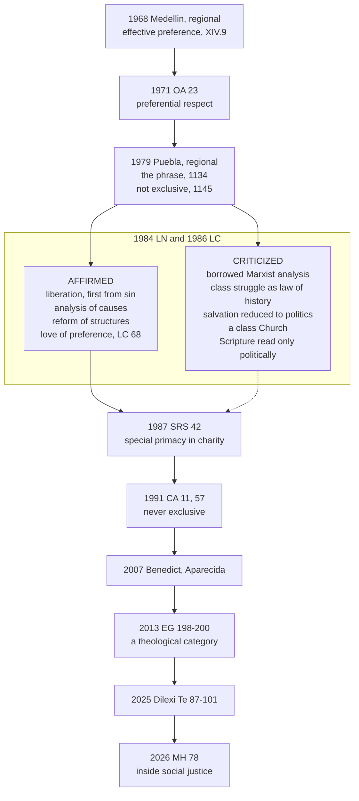

# Catholic Social Teaching · Lesson 3.6: The preferential option for the poor

> ⏱ ~15 min · Module 3: The principles · Builds on: [3.4](03-04-solidarity.md), [3.5](03-05-the-universal-destination-of-goods-and-private-property.md), [`christology` 6.4](../../christology/lessons/06-04-christology-today.md) · Unlocks: [4.2](04-02-the-just-wage.md), [6.4](06-04-three-readings-catholic-liberal-integralist-progressive.md)

## Why this matters

In 1984 the Congregation for the Doctrine of the Faith (CDF) warned sharply against certain forms of liberation theology. In 2025 a pope quoted that document, approvingly, in an exhortation on love for the poor. One reader hears "preferential option for the poor" as Marxism in a Roman collar; another hears licence to make the Church one class's party. Both have mislaid what the documents say, and at what weight.

## The idea

A mother of four has one child in hospital. For a month that child gets most of her time and the first claim on the family's money. She has disowned no one. That is what **preferential** means: an order of claims, not a membership list.

The [preferential option for the poor](../reference.md#preferential-option-for-the-poor) says the same of the Church. Where goods and attention are scarce, the poor's claims come first: in each Christian's charity, in the Church's use of goods, and in judging social arrangements. The reason is not sociology. God took their side first: of the widow and the orphan, "If you hurt them, they will cry out to me, and I will hear their cry" (Exodus 22:23, Douay–Rheims). Christ "being rich he became poor for your sakes" (2 Corinthians 8:9, DR) and names himself in the hungry (Matthew 25:40). Siblings read these texts closely (Amos, [`old-testament` 4.1](../../old-testament/lessons/04-01-what-a-prophet-is-amos-and-hosea.md); Luke, [`new-testament` 2.3](../../new-testament/lessons/02-03-luke.md); Matthew 25, [`creation-grace-last-things` 7.2](../../creation-grace-last-things/lessons/07-02-the-parousia-the-last-judgment-and-the-new-creation.md); Chrysostom, [`patristics` 3.6](../../patristics/lessons/03-06-john-chrysostom.md)); this lesson uses them.

The instinct is old: "God Himself seems to incline rather to those who suffer misfortune" (*Rerum Novarum* 24, Benziger 1903 English). The *phrase* is from 1979, and its first decade was a fight.

## The teaching

**T1. Medellín and Puebla.** The Latin American bishops at Medellín (1968) asked that the Church's apostolic effort give *preferencia efectiva*, effective preference, to the poorest sectors (XIV.9). At Puebla, in an assembly John Paul II opened on 28 January 1979, they named it an *opción preferencial* for the poor, credited it to Medellín, and called service of the poor the privileged but not exclusive measure of following Christ (Puebla 1134, 1145). *In words:* the phrase is a regional bishops' coinage.

**T2. Universal usage.** Paul VI spoke of the preferential respect owed the poor (*Octogesima Adveniens* 23, 1971). The CDF called it a "love of preference" that excludes no one and may not be cast in partisan sociological or ideological categories (*Libertatis Conscientia* 68, 1986). John Paul II called it a "special form of primacy" in the exercise of charity, witnessed by the whole tradition, bearing on each Christian's life, on social responsibilities and on decisions about owning and using goods (*Sollicitudo Rei Socialis* 42, 1987); never exclusive, and not limited to material poverty (*Centesimus Annus* 11, 57, 1991). *In words:* the phrase passed from the bishops of Latin America into universal papal and curial usage.

**T3. Benedict, Francis, Leo XIV.** Benedict XVI told the bishops at Aparecida (13 May 2007) that the option is implicit in faith in a God made poor for our sake. Francis quotes him and calls it primarily a "theological category", distinct from every ideology and owed above all as privileged religious care (*Evangelii Gaudium* 198–200, 2013). Leo XIV's *Dilexi Te* (2025; begun by Francis, §3) reads Medellín, Puebla's "social sin" and Aparecida into a papal text (§§87–101), quotes the 1984 instruction approvingly (§98, as EG 194 had), and repeats the religious-care point (§114). *Magnifica Humanitas* (2026) places it inside [social justice](../reference.md#social-justice), which judges an order by whether its weakest can live with dignity (§§77–78, citing SRS 42). *In words:* four pontificates restate it.

**T4. What [*Libertatis Nuntius*](../reference.md#libertatis-nuntius) affirmed** (CDF, 6 August 1984): the Gospel liberates, first from sin and then from cultural, economic and political slavery (Introduction); the yearning for liberation is a principal sign of the times (I.1); the gap between rich and poor is a scandal (I.6); effective action presupposes a scientific grasp of poverty's causes (VII.3); Scripture has a real political dimension (X.5); structures that are themselves violence need radical reform (XI.8). *In words:* the warning took the injustice as given.

**T5. What it criticized** in "certain forms" of [liberation theology](../reference.md#liberation-theology) (Introduction): Marxist concepts borrowed uncritically, as if the analysis could be detached from the ideology (VI.10, VII.6–9); class struggle as the law of history, and joining it as charity's demand (VIII.5–8, IX.2, IX.7); salvation reduced to earthly liberation (VI.4, IX.4–5); a "Church of the people" set as a class Church against the hierarchy (IX.11–13); a political rereading that makes the Exodus chiefly a symbol of political liberation (X.5, X.14) and confuses the poor of Scripture with Marx's proletariat (IX.10). Its Christological charge (X.9–12) is [`christology` 6.4](../../christology/lessons/06-04-christology-today.md)'s. LN names no theologian. *In words:* it judged a method and a hermeneutic, not concern for the poor.

**T6. What [*Libertatis Conscientia*](../reference.md#libertatis-conscientia) added** (CDF, 22 March 1986), LN's promised companion (LC 2): salvific liberation first, its social dimension as consequence (71); love of preference (68); [base communities](../reference.md#base-communities) as a source of great hope if they live in communion (69); unions supported without the theory of class struggle (77); reform over the myth of revolution (78); armed struggle only as last resort against obvious, prolonged tyranny (79). *In words:* 1984 refused a method; 1986 embraced the cause on the Church's terms.

Two books frame the quarrel. Gustavo Gutiérrez's *Teología de la liberación* (Lima, 1971) founded the movement: on his account theology is critical reflection on Christian practice in the light of the Word, and liberation runs on three levels, political, historical, and from sin. Michael Novak's *Will It Liberate?* (1986) replied that its economics, built on dependency theory, would deepen poverty, and that property, enterprise and law liberate. [Boss 3](../syllabus.md) asks you to state both.

**Mark the levels.** On [the ladder](../../fundamental-theology/lessons/04-04-the-ladder-of-doctrinal-authority.md) ([levels of authority](../reference.md#levels-of-authority)): the option is **rung 3**, fixed by the encyclicals SRS 42 (John Paul II, 30 December 1987) and CA 11, 57 (1 May 1991) with LC 68, and restated in the apostolic exhortations EG 198 (24 November 2013) and *Dilexi Te* (signed 4 October 2025) and in MH 78 (encyclical, 2026); repetition gives it a heavy grade within the rung (LG 25). Beneath it lies the duty of mercy to every neighbour in need, at least rung 3 ([`creation-grace-last-things` 7.2](../../creation-grace-last-things/lessons/07-02-the-parousia-the-last-judgment-and-the-new-creation.md)). CCC 2448 (quoting LC 68) locates; it does not fix. **Medellín and Puebla** were regional assemblies: authentic pastoral teaching in their region, **no act of the universal magisterium**. John Paul II's letter commending Puebla's document (23 March 1979) is reception, not promotion. **LN and LC** are doctrinal instructions of the CDF, each approved by John Paul II in an audience and ordered published: **rung 3 at a light grade, plus the weight of what they restate**. Which theologians fall under LN's criticisms is an **application**. Benedict's Aparecida address is **rung 3 at its lightest**; Gutiérrez and Novak have **no magisterial level**.

**Principle or application.** The **permanent principle** is the option itself: the poor's claims come first in charity and in the use of goods, excluding no one and reducible to no class (SRS 42, CA 57, LC 68); with it, LN's and LC's rejection of class struggle as the law of history and of salvation reduced to politics. These ask religious submission. **Applications** run it through a time and place: Medellín's redeployment of clergy, the international reforms SRS 43 lists, every parish budget and policy sold as "for the poor". They ask serious, respectful consideration ([the three assents](../reference.md#the-three-assents)); a Catholic who weighs one and judges otherwise dissents from nothing. **Empirical premises** say why the poor are poor and what lifts them: the dependency theory Gutiérrez drew on, Novak's case for enterprise, LN's own claim that the myth of class struggle aggravates poverty (XI.11). They stand or fall on evidence ([empirical premise](../reference.md#empirical-premise)). Hence the [two symmetrical errors](../reference.md#the-two-symmetrical-errors): reading the option as a mandate for one party or theory of capitalism, and dismissing it as a 1970s slogan.

**Where it stops.** The option says whose claims weigh first, not which policy relieves poverty fastest, which of two groups of poor to serve first, or which economics is right. LN says the social teaching gives the main lines of ethical orientation and needs competent scientists to guide action (XI.14); LC leaves the political building of society to the laity (LC 80). These are [the doctrine's disclaimers](../reference.md#the-doctrines-disclaimers), and the option adds one: it may never become a partisan choice (LC 68).

## The timeline

A regional phrase became universal teaching after Rome sifted the theology around it.

## Worked examples

**Example 1 (clean): the budget at St Martin de Porres, Dunlin.** An invented parish faces a lean year. The council's draft (i) waives hall rent for a food bank and a debt-advice clinic; (ii) moves the Spanish-language Mass to an hour the hospital's night cleaners can attend; (iii) ends Communion calls at a nursing home on the hill, "since its residents are well off"; (iv) puts in the newsletter: "this parish belongs to the poor; everyone else is a guest." (i) gives the poor first claim on a scarce good. (ii) is the option as religious care (EG 200). (iii) fails twice: the option is never exclusive, and not limited to material poverty; CA 57 names the elderly and the sick among today's poor. (iv) turns a preference into a membership rule, the class Church LN rejects (IX.9–10). No empirical premise was needed: the principle decides all four.

**Example 2 (strain): the Exodus in Saltgate.** In Dunlin's harbour district, an invented Bible-study group of dock cleaners and laid-off fishermen reads Exodus 3:7: "I have seen the affliction of my people ... and I have heard their cry" (DR). The leader's handout says Pharaoh is the shipping company, the Exodus is their class struggle, and the priest who urges talks with the employer "serves the bosses".

LN criticizes the frame: the Exodus made chiefly a political symbol, not also the figure of baptism Paul reads in it (X.5, X.14; 1 Corinthians 10:1–2); the poor of Scripture made a class (IX.10); the pastor discredited in advance as a class enemy (X.1). It would not suppress the text's political dimension (X.5), a sober analysis of how the company sets wages (VII.3), a union (LC 77), or the group itself (LC 69).

Where it stops: the pastor, with his bishop, may correct the handout's hermeneutic (LN XI.15–16). Whether the wages are unjust takes the books and [4.2](04-02-the-just-wage.md)'s measures; whether to strike is the workers' prudential call ([4.1](04-01-work-and-the-worker-laborem-exercens.md)). The option bids him stand with them while correcting them.

## Watch out

- **You might think "preferential" slides into "exclusive" when need is great**, but every act that uses the word shuts that door: Puebla 1145 (privileged, not exclusive), LC 68 (excludes no one), CA 57 (never exclusive or discriminatory).
- **You might think the option is a Latin American slogan Rome merely tolerated**, but that demotes a rung-3 principle taught in encyclicals (SRS 42, CA 57, MH 78). The mirror error inflates it: the option ranks claims; it chooses no party, tax or economic model.
- **You might think Rome condemned liberation theology in 1984**, but LN addressed "certain forms" that borrow Marxist concepts uncritically and named no one. Calling LN infallible, or a dead letter, misreads it the other way: it is rung 3 at a light grade, and Francis and Leo XIV both quote it approvingly (EG 194; DT 98).
- **You might think Medellín made the option Church teaching.** Medellín never uses the phrase, and a regional assembly is not the universal magisterium; the option is rung 3 through the papal and curial acts.

## One-liner

> The poor's claims come first, in charity, in the use of goods and in judging society, because God's preference came first; "preferential" never means "exclusive", and "for the poor" never means "for a class".

## Problems

**P1 (🟢)** *(Exegetical)* **Sort and weigh.**

(a) Each claim below is a paraphrase written for this problem. Put each in one bin: **A** affirmed in *Libertatis Nuntius* (LN, 1984); **B** a position LN states and criticizes; **C** taught in *Libertatis Conscientia* (LC, 1986) and not in LN; **D** stated in neither instruction, whether or not it contradicts them. **One line each, with the section.**

1. The yearning of the oppressed for liberation is one of the principal signs of the times, to be read in the light of the Gospel.
2. Marxist social analysis is a neutral scientific tool that can be borrowed without its philosophy.
3. The Church encourages trade unions that fight for workers' rights, without thereby accepting class struggle as the driving force of social life.
4. Since Marxist analysis is suspect, Christians should not use any social science to study the structural causes of poverty.
5. Faith, hope and charity are rightly restated as "fidelity to history", "confidence in the future" and "option for the poor".
6. Armed struggle may be admitted only as a last resort to end an obvious and prolonged tyranny, and only after very rigorous analysis.
7. The mistake in political readings of the Exodus and the Magnificat is not noticing a political dimension but making it the principal or exclusive one.
8. LN condemns by name Gustavo Gutiérrez's *A Theology of Liberation*.

(b) LN XI.11, paraphrased: to treat class struggle as the way to a society without classes is to chase a myth, one that holds back reform and deepens poverty and injustice. Split it into a principle and an empirical premise, and give the level and the assent each asks. **Two sentences.**

**P2 (🟡)** *(Exegetical)* **Diagnose.** Two texts, invented for this problem; they are not the words of any real person.

(a) A mailer from the invented Diocese of Holmcaster: "Our diocese has embraced the preferential option for the poor, which the Church defined at Medellín. From September our chaplaincies will serve only the poor: the university and hospital-staff chaplaincies will close, since the comfortable can find God elsewhere."

(b) A blog post: "The 'preferential option for the poor' is Marxist by definition. Liberation theologians invented it, and Rome condemned it in 1984. It is a Latin American slogan, not Church teaching, and no Catholic is bound by it."

For each text, name the **two** most serious errors and correct each with the document that fixes it and its level. **80 words or fewer per text.**

**P3 (🔴)** *(Exegetical (a) · Evaluative (b))* **Apply to a hard case.** St Martin de Porres parish in Dunlin receives a bequest "for the parish's work with those in need", large enough to fund one of two proposals for five years: (1) twenty more free places in the parish primary school for children of low-income local families; (2) a new adult-literacy and language programme for recent migrants in the harbour district, most of whom are not Catholic.

(a) What does the preferential option for the poor require, permit and forbid here, and where does it stop giving a verdict? Say who decides the rest. **120 words or fewer.**

(b) Which use would you choose, and why? **100 words or fewer.** Any verdict passes if the moves are made.

Solutions

**P1** *(Exegetical)*

**Must hit, strict (a):**

1. **A**: LN I.1.
2. **B**: LN VII.6–9 (the analysis cannot be detached from the ideology; VI.10 on concepts borrowed uncritically).
3. **C**: LC 77. LN never mentions unions.
4. **D**: neither states it. LN says the opposite: a scientific grasp of the situation is a presupposition of effective action (VII.3), used with critical awareness of one's working hypotheses (VII.13).
5. **B**: LN IX.5, where the renaming empties the virtues of their theological content.
6. **C**: LC 79 (citing PP 31). LN condemns systematic recourse to blind violence (XI.7) but does not state the last-resort teaching.
7. **A**: LN X.5.
8. **D**: LN names no theologian.

**Must hit, strict (b):** the **principle**: class struggle is not the law of history, and revolution by it is no path to justice (LN VIII–IX; LC 77–78); rung 3 at a light grade, owed religious submission. The **empirical premise**: that this road in fact slows reform and aggravates poverty, which LN supports from history (XI.10); it stands or falls on evidence, so a Catholic who doubted it in one case would dissent from nothing, while the principle would stand.

**Wrong turns:** putting 4 in A or B because it sounds like LN's caution about Marxism; LN never states this position, and it affirms the contrary (VII.3). Putting 3 or 6 in A because they sound like LN; LN mentions neither unions nor armed struggle. Putting 8 in B: LN criticizes positions, never persons. In (b), calling the whole sentence "rung 3, binding", or calling it all "the CDF's opinion about history".

**Model answer (b):** That class struggle is no law of history and no road to justice is a principle, rung 3 at a light grade, owed religious submission. That pursuing it in fact slows reform and deepens poverty is an empirical premise LN argues from history; it asks to be weighed on evidence, and the principle does not depend on it.

---

**P2** *(Exegetical)*

**Must hit, strict (a):**

- **"Defined at Medellín."** Wrong twice. Nothing here is defined, and Medellín was a regional assembly with no universal weight; it spoke of "effective preference" (XIV.9) and the phrase is Puebla's (1134). The option is **rung 3** through SRS 42, CA 57 and LC 68.
- **"Only the poor ... the comfortable elsewhere."** Exclusivity. The option is never exclusive or discriminatory and not limited to material poverty (CA 57); it excludes no one (LC 68). Students and hospital staff remain the Church's charge.

**Must hit, strict (b):**

- **"Marxist by definition ... liberation theologians invented it."** Wrong on origin and content. Bishops coined it at Puebla (1134), in an assembly John Paul II opened; EG 198 calls it primarily a theological category, and LC 68 forbids expressing it in ideological categories.
- **"Rome condemned it ... no Catholic is bound."** LN criticized certain forms of liberation theology and itself speaks of the option approvingly (VI.5; IX.9 on preference without exclusion; citing the Introduction is also correct); the same Congregation taught it in LC 68. It is **rung 3** (SRS 42, CA 57), owed religious submission.

**Wrong turns:** fixing (a)'s exclusivity but leaving "defined" standing. Answering (b) with "the option is infallible", which overcorrects. Treating LN as a condemnation of the option rather than of a method.

**Model answer (a):** Nothing in this teaching is defined, and Medellín, a regional assembly, cannot define for the Church; the phrase is Puebla's, and its universal standing is rung 3 through SRS 42, CA 57 and LC 68. "Only the poor" contradicts the teaching itself: the option is never exclusive or discriminatory and is not limited to material poverty (CA 57). The chaplaincies stay the Church's work.

**Model answer (b):** Bishops, not theologians, coined the phrase (Puebla 1134), and the Church calls it a theological category that may not be cast in ideological terms (EG 198; LC 68). LN criticized a Marxist method, not the option, which it names approvingly (VI.5). The option is rung 3 (SRS 42, CA 57), owed religious submission.

---

**P3** *(Exegetical (a) · Evaluative (b))*

**Must hit, strict (a):**

- **Requires:** that the bequest go to the poor's claims, ahead of other parish goods, as the will itself directs (SRS 42 on decisions about the use of goods); that neither project become exclusive, so the literacy programme is open to non-Catholics and makes no faith test (LC 68; CA 57); attention to religious care, offered and not imposed (EG 200; DT 114).
- **Permits:** either project. Both serve the poor, and the option ranks the poor's claims above other goods, not one group of poor above another.
- **Forbids:** spending the money on non-poor uses under the option's name; choosing a group because it is "ours" politically or by class (LC 68).
- **Stops:** at which does more good. That turns on empirical premises (unmet need, whether the state or others already provide either, cost per person helped) and is a prudential judgment for the pastor with the parish finance council, ideally after hearing the families and migrants themselves (DT 100). The option is rung 3; the allocation is an application.

**Must hit, any verdict (b):** a verdict; at least one empirical premise named and what evidence would change the verdict; one consideration from the other side; no claim that the option itself decides between the two.

**Wrong turns:** saying the option requires the migrants' programme because they are poorer, or the school because they are parishioners; the option ranks the poor against other uses, not the poor against each other. Saying the literacy programme is outside the option because its students are not Catholic. Treating either choice as dissent.

**Model answer (a):** The option requires that the bequest serve the poor first, as the will directs; that neither project shut anyone out (the literacy classes open to non-Catholics, LC 68, CA 57); and that religious care be offered, not imposed (EG 200). It permits either, since both serve the poor, and forbids diverting the money or choosing on class or party lines. Which does more good is an empirical, prudential question for the pastor and finance council, who should hear the families and migrants first (DT 100).

**Model answer (b), one of several:** I would fund the literacy programme. The school's free places help twenty children deeply, but the city may already subsidize school costs, while adult migrants without the language are shut out of work, health care and the parish itself. Literacy is a way into everything else, including the parish's welcome. Evidence that the migrants already have free language courses within reach, or that the school's poorest families are being turned away, would change my answer. A colleague choosing the school serves the poor no less.

## Flashback

**From Lesson [3.4](03-04-solidarity.md) (Solidarity):** *(Exegetical, reconstruct.)* An invented study-day handout reconstructs *Sollicitudo Rei Socialis* (SRS) 38:

> P1. Interdependence, economic, cultural, political and religious, is a system shaping the modern world.
>
> P2. Once recognized, interdependence is a moral category, and the fitting response is the virtue of solidarity.
>
> P3. Solidarity is a settled, lasting resolve to work for the common good, the good of everyone and of each person.
>
> ∴ C. Solidarity is owed in proportion to measured interdependence: as a country's trade with another falls, so does its duty to that people.

(a) Tag P1–P3: principle or empirical premise, level, assent. **One line each.**

(b) Does C follow? Name the premise the handout adds, and what in SRS 38–39 grounds the duty instead. **Two sentences.**

(c) If P1 proved exaggerated, what follows for the principle and its applications? **One sentence.**

Solution

**Must hit, strict (a):**

- **P1: empirical premise**, no magisterial level; it stands or falls on evidence, as 3.4 files it.
- **P2: principle**, rung 3 (SRS, encyclical, 30 December 1987), owed religious submission.
- **P3: principle**, rung 3, its grade raised by restatement down to MH 75 (2026), but not proposed as definitive (can. 749 §3). The love of neighbour beneath it is rung 1; the social definition does not inherit that rung.

**Must hit, strict (b):** C does not follow. It adds a premise SRS never states, that measured interdependence fixes the duty's extent, and it shrinks P1's four spheres to trade. In SRS 38 interdependence, once recognized, reveals the duty; the commitment rests on all being really responsible for all, and SRS 39 grounds solidarity between nations on the goods of creation being meant for all ([3.5](03-05-the-universal-destination-of-goods-and-private-property.md)).

**Must hit, strict (c):** the principle stands; applications built on the trend (urgency, instruments, aid and trade rules) are revised. A false empirical premise yields a mistaken application, not a false principle.

**Wrong turns:** tagging P3 rung 1 because neighbour-love is revealed, or P1 rung 3 because an encyclical states it. Accepting C because SRS does start from interdependence. Calling interdependence irrelevant, when SRS 38 makes it the moral category the virtue answers.

**Model answer:** (a) P1 is an empirical premise with no level; P2 and P3 are rung-3 principles owed religious submission, and neighbour-love's rung 1 does not pass to P3. (b) No: C makes measured trade fix the duty, while SRS 38 grounds it on all being responsible for all, and SRS 39 grounds solidarity between nations on the goods of creation being meant for all. (c) The principle would stand; only applications built on the trend would change.

## Connections

- **Backward:** [3.4](03-04-solidarity.md) gave solidarity and [structures of sin](../reference.md#structures-of-sin), which Puebla's "social sin" and MH 79 apply; [3.5](03-05-the-universal-destination-of-goods-and-private-property.md) gave the [universal destination of goods](../reference.md#universal-destination-of-goods), under which the *Compendium* files the option (182) and beside which SRS 42 places it. The levels come from [`fundamental-theology` 4.4](../../fundamental-theology/lessons/04-04-the-ladder-of-doctrinal-authority.md) and the genres from [4.5](../../fundamental-theology/lessons/04-05-reading-a-documents-weight.md).
- **Forward:** [4.2](04-02-the-just-wage.md) runs the option through the wage; [5.5](05-05-migration.md) takes up MH 81's migrants as the "litmus test" of social justice; [6.4](06-04-three-readings-catholic-liberal-integralist-progressive.md) makes the option the centre of the progressive reading and asks what the liberal and integralist readings make of it.
- **Sideways:** LN's target is Marx's class struggle as a theory of history ([`history-of-political-thought` 6.5](../../history-of-political-thought/lessons/06-05-marx-from-hegel-to-historical-materialism.md); [`social-theory` 2.2](../../social-theory/lessons/02-02-class-class-consciousness-and-ideology.md)). Puebla's "social sin" is the analogical sense of [`moral-theology` 3.5](../../moral-theology/lessons/03-05-social-sin-and-cooperation-in-the-sins-of-others.md). The secular cousin is prioritarianism, which weights benefits to the worse off ([`political-philosophy` 2.6](../../political-philosophy/lessons/02-06-luck-relations-priority-and-sufficiency.md)): a distributive formula, where the option is a primacy within charity grounded in God's own preference and supplies no formula.
