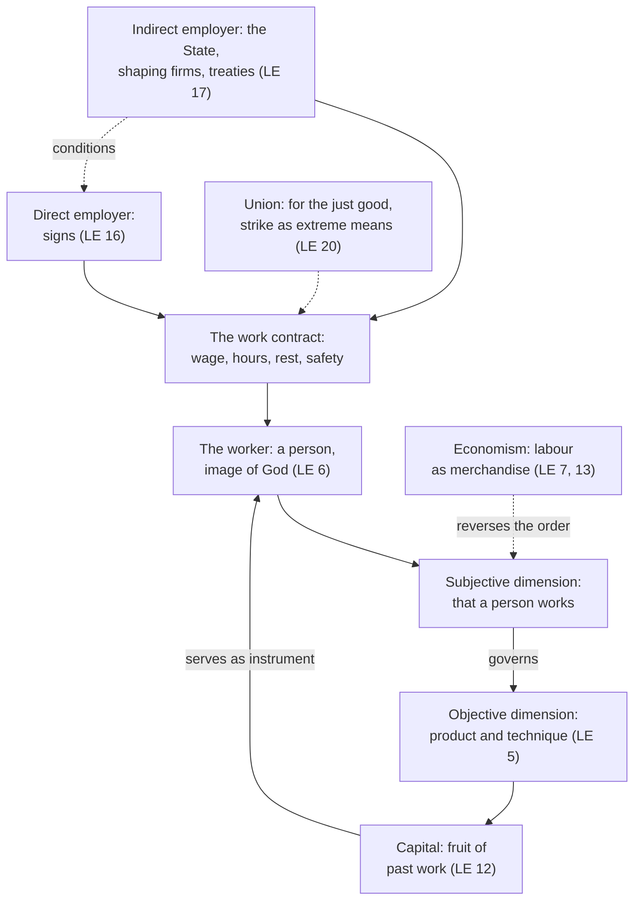

# Catholic Social Teaching · Lesson 4.1: Work and the worker: *Laborem Exercens* (1981)

> ⏱ ~15 min · Module 4: Work, the economy and the two critiques · Builds on: [3.5](03-05-the-universal-destination-of-goods-and-private-property.md), [`phenomenology-and-personalism` 5.4](../../phenomenology-and-personalism/lessons/05-04-action-reveals-the-person.md) · Unlocks: [4.2](04-02-the-just-wage.md), [4.3](04-03-socialism-and-liberal-capitalism-each-judged.md)

## Why this matters

A haulage firm's consultant ranks every job by value added per hour and puts the bottom rows on call by text message. A union leaflet says the Pope requires workers to own their firms. A columnist replies that the "priority of labour" is a pious phrase. The consultant never read *Laborem Exercens* (John Paul II, 1981), the encyclical that made work the key to the social doctrine; the other two misread it in opposite directions.

## The idea

Ask two questions of any job. *What is being done?* Loading a lorry, setting a fracture: the product, technique and tools are the job's **objective dimension**. *Who is doing it?* Always a person, who decides about himself in what he does: the job's **subjective dimension** ([objective and subjective dimensions](../reference.md#objective-and-subjective-dimensions-of-work)). Economies run on the first question; *Laborem Exercens* insists that the second governs. The clinic and the loading bay differ enormously in what they make. The nurse and the loader do not differ at all in what they are.

Keep that order and the rest follows. Capital is the fruit of earlier work and exists to serve present workers ([priority of labour over capital](../reference.md#priority-of-labour-over-capital)). Whoever shapes a contract without signing it, the State first, answers for its terms ([indirect employer](../reference.md#indirect-employer)). [`phenomenology-and-personalism` 5.4](../../phenomenology-and-personalism/lessons/05-04-action-reveals-the-person.md) has shown what it is to be the one who acts; this lesson asks what the Church teaches with that, and at what level.

## The teaching

*Laborem Exercens* (LE) is paraphrased throughout, by section.

**T1. Two dimensions (LE 5–6).** The objective dimension is man subduing the earth through farming, industry, services and research (§5). The subjective dimension is that the worker is a person in God's image, able to plan and to decide about himself (§6). Work may be ranked objectively, but its dignity comes first from the one doing it. So work is for man, not man for work (§6; CCC 2428). *In words:* a job's dignity comes from who does it before what it makes.

**T2. Economism (LE 7, 13).** Treating work as merchandise or an impersonal "workforce", valued solely by its economic purpose, is [economism](../reference.md#economism): a practical materialism that makes man an instrument of production. *In words:* the error is counting the worker as nothing but a cost.

**T3. The priority of labour over capital (LE 12, 15).** In production, labour is always the primary efficient cause. Capital, the whole collection of means of production, is an instrument, and is itself the product of past work (§12). LE calls it a principle the Church has always taught and (§15) a postulate of social morality, binding under private or collective ownership. *In words:* things serve persons, under every ownership.

**T4. Ownership serves labour (LE 14).** Private property, in the means of production too, is upheld but never absolute: it is subordinate to the common use of goods ([3.5](03-05-the-universal-destination-of-goods-and-private-property.md)). Productive property may not be held against labour or for possession's sake; its only title, private or public, is that it serves labour. LE rejects both "rigid" capitalism's untouchable private ownership and the a priori abolition of private ownership, while not excluding socialization of some means "in suitable conditions". Joint ownership, a share in management or profits, and shareholding by labour are proposals whose concrete feasibility LE leaves open ([worker participation](../reference.md#worker-participation)). *In words:* the principle judges how property is used and leaves its form to prudence.

**T5. Direct and indirect employer (LE 16–18).** The direct employer signs the contract. The indirect employer is every person, institution, collective agreement and rule that substantially shapes it: the State first, then the links between states. Its responsibility is less direct but real, and it does not excuse the direct employer (§17). Its first task is work for all, pursued by coordination rather than centralization; unemployment is an evil in every case, and supporting the unemployed is a duty flowing from the common use of goods (§18). *In words:* whoever sets the conditions of a contract answers for them.

**T6. Unions and the strike (LE 20).** Workers may associate, and unions are indispensable. They struggle *for* the just good, not *against* others: no class war, no group "egoism", no party's instrument. The strike is legitimate in proper conditions and within just limits, and no one may be penalized personally for joining one. It remains an extreme means, never to be abused, above all for political ends. Essential community services must always be secured, by law if necessary ([unions and the strike](../reference.md#unions-and-the-strike); GS 68: a necessary but ultimate means). *In words:* workers may strike for what justice owes them, within limits.

**T7. The margins (LE 22–23).** The disabled worker is a full subject of work, and admitting only the fully functional would be a serious discrimination (§22). The emigrant may leave and return, and must never be disadvantaged in working rights, whatever his nationality, religion or race (§23; CCC 2433). *In words:* the subjective dimension is tested where output or votes count least.

**T8. Work and holiness (LE 25–27).** By work man shares in the Creator's activity (§25, citing GS 34). Toil joined to Christ crucified shares in the work of redemption (§27; CCC 2427: a means of sanctification). *In words:* ordinary work is an ordinary way to God.

**T9. Forty-five years on (*Magnifica Humanitas* 148–152, 2026).** Leo XIV repeats that work is "the essential key" to the social question (§148, quoting LE 3, which hedged: "probably"). Reading LE 18, he calls unemployment a "grave evil" that, at scale, calls on the State (§151). Relieving arduous or dangerous tasks is welcome, but protecting employment must remain the "general rule": profit cannot justify systematically sacrificing jobs, because the person is an end (§152) ([*Magnifica Humanitas*](../reference.md#magnifica-humanitas); the AI side is [4.5](04-05-the-new-things-of-our-time-magnifica-humanitas.md)). *In words:* the 1981 principles, applied to automation.

**Mark the levels.** See [the ladder](../../fundamental-theology/lessons/04-04-the-ladder-of-doctrinal-authority.md) and [levels of authority](../reference.md#levels-of-authority). [*Laborem Exercens*](../reference.md#laborem-exercens) is an encyclical to the bishops, the faithful and all people of good will, signed on 14 September 1981 for *Rerum Novarum*'s ninetieth anniversary. What it proposes as principle is authentic ordinary magisterium, **rung 3**, owed religious submission of mind and will (LG 25): the principles of T1–T8, which in T4 means the rule, not the proposals. Much of it restates GS 67–68, also **rung 3**; CCC 2427–2436 locate it without adding weight. Its root, that every person is made in God's image, is held as revealed (rung 1; [human dignity](../reference.md#human-dignity), [3.1](03-01-human-dignity.md)), but nothing in LE is defined. *Magnifica Humanitas* (Leo XIV, encyclical, signed 15 May 2026, published 25 May 2026) is **rung 3** in T9's principles.

**Principle or application.** Religious submission attaches to the principles; the applications ask serious, respectful consideration, after which a Catholic may judge one differently without dissenting. He may not deny the principle, treat the application as weightless, or claim the Church's authority for his own ([principle and application](../reference.md#principle-and-application); [the three assents](../reference.md#the-three-assents)). LE marks its own applications: T4's ownership proposals, socialization "in suitable conditions", which services count as essential and what law secures them, and its hopes for the International Labour Organization (§17). Its **empirical premises**, §17's account of how rich countries and transnational firms set prices and §1's forecast of job losses from automation, stand or fall on evidence, and so does MH 151's fear of a rapid fall in jobs ([empirical premise](../reference.md#empirical-premise)). Both [symmetrical errors](../reference.md#the-two-symmetrical-errors) live here. "The Church requires worker ownership" inflates T4's proposals into its rule. "The priority of labour is a sentiment" demotes a postulate of social morality to a mood.

**Where it stops.** LE says it is not for the Church to analyse scientifically the consequences of technological change (§1). Its account of employers is not a treatise on economics or politics but on their moral side (§19) ([the doctrine's disclaimers](../reference.md#the-doctrines-disclaimers)). So the principle tells a firm its loaders are not fuel, but not whether to run two shifts or three. It tells a union the strike is legitimate within limits, but not whether *this* strike is proportionate. Those judgments belong to workers and unions, owners and managers, and those responsible for the common good ([prudential judgment](../reference.md#prudential-judgment)). MH 153 agrees: there is no single model.

## The map

Left (LE 6, 12): capital comes from work and serves the worker. Right (LE 16–17): the indirect employer shapes, and answers for, the contract the direct employer signs.

## Worked examples

**Example 1 (clean): the role review at Marrin Logistics (invented).** A consultant ranks the fourteen roles in Marrin's depot by value added per hour. Route planners come top; night cleaners and loaders come bottom. He proposes moving the bottom three to "flex capacity": no fixed shifts, a text the evening before, pay only for hours called.

- *The ranking* measures the objective dimension. LE allows it, and pay may differ (§6; [4.2](04-02-the-just-wage.md)).
- *The inference* is economism (§§7, 13): lowest value, so treat the worker as a variable input. The cleaner's work draws its dignity from the same source as the planner's: the person (§6).
- *What follows:* work must be organized around the person and his home life, with rest (LE 19; GS 67). Claiming a person's evening at a day's notice fails that test, whatever the pay. Flexible hours a worker chooses and can plan around are another case.

**Example 2 (strain): the nurses' strike at Belcastro General Hospital (invented).** After eighteen months of failed talks over night staffing (one nurse to twelve patients), the nurses' union votes for a five-day strike. It will cover emergency, intensive care and maternity; elective surgery stops, and some cancer operations slip a week. Management is the direct employer; the health ministry, which sets the budget, is the indirect one (§17).

Run LE 20. The aim is a working condition, not a party's power. So this is not the "political" abuse §20 forbids, even though the pressure lands on a government: here the State is an employer. Talks came first, so the strike is a last resort, not an opening move (GS 68).

The strain: essential services must always be secured, and the strike's own cause is patient safety. Is a delayed cancer operation essential? Are five days proportionate to the benefit sought (CCC 2435)? The doctrine names the conditions but does not apply them to this ward. That falls first to the nurses and their union, in conscience, then to management and the ministry, and to legislators and courts where law sets minimum service levels. Two nurses can apply the same rung-3 conditions, vote differently, and neither dissents.

## Watch out

- **You might think the priority of labour is either a ruling on ownership or a slogan.** It is a rung-3 principle that holds under any ownership (§15), and it has teeth: productive property has no title except service to labour (§14). Co-ownership and shareholding are proposals LE leaves to concrete judgment.
- **You might think LE 7 condemns capitalism as a system.** It uses the word for a reversal of order, persons treated as instruments, which can recur under any programme or name, collectivism included (§§11–15). Judging the systems is [4.3](04-03-socialism-and-liberal-capitalism-each-judged.md)'s work.
- **You might think the right to strike is unlimited once a union votes, or merely tolerated.** LE 20 recognizes the right and bars personal penalties (rung 3), and attaches the limits in the same paragraph. The right without the limits overstates LE; the limits without the right understate it.
- **You might think "unemployment is a grave evil" is LE's phrase, or a policy.** It is MH 151 reading LE 18 (an evil in every case); either way the indirect employer must act, by means prudence chooses.

## One-liner

> Work is judged first by who does it: capital serves labour under any ownership, whoever shapes a contract answers for it, and the strike is a right with limits, while forms of ownership, strike decisions and jobs policy are left to prudence.

## Problems

**P1 (🟢)** *(Exegetical)* Sort and weigh. For each claim (paraphrased), say whether it is a principle, an application or an empirical premise; give its level, or say it has none as a principle; and say what assent it asks. **One line each.**

1. Work draws its value first from the person doing it, and only then from the kind of work it is (LE 6).
2. In production, labour is always the primary efficient cause and capital a mere instrument; LE calls this an evident truth drawn from the whole of human historical experience (LE 12).
3. Workers should share in owning the means of work, in management or profits, or through shareholding by labour (LE 14's list of proposals).
4. Highly industrialized countries and transnational firms set the highest prices for their products and the lowest for raw materials, widening the gap between rich and poor nations (LE 17).
5. The State is, in the first place, the indirect employer and must conduct a just labour policy (LE 17).
6. Essential community services must always be secured, by legislation if need be (LE 20).
7. The International Labour Organization and the Food and Agriculture Organization have fresh contributions to make toward respect for workers' rights (LE 17).
8. As automation and AI spread, protecting employment must remain the general rule (*Magnifica Humanitas* 152, 2026).

**P2 (🟡)** *(Exegetical)* Apply to a hard case. Marrin Logistics, based in Dunmara, contracts its cross-border trunk route to Tollmark Haulage, a firm registered in neighbouring Veldra (firms and countries invented). Veldra's law allows 72-hour driving weeks. Dunmara caps drivers at 56 hours but exempts foreign-registered carriers, and a trade agreement between the two states leaves working hours to each. Marrin's delivery windows can be met only if Tollmark's drivers work about 65 hours a week. A Tollmark driver crashes at the end of a 15-hour shift.

(a) Name the direct employer and every indirect employer, with the section of LE that makes each one so. **One line each.**

(b) Say what LE requires of Marrin and whether having no contract with the driver clears it. Then say where the doctrine stops giving a verdict, and who decides the rest. **120 words or fewer.**

**P3 (🔴)** *(Exegetical)* Diagnose. Two texts, invented and written for this problem; neither is the work of any real person or body.

> **Leaflet of the Depot and Transport Workers' Federation:** "*Laborem Exercens* settles it. Labour has priority over capital, so the Church teaches that workers must own the firms they work in. Until we do, every strike is justified: the encyclical says the right to strike cannot be limited."

> **Column in the *Harbourside Business Weekly*:** "The 'priority of labour' is a pious sentiment with no implications for how a firm is run. The encyclical admits in its first section that the Church has no competence in economics, and an encyclical is only the Pope's opinion anyway, written for Poland in 1981."

Name **two** errors in each text. Correct each with the section of LE and the level, and say which of the two symmetrical errors each text commits. **150 words or fewer.**

Solutions

**P1** *(Exegetical)*

**Must hit, strict:**

1. **Principle, rung 3**; religious submission. It rests on human dignity and restates GS 67.
2. **Principle, rung 3**; religious submission. It is **not** an empirical premise. "Evident truth" names the ground LE offers, but the claim concerns the order of causes and values (persons over things), which LE calls a principle always taught and, in §15, a postulate of social morality. No economic dataset could revise it.
3. **Application**: no rung as a principle; serious, respectful consideration. LE itself leaves open whether each proposal can be applied concretely (§14). The principle behind it, that labour's proper place demands some adaptation of ownership (and, in GS 68, active participation in forms still to be worked out), is rung 3.
4. **Empirical premise** in a rung-3 document. It stands or falls on trade and price evidence; the Church's teaching authority does not extend to it as such. If it is false, the indirect employer's responsibility is untouched.
5. **Principle, rung 3**; religious submission.
6. **Split.** That essential services be secured is a **principle, rung 3**. Which services count, and what law secures them, is an **application** for legislators.
7. **Application**: a judgment about named institutions; serious consideration.
8. **Principle, rung 3** (encyclical, 2026), but as a *general rule*, not an exceptionless norm: §152 itself welcomes relieving people of arduous or dangerous tasks. The forecast of job losses in §151 is the empirical premise.

**Wrong turns:** calling 2 empirical because of "experience" (understatement). Calling 3 binding Church teaching (overstatement). Reading 8 as a ban on automation, or as "just Leo's view". Giving 4 a rung.

**Model answer:** 1 P, rung 3. 2 P, rung 3; the appeal to experience is its ground, not a revisable forecast. 3 A, serious consideration; LE leaves feasibility open. 4 Empirical premise, revisable. 5 P, rung 3. 6 P (secure the services), rung 3; A (which services, which law). 7 A. 8 P, rung 3, as a general rule; its forecast is empirical.

---

**P2** *(Exegetical)*

**Must hit, strict (a):**

- **Direct employer:** Tollmark Haulage, the firm the driver contracts with (§16).
- **Indirect employers:** Marrin, whose delivery windows substantially shape the terms (§17: persons and institutions that condition the direct employer). Veldra, as the State in the first place (§17). Dunmara, whose exemption shapes conditions on its roads (§17). The two states jointly through their agreement, since international links and treaties belong to the indirect employer and should take human work as their criterion (§§17–18).

**Must hit, strict (b):**

- Marrin's responsibility is **less direct but real** (§17). It must set terms compatible with the drivers' objective rights: rest, and work that does not harm their health (§19).
- Having no contract does not clear Marrin, and Marrin's share does not clear Tollmark (§17).
- **Where it stops:** LE fixes no hours cap. Whether Dunmara should extend its cap to foreign carriers, whether the agreement should be renegotiated, and whether Marrin should lengthen its windows or pay for two-driver crews are prudential. Legislators, the firms and the unions decide them.

**Wrong turns:** treating Marrin as a buyer whose problem is cooperation in sin ([`moral-theology` 3.5](../../moral-theology/lessons/03-05-social-sin-and-cooperation-in-the-sins-of-others.md)'s frame); this question asks about an employer's responsibility. Saying only Tollmark is responsible because it signed. Saying Veldra's law makes 72 hours just, when the indirect employer is itself judged. Invoking LE 23 as if the driver were an emigrant. Naming an hours figure as Church teaching.

**Model answer (b):** LE 17 makes Marrin an indirect employer. Its windows force the hours, so its responsibility is less direct than Tollmark's but real. It must set terms that leave room for the rest and safety drivers are owed (§19). The lack of a contract does not clear it, and Marrin's share does not excuse Tollmark either. The doctrine stops at the figure and the instrument. How many hours, whether Dunmara closes its exemption, whether the agreement is reopened, and whether Marrin lengthens its windows or pays for second drivers belong to legislators in both states, to the firms and to the drivers' unions.

---

**P3** *(Exegetical)*

**Must hit, strict (two per text):**

- **Leaflet (i):** priority ≠ mandatory ownership. The priority principle holds under private *and* collective ownership (§15). Co-ownership and shareholding are §14's proposals, whose concrete feasibility LE leaves open: **application**, serious consideration. The rung-3 principle is that productive property must serve labour.
- **Leaflet (ii):** the strike is a right (rung 3, §20) *within just limits*: an extreme means, no political abuse, essential services secured. "Cannot be limited" drops the conditions. Accept also: a strike's aim must be linked to working conditions (CCC 2435), and §20 forbids group "egoism".
- **Leaflet commits inflation.**
- **Column (i):** the priority is a **rung-3 principle** with consequences. Productive property has no title but service to labour, and "rigid" capitalism is rejected (§14); economism is condemned (§13). Commits **demotion**.
- **Column (ii):** §1 disclaims *scientific analysis* of technological change. In the same breath it claims the task of defending workers' dignity and rights: moral, not technical, competence.
- **Accept also:** an encyclical is rung 3, owed religious submission in its principles. It is neither "opinion" nor infallible, and it is addressed to the whole Church and all people of good will, not to Poland.

**Wrong turns:** "correcting" the leaflet by saying LE rejects worker ownership, or forbids unions to raise it (§14 commends the proposals; §20 lets unions seek to correct the ownership system for the common good). Correcting the column by calling LE infallible. Taking a side on any co-ownership scheme.

**Model answer:** The leaflet inflates. LE's priority of labour holds under any ownership (§15); co-ownership and shareholding are §14's proposals, whose feasibility LE leaves open, so they are applications owed serious consideration, while the rung-3 principle is that property must serve labour. And §20 recognizes the strike only within just limits: an extreme means, never for political ends, with essential services secured. The column demotes. The priority is a rung-3 principle with consequences: no title to productive property except service to labour, and no "rigid" capitalism (§§13–14). Section 1 disclaims scientific analysis of technical change, not moral competence. An encyclical is authentic magisterium owed religious submission, not opinion, and LE addresses the whole Church.

## Flashback

**From Lesson [3.5](03-05-the-universal-destination-of-goods-and-private-property.md) (The universal destination of goods and private property):** *(Exegetical · diagnose.)* Four posts from an invented online forum, written for this problem and not the words of any real person:

1. "Aquinas taught a natural right to private property, and *Rerum Novarum* simply repeats him."
2. "God gave the earth to the whole human race, so every family has a right to an equal share, and any law allowing unequal holdings contradicts Catholic teaching."
3. "The 'social mortgage' comes from one papal speech in Mexico, and a speech binds nobody."
4. "Since *Magnifica Humanitas* 66 calls property's social function Church doctrine, doubting it is now heresy."

For each, say whether it misstates the teaching, inflates an application into a principle, or overstates or understates a level, and give the correct claim with its level. **One or two sentences each.**

Solution

**Must hit, strict:**

1. **Misstates the teaching.** Aquinas makes the division of possessions an addition "devised by human reason" (ST II-II q.66 a.2 ad 1); RN 6 calls ownership a right "by nature". Reconciling them, usually through his *ius gentium* (q.57 a.3), is the theologians' work: **rung 4**.
2. **Misstates the principle by inflating it** (accept "inflates an application"). Everyone has a right to a share sufficient for himself and his family (GS 69), **rung 3**, but the destination fixes no equal division: RN 8 leaves the limits of possession to industry and the laws of peoples, and GS 69 accepts the forms of property legitimate institutions adopt. A distribution rule is an **application**.
3. **Understates.** The [social mortgage](../reference.md#social-mortgage) is John Paul II's phrase, from his address opening the Puebla conference (28 January 1979, III.4), but SRS 42 (encyclical, 1987) restates it and MH 66 calls the social function it names Church doctrine: **rung 3**. Find the act that fixes the level.
4. **Overstates.** MH 66's manner of speaking (LG 25) rules out rung 5 without making a definition: **rung 3**, owed religious submission, and denying it is not heresy. Heresy is obstinate denial of a rung-1 truth (can. 751), such as the creation the destination presupposes (Lateran IV; Vatican I).

**Wrong turns:** "correcting" 1 into "Leo invented a right Aquinas denied". Correcting 2 by denying any right to a share. Leaving 3 at "an address, so light". Correcting 4 by calling the social function an opinion, the door MH 66 shut.

**Model answer:** (1) Misstated: Aquinas assigns the division of goods to human reason, RN says "by nature", and reconciling them is rung 4. (2) Inflated: a sufficient share is owed to all (GS 69, rung 3), equal division is not, and a property regime is an application. (3) Understated: said at Puebla, restated in SRS 42, called doctrine in MH 66: rung 3. (4) Overstated: rung 3, not a definition, and heresy concerns rung-1 truths.

## Connections

- **Backward:** [3.5](03-05-the-universal-destination-of-goods-and-private-property.md) ordered private property under the universal destination of goods; LE 14 applies that order to productive property, and LE 19 makes common use the first principle of all social ethics. [2.1](02-01-rerum-novarum.md) gave *Rerum Novarum* on associations and the wage. [`phenomenology-and-personalism` 5.4](../../phenomenology-and-personalism/lessons/05-04-action-reveals-the-person.md) supplies the acting subject that the subjective dimension presupposes. [5.5](../../phenomenology-and-personalism/lessons/05-05-integration-participation-and-the-bridge.md) supplies participation, and its "opposition" for the sake of the common good is the philosophical shape of a just strike. [`fundamental-theology` 4.5](../../fundamental-theology/lessons/04-05-reading-a-documents-weight.md) explains why an encyclical carries the weight it does.
- **Forward:** [4.2](04-02-the-just-wage.md) derives the just wage from LE 19's test of the whole system. [4.3](04-03-socialism-and-liberal-capitalism-each-judged.md) judges socialism and liberal capitalism; LE 7's special sense of "capitalism" (above) is not that judgment. [4.5](04-05-the-new-things-of-our-time-magnifica-humanitas.md) carries T9 into artificial intelligence. [5.5](05-05-migration.md) develops the emigrant's rights. Boss 4(a) reconstructs the priority argument premise by premise.
- **Sideways:** [`history-of-political-thought` 6.5](../../history-of-political-thought/lessons/06-05-marx-from-hegel-to-historical-materialism.md) gives Marx's alienated labour, the rival diagnosis of the same wound. LE 13 agrees that labour was reduced to a factor, but answers that dialectical materialism also treats man as a by-product of production relations. Polanyi's "fictitious commodity" ([`social-theory` 5.3](../../social-theory/lessons/05-03-polanyis-great-transformation.md); [`philosophy-of-economics` 5.1](../../philosophy-of-economics/lessons/05-01-commodification.md)) is the economic historian's version of LE 7's merchandise. The Gdańsk strikes and Solidarity, the year before LE, are [`church-history` 9.3](../../church-history/lessons/09-03-after-the-council.md). LE 18's duty to support the unemployed meets the design of benefits in [`public-economics` 7.2](../../public-economics/lessons/07-02-optimal-unemployment-insurance-baily-chetty.md).
