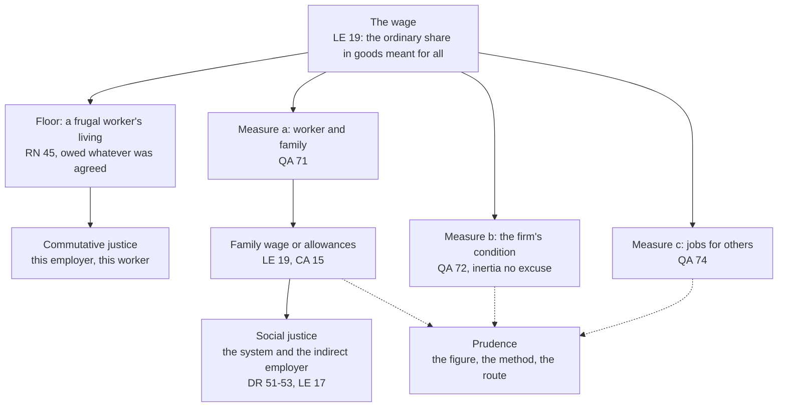

# Catholic Social Teaching · Lesson 4.2: The just wage

> ⏱ ~15 min · Module 4: Work, the economy and the two critiques · Builds on: [2.1](02-01-rerum-novarum.md), [2.2](02-02-quadragesimo-anno-and-the-interwar-proposals.md), [4.1](04-01-work-and-the-worker-laborem-exercens.md) · Unlocks: [4.3](04-03-socialism-and-liberal-capitalism-each-judged.md)

## Why this matters

Orlanda's town council is debating a living-wage bill. One speaker says the Church requires it, figure and all. Another says the "just wage" is a pious sentiment economics retired long ago. Both are wrong, in mirror image. The Church teaches, with real weight, that an agreed wage is not thereby just. It teaches no figure at all.

## The idea

Sell me a lamp at any price we agree, and no one is wronged. Labour is different: its seller is selling the one thing he has to live on, and a price accepted because the alternative is hunger was not freely bargained in the sense that makes bargains just. So beneath every wage bargain lies a floor: enough for a frugal worker to live on. Above it the Church gives no formula, only three things to weigh: the family, what the firm can bear, and everyone else's jobs. It also divides the duty: the employer owes what this contract owes, and the wider order owes the conditions in which a family can live from work.

[4.1](04-01-work-and-the-worker-laborem-exercens.md) taught the direct and indirect employer, used here. [`philosophy-of-economics` 5.4](../../philosophy-of-economics/lessons/05-04-markets-and-desert.md) set the just wage beside marginal-productivity desert as one position; here it is taught from within, without re-arguing desert.

## Source

*Rerum Novarum* 46 (Leo XIII, 15 May 1891), in *The Great Encyclical Letters of Pope Leo XIII* (Benziger, New York, 1903), vatican.va numbering:

> If a workman's wages be sufficient to enable him to maintain himself, his wife, and his children in reasonable comfort, he will not find it difficult, if he be a sensible man, to study economy; and he will not fail, by cutting down expenses, to put by some little savings and thus secure a small income. Nature and reason alike would urge him to this. We have seen that this great labor question cannot be solved save by assuming as a principle that private ownership must be held sacred and inviolable. The law, therefore, should favor ownership, and its policy should be to induce as many as possible of the humbler class to become owners.

**"If"**: the measure named here is a family, not the lone "frugal and well-behaved wage-earner" of §45; *Quadragesimo Anno* and *Laborem Exercens* later close that gap. **"Savings … owners"**: the wage's purpose runs past consumption to property. **"Therefore"**: inviolable ownership justifies *spreading* it. Leo's cure for the propertyless worker is not abolishing wages but making wage-earners owners.

## The teaching

- **T1. The wage is the ordinary share in goods meant for all.** In any system, private or socialized, worker and employer settle their relation through the wage. For most people it is the practical access to goods destined for common use, so a just wage is the key test of a whole system's justice (*Laborem Exercens* 19, 1981; [universal destination of goods](../reference.md#universal-destination-of-goods)). *Magnifica Humanitas* 37 (2026) restates the test. *In words:* judge an economy by its pay.
- **T2. Agreement is not sufficient.** Free agreement is the rule, yet beneath the bargain lies "a dictate of natural justice more imperious and ancient than any bargain between man and man": remuneration "sufficient to support a frugal and well-behaved wage-earner" (RN 45). The ground is §44 ([4.1](04-01-work-and-the-worker-laborem-exercens.md)): labour is personal but also *necessary* to life. Pay is left neither to the market nor to the stronger (*Mater et Magistra* 71). *In words:* a wage can be agreed and still unjust.
- **T3. No single rule; [three measures](../reference.md#three-measures-of-the-wage).** Pius XI rejects every one-rule solution, including labour's claim to the whole value of its product (*Quadragesimo Anno* 66–68). The [just wage](../reference.md#just-wage) weighs (a) the worker's and his family's support (QA 71); (b) the firm's condition: ruinous wages cannot be demanded, but lack of initiative is no reason to cut pay, and whoever crushes a firm with unjust burdens wrongs its workers (QA 72); (c) the common good: pay too low or too high causes unemployment (QA 74). *Gaudium et Spes* 67 adds each person's role and productivity. *In words:* above the floor, family, firm and others' jobs are weighed.
- **T4. The family measure has two routes.** Pay for an adult responsible for a family must suffice to found and keep one, either as a single [family wage](../reference.md#family-wage) or through social measures such as [family allowances](../reference.md#family-allowance) matched to dependants (LE 19). Society and the State must ensure such wage levels, and unions are decisive in negotiating minimums (*Centesimus Annus* 15, 1991). *In words:* a family must live from work, by wage or by wage plus allowance.
- **T5. Two justices.** [Commutative justice](../reference.md#commutative-justice) ([`moral-theology` 3.3](../../moral-theology/lessons/03-03-the-cardinal-virtues-and-the-gifts.md)) governs this employer's contract with this worker. [Social justice](../reference.md#social-justice) ([2.2](02-02-quadragesimo-anno-and-the-interwar-proposals.md)) asks of each what the common good needs, and is unsatisfied while workers cannot support families (*Divini Redemptoris* 51–52). A lone employer under competition may be unable to pay it; he must then support the institutions that make fair pay possible (DR 53). The [indirect employer](../reference.md#indirect-employer) shapes the terms without absolving the direct one (LE 17). *In words:* the employer owes his share; the system owes the rest.
- **T6. The wage contract is not unjust in itself.** Calling hiring unjust by nature is an error (QA 64; MM 31). Yet where possible it should be tempered with partnership: shares in ownership, management or profits (QA 65; the proposals of LE 14). *In words:* wages are legitimate; partnership is better where it can be had.

**Mark the levels.** Find the act ([the ladder](../../fundamental-theology/lessons/04-04-the-ladder-of-doctrinal-authority.md); [levels of authority](../reference.md#levels-of-authority)). T1–T5 and T6's first half are **rung 3**, authentic ordinary magisterium, at a heavy grade by LG 25's sign of frequency. The acts are encyclicals: RN 45 (Leo XIII, 15 May 1891), QA 63–75 (Pius XI, 15 May 1931), DR 51–53 (Pius XI, 19 March 1937), MM 71 (John XXIII, 15 May 1961), LE 19 (John Paul II, 14 September 1981), CA 8 and 15 (1 May 1991), MH 37 (Leo XIV, 2026). So does the pastoral constitution GS 67 (7 December 1965). None defines (can. 749 §3). CCC 2434 locates the teaching and adds no weight. That withholding wages owed is gravely wrong (Deut 24:14–15; Jas 5:4) is **at least rung 3**, commonly held revealed as a Decalogue precept; claiming more needs an act. "Social justice" is vocabulary with no rung of its own. QA 65's and LE 14's partnership forms are **applications**, by their own qualifiers. Every figure has **no rung**.

**Principle or application.** The floor, the three measures, the family measure, the two justices' duties and the contract's legitimacy are [principles](../reference.md#principle-and-application), owed religious submission of mind and will. The route that closes a family's gap, the partnership forms and every figure are applications. They ask serious, respectful consideration (GS 43; *Donum Veritatis* 24; [the three assents](../reference.md#the-three-assents)). A Catholic who weighs them and judges otherwise does not dissent. He may not deny the floor, treat the proposals as weightless, or claim the Church's authority for his own figure. Whether a floor costs jobs, or allowances depress wages, are [empirical premises](../reference.md#empirical-premise) for evidence to decide. The [two symmetrical errors](../reference.md#the-two-symmetrical-errors) here: a living-wage figure inflated into doctrine, and the floor demoted to papal advice on generosity. One hard edge: QA 71 and LE 19 picture a father's wage and a mother at home, yet LE 19 makes allowances an equal route and GS 67 states the measure with no household model. The wage teaching binds the floor and the family measure; the mother's role belongs to the teaching on the family.

**Where it stops.** The principle forbids an employer to pay below a frugal living, plead his own inertia, or treat consent as the end of the matter, and obliges the state to see that work can support a family. It gives no figure, no method of measuring need, no split between wage and allowance: those belong to employers, unions, legislators and voters, weighing evidence the Church does not supply. The documents say so: RN 45 sends such questions to boards, "especially as circumstances, times, and localities differ so widely", and LE 19 calls itself no treatise on economics. These [disclaimers](../reference.md#the-doctrines-disclaimers) are part of the teaching.

## The map

Solid arrows bind; dashed arrows hand the decision to prudence.

## Worked examples

**Example 1 (clean): Elsbeth's household (invented).** Elsbeth, a ferry deckhand in Orlanda, earns 10.50 crowns an hour for 160 hours a month and raises two children alone. Orlanda's budget standard (invented, crowns a month):

| Item | Per household | Per adult | Per child |
|---|---|---|---|
| Housing (rent and utilities) | 820 for 1–2 people, 1,000 for 3–4 | | |
| Food | | 310 | 220 |
| Transport, clothing, other | | 180 | 110 |

- Wage: $10.50 \times 160 = 1{,}680$.
- Her own frugal need: $820 + 310 + 180 = 1{,}310$, so the floor is met by $1{,}680 - 1{,}310 = 370$.
- Household need: $1{,}000 + 310 + 2(220) + 180 + 2(110) = 2{,}150$, a gap of $2{,}150 - 1{,}680 = 470$.
- With Orlanda's child allowance of 240 crowns a child: $1{,}680 + 2(240) = 2{,}160 \ge 2{,}150$.

The verdict is clean: the employer meets his floor with margin, and LE 19's second route meets the family measure with 10 crowns to spare (LE 19's adult responsible for a family includes a lone parent). Unindexed, the allowance fails as prices rise (P1).

**Example 2 (strain): two bills (invented).** Orlanda's minimum is 9.00 crowns an hour (1,440 a month, 130 above a single worker's need). **Bill A** makes every employer pay every adult the family-of-four need: $2{,}640 / 160 = 16.50$ an hour, a rise of $16.50/9.00 - 1 \approx 83\%$. **Bill B** raises the allowance until a one-earner family of four on the minimum reaches its need: $2{,}640 - 1{,}440 = 1{,}200$, or 600 crowns a child.

Measure (a) favours both. Measure (b) cuts against Bill A for firms it would ruin, not for firms failing through inertia. Measure (c) asks whether an 83% rise prices workers out of jobs, an empirical premise of the kind [`econometrics` 4.3](../../econometrics/lessons/04-03-difference-in-differences.md) estimates. QA 71 supports both logics: a family-sufficient wage for every adult worker, and pay that grows with family burdens. Bill B's risk is that employers trim wages because the public purse tops them up, the charge Polanyi laid against Speenhamland, though later research doubts his account ([`social-theory` 5.3](../../social-theory/lessons/05-03-polanyis-great-transformation.md)). Either way the employer's floor binds.

The principle requires that Orlanda's families can live from work, forbids either bill to cover pay below the floor, and does not choose between them. The council and voters judge on the economists' evidence; Catholics may back either with equal sincerity (GS 43).

## Watch out

- **You might think a living-wage figure is Catholic teaching.** But 16.50 crowns, 600 a child, or any number a party or parish prints is an application with no rung. Weighing it and preferring another is not dissent.
- **You might think the just wage is a pious hope economics outgrew.** But the floor and the measures are rung 3, restated from 1891 to 2026. Calling them "one opinion about labour markets" is the demotion error.
- **You might think RN 45 is the whole teaching**, "a floor set by need, independent of contribution and of agreement", as [`philosophy-of-economics` 5.4](../../philosophy-of-economics/lessons/05-04-markets-and-desert.md)'s card puts it. True of the floor; above it QA 72 weighs the firm, QA 74 the common good, GS 67 productivity. The courses agree.
- **You might think QA 64 blessed the wage system without condition.** The next section advises partnership (QA 65), and §72 binds the firm that pleads hardship. Lifting §64 alone drops both.

## One-liner

> A wage is just not because it was agreed but because it lets a frugal worker live and, with the help a just order owes, keep a family; the Church binds that measure and leaves every figure to prudence.

## Problems

**P1 (🟢)** *(Formal)* Use Orlanda's budget standard from Example 1 and its child allowance of 240 crowns a child (not indexed to prices). Danel drives a forklift at a bottling plant, paid for 160 hours a month. His spouse cares for their children at home.

| | Household | Prices (Year 1 = 1.00) | Danel's hourly wage |
|---|---|---|---|
| Year 1 | Danel alone | 1.00 | 11.00 |
| Year 3 | Danel, spouse, one child | 1.05 | 11.50 |
| Year 5 | Danel, spouse, two children | 1.10 | 12.00 |

(a) Find the household's monthly need in each year. (Every item in the standard rises with the price index.)

(b) Find Danel's monthly wage each year, and the gap between wage and need before and after the allowance.

(c) For Year 5, find the hourly wage that would close the gap with no allowance, and the per-child allowance that would close it at Danel's actual wage. **One line each.**

(d) Did Danel's real wage rise or fall between Year 1 and Year 5? **One line.**

**P2 (🟡)** *(Exegetical)* Sort and weigh. Six claims about Danel's Year 5. For each, say whether it is a principle, an application or an empirical premise; give its level (or "no rung"); and say on whom any duty falls: the employer (commutative justice), the town and the system (social justice; the indirect employer), or no one's assent (a prudential choice). Correct any claim that is false. **One line each.**

1. Danel's employer must pay at least what a frugal single worker in Orlanda needs, whatever the labour market would bear.
2. The 504-crown gap left in Year 5 is a breach of justice by Danel's employer, because the Church requires a family wage of every employer.
3. Orlanda should raise its child allowance to exactly 492 crowns.
4. Raising Orlanda's minimum to 18.15 crowns an hour would cost more households their livelihood than it would rescue.
5. If the plant's sales fall because its owners neglected to modernize, it may cut Danel's pay below a frugal single worker's need until sales recover.
6. Orlanda, as indirect employer, must see that a full-time wage plus its social measures lets a worker found and keep a family.

**P3 (🔴)** *(Apologetic: (a) Exegetical, graded first · (b) reply)* The English historian and democratic socialist R. H. Tawney argued in *The Acquisitive Society* (Harcourt, Brace and Howe, New York, 1920; public domain in the US) that what is wrong with industry is not the size of wages but the relation they belong to. Three of his lines:

> "What happens at present, however, is that its workers are hired at the cheapest price which the market (as modified by organization) allows, and that the surplus, somewhat diminished by taxation, is distributed to the owners of property." (p. 78)

> "If they are not content both to be servants, one or other must be master" (p. 99)

> "In industry, however, the equity of existing relationships is precisely the point at issue." (p. 101)

Around them, in paraphrase, Tawney holds that rights are justified only by the function they serve. Capital is a means, to be hired at the lowest price that secures it. An owner who is owner and nothing else should receive that price and no authority over production (pp. 99–102). He also denies that handing industry to state officials is the cure, and wants it run as a profession by those who do its work (pp. 113–115).

(a) State, as Tawney would, the objection that a just wage settled inside the present relation leaves an unjust relation standing and lends it legitimacy. **100 words or fewer.** This part is graded first and strictly; a wrong statement fails the problem.

(b) Reply from *Quadragesimo Anno* 64–65 and *Laborem Exercens* 14 (paraphrased), opening with a named concession. **150 words or fewer.** A reply that concludes Tawney is right passes if it is a good reply.

Solutions

**P1** *(Formal)*

**Must hit, strict:**

- (a) Year 1: $820 + 310 + 180 = 1{,}310$. Year 3 at base prices: $1{,}000 + 2(310) + 220 + 2(180) + 110 = 2{,}310$, so need is $2{,}310 \times 1.05 = 2{,}425.50$. Year 5 at base prices: $1{,}000 + 2(310) + 2(220) + 2(180) + 2(110) = 2{,}640$, so need is $2{,}640 \times 1.10 = 2{,}904$.
- (b) Wages: $11.00 \times 160 = 1{,}760$; $11.50 \times 160 = 1{,}840$; $12.00 \times 160 = 1{,}920$. Year 1: no gap; the wage exceeds need by $1{,}760 - 1{,}310 = 450$. Year 3: gap $2{,}425.50 - 1{,}840 = 585.50$, and after one allowance $585.50 - 240 = 345.50$. Year 5: gap $2{,}904 - 1{,}920 = 984$, and after two allowances $984 - 480 = 504$.
- (c) Wage alone: $2{,}904 / 160 = 18.15$ crowns an hour. Allowance alone: $984 / 2 = 492$ crowns a child.
- (d) Fell. The nominal wage rose $12.00/11.00 - 1 \approx 9.09\%$ against prices up $10\%$, so the real wage changed by $1.0909/1.10 - 1 \approx -0.83\%$.

**Wrong turns:** using the 820 housing figure for a household of three. Raising the allowance with prices (the problem says it is not indexed, which is why the gap widens). Comparing Year 5's wage with Year 1's need. Calling the real wage "up 9%" by ignoring prices.

**Model answer:**

| | Need | Wage | Gap before allowance | Allowance | Gap after |
|---|---|---|---|---|---|
| Year 1 | 1,310.00 | 1,760.00 | none (450 to spare) | 0 | none |
| Year 3 | 2,425.50 | 1,840.00 | 585.50 | 240 | 345.50 |
| Year 5 | 2,904.00 | 1,920.00 | 984.00 | 480 | 504.00 |

(c) 18.15 crowns an hour, or 492 crowns a child. (d) Fell by about 0.83%: wages up 9.09%, prices up 10%.

---

**P2** *(Exegetical)*

**Must hit, strict:**

1. **Principle**, rung 3 (RN 45; QA 72; MM 71). It binds the **employer** in commutative justice. Danel's 1,920 clears his own Year 5 need of $1{,}310 \times 1.10 = 1{,}441$.
2. **Overstated.** The family measure is a rung-3 principle (QA 71; LE 19), but LE 19 lets it be met by a wage *or* by social measures, and QA 71 assigns a shortfall to social justice. So the gap falls on the **system**. Which route closes it is an **application**.
3. **Application**, **no rung**: a figure. It asks serious consideration and binds **no one's assent**. It is a choice for Orlanda's legislators and voters.
4. **Empirical premise**, **no rung**. Evidence decides it. QA 74 makes it morally relevant but does not settle it.
5. **False.** It denies a rung-3 principle. QA 72 refuses lack of initiative as a reason to cut pay, and the floor of RN 45 binds the **employer** regardless.
6. **Principle**, rung 3 (LE 17, 19; CA 15; DR 52). It falls on the **town and the system**: social justice and the indirect employer.

**Wrong turns:** calling 1 or 6 "Catholic opinion", which is the demotion error. Calling 3 binding because a Church text names allowances, which inflates an application. Marking 4 as a principle because QA 74 talks about unemployment. Calling 2 simply true or simply false: its principle is right and its assignment of the duty is wrong.

**Model answer:** (1) Principle, rung 3; the employer, in commutative justice; met. (2) Principle misassigned: the family measure is rung 3, but by LE 19 it falls on wage plus social measures together, and the route is an application. (3) Application, no rung; prudence. (4) Empirical premise, no rung; evidence decides. (5) False: it denies QA 72 and RN 45 (rung 3); the employer's floor stands. (6) Principle, rung 3; social justice and the indirect employer.

---

**P3** *(Apologetic: (a) Exegetical, graded first · (b) reply)*

**Accept:** any faithful statement in Tawney's own terms (function, functionless property, service, "hands", profession). For (b), any verdict, including that Tawney wins, if the reply engages QA 64–65 and LE 14 and opens with a named concession.

**Must hit, strict (a), graded first:**

- The target is the **relation**, not the level of pay: owners as such hold the surplus and the command while workers are hired at the cheapest price.
- The ground is **function**: rights are justified only by the service they perform. Capital is a means, owed its hire price and nothing more.
- The step to the wage: settling wages fairly *inside* the relation takes its equity for granted, and that equity is "precisely the point at issue". Better terms do not reconcile; one side remains master.
- The remedy is to change proprietary rights, with capital hired at cost and industry run as a profession by those who work, **not** state officials stepping into the owners' place.

**Must hit (b):**

- A **named** concession that is really conceded, such as LE 14's "rigid" capitalism, means of production that may not be held against labour, or QA 65's own preference for partnership.
- QA 64 used correctly: the contract of hiring is **not unjust by nature**. What Tawney indicts is located in its terms and setting, which the just-wage teaching itself judges.
- LE 14 on what divides them: reform cannot come by abolishing private ownership of productive goods **a priori**, and state ownership is not socialization. Name the alternative: partnership, wider ownership, intermediate bodies.

**Wrong turns:** stating Tawney as a Marxist (surplus value, class war, revolution) or as a statist; he rejects both readings. Stating his complaint as "wages are too low". The caricature that socialists simply want to seize all property. In (b), claiming QA 64 settles the matter alone, or claiming the Church accepts Tawney's abolition of private property in capital.

**Model answer (a):** Industry exists to serve, and every right in it is justified only by its function. Capital is a means: it should be hired at the cheapest price that secures it, and its owner, as owner, performs no other function. Today the reverse holds. Workers are hired at the cheapest price the market allows, owners take the surplus and the command, and workers are "hands". Settling a fairer wage inside that relation assumes its equity, which is exactly what is in question. Better provisions reconcile no one, because one side remains master. The cure is to change the relation: capital hired at cost, and industry run as a profession by those who work.

**Model answer (b), one of several:** Tawney sees what *Laborem Exercens* 14 says. Capital is an instrument; the means of production may not be held against labour, and their only title is to serve it. "Rigid" capitalism must be revised, and Pius XI himself judged partnership advisable (QA 65). But the wage is not the inversion. QA 64 denies that hiring is unjust by nature. What Tawney indicts, labour bought at the market's price with surplus and command taken regardless of labour's priority, is condemned by the just-wage teaching itself, which refuses agreement as the measure (RN 45) and makes pay the test of the system (LE 19). The wage survives in every system, socialized included. The real disagreement is ownership. LE 14 holds that reform cannot come by eliminating private ownership of productive goods a priori, and that state ownership is not socialization. The remedy is to make each worker a part-owner through partnership and wider ownership (RN 46), not to reduce owners to lenders at cost.

## Flashback

**From Lesson [3.6](03-06-the-preferential-option-for-the-poor.md) (The preferential option for the poor):** *(Exegetical.)* **Sort and weigh.** Six sentences from an invented parish study guide, written for this problem. Mark each right, overstated or understated, and give the claim's correct status (principle, application or empirical premise), its level and the act that fixes it. **One line each.**

1. In decisions about owning and using goods, the poor's claims come first, excluding no one.
2. John Paul II's 1979 letter commending the Puebla document made its option universal teaching.
3. Because CCC 2448 quotes *Libertatis Conscientia* 68, the option is now defined doctrine.
4. The 1984 and 1986 instructions are a Roman office's staff papers, with no magisterial weight.
5. *Libertatis Nuntius* itself settles which theologians' books it criticizes.
6. If aid aimed at the poorest proved to slow growth, the option would lapse.

Solution

**Must hit, strict:**

1. **Right.** A **principle**, **rung 3** at a heavy grade: SRS 42 (1987), CA 11, 57 (1991) and LC 68 (1986), restated in EG 198, *Dilexi Te* and MH 78; owed religious submission.
2. **Overstated.** The letter, to the bishops of Latin America, is **reception, not promotion**; Puebla, a regional assembly, is **no act of the universal magisterium**. The universal acts are SRS 42, CA 57 and LC 68.
3. **Overstated.** CCC 2448 locates the teaching and adds no weight. Nothing is defined: **rung 3**, from the acts it quotes.
4. **Understated.** CDF doctrinal instructions, each approved by John Paul II in an audience and ordered published: **rung 3 at a light grade**, plus the weight of what they restate.
5. **Overstated.** LN names no theologian; which works fall under its criticisms is an **application**.
6. **Understated.** What such aid does to growth is an **empirical premise**, no rung. It can change an application (which policy serves the poor), but the option ranks whose claims come first, not which policy works, and stays at rung 3.

**Wrong turns:** accepting 3 because the Catechism "says so". Correcting 4 by calling the instructions infallible, or 2 by calling Puebla worthless (it is authentic pastoral teaching in its region). Treating 6's evidence as irrelevant to policy.

**Model answer:** (1) Right: principle, rung 3, heavy grade, owed submission. (2) Overstated: reception; Puebla is regional; the universal acts are SRS 42, CA 57, LC 68. (3) Overstated: the Catechism locates; rung 3 from the acts it quotes. (4) Understated: papally approved CDF instructions, rung 3 at a light grade. (5) Overstated: whom LN touches is an application; it names no one. (6) Understated: an empirical premise, no rung, able to change a policy but not the principle.

## Connections

- **Backward:** [2.1](02-01-rerum-novarum.md) set RN's wage floor in the whole encyclical, and [2.2](02-02-quadragesimo-anno-and-the-interwar-proposals.md) introduced social justice and named the three measures this lesson works. [3.5](03-05-the-universal-destination-of-goods-and-private-property.md) showed why the wage carries the universal destination of goods. [3.6](03-06-the-preferential-option-for-the-poor.md) asks that a system be judged from the side of the poor, and the lowest-paid household is where the wage test is made. [4.1](04-01-work-and-the-worker-laborem-exercens.md) gave the priority of labour, RN 44's two notes and the indirect employer.
- **Forward:** [4.3](04-03-socialism-and-liberal-capitalism-each-judged.md) judges the systems the wage test is run on: socialism and a capitalism that treats labour as a commodity. [4.4](04-04-enterprise-consumption-and-the-economy-of-gift.md) takes the firm as a community of persons. Boss 4(b) runs the three measures on a firm's payroll.
- **Sideways:** the just wage meets **marginal-productivity desert** in [`philosophy-of-economics` 5.4](../../philosophy-of-economics/lessons/05-04-markets-and-desert.md). QA 66–68's refusal of any single rule is the Catholic reply to treating either the marginal product or the whole product as the wage. [`philosophy-of-economics` 5.3](../../philosophy-of-economics/lessons/05-03-exploitation-in-labour-markets.md) gives the secular accounts of why agreement is not enough (Marx, Roemer, the sweatshop debate), and [5.5](../../philosophy-of-economics/lessons/05-05-hayek-knowledge-order-and-the-mirage-of-social-justice.md) gives Hayek's denial that "social justice" means anything. [`public-economics` 5.4](../../public-economics/lessons/05-04-participation-and-the-eitc.md) and [7.3](../../public-economics/lessons/07-03-tagging-ordeals-and-in-kind-benefits.md) model wage supplements and tagged benefits such as a child allowance. [`econometrics` 4.3](../../econometrics/lessons/04-03-difference-in-differences.md) estimates the minimum-wage effects that QA 74 makes relevant.
