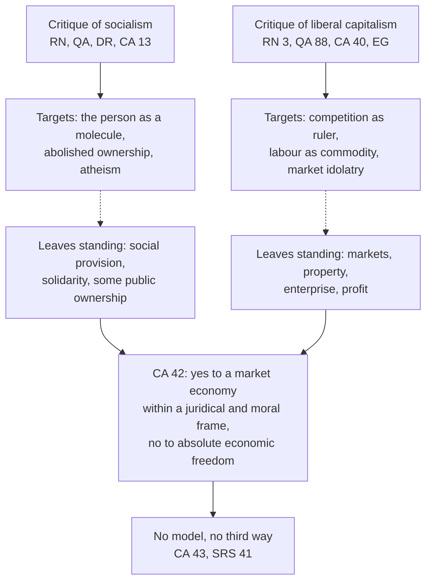

# Catholic Social Teaching · Lesson 4.3: Socialism and liberal capitalism, each judged

> ⏱ ~15 min · Module 4: Work, the economy and the two critiques · Builds on: [2.1](02-01-rerum-novarum.md), [2.2](02-02-quadragesimo-anno-and-the-interwar-proposals.md), [4.1](04-01-work-and-the-worker-laborem-exercens.md) · Unlocks: [4.4](04-04-enterprise-consumption-and-the-economy-of-gift.md), [6.4](06-04-three-readings-catholic-liberal-integralist-progressive.md)

## Why this matters

One Catholic columnist writes that the Pope "condemned capitalism"; another, that the Church "blessed the free market in 1991". Each has cut a real paragraph loose from its conditions. For 135 years the Magisterium has judged *both* systems and adopted neither; this lesson states each judgment at its real strength and level.

## The idea

A doctor treats two opposite illnesses: an immune system that attacks the body, and one that has failed. She preaches neither "more immunity" nor "less". She judges both by one picture of health.

The social doctrine's one picture is the person: a free subject made for God, who owns, works, associates and answers for his choices ([human dignity](../reference.md#human-dignity)). The [critique of socialism](../reference.md#critique-of-socialism) says socialism swallows that person into the collective, a claim about *anthropology* before efficiency. The [critique of liberal capitalism](../reference.md#critique-of-liberal-capitalism) says liberalism leaves him alone with a market that cannot order economic life by itself. Neither condemns what the other system got right, so *Centesimus Annus* could answer "capitalism?" with yes and no in one paragraph. Marx's theory is taught in [`history-of-political-thought` 6.5](../../history-of-political-thought/lessons/06-05-marx-from-hegel-to-historical-materialism.md).

## The teaching

**The critique of socialism.**

**T1. *Rerum Novarum* (Leo XIII, 1891) 4–15.** Leo: "the main tenet of Socialism, community of goods, must be utterly rejected" (RN 15), because every man has "by nature the right to possess property as his own" (RN 6). Quotations of *Rerum Novarum* here are from *The Great Encyclical Letters of Pope Leo XIII* (Benziger, 1903). *In words:* collective ownership violates a [natural right](../reference.md#private-property).

**T2. *Quadragesimo Anno* (Pius XI, 1931) 111–120.** Socialism had split into communism and a moderate socialism whose demands sometimes approach Christian reformers' (111–114). Yet socialism as doctrine, historical fact or movement, *while it remains truly socialism*, cannot be reconciled with Catholic teaching even after yielding on class struggle and property, for it holds that society exists for material advantage alone (117–119). Hence no one can be both a good Catholic and a true socialist (120). *In words:* the error lies in the picture of society, which no softened program cures.

**T3. *Divini Redemptoris* (Pius XI, 19 March 1937).** Communism makes the person a "cog-wheel" (10). It is "intrinsically wrong", and those who would save Christian civilization may not collaborate with it in any undertaking (58). *In words:* a doctrine condemned in itself, plus a directive for 1937 ([*Divini Redemptoris*](../reference.md#divini-redemptoris)).

**T4. *Pacem in Terris* (1963) 159–160; *Octogesima Adveniens* (1971) 26, 31.** A false philosophy differs from the movements it inspired, which change and may contain good elements; cooperation is for prudence, under Church directives ([error and the person who errs](../reference.md#error-and-the-person-who-errs)). Paul VI forbids adhering to Marxist *and* to liberal ideology (OA 26), and asks Christians drawn to socialist currents to distinguish aspiration, movement and ideology without forgetting their links (OA 31). *In words:* the doctrine stays condemned; movements are judged singly.

**T5. *Centesimus Annus* (John Paul II, 1991) 13, 24.** Socialism's fundamental error is anthropological: the person becomes a "molecule" of the social organism, wholly subordinate to the socio-economic mechanism, no longer the subject of moral decision. Opposition to private property follows, and the [subjectivity of society](../reference.md#subjectivity-of-society) is cancelled. The first cause is atheism (13). Its inefficiency came from violated rights to initiative and ownership (24). *In words:* socialism fails first as a theory of man.

**The critique of liberal capitalism.**

**T6. *Rerum Novarum* 3; *Quadragesimo Anno* 88, 105–109.** Leo blamed the workers' misery on an order that left them "surrendered, all isolated and helpless, to the hard-heartedness of employers and the greed of unchecked competition" (RN 3, Benziger 1903). Pius XI named the error: the belief that free competition directs economic life by itself. Competition is useful within limits, but [social justice](../reference.md#social-justice) and [social charity](../reference.md#social-charity) must direct (QA 88). Unlimited, it produced an [economic dictatorship](../reference.md#economic-dictatorship) of those who control credit and an "international imperialism" of finance (105–109). *In words:* the market serves; it cannot rule.

**T7. *Populorum Progressio* to *Magnifica Humanitas*.** Paul VI condemns an "unbridled liberalism" of profit as chief spur, competition as norm, ownership as absolute (PP 26, 1967). *Centesimus Annus* grants that the free market *appears* the most efficient instrument for needs backed by purchasing power, but some needs find no place on it, some goods must never be sold, and it risks an [idolatry](../reference.md#idolatry-of-the-market) (CA 34, 40). Francis rejects an economy of exclusion and an "idolatry of money", and finds [trickle-down theories](../reference.md#trickle-down-theories) unconfirmed (EG 53–55, 2013; FT 168). Leo XIV finds promises of automatic prosperity often illusory (MH 158, 2026). *In words:* the market is useful; its absolutization is the error.

**T8. *Centesimus Annus* 42: the conditional answer** ([CA 42](../reference.md#centesimus-annus-42)). After communism's failure, is capitalism the victorious system, the goal for the countries rebuilding, and the model for the Third World? Two answers:

- If "capitalism" means an economy that accepts as basic and positive the role of business, the market and private property, the responsibility for productive means that comes with them, and free human creativity in economic life: **yes**, though "business economy", "market economy" or "free economy" are better names.
- If it means a system whose economic freedom no "strong juridical framework" places at the service of human freedom as a whole, a freedom whose core is ethical and religious: **no**.

It ends by warning against a "radical capitalistic ideology" that leaves the poor to market forces. Leo XIV, citing CA 42, recognizes the market's potential only if it stays subordinate to the moral law and guided by solidarity (MH 39). *In words:* yes to markets inside a legal and moral frame; no to economic freedom as an absolute.

**T9. No system.** The Church has no model of her own to present (CA 43). Her social doctrine is no "third way" between liberal capitalism and Marxist collectivism; she proposes and prefers no system, provided human dignity is respected (SRS 41). *In words:* she judges systems and sells none ([the doctrine's disclaimers](../reference.md#the-doctrines-disclaimers)).

**Mark the levels.** On [the ladder](../../fundamental-theology/lessons/04-04-the-ladder-of-doctrinal-authority.md) ([levels of authority](../reference.md#levels-of-authority)); every act is an encyclical unless marked:

- **Rung 3**: RN 6 and 15; DR 58's "intrinsically wrong"; PT 159; OA 26 (an apostolic letter); CA 13, 34's limit on the market, 40, 43; QA 88; PP 26; SRS 41; EG's principles (an apostolic exhortation). CA 42 too, read whole with both conditions, as MH 39 (2026) reads it.
- QA 117–120: **rung 3 at a heavy grade**. QA 121's "solemn authority" is LG 25's manner of speaking within rung 3; with no defining formula, default down (can. 749 §3). **Not a definition.**
- DR 58's collaboration ban is a 1937 directive that PT 160 handed to prudence. The 1949 Holy Office decree is a penalty: law, no rung ([`church-history` 9.1](../../church-history/lessons/09-01-the-church-and-the-totalitarian-states.md)).
- CCC 2425 sums up both rejections. It is a locator pointing to CA 10, 13, 34 and 44, not a level.

**Principle or application.** ([principle and application](../reference.md#principle-and-application); [the three assents](../reference.md#the-three-assents))

- **Principles**, owed religious submission: the person is never a mere part of the economic mechanism; private ownership, of productive goods too, is a natural right ordered to the [universal destination of goods](../reference.md#universal-destination-of-goods) ([3.5](03-05-the-universal-destination-of-goods-and-private-property.md)); competition cannot rule economic life alone; some goods are not commodities; economic freedom must be framed by law.
- **Applications** ([prudential judgment](../reference.md#prudential-judgment)): DR 58's ban; any verdict that a party is "truly socialist" or that a named economy fails CA 42; which property QA 114 would reserve to the state. They ask serious, respectful consideration; a Catholic who weighs one and judges differently does not dissent (GS 43; *Donum Veritatis* 24).
- **Empirical premises** ([empirical premise](../reference.md#empirical-premise)), decided by evidence: RN 15's forecast that common ownership would dry up wealth; CA 24 on why the system failed (CA 3 calls its analysis of events not definitive); CA 34's efficiency claim; EG 54's trickle-down verdict and MH 158's on promises of automatic prosperity.

[The two symmetrical errors](../reference.md#the-two-symmetrical-errors) both threaten. "The Church condemns this welfare program as socialism" inflates; "the condemnation of socialism was a Cold War opinion" demotes.

**Where it stops.** The critiques fix the ends of a line: no abolition of private ownership, no economic life freed from law and morals. Between those walls the doctrine fixes no share of public ownership (QA 114 allows some), no tax rate, no welfare design, and GS 43 forbids anyone to claim the Church's authority for his answer. What CA 42 conceded is itself disputed. Michael Novak (*The Catholic Ethic and the Spirit of Capitalism*, 1993), Richard John Neuhaus (*Doing Well and Doing Good*, 1992) and George Weigel read it as accepting Novak's democratic capitalism: market economy, democratic polity, moral-cultural order. David L. Schindler and the *Communio* school replied that the liberal idea of freedom beneath it is what CA's last condition judges (*Heart of the World, Center of the Church*, 1996). These readings have **no magisterial level**; whether CA endorsed or only conditionally accepted markets is **rung 5**, argued in [6.4](06-04-three-readings-catholic-liberal-integralist-progressive.md) ([reception of *Centesimus Annus*](../reference.md#reception-of-centesimus-annus)).

## The two critiques

Each critique hits the other system's strengths only when they are made absolute; what each leaves standing meets in CA 42.

## Worked examples

**Example 1 (clean): Lusovia's shops.** Lusovia, an invented country, decrees that every shop, café and workshop under ten workers becomes a state outlet run by its former owner on salary, because "the citizen's good is the plan's good".

- **CA 13.** The decree's premise is the anthropological error; the owners lose something of their own and depend on the social machine.
- **RN 6 and 15.** Community of goods, applied to small productive property.
- **[Subsidiarity](../reference.md#subsidiarity)** (QA 79). The state absorbs what families already do.
- **QA 114 does not apply.** It covers property with power too great for private hands; a corner shop has none.

Principle alone decides: the verdict would stand if the outlets proved efficient, and RN 15's contrary forecast is a separate, empirical point.

**Example 2 (strain): Maresh's cooperatives.** A coalition in Maresh, an invented country, would convert every firm above 50 workers into a worker-owned cooperative within ten years, buying out investors at a fair price with public-bank loans; markets, small firms, homes and savings stay private.

- **CA 13 barely bites.** Workers become owners, and *Laborem Exercens* 14 commends joint ownership and does not exclude socializing certain means of production ([4.1](04-01-work-and-the-worker-laborem-exercens.md)).
- **Another principle pulls back.** The mandate takes a lawful form of ownership from investors (RN 6), and one public lender raises the subsidiarity question; fair compensation and the state's power to regulate ownership (QA 49, 114) keep it from being community of goods.
- **The label decides little.** QA 115: just demands are not special to socialism.

Here the principle stops: it forbids abolishing ownership and absorbing the person, and commends worker ownership. Whether *compulsory* conversion is proportionate, and whether 50 is the right line, are prudential judgments for Maresh's legislators; whether cooperatives invest and hire as well is an empirical premise for economists. Catholics may differ on both without dissent (GS 43).

## Watch out

- **You might think *Quadragesimo Anno* defined that no socialist can be Catholic, but** QA 120 is rung 3 at a heavy grade, about socialism as a doctrine; whether a party today "remains truly socialism" is an application (PT 159–160; OA 31). "A 1931 opinion" errs the other way: CA 13 restated it in 1991.
- **You might think the "idolatry of the market" is Francis's phrase, but** it is CA 40 (1991), which also lists the market's real advantages. EG 55 extends it to money.
- **You might think EG 54's trickle-down verdict binds as doctrine, but** it has no rung and an economist may test it; the moral claim beside it is a principle.

## One-liner

> The Church condemns socialism for what it does to the person and liberal capitalism for what it lets the market do to him, accepts markets only inside a legal and moral frame, and sells no system.

## Problems

**P1 (🟢)** *(Exegetical)* **Sort and weigh.** For each claim (paraphrased), say whether it is a principle, a contingent application or an empirical premise. Give its level and the assent it asks. **One line each.**

1. Communism is intrinsically wrong (*Divini Redemptoris* 58, 1937).
2. Catholics may not join or support communist parties, and those who profess communism's materialist doctrine incur excommunication (Holy Office decree, 1 July 1949).
3. One cannot be both a good Catholic and a true socialist (*Quadragesimo Anno* 120, 1931).
4. Under community of goods the sources of wealth would run dry, since no one would have an interest in exerting his talents (*Rerum Novarum* 15, 1891).
5. Socialism's fundamental error is anthropological: it treats the person as a molecule of the social organism (*Centesimus Annus* 13, 1991).
6. The free market appears to be the most efficient instrument for using resources and meeting needs backed by purchasing power (*Centesimus Annus* 34).
7. Some goods, by what they are, may never be traded, and the market risks becoming an idol (*Centesimus Annus* 40).
8. Trickle-down theories have never been confirmed by the facts (*Evangelii Gaudium* 54, 2013).

**P2 (🟡)** *(Exegetical)* **Find the crux.** Two Catholics, both invented and written for this problem:

> **Yorath Corbin, a Catholic market liberal:** "*Centesimus Annus* 13 locates socialism's error in its anthropology, so every socialism carries it. A Catholic socialist is a contradiction in terms."
>
> **Wenna Talfryn, a Catholic socialist:** "CA 13 describes the 'Real Socialism' of the Soviet bloc. A democratic socialism that respects religion, family and free association has shed that error. What remains is a program of common ownership, and programs are prudential."

(a) Name the single premise one of them must deny, and say whether it is a principle, an application or an empirical premise.

(b) Name one text that should move each of them, and say what it shows.

**120 words or fewer.**

**P3 (🔴)** *(Exegetical)* **Paraphrase reading.** Two paraphrases, written for this problem:

> **A (1931–37).** Socialism, whether taken as a doctrine, as a historical fact or as a movement, cannot be reconciled with Catholic teaching while it remains truly socialism, even if it has given ground on class struggle and private property (*Quadragesimo Anno* 117). Communism is intrinsically wrong, and those who would save Christian civilization may not collaborate with it in any undertaking at all (*Divini Redemptoris* 58).
>
> **B (1971).** Socialist currents take different forms on different continents. Christians drawn to them must distinguish a generous aspiration, a historical movement with political aims, and an ideology claiming to explain the whole of man. They must not treat these as wholly separate, and they must judge how far commitment is possible (*Octogesima Adveniens* 31).

(a) What changed between A and B in how the documents treat socialist *movements*, and which text of 1963 made the change possible?

(b) Is the change one of principle or of application? Give the level of each of A's two claims about communism and of B's instruction.

**150 words or fewer.**

Solutions

**P1** *(Exegetical)*

**Must hit, strict:**

1. Principle; **rung 3** (encyclical); religious submission. Not a definition.
2. **Application**: a practical directive backed by a penalty, so Church law with **no rung** ([`church-history` 9.1](../../church-history/lessons/09-01-the-church-and-the-totalitarian-states.md)). It binds conduct as law, not assent as doctrine; the doctrinal judgment behind it is item 1.
3. Principle about socialism as a doctrine and system; **rung 3 at a heavy grade** (QA 121's "solemn authority"), not a definition (can. 749 §3). Applying it to a named party is an application.
4. **Empirical premise** (a forecast). It stands or falls with the evidence; the principle beside it (community of goods violates natural right, RN 6) is rung 3.
5. Principle; **rung 3**; religious submission.
6. **Empirical premise**, and hedged ("appears"). No rung; the evidence decides.
7. Principle; **rung 3**; religious submission.
8. **Empirical premise** in a rung-3 document. The claim itself has no rung; the moral point beside it (the excluded may not be written off) is a principle.

**Wrong turns:** calling 2 a dogmatic condemnation because it carries excommunication, or a permanent principle because it sits beside 1. Calling 3 "defined" or "infallible" because of "solemn authority", or calling it a mere 1931 opinion. Giving 8 a rung because an exhortation states it, or dismissing EG 53–55's principles with it. Missing the hedge in 6.

**Model answer:** as above, one line each.

---

**P2** *(Exegetical)*

**Must hit, strict (a):** the crux is a premise of *principle*, not an empirical one: **whether socialism's condemned error is a detachable ideology (atheism, materialism) or lies in its idea of society and of property themselves.** Talfryn affirms that it is detachable, and Corbin denies it.

**Must hit, strict (b):**

- **For Talfryn:** QA 117–119. Even a socialism tempered on class struggle and property stays irreconcilable while it treats society as existing for production and material advantage. And RN 6, 15: a *general* abolition of private ownership violates natural right with or without atheism.
- **For Corbin:** QA 113–115. Just demands, including some state ownership (114), are not special to socialism. And PT 159 / OA 31: whether a given movement "remains truly socialism" is a judgment about that movement, which is an application and no deduction from CA 13.

**Wrong turns:** making the crux empirical ("whether socialism works"), since CA 13 is a claim about the person. Letting Corbin win by citing QA 120 as a definition. Letting Talfryn win by treating the abolition of private ownership as merely prudential.

**Model answer:** The crux: is socialism's error a removable ideology, or does it lie in socialism's idea of society and property? That is a question of principle. QA 117–119 should move Talfryn. Even a socialism that drops class war stays condemned while society exists for production, and RN 6 and 15 condemn general common ownership without any appeal to atheism. QA 114–115 and OA 31 should move Corbin. Just demands, some public ownership included, are not special to socialism, and whether a given movement still carries the error is an application.

---

**P3** *(Exegetical)*

**Must hit, strict (a):**

- In A the movement is judged *with* the doctrine. QA 117 names the movement alongside the doctrine, exempting only a socialism that no longer "remains truly socialism", and DR 58 forbids any collaboration.
- In B movements are judged *distinctly*: by form and place, and by their concrete link to the ideology. The degree of commitment is a matter of discernment.
- The hinge is **PT 159–160**. A false philosophy is to be distinguished from the historical undertakings it inspired, which change with conditions and may contain good elements, and cooperation is for prudence. PT names no movement.

**Must hit, strict (b):**

- **Application, not principle.** B keeps the principle: OA 26 still forbids adhering to Marxist ideology, and OA 31 says the currents remain conditioned by ideologies incompatible with faith.
- What changed is (i) a historical judgment about whether movements stay identical to their doctrine, and (ii) the practical rule on collaboration.
- QA's own condition, that socialism "remains truly socialism", already left room for this.
- **Levels:** "intrinsically wrong" is rung 3 (P). The collaboration ban is an application (a 1937 directive), not a principle. B's call to discern is rung 3 (apostolic letter), and any verdict it reaches on a given current is an application.

**Wrong turns:** "OA reversed QA" (overstates: no principle was withdrawn). "Nothing changed" (misses the shift on movements and collaboration). Treating DR 58's ban as permanent. Claiming PT 159 names socialism or communism.

**Model answer:** A judges the socialist movement together with its doctrine: QA 117 includes the movement, and DR 58 bans all collaboration. B judges movements separately, by form and place and by their real link to the ideology, and leaves the degree of commitment to discernment. PT 159–160 made this possible. It distinguished a false philosophy from the movements it inspires, which change and may contain good, and it handed cooperation to prudence. The change is one of application. OA 26 still forbids Marxist ideology, and QA itself condemned only a socialism that "remains truly socialism". What moved was a historical judgment and a practical directive. "Intrinsically wrong" is rung 3. The collaboration ban is a 1937 application. B's instruction is rung 3, with its verdicts on particular currents as applications.

## Flashback

**From Lesson [4.1](04-01-work-and-the-worker-laborem-exercens.md) (Work and the worker: *Laborem Exercens* (1981)):** *(Exegetical, apply to a hard case.)* A case invented for this problem. Kestrow Bakeries rebuilds its packing line so that every packer rotates through six stations at full speed, and stops hiring anyone who cannot, which shuts out almost every applicant with a physical disability. The manager says adapted stations would cut output by a fifth: "the line decides who works here." The regional disability council replies that *Laborem Exercens* obliges every firm to fit adapted stations, and the region to pay for them.

(a) What does LE call the hiring rule (section and level), and which of the manager's words reverse LE 6's order? **Two sentences.**

(b) Sort the manager's forecast and the council's two claims as principle, application or empirical premise, with level or assent; then say what LE leaves open and who settles it. **100 words or fewer.**

Solution

**Must hit, strict (a):**

- **LE 22:** admitting to work only the fully functional is a serious discrimination, the strong against the weak. **Principle, rung 3**; religious submission.
- "The line decides who works here" is [economism](../reference.md#economism) (LE 7, 13): the [objective dimension](../reference.md#objective-and-subjective-dimensions-of-work) ranking the person.

**Must hit, strict (b):**

- **The forecast:** **empirical premise**, no rung; if true, it bears on the means, not the duty.
- **"Every firm must fit adapted stations":** **application** inflated into a rule; serious consideration. LE 22 offers adapted jobs as one option beside ordinary jobs and "protected" enterprises. What binds (rung 3) is that direct and indirect employers open work suited to disabled people's capacities, a goal LE says may not be evaded.
- **"The region must pay":** **application.** That public authorities share the duty is principle (the State is the [indirect employer](../reference.md#indirect-employer), §17); who pays and how much is prudential, and the region's share does not excuse Kestrow.
- **Open:** the means, the costs, whether full rotation is needed at all; LE 22's list settles them: public authorities, associations, firms, disabled people themselves.

**Wrong turns:** reading LE 22's closing hope as making the paragraph a wish (demotion). Treating the forecast as decisive, or as doctrine. Calling a quota or a workstation design Church teaching (inflation).

**Model answer (a):** LE 22 calls admitting only the fully functional to work a serious discrimination: a rung-3 principle, owed religious submission. "The line decides who works here" is economism, the objective dimension ranking the person.

**Model answer (b):** The forecast is an empirical premise with no rung: it shapes the means, not the duty. Both council claims are applications owed serious consideration; LE 22 lists adapted jobs as one option and gives public authorities a share without fixing who pays. What binds at rung 3 is that employers, direct and indirect, open work suited to disabled people's capacities. The region, the firm, the council and disabled workers settle the rest.

## Connections

- **Backward:** [2.1](02-01-rerum-novarum.md) read *Rerum Novarum*'s refusal of the socialist remedy, and [2.2](02-02-quadragesimo-anno-and-the-interwar-proposals.md) read *Quadragesimo Anno*'s judgment of both systems. [2.3](02-03-mater-et-magistra-and-pacem-in-terris.md) gave the distinction between a philosophy and its movements, and [2.4](02-04-gaudium-et-spes-to-justice-in-the-world.md) gave *Octogesima Adveniens*. [4.1](04-01-work-and-the-worker-laborem-exercens.md)'s priority of labour is the ground on which both critiques treat labour as more than a commodity, and [3.5](03-05-the-universal-destination-of-goods-and-private-property.md) orders property to the universal destination.
- **Forward:** [4.4](04-04-enterprise-consumption-and-the-economy-of-gift.md) takes the firm, profit and the Social Assistance State. [4.5](04-05-the-new-things-of-our-time-magnifica-humanitas.md) takes *Magnifica Humanitas* on concentrated digital power. [6.3](06-03-distributism-and-the-alternative-proposals.md) takes distributism, one proposal for the open middle. [6.4](06-04-three-readings-catholic-liberal-integralist-progressive.md) stages the Novak–Schindler dispute as the [Catholic liberal reading](../reference.md#catholic-liberal-reading) against its critics. Boss 4 tests CA 42's conditions and asks whether the doctrine underdetermines economic systems.
- **Sideways:** Marx is taught in [`history-of-political-thought` 6.5](../../history-of-political-thought/lessons/06-05-marx-from-hegel-to-historical-materialism.md)–[6.6](../../history-of-political-thought/lessons/06-06-marx-the-state-revolution-and-after.md), and historical materialism as social science in [`social-theory` 2.1](../../social-theory/lessons/02-01-historical-materialism.md). QA 88's error, a market that directs itself, is the self-regulating market of Polanyi in [`social-theory` 5.3](../../social-theory/lessons/05-03-polanyis-great-transformation.md), and Hayek's knowledge argument in [`philosophy-of-economics` 5.5](../../philosophy-of-economics/lessons/05-05-hayek-knowledge-order-and-the-mirage-of-social-justice.md) is its strongest secular defence. CA 40's goods that cannot be bought meet [`philosophy-of-economics` 5.1](../../philosophy-of-economics/lessons/05-01-commodification.md) on commodification. Rawls's five regimes in [`political-philosophy` 6.4](../../political-philosophy/lessons/06-04-welfare-property-and-subsidiarity.md) are the secular counterpart of "the Church proposes no system". The events of 1989 that CA reads are [`church-history` 9.3](../../church-history/lessons/09-03-after-the-council.md)'s.
