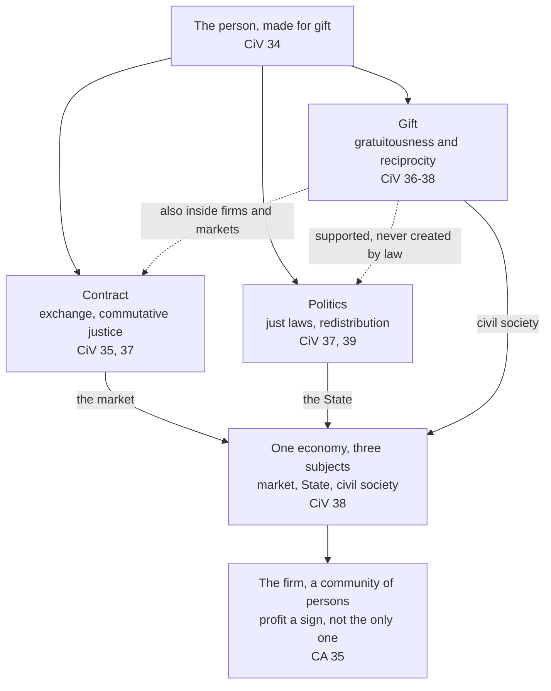

# Catholic Social Teaching · Lesson 4.4: Enterprise, consumption and the economy of gift

> ⏱ ~15 min · Module 4: Work, the economy and the two critiques · Builds on: [4.3](04-03-socialism-and-liberal-capitalism-each-judged.md), [3.3](03-03-subsidiarity.md) · Unlocks: [4.5](04-05-the-new-things-of-our-time-magnifica-humanitas.md), [6.3](06-03-distributism-and-the-alternative-proposals.md)

## Why this matters

A packaging firm's board meets. The finance director's slide shows record margins. Then the night-shift supervisor reports that a third of her team has quit since the new foreman arrived. Which report is about the firm's condition? *Centesimus Annus* answers: both. After [4.3](04-03-socialism-and-liberal-capitalism-each-judged.md)'s verdict on the absolutized market, this lesson goes inside the firm, the shop and the household budget, and asks what Benedict XVI meant by putting gift *inside* economic life.

## The idea

Think of profit as a thermometer. A fever reading tells you something real, and a doctor who ignored it would be negligent. But a normal temperature does not prove the patient well. The Church reads profit that way: a legitimate sign that a business uses its resources well and meets real needs, but not the only sign. A firm is people working together, and they can be humiliated while the numbers shine.

Now picture one town's economy. You buy a ladder at the hardware shop: an exchange of equal values. You pay taxes for the school: a duty enforced by law. A retired joiner coaches the youth football team for nothing: a gift. The easy picture keeps gift for the weekend. *Caritas in Veritate* denies it. Trust and gift can live inside the shop and the firm, and an economy that leaves everything to market and State wears away the society it depends on.

Two corollaries follow. What you buy and where you invest are moral choices. And a State that takes over what families and associations could do weakens them, however kindly. That is [subsidiarity](../reference.md#subsidiarity), taught in [3.3](03-03-subsidiarity.md) and used here on welfare.

## The teaching

**T1. The firm is a [community of persons](../reference.md#the-firm-as-a-community-of-persons).** A firm's purpose is not simply profit but its existence as a community of persons who meet their own needs while serving the whole of society (*Centesimus Annus* 35). A business is a "society of persons" as well as a society of capital goods, whether people bring capital or labour (CA 43). *In words:* a firm is people, not a portfolio.

**T2. [Profit is a legitimate indicator](../reference.md#profit-as-an-indicator), but not the only one.** The Church acknowledges profit's legitimate role: it shows that productive factors were well used and real needs met. But the accounts can be in order while the people, the firm's greatest asset, are humiliated. That is morally inadmissible, and in the end it also hurts efficiency. Other human and moral factors matter at least as much over the long term (CA 35). *In words:* read the thermometer, but don't mistake it for the patient.

**T3. Initiative is a right, and economic freedom is not absolute.** The [right of economic initiative](../reference.md#right-of-economic-initiative) serves both the individual and the common good. *Sollicitudo Rei Socialis* 15 adds that, as experience shows, suppressing it kills the citizen's "creative subjectivity" and breeds dependence on bureaucracy. CA 32 praises entrepreneurial ability and its virtues, and CA 13 names the "[subjectivity of society](../reference.md#subjectivity-of-society)": families and intermediate groups with their own autonomy. *[Magnifica Humanitas](../reference.md#magnifica-humanitas)* 157 (2026) sets the limit: economic freedom is not absolute but answers to the common good and every person's dignity, and enterprise can be a genuine vocation when it treats creating decent jobs as part of its service to society. *In words:* enterprise is a right and can be a calling, within a boundary.

**T4. Consumption is a moral matter.** [Consumerism](../reference.md#consumerism) appeals to instinct and creates life-styles aimed at "having" rather than "being". So consumers need educating in their power of choice, and choosing where to invest is a moral and cultural decision, never a neutral one (CA 36). *[Caritas in Veritate](../reference.md#caritas-in-veritate)* 66 adds that [every purchase is a moral act](../reference.md#purchasing-as-a-moral-act), never a merely economic one, so the consumer has a social responsibility alongside the firm's. *In words:* your shopping basket and your pension fund are moral choices.

**T5. [Gift belongs inside the economy](../reference.md#economy-of-gift).** Gift neither replaces justice nor stands beside it as an add-on (CiV 34). Friendship, solidarity and reciprocity belong within economic activity itself, not just outside it or once the money is made, and gratuitousness must find a place in normal business (CiV 36). Economic life needs three logics: contract, just laws with redistribution, and works of gift (CiV 37). If market and State each keep a monopoly over their own area, society is corroded, yet no law can create gratuitousness (CiV 39). *In words:* gift is not a weekend hobby.

**T6. Many forms of enterprise.** The market should let firms with different institutional ends compete on equal terms, so that hybrid forms can emerge (CiV 38). Between profit and non-profit lies a broad middle area: the "[civil economy](../reference.md#civil-economy)", the "economy of communion" and firms that use profit as a means to human and social purposes. Benedict hopes such firms find suitable legal and tax forms (CiV 46). And management must answer not only to owners but to every [stakeholder](../reference.md#stakeholders): workers, clients, suppliers and the community (CiV 40). *In words:* "for-profit versus non-profit" is too thin a map.

**T7. The [Social Assistance State](../reference.md#social-assistance-state) (its critics' label) and its corrective.** The welfare state arose to relieve poverty beneath human dignity; its excesses come from misunderstanding the State's tasks. Subsidiarity corrects them: the higher community supports the lower one in need instead of absorbing its functions, and needs seem best met by those closest to them (CA 48). The same section gives the State real duties, and MH 69 adds that subsidiarity never licenses the State to disengage. *In words:* help the lower body; neither replace it nor abandon it.

**Mark the levels.** Find the act ([the ladder](../../fundamental-theology/lessons/04-04-the-ladder-of-doctrinal-authority.md); [levels of authority](../reference.md#levels-of-authority)). Every act behind T1–T7 is an encyclical: *Sollicitudo Rei Socialis* (John Paul II, 30 December 1987), *Centesimus Annus* (John Paul II, 1 May 1991), *Caritas in Veritate* (Benedict XVI, 29 June 2009) and *Magnifica Humanitas* (Leo XIV, signed 15 May 2026). None is framed as a definition, so default down (can. 749 §3). T1–T5, T6's duty to stakeholders and the principle in T7 are **rung 3**, authentic ordinary magisterium, and repeated: the firm as persons in CA 35 and 43; gift inside economic life in CiV 34–39, whose justice-in-every-phase claim MH 162 repeats. Subsidiarity is the ladder's own rung-3 example. Beneath T2 lies something taught higher: the dignity that humiliation offends is **at least rung 3**, and its root, the image of God, is **rung 1** ([3.1](03-01-human-dignity.md)). CCC 2424, 2429 and 2432 locate these claims; they add no weight.

**Principle or application.** The [principles](../reference.md#principle-and-application) of T1–T5 and subsidiarity in T7 are owed religious submission of mind and will. The [applications](../reference.md#prudential-judgment) are owed serious, respectful consideration (GS 43; *Donum Veritatis* 24): CiV 46's hope for new legal and tax forms, CiV 66's consumer cooperatives, the economy of communion as a model, and any judgment that a given welfare state has become a Social Assistance State. The [empirical premises](../reference.md#empirical-premise) stand or fall with the evidence: that humiliating staff eventually costs efficiency (CA 35); that suppressing initiative breeds passivity (SRS 15, "experience shows"); that more forms of enterprise make markets more competitive (CiV 46); that those closest meet needs best (CA 48, "it would appear"). The [two symmetrical errors](../reference.md#the-two-symmetrical-errors) both threaten here: "CiV requires Catholic owners to join the economy of communion" inflates an application; "the community-of-persons line is management sentiment" demotes a principle. Doubting CiV 46's claim about competition is not dissent; calling profit-only management licit contradicts CA 35.

**Where it stops.** The teaching sets requirements and limits, not business plans, and its [disclaimers](../reference.md#the-doctrines-disclaimers) say so. The Church offers no models; workable ones emerge from those facing concrete problems in their own situations (CA 43). It claims no technical solutions (CiV 9). Gratuitousness cannot be legislated (CiV 39), so nothing fixes how much a firm should give. Where to build, what to charge, whether a welfare programme has become a Social Assistance State: these are prudential judgments for owners, boards, consumers and legislators, resting on facts the Church takes from economics. Finance and credit belong to [`theology-of-debt` 6.1](../../theology-of-debt/lessons/06-01-usury-and-finance-in-modern-teaching.md), which owns CiV 45 and 65. Artificial intelligence and work belong to [4.5](04-05-the-new-things-of-our-time-magnifica-humanitas.md).

## The map

The three logics are layers of one economy, not three sectors, and gift runs through all of them (CiV 38–39).

## Worked examples

**Example 1 (clean): Harrowgate Packaging.** An invented, profitable family firm with 180 staff in the invented town of Millbeck is choosing where to grow: (A) a plant abroad whose cost advantage comes mainly from unenforced safety rules and a ban on unions; (B) a plant abroad near new customers, run to home standards; or (C) expanding Millbeck.

Run the teaching. CA 35 lets profit count, and CA 36 and CiV 40 deny that the choice is merely technical. CiV 40 grants that capital can do good abroad, but justice asks how the capital was generated (here, by Millbeck's workers) and what harm follows if it leaves. Relocating just to chase cheaper conditions is wrong; relocating to exploit is worse. So the teaching **forbids** A, whose savings come from treating persons as factors ([4.1](04-01-work-and-the-worker-laborem-exercens.md)). It **permits** B or C. It **requires** that Millbeck's workforce count as stakeholders either way. Between B and C it gives no verdict; that is the owners' prudence, working from facts about markets and costs.

**Example 2 (strain): Thorncastle Cycle Works.** An invented social enterprise refurbishes donated bicycles with staff who have mostly just left prison. It sells cheaply to low-income commuters and gives every fifth bicycle to the job centre. It has lost money for three years; its savings will last eight months. The board's options: raise prices and end the giveaways; stop hiring the slowest, hardest-to-employ workers; or accept a city contract that would fund it but route its hiring through the city's case system.

Here the principles pull apart. CiV 36–38 praise exactly this kind of firm: gift inside a market activity. But CiV 37 wants such work to keep producing economic value, and CiV 46 treats profit as a means, not an enemy. CA 35's thermometer reads fever: needs unmet or resources badly used. Subsidiarity cuts both ways on the contract. The city may support Thorncastle (CA 48), but a contract that takes over its judgment of whom to hire begins to replace the lower body, and MH 69 denies that subsidiarity lets the city walk away. Here the doctrine stops: gift needs a viable vehicle, and the State may help without absorbing. Which mix of prices, hiring and contract keeps Thorncastle generous and alive is for the board to judge from its accounts, and for the city to settle in terms that support without supplanting.

## Watch out

- **You might think "not the only indicator" makes profit suspect.** CA 35 begins by acknowledging profit's legitimate role, and CCC 2432 adds that profits fund investment and secure jobs. What is condemned is profit as the exclusive norm and final end of economic activity (CCC 2424).
- **You might think CiV's praise of the economy of communion binds Catholic owners to adopt it.** That inflates an application. The opposite error, dismissing the gift chapter as pious decoration, demotes a rung-3 principle.
- **You might think CA 48 condemns the welfare state.** It criticizes excesses and abuses, grants that the welfare state answered poverty beneath human dignity, blames the malfunctions on a misunderstanding of the State's tasks, and gives the State duties in the same section. Tocqueville's "tutelary" power is a family resemblance, not this doctrine ([`political-philosophy` 6.4](../../political-philosophy/lessons/06-04-welfare-property-and-subsidiarity.md)).
- **You might think CiV 66's principle makes every purchase from a tainted supply chain a sin.** CiV 66 states a principle of responsibility; how far a buyer shares another's wrong is for the cooperation apparatus of [`moral-theology` 4.2](../../moral-theology/lessons/04-02-double-effect-and-cooperation-as-catholic-method.md).

## One-liner

> A firm is a community of persons whose profit is a legitimate sign but not its purpose; buying and investing are moral acts; and gift belongs inside the economy, where the State may support it but no law can create it.

## Problems

**P1 (🟢)** *(Exegetical)* Sort and weigh. For each claim, say whether it is a principle, an application or an empirical premise; give its level, or "no rung"; and say what assent it asks. **One line each.**

1. Profit is a legitimate sign that a business is working well (CA 35, paraphrased).
2. A firm whose accounts are in order while its people are humiliated will eventually lose efficiency (CA 35, paraphrased).
3. A firm's purpose is not just profit: it is a community of persons serving society (CA 35, paraphrased).
4. Firms that use profit as a means to social ends will, it is hoped, find fitting legal and tax frameworks in every country (CiV 46, paraphrased).
5. An invented bishops' conference statement: every firm with more than 50 employees should seat an elected worker on its board.
6. Every purchase is a moral act, never a merely economic one (CiV 66, paraphrased).

**P2 (🟡)** *(Exegetical (a) · Evaluative (b))* Apply to a hard case. An invented firm, Brenlow Castings, runs two foundries. The one in the invented town of Tessmoor employs 120 people and is the town's largest employer. It has lost money for three years and needs heavy re-equipment, though the firm as a whole is profitable. A fund now holds a majority stake. It wants Tessmoor closed this year and its work moved to the other foundry, which has spare capacity, to lift returns before the fund sells its stake. The founding family's directors propose instead a two-year attempt to restore the plant, drawing on the workforce's own proposals, and closing only if the attempt fails.

(a) Using CA 35 and CiV 40, say what the teaching requires of the board, what it permits, and what it forbids. **Three sentences.**

(b) Where does the teaching stop giving a verdict, and who is competent to judge the rest? Any verdict on the closure passes. **100 words or fewer.**

**P3 (🔴)** *(Exegetical)* Diagnose two texts. Both are **invented**, written for this problem, and not the words of any real person.

> (i) From an op-ed in the invented *Gannet Business Review*: "Benedict XVI's *Caritas in Veritate* teaches that profit is immoral. In effect he defined that Catholic-owned firms must become non-profits or join the economy of communion, and a Catholic shareholder who expects a dividend is in dissent."

> (ii) From a column in the invented *Corriedale Monthly*: "John Paul II settled it: *Centesimus Annus* makes profit the one true measure of a firm. The talk of a 'community of persons', like Benedict's chapter on gift, is sermon, not teaching. An encyclical about economics binds nobody."

Name **two** errors in each text. For each, give the correct claim with its text and level, and say what kind of error it is: an application inflated, a principle demoted, a level misstated, or a document misread. **150 words or fewer.**

Solutions

**P1** *(Exegetical)*

**Must hit, strict:**

1. **Principle**, rung 3 (CA 35, encyclical, 1991). It asks religious submission of mind and will.
2. **Empirical premise**, no rung. It stands or falls with the evidence. The moral verdict beside it in CA 35, that humiliating persons is morally inadmissible, is the principle (rung 3).
3. **Principle**, rung 3 (CA 35, restated in CA 43). It asks religious submission.
4. **Application**, in a rung-3 document. It is a proposal about legal and tax design, and "it is hoped" marks it as one. It asks serious, respectful consideration. A Catholic who weighs it and prefers another legal form does not dissent.
5. **Application**, and **particular**. A bishops' conference teaches only in its own territory and cannot create a universal level (*Apostolos Suos* 22). The threshold of 50 and the board seat are prudential choices, owed serious consideration. The principle they apply, worker participation in the firm (CA 43), is rung 3.
6. **Principle**, rung 3 (CiV 66, encyclical, 2009). It asks religious submission. How far a particular purchase shares in another's wrong is the cooperation question.

**Wrong turns:** giving (2) rung 3 because an encyclical says it; an empirical claim acquires no rung from its setting. Calling (1) "just economics", which demotes a principle. Treating (5) as binding Catholics everywhere. Treating (4) as weightless because it is an application.

**Model answer:** (1) principle, rung 3, submission. (2) empirical premise, no rung, open to evidence. (3) principle, rung 3, submission. (4) application in a rung-3 encyclical, serious consideration. (5) particular application, no universal weight, serious consideration. (6) principle, rung 3, submission.

---

**P2** *(Exegetical (a) · Evaluative (b))*

**Must hit, strict (a):**

- **Requires:** treat the decision as a moral act and not a merely technical one (CiV 40, citing CA 36). Count the Tessmoor workers and the town as stakeholders, rather than answering to the fund alone (CiV 40). Whatever happens, treat the 120 as persons and not as costs to be shed (CA 35).
- **Permits:** reading three years of losses as a real signal, since profit is a legitimate indicator (CA 35). Closing a plant that cannot be made viable.
- **Forbids:** closing *merely* to lift short-term returns, without regard to the enterprise's long-term health or to the harm done where the capital was produced (CiV 40). Treating profit as the only regulator (CA 35).

**Must hit, any verdict (b):**

- Whether Tessmoor can be restored is an empirical, commercial question.
- Whether to allow two years or one, and on what terms to close if it comes to that, are prudential judgments. They belong to the board, informed by the workforce.
- Any public help with retraining is for legislators, who must support and not supplant (CA 48).
- The doctrine offers no model (CA 43).

**Wrong turns:** saying CA 35 forbids closing a plant; it does not. Saying the losses settle the matter, which makes profit the only indicator. Claiming the Church endorses the family's plan. Bringing in the just-wage measures, which are not at issue here.

**Model answer (a):** The board must weigh the closure as a moral choice and count Tessmoor's workers and town as stakeholders, not answer to the fund alone (CiV 40; CA 35). It may treat three years of losses as a real signal and close a plant that cannot be saved (CA 35). It may not close merely to lift returns before a sale, ignoring the firm's long-term health and the harm to the place where its capital was earned (CiV 40).

**Model answer (b), one of several:** The teaching rules out closure for a quick return alone and requires that the workers be counted. It cannot say whether the plant is restorable, whether two years is the right trial, or what severance is fair. Those rest on market and cost facts. The board must judge them, with the workforce's knowledge, and the legislature must judge any public help with retraining. I would back the two-year plan, but a director who judged the plant beyond saving and closed it well would dissent from nothing.

---

**P3** *(Exegetical)*

**Must hit, strict (two per text):**

- (i) **"Profit is immoral":** a document misread. CiV 38 commends enterprise that aims higher without rejecting profit. CiV 46 treats profit as a means to human ends, and CA 35 calls its role legitimate. The principle is rung 3.
- (i) **"Defined … must become non-profits or join the economy of communion; a dividend is dissent":** a level misstated and an application inflated. An encyclical defines nothing here (rung 3, default down). The economy of communion is CiV 46's example, an application owed serious consideration, and CiV 46 calls dividends secondary.
- (ii) **"Profit the one true measure":** a document misread. CA 35 makes profit one indicator of a firm's condition, not the only one.
- (ii) **"Sermon, not teaching; binds nobody":** a principle demoted and a level understated. CA 35, CA 43 and CiV 34–39 teach moral principles at rung 3, owed religious submission. The Church disclaims technical competence (CiV 9), not moral competence.

**Wrong turns:** correcting (i) by saying CiV endorses profit maximization. Correcting (ii) by calling CA 35 infallible. Treating the economy of communion as a principle. Turning (ii) into a debate about *Centesimus Annus* and capitalism ([4.3](04-03-socialism-and-liberal-capitalism-each-judged.md)).

**Model answer:** (i) misreads CiV: it commends enterprise that does not reject profit (38) and treats profit as a means (46). It also overstates twice. Nothing is defined, since this is rung-3 teaching, and the economy of communion is an application owed consideration, not obedience; CiV 46 even calls dividends secondary. (ii) misreads CA 35, which makes profit one indicator of a firm's health among others. It then demotes principles. The firm as a community of persons (CA 35, 43) and gift inside the economy (CiV 34–39) are rung-3 moral teaching, owed religious submission. The Church disclaims technical solutions (CiV 9), not moral judgment.

## Flashback

**From Lesson [4.2](04-02-the-just-wage.md) (The just wage):** *(Formal (a) · Exegetical (b).)* An invented council briefing in Hollinsby, written for this problem: "Our average full-time wage, 2,480 crowns a month, exceeds the 2,300 our budget standard sets for a parent of two. So by Catholic teaching 2,300 crowns is the just wage here, our wages meet it, and the child allowance of 200 crowns a child can go." Appendix: the lowest-paid tenth of full-time workers earn 9.50 crowns an hour, 160 hours a month.

(a) For a lone parent of two in that tenth, find the monthly gap to the standard with and without the allowance. **One line.**

(b) Is "by Catholic teaching 2,300 crowns is the just wage" a principle, an application or an empirical premise, and at what level? Name the other error and the duty it leaves unmet, with document and level. **Three sentences.**

Solution

**Must hit, strict (a):** pay 9.50 × 160 = 1,520 crowns; with the allowance 1,520 + 2 × 200 = 1,920, a gap of 2,300 − 1,920 = 380; without it, 2,300 − 1,520 = 780.

**Must hit, strict (b):**

- The figure is an **application**, **no rung**, resting on empirical premises about prices. The teaching supplies no figure (RN 45 sends such questions to boards), so "by Catholic teaching" claims the Church's authority for one (GS 43). What binds, at **rung 3**, is the floor and the family measure (RN 45; QA 71; LE 19).
- The other error reads a measure owed to **each** worker and family as an **average**. LE 19 tests a system by how work in it is paid; an average above the standard hides (a)'s gaps.
- The unmet duty is the **town's** as indirect employer: to see that full-time pay plus social measures keeps a family (LE 17, 19; CA 15), **rung 3**. The route is an application.

**Wrong turns:** calling 2,300 "the Church's figure", or the family measure an ideal. Calling abolition itself forbidden: the route may change, but the gap must close. Charging the whole 780 to employers, though LE 19 lets wage and social measures meet the family measure together.

**Model answer (a):** Pay 1,520 crowns; gap 380 with the allowance, 780 without.

**Model answer (b):** An application, a figure with no rung; the Church binds the floor and the family measure (rung 3: RN 45; QA 71; LE 19), and no one may claim its authority for a figure (GS 43). The other error averages a measure owed to each worker and family: the lowest-paid tenth already falls 380 crowns short. Closing that gap is the town's duty as indirect employer (LE 17, 19; CA 15; rung 3), by whatever route; the average cannot discharge it.

## Connections

- **Backward:** [4.3](04-03-socialism-and-liberal-capitalism-each-judged.md) judged the absolutized market and read *Centesimus Annus* 42's conditional answer. This lesson takes that teaching inside the firm. [4.1](04-01-work-and-the-worker-laborem-exercens.md)'s subjective dimension of work is why a firm is persons before it is capital. [3.3](03-03-subsidiarity.md) supplies the principle that corrects the Social Assistance State, and [3.5](03-05-the-universal-destination-of-goods-and-private-property.md) supplies the universal destination of goods, under which CA 43 calls ownership of the means of production legitimate when it serves useful work.
- **Forward:** [4.5](04-05-the-new-things-of-our-time-magnifica-humanitas.md) carries the firm and work into artificial intelligence with *Magnifica Humanitas*. [6.3](06-03-distributism-and-the-alternative-proposals.md) asks whether cooperatives and the civil economy are the teaching's natural implementation or one proposal among many. [6.4](06-04-three-readings-catholic-liberal-integralist-progressive.md) shows Catholic liberal and progressive readers taking CA 35 and CiV 34–39 in different directions.
- **Sideways:** Finance, credit and CiV 45 and 65 belong to [`theology-of-debt` 6.1](../../theology-of-debt/lessons/06-01-usury-and-finance-in-modern-teaching.md), and CA 35's paragraph on foreign debt to [`theology-of-debt` 6.2](../../theology-of-debt/lessons/06-02-international-debt-and-the-jubilee-call.md). CiV's claim that gift belongs inside markets meets its secular test in Titmuss's gift relationship and the crowding-out cases of [`philosophy-of-economics` 5.1](../../philosophy-of-economics/lessons/05-01-commodification.md). The Social Assistance State is subsidiarity asked morally; the same question asked economically is crowding out ([`public-economics` 1.2](../../public-economics/lessons/01-02-voluntary-provision-and-crowding-out.md)) and the design of social insurance ([`public-economics` 7.1](../../public-economics/lessons/07-01-adverse-selection-as-a-policy-problem.md)–[7.3](../../public-economics/lessons/07-03-tagging-ordeals-and-in-kind-benefits.md)). The consumer's responsibility (CiV 66) has a secular rival in Young's social connection model ([`political-philosophy` 4.4](../../political-philosophy/lessons/04-04-feminist-political-philosophy.md)), and a Catholic method for measuring a buyer's share in another's wrong in [`moral-theology` 3.5](../../moral-theology/lessons/03-05-social-sin-and-cooperation-in-the-sins-of-others.md) and [4.2](../../moral-theology/lessons/04-02-double-effect-and-cooperation-as-catholic-method.md).
