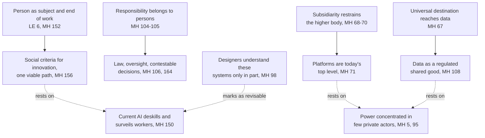

# Catholic Social Teaching · Lesson 4.5: The new things of our time: *Magnifica Humanitas* (2026)

> ⏱ ~15 min · Module 4: Work, the economy and the two critiques · Builds on: [4.1](04-01-work-and-the-worker-laborem-exercens.md), [4.4](04-04-enterprise-consumption-and-the-economy-of-gift.md), [`theology-of-debt` 6.1](../../theology-of-debt/lessons/06-01-usury-and-finance-in-modern-teaching.md) · Unlocks: [5.4](05-04-deterrence-and-the-challenge-to-just-war.md)

## Why this matters

On 15 May 2026, the 135th anniversary of *Rerum Novarum*, Leo XIV signed his first encyclical, on safeguarding the human person in the time of artificial intelligence. Two misreadings come easily: a papal ban on AI, or a pope's musings about gadgets. Both skip one step: sorting its sentences into those that bind, those that advise and those that report. The encyclical asks for exactly that sorting.

## The idea

A document about a new technology speaks in three registers at once. Think of a hospital's guidance on a new drug. "Do no harm to the patient" never dates. "Start at half the dose" is good judgment for now. "The drug clears the body in six hours" is a lab finding, true until a better study says otherwise. Treat the third like the first and a measurement becomes a commandment; treat the first like the third and a commandment becomes a guess.

[*Magnifica Humanitas*](../reference.md#magnifica-humanitas) (MH) is built the same way, and it marks its third register itself: §98 warns that anything said about AI may soon be out of date.

Its frame is Leo XIII's. On 10 May 2025 Leo XIV told the cardinals he took his name mainly because *Rerum Novarum* answered the first industrial revolution, and the Church must now answer another, and AI. *Rerum Novarum*'s Latin opens *Rerum novarum semel excitata cupidine*, the craving for "new things", that is, for upheaval; MH 4 turns the phrase to digitalization, AI and robotics, today's [*res novae*](../reference.md#res-novae). MH's first two chapters read the corpus and set out its [five principles](../reference.md#the-five-principles) ([1.1](01-01-the-social-doctrine-sources-genre-and-claim.md), Module 3); the third and fourth, this lesson's, apply them to technology, truth and work; the fifth, on war, is [5.3](05-03-war-and-peace.md)–[5.4](05-04-deterrence-and-the-challenge-to-just-war.md)'s. [`moral-theology` 3.5](../../moral-theology/lessons/03-05-social-sin-and-cooperation-in-the-sins-of-others.md) taught that only persons are subjects of moral acts; this lesson uses it.

## The teaching

Paraphrased from MH (Leo XIV, 2026) unless marked.

**T1. The new thing is concentrated power.** Technology is neither hostile to humanity nor evil in itself, but in practice never neutral: it takes on the aims of those who design, fund and use it (§§4, 9). Innovation is now driven chiefly by private, often transnational actors richer than many governments, who control platforms, data and computing power (§§5, 95). AI spreads the [technocratic paradigm](../reference.md#technocratic-paradigm) of *Laudato Si'* 106–109, in which efficiency, control and profit alone decide (§§92–93). *In words:* the question is not "AI, yes or no?" but who holds its power, and for what.

**T2. AI is not morally neutral, and someone must answer.** A system builds choices into what it counts, leaves out and optimizes for. If it treats some lives as less worthy, it has built in a criterion contrary to dignity, so discernment must judge design, not only use (§104; [AI is not morally neutral](../reference.md#ai-is-not-morally-neutral)). When no one bears an algorithm's judgment, exclusion hides behind a look of objectivity (§103), so [responsibility](../reference.md#responsibility-at-every-stage) must be assigned at every stage from design to use (§105). Nor does "alignment" suffice when a few choose the values aligned to (§107). *In words:* a machine can sort people; only a person can answer for the sorting.

**T3. Old principles reach new goods.** Patents, algorithms, platforms and data fall under the [universal destination of goods](../reference.md#universal-destination-of-goods) (§67, from [3.5](03-05-the-universal-destination-of-goods-and-private-property.md)). Data, made by many people, should not be sold off or handed to a few but managed as a regulated [shared good](../reference.md#data-as-a-shared-good) (§108, citing *Centesimus Annus* 40). In the digital sphere the top level that [subsidiarity](../reference.md#subsidiarity) restrains is not the State but the large platforms, which owe transparency, accountability and participation (§71, from [3.3](03-03-subsidiarity.md)). *In words:* old principles meet a new kind of property and a new "higher level".

**T4. The "more than human" is grace.** Transhumanism and posthumanism hope to transcend the human condition by technology (§§115–116). The issue is the vision, not the tools: treat the human as something to upgrade and some lives start to look less worthy (§117). We are called beyond ourselves, but by God's grace in Christ, not by technological self-divinization (§§126–128). *In words:* the Church agrees we are made to exceed ourselves and denies that a machine is the way.

**T5. Truth is a common good.** AI amplifies disinformation (§132), and democracy rests on a shared commitment to the facts (§134). [Truth is a common good](../reference.md#truth-as-a-common-good), not the property of the powerful; hence an "ecology of communication": transparent rules for selecting content, stronger intermediary bodies and journalism, critical education (§137). *In words:* who curates what we see is a common-good question, not a product feature.

**T6. Work in the digital transition** ([AI and work](../reference.md#artificial-intelligence-and-work)). [4.1](04-01-work-and-the-worker-laborem-exercens.md) gave MH 148–152: work "the essential key" (*Laborem Exercens* 3), unemployment a grave evil that, at scale, calls on the State, and protecting employment the general rule, since profit cannot justify systematically sacrificing jobs when the person is an end, not a means. The AI side: current approaches can deskill and surveil workers, so systems must be designed around the person, not performance alone (§150, quoting *Antiqua et Nova* 67). Unions must reach new kinds of work (§155). "One viable path" is social criteria for innovation: verifiable measures for jobs, retraining and participation with each automation, its costs not left on individuals alone (§156). *In words:* the machine may take the drudgery; it may not take the worker out of the economy's purpose.

**T7. The encyclical dates its own premises.** Any statement about AI may soon be outdated, and everyone, designers included, understands these systems only in part (§98; [the MH 98 caveat](../reference.md#the-mh-98-caveat)). *In words:* MH tells you which of its sentences will age.

MH 97 points to existing work on AI, chiefly [*Antiqua et Nova*](../reference.md#antiqua-et-nova), a Note of the Dicastery for the Doctrine of the Faith and the Dicastery for Culture and Education (approved by Francis 14 January, dated 28 January 2025). Finance and cryptocurrency (§160) are [`theology-of-debt` 6.1](../../theology-of-debt/lessons/06-01-usury-and-finance-in-modern-teaching.md)'s.

**Mark the levels.** MH is an encyclical letter of Leo XIV, signed 15 May 2026, published 25 May 2026, addressed to the Catholic faithful, all Christians and all people of good will (§16). By genre it is **authentic ordinary magisterium, rung 3** ([the ladder](../../fundamental-theology/lessons/04-04-the-ladder-of-doctrinal-authority.md); [levels of authority](../reference.md#levels-of-authority); genres in [`fundamental-theology` 4.5](../../fundamental-theology/lessons/04-05-reading-a-documents-weight.md)). The rung belongs to the document; religious submission attaches to its principles. The principles restated in T2, T3, T5 and T6 are **rung 3**, those of T6 restating *Laborem Exercens* 6 and 18; MH 66 itself calls property's social function Church doctrine, not a theological opinion. T4 restates the doctrine of grace, whose core [`creation-grace-last-things` 4.3](../../creation-grace-last-things/lessons/04-03-sanctifying-grace-the-indwelling-and-divinization.md) levels at **rung 1**; MH defines nothing. *Antiqua et Nova*, a dicastery note approved in ordinary form, is the dicasteries' act: **rung 3 at a light grade**, plus the weight of what it restates. The 10 May 2025 address is **rung 3 at its lightest** at most.

**Principle or application.** Sort before you weigh ([principle and application](../reference.md#principle-and-application); [the three assents](../reference.md#the-three-assents)). *Principles*, owed religious submission: persons alone answer for decisions; data falls under the universal destination; subsidiarity restrains whichever body is higher; truth is a common good; profit may not systematically sacrifice the person's work. *Applications*, owed serious and respectful consideration: that platforms are now that higher body (§71, resting on §95, as [3.3](03-03-subsidiarity.md) marks it), legal frameworks and oversight (§106), the data regime (§108), the communication norms (§137), social criteria for innovation (§156). [*Empirical premises*](../reference.md#empirical-premise), standing or falling with evidence: that power is concentrated (§95), that current AI deskills (§150), that jobs may contract fast (§151). §98 locates the revisable layer exactly: it qualifies **statements about AI**, not statements about persons, and reaches an application only as far as it rests on one. [The two errors](../reference.md#the-two-symmetrical-errors) here: inflating §156 into a rule for every firm, and demoting §105 to a pious hope for engineers.

**Where it stops.** MH denies there is one model of change or one universal remedy (§153), and presenting the encyclical Leo said the Church has no technical answers (address, 25 May 2026): [the doctrine's disclaimers](../reference.md#the-doctrines-disclaimers). The principles fix boundaries: no decision about a person with no one answerable; no strategy that treats jobs as the cost to cut; no concentration that shuts the many out of goods the many made. Which tasks to automate and how fast, which retraining scheme, which data regime, how much transparency the law demands: these are [prudential judgments](../reference.md#prudential-judgment) for legislators, firms, unions and intermediary bodies, on evidence that will change.

## The map

Top row: principles at rung 3; middle: applications owed serious consideration; bottom: evidence that §98 itself says will move.

## Worked examples

**Example 1 (clean): Tirrenia's claims floor.** Tirrenia, an invented insurer, installs an AI system that settles routine claims in minutes. Its plan: cut 300 of its 420 claims handlers within a year and pay the savings out as dividends.

- *Welcomed:* lifting repetitive work off people (§152).
- *Condemned:* the plan's logic: jobs as the cost to remove for profit, which "systematically sacrifice jobs" names, and handlers as inputs, against the [subjective dimension of work](../reference.md#objective-and-subjective-dimensions-of-work) ([4.1](04-01-work-and-the-worker-laborem-exercens.md)).
- *Asked:* redeployment to complex claims and appeals; retraining whose cost does not fall on the workers alone (§156); a person who answers for every refused claim (§§102, 105).

Verdict: the plan as stated fails; one built on redeployment, retraining and human answerability passes. How many handlers, and how fast, is Tirrenia's prudence, worked out with its staff's union (§155).

**Example 2 (strain): Vasskar's benefit algorithm.** The invented city of Vasskar buys a vendor's algorithm to decide housing-benefit claims. Decisions take two days, not six weeks, with fewer wrongful refusals than the caseworkers made. But the model is proprietary: the city cannot see why anyone was refused, and one input, postcode, tracks the poorest districts.

The principles pull apart. Faster, more accurate help serves the common good and the [option for the poor](../reference.md#preferential-option-for-the-poor). Against it: no one in the city can answer for a refusal (§105); the vendor decides while the city merely receives (§§71, 109); a postcode proxy may count some lives for less (§104). MH does not tell Vasskar to bring back the caseworkers. It requires that an official answer for each refusal, that applicants can appeal to a person, that the city can inspect and correct the model, and that discriminatory proxies go (§164). Whether to keep it while a transparent one is built, and how to weigh quick help for many against opaque refusals for a few: there the doctrine stops. The council decides, after hearing tenants' associations (§108), on error rates that will change.

## Watch out

- **You might think "AI is not morally neutral" means AI is bad**, but MH calls technology neither hostile nor evil in itself (§§4, 9) and says that to "disarm" AI is not to reject it (§110). Non-neutral means its design carries moral content that must be judged.
- **The two errors, one on each side of T2 and T6.** "MH obliges every firm to match each automation with verifiable job guarantees" inflates §156, one viable path beside "no single model" (§153). "'Someone must answer' is a pious hope for engineers" demotes §105, which applies at rung 3 the teaching that only persons bear moral responsibility.
- **You might read §98 as "none of it binds"**, but that drops its object: it dates statements about AI, not about persons. Conversely, §150's deskilling claim is not doctrine: quoting *Antiqua et Nova*, it says only that "current approaches" "can" de-skill workers.
- **You might cite *Antiqua et Nova* as papal teaching**, but it is a dicastery note approved in ordinary form; "the Pope teaches" overstates it.

## One-liner

> *Magnifica Humanitas* runs old principles on a new concentration of power: the principles bind, the remedies ask serious consideration, and its account of what AI does is the part it warns will date.

## Problems

**P1 (🟢)** *(Exegetical)* Sort and weigh. Each item paraphrases a sentence of MH, written for this problem. Say whether it is a **principle**, an **application** or an **empirical premise**, and give its level or the assent it asks. **One line each.** Then, **in one sentence**, say which items §98's caveat reaches.

1. Responsibility for an AI-assisted decision must be assignable at every stage, from design to use (§105).
2. Present AI systems are more "cultivated" than built, and no one yet knows how they work inside (§98).
3. Firms that automate should pair each step with checkable commitments on jobs, retraining and worker participation (§156).
4. Patents, algorithms and data are among the goods destined for all (§67).
5. Today's AI consumes very large quantities of energy and water (§101).
6. The authentic "more than human" is reached by God's grace in Christ, not by technological self-divinization (§§126–128).
7. Data ownership may not rest with private parties alone; it needs suitable regulation (§108).
8. AI tends to strengthen whoever already has money, know-how and data (§108).

**P2 (🟡)** *(Exegetical (a) · Evaluative (b))* Apply to a hard case, invented for this problem. The Brennholt rural health board has too few doctors. Ravelle Systems offers its AI triage service free for five years if the board grants it exclusive, perpetual rights to the region's patient records, which Ravelle will use to train models it sells worldwide. Patients are not asked, and the board's patient council is not consulted. Doctors keep the final say on every treatment.

(a) What does MH require here, and what does it condemn? Cite sections, and name one thing it does **not** forbid. **80 words or fewer.**

(b) Where does MH stop giving a verdict, and who is competent to judge the rest? Any verdict on the contract passes if the moves are made. **100 words or fewer.**

**P3 (🔴)** *(Exegetical)* Diagnose. Two **invented** texts, written for this problem; no real person said either.

> **A** (a technology newsletter, the *Signal Ledger*): "Leo XIV has banned AI for Catholics. *Magnifica Humanitas* §104 declares AI morally evil, §106 orders a halt to its development, and since an encyclical is infallible, a Catholic engineer who builds AI is in sin."

> **B** (a column in the *Pellam Review*): "An encyclical on technology is the Pope's opinion about gadgets. He admits in §98 that whatever he says about AI will soon be out of date, so none of it binds; and the idea that data falls under the universal destination of goods is a theologian's curiosity, not Church teaching."

Name **two errors in each** text and correct each with a section and, where a level is at issue, the level. Credit anything B gets right. **150 words or fewer.**

Solutions

**P1** *(Exegetical)*

**Must hit, strict:**

1. **Principle**, rung 3: restates that moral responsibility belongs to persons; religious submission.
2. **Empirical premise**, no rung; revisable on evidence, as MH itself says.
3. **Application**, owed serious and respectful consideration: MH calls it "one viable path" (§156) and denies any single model (§153).
4. **Principle**, rung 3: the universal destination reaches every kind of good (3.5's principle; MH 66 calls property's social function doctrine). How data is to be shared is a separate, prudential question.
5. **Empirical premise**, no rung.
6. **Principle.** MH's own act is rung 3; it restates a doctrine whose core, partaking of the divine nature by grace, other acts fix at rung 1 ([`creation-grace-last-things` 4.3](../../creation-grace-last-things/lessons/04-03-sanctifying-grace-the-indwelling-and-divinization.md)). MH defines nothing, so it adds no rung of its own.
7. **Application** of item 4 (a regime for data), owed serious consideration; a Catholic may weigh it and prefer another regime that still honours the principle.
8. **Empirical premise** ("tends"), no rung.

§98 reaches 2, 5 and 8 directly, and 3 and 7 so far as they rest on such premises; it leaves 1, 4 and 6 alone, because they are statements about persons, goods and grace, not about AI.

**Wrong turns:** calling 3 or 7 binding because they are "in an encyclical" (inflation: the document's rung does not attach to its applications). Calling 1 a hope rather than teaching (demotion). Giving 6 rung 1 "because the encyclical says so", or rung 5 because it concerns transhumanism. Treating 2 as a doctrine about AI's nature. Reading §98 as touching everything. Accept for 4 "the principle extended to new matter", provided it stays rung 3 and the data regime is marked prudential.

**Model answer:** as above, one line each, with the §98 sentence.

---

**P2** *(Exegetical (a) · Evaluative (b))*

**Must hit, strict (a):**

- **Condemns** the core of the deal: data made by many contributors handed exclusively and forever to one firm, which is what §108 says data must not be (sold off, or left to a few), and a concentration without access that contradicts the universal destination (§67).
- **Requires** the records to be treated as a regulated shared good (§108), and patients and their council to have a voice, since communities must not be passive recipients of decisions made elsewhere (§§71–72, 108; §178 on restoring to people a say in how their data is used).
- **Does not forbid** AI triage, or a contract with a private firm. Responsibility is not the problem here: doctors keep the final say (§105).

**Must hit, any verdict (b):**

- Name what is left to prudence: whether any licence is acceptable and on what terms (length, exclusivity, benefit-sharing, consent), how far doctors may rely on the rankings, and the trade-off against present harm from the shortage, which is an empirical question.
- Name the competent judges: the board and the legislature that regulates it, with clinicians and the patient council heard (§108), not the moralist.
- Mark the facts as revisable (§98).

**Wrong turns:** "MH forbids AI in medicine" (§§4, 129 say otherwise). "MH requires public ownership of data" (it asks regulation and shared management; the form is prudential). Treating the free service as settling the question: the good offered does not license the exclusive transfer. Making responsibility (§105) the main problem when doctors keep the decision.

**Model answer (a):** MH condemns the deal's core: records made by many patients handed exclusively and forever to one firm, which §108 says data must not be and §67 counts against the universal destination. It requires the board to treat the records as a regulated shared good and to give patients and their council a voice (§§71–72, 108, 178). It does not forbid AI triage or a private partner; the doctors' final say meets §105.

**Model answer (b), one of several:** MH stops at the terms. A non-exclusive, time-limited licence with consent and shared benefits might honour §108; whether it does, and whether faster triage outweighs the risks, depends on facts (deaths on the waiting list, the model's error rate) MH does not supply. The board decides, under laws the legislature sets, after hearing clinicians and the patient council. My verdict: refuse this contract and negotiate a non-exclusive one. A reader who accepts a short exclusive licence with strong safeguards, and says why, also passes.

---

**P3** *(Exegetical)*

**Must hit, strict (two from each text):**

- A, **"banned AI":** no ban. Technology is neither hostile nor evil in itself (§§4, 9); to disarm AI is not to reject it (§110); developers' work can share in creation (§111).
- A, **"§104 declares AI evil":** §104 says AI is not morally *neutral*, so its design must be judged; that is not a verdict of evil.
- A, **"§106 orders a halt":** §106 asks for prudence, rigorous evaluation and at times a slower pace, says this is not opposing progress, and calls for law and independent oversight, not a halt.
- A, **"an encyclical is infallible":** authentic ordinary magisterium, rung 3, non-definitive; MH defines nothing.
- B, **"just opinion":** an encyclical's principles are rung 3 and owed religious submission.
- B, **§98:** it dates statements about AI, not principles about persons. B is right that the empirical layer is revisable.
- B, **data:** §67 applies a rung-3 principle, and §66 says property's social function is Church doctrine, not a mere theological opinion.

**Wrong turns:** answering B by calling MH's empirical claims doctrine (overcorrection). Answering A by saying an encyclical is "only advice". Missing B's half-truth.

**Model answer:** A: MH bans nothing; it calls technology neither hostile nor evil in itself (§§4, 9) and says disarming AI is not rejecting it (§110). §104 says AI is not morally neutral, meaning its design must be judged. §106 asks at most for a slower pace, under law and oversight. An encyclical teaches at rung 3, not infallibly. B: the principles MH restates bind at rung 3, with religious submission. §98 dates its statements about AI, not about persons, though B is right that those statements are revisable. The universal destination's reach to data (§67) is rung-3 doctrine; §66 refuses to call property's social function a theological opinion.

## Flashback

**From Lesson [4.3](04-03-socialism-and-liberal-capitalism-each-judged.md) (Socialism and liberal capitalism, each judged):** *(Exegetical, paraphrase reading.)* A paraphrase of *Populorum Progressio* 26 (Paul VI, 1967), written for this problem:

> Out of the new industrial conditions certain ideas took hold: that profit is the main engine of progress, that free competition is the supreme rule of economic life, and that owning the means of production is an absolute right, bounded by nothing and owing nothing to society. This "unbridled liberalism" opens the way to the tyranny Pius XI condemned. The economy exists to serve man. The hardships and injustices of a certain capitalism spring from these ideas, not from industrialization itself, whose organization of work has served development well.

(a) Does the passage condemn profit, competition and private ownership of productive goods? Name the words that decide it, and say what it refuses to blame. **Two sentences.**

(b) Is its account of where the hardships came from a principle, an application or an empirical premise, and at what level? If historians showed it wrong, what in the passage would still bind, and at what level? **Two sentences.**

Solution

**Must hit, strict (a):**

- **No.** It condemns each one made absolute: profit as the *main* engine, competition as the *supreme* rule, ownership as *absolute* and *owing nothing*. That is 4.3's [critique of liberal capitalism](../reference.md#critique-of-liberal-capitalism): the market is useful; its absolutization is the error.
- It refuses to blame **industrialization**, whose organization of work it credits.

**Must hit, strict (b):**

- The causal account is an [empirical premise](../reference.md#empirical-premise), a historical judgment, in a rung-3 document. It has no rung of its own; historians may test it.
- What would still bind: the economy serves man; competition may not be its supreme rule; ownership of productive goods has limits and social obligations ([universal destination of goods](../reference.md#universal-destination-of-goods)). These are **principles, rung 3** (encyclical), owed religious submission. As with RN 15's forecast in 4.3, the verdict rests on the principle, not on the history.

**Wrong turns:** "PP 26 condemns profit, the market or capitalism" (drops the qualifiers). "PP 26 blames industrialization." Giving the historical account rung 3 because an encyclical states it (inflation). Dismissing the principles as 1960s development economics because the history is arguable (demotion).

**Model answer (a):** No: it condemns profit as the *main* engine, competition as the *supreme* rule and ownership as an *absolute* right owing nothing, so the qualifiers carry the condemnation. It expressly refuses to blame industrialization, whose organization of work it credits.

**Model answer (b):** The account of where the hardships came from is an empirical premise, a historical judgment with no rung that evidence can revise. If it failed, the principles would stand at rung 3: the economy serves man, competition may not rule it, and ownership of productive goods carries limits and social obligations.

## Connections

- **Backward:** [4.1](04-01-work-and-the-worker-laborem-exercens.md) supplies the subjective dimension and the indirect employer behind MH 151–152 (*Laborem Exercens* 6, 18). [4.4](04-04-enterprise-consumption-and-the-economy-of-gift.md) has the firm as a community of persons and economic freedom as not absolute. [3.5](03-05-the-universal-destination-of-goods-and-private-property.md) and [3.3](03-03-subsidiarity.md) teach the principles MH 67 and 71 extend, and [1.2](01-02-permanent-principles-and-contingent-applications.md) the line MH 46 draws when it says the social doctrine holds a core of unchanging truths. Finance, credit and cryptocurrency (MH 160) go to [`theology-of-debt` 6.1](../../theology-of-debt/lessons/06-01-usury-and-finance-in-modern-teaching.md).
- **Forward:** [5.3](05-03-war-and-peace.md) takes MH 197–200 on autonomous weapons, where no lethal or irreversible decision may be entrusted to a machine. [5.4](05-04-deterrence-and-the-challenge-to-just-war.md) takes MH 192 and 194 on just-war theory and deterrence. [6.1](06-01-integral-ecology-laudato-si.md) owns the technocratic paradigm of *Laudato Si'* and the ecological cost MH 101 notes.
- **Sideways:** [`moral-theology` 3.5](../../moral-theology/lessons/03-05-social-sin-and-cooperation-in-the-sins-of-others.md) taught that only persons are subjects of moral acts (*Reconciliatio et Paenitentia* 16); MH 103–105's demand that someone answer for an algorithm's verdict is that claim in a new setting. Whether a language model understands, which MH 99 denies, is argued in [`philosophy-of-mind`](../../philosophy-of-mind/syllabus.md) 6.2–6.3, not here. How generous the State's response to job loss should be, which MH 151 leaves to prudence, is modelled in [`public-economics` 7.2](../../public-economics/lessons/07-02-optimal-unemployment-insurance-baily-chetty.md). Weber's rationalization ([`social-theory` 4.4](../../social-theory/lessons/04-04-bureaucracy-rationalization-and-disenchantment.md)) is the secular cousin of the technocratic paradigm, and the "more than human" of grace is [`creation-grace-last-things` 4.3](../../creation-grace-last-things/lessons/04-03-sanctifying-grace-the-indwelling-and-divinization.md).
