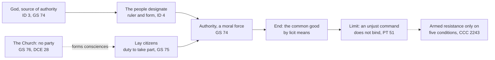

# Catholic Social Teaching · Lesson 5.1: The political community and the limits of the state

> ⏱ ~15 min · Module 5: The political community, peace and the stranger · Builds on: [3.2](03-02-the-common-good.md), [4.3](04-03-socialism-and-liberal-capitalism-each-judged.md) · Unlocks: [5.2](05-02-religious-liberty-dignitatis-humanae.md), [5.3](05-03-war-and-peace.md)

## Why this matters

A government postpones an election "for the common good". An official is told to carry out an order she thinks wrong. A parishioner wants the pulpit to name the Catholic party. Each asks what political authority is and where it stops. Catholics misuse the answer from both sides: some quote Romans 13 as if every command bound, others think the Church must either field a party or keep silent.

## The idea

Think of a hospital's medical director. The office exists because patients need someone to coordinate their care, and its powers reach exactly as far as that purpose. The board may fill it by election or appointment. But an order to falsify a chart is no order at all, and the nurse who refuses it is no rebel.

That is the teaching's shape. [Political authority](../reference.md#political-authority) is natural and necessary: people cannot live together without someone directing them to the [common good](../reference.md#common-good), so it comes, as to its origin, from the God who made us social. Who rules, and under which constitution, the people decide. What authority is for fixes its limit: a command against the moral order does not bind. And the Church is neither a rival government nor a party: she teaches principles and leaves the building to citizens.

Whether any state may rightly command, and on what terms, is argued secularly in [`political-philosophy` 1.1](../../political-philosophy/lessons/01-01-the-problem-of-political-authority.md), [4.1](../../political-philosophy/lessons/04-01-political-liberalism.md) and [5.1](../../political-philosophy/lessons/05-01-why-democracy.md).

## Source

Leo XIII, *Immortale Dei* (1 November 1885), §4 in the Vatican numbering, from *The Great Encyclical Letters of Pope Leo XIII* (Benziger, New York, 1903).

> The right to rule is not necessarily, however, bound up with any special mode of government. It may take this or that form, provided only that it be of a nature to insure the general welfare. But whatever be the nature of the government, rulers must ever bear in mind that God is the paramount ruler of the world, and must set Him before themselves as their exemplar and law in the administration of the State. For, in things visible, God has fashioned secondary causes, in which His divine action can in some wise be discerned, leading up to the end to which the course of the world is ever tending. In like manner in civil society, God has always willed that there should be a ruling authority, and that they who are invested with it should reflect the divine power and providence in some measure over the human race.

The shape is a concession, then a turn. **"Not necessarily … bound up with any special mode"** and **"this or that form"** detach the right to rule from every constitution; **"provided only"** sets the one test. **"But whatever be the nature of the government"** turns from the form to its holders, who rule under God; the **secondary causes** make them sharers in a power they did not invent. (The vatican.va English drops the proviso; read the 1903 print.)

## The teaching

**T1. Authority is natural, necessary and from God.** No society holds together without someone directing all to the common good, so authority, like society, comes from nature and has God for its author (*Immortale Dei* 3; *Diuturnum* 11, 1881). *Gaudium et Spes* 74 (1965): political community and public authority belong to the order God designed. *In words:* government belongs to being social.

**T2. The people designate; no form is prescribed.** Rulers may in some cases be chosen by the people; the choice designates the ruler without conferring the right to rule (*Diuturnum* 6). Rule by one or by many may be approved if just and for the common advantage (*Diuturnum* 7; *Immortale Dei* 4). Leo rejects the view that all power is delegated by the people and revocable at their will (*Diuturnum* 5; cf. PT 78). GS 74 leaves regime and rulers to the citizens. *In words:* God grounds the office; the people choose its holder and its [form](../reference.md#forms-of-government).

**T3. Its end is the common good, by licit means.** Authority must act within the moral order for the common good, as a "moral force"; so exercised, it binds in conscience (GS 74; PT 47–48); it is legitimate only by morally licit means (CCC 1903). Against Machiavelli's counsel that a prince must learn to be able not to be good ([`history-of-political-thought` 3.1](../../history-of-political-thought/lessons/03-01-machiavelli-the-prince.md)), no reason of state licenses an evil means ([`moral-theology` 2.3](../../moral-theology/lessons/02-03-intention-and-circumstances.md); Rom 3:8). *In words:* the purpose limits the means.

**T4. Its limit: an unjust command does not bind.** Laws against the moral order have no binding force in conscience (PT 51, citing Acts 5:29). When laws are manifestly at variance with the divine law, Leo XIII wrote, "to resist becomes a positive duty, to obey, a crime" (*Sapientiae Christianae* 10, 1890, Benziger 1903), and CCC 2242 obliges the citizen not to follow such directives. Two brakes come with this [limit](../reference.md#limits-of-obedience): citizens must still give what the common good objectively requires (GS 74; CCC 2242). And [armed resistance](../reference.md#armed-resistance) needs all five conditions of CCC 2243: certain, grave and prolonged violation of fundamental rights; other means exhausted; no worse disorder; well-founded hope of success; no better solution in view (cf. *Libertatis Conscientia* 79, 1986). Conscience is [`moral-theology` 2.4–2.5](../../moral-theology/lessons/02-04-conscience-its-nature-and-its-errors.md)'s, tyranny [`history-of-political-thought` 2.4](../../history-of-political-thought/lessons/02-04-aquinas-on-kingship-tyranny-and-property.md)'s. *In words:* obedience ends where the command is itself wrong.

**T5. Two senses of autonomy; the Church no party.** GS 36: [autonomy](../reference.md#rightful-autonomy-of-earthly-affairs) meaning that societies have their own laws and values is right; autonomy meaning independence from God is false. That pair is the course's answer on secularism; the CDF's 2002 Doctrinal Note (§6) puts it as autonomy from the Church, not from morality. The Church is bound to no political system (GS 76), cannot and must not take the political battle into her own hands (DCE 28), and does not claim the State's functions (*Magnifica Humanitas* 21, 2026). *In words:* a secular state, yes; a state beyond moral judgment, no.

**T6. Participation is a duty; the building is the laity's.** Citizens have the right and duty to vote for the common good (GS 75); [participation](../reference.md#participation) is an obligation rooted in dignity (CCC 1913–1915; *Christifideles Laici* 42, 1988). Ordering society justly is directly the [lay faithful's](../reference.md#the-lay-mission-in-temporal-affairs) task (DCE 29; CCC 2442). Catholics may disagree "with equal sincerity" on concrete solutions, and none may claim the Church's authority for his own (GS 43). Many parties are legitimate because many choices are contingent, but pluralism covers no policy undermining fundamental ethical requirements (Doctrinal Note 3, 5). *In words:* different benches, not any bench.

**T7. Democracy on conditions; the family first.** *Centesimus Annus* 46 (1991) values democracy "inasmuch as" citizens take part and can elect, hold to account and peacefully replace their rulers. It needs the rule of law and a correct conception of the person, not truth fixed by majorities; without values it easily becomes "open or thinly disguised totalitarianism", and the same section rejects a fanaticism imposing its truth ([democracy and truth](../reference.md#democracy-and-truth)). Pius XII's 1944 Christmas radio message had called democracy possible in monarchies and republics alike. Beneath the state lies the "[human ecology](../reference.md#human-ecology)", the family first (CA 38–39; *Apostolicam Actuositatem* 11). *In words:* democracy is prized for what it secures and on what it rests.

**Mark the levels.** On [the ladder](../../fundamental-theology/lessons/04-04-the-ladder-of-doctrinal-authority.md) ([levels of authority](../reference.md#levels-of-authority)), T1–T7's principles are **rung 3**, owed religious submission: encyclicals from *Diuturnum* (1881) to MH (2026), a pastoral constitution (GS), a conciliar decree (AA). That authority comes from God restates Romans 13:1. That no form is prescribed is itself **rung 3**, so "forms are applications" is the corpus's own answer. The 2002 Doctrinal Note, a CDF act approved in ordinary form, is **rung 3, light grade**; Pius XII's radio message **rung 3 at its lightest**, at most. The Catechism only locates; CCC 2243's conditions are **rung 3**. Nothing here is defined.

**Principle or application.** The **principles** above ask religious submission. **Applications** such as a bishops' view on voting rules ask [serious, respectful consideration](../reference.md#the-three-assents); weighing one and judging otherwise is not dissent. Citizens' verdicts (this regime meets CA 46, this law is unjust, this rising meets CCC 2243) have no rung. **[Empirical premises](../reference.md#empirical-premise)** stand on evidence: two of CCC 2243's conditions are forecasts, as is any claim about a voting rule's effect on turnout. The [two symmetrical errors](../reference.md#the-two-symmetrical-errors): "the Church requires democracy, or this party" inflates; "authority from God is a medieval relic" demotes.

**Where it stops.** The principle names source, end and line; it does not draw the line in a hard case, or choose a constitution, a voting system or a party. Whether a measure is merely unwise or unjust is first for the citizen's formed conscience about his own act; how to refuse is [prudential judgment](../reference.md#prudential-judgment). T5's [disclaimers](../reference.md#the-doctrines-disclaimers) are part of the teaching, not modesty about it.

## The map

Authority's end fixes its limit; the Church stands beside the line, not on the throne.

## Worked examples

**Example 1 (clean): Selbourne postpones its election.** Invented. Six weeks before a general election, the Republic of Selbourne's government postpones it indefinitely "for the common good": a campaign would unsettle a fragile economy.

- **Is democracy owed?** Not as such: no form is prescribed (T2). But Selbourne's citizens chose this constitution, and GS 74 leaves that choice to them, not to the government.
- **CA 46** values democracy for exactly what is being removed, and will not encourage narrow groups that usurp the State's power; GS 75 wants rights restricted for the common good restored as soon as circumstances change.
- **Verdict:** indefinite postponement on a general appeal to stability fails. A short delay for a real emergency, with a fixed new date, may pass; whether the emergency is real and how short is short are fact and prudence.

**Example 2 (strain): the benefits officer.** Invented. Selbourne's Benefits Act tells officers to stop the housing allowance of any claimant who misses two appointments, without exception. Severin Ostvik, an officer, thinks the rule harsh and self-defeating.

- **The rule binds him.** A measure he judges unwise is not thereby against the moral order (GS 74). His remedy is participation: argue, petition, vote (GS 75); others may disagree with equal sincerity (GS 43).
- **An order to backdate missed appointments** to shrink the caseload is a command to lie. It does not bind, and he must refuse (CCC 2242).
- **The strain:** one claimant missed both appointments in hospital and will now lose her home. Is applying the rule to her unjust, or the rough edge of a general law? The doctrine does not say where a harsh rule turns unjust in one case. That falls to Severin's conscience about his own act, helped by the cooperation distinctions of [`moral-theology` 4.2](../../moral-theology/lessons/04-02-double-effect-and-cooperation-as-catholic-method.md), then to prudence: any discretion the Act allows, an appeal, at the limit resignation. Changing the Act is for legislators and courts.

## Watch out

- **You might think Romans 13 makes every command binding**, but the Leo XIII who called revolt treason (*Immortale Dei* 5) called obedience to a law against God's a crime (*Sapientiae Christianae* 10). The mirror error, that any law I dislike is "unjust", forgets GS 74: a measure within the moral order binds.
- **You might think the Church teaches that democracy is the only legitimate regime**, but that inflates CA 46's conditional "inasmuch as" into a mandate the corpus denies (GS 74; *Immortale Dei* 4). Dropping the conditions errs the other way, as if whatever a majority enacts were legitimate; calling CA 46 "one pope's view" demotes a rung-3 principle the 2002 Note (§3) and MH 39 restate.
- **You might think CA's "human ecology" is Robert George's "moral ecology"** ([`political-philosophy` 4.3](../../political-philosophy/lessons/04-03-perfectionism-and-the-common-good.md)). George's term serves a perfectionist case for morals legislation; CA's names the natural and moral structure of the person, family first, that policy must respect.

## One-liner

> Authority comes from God through the people's choice, exists for the common good and binds only within the moral order; the Church judges it, takes no throne and no party, and sends lay citizens to do the building.

## Problems

**P1 (🟢)** *(Exegetical)* Close reading of the Source, *Immortale Dei* §4 (Benziger, 1903).

(a) Which words leave the form of government open, and which words set the one condition every form must meet? **One line.**

(b) One reader says the passage shows that Leo XIII rejected democracy; another, that it shows he held democracy to be the best form. Is either right? **Two sentences**, naming the words that decide it.

(c) What does the sentence beginning "But whatever be the nature of the government" add, for a democracy, that the proviso alone does not? **Two sentences.**

**P2 (🟡)** *(Exegetical)* Sort and weigh. Six claims, written for this problem. For each, say whether it is a **principle**, an **application**, an **empirical premise**, or an **error** (and which error); give its level or "no rung", the act that fixes it, and the assent it asks. **One line each** (two for item 2).

1. The family is the first and vital cell of society (*Apostolicam Actuositatem* 11, paraphrased).
2. The bishops of Selbourne (invented) urge the country to adopt compulsory voting, because it raises turnout among the poorest households.
3. Catholics must vote for a Catholic party wherever one stands.
4. Whatever a democratic majority enacts binds in conscience, because in a democracy the people are the source of authority.
5. That political authority comes from God was Leo XIII's opinion, which Vatican II quietly dropped.
6. Pius XII's 1944 Christmas message made democracy the form of government the Church requires.

**P3 (🔴)** *(Exegetical)* Apply to a hard case. Invented. Selbourne's new Housing Order (i) requires every landlord to register each tenancy with the housing office, which will use the register to enforce (ii); and (ii) orders landlords to evict tenants of Oskari descent, a long-settled minority, and to report any who stay. Cosima Brannor, a Catholic landlord with four Oskari tenants, judges (ii) gravely unjust. A neighbour invites her to join an armed group preparing to seize the housing office.

(a) What does the doctrine decide about (i) and about (ii), and what does it require of Cosima? **One line each.**

(b) What does it leave to her prudence, and what does it say about the neighbour's invitation? **120 words or fewer.**

Solutions

**P1** *(Exegetical)*

**Must hit, strict:**

- (a) Open: **"not necessarily … bound up with any special mode of government"** and **"this or that form"**. Condition: **"provided only that it be of a nature to insure the general welfare"**.
- (b) **Neither.** The passage neither condemns nor ranks forms: a democracy that serves the general welfare is as legitimate as a monarchy that does ("this or that form", "provided only"). Leo is denying that the right to rule depends on any one form.
- (c) The proviso judges the **form**; the second sentence binds the **holders** under every form, democratic ones included, to God as "exemplar and law". So an elected government's acts are not right because a majority chose them; they are measured by a law above the vote (the point CA 46 later makes about truth and majorities).

**Wrong turns:** reading "the general welfare" as "majority preference". Taking "not necessarily" as hostility to any one form, when it is neutrality among them. Reading the secondary-causes analogy as divine right: it says rulers *share* in God's providence, not that whoever holds power is beyond judgment. Answering (b) from Leo's other writings instead of this passage.

**Model answer:** (a) "Not necessarily … bound up with any special mode" and "this or that form" leave the form open; "provided only that it be of a nature to insure the general welfare" is the condition. (b) Neither reader is right: the passage allows "this or that form", democracy included, so long as it serves the general welfare, and ranks none above another. (c) The proviso tests the form, but the next sentence binds the rulers of every form, elected ones too, to God as "exemplar and law". A democratic majority is therefore not the measure of what is right, which is what CA 46 later says.

---

**P2** *(Exegetical)*

**Must hit, strict:**

1. **Principle, rung 3** (AA 11, a conciliar decree, 1965; cf. CA 39 and MH 165, 2026). Religious submission.
2. **Split.** The policy is an **application** in a bishops' conference's particular teaching (authentic in its territory, never universal): serious, respectful consideration, and a Catholic who weighs it and disagrees does not dissent. "It raises turnout among the poorest" is an **empirical premise**: no magisterial level, settled by evidence. The principle underneath, the duty to take part (GS 75), is rung 3.
3. **Error, inflation**: it turns one possible prudential choice into a duty. Correct: a plurality of parties is legitimate because many choices are contingent (Doctrinal Note 3; GS 43, 75), rung 3. No party carries the Church's authority.
4. **Error, misstatement** (drops CA 46's conditions). Correct: authority binds only within the moral order (GS 74); the will of individuals or groups is not the sole source of its binding force (PT 78; *Diuturnum* 5); truth is not fixed by the majority (CA 46). Rung 3.
5. **Error, understatement.** GS 74 restates it (authority belongs to the order God designed), as do PT 46 and CCC 1899. Rung 3, restating Romans 13:1.
6. **Error, overstatement** of act and content. A radio message is **rung 3 at its lightest**, at most, and defines nothing. Pius XII says democracy can exist in monarchies and in republics; no form is prescribed (GS 74; *Immortale Dei* 4), rung 3.

**Wrong turns:** calling 2 simply "a principle because bishops said it". Giving 2's turnout claim the bishops' authority. Answering 3 with "no Catholic may join a Catholic party", the mirror error. Calling 5 rung 1 because Romans says it: what the encyclicals and GS teach is rung 3. Giving 6 a heavy rung because Pius XII was pope.

**Model answer:** (1) Principle, rung 3 (AA 11, conciliar decree); religious submission. (2) The proposal is an application in particular teaching, owed serious consideration, and disagreeing after weighing it is not dissent. The turnout claim is an empirical premise, settled by evidence, with no magisterial level; the participation duty beneath it is rung 3 (GS 75). (3) Error, inflation: plurality of parties is legitimate (Doctrinal Note 3; GS 43), rung 3. (4) Error: authority binds only within the moral order, and no will is its sole source (GS 74; PT 78), rung 3. (5) Error, understatement: GS 74 and PT 46 restate it, rung 3. (6) Error, overstatement: a radio message, lightest rung 3 at most, and no form is prescribed (GS 74).

---

**P3** *(Exegetical)*

**Must hit, strict (a):**

- **(ii)** is contrary to the moral order and the fundamental rights of persons, so it **does not bind** in conscience (PT 51; CCC 2242).
- **(i)**, a tenancy register, is in itself within authority's competence (GS 74), but here it is the **instrument** of (ii). Whether registering her Oskari tenants is cooperation in the evictions is a question for the cooperation distinctions of `moral-theology` 4.2; T4 alone does not settle it.
- **Cosima** is obliged in conscience **not** to evict or report her tenants (CCC 2242: not merely permitted to refuse), and she must still give what the common good objectively requires: taxes and the other laws (GS 74).

**Must hit, strict (b):**

- **Prudence:** how she refuses (openly, accepting the penalty; in the courts; with other landlords and citizens), and how she protects her tenants, all within the natural law and the Gospel (GS 74).
- **The invitation:** armed resistance is legitimate only if all five conditions of CCC 2243 hold. One order, with courts and other remedies still open, fails at least "prolonged" and the exhaustion of other means on these facts.
- Whether the conditions are met is an **application**, and two of them (no worse disorder, hope of success) are **forecasts**, empirical premises. So she must not join now, and the principle does not decide for later.

**Wrong turns:** "the law is the law, so she must evict and protest afterwards" (demotes PT 51). "Any unjust law licenses force" (drops CCC 2243). Treating refusal as merely permitted. Saying (i) binds without asking what it is used for, or forbidding all registration as though the register were unjust in itself. Re-running Aquinas's remedies against tyranny, which is `history-of-political-thought` 2.4's question.

**Model answer:** (a) The eviction order does not bind, since it is contrary to the moral order and to fundamental rights (PT 51; CCC 2242). The register is within competence in itself, but here it is the means of enforcing the evictions, so whether she may register these tenants is a cooperation question (`moral-theology` 4.2). Cosima must refuse to evict or report, while still paying her taxes and keeping the other laws. (b) Prudence decides how she refuses: openly and accepting the penalty, through the courts, with other landlords, sheltering her tenants. The neighbour's plan fails CCC 2243 now. The violation is grave and certain but not yet prolonged, and peaceful remedies remain. Whether worse disorder would follow, or success is likely, are forecasts. She should decline.

## Flashback

**From Lesson [4.4](04-04-enterprise-consumption-and-the-economy-of-gift.md) (Enterprise, consumption and the economy of gift):** *(Exegetical (a) · Evaluative (b).)* A paraphrase of *Caritas in Veritate* 39 (Benedict XVI, 2009), written for this problem: if market and State each keep a monopoly over their own field, solidarity, participation and gratuitous action, which differ both from giving to get and from giving because the law compels, are lost in the long run. Market plus State alone corrodes society. Gratuitousness cannot be established by law, yet market and politics both need people open to gift.

Invented, not the words of any real person: Tarnholm's finance minister, a Catholic, proposes that firms with over 250 staff give 1 percent of profit to charities their employees choose, calling it "*Caritas in Veritate* in law".

(a) Reconstruct the paraphrase as numbered premises and a conclusion about what law can do for gift, marking each premise principle, application or empirical premise, with its level. **Five lines or fewer.**

(b) Is the minister's label right, and may a Catholic legislator vote either way? Any verdict on the statute passes. **100 words or fewer.**

Solution

**Must hit, strict (a):**

- **Principles, rung 3** (CiV 34–39), owed religious submission: society needs solidarity, participation and gratuitous action; these differ in kind from exchange and from legal duty; law cannot establish gratuitousness.
- **Empirical premise**, no rung: that a market-plus-State monopoly makes them wither. It would fail if such societies kept their solidarity, so by 1.2's standing question it is no principle. Accept "mixed" if the anthropology and the long-run effect are separated.
- **Conclusion:** law cannot produce gift, but it can make room for it (CiV 38).

**Must hit, any verdict (b):**

- **The label is wrong.** Mandated giving is giving through duty (CiV 39): at most political logic, just laws and redistribution (CiV 37). Claiming the encyclical for it claims the Church's authority for one's own application (GS 43).
- **The vote turns on fact and prudence:** does the statute add to charities' income, or crowd out what firms and staff would give freely ([`public-economics` 1.2](../../public-economics/lessons/01-02-voluntary-provision-and-crowding-out.md))? Legislators judge, and either vote keeps the principle.

**Wrong turns:** calling the monopoly premise rung 3 because an encyclical states it. Reading CiV 39 as forbidding the statute: law cannot create gift, but such a law is not thereby unjust. Concluding that the State has no role (CiV 37; MH 69).

**Model answer (a):** P1 society needs solidarity, participation and gratuitous action (principle, rung 3). P2 these are neither exchange nor legal duty (principle, rung 3). P3 a market-plus-State monopoly lets them wither (empirical premise, no rung). P4 law yields only giving through duty, so it cannot establish gratuitousness (principle, rung 3). C law can make room for gift, never manufacture it.

**Model answer (b), one of several:** The label is wrong. Required giving is giving through duty, and CiV 39 says gratuitousness cannot be established by law, so the statute is at most redistribution (CiV 37); calling it the encyclical in law claims the Church's authority for an application (GS 43). Whether it helps is a question of fact: does it add to charities' income or crowd out free giving? I would vote yes, as modest support for civil society; a colleague who foresaw crowding out and voted no would dissent from nothing.

## Connections

- **Backward:** [3.2](03-02-the-common-good.md) made the common good authority's measure. [2.3](02-03-mater-et-magistra-and-pacem-in-terris.md) read PT 46–52 and [2.4](02-04-gaudium-et-spes-to-justice-in-the-world.md) GS 36 and PP 31. [4.3](04-03-socialism-and-liberal-capitalism-each-judged.md) gave CA 13's anthropological error, which CA 44–46 turn into the critique of totalitarianism and of a democracy without values. The levels come from [`fundamental-theology` 4.4](../../fundamental-theology/lessons/04-04-the-ladder-of-doctrinal-authority.md)–[4.5](../../fundamental-theology/lessons/04-05-reading-a-documents-weight.md).
- **Forward:** [5.2](05-02-religious-liberty-dignitatis-humanae.md) asks what the state owes religion, the question *Immortale Dei*'s next sections open. [5.3](05-03-war-and-peace.md) takes authority's duty to defend and its limits in war. [6.4](06-04-three-readings-catholic-liberal-integralist-progressive.md) finds that the corpus has already ruled forms of government applications; its three readings divide elsewhere. The state's power to punish, the death penalty included, is [`moral-theology` 5.4](../../moral-theology/lessons/05-04-the-death-penalty-and-ccc-2267.md)'s.
- **Sideways:** [`political-philosophy` 1.1](../../political-philosophy/lessons/01-01-the-problem-of-political-authority.md) poses the anarchist challenge to any right to rule; [4.1](../../political-philosophy/lessons/04-01-political-liberalism.md) gives Rawls's neutrality; [5.1](../../political-philosophy/lessons/05-01-why-democracy.md) sorts justifications of democracy, and CA 46 values it both for what it secures (accountability) and for what dignity requires (participation, PT 73), while refusing to let a vote fix truth. Weber's legitimacy as a belief ([`social-theory` 4.3](../../social-theory/lessons/04-03-domination-and-the-three-types-of-authority.md)) is descriptive; the legitimacy here is moral. GS 36's two senses of autonomy answer the secularization questions [`social-theory` 7.1](../../social-theory/lessons/07-01-classical-secularization-theory.md), [7.3](../../social-theory/lessons/07-03-taylors-a-secular-age.md) and [`church-history` 8.1](../../church-history/lessons/08-01-enlightenment-revolution-and-napoleon.md) hand here. Religious parties as political actors are [`comparative-politics`](../../comparative-politics/syllabus.md) 6.4's. The laity's secular character is [`ecclesiology-and-mariology` 3.3](../../ecclesiology-and-mariology/lessons/03-03-the-laity-charisms-and-the-sensus-fidei.md).
