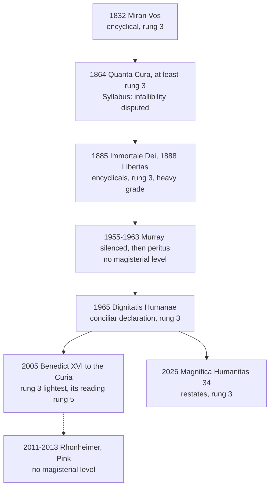

# Catholic Social Teaching · Lesson 5.2: Religious liberty: *Dignitatis Humanae* (1965)

> ⏱ ~15 min · Module 5: The political community, peace and the stranger · Builds on: [3.1](03-01-human-dignity.md), [5.1](05-01-the-political-community-and-the-limits-of-the-state.md), [`fundamental-theology` 5.2](../../fundamental-theology/lessons/05-02-newmans-theory-of-development.md) · Unlocks: [6.4](06-04-three-readings-catholic-liberal-integralist-progressive.md)

## Why this matters

In 1888 Leo XIII called it unlawful to grant unconditional freedom of worship as if it were a natural right. In 1965 an ecumenical council declared that every person has a right to religious freedom. One blogger concludes that Vatican II made the Church liberal; another, that it changed nothing. Both are wrong, and how they are wrong is this course's discipline in miniature: what is taught, what is left untouched, and at what weight.

## The idea

Separate two questions. Is this religion true, and what do I owe it? And: may anyone force me to act against my religious convictions, or stop me acting on them? [*Dignitatis Humanae*](../reference.md#dignitatis-humanae) answers the second: no human power may coerce, within the limits of public order. It does not answer the first by calling all religions equal. Its opening section says the opposite.

A patient's right to refuse surgery is not a judgment that refusing is wise. His doctor may call it foolish, with all the force of the truth; no one may strap him to the table. So with [religious liberty](../reference.md#religious-liberty): an immunity owed to persons for what they are, held even by those who use it badly. Faith as a free assent is [`fundamental-theology` 2.1](../../fundamental-theology/lessons/02-01-the-act-of-faith.md)'s, and [the dignity](../reference.md#human-dignity) beneath the right is [3.1](03-01-human-dignity.md)'s.

## Source

Leo XIII, *Libertas* (20 June 1888), §42, in *The Great Encyclical Letters of Pope Leo XIII* (Benziger, New York, 1903), p. 161:

> "From what has been said, it follows that it is quite unlawful to demand, to defend, or to grant unconditional freedom of thought, of speech, of writing, or of worship, as if these were so many rights given by nature to man. For if nature had really granted them, it would be lawful to refuse obedience to God, and there would be no restraint on human liberty. It likewise follows that freedom in these things may be tolerated wherever there is just cause; but only with such moderation as will prevent its degenerating into license and excess. And where such liberties are in use, men should employ them in doing good, and should estimate them as the Church does; for liberty is to be regarded as legitimate in so far only as it affords greater facility for doing good, but no farther."

Two moves. Leo denies freedom that is *unconditional* and held *as if* a natural right, because such a right would license refusing obedience to God: he reads the claim as a moral licence to do wrong. He allows toleration "wherever there is just cause" ([toleration for a greater good](../reference.md#toleration-for-a-greater-good); *Libertas* 33–34). Continuity readings lean on "unconditional" and "as if"; reversal readings, on "tolerated".

## The teaching

*Dignitatis Humanae* (Vatican II, promulgated 7 December 1965), paraphrased:

**T1. The right.** Every person has a right to immunity from coercion by individuals, groups or any human power, so that no one is forced to act against his beliefs or restrained from acting on them, privately or publicly, alone or with others, within due limits. It is to become a civil right (DH 2). Communities and parents share it (DH 4–5). *In words:* no one may be forced in religion, at home or in public.

**T2. The ground.** The person's dignity, known by revelation and by reason. Persons are bound to seek the truth, above all about God, and can do so as persons only when free from coercion; so the right lies in their nature, not their dispositions, and persists in those who do not seek (DH 2–3). Government exceeds its competence if it commands or forbids religious acts (DH 3). The act of faith is free by nature, so no one may be forced to embrace the faith (DH 10). *In words:* the duty to seek truth is the reason for the freedom, not its rival.

**T3. The object, and the clause.** The Council professes that the one true religion subsists in the Catholic Church. Religious freedom concerns immunity in civil society, so it **leaves untouched** the traditional doctrine on the moral [duty of persons and societies toward the true religion](../reference.md#duty-of-societies-toward-the-true-religion) (DH 1; restated in CCC 2105). It is no right to error (CCC 2108, citing *Libertas*). *In words:* a civil immunity, not a theory that all creeds are equal.

**T4. The limit.** [Just public order](../reference.md#just-public-order): juridical norms conforming to the objective moral order, for the rights of all, genuine public peace and public morality; beyond it, freedom is curtailed only as far as necessary (DH 7). Political prudence fixes the limits for each situation (CCC 2109). *In words:* the state may stop harm, not error.

**T5. The state's posture.** Government should favour religious life (DH 3, 6). If a constitution gives one community special recognition, everyone's religious freedom must be effective (DH 6). *[Magnifica Humanitas](../reference.md#magnifica-humanitas)* 34 (2026) restates the right, exercised "privately and publicly". *In words:* favour is permitted; coercion is not.

**The background, stated flatly.** Gregory XVI (*Mirari Vos*, 15 August 1832) condemned as madness the claim that liberty of conscience must be secured for everyone. Pius IX's *Quanta Cura* (8 December 1864, §3) condemned the opinion that liberty of conscience and worship is each person's right, to be proclaimed in law and restrained by no authority, and the Syllabus condemned propositions 15 and 77–79 ([*Quanta Cura* and the Syllabus](../reference.md#quanta-cura-and-the-syllabus); close-read in [`church-history` 9.2](../../church-history/lessons/09-02-the-second-vatican-council.md)). Leo XIII taught that the state owes God the public profession of religion and may not treat all religions alike (*Immortale Dei* 6; *Libertas* 21), though rulers may tolerate other worship for a great good (*Immortale Dei* 36). [Thesis and hypothesis](../reference.md#thesis-and-hypothesis) set the [confessional state](../reference.md#confessional-state) as ideal against concessions to fact; the distinction entered theology in *La Civiltà Cattolica* (1863), and Dupanloup applied it to the Syllabus (1865). On any reading these texts are hard to square with DH 2.

**The debate.** John Courtney Murray, an American Jesuit (silenced by his superiors in 1955; *We Hold These Truths*, 1960; peritus from 1963), shaped the text, which passed 2,308 to 70 (`church-history` 9.2). For Murray, DH teaches a juridical principle, government's incompetence in religion, and Leo answered conditions now gone. Benedict XVI (to the Curia, 22 December 2005) proposed a [hermeneutic of reform](../reference.md#hermeneutic-of-reform): continuity of principle, discontinuity in contingent applications, religious freedom his example, a reading Martin Rhonheimer developed (*Nova et Vetera*, 2011). Thomas Pink (*Nova et Vetera*, 2013) reads DH as addressing the state's coercive authority as a civil authority, not the Church's over the baptized (Trent, session VII, on baptism, can. 14), which states once exercised for her; DH 1's clause then means what it says. Which reading fits is Boss 5's question; development or reversal is [`fundamental-theology`](../../fundamental-theology/syllabus.md) Boss 5's.

**Mark the levels.** ([the ladder](../../fundamental-theology/lessons/04-04-the-ladder-of-doctrinal-authority.md); [levels of authority](../reference.md#levels-of-authority).) DH's core (T1–T2) is a conciliar declaration ("This Vatican Council declares", DH 2): **rung 3**. Some theologians read its core as definitive; that is not manifest, so default down (can. 749 §3). Genre did not cap its weight ([`fundamental-theology` 4.5](../../fundamental-theology/lessons/04-05-reading-a-documents-weight.md)). No coercion into faith (DH 10): **at least rung 3**; its defined neighbour is narrower (*Dei Filius*, 1870: faith's assent is not necessitated by rational argument, **rung 1**). The duty of societies (T3): **at least rung 3**, affirmed; that a moral limit exists (T4): **rung 3**. The nineteenth-century encyclicals: **rung 3 at their date, at a heavy grade**, none manifestly a definition. *Quanta Cura* is a disputed candidate *ex cathedra* act, in which Newman heard "that infallible teaching voice" (*Letter to the Duke of Norfolk*, 1875, §8): at least rung 3, not manifestly defined. The Syllabus, which Newman said "has no dogmatic force" (§7), was disputed; each proposition keeps its source's weight. Thesis and hypothesis, Murray, Pink, Rhonheimer: **no magisterial level**. Benedict's address: **rung 3 at its lightest**; its reading of DH is one side, not a settlement. Development or reversal: **rung 5**.

**Principle or application.** [Principles](../reference.md#principle-and-application), owed religious submission of mind and will: T1–T3, and that a moral limit exists. [Applications](../reference.md#prudential-judgment): where public order falls in a given case is left to political prudence (CCC 2109), with no magisterial level; DH 6's conditional permission of recognition and DH 15's urgency judgment, the Council's applications, are owed serious consideration. [Empirical premises](../reference.md#empirical-premise): DH 15's report that most constitutions declare the right; Syllabus 79's 1864 assumption about what liberty of worship does to morals. [The two symmetrical errors](../reference.md#the-two-symmetrical-errors): "DH requires a secular state" inflates a permission into a mandate; "religious liberty is a truce" demotes a principle.

**Where it stops.** DH gives a right, a ground, a limit and a criterion, not case-by-case lines or a constitutional model ([the doctrine's disclaimers](../reference.md#the-doctrines-disclaimers)): an established church with freedom for all and strict separation both fit. What DH 1's duty requires of a state now is rung 5, and [6.4](06-04-three-readings-catholic-liberal-integralist-progressive.md)'s question. US doctrine is compared, never merged: the First Amendment limits government and forbids an establishment, which DH 6 permits ([`constitutional-law`](../../constitutional-law/syllabus.md) Module 7).

## The timeline

Each arrow is a date, not a verdict: whether 1888 to 1965 is growth or a turn stays at rung 5.

## Worked examples

**Example 1 (clean): the Fellowship of the Still Pool.** An invented sect in the invented city of Velsk meets illness with prayer alone. Parents stop their diabetic nine-year-old's insulin, and the city obtains a court order for treatment. A councillor also moves to close the sect's meeting hall "to stop this cult".

Run DH 7. The child's life is another's right, the first element of public order, so the order is within the limit; parents' rights over religious education (DH 5) never covered endangering a child. The closure is outside it: the hall harms no one, DH 4 protects worship and buildings, and curtailment goes only as far as necessary. The doctrine **requires** treatment, **permits** the order and **forbids** closing the hall. How to supervise the family is the judge's prudence.

**Example 2 (strain): Monteral.** The invented Republic of Monteral's constitution names the Catholic Church the religion of the state. Evangelicals worship in the open air and in a converted cinema. A bill would forbid public worship by any other religion, to protect "the Catholic unity of the nation".

DH: recognition is permitted only if everyone's religious freedom is effective (DH 6); public worship and buildings belong to the right (DH 2, 4); religious unity is not public order unless peace or others' rights are at stake (DH 7). So the ban falls outside the declaration. What DH 1 leaves untouched: Monteral may keep its establishment and favour religious life (DH 3, 6). Why it is hard: Syllabus 78 condemned praise of laws granting immigrants public worship in Catholic countries, so the bill sits near what 1864 approved, and those who hold the confessional state as "thesis" will ask what the duty means if it may never touch worship (rung 5; Boss 5, 6.4). Where it stops: Monteral may regulate the time and place of all services equally, by its legislators' and courts' judgment.

## Watch out

- **You might think DH gives all religions equal rights to the truth, but** the right is an immunity of persons: DH 1 professes the one true religion, and CCC 2108 denies any right to error (a document misread).
- **You might think religious liberty a truce, the "hypothesis" to drop when Catholics are a majority, but** DH 2 grounds it in nature and has it persist in those who do not seek the truth: a rung-3 principle (a principle demoted).
- **You might think "DH defined religious liberty", or that *Quanta Cura* was plainly not *ex cathedra*, but** DH is rung 3 and QC a disputed candidate that Newman held infallible. Can. 749 §3 forbids presuming a definition, and "not manifest" is not "plainly not" (a level misstated).

## One-liner

> *Dignitatis Humanae* teaches, at rung 3, every person's natural immunity from coercion in religion within just public order, leaving the duty toward the true religion untouched; whether it develops or reverses Leo XIII is freely disputed.

## Problems

**P1 (🟢)** *(Exegetical)* Apply to a hard case. Four invented cases. For each, say whether the state's action falls within DH 7's limit or violates the right, and name the section that decides. **One line each.**

(i) The invented city of Velsk requires a permit for any outdoor gathering over 500 people, concerts, rallies and processions alike, and routes a night procession away from the children's hospital.

(ii) In an invented country, a ministry refuses to register a new religious community because its officials judge the community's doctrine of God incoherent.

(iii) A preacher persuades elderly members with dementia to sign over their savings in return for promised healing; prosecutors charge him with fraud.

(iv) An invented country's law requires every bishop, imam or rabbi appointed there to be approved in advance by the Interior Ministry.

**P2 (🟡)** *(Apologetic: (a) Exegetical, graded first · (b) reply)* Steelman and reply.

(a) State how John Rawls grounds religious liberty in political liberalism, as he states it: the problem it answers, the kind of justification it gives, and what that justification declines to claim. Paraphrase, drawing on [`political-philosophy` 4.1](../../political-philosophy/lessons/04-01-political-liberalism.md) and [4.2](../../political-philosophy/lessons/04-02-public-reason-and-religious-argument.md). **100 words or fewer.**

(b) Reply from *Dignitatis Humanae*'s grounding (DH 2–3, 9–10), opening with one named concession. A reply that concludes Rawls's grounding is the better one for a pluralist state passes, if it is a good reply. **150 words or fewer.**

**P3 (🔴)** *(Exegetical)* Diagnose. Two blog posts, both **invented**, written for this problem, and not the words of any real person.

> (i) From the invented *Throne and Altar Review*, a blog of political [integralism](../reference.md#integralism) (not the anti-modernist "integralism" of [`church-history` 8.3](../../church-history/lessons/08-03-leo-xiii-and-the-modernist-crisis.md)): "DH abolished nothing, because it never applied to confessional states: it addresses secular democracies. And DH 6 proves the Council still taught the confessional state as the thesis every Catholic must work toward."

> (ii) From the invented *Wide Tent Catholic*: "DH teaches that all religions have equal rights to the truth, so the old talk of a duty toward the true religion was quietly dropped. DH 15 even shows that religious freedom is already a civil right in most constitutions, and Catholics are bound to believe that."

Name **two** errors in each post. For each, give the section that corrects it and the kind of error (an application inflated, a principle demoted, a level misstated, a document misread). Where a post misstates what kind of claim something is, give its correct status (principle, application or empirical premise) and its level. **150 words or fewer.**

Solutions

**P1** *(Exegetical)*

**Must hit, strict:**

- (i) **Within the limit.** Equal, non-partisan regulation of time and place for public peace and others' rights (the patients), curtailing nothing beyond what is necessary (DH 7).
- (ii) **Violates.** Judging a doctrine's truth is beyond government's competence (DH 3), the community has the right to exist and worship (DH 4), and incoherence is no public-order ground; the refusal is arbitrary and partisan (DH 7).
- (iii) **Within the limit.** Fraud injures others' rights, and DH 4 itself calls dishonourable persuasion, especially of the poor or uneducated, an abuse of the right; society may defend itself against abuses under religion's pretext (DH 7).
- (iv) **Violates.** DH 4 names the selection and appointment of a community's own ministers as free from government hindrance, and no public-order need is shown (DH 7).

**Wrong turns:** calling any permit a violation (DH 7 itself expects regulatory norms). In (ii), saying the state may refuse because DH 1 professes one true religion: the truth is the Church's to teach, not a ministry's to enforce. In (iii), treating fraud as shielded because the promise was religious. In (iv), citing DH 6: recognition never licenses control, and a concordat in which a church freely agrees to notify a government is a different case, resting on the church's own consent.

**Model answer:** (i) Within DH 7: equal, necessary regulation for public peace. (ii) Violates DH 3–4: government may not judge religious truth, and no public-order ground exists. (iii) Within DH 7, with DH 4: fraud on the vulnerable is an abuse of the right. (iv) Violates DH 4: appointing ministers belongs to the community.

---

**P2** *(Apologetic: (a) Exegetical, graded first · (b) reply)*

**Accept:** any wording of (a) that has the three elements below, with or without *A Theory of Justice*'s argument that parties behind the veil of ignorance would not gamble their liberty of conscience. Any reply in (b) that meets the must-hits, whatever its verdict.

**Must hit, strict (a), graded first:**

- **The problem:** reasonable pluralism. Under free institutions, people reasoning in good faith come to hold incompatible religious and moral doctrines, and the burdens of judgment explain why; keeping one doctrine dominant would take state oppression.
- **The justification:** political and freestanding. Coercive power over constitutional essentials, liberty of conscience among them, is legitimate only on terms all citizens, as free and equal, can reasonably be expected to endorse (the liberal principle of legitimacy), argued in public reason rather than from any comprehensive doctrine.
- **What it declines:** any claim that a religion is true or false, and scepticism too. It hopes for an overlapping consensus, in which each reasonable doctrine endorses the liberty from within, and not a mere modus vivendi.

**Must hit (b):**

- One concession, named and precise: for example, that the state is no judge of religious truth (DH 3 agrees), that enforced religious unity has needed oppression (DH 12 admits conduct contrary to the Gospel), or that Rawls too limits liberty of conscience by public order and security (*A Theory of Justice* §34).
- DH's ground stated accurately: the person's nature and duty to seek the truth, which can be met only free of coercion (DH 2–3), and the free act of faith (DH 10). So the right holds even for those who do not seek (DH 2), and it does not depend on what citizens can be brought to accept.
- At least one place where the grounds part: DH measures public order by the objective moral order (DH 7; CCC 2109 rejects a positivist public order), which political liberalism declines to affirm as true; or DH lets government favour religion and recognize one community (DH 3, 6), against Rawls's neutrality of aim.
- Credit for the bridge: DH is the kind of endorsement from inside that an overlapping consensus needs, which answers, for Catholics, the modus vivendi worry in `political-philosophy` 4.1's Example 2.

**Wrong turns:** the caricature, that Rawls thinks religion false or irrational, or wants it out of public life. Grounding Rawls in relativism or scepticism, which he denies (`political-philosophy` 4.1's reply to Raz). Treating public reason as a speech law: it is a moral duty of civility in the public political forum (`political-philosophy` 4.2). In (b), replying as though DH rested on indifferentism, or answering Rawls by authority alone, or citing the Syllabus as the Catholic answer.

**Model answer (a):** Rawls starts from reasonable pluralism: under free institutions, people reasoning in good faith hold incompatible religious and moral doctrines, as the burdens of judgment explain; only oppression could restore unity. So coercion over constitutional essentials, liberty of conscience among them, is legitimate only on terms all citizens, as free and equal, can reasonably be expected to accept, argued in public reason, not from any comprehensive doctrine. This freestanding political conception claims no religion true or false, and no scepticism; it hopes each reasonable doctrine will endorse it from within, an overlapping consensus rather than a truce.

**Model answer (b), one of several:** Concession: Rawls is right that the state is no judge of religious truth; DH 3 says government oversteps if it commands or forbids religious acts, and DH 12 admits ways of acting in the Church's own history hardly in accord with the Gospel. But DH grounds the right deeper. Persons must seek the truth about God and can do so as persons only when free of coercion, so the right lies in their nature and holds even for those who do not seek (DH 2); and the act of faith is free by nature (DH 10). Rawls's justification is relative to what free and equal citizens can accept, so it cannot say why public order should track the objective moral order rather than a political settlement; DH 7 can. And DH supplies what an overlapping consensus needs: an endorsement from inside a comprehensive doctrine, grounded in its truth, not a truce.

---

**P3** *(Exegetical)*

**Must hit, strict (two per post):**

- (i) **"Never applied to confessional states":** a document misread. DH 6 addresses exactly the state that gives one community special civil recognition and requires that everyone's religious freedom be effective there, and DH 2 binds any human power.
- (i) **"DH 6 proves … the thesis every Catholic must work toward":** an application inflated and a level misstated. DH 6 is a conditional permission (application) in a rung-3 document. The duty of societies toward the true religion is affirmed (DH 1, at least rung 3), but that the confessional state is the "thesis" is freely disputed (rung 5), and thesis and hypothesis carry no magisterial level.
- (ii) **"Equal rights to the truth … the duty was dropped":** a document misread and a principle demoted. DH 1 professes the one true religion and leaves the duty of persons and societies toward it untouched; CCC 2105 restates it and CCC 2108 denies any right to error. The duty is a principle, at least rung 3.
- (ii) **"DH 15 … Catholics are bound to believe that":** a level misstated. DH 15's report on constitutions is an empirical premise, no rung; it stands or falls with the facts.

**Wrong turns:** "correcting" (ii) by saying DH forbids states to favour any religion (DH 3, 6 allow favour). Correcting (i) by declaring DH a rupture, or by arguing Pink's or Murray's reading (Boss 5; not asked). Calling DH 6 a mandate to establish a church.

**Model answer:** (i) misreads DH: section 6 addresses precisely states that give one community special recognition and requires effective freedom for all there, and DH 2 binds any human power. It then inflates: DH 6 is a conditional permission, an application, and that the confessional state is the "thesis" is freely disputed (rung 5), though the duty of societies itself is affirmed (DH 1). (ii) misreads DH 1, which professes the one true religion and leaves the duty toward it untouched (CCC 2105); the right is an immunity of persons, not a right to error (CCC 2108). Dropping the duty demotes a principle held at least at rung 3. And DH 15's count of constitutions is an empirical premise with no rung, not an object of belief.

## Flashback

**From Lesson [4.5](04-05-the-new-things-of-our-time-magnifica-humanitas.md) (The new things of our time: *Magnifica Humanitas* (2026)):** *(Exegetical (a) · Evaluative (b).)* A case invented for this problem. Before an election in the invented Republic of Halvia, faked videos of candidates spread on Brightwire, the dominant platform, whose ranking rules are secret. Bill 1 sets up a state agency whose AI deletes any post it rates false. Bill 2 makes platforms publish how they select content, and funds local newsrooms and school courses in checking sources. A deputy says: "*Magnifica Humanitas* teaches that truth is a common good, so Catholics must vote for Bill 1."

(a) Is "truth is a common good" a principle, an application or an empirical premise, and at what level? Does it carry the deputy's conclusion? Cite sections. **Three sentences.**

(b) Should a Catholic deputy vote for Bill 2 as drafted? Any verdict passes if the moves are made. **80 words or fewer.**

Solution

**Must hit, strict (a):**

- That [truth is a common good](../reference.md#truth-as-a-common-good), not the property of the powerful (MH 137), is a **principle**, **rung 3** (an encyclical), owed religious submission.
- It does not carry the conclusion: which law serves it is an **application**, and "Catholics must" claims the Church's authority for one's own (GS 43).
- MH's text weighs against Bill 1: truthful information does not come from centralized or automated control (§132). Its own means are Bill 2's kind (§137).

**Must hit, any verdict (b):**

- Marks Bill 2's measures as **applications** of §137, owed serious and respectful consideration; the drafting is [prudential](../reference.md#prudential-judgment).
- Names the [empirical premise](../reference.md#empirical-premise) the vote turns on (does disclosure curb the harm?), revisable (§98).
- Claims no Church authority (GS 43).

**Wrong turns:** "MH forbids any law on platforms" (overcorrection: §137 asks for norms). "MH requires Bill 2" (inflation). Truth as a common good as Leo's opinion (demotion). "MH condemns Bill 1": it names no law. Giving §132's claim that AI amplifies disinformation a rung.

**Model answer (a):** That truth is a common good, not the property of the powerful (MH 137), is a principle, rung 3, owed religious submission. It does not carry the conclusion: which law serves it is an application, and "Catholics must" claims the Church's authority for one's own (GS 43). MH even weighs against Bill 1, since truthful information does not come from centralized or automated control (§132), and its own means are Bill 2's kind (§137).

**Model answer (b), one of several:** Yes, with a review after the election. Its measures follow MH 137, but they are applications I weigh, not orders. My vote rests on an empirical premise: that published ranking rules let newsrooms catch manipulation; if they yield only paperwork, amend the bill. A deputy who votes no, fearing that state money will tame the newsrooms, also passes; neither may call his vote the Church's.

## Connections

- **Backward:** [3.1](03-01-human-dignity.md) supplies the dignity that DH 2 makes the ground of the right. [5.1](05-01-the-political-community-and-the-limits-of-the-state.md) set the state's authority inside the common good and read *Immortale Dei* on forms of government; this lesson takes up what the state owes religion, the question that encyclical's next sections open, and marks the one zone, religious acts, that authority may not command. [2.4](02-04-gaudium-et-spes-to-justice-in-the-world.md) reads *Gaudium et Spes*, promulgated the same day as DH, and [1.2](01-02-permanent-principles-and-contingent-applications.md) supplies the principle/application sort used on DH 6 and DH 15.
- **Forward:** Boss 5 close-reads *Immortale Dei* 36 against DH and sets Pink's reading against Murray's. [6.4](06-04-three-readings-catholic-liberal-integralist-progressive.md) puts Murray among the Catholic liberals and Pink among the political integralists, and asks what DH 1's clause requires of a state now.
- **Sideways:** Religious liberty meets public reason, the secular rival, in [`political-philosophy` 4.2](../../political-philosophy/lessons/04-02-public-reason-and-religious-argument.md), and modus vivendi against overlapping consensus in [4.1](../../political-philosophy/lessons/04-01-political-liberalism.md), whose Ostmark case asks whether a church's own teaching grounds religious liberty or only tolerates it: DH answers for the Catholic Church. [`political-philosophy` 6.3](../../political-philosophy/lessons/06-03-conscience-and-exemptions.md) treats DH as one position on exemptions, and Locke's toleration is [`history-of-political-thought` 4.2](../../history-of-political-thought/lessons/04-02-locke-limited-government-and-toleration.md). The Free Exercise and Establishment Clauses are [`constitutional-law`](../../constitutional-law/syllabus.md) 7.1–7.4, compared here and never merged. The development question is [`fundamental-theology`](../../fundamental-theology/syllabus.md) Boss 5, run with [5.2](../../fundamental-theology/lessons/05-02-newmans-theory-of-development.md)'s notes; Augustine's case for coercing the Donatists ([`patristics` 4.4](../../patristics/lessons/04-04-augustine-against-the-donatists.md)) is not DH's position, and DH 10's note on the Fathers cites his earlier writings instead; *Exsurge Domine* 33 against DH is [`apologetics-catholic-claims` 7.1](../../apologetics-catholic-claims/lessons/07-01-the-inquisition-and-the-galileo-affair.md); the Council's reception and Lefebvre are [`church-history` 9.3](../../church-history/lessons/09-03-after-the-council.md).
